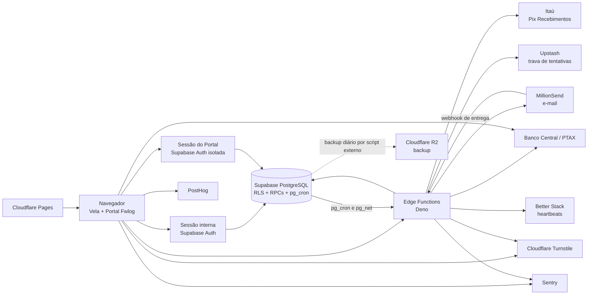
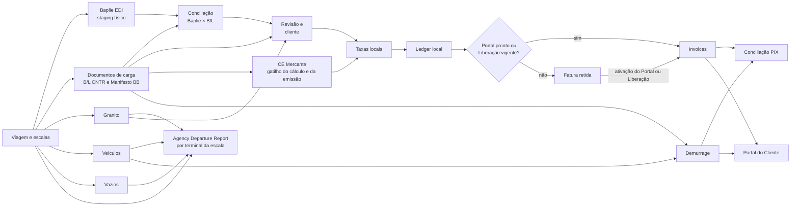

# Arquitetura do Vela e do Portal Fwlog

Revisado em 2026-10-14, na [revisão geral da documentação](archive/plans/2026-10-13-revisao-geral-documentacao.md):
a visão geral, a hospedagem, as integrações, os Comunicados, os alertas, as
fronteiras de autenticação, as camadas, o fluxo operacional e financeiro, o
modelo de dados, a projeção de escalas, a segurança, as Edge Functions e o mapa
de rotas foram reconferidos contra o código e a cadeia ativa de migrations. As
seções "Celular e toque" e "Densidade e primitivas visuais" vêm da verificação
de 2026-09-07 e não foram reconferidas. Estado remoto (publicação de funções,
jobs e segredos) tem registro próprio em
[Serviços externos](operations/servicos-externos.md).

Este é o mapa canônico da arquitetura atual: camadas, integrações, modelo de
dados, fluxo de alto nível e mapa de rotas
([ADR 0082](adr/0082-governanca-documental-dono-unico-e-adr-historica.md)).
Regras de negócio vivem nos módulos listados no [índice documental](README.md)
e, quando atravessam módulos, em [Regras de negócio](operations/regras-de-negocio.md);
termos vivem em [`CONTEXT.md`](../CONTEXT.md); decisões e supersessões, no
[índice de ADRs](./adr/README.md). Aqui uma regra aparece em uma frase, com o
link para o documento dono.

## Visão geral



O frontend entrega duas SPAs estáticas, com entradas e roteadores separados. A
segurança real não depende do roteador: tabelas, views e funções do Supabase
aplicam escopo e autorização por RLS, grants e validações dentro das RPCs.

### Hospedagem e publicação

O Cloudflare Pages hospeda as duas aplicações estáticas produzidas pelo mesmo
build Vite ([ADR 0076](adr/0076-cloudflare-pages-como-hosting.md)):
`vela-internal` publica `index.html` em `https://vela.app.br`, e `vela-portal`
publica `portal.html` em `https://portalfwlog.com.br`. O GitHub Actions publica
`main` nos dois sites, com as credenciais de produção, e as previews de cada PR,
com as credenciais da branch Supabase de Preview. A Pages Function
`functions/assets/[[path]].ts` responde `404` sem cache a asset inexistente. A
Vercel ficou só como rollback manual, sem publicação automática, e o Firebase
não faz mais parte da arquitetura. O Portal continua sendo Fwlog; Vela
identifica somente a superfície interna. Workflows, variáveis e headers estão
em [Deploy](setup/deploy.md); projetos e contas, em
[Serviços externos § Hospedagem do front-end](operations/servicos-externos.md#hospedagem-do-front-end).

Quando a PR recebe a etiqueta `preview`, o workflow confiável
`.github/workflows/provision-preview-admin.yml` aguarda o check da branch
Supabase e provisiona `qa-admin@example.test` pela Auth Admin API da própria
Preview, com perfil interno `administrativo`. A senha existe somente como secret do
GitHub Actions; ela não participa do bundle Vite nem do projeto de produção.

### Inbox de eventos, efeitos pós-commit e cálculo de Demurrage

Três mecanismos server-side tiram do navegador o que precisa sobreviver a
falhas ([ADR 0065](adr/0065-inbox-efeitos-e-autoridade-financeira.md)):

- **Inbox de eventos de e-mail** (migration `022`): o webhook do provedor de e-mail só
  valida e grava o evento em `portal_email_events`; o
  `portal-email-events-runner` resolve a tentativa, aplica as supressões e
  executa os efeitos ([E-mail transacional e Comunicados](#e-mail-transacional-e-comunicados)).
- **Fila de efeitos pós-commit das importações** (`import_pending_effects`,
  migrations `015`, `017`, `025` e `031`): a importação grava o efeito
  (faturamento local, marcações físicas) na mesma transação, e o
  `import-effects-runner` o consome com lease, nova tentativa e bloqueio
  investigável, com alerta persistente (migration `026`). Desde a migration
  `218`, a própria transação dispara o runner, e o job de 1 minuto é a rede de
  segurança.
- **Cálculo autoritativo de Demurrage** (migration `023`): a emissão recebe só a
  identidade dos containers; tarifas, acordos, datas, câmbio e total são
  resolvidos no banco e gravados em `demurrage_calculation_snapshots`
  (append-only). A falha do recálculo PTAX abre um alerta global persistente
  (migration `024`).

O estado de cada job — o `import-effects-runner` ligado em produção desde
2026-10-12 e o `recalc-demurrage-ptax` agendado desde 2026-10-07 — fica em
[Serviços externos § Jobs agendados](operations/servicos-externos.md#jobs-agendados-pg_cron).

### Comunicados ao Cliente e Caixas de Comunicação

Comunicado é o canal de e-mail da Transhipping para os Emails de Contato do
Cliente, separado do e-mail transacional do Portal
([ADR 0058](adr/0058-canal-de-comunicado-ao-cliente.md)). A regra vigente está
em [Clientes § Comunicados ao Cliente](modules/clientes.md#comunicados-ao-cliente);
aqui fica o desenho:

- **Trilha.** `customer_communications`, seus vínculos com B/Ls
  (`customer_communication_bls`), tentativas (`customer_communication_attempts`),
  anexos e as supressões próprias do canal (`customer_communication_suppressions`),
  todas na migration `001`; a trilha nasceu na migration arquivada `372`, sem
  histórico retroativo. As âncoras (viagem, porto, Atracação, invoice) são
  snapshots, sem FK.
- **Caixas de Comunicação** (migration `008`,
  [ADR 0064](adr/0064-caixas-de-comunicacao-e-auditoria-de-contatos.md)):
  `customer_communication_boxes`, o mapa caixa → modelo
  `customer_communication_box_kinds` e os vínculos `customer_contact_box_links`.
  A gravação dos contatos passa por `_apply_customer_contact_configuration`, com
  trava do Cliente, no Vela e no Perfil do Portal, e toda alteração grava
  `customer_contact_change_events` (append-only). Regra em
  [Clientes § Contatos e Caixas de Comunicação](modules/clientes.md#contatos-e-caixas-de-comunicação).
- **Envio.** O Disparo manual de `/clientes/comunicacao` (sessão interna) e a
  régua automática (segredo de automação) saem pela Edge Function
  `send-customer-communication`. Ela reconfere no servidor o Cliente, os B/Ls e
  as âncoras, a natureza do modelo e cada destinatário por
  `customer_communication_recipient_allowed` — contato ativo, vínculo à caixa
  exigida pelo modelo e supressões —, grava o Comunicado e a tentativa
  atomicamente e envia ou registra a simulação.
- **Automação.** O `customer-communication-auto-runner` avalia NOA, NOR, NOB e
  CE e Taxas com claims recuperáveis (`customer_communication_automation_claims`);
  recusa definitiva do envio rejeita a claim por 24 horas em vez de liberá-la
  (migration `297`);
  a condição do CE e Taxas é a
  [Prontidão de Comunicação de Taxas](modules/clientes.md#prontidão-de-comunicação-de-taxas)
  (`customer_local_charges_communication_readiness`).
- **Régua de Cobrança.** A Cobrança de Demurrage (`cobranca_demurrage`) é
  produzida e enviada pela Edge Function `demurrage-dunning`, em job horário,
  com o mesmo helper de e-mail e a mesma trilha. Cadência, pausas (inclusive a
  Invoice suspensa por datas alteradas, `dunning_suspended_reason`, migration
  `179`) e conteúdo são regra de
  [Demurrage § Régua de Cobrança](modules/demurrage.md#régua-de-cobrança).
- **Chave global.** `app_settings.communications_enabled`, alterada só pela RPC
  `set_communications_enabled(boolean)`, que exige o Administrativo e grava em
  `audit_logs`. O que ela silencia está em
  [Regras de negócio § Chave de envio e supressão de e-mail](operations/regras-de-negocio.md#chave-de-envio-e-supressão-de-e-mail).

A linha singleton `id=1` de `app_settings` é obrigatória para as leituras da
aplicação. Ela foi restaurada pelas migrations `044`, `104` e `155` (as duas
últimas porque sumiu de produção por ação externa) e, desde a migration `156`,
o banco recusa apagá-la, inclusive em cascata, salvo desabilitar o gatilho de
propósito.

### Alertas e notificações internas

Alertas internos têm um agregado por entidade em `alerts` e uma projeção de
pendências em `alert_items`, um item por tipo e setor. O catálogo
`alert_type_catalog` declara gravidade, setor, audiência, destino e se o tipo
está ativo; `alert_item_events` e `alert_item_dismissals` guardam o histórico.
`internal_notifications` é o fan-out por usuário e evento
(`fanout_alert_item_for_department`), com RLS que limita a leitura ao
destinatário e só permite marcar `read_at`; a entrega que não encontra
destinatário fica em `alert_notification_failures`. A fila `/alertas` lê
`list_alert_queue_page`, de 100 em 100, inclusive as linhas legadas de `alerts`
sem item; a fila e o sino resolvem o rótulo da
entidade numa consulta em lote separada (`fetchAlertEntityLabels`) e caem no id
quando a tradução não volta. Ciclo de vida, dispensa, audiência e fallback
crítico ao Administrativo são regra de
[Operação e suporte § Alertas e Notificações Internas](modules/operacao-suporte.md#alertas-e-notificações-internas).

Os produtores rodam no banco. Gatilhos em audit logs, no estado terminalizado
da escala e nas origens da divergência Baplie/B/L (`baplie_containers`,
`bl_containers`, statement-level; definição vigente na migration `002`)
reconciliam a origem na hora. O detector periódico é a Edge Function
`alerts-detector`, protegida por `ALERTS_DETECTOR_SECRET` e disparada pelo
`pg_cron` a cada 15 minutos por
`ops.dispatch_edge_job('alerts-detector', 'ALERTS_DETECTOR_SECRET')`, que lê a
base da API e o segredo do Supabase Vault; o comando agendado cita nomes, nunca
valores ([ADR 0063](adr/0063-configuracao-de-jobs-cron-no-vault.md)). Ela roda
`run_alert_detectors` e remove anexos órfãos de Disputa. Sem o segredo no
Vault, o job continua visível e inerte, registrando `WARNING` a cada execução
([segredos e cron](operations/segredos-cron.md)).

O navegador não executa detectores, e as notificações só nascem no banco. O
destino de cada item é derivado no frontend por `alertEntityLink`, e a
identidade pública de terminal é `voyage::porto::depots.code` (o UUID fica só
no metadata). Os dois alertas de faturamento que o navegador abre e fecha por
RPC estão em
[Operação e suporte § Notas e divergências](modules/operacao-suporte.md#notas-e-divergências)
(o fechamento recomputa a origem no servidor desde a migration `238`).

## Fronteiras de autenticação

O projeto cria dois clientes em `src/services/supabase.ts`:

- `supabase`: sessão dos usuários internos;
- `supabasePortal`: sessão do cliente, com `storageKey` próprio.

As duas sessões podem coexistir no navegador sem que um logout derrube a outra.

### Acesso interno

O usuário autentica pelo Supabase Auth e precisa de perfil ativo em
`user_profiles`. A interface usa o perfil para navegação e UX; RLS e RPCs
continuam responsáveis pela autorização.

Em Preview, o usuário fixo de teste é criado ou reparado automaticamente pelo
workflow de provisionamento após a branch Supabase estar saudável. Isso é um
procedimento de ambiente, não um usuário ou uma migration de produção.

### Portal do Cliente

O Portal usa exclusivamente sessão do Supabase Auth. O login visível aceita
somente CNPJ e senha; a Edge Function `portal-login` resolve a identidade
técnica no servidor e devolve apenas a sessão. `portal_resolve_login(text)` não
é executável por `anon`/`authenticated`.

A [ADR 0013](./adr/0013-portal-auth-identificador-resolvido-e-excecao-anon.md)
tratou essa resolução como exceção pré-autenticação para `anon`, limitada por
tentativas e erro genérico. **Essa exceção não existe mais:** a migration
arquivada `182` revogou `anon` de `portal_resolve_login(text)` quando o login
passou a ser resolvido pela Edge Function com `service_role`, e a
[ADR 0047](adr/0047-grants-de-funcao-fechados-por-padrao.md) (migration
arquivada `297`) encerrou formalmente a exceção. O wrapper `portalResolveLogin`
em `src/services/portalBilling.ts` é código morto, sem chamador de produção. RPCs
de dados do Portal exigem sessão autenticada e resolvem o cliente por
`auth.uid()`.

O cliente do Portal recebe o **mesmo role `authenticated`** do usuário interno.
O role, portanto, não separa os dois: quem separa é o perfil. `user_profiles`
identifica o usuário interno (`is_active_read_user()`, `is_admin()`,
`_portal_actor_role()`) e `customer_portal_accounts` identifica o cliente
(`current_portal_customer_id()`); uma conta de Portal nunca satisfaz a primeira
condição. Daí a regra: nenhuma policy ou função pode autorizar por "estar
autenticado". Policy de leitura com `USING (true)` e função `SECURITY DEFINER`
sem guarda explícita são vazamentos para o Portal — foi essa a causa das
migrations arquivadas `192` e `257`.

O `PortalAuthProvider` também assina `supabasePortal.auth.onAuthStateChange`.
Eventos `SIGNED_OUT` limpam o overview local e removem todos os caches TanStack
Query com chave iniciada por `portal-`, cobrindo logout em outra aba e falha de
refresh de token. Eventos `SIGNED_IN` e `TOKEN_REFRESHED` reidratam o overview
quando necessário, sem compartilhar estado com a sessão interna.

O provisionamento operacional mantém decisão e situação da conta em eixos
separados em `customer_portal_accounts`. Convites, tentativas/eventos de email,
supressões e histórico append-only vivem respectivamente em
`portal_invites`, `portal_email_attempts`, `portal_email_events`,
`portal_suppressed_emails` e `portal_provisioning_events`. O registro de Portal
nasce no cadastro do Cliente (gatilho `trg_portal_create_account_on_customer_insert`)
e a leitura do console repara contas ausentes (`portal_repair_missing_accounts`).
RPCs internos autorizam as transições e a expiração idempotente; nenhum token
ou senha em claro é persistido. O backfill inicial e seu pré-voo foram uma
operação única de implantação, cujas RPCs saíram do catálogo (migration
arquivada `203`).

## Camadas do frontend

```text
src/AppInterno.tsx + src/AppPortal.tsx
  -> páginas lazy em src/pages/ (com compartilhamento neutro entre builds)
     -> hooks de estado remoto e mutations em src/hooks/
     -> serviços, parsers e regras em src/services/
     -> componentes compartilhados em src/components/
```

Essa separação é uma direção arquitetural, não uma afirmação de pureza absoluta
do código legado. Páginas ainda executam alguns comandos de serviço e operações
de importação/exportação diretamente. Novas mudanças devem reutilizar o menor
dono existente da operação, sem criar uma segunda implementação.

As páginas são carregadas sob demanda (`React.lazy`) e bibliotecas pesadas como
`@e965/xlsx` entram por `await import(...)`, fora do grafo estático da rota. Cada
rota tem um orçamento de **50 ms** de parse/compile de JS, verificável por
`scripts/perf/measure-page-load.mjs` — ver [setup/testing.md](./setup/testing.md#orçamento-de-carga-das-rotas-performance).

### Responsabilidades

- `src/pages/`: composição de rotas, estado visual e fluxos de tela;
- `src/hooks/`: queries e mutations reutilizáveis com TanStack Query;
- `src/services/`: acesso ao Supabase, parsers, importadores e domínio;
- `src/services/queryKeys.ts`: famílias de chave do TanStack Query, reutilizadas por hooks e invalidações;
- `src/services/cacheEffects.ts`: efeitos `after*` por evento de domínio — viagem, escala, rota, Baplie, B/L, manifesto, carga, datas de container, faturamento, Liberação de faturamento sem Portal, Comunicados, Desbloqueio de CE, Demurrage e PIX, entre outros; a lista vigente é o próprio arquivo. O adapter histórico de Baplie encaminha para esse owner. Importações, edições e exclusões atualizam listas, cards, fichas e consumidores derivados, incluindo Revisão, Taxas Locais, ADR e Relatórios. Consultas ativas são refeitas e consultas desmontadas ficam obsoletas para a próxima abertura. O efeito é aguardado pelo fluxo de gravação; não há sincronização entre usuários neste mecanismo;
- `src/services/importCore.ts`: leitor único de planilhas por `readSheet` (célula tipada, linhas/abas ocultas ignoradas com aviso, cabeçalho repetido renomeado com sufixo e bloqueio só quando duas colunas casam o mesmo campo do importador) e casamento de cabeçalhos por `HeaderSpec`/`matchHeaders`; datas de importação pelo parser único `src/lib/importDate.ts`, números por `src/lib/importNumber.ts`. Regra completa em [Regras de negócio § Leitura de planilhas](operations/regras-de-negocio.md#leitura-de-planilhas);
- `src/components/ui/`: primitivas visuais;
- `src/components/shared/`: componentes reutilizados por módulos;
- `src/lib/`: utilitários puros, datas, status, PIX e telemetria;
- `src/lib/errors.ts`: `extractErrorText` e `classifyDbError` (`permissao`, `sessao_expirada`, `conflito`, `limite`, `validacao`, `nao_encontrado`, `desconhecido`); `portalErrorMessage.ts` é seu adapter do Portal;
- `src/types/database.ts`: tipos gerados e complementos tipados do banco.

### Celular e toque

O Vela e o Portal usam o mesmo shell responsivo. No Vela, acima de 1100px, a
pessoa escolhe no menu da conta se o menu fica no topo ou numa lateral fixa,
recolhida ou expansível (`useNavPosition`, guardado no navegador; regras em
[Identidade visual § Menu do Vela](identidade-visual.md#menu-do-vela)). Abaixo de 1100px o botão
**Menu** fica no cabeçalho em qualquer posição e abre a navegação por cima da página
(`useMobileNav`, em `src/components/layout/`: trava a rolagem, Escape fecha o
grupo aberto e depois o menu, e o menu fecha sozinho quando a tela passa de
1100px, para não deixar a página travada ao girar o tablet). As regras transversais vivem na seção
"Celular e toque" de `src/index.css`, fora de `@layer`, para vencer as
utilitárias do Tailwind sem `!important`:

- `[role='tablist']` vira uma linha única com rolagem lateral abaixo de 768px;
  `TabButton` traz a aba ativa para a vista (`src/lib/tabStrip.ts`);
- `Modal` vira folha ancorada no rodapé abaixo de 640px; o rodapé fixo
  `.app-modal__actions` acompanha o recuo `--app-modal-pad` do corpo;
- com ponteiro de toque (`pointer: coarse`), campos usam fonte de 16px (evita o
  zoom automático do Safari no iPhone), checkboxes têm 20px e botões só com
  ícone e `aria-label`/`title` têm área mínima de 40px.

### Densidade e primitivas visuais

Os tokens `--app-*` de `src/index.css` têm dois blocos (atual e claro) e
são a única fonte de cor, escala tipográfica (`--app-size-*`, de 12 a 32px),
raio (`--app-radius` 8px, `--app-radius-control` 6px) e densidade. A cor de
estado usa os aliases `--app-{success,warning,danger,info,neutral}-{fg,bg,border}`,
conferidos por `npm run a11y:contrast` nos dois temas. O shell interno tem a
classe `app-shell--vela`, que com ponteiro fino aplica a densidade compacta
(controle de 36px, linha de 40px); o toque e o shell do Portal
(`app-shell--portal`, inclusive no Modo Inspeção) mantêm 44px e 52px. As
células de `.app-table` usam essa densidade em `@layer components`, então o
padding utilitário que uma tela declara continua valendo até a tela migrar.

Primitivas de `src/components/ui/`: `Button` (`loading` desativa, anuncia
`aria-busy` e mantém a largura; `loadingLabel` dá o texto da ação), `Modal`
(`size` `sm`/`md`/`lg`; foco inicial no primeiro campo ou no título),
`Drawer`, `TabList` + `TabButton` (aba sublinhada, setas, Home e End, contagem
opcional), `SegmentedControl` (duas a quatro opções exclusivas),
`SummaryStrip` (faixa de resumo de uma linha), `StepRail` (trilho de etapas),
`MetricCard` (com `onSelect`, aplica o filtro do card) e
`TableFooterPagination`, cujo texto vem de `describePageRange`
(`src/lib/pagination.ts`). As peças da identidade visual (`Block`,
`LeadValue`, `FactList`, `IdentityBand`, `NextAction`, `NoValue`) e as nove
regras que toda tela segue estão na [identidade visual](identidade-visual.md)
([ADR 0081](adr/0081-identidade-visual-unica.md)).

Tela nova: componha as peças da identidade visual, use `TabList`/`TabButton`,
`Modal` ou `Drawer` e as classes do design system em vez de overlays próprios,
sem CSS próprio de página (`npm run design:check`); grades com três ou mais colunas devem
começar em uma coluna (`grid sm:grid-cols-3`), e tabelas largas ficam dentro de
`.app-table-scroll`.

### Como rastrear uma interação

Use [`docs/RASTREABILIDADE.md`](./RASTREABILIDADE.md) para partir de uma rota ou
ação e localizar o componente, hook/serviço, contrato Supabase, efeitos de cache,
testes e evidência de runtime. A explicação completa permanece no documento vivo
do módulo proprietário.

## Fluxo operacional e financeiro



### Importações

- Baplie entra em staging por viagem e pode alimentar Vazios de Importação.
- O B/L é a entidade unificada de conhecimento de embarque (`cargo_mode IN ('container', 'carga_solta', 'misto')`), acessado pela rota canônica `/bls` (substituindo em definitivo as antigas telas e rotas separadas `/manifestos` e `/carga-solta`). B/Ls com presença simultânea de contêineres e carga solta assumem automaticamente o modo `misto` via trigger no banco (`trg_sync_bl_cargo_mode_statement`, migration `060`).
- Peso e cubagem do B/L são colunas disjuntas por modalidade (`total_weight_kg`/`bb_weight_ton` e `total_cbm`/`bb_cbm`; migrations `061`, `063` e `064`), somadas por `blTotalWeightKg`/`blTotalCbm` (`src/lib/cargoMode.ts`). Regra em [Manifestos & EDI § Modalidade, peso e cubagem do B/L](modules/manifesto-edi.md#modalidade-peso-e-cubagem-do-bl).
- Arquivos de B/L alimentam os B/Ls e cargas de container; Manifestos BB mantêm seu fluxo próprio. A importação de Manifesto CNTR e a geração local de EDI Mercante foram removidas conforme a ADR 0025.
- Carga solta tem duas portas de ingestão que convivem: o Manifesto BB (planilha) e o B/L avulso do armador em `.pdf`/`.docx`. As duas terminam na mesma RPC transacional (`import_breakbulk_manifest_transactional`); o B/L avulso é lido no cliente (`blDocumentParser.ts`) e convertido em um manifesto de uma linha.
- O Nº de Manifesto Mercante vive em `manifestos_mercante` (número único, Viagem, par de portos e `natureza` = `carga` ou `vazio`), com vários manifestos por rota; cada B/L aponta para o seu por `bls.manifesto_mercante_id`, e `voyage_route_ce_master` continua como espelho do **Informar** (Nº de Manifesto Mercante) da rota para os leitores antigos — a nomenclatura "CE Master" sobrevive só nesses identificadores. Desde a migration `212` a API só lê o cadastro. Regra em [Manifestos & EDI § Manifesto Mercante](modules/manifesto-edi.md#manifesto-mercante); o efeito do COD sobre o CE e o vínculo do Manifesto está em [Viagens § Omissão de Escala, Transbordo e COD](modules/viagens.md#omissão-de-escala-transbordo-e-cod).
- Terminal do B/L: `bls.terminal_id` é a exceção auditada; nulo herda de `voyage_escala_operation_fronts` via `resolve_bl_terminal_id`. B/L misto exige convergência das duas frentes ou exceção válida. Terminal não participa da chave tarifária (ADR 0068).
- Granito mantém tabelas próprias, integradas downstream.
- Veículos são importados por planilha e vinculados a B/L/container.
- CE Mercante e datas operacionais têm importadores específicos.
- Arquivos de planilha usam `@e965/xlsx` e devem passar pelo limite de upload antes do parsing. B/L em PDF usa `pdfjs-dist` (import dinâmico, chunk próprio) e B/L em `.docx` é descompactado por `src/lib/zipEntry.ts`, sem dependência de zip no bundle.

### Revisão e auto-faturamento

A Revisão resolve as pendências que impedem a emissão. O banco as calcula por
estado real em `_compute_bl_review_pendencies` (última definição na migration
`085`): Cliente não vinculado, acesso ao Portal não provisionado e peso da carga
solta ausente; e-mail de contato não é pendência nem condição de faturamento
desde a `085`. `save_bl_review` calcula o status no servidor e protege a
identidade do ator e a concorrência, e gatilhos de Portal, contatos e Liberação
reavaliam a Revisão no próprio banco
([Operação e suporte § Gate canônico de revisão](modules/operacao-suporte.md#gate-canônico-de-revisão)).

A gravação do CE Mercante é o gatilho do cálculo e da emissão das Taxas Locais.
O Portal trava toda emissão — manual, pelo Cliente e automática pelo CE: o gate
único é `customer_billing_access_ready` (Portal pronto ou Liberação de
faturamento sem Portal vigente; migrations `083` e `084`). Sem ele, o CE calcula
e retém a fatura (`held`, com `billing_hold_reason`; última definição de
`_auto_bill_bl_core` na migration `181`), que é emitida na ativação do Portal
ou quando o Administrativo concede a Liberação
([ADR 0070](adr/0070-portal-trava-toda-emissao-e-liberacao-por-cliente.md)).
A regra completa está em
[Regras de negócio § Gate de faturamento](operations/regras-de-negocio.md#gate-de-faturamento)
e em [Faturamento](modules/faturamento.md). A retirada do Portal do gate
(migration arquivada `188`) e a exceção da automação pelo CE (migration `051`)
foram revogadas pela `083`.

### Taxas locais e ledger

Taxas locais geram recebíveis por B/L. `bl_receivables`,
`invoice_receivable_links`, `ledger_settlements` e eventos de ciclo de vida são
a fonte de saldo, reemissão e consolidação; `invoices` continua sendo o
documento emitido
([Regras de negócio § Ledger local e ciclo de vida](operations/regras-de-negocio.md#ledger-local-e-ciclo-de-vida)).
Uma fatura emitida não muda de valor
([ADR 0077](adr/0077-fatura-emitida-nao-muda-de-valor.md)); as estruturas que
sustentam a emissão e o que vem depois dela são:

- `customer_billing_portal_releases`: Liberação de faturamento sem Portal, por Cliente (migration `083`);
- `invoice_corrections` (migration `124`) e `invoice_basis_pending_changes` (migration `130`): correção após emissão quando a base do B/L muda;
- `local_pix_charge_versions` (migration `130`): cada apresentação Pix de uma fatura local, com TXID próprio;
- `invoice_customer_changes` (migration `136`): troca de Cliente da fatura pela regra de CNPJ;
- `invoice_refunds` (restituições) e `financial_payment_attempts` (migration `136`, idempotência do registro de pagamento);
- `invoice_document_snapshots` (migration `183`): documento da fatura congelado na emissão ([ADR 0078](adr/0078-importacoes-e-ce-mercante-regras-de-entrada-e-correcao.md), item 13).

A regra está em [Faturamento § Correção após emissão (ADR 0077)](modules/faturamento.md#correção-após-emissão-adr-0077),
[§ Troca de Cliente após emissão](modules/faturamento.md#troca-de-cliente-após-emissão-regra-de-cnpj)
e [§ Pagamento, saldo e restituição](modules/faturamento.md#pagamento-saldo-e-restituição).

A Fatura Avulsa é uma `invoices` com `invoice_type = 'manual'` (migration `097`;
última definição de `create_manual_invoice` na `125`): grava a fatura e seus
itens em `invoice_items`, sem `invoice_bls`, `invoice_receivable_links`,
`bl_receivables` nem `ledger_settlements`, e o pagamento segue o caminho
genérico de invoice. Regra em
[Faturamento § Propósito e escopo](modules/faturamento.md#propósito-e-escopo) e
[ADR 0075](adr/0075-fatura-avulsa-flexivel.md).

### Demurrage

Demurrage depende de descarga, devolução, free time e tarifa por equipamento e
tem persistência própria
([ADR 0008](adr/0008-demurrage-integrado-sem-unificar-persistencia.md)): datas
em `bl_containers` (o status `overdue` é gravado por job diário, migration
`197`), tarifas em `demurrage_rates`, documentos em `demurrage_invoices` e
`demurrage_invoice_items`, fotos do cálculo em `demurrage_calculation_snapshots`
(migration `023`), Disputas em `demurrage_disputes` e restituições em
`demurrage_refunds` (migration `136`). A cobrança é por caixa dentro do grupo de
Demurrage (migration `214`, [ADR 0080](adr/0080-decisoes-da-revisao-final-da-pr-929.md);
[Demurrage § Grupo de Demurrage e cobrança por caixa](modules/demurrage.md#grupo-de-demurrage-e-cobrança-por-caixa)).
A operação fica em `/demurrage`; Demurrage aparece também na Conciliação PIX
(`/reconciliacao`), no Portal (`/portal/billing`), nas fichas do B/L e do
Cliente e em Relatórios, não em `/taxas-locais`. Regra em
[Demurrage](modules/demurrage.md).

### PIX

`app_settings.pix_provider` escolhe o autor do QR. Com `static`, o BR Code
estático fica na fatura e a baixa vem da conciliação por extrato em
`/reconciliacao`. Com `itau`, os gatilhos de emissão abrem cobranças em
`itau_pix_charges` (migration `151`), a Edge Function `itau-pix` as registra na
API do Itaú e a baixa automática grava em `itau_pix_receipts` (migration `152`);
`business_holidays` sustenta os prazos (migration `153`). Regra em
[Conciliação PIX § Cobrança dinâmica Itaú — migration 151](modules/reconciliacao-pix.md#cobrança-dinâmica-itaú--migration-151)
e [Regras de negócio § Conciliação PIX](operations/regras-de-negocio.md#conciliação-pix).

### Desbloqueio de CE Mercante

O Desbloqueio de CE tem tabelas próprias `ce_unlock_*` (pedidos e seus B/Ls,
documentos, Clientes VIP, entregas físicas, eventos, exportações, situação na
ZPT e fila de avisos), o schema `ce_unlock_private` para helpers e projeções do
Portal, o bucket privado `ce-unlock-documents` e Edge Functions próprias para
upload pelo Portal, download, exportação para a ZPT, expurgo e avisos. O
navegador não acessa as tabelas diretamente: tudo passa por RPCs com escopo no
servidor. A troca com a ZPT é por planilha ([Integrações externas](#integrações-externas)).
Regra em [Desbloqueio de CE](modules/desbloqueio-ce.md); tabelas, migrations e
funções em [§ Estado e dados](modules/desbloqueio-ce.md#estado-e-dados).

### Armazenamento de arquivos

O Supabase Storage tem três buckets privados: `demurrage-disputes` (anexos da
Disputa de Demurrage; o Portal envia pela Edge Function
`portal-dispute-attachment`, e o `alerts-detector` remove anexos órfãos),
`customer-communications` (anexos de Comunicados), ambos criados pela migration
`003`, e `ce-unlock-documents` (documentos do Desbloqueio de CE, migration
`139`).

### Documentos imprimíveis

Invoices são componentes React preparados para impressão. Cabeçalho, título,
cliente e rodapé compartilhados vivem em
`src/components/shared/InvoiceDocumentKit.tsx`; a paleta e os estilos de tabela
(navy `#1A2744` no cabeçalho, zebra clara, barra de total âmbar `#F59E0B`,
faixa clara de agrupamento) vivem em `src/components/shared/invoiceFormat.ts`.
Os estilos são inline porque o detalhe do Vela imprime por
`src/lib/printDocument.ts`, que clona o documento numa janela sem o CSS do app;
Portal, ADR e relatório por Cliente
usam `window.print()` com as regras `@media print` de `src/index.css`, que
deixam no papel só o modal com o documento. As duas folhas são A4 com margem
vertical na página e "Página N de M" no rodapé. A geração do arquivo é feita
pelo diálogo de impressão do navegador. A fatura emitida mostra
o Cliente, a Viagem e o endereço congelados em `invoice_document_snapshots`,
que o detalhe e o Portal sobrepõem aos dados vivos
([Faturamento § Documento da fatura congelado](modules/faturamento.md#documento-da-fatura-congelado-adr-0078-item-13)).

A fatura de taxas locais é o modelo visual dos documentos imprimíveis: a
fatura/recibo de Demurrage e o impresso do Agency Departure Report
(`src/components/voyages/AgencyReportDocument.tsx`) consomem os mesmos tokens —
Arial 13px sobre branco, mesmos cabeçalhos, barras e rodapé. Documento novo
reusa o kit em vez de criar CSS próprio. A identidade visual dos documentos
(barras âmbar, cabeçalho azul-marinho, título centralizado com filete) é
decisão do responsável de 2026-10-13 e não muda sem nova decisão.

## Programação de navios

`/chegadas-saidas` cria ou anexa a própria `voyage` operacional e marca
`voyages.show_on_portal` para publicar a programação no Dashboard do Portal. O
widget não lê mais `vessel_schedules`; ele chama a RPC allowlisted
`portal_ship_schedule`, que projeta viagens ativas e visíveis sobre a constante
única de portos-vitrine. As tabelas legadas `vessel_schedules` e
`ended_vessels` permanecem no histórico de schema, mas não são fonte do fluxo
atual. Regra em [Chegadas e Saídas](modules/chegadas-saidas.md).

A migration arquivada `257` fechou a leitura dessas duas tabelas: eram as
únicas policies de `SELECT` com `USING (true)` do schema e, como o cliente do
Portal autentica no mesmo role `authenticated` do usuário interno, davam a ele
leitura integral — contornando o portão `voyages.show_on_portal`. Hoje a leitura
exige `is_active_read_user()` (definição vigente na migration `002`). O serviço
e o hook que liam `vessel_schedules` pela sessão do Portal eram código morto e
foram removidos na mesma mudança.

## Projeção de escalas

A escala operacional é projetada por `src/services/voyageRouteSchedules.ts` a
partir de três portadores existentes: `voyage_pod_schedule` (audit logs com o
ciclo de chegada da escala), `voyage_pol_schedule` (registro documental do POL,
incluindo ETD/ATD do Laden on Board) e `voyage_export_schedules` (linha de
exportação por `(voyage_id, pol)`). A projeção normaliza os portos por
`normalizePortCode`, restringe a lista a portos brasileiros (`BR*`) e entrega
uma linha por `(viagem, porto)`, com marcadores de importação, exportação,
granito, containers e movimentos. ETA/ATA são próprias da Escala; ETB, ATB,
ETD, ATD e Restow pertencem às Atracações de
`voyage_escala_terminal_state`. O ATD da Escala é somente uma projeção derivada,
preenchida quando todas as Atracações têm ATD. A ordenação compartilhada usa
`COALESCE(ATB, ETB)` e o código do terminal. Regra em
[Viagens § Escala, Atracação e datas](modules/viagens.md#escala-atracação-e-datas).

O registro terminalizado (`voyage_escala_terminal_state`) e as frentes
(`voyage_escala_operation_fronts`) estão nas migrations `001` e `002`, e o
salvamento transacional `save_voyage_escala_terminal_state_v2` tem a última
definição na migration `049`; o desenho nasceu nas migrations arquivadas `306`,
`341` e `342`. `src/services/escalaTerminalAllocation.ts` é o domínio de
leitura/mutação, usando a RPC transacional e a revisão da escala.
`voyage_pod_schedule` continua como portador histórico/auditável da Escala,
enquanto `voyage_pol_schedule` permanece documental do POL; ETD/ATD do POL não
são fundidos de volta à Escala.

O Agency Departure Report tem um relatório por terminal da Escala, identificado
por `(viagem, porto, terminal)` e materializado por `report_id`; o legado por
`(viagem, porto)` continua legível, e não se deve impor unicidade só por
`(viagem, porto)` ao modelo atual. `agencyDepartureReport.ts` resolve a carga a
partir das fontes operacionais compartilhadas e `voyage_escala_terminal_state`
fornece ATB/ATD/Restow; sign-offs, observações e snapshots são do relatório, e
o fechamento não reescreve a carga de origem. Os alertas do ADR são
reconciliados no banco (`reconcile_agency_report_alerts`, definição vigente na
migration `002`) pela auditoria da escala, pelos sign-offs e pelo detector
periódico; `Alertas.tsx` e as notificações usam o deep-link
`/viagens/:voyageId?tab=adr&escala=...`, com `terminal` e `report` quando
disponíveis. Regra do ADR em
[Viagens § Agency Departure Report (ADR)](modules/viagens.md#agency-departure-report-adr);
fila e catálogo em [Operação e suporte § `/alertas`](modules/operacao-suporte.md#alertas).

Consumidores principais:

- `/viagens` e `/viagens/:voyageId`: `useViagemSchedulesAndStats`,
  `VoyageCard` e `VoyageVisaoTab` usam a projeção para Próxima Escala, rail,
  tabela de planejamento e seletor do ADR.
- Line-Up: `src/services/lineup.ts` deriva o snapshot da mesma projeção,
  preservando importação e exportação quando o porto é misto; o terminal é uma
  coluna da linha e `TBC` é apenas apresentação.
- ADR: `VoyageAgencyReportTab` seleciona o ADR terminalizado por
  `report_id`/terminal; o modal da escala atribui frentes, datas e terminais.
  Escala com frente de operação e sem ADR com terminal (frentes `TBC`) não cai
  no caminho legado: a aba explica que falta atribuir o terminal e
  `ensure_agency_departure_report` recusa criar o ADR por porto (B6, migration
  `259`); o caminho legado por `(voyage_id, port)` fica para escala sem frente
  e para os ADRs legados que já existem.
- A RPC transacional `save_voyage_escala_terminal_state_v2` recebe a Escala, as
  frentes e as Atracações no mesmo save; os audit rows de ETA/ATA, CE, vínculo e
  número de escala entram na mesma transação. A expectativa de vazios faz
  backfill somente pela heurística legada de quantidades e depois permanece
  explícita.
- `depots.port_id` é obrigatório para novos terminais portuários. A trigger
  `validate_depot_terminal_port` mantém terminais legados sem mapeamento
  editáveis por SQL, enquanto o preflight e o Cadastro orientam o mapeamento;
  a lista de opções da escala filtra pelo porto brasileiro.
- Timeline: `src/services/voyageSummaries.ts` humaniza atribuição, remoção,
  datas, expectativa de exportação e criação/preservação de ADR terminalizado.
- Acompanhamento: `src/components/lineup/LineUpTable.tsx`,
  `src/pages/Painel.tsx` e `src/pages/LineUpTVDisplay.tsx` exibem o terminal
  por sentido sem criar eixo adicional de linhas.

## Supabase

### Migrations

A cadeia ativa está em `supabase/migrations/`: `001` consolida o schema, `002`
funções, policies e triggers, e `003` em diante aplicam os refinamentos; as
lacunas `014` e `114` não se preenchem. O histórico anterior à consolidação
fica em `supabase/migrations_archive/`
([ADR 0062](adr/0062-consolidacao-migrations-schema-1-0.md)). Como os números se
repetem nas duas cadeias, um número sem qualificação neste documento é da
cadeia ativa, e o da anterior é escrito "migration arquivada `NNN`": as
migrations arquivadas `208`–`214` (fundação do ADR), `249`–`251` (snapshot e
escala) e `291`/`295` (permissões), por exemplo, são origem histórica, não
arquivos a reaplicar. Procedimento, nomes e aplicação estão em
[WORKFLOW.md § 5. Migrations Supabase](../WORKFLOW.md#5-migrations-supabase).

A fonte vigente de cada função é sua última definição por assinatura na cadeia
ativa. A existência de uma migration no checkout não prova aplicação remota. O
relato das mudanças de contrato está nas ADRs e no [CHANGELOG](CHANGELOG.md); a
[auditoria documental de 2026-09-19](archive/audits/2026-09-19-overhaul-documental.md)
registra o inventário de declarações e contratos daquela data.

### Segurança

A regra e os procedimentos estão em [Segurança](operations/seguranca.md); aqui
fica o desenho:

- RLS protege tabelas expostas;
- leitura interna global exige perfil ativo; a escrita é de todo Departamento
  ativo, com rastro, salvo as exceções da lista fechada
  ([ADR 0044](adr/0044-leitura-interna-global-departamento-restringe-escrita.md),
  [ADR 0046](adr/0046-escrita-interna-global-com-rastro-obrigatorio.md),
  [ADR 0085](adr/0085-modelo-de-permissoes-por-perfil.md)); quem faz o quê
  está na [matriz de Segurança](operations/seguranca.md#modelo-de-permissões-por-perfil),
  e cada linha diz a migration que a cumpre;
- helpers como `is_active_user()`, `is_active_read_user()` e `is_admin()`
  sustentam policies; leitura de dado interno usa `is_active_read_user()`. Hoje
  `is_active_user()` tem o mesmo corpo (migration `002`: qualquer perfil interno
  ativo, inclusive Equipamentos), e a distinção da migration arquivada `211`
  foi desfeita; `is_admin()` é o Administrativo
  ([ADR 0074](adr/0074-usuarios-retencao-e-backup-diario.md));
- operações financeiras e destrutivas usam RPCs ou policies restritas;
- funções privilegiadas têm `search_path` controlado e grants explícitos;
- `anon` segue default-deny **por construção**: o `ALTER DEFAULT PRIVILEGES` de
  `public` (migrations `001` e `006`; origem na migration arquivada `297`)
  revoga `EXECUTE` de `PUBLIC`, `anon` e `authenticated`, então função nova
  nasce fechada e o acesso é concedido caso a caso na própria migration
  ([ADR 0047](adr/0047-grants-de-funcao-fechados-por-padrao.md)). Não há
  exceção pré-autenticação: `portal_ship_schedule()` deixou de ser executável
  por `anon` na migration `320` ([ADR 0090](adr/0090-programacao-de-navios-so-com-sessao.md)).
  Ela continua sem guarda de Cliente (toda sessão, de qualquer Cliente, lê a
  mesma programação), então nenhum campo de cliente, fatura, B/L, container ou
  contato pode entrar nela sem revisar a ADR 0090. A exceção `anon` da ADR
  0013 (`portal_resolve_login`) foi encerrada pela migration arquivada `182`;
- a emissão segue a trava do Portal, sem exceção para a automação pelo CE
  ([Revisão e auto-faturamento](#revisão-e-auto-faturamento)); a liberação
  documental para leitura no Portal é outro gate
  ([Regras de negócio § Gate de CE Mercante no Portal](operations/regras-de-negocio.md#gate-de-ce-mercante-no-portal));
- Edge Functions com service role validam chamador, origem ou segredo.

### Edge Functions

As Edge Functions (Deno, `supabase/functions/`) são a camada server-side que
fala com serviços externos ou precisa de `service_role`. Nenhuma confia no
navegador: cada uma confere o chamador no próprio código, por um destes
padrões.

- **Sem sessão, com proteção própria:** login, ativação do convite,
  recuperação e redefinição de senha do Portal (`portal-login`,
  `portal-invite-activate`, `portal-password-recovery`, `portal-password-reset`)
  resolvem a identidade no servidor e usam token de uso único, Turnstile e
  trava de tentativas por CNPJ
  ([Portal do Cliente § Identidade, convite e recuperação](modules/portal-cliente.md#identidade-convite-e-recuperação)).
- **Sessão do Portal:** troca do Email de Recuperação, anexos da Disputa de
  Demurrage e documentos do Desbloqueio de CE, sempre no escopo do Cliente da
  sessão.
- **Sessão interna com papel conferido no servidor:** usuários internos
  (`admin-users`, só `is_admin()`), convite e suspensão de conta do Portal
  (Administrativo ou Documentação), Disparo manual de Comunicados
  (`send-customer-communication`) e download e exportação do Desbloqueio de CE.
- **Webhook assinado:** `portal-email-webhook` só valida a assinatura e grava o
  evento ([E-mail transacional e Comunicados](#e-mail-transacional-e-comunicados)).
- **Segredo de job:** as rotinas disparadas pelo `pg_cron`, em geral por
  `ops.dispatch_edge_job`, que lê a base da API e o segredo no Vault
  ([ADR 0063](adr/0063-configuracao-de-jobs-cron-no-vault.md)): os runners de
  efeitos de importação e de eventos de e-mail, o detector de alertas, a régua
  automática de Comunicados (NOA, NOR, NOB e CE e Taxas, que envia pela
  `send-customer-communication` com o segredo de automação), a Régua de
  Cobrança (`demurrage-dunning`), o resumo diário interno, o recálculo PTAX, o
  expurgo e os avisos do Desbloqueio de CE e a fila do Itaú (`itau-pix`, também
  disparada pela transação que deixa cobrança pendente, migration `219`).

A lista completa, com segredos, jobs, horários e a versão publicada de cada
função, está em
[Serviços externos § Edge Functions](operations/servicos-externos.md#edge-functions)
e [§ Jobs agendados](operations/servicos-externos.md#jobs-agendados-pg_cron); o
contrato de chamada a partir de cada tela, em
[RASTREABILIDADE.md](RASTREABILIDADE.md).

## Integrações externas

Contas, segredos, jobs e o que quebra se cada serviço parar estão em
[Serviços externos](operations/servicos-externos.md); aqui fica o papel de cada
integração na arquitetura.

- **Supabase:** PostgreSQL com RLS e RPCs, Auth das duas sessões, Storage, Edge
  Functions, `pg_cron`/`pg_net` e Vault para os segredos dos jobs.
- **MillionSend** (API compatível com a Resend, que usou até 2026-10-14): envio de todo e-mail, do Portal e de Comunicados, e eventos de
  entrega por webhook ([E-mail transacional e Comunicados](#e-mail-transacional-e-comunicados)).
- **Banco Central (PTAX):** a Edge Function `recalc-demurrage-ptax` busca a PTAX
  para o Recálculo Diário de Demurrage; o navegador também consulta o BCB para
  o ROE exibido no Vela (`fetchROE`, em `src/services/demurrage/demurrageKpis.ts`),
  por isso `olinda.bcb.gov.br` está no `connect-src` da CSP. ROE e markup são
  regra de [Regras de negócio § Câmbio (ROE / PTAX)](operations/regras-de-negocio.md#câmbio-roe--ptax).
- **Itaú (API Pix Recebimentos):** com `app_settings.pix_provider = 'itau'`
  (valor em produção desde 2026-10-07), a Edge Function `itau-pix` registra a
  COB dinâmica por mTLS e baixa pela consulta `GET /pix`; a fila de cobranças é
  disparada pela transação que deixa cobrança pendente (migration `219`) e pelo
  job de 1 minuto. O webhook do Itaú não foi implementado. Comportamento da fila
  em [Conciliação PIX § Cobrança dinâmica Itaú — migration 151](modules/reconciliacao-pix.md#cobrança-dinâmica-itaú--migration-151);
  versão publicada e credenciais em
  [Serviços externos § Itaú](operations/servicos-externos.md#itaú--api-pix-recebimentos).
- **ZPT:** sem API. O Desbloqueio de CE exporta a planilha `zpt-5-v2` e concilia
  lendo o "Exportar Tela" da ZPT
  ([Desbloqueio de CE § Envio e conciliação com a ZPT](modules/desbloqueio-ce.md#envio-e-conciliação-com-a-zpt)).
- **Sentry:** erros do frontend, nas duas SPAs, e das Edge Functions
  ([Telemetria](#telemetria)).
- **PostHog:** iniciado nas duas SPAs; só o Portal envia evento
  ([Telemetria](#telemetria)).
- **Cloudflare Pages:** distribuição dos dois SPAs, Preview e produção, mais a
  Pages Function de `/assets/*` ([Hospedagem e publicação](#hospedagem-e-publicação)).
- **Cloudflare Turnstile:** desafio anti-robô no login e na recuperação de
  senha do Portal (`src/components/security/TurnstileChallenge.tsx`, conferido
  no servidor por `supabase/functions/_shared/turnstile.ts`).
- **Upstash:** segunda trava de tentativas do Portal, que só acrescenta
  bloqueio (`supabase/functions/_shared/rateLimit.ts`;
  [Rate limit do Portal](operations/portal-rate-limit.md)).
- **Better Stack:** monitores de site no ar e heartbeats das rotinas agendadas
  (`supabase/functions/_shared/betterStackHeartbeat.ts`).
- **Cloudflare R2:** destino do backup lógico cifrado diário
  (`scripts/backup-r2.mjs`), rodado fora do runtime da aplicação
  ([Backup no R2](operations/backup-r2.md)).

### E-mail transacional e Comunicados

Os e-mails do Portal e os Comunicados passam pela mecânica comum de
`supabase/functions/_shared/email.ts`; `portalEmail.ts` adapta essa mecânica às
tentativas e supressões do Portal. Ambos preservam idempotência e novas
tentativas de falhas transitórias. A simulação (`simulate: true`) acontece com a
chave global de envio desligada nos Comunicados (inclusive a Régua de Cobrança)
e nos avisos do Desbloqueio de CE (D11); os demais e-mails do Portal não
simulam. Com a chave ligada e sem `RESEND_API_KEY`, remetente ou reply-to, os
Comunicados recusam antes de registrar o Comunicado e o Desbloqueio de CE deixa
a fila intacta; no `sendEmail`, sem `RESEND_API_KEY`, a tentativa fica
`falha_permanente`. Cada chamada ao provedor tem tempo limite de 15 s. Tempo
esgotado vira `falha_transitoria` sem repetir na mesma chamada (o pedido anterior
pode ainda estar rodando no provedor); erro de rede, 408, 429 (respeitando
`Retry-After` até 10 s), 5xx e 409 `concurrent_idempotent_requests` ou
`resource_locked` têm até três tentativas na rodada e terminam
`falha_transitoria`. 401, 403 e o 400/422 de configuração (chave da API,
remetente ou reply-to inválidos) também ficam `falha_transitoria`, com
"(configuração do provedor)" no motivo, para a tentativa voltar a ser feita
depois de corrigida a configuração. Os demais 4xx viram `falha_permanente`. Se o
provedor aceitou e a gravação do id falhou, o envio conta como aceito (o
Comunicado não fica `falha`), e a chave de idempotência evita duplicidade. Erro
ao consultar as listas de supressão impede o envio. A origem da API vem do secret opcional
`RESEND_BASE_URL` (padrão `https://api.resend.com`), o que permite trocar por
um provedor compatível sem mudar código. O envio real usa `PORTAL_FROM_EMAIL` como
remetente; o reply-to é `PORTAL_REPLY_TO` no Portal e no Desbloqueio de CE,
`COMMUNICATIONS_REPLY_TO` nos Comunicados e `DEMURRAGE_REPLY_TO` na Régua de
Cobrança; domínio próprio verificado continua sendo condição para o
envio real ([Serviços externos § MillionSend](operations/servicos-externos.md#millionsend-envio)).

Os eventos de entrega chegam pelo `portal-email-webhook`, que valida a
assinatura (`RESEND_WEBHOOK_SECRET`), deduplica e grava o evento em
`portal_email_events` como pendente: a resposta só significa persistência
durável. O `portal-email-events-runner` (job de 1 minuto, migration `107`)
processa a inbox: resolve o `provider_message_id` em `portal_email_attempts` ou
`customer_communication_attempts`, aplica a supressão
(`process_portal_email_event`, última definição na migration `109`), repara as
Caixas de Comunicação afetadas e executa o Tratamento de Bounce em Cascata.
Complaint suprime o endereço só no canal de origem; bounce permanente vale nos
dois canais
([Regras de negócio § Chave de envio e supressão de e-mail](operations/regras-de-negocio.md#chave-de-envio-e-supressão-de-e-mail)).
O aviso da cascata ao Cliente é um e-mail do Portal (tipo
`contato_bounced_notificacao`), não uma Natureza de Comunicado, e só sai com a
chave de envio ligada; sem contato alternativo, abre o alerta
`cliente_contato_bounced_sem_alternativa`. Regra em
[Clientes § Tratamento de Bounce em Cascata](modules/clientes.md#tratamento-de-bounce-em-cascata).

### Telemetria

As duas SPAs reportam erros ao Sentry só em produção (`src/lib/telemetry.ts`),
cada uma com o seu DSN (`VITE_SENTRY_DSN_INTERNAL` e `VITE_SENTRY_DSN_PORTAL`) e
com `dataCollection` sem dados do usuário, cookies, cabeçalhos, corpos nem
query string. Erros globais de queries e mutations TanStack Query são
reportados por `reportCaughtException`, com o contexto `TanStack Query` (no
Portal, `TanStack Query Portal`) e a `queryKey` ou `mutationKey` serializada em
`extra`. A sessão interna identifica o usuário pelo id do perfil e pela tag
`user_role`. O `PortalAuthProvider` mantém `Sentry.setUser(null)` e marca
`area=portal`: nenhum identificador do Cliente vai ao Sentry, nem email, nome,
documento ou contato. As Edge Functions instrumentadas reportam por
`supabase/functions/_shared/telemetry.ts`, com `sendDefaultPii: false`.
Configuração e alertas em [Observabilidade](operations/observabilidade.md) e
[Configuração do Sentry](operations/sentry-configuracao.md).

O PostHog é iniciado nas duas SPAs quando `VITE_POSTHOG_KEY` existe
(`src/lib/featureFlags.ts`); hoje só o Portal envia evento, `invoice_viewed`,
com a superfície e o tipo da fatura.

Domínios usados pelo navegador precisam permanecer compatíveis com a CSP gerada
em `_headers` pelo staging do Cloudflare Pages (`scripts/cloudflare-pages-stage.mjs`).

## Mapa de rotas

Todas as rotas de `src/AppInterno.tsx` e `src/AppPortal.tsx` aparecem nas
tabelas abaixo; o gate documental confere essa cobertura.

### Públicas e autenticação

| Rota | Destino |
|---|---|
| `/login` | Login interno |
| `/portal/login` | Login do Portal |
| `/portal/esqueci-senha` | Solicitação de recuperação |
| `/portal/recuperar-senha` | Definição de nova senha |
| `/portal/ativar` | Ativação de convite sem login automático |
| `/portal/confirmar-email` | Confirmação do novo Email de Recuperação por token, sem login |

### Portal autenticado

| Rota | Destino |
|---|---|
| `/portal` | Dashboard do cliente |
| `/portal/billing` | Faturas de taxas locais/avulsas e demurrage |
| `/portal/operacao` | B/Ls e containers |
| `/portal/desbloqueio-ce` | Solicitar CE e consultar documentos anuais VIP |
| `/portal/informacoes` | Central de Informações, com seis seções |
| `/portal/informacoes/:section` | Seção da Central: Taxas Locais, Devolução, Demurrage, Agentes, Atendimento e Tracking |
| `/portal/perfil` | Contatos e perfil |

### Aplicação interna

| Rota | Destino |
|---|---|
| `/painel` | Dashboard operacional |
| `/viagens` | Lista e seleção de viagens |
| `/viagens/:voyageId` | Detalhe master-detail deep-linkável, incluindo a aba ADR, com um relatório por terminal da Escala |
| `/baplie` | Importação e conciliação Baplie |
| `/bls` | Painel unificado de B/Ls (contêiner, carga solta e misto); importação documental e CE Mercante |
| `/bls/:blId` | Detalhe do B/L |
| `/desbloqueio-ce` | Importação: pedidos de CE, documentos, entrega física e ZPT |
| `/containers` | Containers |
| `/veiculos` | Veículos RoRo |
| `/vazios-importacao` | Vazios de importação |
| `/embarquevazios` | Embarques de Vazios por escala, unidades importadas e linhas de serviço manuais |
| `/embarquevazios/depots` | Cadastro de Terminais (depots/terminais portuários) e catálogo de valores sugeridos |
| `/granito` | Operação de Granito |
| `/granito/taxas` | Tarifas de Granito |
| `/revisao` | Revisão operacional |
| `/clientes` | Clientes |
| `/clientes/informacoes` | Cadastros internos e publicação da Central de Informações |
| `/clientes/portal` | Console interno de provisionamento sob `ProtectedRoute` |
| `/clientes/comunicacao` | Conferência, simulação/envio e histórico de Comunicados ao Cliente |
| `/clientes/:cnpj` | Ficha do cliente (hub em abas via `?tab=`) |
| `/clientes/portal/inspecao/:customerId/*` | Inspeção interna somente leitura do Portal, fora do `AppLayout`, sob `ProtectedRoute` |
| `/clientes/portal/inspecao/:customerId` | Visão geral do Portal em Modo Inspeção (monta `PortalDashboard`) |
| `/clientes/portal/inspecao/:customerId/billing` | Faturas do Cliente em Modo Inspeção |
| `/clientes/portal/inspecao/:customerId/operacao` | BLs e containers do Cliente em Modo Inspeção |
| `/clientes/portal/inspecao/:customerId/desbloqueio-ce` | Desbloqueio de CE do Cliente em Modo Inspeção, somente leitura |
| `/clientes/portal/inspecao/:customerId/perfil` | Perfil do Cliente em Modo Inspeção |
| `/clientes/portal/inspecao/:customerId/informacoes` | Central de Informações no escopo de inspeção |
| `/clientes/portal/inspecao/:customerId/informacoes/:section` | Seção da Central no escopo de inspeção |
| `/taxas-locais` | Validação, invoices de Taxas Locais/Avulsas e ledger local |
| `/taxas-locais/tabelas` | Cadastro de tabelas e overrides de Taxas Locais |
| `/demurrage` | Operação e invoices de demurrage |
| `/demurrage/taxas` | Tarifas de demurrage |
| `/reconciliacao` | Conciliação PIX |
| `/alertas` | Fila de alertas internos |
| `/alertas/regras` | Manual somente leitura das regras de alertas, com setores notificados, filtros e links para as telas de resolução |
| `/relatorios` | Relatórios e exportações |
| `/line-up-tv` | Sem rota própria: cai no catch-all interno, que responde com a tela "Página não encontrada" |
| `/line-up-tv/display` | Display protegido para TV |
| `/chegadas-saidas` | Programação exibida no Portal |
| `/admin` | Administração: abre a tela completa na aba padrão (Usuários) |
| `/admin/:tab` | Uma sub-rota por aba (`usuarios`, `falhas`, `logs`, `metricas`, `prazo-adr`): o endereço é compartilhável e sobrevive ao refresh. Aba inexistente responde "Página não encontrada" em vez de cair na aba padrão |
| `/perfil` | Perfil do usuário interno: nome, e-mail e troca da própria senha |

### Redirecionamentos de compatibilidade

| Rota | Redireciona para |
|---|---|
| `/vazios` | `/embarquevazios` |
| `/demurrage/invoices` | `/demurrage` |
| `/demurrage/reconciliacao` | `/reconciliacao` |
| `/carga-solta` | `/bls` |
| `/carga-solta/:blId` | `/bls/:blId` |
| `/manifestos` | `/bls` |
| `/faturamento` | `/taxas-locais`, preservando a query string; com `tab=demurrage`, `/demurrage` |
| `/taxas-locais?tab=tabelas` (também `tab=overrides`) | `/taxas-locais/tabelas`, preservando a query string |
| `/taxas-locais?tab=demurrage` | `/demurrage`, sem o `tab` |

### Índice e fallback

| Rota | Superfície / origem | Contrato | Evidência |
|---|---|---|---|
| `/` | Índice de `AppInterno`, sob `ProtectedRoute` | `Navigate` para `/painel`; sem hook/service/persistência própria | **Código:** `src/AppInterno.tsx` |
| `*` | `AppInterno` e `AppPortal` | Interno mostra `NaoEncontrado` sob `ProtectedRoute`; Portal redireciona para `/portal`, onde o guard exige sessão | **Código:** os dois roteadores |

### Guards, inspeção e telas compartilhadas

As rotas internas exigem sessão e perfil; `/admin` e `/admin/:tab` exigem
`adminOnly`. `/clientes/comunicacao` exige `customer_communications` e
`/desbloqueio-ce`, `ce_unlock_read`. Sem a permissão, o guard mostra "Acesso
restrito" com o motivo e o caminho de volta ao Painel, em vez de redirecionar.
As rotas autenticadas do Portal, inclusive a Central de Informações, usam `PortalProtectedRoute`,
`PortalScopeProvider` e `PortalLayout`. A inspeção é interna e somente leitura.
Esses guards são UX; grants, RLS e RPCs continuam sendo a autorização real.

`/clientes/portal/inspecao/:customerId/*` é uma rota interna protegida, no nível
de `/line-up-tv/display`, fora do `AppLayout` para não aninhar dois shells. Ela
renderiza o mesmo `PortalLayout` do cliente real em modo inspeção, com faixa
persistente, `PortalScope`, base path próprio e bloqueio de escritas. O Portal
tem dois hosts (cliente e inspeção) e dois modos (client e inspect), mas uma
única composição visual e um núcleo de leitura compartilhado
([Portal do Cliente § Inspeção do Portal](modules/portal-cliente.md#inspeção-do-portal)).

`/revisao` trabalha visualmente por grupo de cliente, embora o gate canônico
continue sendo calculado por B/L; o onboarding do grupo e o convite opcional do
Portal estão em [Operação e suporte § `/revisao`](modules/operacao-suporte.md#revisao).

A Central de Informações (`/portal/informacoes`, a mesma central na inspeção e
o cadastro interno `/clientes/informacoes`) usa `src/services/portalInformation.ts`
e `src/hooks/usePortalInformation.ts`, com as migrations `137` e `138`; os
preços vêm das tabelas vigentes do Vela. Regra, inclusive a orientação de
devolução por porto, em
[Portal do Cliente § Central de Informações](modules/portal-cliente.md#central-de-informações).

### Console de provisionamento do Portal

`/clientes/portal` é a fila dedicada de análise, convites e situações do
Portal, alimentada por `portal_list_provisioning_console` (última definição na
migration `103`), com a gestão inline reutilizada na seção **Acesso ao Portal**
da ficha do Cliente. Tela e ações em
[Portal do Cliente § Console `/clientes/portal`](modules/portal-cliente.md#console-clientesportal).
A RPC entrega os campos completos a Administrativo, Documentação, Financeiro e
Equipamentos e mascara para Operações o Email de Recuperação, os candidatos e o
status de entrega. Vale a [ADR 0045](adr/0045-inspecao-do-portal.md):
Operações vê os campos completos ([ADR 0083](adr/0083-decisoes-da-revisao-geral-da-documentacao.md), item 18) e o Histórico
([ADR 0085](adr/0085-modelo-de-permissoes-por-perfil.md), item D12), desde a migration `250`.

## Fontes relacionadas

- [`docs/README.md`](./README.md): mapa e autoridade documental;
- [`WORKFLOW.md`](../WORKFLOW.md): execução, desenvolvimento, testes e deploy;
- [`docs/ROADMAP.md`](./ROADMAP.md): baseline, evolução e riscos;
- [`docs/operations/validacao.md`](./operations/validacao.md): provas funcionais e técnicas;
- [`docs/operations/servicos-externos.md`](./operations/servicos-externos.md): contas, segredos, jobs e Edge Functions publicadas;
- [`docs/adr/README.md`](./adr/README.md): decisões arquiteturais.
