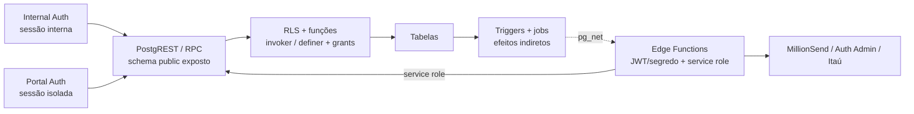

# Rastreabilidade Técnica

Revisado em 2026-10-13, na [revisão geral da documentação](archive/plans/2026-10-13-revisao-geral-documentacao.md):
leitura estática do checkout com a cadeia ativa de migrations (`001`–`221`) e
consulta ao catálogo de um Postgres local com essas migrations aplicadas
(`scripts/setup-local-pg.sh`). O projeto Supabase remoto não foi conferido.

Este documento liga cada rota e ação da interface ao componente, hook, serviço,
RPC ou tabela que a executa, e à evidência que sustenta esse caminho
([ADR 0082](adr/0082-governanca-documental-dono-unico-e-adr-historica.md)). A
regra de negócio fica no módulo dono, linkado em cada linha; o motivo de cada
decisão fica na ADR. Quando uma linha menciona uma regra, é só para orientar a
leitura do caminho.

## Como ler

- **Definição vigente** é a última migration da cadeia ativa
  (`supabase/migrations/`) que cria ou redefine o objeto. Número sem
  qualificação é dessa cadeia. Número da cadeia anterior à consolidação
  ([ADR 0062](adr/0062-consolidacao-migrations-schema-1-0.md)) aparece como
  "migration arquivada `NNN`": os números se repetem nas duas cadeias com
  conteúdos diferentes.
- Testes `*Migration.test.ts` que leem um arquivo inexistente na cadeia ativa
  passam porque `src/test/setup.ts` redireciona a leitura para
  `supabase/migrations_archive/`. Eles provam o texto da cadeia anterior, não o
  comportamento atual, e aparecem aqui só como contrato histórico.
- As colunas **Execução** e **Acesso conferido** das tabelas de contratos vêm
  do catálogo do Postgres local (`SECURITY DEFINER`/`INVOKER` e papéis com
  `EXECUTE`) e da guarda encontrada na definição vigente ou no núcleo que ela
  chama (`_impl`, `_core`, `_legacy_…`). Elas não provam o projeto remoto.
- Quando o código ainda diverge de uma regra decidida, a linha descreve o que
  o código faz hoje e cita a correção pendente no
  [plano de correções](archive/plans/2026-10-14-correcoes-decididas-na-revisao-geral.md) (decisões na
  [ADR 0083](adr/0083-decisoes-da-revisao-geral-da-documentacao.md) e na
  [ADR 0085](adr/0085-modelo-de-permissoes-por-perfil.md), cuja matriz de quem faz o quê está em
  [Segurança](operations/seguranca.md#modelo-de-permissões-por-perfil)). Em 2026-10-14 as linhas
  de permissão ganharam o item P correspondente. Neste arquivo, "(P*n*)" é sempre o item do plano,
  nunca as faixas P1 e P2 da Demurrage.
- Notas de entrega e verificações datadas ficam no arquivo histórico:
  [notas retiradas em 2026-10-13](archive/reports/2026-10-13-notas-retiradas-da-rastreabilidade.md)
  e [notas de 2026-09-19](archive/reports/2026-09-19-notas-historicas-rastreabilidade.md).

## Evidência

- **Código**: caminho confirmado por leitura do código executável (frontend,
  Edge Functions ou SQL das migrations ativas).
- **Teste**: asserção automatizada identificada pelo arquivo. "Teste local-pg"
  é uma suíte `*.local-pg.test.ts` que executa SQL num Postgres local com as
  migrations ativas e shims do Supabase; não prova Auth, PostgREST nem o
  projeto remoto.
- **Teste de contrato SQL**: inspeção textual de migration; prova a forma do
  SQL, não a execução nem a RLS.
- **Runtime**: comportamento observado num ambiente identificado, com data.
- **Suspeita**: hipótese ainda não verificada; a linha diz o que falta.

## Índice por rota e ação

Cada tabela abaixo tem uma linha por ação visível. A coluna **Módulo** leva à
regra; a coluna **RPC / tabela / integração** usa os nomes do banco, detalhados
em [Contratos Supabase](#contratos-supabase).

### Acesso, Painel, Alertas e Administração

| Rota / superfície | Ação | Origem | Hook / serviço | RPC / tabela / integração | Efeito e cache | Evidência | Módulo |
|---|---|---|---|---|---|---|---|
| `/login` | Entrar no Vela | `src/pages/Login.tsx` | `useAuth.tsx` / cliente `supabase` | Supabase Auth interno + `user_profiles` | Abre a sessão interna e vai para `/painel` | **Código**; sem teste de página | [Operação e suporte](modules/operacao-suporte.md#guards-shell-e-navegação) |
| `/` | Abrir o Vela | `src/AppInterno.tsx` (índice sob `ProtectedRoute`) | — | Nenhuma | `Navigate` para `/painel`, com `replace` | **Código** | [Operação e suporte](modules/operacao-suporte.md#guards-shell-e-navegação) |
| `/painel` | Ver o Line-Up, filtrar, **Carregar mais viagens**, **Exportar** e abrir os alertas por setor | `src/pages/Painel.tsx`, `src/lib/lineupFilters.ts` | `lineup.ts` (`fetchLineUpSnapshot`), `voyageRouteSchedules.ts` (`listVoyageEscalaSchedulesByVoyageIds`), `alerts.ts` (`getAlertDepartmentSummary`) | Leituras de `voyages` (só `active` e `completed`), `bls`, `bl_containers`, `vehicles`, `vazios_importacao_containers` e `audit_logs` de POD/POL; RPC `summarize_alert_queue_by_department` | Queries `['lineup-tv-v3', janela]` e `['alert-department-summary']`; janela de 60 viagens, ampliada de 60 em 60 até 500; filtros e XLSX usam o snapshot carregado; os cartões de setor levam a `/alertas?departamento=` | **Código**; **Teste:** `Painel.behavior.test.tsx`, `PainelAlertsSummary.test.tsx` | [Operação e suporte](modules/operacao-suporte.md#painel) |
| `/line-up-tv/display` | Exibir o Line-Up na TV | `src/pages/LineUpTVDisplay.tsx` | `lineup.ts`, `voyageRouteSchedules.ts` | Mesmas leituras do Painel | Query `['lineup-tv-display-v2']`, 60 viagens | **Código**; **Teste:** `LineUpTVDisplay.behavior.test.tsx`, `LineUpTVDisplay.cycleStart.test.ts`; runtime visual não executado | [Operação e suporte](modules/operacao-suporte.md#line-up-tv-e-line-up-tvdisplay) |
| `/line-up-tv` | Cair no catch-all interno | `src/pages/NaoEncontrado.tsx` | `<Route path="*">` de `src/AppInterno.tsx`, dentro de `ProtectedRoute` | Nenhuma | Não há rota nem página dedicada a `/line-up-tv`: aparece "Página não encontrada" com o endereço pedido; sem sessão, vai a `/login` | **Código**; **Teste:** `rotasDesconhecidas.test.tsx` | [Operação e suporte](modules/operacao-suporte.md#line-up-tv-e-line-up-tvdisplay) |
| `/alertas` | Consultar a fila, filtrar, dispensar temporariamente um item e resolver com justificativa os tipos de conferência sem fato de origem | `src/pages/Alertas.tsx` | `alerts.ts` (`listAlerts`, `fetchAlertEntityLabels`, dispensa, `resolveAlertItemWithJustification`) | RPCs `list_alert_queue_page` (100 por página), `count_alert_queue`, `summarize_alert_queue_by_department`, `dismiss_alert_item`, `resolve_alert_item_with_justification` | Chave `['alerts', filtro, página, setor]`; `?departamento=` filtra no servidor (inclui Sem setor); abre em Ativos; gravidade, registro e busca filtram a página carregada; o registro aparece pelo rótulo humano, resolvido em lote; toda linha tem **Resolver** (leva ao lugar ou pede justificativa) e **Dispensar** (motivo e data de volta) | **Código**; **Teste:** `Alertas.behavior.test.tsx`; **Teste local-pg:** `alertasFechamPelaOrigem.local-pg.test.ts` | [Operação e suporte](modules/operacao-suporte.md#alertas) |
| `/alertas/regras` | Consultar o manual de regras de Alertas e abrir o destino de tratamento | `src/pages/AlertasRegras.tsx` | `alertRulesCatalog.ts` (catálogo TypeScript) | Nenhuma; somente leitura | Filtros em `?regra=`, `?q=`, `?setor=`, `?dominio=` e `?gravidade=`; um verbete por regra viva; tipo inexistente ou aposentado cai na primeira regra viva. `caixa_sem_destinatario` e `cliente_sem_contato_principal` (catálogo da `008`) têm verbete desde o B19 | **Código**; **Teste:** `AlertasRegrasCatalog.test.tsx`, `AlertasCatalogContract.test.ts` (compara com as migrations de catálogo de `src/services/__tests__/alertCatalogSql.ts`, arquivadas e ativas) | [Operação e suporte](modules/operacao-suporte.md#alertasregras) |
| `/relatorios` | Consultar e exportar relatórios | `src/pages/Relatorios.tsx` | `reports.ts`, `exports.ts` | Leituras de `bls`, `invoices`, `invoice_receivable_links`, `customers` e Demurrage | Caches por aba e filtro; cada visão exporta XLSX | **Código**; **Teste:** `Relatorios.behavior.test.tsx` | [Operação e suporte](modules/operacao-suporte.md#relatorios) |
| `/perfil` | Atualizar o próprio nome e trocar a senha com reautenticação; o e-mail de acesso aparece só para leitura, com a orientação de pedir a troca ao Administrativo (Admin › Usuários › Editar acesso; D13 do [plano dos e-mails](archive/plans/2026-10-17-correcao-dos-emails.md)) | `src/pages/Profile.tsx`, `AlterarMinhaSenhaModal` | `useAuth.tsx` (`refreshProfile`) / cliente `supabase` | UPDATE de `user_profiles.full_name`; `supabase.auth.updateUser` só para a senha, com `signInWithPassword` conferindo a senha atual | Recarrega o perfil da sessão; o Departamento é só leitura | **Código**; **Teste:** `Profile.confirmation.test.tsx` | [Operação e suporte](modules/operacao-suporte.md#admin-e-shell) |
| `/admin` e `/admin/:tab` | Aba **Usuários**: criar usuário, editar credenciais, alterar Departamento e desativar (encerra as sessões); marca **E-mail devolvido** no usuário cujo e-mail está suprimido, e salvar o e-mail em Editar acesso libera a supressão do endereço anterior (migration `309`) | `src/pages/Admin.tsx`, `src/pages/adminTabs.ts` (cinco abas), sob `ProtectedRoute adminOnly` | `adminUsers.ts` | RPC `admin_list_users` (com `email_bounced`); Edge `admin-users` (RPC `release_internal_user_email_suppression`); UPDATE em `user_profiles` | Invalida a lista de usuários; o gatilho de `user_profiles` audita troca de Departamento e de ativo | **Código**; **Teste:** `Admin.behavior.test.tsx` | [Operação e suporte](modules/operacao-suporte.md#admin) |
| `/admin/falhas` | Aba **Falhas de Roteamento**: notificações críticas sem destinatário | `Admin.tsx` | `adminObservability.ts` (`fetchRoutingFailures`) | `alert_notification_failures` (SELECT, com `alerts` embutido) | Leitura paginada | **Código**; **Teste:** `AdminRoutingFailures.test.tsx` | [Operação e suporte](modules/operacao-suporte.md#admin) |
| `/admin/logs`, `/admin/metricas` | Abas **Log de Ações** e **Métricas** | `Admin.tsx` | `adminObservability.ts` (`fetchAuditLogs`, `fetchSystemMetrics`) | `audit_logs` e `user_profiles` (nome do autor); última viagem, conciliação PIX e fatura em `voyages`, `audit_logs` e `invoices` | Leitura | **Código** | [Operação e suporte](modules/operacao-suporte.md#admin) |
| `/admin/prazo-adr` | Aba **Relatório SLA ADR**: uma linha por ADR fechado (viagem, porto, terminal), com o ATD da Atracação, o prazo e o cumprimento por departamento; filtros **Fechado de** e **até** | `Admin.tsx` | `useAgencyReport.ts` (`useAgencyReportSla`) → `agencyReportSla.ts` | `agency_departure_reports` (`status = 'closed'`, `closed_snapshot`) | Consulta só com a aba ativa; exclui escalas omitidas e ADRs fechados antes do prazo existir | **Código**; **Teste:** `agencyReportSla.test.ts` | [Viagens](modules/viagens.md#prazo-de-conclusão-do-adr) |
| Shell interno (rotas protegidas) | Notificações internas: contar, listar, marcar como lidas e identificar a entidade | `src/components/layout/InternalNotificationBell.tsx` em `AppLayout.tsx` | `useInternalNotifications.ts`; `alerts.ts` | RPCs `list_internal_notifications`, `count_unread_internal_notifications`, `mark_internal_notification_read`, `mark_all_internal_notifications_read`; tabela `internal_notifications` | Cursor pagina a lista; leitura atualiza lista e contador; rótulos de entidade em lote | **Teste:** `InternalNotificationBell.test.tsx`, `internalNotifications.test.ts` | [Operação e suporte](modules/operacao-suporte.md#notificação-interna-e-regra-de-destinatários) |

### Viagens, Escalas, ADR e Programação

| Rota / superfície | Ação | Origem | Hook / serviço | RPC / tabela / integração | Efeito e cache | Evidência | Módulo |
|---|---|---|---|---|---|---|---|
| `/viagens` | Buscar, filtrar, ordenar, criar e selecionar viagem | `src/pages/Viagens.tsx`, `VoyageRail.tsx`, `VoyageCreateModal.tsx` | `useBls.ts` (`useVoyages`, `useVoyageDetail`), `operationalLists.ts`, `useViagemSchedulesAndStats.ts`, `voyages.ts`, `voyageForm.ts` | RPCs `operational_list_voyage_summaries` para o rail e `operational_voyage_vehicle_stats` para os indicadores de veículos; o detalhe lê `voyages` e os módulos vinculados | O rail traz o envelope resumido paginado; o detalhe carrega só a viagem aberta; a seleção sincroniza a URL; invalida por `afterViagemAlterada`, `afterEscalaAlterada` e `afterRotaAlterada` | **Código**; **Teste:** `Viagens.behavior.test.tsx` | [Viagens](modules/viagens.md#viagens-1) |
| `/viagens/:voyageId` | Planejar a Escala e as Atracações (**Adicionar escala**, **Editar** da escala ou da atracação, **Adicionar atracação**, `EscalaModal`) | `VoyageVisaoTab.tsx`, `src/components/shared/VoyageScheduleModals.tsx` | `voyageRouteSchedules.ts`, `voyageExportSchedules.ts`, `escalaTerminalAllocation.ts` | Agenda POD/POL em `audit_logs`; `voyage_export_schedules` por `(voyage_id, pol)`; RPCs `save_voyage_escala_terminal_state_v2` e `save_voyage_escala_terminal_state` (Atracações e frentes por terminal) | Atualiza cards, timeline, Line-Up e Programação | **Código**; **Teste:** `VoyageScheduleModals.test.tsx`, `VoyageVisaoTab.atracacoes.test.tsx`, `escalaTerminalAllocation.test.ts`, `voyageRouteSchedules.test.ts`, `voyageForm.test.ts` | [Viagens](modules/viagens.md#escala-atracação-e-datas) |
| `/viagens/:voyageId` | Status documental da Escala (**BLs e CEs**): automático ou manual com justificativa | `VoyageScheduleModals.tsx`, `VoyageCard.tsx` | `voyageRouteSchedules.ts`, `voyageSummaries.ts` | Gatilhos diferidos da `134` (guarda de CEs de exportação corrigida na `135`) em B/L, container, Baplie, Granito e exportação; `voyage_documental_state` | Invalida agendas, viagens, timeline e Line-Up | **Código**; **Teste local-pg:** `escalaDocumentalStatus.local-pg.test.ts` | [Viagens](modules/viagens.md#bls-e-ces-da-escala) |
| `/viagens/:voyageId` | Rotas e Manifestos: **Informar manifesto** (Nº de Manifesto Mercante; vira **Editar** com o número informado) e **Ver B/Ls** (mover ou desvincular em lote) | `VoyageManifestosTab.tsx`, `ManifestoBlsModal.tsx` | `voyageRouteSchedules.ts`, `useManifestosMercante.ts`, `manifestosMercanteService.ts` | RPCs `set_voyage_route_ce_master`, `move_bls_to_manifesto_mercante`, `unlink_bls_from_manifesto_mercante`; `manifestos_mercante` só é lida pela API | Invalida a viagem, os B/Ls e o Histórico | **Código**; **Teste:** `ManifestoBlsModal.test.tsx`, `VoyageManifestosTab.vazios.test.tsx` | [Viagens](modules/viagens.md#etd-e-atd-do-pol-manifesto-mercante-da-rota) |
| `/viagens/:voyageId` | Abas Importação e Exportação: cargas por escala e atalhos de importação (B/L container, carga solta, CE Mercante, Granito, **Novo embarque de vazios**) | `VoyageImportacaoTab.tsx`, `VoyageExportacaoTab.tsx`, `VoyageImportActions.tsx` | `useVaziosImportacaoStats.ts` (consulta PostgREST direta), serviços de importação | `vazios_importacao_manifests` e `vazios_importacao_containers` (leitura); importações nas linhas de `/bls` e `/granito`; o embarque abre `/embarquevazios?voyage=<id>` | Query `['vazios-importacao-stats', ids]` | **Teste:** `VoyageImportacaoTab.behavior.test.tsx`, `useVaziosImportacaoStats.test.tsx`, `VoyageImportActions.behavior.test.tsx` | [Viagens](modules/viagens.md#conciliação-importação-rápida-e-indicadores) |
| `/viagens/:voyageId` | Omitir escala (dentro da edição da escala), complementar e reverter a omissão; listar B/Ls afetados | `OmitEscalaModal.tsx`, `TransshipmentInfoCard.tsx`, `VoyageVisaoTab.tsx` | `useTransshipments.ts`, `transshipments.ts` | RPCs `omit_voyage_escala`, `update_voyage_omission`, `revert_voyage_omission`; `voyage_omissions`, `bl_transshipments` | Invalida programação, Line-Up e Portal | **Código**; **Teste:** `transshipments.test.ts` | [Viagens](modules/viagens.md#omissão-de-escala-transbordo-e-cod) |
| `/viagens/:voyageId` | **Cancelar viagem**, **Reativar viagem** e **Excluir viagem** (Administrativo) | `Viagens.tsx` | `voyages.ts` (`cancelVoyage`, `reactivateVoyage`, `previewVoyageDeletion`, `deleteVoyage`), `deleteRecords.ts` | RPCs `cancel_voyage`, `reactivate_voyage`, `voyage_delete_preview` e `delete_records('voyage')` | Cancelar e reativar mexem na fila de efeitos de importação; excluir mostra antes o que sai junto | **Código** | [Viagens](modules/viagens.md#status-da-viagem-e-viagem-cancelada) |
| `/viagens/:voyageId` | Excluir escala (Administrativo) | **Excluir escala** dentro da edição da escala (`EscalaModal`), a partir de `VoyageVisaoTab.tsx` | `voyageRouteSchedules.ts` (`deleteEscala`) | RPC `delete_escala` (com `p_dry_run` para a trava) | Pede motivo; recusa quando a trava do porto não está livre | **Código**; **Teste local-pg:** `deleteLock.local-pg.test.ts` | [Viagens](modules/viagens.md#escala-atracação-e-datas) |
| `/viagens/:voyageId?tab=adr&escala=:port&terminal=:terminal&report=:reportId` | Consultar, resolver seções, assinar, fechar, reabrir e imprimir o ADR do terminal | `VoyageAgencyReportTab.tsx`, `DepartmentSignoffControl.tsx`, `AgencyReportDocument.tsx`, `AgencyReportTimeline.tsx` | `useAgencyReport.ts` → `agencyDepartureReport.ts` (variantes `_by_report_id` escolhidas por `callReportIdAwareRpc`), `agencyReportDeadline.ts` | `agency_departure_reports` e tabelas de sign-off; RPCs `set_agency_report_signoff`, `set_agency_report_section_observation`, `set_agency_report_department_signoff`, `close_agency_departure_report`, `reopen_agency_departure_report`, `set_agency_report_terminal` | Um ADR por terminal da Escala (relatórios legados por porto continuam legíveis); `?report=` (ou `?reportId=`) escolhe o relatório; fechado lê o snapshot. A assinatura do departamento com seção pendente é recusada também no banco (B5, migration `257`) | **Código**; **Teste:** `agencyDepartureReport.test.ts`, `agencyReportDeadline.test.ts`, `agencyReportTerminalizedRpc.test.ts`; os `agencyReport*Migration.test.ts` são contrato histórico; **Teste local-pg:** `agencyReportCloserName.local-pg.test.ts` | [Viagens](modules/viagens.md#agency-departure-report-adr) |
| `/chegadas-saidas` | Criar ou anexar viagem, publicar na Programação do Portal e importar a planilha da Programação | `src/pages/ChegadasSaidas.tsx` | `voyageFromSchedule.ts`, `portalScheduleVoyages.ts`, `portalScheduleBulkImport.ts` | `voyages.show_on_portal` (só liga); RPC `apply_schedule_sheet_atomic`; leitura `portal_ship_schedule`; `voyage_escala_revision_state` | Atualiza por `afterViagemAlterada`; a tela não tira linhas: a viagem sai da Programação ao ficar Concluída ou por Excluir/Cancelar em `/viagens`; escala omitida aparece como `OMIT` | **Código**; **Teste:** `ChegadasSaidas.behavior.test.tsx` | [Chegadas e saídas](modules/chegadas-saidas.md#catálogo-de-ações) |

### B/Ls, CE Mercante e importações

| Rota / superfície | Ação | Origem | Hook / serviço | RPC / tabela / integração | Efeito e cache | Evidência | Módulo |
|---|---|---|---|---|---|---|---|
| `/bls` | Listar e exportar B/Ls (container, carga solta e misto); ícone de copiar no número do B/L e no CE Mercante; sem menu ⋮: **Excluir B/L** fica na seleção em lote do Administrativo | `src/pages/Bls.tsx` (o número do B/L é o link da ficha) | `useBls.ts` → `operationalLists.ts` (`listOperationalBls`); `deleteRecords.ts` | RPCs `operational_list_bls` e `operational_list_bl_summary` (estado de Taxas Locais pelas migrations `222`, `226` e `229`, que tiram o B/L cancelado de Pendente e de Isenta); `delete_records('bl')` | A mesma RPC paginada serve tela e export; o ícone de copiar (`CopyValue`) só confirma depois do `clipboard.writeText` | **Código**; **Teste:** `Bls.test.tsx` | [Manifestos e EDI](modules/manifesto-edi.md#bls) |
| `/bls`, `/granito` | Vincular o consignatário importado a um Cliente | `BlImportModal.tsx`, `BlBreakbulkManifestModal.tsx`, `Granite.tsx` | `customerReconciliation.ts` (`loadCustomerMaps`, `findMatchedCustomer`), chamado por `blFreightImport.ts`, `breakbulkImport.ts` e `graniteImport.ts` | Leitura de `customers`; o Cliente encontrado segue no payload das RPCs de importação | Documento exato vincula; nome só grava sugestão; Cliente desativado não é candidato pelo nome; pelo CNPJ vira sugestão com o motivo (B17) | **Código**; **Teste:** `customerReconciliation.test.ts` | [Clientes](modules/clientes.md#reconciliação-de-cliente-em-bl-e-granito) |
| `/bls`, `/bls/:blId` | **Importar B/L** (lote ou o B/L aberto) | `src/components/shared/BlImportModal.tsx` | `blParser.ts`, `blFreightImport.ts` | RPC `import_bl_freight_file_atomic` (arquivo inteiro numa transação, migration `329`) → `import_bl_freight_with_metadata` → `import_bl_freight_transactional`; troca de consignatário aceita na prévia delega a `relink_bl_customer`; `apply_bl_review_gate_after_import` roda dentro da importação | Invalida B/Ls, viagem e timeline pelo efeito de manifesto; não emite fatura (o gatilho de emissão é o CE Mercante) | **Código**; **Teste:** `blParser.test.ts`, `blFreightImport.test.ts`; **Teste local-pg:** `auditoriaImportacaoBlContainer.local-pg.test.ts` | [Manifestos e EDI](modules/manifesto-edi.md#importação-do-bl-e-invariantes-gerais) |
| `/bls` | **Importar CE Mercante** por planilha, um Manifesto por importação | `src/components/shared/CeMercanteImportModal.tsx` | `ceMercanteImport.ts` (`previewCeMercanteRows`, `importCeMercanteRows`, `emitCeMercanteBilling`) | RPCs `preview_ce_mercante_rows` → `apply_ce_mercante_rows_atomic` → `emit_ce_mercante_billing` em lotes de 25 | A prévia mostra CE e Manifesto antes → depois; a emissão mostra progresso, **Retomar** e o resultado por B/L; invalida B/Ls, ficha e manifestos | **Código**; **Teste:** `CeMercanteImportModal.test.tsx`; **Teste local-pg:** `ceImportacaoContrato.local-pg.test.ts` | [Manifestos e EDI](modules/manifesto-edi.md#ce-mercante) |
| `/bls` | Importar manifesto de carga solta (breakbulk) | `src/components/bl/BlBreakbulkManifestModal.tsx`, `FileImportModal.tsx`, `BreakbulkReimportReview.tsx` | `breakbulkImport.ts`, `importCore.ts` | RPC `import_breakbulk_manifest_transactional` | A Viagem é escolhida antes do arquivo; o resultado separa novos, corrigidos, sem mudança e pendências | **Código**; **Teste**; **Teste local-pg:** `auditoriaImportacaoCargaSolta.local-pg.test.ts` | [Manifestos e EDI](modules/manifesto-edi.md#importação-do-bl-e-invariantes-gerais) |
| `/bls` | Importar B/L avulso (`.pdf`/`.docx`) | `src/components/shared/BlDocumentImportModal.tsx`, `FileImportModal.tsx` | `blDocumentParser.ts`, `blDocumentPdf.ts`, `blDocumentDocx.ts`, `blDocumentFields.ts`, `blDocumentImport.ts`, `breakbulkImport.ts` | Mesma RPC da carga solta | Um arquivo por B/L; avisos de leitura vão para os erros do lote | **Código**; **Teste** | [Manifestos e EDI](modules/manifesto-edi.md#importação-do-bl-e-invariantes-gerais) |
| `/bls/:blId` | Faixa de identidade (número, Navio / Viagem, Trecho, CE Mercante e Cliente; **Reimportar B/L** e **Mais ações**, quando cabem), faixa **Próxima ação** (só com pendência documental) e trilhos Operacional e Documental em blocos; Visão geral em cinco blocos (Embarque, Documento Mercante, Cliente, Carga e Portal), com a exceção de terminal no Embarque | `src/pages/BlDetalhe.tsx`, `BlVisaoGeralTab.tsx`, `BlRailsPipeline.tsx`, `BlPortalCard.tsx`, `BlTerminalOverrideCard.tsx` | `useBlCockpit.ts`, `blRails.ts`, `blPortalStatus.ts`, `blTerminal.ts`, `useVoyageReconciliation.ts` | RPCs `get_bl_portal_status` e `set_bl_terminal_override`; leituras de agendas, B/L, containers, invoices e Demurrage | Queries `bl-cockpit` e de links de fatura (diretos e por `invoice_receivable_links`); a próxima ação diz para onde leva | **Código**; **Teste:** `BlDetalhe.test.tsx`, `BlRailsPipeline.test.tsx`, `BlVisaoGeralTab.test.tsx` | [Manifestos e EDI](modules/manifesto-edi.md#blsblid) |
| `/bls/:blId` | Editar detalhes e dados documentais (inclui NCM) | `BlDetalhesTab.tsx` | `useBlEditForm.ts` | RPC `save_bl_review` (lock otimista; não grava `ce_mercante`) | Invalida ficha, Histórico e listas | **Código**; **Teste** | [Manifestos e EDI](modules/manifesto-edi.md#blsblid) |
| `/bls/:blId` | **Corrigir CE Mercante** / **Remover CE Mercante**, com motivo | `BlCeMercanteField.tsx` | `blCeMercante.ts` | RPCs `correct_bl_ce_mercante` e `remove_bl_ce_mercante`, pela porta única `_set_bl_ce_mercante`; o gatilho `guard_bl_ce_mercante_port` recusa gravação fora das portas | Invalida a ficha, as listas e o Histórico (`afterBlEstadoAlterado`). A troca com Desbloqueio conferido do CE anterior (conciliação ZPT `unlocked` ou confirmação legada do mesmo CE) abre `ce_trocado_com_desbloqueio` (migrations `230` e `277`) | **Código**; **Teste local-pg:** `ceImportacaoContrato.local-pg.test.ts`, `revisaoFinalCeMercante.local-pg.test.ts` | [Manifestos e EDI](modules/manifesto-edi.md#ce-mercante) |
| `/bls/:blId` | Mover o B/L para outro Manifesto Mercante ou desvincular, com motivo | `BlManifestoField.tsx` | `useManifestosMercante.ts` (`useMoveBlsToManifestoMercante`, `useUnlinkBlsFromManifestoMercante`) | RPCs `move_bls_to_manifesto_mercante` e `unlink_bls_from_manifesto_mercante`; o gatilho `guard_bl_manifesto_port` recusa troca de vínculo fora delas | Invalida a ficha, as listas e o Histórico do B/L e da Viagem | **Código**; **Teste:** `BlManifestoField.test.tsx` | [Manifestos e EDI](modules/manifesto-edi.md#manifesto-mercante) |
| `/bls/:blId` | Blocos Cliente e Portal da Visão geral: vincular ou cadastrar Cliente, convidar ao Portal (**Enviar convite do Portal**, quando falta a conta do Portal), trocar ou desvincular | `BlClienteSection.tsx` | `ReviewCustomerOnboarding`, `useReviewCustomerGroup.ts`, `review.ts` (`linkBlCustomer`), `reviewBillingAutomation.ts` | RPCs `complete_review_customer_group` e `save_bl_review`; Edge `portal-invite-send` | Invalida B/L, Revisão, clientes, taxas, faturas, Portal e Histórico | **Código**; **Teste** | [Manifestos e EDI](modules/manifesto-edi.md#blsblid) |
| `/bls/:blId` | Aba Carga: **Corrigir** o container (perfil IMO/OOG, SOC/COC, lacre, peso bruto, CBM, descarga e devolução), com uma justificativa | `BlCargaTab.tsx`, `BlContainerCorrectModal.tsx` | `vaziosNatureza.ts` (`setContainerProfile`, `setContainerOwnership`), `containerCorrection.ts` (`correctContainerData`), `demurrage/demurrageContainers.ts` (`updateContainerDates`) | RPCs `set_bl_container_profile`, `set_bl_container_ownership`, `correct_bl_container_data` (migrations `289` e `292`) e `set_container_dates` | B/L faturado trava só perfil e SOC/COC; lacre, peso, CBM e datas corrigem sempre. O perfil vem do B/L, do Baplie ou desta correção manual | **Código**; **Teste:** `BlCargaTab.behavior.test.tsx`, `containerCorrection.test.ts` | [Manifestos e EDI](modules/manifesto-edi.md#baplie-marcas-soccoc-e-divergências) |
| `/bls/:blId` | Taxas Locais e fatura do B/L (**Emitir fatura**, qualquer Departamento desde a `246`) | `BlFaturamentoTab.tsx`, `BlCobrancasTab.tsx` | `useLocalCharges.ts`, `chargeOperationsService.ts`, `billing.ts` | RPCs `list_bl_local_charge_lines`, `add_manual_bl_charge`, `update_manual_bl_charge`, `delete_manual_bl_charge`, `calculate_bl_local_charges`, `mark_bl_ready_and_create_invoice` | B/L faturado esconde edição e recálculo; a razão de recusa do banco aparece na tela | **Código**; **Teste:** `BlCobrancasTab.behavior.test.tsx` | [Taxas locais](modules/taxas-locais.md#superfícies-operacionais-fora-da-rota) |
| `/bls/:blId` | Seção Demurrage do B/L: free time, P1/P2 e datas do container | `BlDemurrageSection.tsx` | `blDemurrageConfig.ts` (`saveBlDemurrageConfig`), `demurrage/demurrageContainers.ts` (`updateContainerReturnDate`) | RPCs `save_bl_demurrage_config` e `set_container_dates`; a auditoria é gravada dentro das RPCs | Atualiza a previsão de Demurrage | **Código** | [Demurrage](modules/demurrage.md#blsblid--aba-faturamento) |
| `/bls/:blId` | Histórico: filtrar por assunto e paginar | `BlHistoricoTab.tsx` | `useBlTimeline.ts` / `blTimeline.ts` | RPC `bl_timeline` (lida inteira, até 1.000 eventos); nomes em `user_profiles` | 20 por página, com Quando, Assunto, O que aconteceu e Por; Auditoria é o subconjunto com justificativa | **Código**; **Teste** | [Manifestos e EDI](modules/manifesto-edi.md#blsblid) |
| `/bls/:blId` | Cancelar e reativar B/L (Administrativo) | `BlDetalhe.tsx` (só para B/L com CE) | `blState.ts` | RPCs `cancel_bl` e `reactivate_bl` | Cancelar anula recebível e cálculo sem fatura, com Histórico | **Código**; **Teste local-pg:** `blCancel.local-pg.test.ts` | [Manifestos e EDI](modules/manifesto-edi.md#bl-cancelado-e-exclusão) |
| `/bls/:blId` | Disposição Transbordo ou COD | `BlTransshipmentCard.tsx` | `useTransshipments.ts` (`useSetBlDisposition`), `transshipments.ts` | RPCs `set_bl_transshipment` e `set_bl_cod`; `bl_transshipments`, `audit_logs` | Invalida cockpit, ficha, B/Ls e viagens; COD gera `cod_adjustments` | **Código**; **Teste:** `transshipments.test.ts` | [Viagens](modules/viagens.md#omissão-de-escala-transbordo-e-cod) |
| `/containers` | Filtrar containers (recorte na URL) e importar datas de descarga e devolução | `src/pages/Containers.tsx`, `containersListState.ts`, `ContainerDatesImportModal.tsx` | `useBls.ts` (`listOperationalContainers`), `containerDatesImport.ts` | RPCs `operational_list_containers` e `apply_container_dates_batch_atomic` (cada B/L por `apply_container_dates_atomic`) | Datas mudam a Demurrage. IMO/OOG não tem importador próprio: o perfil vem do B/L, do Baplie (que prevalece para container presente no arquivo) e da correção manual na aba Carga | **Código**; **Teste:** `Containers.cacheRefresh.test.tsx` | [Manifestos e EDI](modules/manifesto-edi.md#containers) |
| `/veiculos` | Importar, mover para outro B/L ou excluir veículos (com motivo) e definir o Local de desova por container | `src/pages/Veiculos.tsx`, `veiculosPresentation.ts`, `MoveVehiclesModal.tsx` | `vehicleImport.ts`, `vehicles.ts`, `vaziosNatureza.ts` (`setContainerUnpackingLocation`) | RPCs `import_vehicle_rows_transactional`, `move_vehicles_to_bl`, `delete_vehicles_with_reason`; UPDATE de `bl_containers.unpacking_location` | Recalcula as Taxas Locais sem fatura viva; atualiza B/L, container e fatura | **Código**; **Teste:** `Veiculos.savedLocation.test.tsx`; **Teste local-pg:** `veiculosRegras.local-pg.test.ts` | [Manifestos e EDI](modules/manifesto-edi.md#veiculos) |
| `/baplie` | Conferir a Viagem, aplicar as marcas e a Conciliação Baplie × B/L ("Vale o B/L") | `src/pages/Baplie.tsx`, `bapliePresentation.ts` | `useBls.ts` (`useVoyages`), `baplieReadModel.ts`, `useBaplieVoyageContext.ts`, `baplieImport.ts`, `baplieReconciliation.ts` | RPCs `operational_list_voyage_summaries`, `list_voyage_eligible_pods`, `import_baplie_staging_transactional`, `preview_baplie_physical_flags`, `apply_baplie_physical_flags_atomic`, `resolve_baplie_divergence`, `get_voyage_first_brazilian_eta` | Substitui o staging da viagem; as marcas valem para todos os B/Ls ativos do container; invalida reconciliação, viagens e Line-Up | **Código**; **Teste:** `baplieReadModel.test.ts`, `baplieImport.test.ts`, `Baplie.presentation.test.tsx`, `Baplie.cacheRefresh.test.tsx`; **Teste local-pg:** `baplieMarcas.local-pg.test.ts` | [Manifestos e EDI](modules/manifesto-edi.md#baplie) |
| `/vazios-importacao` | Listar, exportar, importar planilha e atribuir natureza (individual ou em lote) | `src/pages/VaziosImportacao.tsx`, `FileImportModal.tsx`, `BulkActionsBar.tsx` | `vaziosImportacaoImport.ts`, `vaziosNatureza.ts` | RPC `import_vazios_importacao_transactional`; UPDATE de natureza em `vazios_importacao_containers` | A Viagem é escolhida antes do arquivo; o recadastro pelo Baplie (`replace_vazios_from_baplie_transactional`) parte de `/baplie`, não desta tela | **Código**; **Teste:** `VaziosImportacao.test.tsx` | [Manifestos e EDI](modules/manifesto-edi.md#vazios-importacao) |
| `/embarquevazios` | Criar um Embarque por escala, importar ou incluir Unidades Embarcadas e lançar Linhas de Serviço | `src/pages/EmbarqueVazios.tsx` | `vaziosImport.ts`, `vaziosExportOperations.ts`, `vaziosCusto.ts`, `operationalLists.ts` (`listVoyageRoutePorts`) | RPCs `import_vazios_bookings_transactional`, `create_manual_vazios_booking`, `update_manual_vazios_booking`, `delete_manual_vazios_booking`; `vazios_export_operations` (upsert), `vazios_export_service_lines` (INSERT/UPDATE); exclusão de linha por `delete_catalog_row` | A reimportação atualiza por container e preserva as unidades incluídas à mão; após mutação atualiza a operação e o ADR. As opções de **Porto de embarque** vêm das escalas da viagem, complementadas pelo POL/POD dos B/Ls (B10) | **Código**; **Teste:** `EmbarqueVazios.flow.test.tsx`, `vaziosManualBooking.test.ts` | [Manifestos e EDI](modules/manifesto-edi.md#embarquevazios) |
| `/embarquevazios/depots` | Cadastro de Terminais: locais, serviços e valor sugerido | `src/pages/DepotCadastro.tsx` | `useDepots.ts`, `depots.ts` | `depots` e `depot_services` (INSERT/UPDATE por usuário ativo); RPC `preflight_depots_terminal_port_mapping`; exclusão por `delete_catalog_row` (Administrativo) | Muda os valores sugeridos das próximas linhas, não as já lançadas | **Código**; **Teste:** `DepotCadastro.behavior.test.tsx` | [Manifestos e EDI](modules/manifesto-edi.md#embarquevaziosdepots) |
| `/granito` | Importar a planilha COSCO, calcular, importar o CE Mercante do Granito e acompanhar a fila de efeitos | `src/pages/Granite.tsx`, `CeMercanteImportModal.tsx`, `ImportResultPanel.tsx` | `graniteImport.ts`, `graniteCharges.ts`, `ceMercanteImport.ts`, `useImportEffects.ts` → `importEffects.ts` | RPCs `import_granite_manifest_transactional`, `calculate_granite_bl_charges`, `apply_ce_mercante_rows_atomic` (`p_target = 'granite'`, que chama `apply_granite_ce_mercante_update`), `list_import_effects`, `retry_import_effect` | O CE do Granito não calcula nem emite (ADR 0078, item 8); na Validação o Granito aparece como **Apoio operacional**, com ou sem CE | **Código**; **Teste:** `Granite.behavior.test.tsx`, `graniteImportAtomic.test.ts`, `graniteParse.test.ts`; **Teste local-pg:** `granitoReimportacao.local-pg.test.ts` | [Granito](modules/granito.md#catálogo-de-ações) |
| `/granito/taxas` | Gerir tarifas de Granito | `src/pages/GraniteRates.tsx` | `graniteCharges.ts`, `deleteRecords.ts` | `granite_rates` (upsert); exclusão por `delete_catalog_row` | Afeta cálculos futuros | **Código**; **Teste:** `GraniteRates.confirmation.test.tsx` | [Granito](modules/granito.md#granitotaxas) |

### Revisão e Clientes

| Rota / superfície | Ação | Origem | Hook / serviço | RPC / tabela / integração | Efeito e cache | Evidência | Módulo |
|---|---|---|---|---|---|---|---|
| `/revisao` | Triar por causa, uma linha por Cliente; no grupo aberto, conforme o caso: identificar ou cadastrar o Cliente (com a escolha do Portal), confirmar o CNPJ, provisionar o Portal, informar o peso, conferir os dados do B/L ou vincular o Granito | `src/pages/Revisao.tsx`, `revisaoHelpers.ts`, `ReviewGroupDetail`, `ReviewCustomerForm`, `ReviewEvidence`, `ReviewPortalBlock`, `ReviewBlCheckForm` | `useReview.ts` (`useReviewQueue`), `useReviewCustomerGroup.ts`, `reviewCustomerGroup.ts`, `review.ts`, `usePortalProvisioning.ts` | RPCs `complete_review_customer_group`, `save_bl_review`, `save_granite_bl_review`; Edge `portal-invite-send` (convite no cadastro ou no bloco do Portal) | Invalida `review-queue`, clientes, B/Ls, pendências de taxa e Portal; `PT409` recarrega a fila. A sugestão de Cliente por nome aparece para B/L e Granito (B16); CNPJ de Cliente desativado chega como sugestão com o motivo (B17) | **Código**; **Teste:** `Revisao.test.tsx`; **Teste local-pg:** `auditoriaImportacaoCargaSolta.local-pg.test.ts` (`complete_review_customer_group`) | [Operação e suporte](modules/operacao-suporte.md#revisao) |
| `/revisao` | Tentar o cálculo e a emissão depois de zerar as pendências | `Revisao.tsx`, `BlClienteSection.tsx` | `reviewBillingAutomation.ts` (`tryAutoIssueInvoice`) | RPCs `calculate_bl_local_charges` e `mark_bl_ready_and_create_invoice`; Alertas `billing_calculation_blocked` e `billing_auto_issue_failed` | Só tenta com Cliente conciliado e Revisão concluída; sem CE fica "Aguardando cadastro do CE Mercante"; a emissão pelo CE é do servidor | **Código**; **Teste:** `reviewBillingAutomation.test.ts` | [Operação e suporte](modules/operacao-suporte.md#revisão-até-faturamento) |
| `/clientes` | Buscar, filtrar, criar, importar a Base de Clientes, exportar o recorte, desativar, reativar e excluir | `src/pages/Clientes.tsx`, `clientesListState.ts`, `CustomerTable.tsx`, `CreateCustomerModal.tsx`, `ImportBaseModal.tsx` | `useCustomers.ts`, `customers.ts`, `customerBase.ts`, `deleteRecords.ts` | RPCs `create_customer_with_contacts`, `apply_customer_base_batch_atomic` (cada Cliente por `apply_customer_base_row_atomic`), `deactivate_customer`, `reactivate_customer`, `delete_records('customer')` | A Base de Clientes vincula só B/Ls pendentes com o mesmo CNPJ, mostrados na prévia | **Código**; **Teste:** `Clientes.behavior.test.tsx`, `customerBase.test.ts`; **Teste local-pg:** `baseClientesVinculo.local-pg.test.ts`, `customerDeactivate.local-pg.test.ts` | [Clientes](modules/clientes.md#importação-da-base-de-clientes) |
| `/clientes/:cnpj` | Ficha do Cliente: pendências, cadastro e contatos, **Acesso ao Portal**, Liberação de faturamento sem Portal, acordos de Demurrage e saldo | `src/pages/ClienteFicha.tsx`, `FichaTabs.tsx`, `VisaoGeralTab.tsx`, `CadastroContatosTab.tsx` (**Gerenciar aqui** embute o `PortalReviewPanel`), `BlsTab.tsx`, `ConteineresTab.tsx`, `FinanceiroTab.tsx`, `HistoricoTab.tsx`, `CadastroChangesBlock.tsx`, `CeUnlockRequestsBlock.tsx` | `useCustomers.ts`, `useCustomerFicha.ts`, `customerFicha.ts`, `customers.ts`, `customerContactConfiguration.ts`, `customerCadastroChanges.ts`, `demurrage/customerContainers.ts`, `useBillingPortalRelease.ts`, `useCustomerDemurrageAgreements.ts`, `useCeUnlock` | RPCs `update_customer_with_audit`, `internal_save_customer_contact_configuration`, `internal_fill_empty_contact_boxes` (migration `223`: caixa sem destinatário recebe o principal, gravado pelo sistema ao abrir o Cadastro), `ce_unlock_customer_requests` (migrations `224`, `227` e `228`), `get_customer_receivables`, `get_customer_pending_balances`, `grant_customer_billing_portal_release` / `revoke_customer_billing_portal_release`; `customer_demurrage_agreements` (upsert); leituras de faturas, Demurrage, pagamentos, tarifas, `portal_provisioning_events`, `audit_logs` e `customer_contact_change_events` | As demais ações financeiras e operacionais seguem nos módulos de origem por deep link | **Código**; **Teste:** `ClienteFicha.behavior.test.tsx`, `customerFicha.test.ts`, `BillingPortalReleaseCard.test.tsx`; **Teste local-pg:** `portalBillingRelease.local-pg.test.ts` | [Clientes](modules/clientes.md#clientescnpj) |
| `/clientes/:cnpj?tab=desbloqueio-ce` | Condição VIP e documentos anuais do Desbloqueio de CE | `CeUnlockVipCoveragePanel.tsx` (escrita com a permissão `ce_unlock_manage`) | `ceUnlockService.ts` | RPC `ce_unlock_command` (`set_vip`, `review`) e envio de documento anual pela Edge `portal-ce-unlock-document` | Sem `ce_unlock_manage` é só leitura; aplicar a cobertura VIP a um pedido (`apply_vip`) fica no detalhe da solicitação em `/desbloqueio-ce` | **Código** | [Desbloqueio de CE](modules/desbloqueio-ce.md#requisitos-e-condição-vip) |
| `/clientes/comunicacao` | Conferir, simular ou enviar (em lote, com confirmação e Repetir só as falhas), consultar o histórico por destinatário e reenviar o CE e Taxas | `src/pages/ClientesComunicacao.tsx` (rota aberta a todos; a aba Disparo exige `customer_communications`, P12) | `useCustomerCommunications.ts`, `customerCommunications.ts`, `customerCommunicationDispatches.ts`, `customerFinanceCommunications.ts`, `customerCommunicationReadiness.ts`, `appSettings.ts` | Edge `send-customer-communication`; RPCs `customer_local_charges_communication_readiness`, `list_customer_communication_saved_templates`, `save_customer_communication_saved_template`, `set_communications_enabled`; leituras de `customer_communications`, `customer_communication_bls`, Caixas, mapa caixa → modelo (`customer_communication_box_kinds`, B18) e supressões | Banner permanente com a chave global desligada; o histórico chega à Ficha e aos B/Ls vinculados; o reenvio do CE e Taxas fecha `comunicado_ce_reenvio_pendente`, cujo link abre `?tab=historico&kind=ce_mercante_taxas&bl=` | **Código**; **Teste:** `ClientesComunicacao.test.tsx`, `customerCommunicationsTela.test.ts`, `customerCommunicationBoxes.test.ts`, `comunicadosCaixasPorModelo.local-pg.test.ts`, `comunicadoCeReenvioFechaAlerta.local-pg.test.ts` | [Clientes](modules/clientes.md#comunicados-ao-cliente) |
| `/clientes/informacoes` | Cadastros da Central de Informações do Portal (aberta pelo botão em `/clientes/portal`) | `src/pages/ClientesInformacoes.tsx` | `usePortalInformation.ts`, `portalInformation.ts` | RPCs `internal_get_portal_information` e `internal_save_portal_information` | Preços vêm das tabelas vigentes do Vela | **Código**; **Teste:** `ClientesInformacoes.test.tsx`; **Teste local-pg:** `portalInformation.local-pg.test.ts` | [Portal do Cliente](modules/portal-cliente.md#central-de-informações) |

### Taxas Locais e Faturamento

| Rota / superfície | Ação | Origem | Hook / serviço | RPC / tabela / integração | Efeito e cache | Evidência | Módulo |
|---|---|---|---|---|---|---|---|
| `/taxas-locais/tabelas` | Consultar e gerir Tabelas de Taxas Locais e Condições de Cliente (`?tab=overrides`, `?modo=`, `?pod=`, `?lente=`, `?vigencia=`, `?cliente=`) | `src/pages/TaxasLocaisTabelas.tsx`, `ChargeTablesTab.tsx`, `ChargeOverridesTab.tsx` e modais | `useLocalCharges.ts`, `chargeTableService.ts`, `chargeRateService.ts`, `deleteRecords.ts` | `charge_tables`, `charge_table_items` e `customer_rate_overrides` (INSERT/UPDATE por usuário interno ativo); exclusão por `delete_catalog_row` | Invalida as famílias `queryKeys.charges.*`; a tabela ativa no escopo (POD + modo; duas para B/L misto) é condição de faturamento e a vigência é informativa (ADR 0040) | **Código**; **Teste:** `TaxasLocaisTabelas.test.ts` | [Taxas locais](modules/taxas-locais.md#tabela-aplicável-item-de-taxa-e-condição-de-cliente) |
| `/taxas-locais` | Validação: fila de bloqueios, recalcular e emitir invoice individual ou consolidada | `src/pages/TaxasLocais.tsx`, `ValidacaoTab.tsx`, `ValidacaoControls.tsx`, `ValidacaoOperationsTable.tsx`, `ConsolidatedInvoiceModal` | `useLocalCharges.ts`, `useBillingLedger.ts`, `billing.ts` (`createInvoiceFromBls`), `billingLedger.ts` (`createConsolidatedInvoice`), `graniteBillingWorkflow.ts` | RPCs `calculate_bl_local_charges_batch`, `create_invoice_from_bls_with_ledger`, `list_consolidatable_receivables`, `create_local_consolidated_invoice` | A fila deriva Sem cliente vinculado, Cálculo incompleto, Aguardando CE Mercante e Portal não provisionado; faturados e isentos só aparecem com o filtro de resolvidos | **Código**; **Teste:** `TaxasLocais.behavior.test.tsx`, `validacaoFunnel.test.ts` | [Faturamento](modules/faturamento.md#validação) |
| `/taxas-locais` | Emitir fatura avulsa, com tipo de cobrança opcional e B/L ou Viagem opcionais | `ManualInvoiceModal` | `useBilling.ts` (`useCreateManualInvoice`), `useLocalCharges.ts` (`useManualInvoiceQuote`) | RPCs `quote_manual_invoice_charge` e `create_manual_invoice` | Invalida lista, detalhe e histórico; não cria recebível nem settlement local | **Código**; **Teste:** `ManualInvoiceModal.test.tsx`; **Teste local-pg:** `manualInvoice.local-pg.test.ts`, `invoiceCorrection.local-pg.test.ts` | [Faturamento](modules/faturamento.md#catálogo-de-ações) |
| `/taxas-locais` · detalhe da fatura; `/clientes/:cnpj?tab=financeiro` | Registrar baixa e ver quem registrou cada baixa em "Pagamentos" | `InvoiceDetailModal`; `FinanceiroTab.tsx` | `billing.ts` (`listInvoiceDetails`, `fetchPaymentRegistrarNames`), `billingLedger.ts` | RPCs `list_invoice_details`, `list_payment_registrar_names`, `register_verified_invoice_payment` (com referência bancária), `register_ledger_invoice_payment` | Falha do resolvedor de nomes deixa a baixa listada com "—". Quem cancelou a baixa não aparece na tela; o `audit_logs` guarda a exclusão (`payments`/`excluido`, com id e autor) e a justificativa fica no evento `payment_reversed` da fatura | **Código**; **Teste:** `billing.test.ts`; **Teste local-pg:** `paymentRegistrarNames.local-pg.test.ts` | [Faturamento](modules/faturamento.md#detalhe-pagamento-restituição-e-cancelamento) |
| `/taxas-locais` · detalhe da fatura; `/demurrage`; `/reconciliacao` | Devoluções: pedir, confirmar (referência bancária, favorecido e data) e cancelar autorização de restituição | `FinancialRefundsPanel` em `InvoiceDetailModal` e `DemurrageInvoiceDetailModal` | `useFinancialRefunds.ts`, `financialRefunds.ts`; `useBillingLedger.ts` (`useSettleInvoiceRefund` → `settleInvoiceRefund`) | RPCs `list_financial_refunds`, `request_financial_refund`, `confirm_invoice_refund`, `confirm_demurrage_refund`, `cancel_financial_refund_authorization`, `list_invoice_refunds_with_evidence` | `settle_invoice_refund` e `list_invoice_refunds` não têm mais chamador | **Código** | [Faturamento](modules/faturamento.md#pagamento-saldo-e-restituição) |
| `/taxas-locais` | Correção após faturamento: Reemissão pendente, fatura desatualizada e ajustes | `PendingReissuesPanel` (**Tentar reemitir**), `StaleInvoiceResolutionPanel` e `InvoiceCorrectionPanel` em `InvoiceDetailModal` | `billing.ts`, `billingLedger.ts` | RPCs `list_pending_reissues`, `retry_pending_consolidated_reissue`, `retry_invoice_basis_changes`, `get_invoice_reissue_links`, `get_invoice_correction_summary`, `resolve_stale_invoice`, `prepare_bl_financial_cancellation`; gatilhos `capture_invoice_basis` e `process_invoice_basis_changes` em `bls`, `bl_containers` e `vehicles` | A correção do B/L vale sempre; a fatura emitida não muda de valor | **Código**; **Teste local-pg:** `invoiceBasisCorrection.local-pg.test.ts`, `invoiceReissue.local-pg.test.ts`, `invoicePostBillingSafety.local-pg.test.ts`, `invoiceAutoReissue.local-pg.test.ts`; **Teste:** `InvoiceCorrectionPanel.test.tsx` | [Faturamento](modules/faturamento.md#correção-após-emissão-adr-0077) |
| `/taxas-locais` | Liquidar Ajuste de COD | `CodAdjustmentsPanel` | `useBillingLedger.ts`, `billingLedger.ts` | `cod_adjustments` (leitura); RPC `settle_cod_adjustment` | Liquidação pelo Financeiro ou Administrativo | **Código** | [Faturamento](modules/faturamento.md#ajuste-de-cod) |

### Demurrage

| Rota / superfície | Ação | Origem | Hook / serviço | RPC / tabela / integração | Efeito e cache | Evidência | Módulo |
|---|---|---|---|---|---|---|---|
| `/demurrage` | Acompanhar containers, gerar Invoice, gerir Invoices (desconto, cancelamento, recálculo) e informar a PTAX | `src/pages/Demurrage.tsx`, `demurrageListState.ts` (`?tab=`, `?busca=`, `?lente=`, `?fatura=`, `?dispute=`), `DemurrageContainersTab.tsx`, `DemurrageInvoicesTab.tsx`, `DemurrageCustomersTab.tsx`, `DemurrageInvoiceDetailModal.tsx` | `demurrage/demurrageInvoices.ts`, `demurrage/demurrageContainers.ts`, `demurrage/demurrageKpis.ts`, `demurragePresentation.ts`, `afterFaturaDemurrageAlterada` | RPCs `issue_demurrage_invoice_for_bl`, `register_demurrage_payment`, `apply_demurrage_discount`, `cancel_demurrage_invoice`, `reopen_demurrage_invoice`, `recalculate_demurrage_invoices_manual`, `set_container_dates`; leitura de `demurrage_invoice_history` | Cada caixa diz em qual Invoice viva foi cobrada; ações só para o perfil que a RPC aceita; banner de PTAX desatualizada | **Código**; **Teste:** `Demurrage.behavior.test.tsx`, `DemurragePaymentReversalModal.test.tsx`; **Teste local-pg:** `demurrageCobrancaPorCaixa.local-pg.test.ts`, `revisaoFinalDemurrage.local-pg.test.ts` | [Demurrage](modules/demurrage.md#catálogo-de-ações) |
| `/demurrage` | Responder, reabrir e anexar arquivo na conversa da Disputa | `DemurrageDisputeConversation.tsx` | `demurrage/demurrageDisputes.ts` | RPCs `list_demurrage_disputes_internal`, `add_demurrage_dispute_message`, `reopen_demurrage_dispute`, `add_demurrage_dispute_attachment` | Equipamentos responde; o Administrativo responde e reabre como cobertura; o Alerta segue de Equipamentos | **Código** | [Demurrage](modules/demurrage.md#disputa-de-demurrage) |
| `/demurrage/taxas` | Gerir tarifas de Demurrage e acordos por Cliente (`?tab=acordos`, `?cliente=`) | `src/pages/DemurrageRates.tsx`, `DemurrageRateModal.tsx`, `CustomerDemurrageAgreementsTab.tsx`, `CustomerDemurrageAgreementModal.tsx` | `demurrage/demurrageRates.ts`, `demurrage/customerDemurrageAgreements.ts` | `demurrage_rates` e `customer_demurrage_agreements` (criar e editar por qualquer Departamento, migration `254`; ativar e desativar, Administrativo); exclusão por `delete_catalog_row` | Muda o cálculo futuro e a previsão da aba Containers | **Código**; **Teste:** `DemurrageRates.behavior.test.tsx` | [Demurrage](modules/demurrage.md#demurragetaxas) |
| Configuração da Régua de Cobrança | Ver o estado da Régua por Invoice e mudar o intervalo (Administrativo) | `DemurrageDunningStatus` | `demurrageDunning.ts`, `appSettings.ts` | RPCs `list_demurrage_dunning_claim_statuses` e `set_demurrage_dunning_interval_days`; envio pela Edge `demurrage-dunning` | Pausada com Disputa aberta, sem contato válido, com a Invoice suspensa por datas alteradas ou por recusa do provedor (`305`) ou pelo motivo do servidor (`pause_reason`: B/L sem CE, Cliente desativado, valor líquido zero, sem ROE, sem navio/viagem; `313`) | **Código** | [Demurrage](modules/demurrage.md#régua-de-cobrança) |

### Conciliação PIX

| Rota / superfície | Ação | Origem | Hook / serviço | RPC / tabela / integração | Efeito e cache | Evidência | Módulo |
|---|---|---|---|---|---|---|---|
| `/reconciliacao?tab=extrato` | Importar o extrato, guardar as exceções, conferir o lote e confirmar (leitura de todos; ler o extrato e confirmar, Financeiro e Administrativo, migration `247`) | `src/pages/Reconciliacao.tsx`, `PixExtractPanel.tsx`, `pixReconciliationPresentation.ts`, `ImportFilePicker`/`ImportNotice` | `reconciliacao.ts`, `pix.ts`, `importCore.ts` (`readSpreadsheetNotices`), `afterPixConciliado` | RPCs `upsert_pix_reconciliation_exceptions`, `list_pix_txid_candidates`, `confirm_unified_pix_matches` | A leitura não baixa nada; o lote é tudo ou nada e a recusa fica na tela; o resultado aponta para Pendências | **Código**; **Teste:** `Reconciliacao.behavior.test.tsx`, `pixReconciliationPresentation.test.ts` | [Conciliação PIX](modules/reconciliacao-pix.md#matching-e-confirmação-pelo-extrato) |
| `/reconciliacao?tab=pendencias` (aba Pendências; sem `?tab` abre no Histórico de baixas) | Monitorar as cobranças Pix Itaú, tratar Pix recebido sem baixa e resolver exceções do extrato | `PixPendingPanel.tsx` | `usePixReconciliation.ts` (`useItauPixMonitor`, `usePixExceptions`), `reconciliacao.ts` | RPCs `itau_pix_monitor`, `itau_pix_mark_receipt_handled`, `list_pix_reconciliation_exceptions`, `list_pix_reconciliation_candidates`, `link_pix_reconciliation_candidate`, `resolve_pix_reconciliation_exception`; tabela `pix_reconciliation_exceptions` | Atualiza a cada minuto; **Tentar de novo** e **Baixar nesta fatura** (seta da linha) dizem na linha até onde chegaram; a baixa usa `afterPixConciliado` e a marcação de tratado usa `afterPendenciaPixAlterada` | **Código**; **Teste:** `Reconciliacao.behavior.test.tsx`, `reconciliacao.test.ts`; **Teste local-pg:** `itauPixCharges.local-pg.test.ts` | [Conciliação PIX](modules/reconciliacao-pix.md#monitoramento-das-cobranças-itaú) |
| `/reconciliacao` (Histórico de baixas, aba padrão; `?tab=historico` também) | Consultar o histórico de baixas, exportar e cancelar baixa | `ReconciliationHistoryTable.tsx`, `reconciliacaoState.ts`; detalhe em `InvoiceDetailModal` ou `DemurrageInvoiceDetailModal` e `DemurragePaymentReversalModal` | `reconciliacao.ts` (`listReconciliationHistory`, `exportReconciliationHistoryExcel`) | RPCs `reverse_invoice_payment` e `reverse_demurrage_payment`, com justificativa | Erro de consulta não vira lista vazia; cancelar a baixa de Demurrage reemite a Invoice suspensa e é recusado com restituição ativa | **Código**; **Teste:** `ReconciliationHistoryTable.behavior.test.tsx`, `reconciliacaoState.test.ts` | [Conciliação PIX](modules/reconciliacao-pix.md#cancelar-baixa) |

### Desbloqueio de CE

| Rota / superfície | Ação | Origem | Hook / serviço | RPC / tabela / integração | Efeito e cache | Evidência | Módulo |
|---|---|---|---|---|---|---|---|
| `/desbloqueio-ce` | Abas Solicitações (validar documentos por pedido, aplicar VIP) e Andamento dos B/Ls (`?aba=controle`: requisitos por B/L, prazo, entrega em massa, planilha comum, exportar, conciliar com a ZPT) | `src/pages/DesbloqueioCe.tsx` (permissão `ce_unlock_read`), `src/components/ce-unlock/`, `CeUnlockRequestDetail.tsx` | `useCeUnlock.ts` (`useCeUnlock`, `useCeUnlockReviewQueue`, `useCeUnlockSituationCounts`), `ceUnlockService.ts`, `exports.ts` (`exportCeUnlockWorkbook`), `ceUnlockSla.ts`, `ceUnlockZptReconcile.ts` | RPCs `ce_unlock_read`, `ce_unlock_command`, `ce_unlock_reconcile`; Edges `ce-unlock-export` e `ce-unlock-document-download` | Exportar registra o envio; a conciliação grava o Desbloqueio conferido em `ce_unlock_zpt_status` | **Código**; **Teste:** `DesbloqueioCe.test.tsx`; **Teste local-pg:** `ceUnlock.local-pg.test.ts` | [Desbloqueio de CE](modules/desbloqueio-ce.md#catálogo-de-ações) |
| `/portal/desbloqueio-ce`, `/clientes/portal/inspecao/:customerId/desbloqueio-ce` | Solicitar (inclusive mudar B/L de solicitação não validada, com confirmação), enviar documentos, cancelar e acompanhar; documentos anuais VIP; abas por `?aba=solicitacoes` e `?aba=anuais`, detalhe por `?pedido=` | `src/pages/PortalDesbloqueioCe.tsx`, `CeUnlockVipCoveragePanel.tsx`, `CeUnlockDocuments.tsx` | `usePortalCeUnlock.ts`, `ceUnlockService.ts` | RPCs `portal_list_ce_unlock_bls`, `portal_list_ce_unlock_requests`, `portal_get_ce_unlock_request`, `portal_get_ce_unlock_vip_coverage`, `portal_get_ce_unlock_model`, `portal_ce_unlock_command`; variantes `portal_inspect_*`; Edge `portal-ce-unlock-document` | Só o próprio CNPJ; a inspeção é somente leitura | **Código**; **Teste:** `PortalDesbloqueioCe.test.tsx`, `CeUnlockVipCoveragePanel.test.tsx`; **Teste local-pg:** `ceUnlock.local-pg.test.ts`, `ceUnlockMatriz.local-pg.test.ts` (B/L muda de solicitação, migration `299`) | [Desbloqueio de CE](modules/desbloqueio-ce.md#catálogo-de-ações) |

### Portal do Cliente

| Rota / superfície | Ação | Origem | Hook / serviço | RPC / tabela / integração | Efeito e cache | Evidência | Módulo |
|---|---|---|---|---|---|---|---|
| `/portal/login` | Entrar por CNPJ e senha | `src/pages/PortalLogin.tsx` | `usePortalAuth.tsx` → Edge `portal-login` | A Edge lê `customer_portal_accounts` por `login_cnpj` com `service_role`, controla tentativas (`portal_login_check_rate_limit`, `portal_login_register_failure`, `portal_login_register_success`) e autentica no Supabase Auth isolado do Portal | Mesma resposta 401 genérica para CNPJ desconhecido, conta inativa, senha errada e bloqueio; hidrata o overview e libera `PortalProtectedRoute`. `portal_resolve_login` não tem chamador nem grant | **Código**; **Teste:** `PortalLogin.test.tsx` | [Portal do Cliente](modules/portal-cliente.md#autenticação-e-sessão) |
| `/portal/ativar` | Inspecionar e ativar o convite | `src/pages/PortalAtivacao.tsx` | Edge `portal-invite-activate` (`inspect`, `activate`) | `portal_invites` por hash do token; usuário Auth criado na ativação; `portal_activation_check_rate_limit`, `reprocess_customer_billing_after_portal_activation`, `reconcile_client_portal_alerts` | Consome o token atomicamente e volta ao login sem sessão automática | **Código**; **Teste:** `PortalAtivacao.test.tsx` | [Portal do Cliente](modules/portal-cliente.md#provisionamento-e-ativação-do-convite) |
| `/portal/esqueci-senha` | Pedir recuperação sem revelar se a conta existe | `src/pages/PortalForgotPassword.tsx` | Edge `portal-password-recovery` | Convite de recuperação por token de uso único; `portal_recovery_check_rate_limit` | Resposta sempre genérica | **Código**; **Teste:** `PortalRecovery.behavior.test.tsx` | [Portal do Cliente](modules/portal-cliente.md#autenticação-e-sessão) |
| `/portal/recuperar-senha` | Consumir o token e trocar a senha | `src/pages/PortalResetPassword.tsx` | Edge `portal-password-reset` | `portal_begin_password_reset`, `portal_finish_password_reset`; senha trocada pelo Auth Admin | Volta ao login sem sessão automática | **Código**; **Teste:** `PortalRecovery.behavior.test.tsx`, `PortalResetPassword.confirmation.test.tsx` | [Portal do Cliente](modules/portal-cliente.md#autenticação-e-sessão) |
| `/portal/confirmar-email` | Confirmar o novo Email de Recuperação pelo token | `src/pages/PortalConfirmarEmail.tsx` (o link antigo é redirecionado por `PortalProtectedRoute`) | Edge `portal-recovery-email-change` (`action: 'confirm'`) | Token de uso único; `portal_confirm_recovery_email`, que encerra as sessões por `portal_revoke_sessions` | Troca o Email de Recuperação e encerra as sessões; rota pública | **Código**; **Teste:** `PortalConfirmarEmail.test.tsx` | [Portal do Cliente](modules/portal-cliente.md#identidade-convite-e-recuperação) |
| `/portal` | Carregar os quatro cartões (Taxas Locais, Demurrage em US$, Containers sem devolução, Desbloqueio de CE), a Programação de navios e as Consultas | `src/pages/PortalDashboard.tsx` | `usePortalAuth.tsx`, `usePortalScheduleVoyages.ts`, `usePortalCeUnlock.ts` | RPCs `portal_get_session_overview_v2`, `portal_ship_schedule`, `portal_list_ce_unlock_requests` (todas as páginas) | O cache do Portal é limpo em logout e `SIGNED_OUT`; a Programação distingue `OMIT` de `X` | **Código**; **Teste:** `PortalDashboard.test.tsx` | [Portal do Cliente](modules/portal-cliente.md#dashboard) |
| `/portal/billing` | Listar, abrir e imprimir cobranças locais (inclusive avulsas `manual`) e de Demurrage (tabela limpa do lote 1: o número abre o detalhe; lote 4: Pagamento pela situação com o Pix em faixa baixa, Pagamentos recebidos, "Imprimir fatura"/"Imprimir recibo", Invoice complementar com ⊕, Restituições e "Imprimir Invoice"); só fatura emitida e visível (migration `298`) | `src/pages/PortalBilling.tsx`, `PortalBillingTabs`, `PortalInvoiceDetailModal`, `PortalDemurrageDetailModal` | `usePortalBilling.ts`, `portalBilling.ts` | RPCs `portal_list_invoices_page`, `portal_list_demurrage_invoices_page`, `portal_invoice_details`, `portal_get_demurrage_invoice_detail`, `portal_get_current_roe` | Filtros e contagem no servidor, até 25 linhas por aba; consolidada paga continua visível com recibo e a individual coberta mostra a consolidada | **Código**; **Teste:** `PortalBilling.test.tsx`, `PortalInvoiceDetailModal.test.tsx`, `PortalDemurrageDetailModal.test.tsx`; **Teste local-pg:** `manualInvoice.local-pg.test.ts`, `portalConsolidadaPaga.local-pg.test.ts`, `portalInspectionParity.local-pg.test.ts` | [Portal do Cliente](modules/portal-cliente.md#billing-consolidação-e-disputa) |
| `/portal/billing` | Criar ou tornar obsoleta uma consolidação | `src/components/portal/PortalConsolidatedModal.tsx` | `usePortalBilling.ts` | RPCs `portal_list_consolidatable_receivables`, `portal_create_consolidation`, `portal_obsolete_consolidation` | Só B/L com fatura visível não cancelada (migration `298`); filtros B/L e Navio / Viagem; invalida listas, overview e recebíveis consolidáveis | **Código**; **Teste:** `PortalConsolidatedModal.confirmation.test.tsx` | [Portal do Cliente](modules/portal-cliente.md#billing-consolidação-e-disputa) |
| `/portal/billing?tab=demurrage&disputas=1`, `&disputa=<id>` | Abrir e conversar na Disputa de Demurrage (tela "Disputas de Demurrage" com Em aberto e Encerradas), anexar arquivo e pedir reabertura | `PortalBilling.tsx`, `PortalDisputeConversation.tsx` | `usePortalDisputes.ts`, `portalBilling.ts` | RPCs `portal_list_disputes`, `portal_open_demurrage_dispute`, `portal_add_dispute_message`, `portal_request_dispute_reopen`, `portal_check_dispute_attachment_eligibility`; Edge `portal-dispute-attachment` | Invalida a lista do Portal; avisa Equipamentos | **Código**; **Teste:** `PortalDisputeConversation.test.tsx` | [Portal do Cliente](modules/portal-cliente.md#billing-consolidação-e-disputa) |
| `/portal/operacao` | Consultar B/Ls (com Taxas locais e Pagamento só de fatura visível, migration `298`), containers e Informações de Transbordo; cartões que filtram | `src/pages/PortalOperacao.tsx` | `usePortalOperation.ts` (`usePortalOperationBls`), `portalOperation.ts` | RPC `portal_list_operation_bls` | COD é distinto e não publica justificativa, navio ou datas internas | **Código**; **Teste:** `PortalOperacao.test.tsx`, `portalOperation.test.ts` | [Portal do Cliente](modules/portal-cliente.md#operação) |
| `/portal/perfil` | Atualizar o endereço, Quem recebe os comunicados e pedir a troca do E-mail de recuperação (o atual vem de `portal_get_profile` só na sessão do Cliente, migration `300`) | `src/pages/PortalProfile.tsx`, `PortalContactConfiguration` | `usePortalProfile.ts`, `usePortalContactConfiguration.ts`, `portalContactConfiguration.ts`; Edge `portal-recovery-email-change` (`action: 'request'`) | RPCs `portal_get_profile`, `portal_update_profile`, `portal_get_contact_configuration`, `portal_save_contact_configuration` | Recarrega o overview | **Código**; **Teste:** `PortalProfile.test.tsx` | [Portal do Cliente](modules/portal-cliente.md#notificações-e-perfil) |
| `/portal/informacoes`, `/portal/informacoes/:section` | Central de Informações (Taxas Locais, Devolução, Demurrage, Agentes, Atendimento, Tracking), seções em abas; tracking com a marca `{BL}` abre a consulta do B/L | `src/pages/PortalInformation.tsx`; seções em `src/components/portal/information/` (`ReturnSection`, `LocalFeesSection` e `DemurrageSection` em `ReferenceSections.tsx`, `AgentsSection` e `ContactsSection` em `ContactSections.tsx`, `TrackingSection`) | `usePortalInformation.ts`, `portalInformation.ts` | RPC `portal_get_information` | Preços das tabelas vigentes; devolução orientada por porto de descarga | **Código**; **Teste:** `PortalInformation.test.tsx`, `InformationSections.test.tsx`; **Teste local-pg:** `portalInformation.local-pg.test.ts` | [Portal do Cliente](modules/portal-cliente.md#central-de-informações) |
| Layout do Portal (`/portal/*` autenticado) | Notificações do Portal: contar, listar e marcar como lidas | `src/components/portal/NotificationBell.tsx` | `usePortalNotifications.ts`, `portalBilling.ts` | RPCs `portal_notification_unread_count`, `portal_list_notifications`, `portal_mark_notification_read`, `portal_mark_all_notifications_read`; tabela `portal_notifications` | A lista consulta ao abrir o sino; marcar como lida invalida lista e contador | **Teste:** `NotificationBell.behavior.test.tsx`, `NotificationBell.test.tsx` | [Portal do Cliente](modules/portal-cliente.md#notificações-e-perfil) |
| `/clientes/portal` | Console de provisionamento: fila (filtro inicial Aguardando análise), revisão individual, convite, cancelamento de convite, retorno à análise, suspensão, troca assistida do Email de Recuperação, liberação de endereço suprimido, troca de CNPJ e exportação XLSX | `src/pages/ClientesPortal.tsx`, `PortalReviewPanel.tsx` | `usePortalProvisioning.ts`, `portalProvisioning.ts` (`exportPortalProvisioningWorkbook`) | RPCs `portal_list_provisioning_console`, `portal_list_provisioning_events`, `portal_return_to_analysis`, `portal_cancel_invite`, `portal_release_suppressed_email`, `portal_admin_change_cnpj`; Edges `portal-invite-send`, `portal-account-suspend` e `portal-recovery-email-change` (`action: 'assisted'`, que chama `portal_assisted_email_change` com o JWT de quem chamou) | Deep link `?cliente={id}`; aviso ao endereço anterior na troca assistida, cuja falha não desfaz a troca. Não há ação de exceção: `portal_set_exception` só recusa e não tem chamador | **Código**; **Teste:** `ClientesPortal.behavior.test.tsx`, `portalProvisioning.test.ts` | [Portal do Cliente](modules/portal-cliente.md#provisionamento-e-ativação-do-convite) |
| `/clientes/portal`, `/clientes/:cnpj?tab=financeiro` | Liberação de faturamento sem Portal: o Administrativo concede (justificativa e revisão em até 30 dias) ou revoga | `BillingPortalReleaseCard.tsx` em `PortalReviewPanel` e `FinanceiroTab` | `useBillingPortalRelease.ts`, `billingPortalRelease.ts`, `afterLiberacaoFaturamentoPortal` | `customer_billing_portal_releases` (leitura); RPCs `grant_customer_billing_portal_release` e `revoke_customer_billing_portal_release` | Conceder emite as faturas retidas pelo CE; vencida ou revogada, o CE volta a reter | **Código**; **Teste:** `BillingPortalReleaseCard.test.tsx`; **Teste local-pg:** `portalBillingRelease.local-pg.test.ts` | [Portal do Cliente](modules/portal-cliente.md#gate-de-faturamento-e-dispute) |
| `/clientes/portal/inspecao/:customerId/*`, `/clientes/portal/inspecao/:customerId` | Inspecionar o Portal de um Cliente em modo somente leitura (índice monta `PortalDashboard`) | `PortalReviewPanel`, `src/pages/PortalInspection.tsx`, `PortalLayout` | `usePortalScope.tsx` / `portalScope.ts` (`callPortalRpc`), `portalRpcContracts.ts` | RPC `portal_open_inspection`; variantes `portal_inspect_*` sobre os núcleos `_portal_*_core` (o Saldo pendente é o mesmo que o Cliente vê, `_portal_customer_pending_balance`, migration `225`); `portal_inspection_events` | Base path e caches incluem o Cliente; escritas bloqueadas; a faixa volta ao Provisionamento ou à ficha, ou fecha a aba aberta pela Espiadinha | **Código**; **Teste:** `PortalInspection.behavior.test.tsx`; **Teste local-pg:** `portalInspectionParity.local-pg.test.ts` | [Portal do Cliente](modules/portal-cliente.md#inspeção-do-portal) |
| `/clientes/portal/inspecao/:customerId/billing` | Consultar faturas e disputas em Modo Inspeção | `PortalBilling.tsx` | `usePortalBilling.ts`, `usePortalDisputes.ts` | `portal_inspect_list_invoices_page`, `portal_inspect_list_demurrage_invoices_page`, `portal_inspect_invoice_details`, `portal_inspect_list_disputes` | Cache inclui `customerId`; mutações desabilitadas | **Código**; **Teste:** `PortalBilling.test.tsx` | [Portal do Cliente](modules/portal-cliente.md#ações-do-modo-inspeção) |
| `/clientes/portal/inspecao/:customerId/operacao` | Consultar B/Ls e containers em Modo Inspeção | `PortalOperacao.tsx` | `usePortalOperation.ts` | `portal_inspect_list_operation_bls` | Somente leitura | **Código**; **Teste:** `PortalOperacao.test.tsx` | [Portal do Cliente](modules/portal-cliente.md#ações-do-modo-inspeção) |
| `/clientes/portal/inspecao/:customerId/perfil` | Consultar o perfil em Modo Inspeção | `PortalProfile.tsx` | `usePortalProfile.ts` | `portal_inspect_get_profile`, `portal_inspect_get_contact_configuration` | Campos visíveis; gravações bloqueadas | **Código**; **Teste:** `PortalProfile.test.tsx` | [Portal do Cliente](modules/portal-cliente.md#ações-do-modo-inspeção) |
| `/clientes/portal/inspecao/:customerId/informacoes`, `/clientes/portal/inspecao/:customerId/informacoes/:section` | Central de Informações no escopo da inspeção | `PortalInformation.tsx` | `usePortalInformation.ts` | `portal_inspect_get_information` | Somente leitura | **Código**; **Teste:** `PortalInformation.test.tsx` | [Portal do Cliente](modules/portal-cliente.md#central-de-informações) |

Os testes das páginas do Portal em modo cliente não provam o modo inspeção;
para a fronteira da inspeção, consulte `portalScope.ts` e
`portalInspectionParity.local-pg.test.ts`.

### Redirects e rotas desconhecidas

| Rota / superfície | Ação | Origem | Hook / serviço | RPC / tabela / integração | Efeito e cache | Evidência | Módulo |
|---|---|---|---|---|---|---|---|
| `/faturamento` | Redirect legado; `tab=demurrage` segue para `/demurrage` | `src/AppInterno.tsx`, `src/lib/routeRedirects.ts` | `resolveLegacyFaturamentoRedirect` | Nenhuma | `replace` preserva a query string | **Código**; **Teste:** `routeRedirects.test.ts` | [Faturamento](modules/faturamento.md#catálogo-de-ações) |
| `/taxas-locais?tab=overrides`, `/taxas-locais?tab=tabelas` | Redirect para `/taxas-locais/tabelas` | `src/AppInterno.tsx` (`TaxasLocaisRoute`) | `resolveTaxasLocaisRedirect` | Nenhuma | `replace` preserva a query string | **Código**; **Teste:** `routeRedirects.test.ts` | [Taxas locais](modules/taxas-locais.md#anatomia-das-telas) |
| `/carga-solta` | Redirect fixo para `/bls` | `src/AppInterno.tsx` | `Navigate` | Nenhuma | `replace`; filtros antigos são descartados | **Código**; sem teste de navegação | [Manifestos e EDI](modules/manifesto-edi.md#bls) |
| `/carga-solta/:blId` | Redirect para `/bls/:blId` | `src/AppInterno.tsx` | `LegacyCargaSoltaRedirect` | Nenhuma | `replace` | **Código**; sem teste de navegação | [Manifestos e EDI](modules/manifesto-edi.md#blsblid) |
| `/manifestos` | Redirect para `/bls` | `src/AppInterno.tsx` | `Navigate` | Nenhuma | `replace`; filtros antigos são descartados | **Código**; sem teste de navegação | [Manifestos e EDI](modules/manifesto-edi.md#bls) |
| `/vazios` | Redirect para `/embarquevazios` | `src/AppInterno.tsx` | `Navigate` | Nenhuma | `replace` | **Código** | [Manifestos e EDI](modules/manifesto-edi.md#embarquevazios) |
| `/demurrage/invoices` | Redirect para `/demurrage` | `src/AppInterno.tsx` | `Navigate` | Nenhuma | `replace` | **Código** | [Demurrage](modules/demurrage.md#demurrage-1) |
| `/demurrage/reconciliacao` | Redirect para `/reconciliacao` | `src/AppInterno.tsx` | `Navigate` | Nenhuma | `replace` | **Código** | [Conciliação PIX](modules/reconciliacao-pix.md#anatomia-das-telas) |
| `*` (Interno) | Mostrar "Página não encontrada" | `src/AppInterno.tsx` | `withSuspense(<NaoEncontrado />)` | Nenhuma | Dentro de `ProtectedRoute`; sem sessão vai a `/login` | **Código**; **Teste:** `rotasDesconhecidas.test.tsx` (renderiza `NaoEncontrado`) | [Operação e suporte](modules/operacao-suporte.md#guards-shell-e-navegação) |
| `*` (Portal) | Redirecionar rota desconhecida do Portal | `src/AppPortal.tsx` | `Navigate` | Nenhuma | `replace` para `/portal` | **Código**; sem teste de navegação | [Portal do Cliente](modules/portal-cliente.md#anatomia-das-telas) |

### Cobertura complementar S14 — famílias e cadeias de dados

As linhas abaixo detalham famílias que precisam permanecer rastreáveis no gate
S14. Cada tabela citada é um objeto persistido real; chamadas RPC e famílias de
query permanecem identificadas como contratos, não como tabelas.

| Rota / superfície | Ação | Origem | Hook / serviço | RPC / tabela / integração | Efeito e cache | Evidência | Módulo |
|---|---|---|---|---|---|---|---|
| `/reconciliacao` | Persistir exceções PIX, ligar candidato e resolver pendência | `src/pages/Reconciliacao.tsx`, `src/components/billing/PixPendingPanel.tsx` (aba Pendências, "Exceções do extrato") | `usePixExceptions` (`queryKeys.reconciliation.pixExceptions()`) e chave de candidatas; `src/services/reconciliacao.ts` (`persistUnresolvedPixMatches`, `linkPixReconciliationCandidate`, `resolvePixReconciliationException`, `confirmUnifiedPixReconciliation`) | RPCs `upsert_pix_reconciliation_exceptions`, `list_pix_reconciliation_exceptions`, `list_pix_reconciliation_candidates`, `link_pix_reconciliation_candidate`, `resolve_pix_reconciliation_exception`, `confirm_unified_pix_matches`; tabela `pix_reconciliation_exceptions`; confirmação também afeta `invoices`, `demurrage_invoices` e `demurrage_invoice_history` | Exceções não conciliadas persistem; correspondência ambígua não é confirmada; Tentar de novo e Baixar nesta fatura dizem na linha até onde chegaram (vincular, baixar, encerrar); baixa gravada com exceção aberta oferece Encerrar exceção, que só chama `resolve_pix_reconciliation_exception`; baixar a exceção e confirmar o lote usam `afterPixConciliado` (ledger, faturas locais, Demurrage, Portal, histórico, exceções, monitor e alertas) | **Código:** página/service; **Teste:** `src/pages/__tests__/Reconciliacao.behavior.test.tsx`, `src/services/__tests__/reconciliacao.test.ts`; **Teste de contrato SQL:** `src/services/__tests__/pixUnreconciledMigration.test.ts`, `src/services/__tests__/bloco522FinalGuardsMigration.test.ts` | [Conciliação PIX](modules/reconciliacao-pix.md#catálogo-de-ações) |
| Layout Portal (`/portal/*` autenticado) | Notificações do Portal — contar/listar/marcar como lidas | `src/components/portal/NotificationBell.tsx` | `src/hooks/usePortalNotifications.ts` (`usePortalUnreadCount`, `usePortalNotifications`, `usePortalMarkRead`, `usePortalMarkAllRead`); `src/services/portalBilling.ts` | RPCs `portal_notification_unread_count`, `portal_list_notifications`, `portal_mark_notification_read`, `portal_mark_all_notifications_read`; tabela `portal_notifications` | Escopo usa a sessão do Portal; lista consulta ao abrir o sino; marcar como lida invalida lista e contador | **Teste:** `src/components/portal/__tests__/NotificationBell.behavior.test.tsx`, `src/components/portal/__tests__/NotificationBell.test.tsx`; **Teste de contrato SQL:** `src/services/__tests__/portalNotificationsBlIdMigration.test.ts` | [Portal do Cliente](modules/portal-cliente.md#catálogo-de-ações) |
| Shell interno (rotas protegidas) | Notificações internas — contar/listar/marcar e identificar entidade | `src/components/layout/InternalNotificationBell.tsx`; montagem em `src/components/layout/AppLayout.tsx` | `src/hooks/useInternalNotifications.ts` (`useInternalNotifications`, `useInternalNotificationEntityLabels`, mutations de leitura); `src/services/alerts.ts` (`listInternalNotifications`, `fetchAlertEntityLabels` e mutations) | RPCs `list_internal_notifications`, `count_unread_internal_notifications`, `mark_internal_notification_read`, `mark_all_internal_notifications_read`; tabela `internal_notifications` | Cursor pagina a lista; leitura atualiza lista/contador; rótulos de entidade são resolvidos em lote | **Teste:** `src/components/layout/__tests__/InternalNotificationBell.test.tsx`, `src/services/__tests__/internalNotifications.test.ts`; **Teste de contrato SQL:** `src/services/__tests__/internalNotificationsCursorMigration.test.ts`, `src/services/__tests__/alertsFoundationMigration.test.ts` | [Operação e suporte](modules/operacao-suporte.md#catálogo-de-ações) |
| `/embarquevazios` | Vazios — criar/editar/excluir unidade manualmente | `src/pages/EmbarqueVazios.tsx` | React Query inline; `src/services/vaziosExportOperations.ts` (`createManualVaziosBooking`, `updateManualVaziosBooking`, `deleteManualVaziosBooking`) | RPCs `create_manual_vazios_booking`, `update_manual_vazios_booking`, `delete_manual_vazios_booking`; tabelas `vazios_bookings` e `vazios_manifests`, ligadas à operação em `vazios_export_operations` | Escritas são atômicas; após mutação a página atualiza a operação e o relatório da agência | **Teste:** `src/pages/__tests__/EmbarqueVazios.flow.test.tsx`, `src/services/__tests__/vaziosManualBooking.test.ts`, `src/services/__tests__/vaziosManualBookingRpc.test.ts`; **Teste de contrato SQL:** `src/services/__tests__/vaziosManualBookingAtomicMigration.test.ts`, `src/services/__tests__/vaziosManualBookingValidationMigration.test.ts`, `src/services/__tests__/vaziosManualBookingDeleteMigration.test.ts` | [Manifestos e EDI](modules/manifesto-edi.md#catálogo-de-ações) |
| `/viagens` | Viagens — resumir Vazios de Importação por rota/viagem | `src/pages/Viagens.tsx`; `src/components/voyages/VoyageCard.tsx`; `src/components/voyages/VoyageImportacaoTab.tsx` | `src/hooks/useVaziosImportacaoStats.ts`; o próprio hook consulta PostgREST, sem service ou RPC intermediário | Tabelas `vazios_importacao_manifests` e `vazios_importacao_containers` (consultas distintas, agregadas por viagem/POD) | Somente leitura; query `['vazios-importacao-stats', normalizedIds]`; as duas tabelas não são contadas como uma família única | **Teste de UI:** `src/pages/__tests__/Viagens.behavior.test.tsx` e `src/components/voyages/__tests__/VoyageImportacaoTab.behavior.test.tsx`; **Teste do hook:** `src/hooks/__tests__/useVaziosImportacaoStats.test.tsx` (paginação ordenada de manifestos e containers além de 1.000 linhas); não foi identificado teste dedicado de agregação por POD/rota | [Viagens](modules/viagens.md#catálogo-de-ações) |

## Contratos Supabase

### Fronteira de execução

`SECURITY INVOKER` continua sujeito a grants e RLS de quem chama.
`SECURITY DEFINER` atravessa a RLS e por isso depende de `search_path`
controlado, de checagem interna de identidade e papel e de ACL explícita. No
catálogo do Postgres local, todas as funções `SECURITY DEFINER` chamadas pelo
app têm `search_path` fixo (`public, pg_temp`, às vezes com `pg_catalog` à
frente). O
default de `EXECUTE` em funções novas nasce fechado na cadeia ativa (cabeçalho
da `001`, ADR 0047); tabelas seguem os grants da plataforma e a fronteira real
é a RLS. Nenhuma RPC tem `EXECUTE` para `anon`: `portal_ship_schedule`
deixou de ter na migration `320` ([ADR 0090](adr/0090-programacao-de-navios-so-com-sessao.md)). A exceção pré-auth de `portal_resolve_login` da ADR 0013
acabou: a migration arquivada `182` revogou seus grants públicos e a ADR 0047
(migration arquivada `297`) encerrou a exceção; na cadeia ativa a função existe
na `002` sem `EXECUTE` para nenhum papel da API. A regra de segurança é de
[Segurança](operations/seguranca.md).

### RPCs chamadas pelo app

Inventário das funções chamadas por `src/` (fora de testes) e por
`supabase/functions/`, incluindo as variantes despachadas por
`portalRpcContracts.ts`. **Código:** extração de `.rpc('…')`, dos auxiliares
`callPortalRpc`, `internalRpc`, `callPixRpc` e `resolveActorNames` e do mapa de
`portalRpcContracts.ts`; `npm run rpc:check` confere no Postgres local que todos
os nomes chamados existem. Chamadores sem prefixo estão em `src/services/`.
"Acesso conferido" descreve a guarda da definição vigente (ou do núcleo que ela
chama); "só pelo grant" indica função sem guarda própria cujo `EXECUTE` é só de
`service_role`.

#### Viagens, Escalas, ADR e Programação

Regra: [Viagens](modules/viagens.md).

| Contrato | Chamador | Definição vigente | Execução | Acesso conferido | Efeito e observação |
|---|---|---|---|---|---|
| `apply_schedule_sheet_atomic` | `voyageFromSchedule.ts` | `188` | DEFINER · `authenticated` | usuário interno ativo | Planilha da Programação em `/chegadas-saidas`, numa transação; introduzida na `188`, redefinida até a `217`. |
| `cancel_voyage` | `voyages.ts` | `178` | DEFINER · `authenticated` | Administrativo ativo; ator = sessão | Cancela com motivo e encerra efeitos pendentes da fila de importação. |
| `close_agency_departure_report` | `agencyDepartureReport.ts` | `002` | DEFINER · `authenticated` | usuário interno ativo | — |
| `close_agency_departure_report_by_report_id` | `agencyDepartureReport.ts`; variante de `portalRpcContracts.ts` | `002` | DEFINER · `authenticated` | usuário interno ativo | Exige os três sign-offs departamentais; congela `closed_snapshot`. |
| `delete_escala` | `voyageRouteSchedules.ts` | `088`, `235` | DEFINER · `authenticated` | Administrativo ativo | Marca o POD como removido e apaga a escala de exportação do porto, com motivo; `p_dry_run` devolve só a trava. Recusa escala com B/L, com ou sem CE (`235`). |
| `get_agency_report_actor_names` | `agencyDepartureReport.ts` | `002` | DEFINER · `authenticated` | usuário interno ativo | — |
| `get_agency_report_actor_names_by_report_id` | `agencyDepartureReport.ts` | `002` | DEFINER · `authenticated` | usuário interno ativo | — |
| `get_voyage_first_brazilian_eta` | `baplieReconciliation.ts` | `002` | DEFINER · `authenticated`, `service_role` | usuário interno ativo | — |
| `omit_voyage_escala` | `transshipments.ts` | `016` | DEFINER · `authenticated` | usuário interno ativo; ator = sessão | Registro global da omissão, herdado pelos B/Ls; audita. |
| `operational_list_voyage_summaries` | `operationalLists.ts` | `058`, `323` | INVOKER · `authenticated`, `service_role` | RLS do chamador (`INVOKER`) | — |
| `operational_voyage_vehicle_stats` | `voyageVehicleStats.ts` | `287` | INVOKER · `authenticated`, `service_role` | RLS do chamador (`INVOKER`) | Indicadores de veículos da faixa de `/viagens` e `/veiculos`: contagens por viagem, POD, marca e tipo de contêiner, e contêineres com veículo, já agrupados. |
| `portal_ship_schedule` | `portalScheduleVoyages.ts` | `002`; grants na `320` | DEFINER · `authenticated` | toda sessão (sem guarda de Cliente; sem `anon` desde a `320`) | Projeção da Programação (`RETURNS TABLE`, `LANGUAGE sql`); distingue `OMIT` de `X`. Sem `anon` desde a ADR 0090. |
| `reactivate_voyage` | `voyages.ts` | `211` | DEFINER · `authenticated` | Administrativo ativo | Devolve a viagem a ativa, recalcula o status e devolve à fila os efeitos encerrados pelo cancelamento (`211`). |
| `reopen_agency_departure_report` | `agencyDepartureReport.ts` | `002`, `251` | DEFINER · `authenticated` | Usuário interno ativo (P6, `251`) | Justificativa obrigatória, gravada em `audit_logs`. |
| `reopen_agency_departure_report_by_report_id` | `agencyDepartureReport.ts`; variante de `portalRpcContracts.ts` | `002`, `251` | DEFINER · `authenticated` | Usuário interno ativo (P6, `251`) | Destrava a edição preservando sign-offs (ADR 0030); justificativa obrigatória. |
| `revert_voyage_omission` | `transshipments.ts` | `002`, `251` | DEFINER · `authenticated` | Usuário interno ativo; ator = sessão (P6, `251`) | Justificativa obrigatória. |
| `save_voyage_escala_terminal_state` | `voyageExportSchedules.ts` | `002` | DEFINER · `authenticated` | departamento interno ativo | — |
| `save_voyage_escala_terminal_state_v2` | `escalaTerminalAllocation.ts` | `049` | DEFINER · `authenticated` | departamento interno ativo | Grava Atracações (ETB/ATB/ETD/ATD/Restow) e frentes por terminal; pelo núcleo `save_voyage_escala_terminal_state` cria um ADR por terminal com frente. |
| `set_agency_report_department_signoff` | `agencyDepartureReport.ts` | `002` | DEFINER · `authenticated` | o departamento assinado ou Administrativo | — |
| `set_agency_report_department_signoff_by_report_id` | `agencyDepartureReport.ts`; variante de `portalRpcContracts.ts` | `002`, `257` | DEFINER · `authenticated` | o departamento assinado ou Administrativo | Exige justificativa ao reabrir; assinar recusa seção do departamento Pendente (B5, `257`). |
| `set_agency_report_section_observation` | `agencyDepartureReport.ts` | `002` | DEFINER · `authenticated` | dono da seção ou Administrativo | — |
| `set_agency_report_section_observation_by_report_id` | `agencyDepartureReport.ts`; variante de `portalRpcContracts.ts` | `002` | DEFINER · `authenticated` | dono da seção ou Administrativo | — |
| `set_agency_report_signoff` | `agencyDepartureReport.ts` | `002` | DEFINER · `authenticated` | dono da seção ou Administrativo | — |
| `set_agency_report_signoff_by_report_id` | `agencyDepartureReport.ts`; variante de `portalRpcContracts.ts` | `002` | DEFINER · `authenticated` | dono da seção ou Administrativo | — |
| `set_agency_report_terminal` | `agencyDepartureReport.ts` | `068` | DEFINER · `authenticated` | Operações ou Administrativo | — |
| `set_bl_cod` | `blChangeOfDestinationService.ts`; `transshipments.ts` | `066` | DEFINER · `authenticated` | usuário interno ativo; ator = sessão | Disposição COD por B/L; dispara `cod_adjustments` pelo efeito financeiro. |
| `set_bl_transshipment` | `transshipments.ts` | `002` | DEFINER · `authenticated` | usuário interno ativo; ator = sessão | — |
| `set_voyage_route_ce_master` | `voyageRouteSchedules.ts` | `217` | DEFINER · `authenticated` | usuário interno ativo; ator = sessão | **Informar** (Nº de Manifesto Mercante): grava em `manifestos_mercante` (13 caracteres) e espelha em `voyage_route_ce_master`; com B/L vinculado ao número antigo, recusa e orienta Mover ou Desvincular. |
| `update_voyage_omission` | `transshipments.ts` | `002` | DEFINER · `authenticated` | usuário interno ativo; ator = sessão | — |
| `voyage_delete_preview` | `voyages.ts` | `088` | DEFINER · `authenticated` | Administrativo ativo | Conta o que sai junto com a viagem para o diálogo de **Excluir viagem**; grant a `authenticated`, recusa no corpo quem não é Administrativo (`42501`). |

#### B/Ls, CE Mercante, Manifesto Mercante e importações

Regra: [Manifestos e EDI](modules/manifesto-edi.md).

| Contrato | Chamador | Definição vigente | Execução | Acesso conferido | Efeito e observação |
|---|---|---|---|---|---|
| `apply_baplie_physical_flags_atomic` | `baplieReconciliation.ts` | `128` | DEFINER · `authenticated` | usuário interno ativo; ator = sessão | — |
| `apply_ce_mercante_rows_atomic` | `ceMercanteImport.ts` | `181` | DEFINER · `authenticated` | usuário interno ativo; ator = sessão | Planilha de CE (carga e Granito, `p_target`): trava da Viagem, Manifesto de 13 caracteres, troca de CE ou de Manifesto só com confirmação e motivo; grava sem emitir. |
| `apply_container_dates_atomic` | `apply_container_dates_batch_atomic` | `179` | DEFINER · `authenticated` | usuário interno ativo; ator = sessão | Datas de descarga/devolução de um B/L, tudo ou nada; a tela chama o lote (`325`). |
| `apply_container_dates_batch_atomic` | `containerDatesImport.ts` | `325` | DEFINER · `authenticated` | usuário interno ativo; ator = sessão | Planilha de datas inteira numa chamada: B/L recusado desfaz todos e volta em `errors`. |
| `bl_timeline` | `blTimeline.ts` | `133` | DEFINER · `authenticated` | usuário interno ativo | Histórico paginado (50); a transação de criação vira um único "B/L criado" (`133`). |
| `cancel_bl` | `blState.ts` | `179` | DEFINER · `authenticated` | Administrativo ativo | Recusa com fatura em aberto (inclusive rascunho), recebível com baixa ou ligado a fatura e Invoice de Demurrage aberta, inclusive do grupo (`bl_open_financial_reasons`, `191`); anula recebível e cálculo sem fatura, com Histórico. |
| `claim_import_effects` | `importEffects.ts`; Edge `import-effects-runner` | `178` | DEFINER · `service_role` | `service_role` (conferido no corpo) | — |
| `complete_import_effect` | `importEffects.ts` | `017` | DEFINER · `service_role` | `service_role` (conferido no corpo) | — |
| `correct_bl_ce_mercante` | `blCeMercante.ts` | `207` | DEFINER · `authenticated`, `service_role` | usuário interno ativo | Porta da ficha; confere o CE exibido e recusa se outra sessão o trocou. Grava por `_set_bl_ce_mercante` (`195`). |
| `create_manual_vazios_booking` | `vaziosExportOperations.ts` | `002` | DEFINER · `authenticated` | usuário interno ativo | — |
| `delete_catalog_row` | `deleteRecords.ts` | `096`, `262` | DEFINER · `authenticated` | Administrativo; linha de serviço de vazios, usuário interno ativo | Exclusão de linha de cadastro com motivo obrigatório; DELETE direto revogado nessas tabelas (`096`); linha de serviço de vazios recusada com o ADR de Saída fechado (B14, `262`). |
| `reactivate_catalog_row` | `deleteRecords.ts`; `chargeTableService.ts`, `chargeRateService.ts`, `demurrageRates.ts`, `customerDemurrageAgreements.ts`; `Admin.tsx`, `GraniteRates.tsx`, `DepotCadastro.tsx` | `261`, `263` | DEFINER · `authenticated` | Administrativo ativo | Reativa tabela e item de Taxas Locais, Condição de Cliente, tarifa e acordo de Demurrage, taxa de Granito, usuário interno (B13), Local e serviço do Local (B15, `263`), com motivo obrigatório em `audit_logs`. |
| `delete_manual_vazios_booking` | `vaziosExportOperations.ts` | `002`, `262` | DEFINER · `authenticated` | usuário interno ativo | Motivo obrigatório; recusa com o ADR de Saída fechado da escala (B14, `262`). |
| `delete_records` | `deleteRecords.ts` | `088` | DEFINER · `authenticated` | Administrativo ativo | Exclusão de B/L, container, veículo, cliente ou viagem com trava (CE Mercante ou documento financeiro) e linha `deleted` em `audit_logs`; `p_dry_run` devolve a prévia. |
| `delete_vehicles_with_reason` | `vehicles.ts` | `184` | DEFINER · `authenticated` | usuário interno ativo | Exclusão de veículo com motivo, por qualquer usuário ativo, mesmo com CE (`184`). |
| `emit_ce_mercante_billing` | `ceMercanteImport.ts` | `212` | DEFINER · `authenticated` | usuário interno ativo | Emissão em lotes de 25 depois da planilha de CE; abre `billing_auto_issue_failed` só em falha técnica. |
| `enqueue_import_effect` | `importEffects.ts` | `178` | DEFINER · `service_role` | usuário interno ativo; ator = sessão ou `service_role` | — |
| `get_bl_portal_status` | `blPortalStatus.ts` | `047` | DEFINER · `authenticated` | usuário interno ativo | Bloco Portal da Visão geral da ficha do B/L (`047`). |
| `import_baplie_staging_transactional` | `baplieImport.ts` | `121`, `237`, `268` | DEFINER · `authenticated` | usuário interno ativo (conferido antes da lista, `268`) | Recusa Baplie sem container, mantendo o anterior (`237`). |
| `import_bl_freight_transactional` | `blFreightImport.ts` | `176` | DEFINER · `authenticated` | usuário interno ativo; ator = sessão | Ponto de entrada na `176`; as camadas `_legacy_205`/`_legacy_357` foram redefinidas na `213`. Em B/L com cálculo ou `invoice_bls`, containers e veículos só mudam com `override_billing`; o peso de contêiner só trava em B/L de carga solta faturado sem override. |
| `import_bl_freight_file_atomic` | `blFreightImport.ts` | `329` | DEFINER · `authenticated`, `service_role` | usuário interno ativo; ator = sessão | Modal **Importar B/L**: o arquivo inteiro numa transação (ADR 0091); VIN recusado pelo banco desfaz tudo (`23514`, HINT `vehicles_discarded`); `statement_timeout` 60 s. |
| `import_bl_freight_with_metadata` | `blFreightImport.ts` | `178` | DEFINER · `authenticated`, `service_role` | usuário interno ativo; ator = sessão | Envelope (batch, metadados, cálculo), chamado por `import_bl_freight_file_atomic` sobre `import_bl_freight_transactional`. |
| `import_breakbulk_manifest_transactional` | `breakbulkImport.ts` | `174` | DEFINER · `authenticated` | usuário interno ativo | — |
| `import_vazios_bookings_transactional` | `vaziosImport.ts` | `187`, `274` | DEFINER · `authenticated` | usuário interno ativo | Reimportação do Embarque de Vazios atualiza por container e preserva as unidades incluídas à mão (`187`); recusada com o ADR de Saída fechado (`274`). |
| `import_vazios_importacao_transactional` | `vaziosImportacaoImport.ts` | `187` | DEFINER · `authenticated` | usuário interno ativo; ator = sessão | — |
| `import_vehicle_rows_transactional` | `vehicleImport.ts` | `184` | DEFINER · `authenticated` | usuário interno ativo | Confere B/L, container, chassi e desova no servidor e recalcula as Taxas Locais (`184`). |
| `list_import_effects` | `importEffects.ts` | `017` | DEFINER · `authenticated`, `service_role` | usuário interno ativo ou `service_role` | — |
| `list_voyage_eligible_pods` | `baplieImport.ts` | `190` | DEFINER · `authenticated` | usuário interno ativo | Escalas da Viagem para a conferência do Baplie. |
| `move_bls_to_manifesto_mercante` | `manifestosMercanteService.ts` | `209` | DEFINER · `authenticated` | usuário interno ativo | Confere o Manifesto que a tela mostrava (`p_expected`) e recusa se outra sessão o trocou. |
| `move_vehicles_to_bl` | `vehicles.ts` | `202` | DEFINER · `authenticated` | usuário interno ativo | — |
| `operational_list_bl_summary` | `operationalLists.ts` | `064`, `229`, `322` | INVOKER · `authenticated`, `service_role` | RLS do chamador (`INVOKER`) | — |
| `operational_list_bls` | `operationalLists.ts` | `064`, `229`, `322` | INVOKER · `authenticated`, `service_role` | RLS do chamador (`INVOKER`) | Lista paginada de `/bls` e o export; `operational_list_bl_summary` dá os totais. |
| `operational_list_containers` | `operationalLists.ts` | `059`, `284`, `295`, `322` | INVOKER · `authenticated`, `service_role` | RLS do chamador (`INVOKER`) | Lista paginada de `/containers`. |
| `operational_list_filter_options` | `operationalLists.ts` | `285`, `322` | INVOKER · `authenticated`, `service_role` | RLS do chamador (`INVOKER`) | POL e POD distintos por porto canônico (`322`) e tipos de contêiner dos filtros de `/bls` e `/containers`. |
| `preflight_depots_terminal_port_mapping` | `depots.ts` | `002` | DEFINER · `authenticated` | usuário interno ativo | — |
| `preview_baplie_physical_flags` | `baplieImport.ts` | `182` | DEFINER · `authenticated` | usuário interno ativo | — |
| `preview_ce_mercante_rows` | `ceMercanteImport.ts` | `181` | DEFINER · `authenticated` | usuário interno ativo | — |
| `reactivate_bl` | `blState.ts` | `089` | DEFINER · `authenticated` | Administrativo ativo | — |
| `remove_bl_ce_mercante` | `blCeMercante.ts` | `209` | DEFINER · `authenticated`, `service_role` | usuário interno ativo | Recusa com fatura viva, inclusive consolidada ligada pelo recebível. Grava por `_set_bl_ce_mercante` (`195`). |
| `replace_vazios_from_baplie_transactional` | `vaziosImportacaoImport.ts` | `187` | DEFINER · `authenticated` | usuário interno ativo; ator = sessão | — |
| `resolve_baplie_divergence` | `baplieReconciliation.ts` | `194` | DEFINER · `authenticated` | usuário interno ativo | "Vale o B/L": registra só a resolução daquele par de valores (`194`). |
| `retry_import_effect` | `importEffects.ts` | `106`, `252` | DEFINER · `authenticated`, `service_role` | Usuário interno ativo de qualquer Departamento (P7, `252`); ou `service_role` | Justificativa obrigatória. |
| `save_bl_review` | `hooks/useBlEditForm.ts`; `review.ts` | `177`, `271` | DEFINER · `authenticated` | usuário interno ativo | Lock otimista (`PT409`), recomputa o gate e audita; ao vincular Cliente, captura o e-mail do manifesto como contato financeiro só quando o CNPJ do manifesto é o do Cliente (`271`). |
| `correct_bl_container_data` | `containerCorrection.ts` | `289`, `292` | DEFINER · `authenticated`, `service_role` | usuário interno ativo; ator = sessão | Lacre, peso bruto e CBM com justificativa, também com B/L faturado e sem recálculo; o lacre vale para o Part Lot; peso e CBM só para o B/L corrigido (`292`). |
| `set_bl_container_ownership` | `vaziosNatureza.ts` | `205` | DEFINER · `authenticated`, `service_role` | usuário interno ativo; ator = sessão | — |
| `set_bl_container_profile` | `vaziosNatureza.ts` | `205` | DEFINER · `authenticated`, `service_role` | usuário interno ativo; ator = sessão | Correção manual do perfil IMO/OOG na aba Carga, com motivo. |
| `set_bl_terminal_override` | `blTerminal.ts` | `060` | DEFINER · `authenticated`, `service_role` | usuário interno ativo; ator = sessão | — |
| `set_import_batch_ce_master` | `manifestImport.ts` | `002` | DEFINER · `authenticated` | usuário interno ativo | Vincula CE Master ao lote de importação. |
| `unlink_bls_from_manifesto_mercante` | `manifestosMercanteService.ts` | `209` | DEFINER · `authenticated` | usuário interno ativo | — |
| `update_manual_vazios_booking` | `vaziosExportOperations.ts` | `002` | DEFINER · `authenticated` | usuário interno ativo | — |

#### Granito

Regra: [Granito](modules/granito.md).

| Contrato | Chamador | Definição vigente | Execução | Acesso conferido | Efeito e observação |
|---|---|---|---|---|---|
| `calculate_granite_bl_charges` | `graniteCharges.ts` | `031` | DEFINER · `authenticated`, `service_role` | usuário interno ativo | Cálculo quantitativo de conferência pela Validação; não emite fatura. |
| `import_granite_manifest_transactional` | `graniteImport.ts` | `186` | DEFINER · `authenticated` | usuário interno ativo | Uma transação; arquivo sem B/L em comum vira manifesto novo e a reimportação fica nos manifestos tocados (`206`). |
| `save_granite_bl_review` | `review.ts` | `002` | DEFINER · `authenticated` | usuário interno ativo; ator = sessão | — |

#### Revisão, Clientes e Comunicados

Regra: [Clientes](modules/clientes.md).

| Contrato | Chamador | Definição vigente | Execução | Acesso conferido | Efeito e observação |
|---|---|---|---|---|---|
| `apply_customer_base_batch_atomic` | `customerBase.ts` | `326` | DEFINER · `authenticated` | usuário interno ativo; ator = sessão | Base de Clientes inteira numa chamada: Cliente recusado desfaz todos; confere o nome de antes do aceite da troca de razão social. |
| `apply_customer_base_row_atomic` | `apply_customer_base_batch_atomic` | `185` | DEFINER · `authenticated` | usuário interno ativo; ator = sessão | Base de Clientes: vincula só B/Ls pendentes com o mesmo CNPJ; corpo vigente `_legacy_189` na `192`. |
| `complete_review_customer_group` | `reviewCustomerGroup.ts` | `002` | DEFINER · `authenticated` | usuário interno ativo; ator = sessão | Cria ou resolve o Cliente, contato, vínculo, auditoria e gate por B/L numa transação; convite é posterior. |
| `create_customer_with_contacts` | `customers.ts` | `008` | DEFINER · `authenticated` | usuário interno ativo | — |
| `customer_local_charges_communication_readiness` | `customerCommunicationReadiness.ts`; `customerCommunications.ts`; Edge `send-customer-communication` | `179` | DEFINER · `authenticated`, `service_role` | usuário interno ativo ou `service_role` | — |
| `deactivate_customer` | `customers.ts` | `092` | DEFINER · `authenticated` | Administrativo ativo | Recusa com cobrança aberta; `p_dry_run` devolve o bloqueio. |
| `ensure_customer_contact_email` | `customers.ts` | `106` | DEFINER · `authenticated`, `service_role` | usuário interno ativo ou `service_role` | — |
| `get_customer_pending_balances` | `customers.ts` | `070` | DEFINER · `authenticated` | usuário interno ativo | — |
| `get_customer_receivables` | `customerFicha.ts` | `002` | DEFINER · `authenticated` | usuário interno ativo | — |
| `grant_customer_billing_portal_release` | `billingPortalRelease.ts` | `085` | DEFINER · `authenticated`, `service_role` | Administrativo | Liberação de faturamento sem Portal: reprocessa as faturas retidas do Cliente (`_reprocess_customer_held_billing`). |
| `internal_save_customer_contact_configuration` | `customerContactConfiguration.ts` | `008`, `245`, `267` | DEFINER · `authenticated`, `service_role` | Administrativo, Documentação ou Equipamentos | — |
| `list_customer_communication_saved_templates` | `customerCommunications.ts` | `002` | DEFINER · `authenticated` | usuário interno ativo | — |
| `list_customer_reconciliation_queue` | `charges/chargeReconciliationService.ts` | `002` | DEFINER · `authenticated` | usuário interno ativo | — |
| `reactivate_customer` | `customers.ts` | `092` | DEFINER · `authenticated` | Administrativo ativo | — |
| `revoke_customer_billing_portal_release` | `billingPortalRelease.ts` | `083` | DEFINER · `authenticated`, `service_role` | Administrativo | — |
| `save_customer_communication_saved_template` | `customerCommunications.ts` | `068` | DEFINER · `authenticated` | Administrativo, Documentação ou Equipamentos | — |
| `set_communications_enabled` | `appSettings.ts` | `002` | DEFINER · `authenticated` | Administrativo | Chave global de envio de Comunicados. |
| `update_customer_with_audit` | `customers.ts` | `002` | INVOKER · `authenticated` | RLS do chamador (`INVOKER`) e usuário interno ativo | Edição auditada do cadastro do Cliente. |

#### Taxas Locais

Regra: [Taxas locais](modules/taxas-locais.md).

| Contrato | Chamador | Definição vigente | Execução | Acesso conferido | Efeito e observação |
|---|---|---|---|---|---|
| `add_manual_bl_charge` | `charges/chargeOperationsService.ts` | `106`, `248` | DEFINER · `authenticated` | usuário interno ativo; ator = sessão | Recusa B/L faturado. Ator = sessão para todos os perfis (`241`). |
| `calculate_bl_local_charges` | `charges/chargeOperationsService.ts` | `106` | DEFINER · `authenticated`, `service_role` | usuário interno ativo; ator = sessão | Recusa recálculo de B/L faturado; a regra de cálculo é do módulo Taxas Locais. Ator = sessão para todos os perfis (`241`). |
| `calculate_bl_local_charges_batch` | `charges/chargeOperationsService.ts` | `072` | DEFINER · `authenticated`, `service_role` | usuário interno ativo; ator = sessão | Até 100 B/Ls por chamada. |
| `delete_manual_bl_charge` | `charges/chargeOperationsService.ts` | `088` | DEFINER · `authenticated` | Administrativo ativo | Só linha manual; recusa B/L faturado. |
| `list_bl_local_charge_lines` | `charges/chargeOperationsService.ts` | `002` | DEFINER · `authenticated` | usuário interno ativo | — |
| `list_manual_charge_items_for_bl` | `charges/chargeOperationsService.ts` | `091`, `248` | DEFINER · `authenticated` | usuário interno ativo | Tabela ativa sem data e Condição pela Data de Referência do automático (`248`). |
| `quote_manual_invoice_charge` | `charges/chargeOperationsService.ts` | `123`, `248` | DEFINER · `authenticated` | usuário interno ativo | Condição pela Data de Referência do automático (`248`). |
| `update_manual_bl_charge` | `charges/chargeOperationsService.ts` | `002` | DEFINER · `authenticated` | usuário interno ativo | Só linha manual; recusa B/L faturado. |

#### Faturamento, ledger e devoluções

Regra: [Faturamento](modules/faturamento.md).

| Contrato | Chamador | Definição vigente | Execução | Acesso conferido | Efeito e observação |
|---|---|---|---|---|---|
| `cancel_financial_refund_authorization` | `financialRefunds.ts` | `136`, `247` | DEFINER · `authenticated` | Usuário interno ativo (P5, `247`) | — |
| `cancel_invoice` | `billing.ts` | `126`, `241` | DEFINER · `authenticated`, `service_role` | Administrativo ativo ou `service_role` (consumidor de efeitos) | Cancela invoice sem pagamento, com justificativa (`126`). `p_actor` conferido com a sessão (`241`). |
| `confirm_demurrage_refund` | `financialRefunds.ts` | `136` | DEFINER · `authenticated` | Financeiro ou Administrativo | Idem para Demurrage (`136`). |
| `confirm_invoice_refund` | `billingLedger.ts` | `136` | DEFINER · `authenticated` | Financeiro ou Administrativo | Confirma devolução com referência bancária, favorecido e data (`136`); chamada por `settleInvoiceRefund`. |
| `create_invoice_from_bls_with_ledger` | `billing.ts` | `002`, `246` | DEFINER · `authenticated` | Usuário interno ativo (P4, `246`) | `p_actor` conferido com a sessão (`241`). |
| `create_local_consolidated_invoice` | `billingLedger.ts` | `002`, `246` | DEFINER · `authenticated` | Usuário interno ativo (P4, `246`) | `p_actor` conferido com a sessão (`241`). |
| `create_manual_invoice` | `billing.ts` | `125`, `246`, `272` | DEFINER · `authenticated` | Usuário interno ativo (A9, `246`) | Fatura avulsa `manual`, com tipo de cobrança opcional; motivo interno obrigatório no rastro (`272`, 10 parâmetros); `p_actor` conferido com a sessão (`241`). |
| `get_consolidated_invoice_item_breakdown` | `billing.ts` | `002` | DEFINER · `authenticated` | usuário interno ativo | — |
| `get_invoice_correction_summary` | `billingLedger.ts` | `136` | DEFINER · `authenticated` | usuário interno ativo | — |
| `get_invoice_reissue_links` | `billing.ts` | `128` | DEFINER · `authenticated` | usuário interno ativo | — |
| `list_consolidatable_receivables` | `billingLedger.ts` | `002` | DEFINER · `authenticated` | usuário interno ativo | — |
| `list_financial_refunds` | `financialRefunds.ts` | `136` | DEFINER · `authenticated` | usuário interno ativo | — |
| `list_invoice_details` | `billing.ts` | `183` | DEFINER · `authenticated` | usuário interno ativo (núcleo `_legacy_134`) | — |
| `list_invoice_refunds_with_evidence` | `billingLedger.ts` | `136` | DEFINER · `authenticated` | usuário interno ativo | — |
| `list_payment_registrar_names` | `billing.ts` | `221` | DEFINER · `authenticated` | usuário interno ativo | Nome de quem registrou cada baixa (`221`). |
| `list_pending_reissues` | `billing.ts` | `128` | DEFINER · `authenticated` | usuário interno ativo | — |
| `mark_bl_ready_and_create_invoice` | `billing.ts` | `002`, `246` | INVOKER · `authenticated` | Usuário interno ativo (P4, `246`) | **Emitir fatura** da ficha e automação da Revisão; marca pronto e cria invoice + ledger atomicamente. |
| `mark_bls_ready_and_create_invoice` | `billing.ts` | `002`, `246` | INVOKER · `authenticated` | Usuário interno ativo (P4, `246`) | — |
| `prepare_bl_financial_cancellation` | `billingLedger.ts` | `136` | DEFINER · `authenticated` | Administrativo | Cancela a cobrança de um B/L de fatura paga ou parcialmente paga, com justificativa detalhada (painel de correção do detalhe da fatura). |
| `reconcile_invoice_payment_by_txid` | `billingLedger.ts` | `130`, `247` | DEFINER · `authenticated` | Financeiro ou Administrativo ativo (P5, `247`) | Versão de cobrança, cadeia de reemissão e excedente como restituição (`130`). |
| `register_invoice_payment` | `billing.ts` | `002`, `232`, `247` | DEFINER · `authenticated` | Financeiro ou Administrativo ativo (P5, `247`) | Sem chamador na tela; a conciliação por TXID da avulsa a chama. `p_actor` conferido com a sessão (`241`). |
| `register_ledger_invoice_payment` | `billingLedger.ts` | `070`, `247` | DEFINER · `authenticated`; DEFINER · `authenticated`, `service_role` | Financeiro ou Administrativo ativo (P5, `247`) | Baixa sem referência bancária pelo ledger. `p_actor` conferido com a sessão (`241`). |
| `register_verified_invoice_payment` | `billing.ts`; `billingLedger.ts` | `136`, `247` | DEFINER · `authenticated` | Financeiro ou Administrativo ativo (P5, `247`) | Baixa com referência bancária (`136`). |
| `request_financial_refund` | `financialRefunds.ts` | `136`, `247` | DEFINER · `authenticated` | Usuário interno ativo (P5, `247`) | Restituição excepcional autorizada (`136`). |
| `resolve_stale_invoice` | `billingLedger.ts` | `124`, `246` | DEFINER · `authenticated` | Usuário interno ativo (P4, `246`) | — |
| `retry_invoice_basis_changes` | `billingLedger.ts` | `136`, `246`, `275` | DEFINER · `authenticated` | Usuário interno ativo (P4, `246`) | Sem correção pendente não faz nada (`275`). |
| `retry_pending_consolidated_reissue` | `billing.ts` | `128`, `246` | DEFINER · `authenticated` | Usuário interno ativo (P4, `246`) | — |
| `settle_cod_adjustment` | `billingLedger.ts` | `130` | DEFINER · `authenticated` | Financeiro ou Administrativo; ator = sessão | Liquidação do Ajuste de COD. |

#### Demurrage

Regra: [Demurrage](modules/demurrage.md).

| Contrato | Chamador | Definição vigente | Execução | Acesso conferido | Efeito e observação |
|---|---|---|---|---|---|
| `add_demurrage_dispute_attachment` | `demurrage/demurrageDisputes.ts`; Edge `portal-dispute-attachment` | `106` | DEFINER · `authenticated`, `service_role` | Equipamentos ou Administrativo na própria mensagem; ou Cliente da sessão | — |
| `add_demurrage_dispute_message` | `demurrage/demurrageDisputes.ts` | `081` | DEFINER · `authenticated` | Equipamentos ou Administrativo | Responde com `next_responder = equipamentos`; o Alerta segue de Equipamentos (`081`). |
| `apply_demurrage_discount` | `demurrage/demurrageInvoices.ts` | `012`, `247`, `264`, `306` | DEFINER · `authenticated`, `service_role` | Usuário interno ativo (P5, `247`) ou `service_role` | Desconto que zera o USD líquido quita a Invoice (isenta, `306`). |
| `cancel_demurrage_invoice` | `demurrage/demurrageInvoices.ts` | `012` | DEFINER · `authenticated`, `service_role` | Administrativo ou `service_role` | — |
| `issue_demurrage_invoice_for_bl` | `demurrage/demurrageInvoices.ts` | `214`, `246` | DEFINER · `authenticated`, `service_role` | Usuário interno ativo (P4, `246`) ou `service_role` | Emissão da Invoice de Demurrage do B/L (`214`). |
| `list_demurrage_disputes_internal` | `demurrage/demurrageDisputes.ts` | `081`, `250` | DEFINER · `authenticated` | Usuário interno ativo (P12, `250`) | Responder, reabrir e anexar seguem de Equipamentos e do Administrativo. |
| `list_demurrage_dunning_claim_statuses` | `demurrageDunning.ts` | `002`, `313` | DEFINER · `authenticated`, `service_role` | usuário interno ativo ou `service_role` | Uma linha por Invoice pedida, com o motivo da pausa (`_demurrage_dunning_block_reason`, `313`). |
| `recalculate_demurrage_invoices_manual` | `demurrage/demurrageKpis.ts` | `110` | DEFINER · `authenticated` | Financeiro, Administrativo ou Equipamentos | — |
| `register_demurrage_payment` | `demurrage/demurrageInvoices.ts` | `027` | DEFINER · `authenticated`, `service_role` | Financeiro ou Administrativo ou `service_role` | — |
| `reopen_demurrage_dispute` | `demurrage/demurrageDisputes.ts` | `081` | DEFINER · `authenticated` | Equipamentos ou Administrativo | — |
| `reopen_demurrage_invoice` | `demurrage/demurrageInvoices.ts` | `012` | DEFINER · `authenticated`, `service_role` | Administrativo ou `service_role` | Reabre Invoice paga (volta a `issued`), com justificativa e auditoria. |
| `save_bl_demurrage_config` | `blDemurrageConfig.ts` | `002` | DEFINER · `authenticated` | usuário interno ativo; ator = sessão | — |
| `save_exchange_rate_reference_v2` | Edge `recalc-demurrage-ptax`; `recalculate_demurrage_invoices` | `018`, `236`, `264` | DEFINER · `service_role` | `service_role` (ou chamada interna como dono) | Só o job do BCB e o Informar PTAX gravam a referência (ADR 0083, item 14). |
| `set_container_dates` | `demurrage/demurrageContainers.ts` | `211` | DEFINER · `authenticated`, `service_role` | usuário interno ativo | Datas de descarga e devolução do container (ficha do B/L e `/demurrage`). |
| `set_demurrage_dunning_interval_days` | `appSettings.ts` | `002` | DEFINER · `authenticated` | Administrativo | — |

#### Conciliação PIX

Regra: [Conciliação PIX](modules/reconciliacao-pix.md).

| Contrato | Chamador | Definição vigente | Execução | Acesso conferido | Efeito e observação |
|---|---|---|---|---|---|
| `confirm_unified_pix_matches` | `reconciliacao.ts` | `002`, `247`, `264`, `269` | INVOKER · `authenticated` | Financeiro ou Administrativo ativo (P5, `247`) (guarda própria; `INVOKER`) | Lote tudo ou nada: local e Demurrage numa transação. Guarda própria desde a `247`. |
| `itau_pix_mark_receipt_handled` | `reconciliacao.ts` | `154`, `247` | DEFINER · `authenticated` | Financeiro ou Administrativo ativo (P5, `247`) | Encerra Pix em análise com motivo e fecha `pix_unreconciled`. |
| `itau_pix_monitor` | `reconciliacao.ts` | `154`, `247` | DEFINER · `authenticated` | Usuário interno ativo (P5, `247`) | — |
| `link_pix_reconciliation_candidate` | `reconciliacao.ts` | `002`, `247` | DEFINER · `authenticated` | Financeiro ou Administrativo ativo (P5, `247`) | — |
| `list_local_pix_candidates` | Sem chamador desde a `242` (o matching usa `list_pix_txid_candidates`) | `130`, `247` | DEFINER · `authenticated` | Usuário interno ativo (P5, `247`) | — |
| `list_pix_txid_candidates` | `reconciliacao.ts` | `242`, `247` | DEFINER · `authenticated` | Usuário interno ativo (P5, `247`) | Resolve o TXID nas faturas abertas, inclusive avulsa e Invoice de Demurrage (`_pix_txid_open_candidates`). |
| `list_pix_reconciliation_candidates` | `reconciliacao.ts` | `097`, `247` | DEFINER · `authenticated` | Usuário interno ativo (P5, `247`) | — |
| `list_pix_reconciliation_exceptions` | `reconciliacao.ts` | `002`, `247` | DEFINER · `authenticated` | Usuário interno ativo (P5, `247`) | — |
| `resolve_pix_reconciliation_exception` | `reconciliacao.ts` | `002`, `247`, `269` | DEFINER · `authenticated` | Financeiro ou Administrativo ativo (P5, `247`) | — |
| `reverse_demurrage_payment` | `reconciliacao.ts` | `002` | DEFINER · `authenticated` | Administrativo ativo | Reabre a Invoice; os gatilhos da `191` reemitem a Invoice suspensa e a `136` recusa com restituição ativa. `p_actor` conferido com a sessão (`241`). |
| `reverse_invoice_payment` | `reconciliacao.ts` | `136` | DEFINER · `authenticated` | Administrativo; ator = sessão | Cancela excedente automático pendente e recalcula a avulsa (`136`); a exclusão da baixa fica em `audit_logs` pelo gatilho `audit_payments`. |
| `upsert_pix_reconciliation_exceptions` | `reconciliacao.ts` | `002`, `247` | DEFINER · `authenticated` | Financeiro ou Administrativo ativo (P5, `247`) | — |

#### Alertas e notificações internas

Regra: [Operação e suporte](modules/operacao-suporte.md).

| Contrato | Chamador | Definição vigente | Execução | Acesso conferido | Efeito e observação |
|---|---|---|---|---|---|
| `count_alert_queue` | `alerts.ts` | `002` | DEFINER · `authenticated` | usuário interno ativo | — |
| `count_unread_internal_notifications` | `alerts.ts` | `002` | DEFINER · `authenticated` | usuário interno ativo | — |
| `dismiss_alert_item` | `alerts.ts` | `002` | DEFINER · `authenticated` | usuário interno ativo | — |
| `list_alert_queue_page` | `alerts.ts` | `002` | DEFINER · `authenticated` | usuário interno ativo | Fila paginada de 100 em 100, filtro de setor no servidor; `list_alert_queue` (atalho da primeira página) não tem chamador. |
| `list_internal_notifications` | `alerts.ts` | `002` | DEFINER · `authenticated` | usuário interno ativo (filtro na consulta) | — |
| `mark_all_internal_notifications_read` | `alerts.ts` | `002` | DEFINER · `authenticated` | usuário interno ativo | — |
| `mark_internal_notification_read` | `alerts.ts` | `002` | DEFINER · `authenticated` | usuário interno ativo | — |
| `resolve_billing_alert` | `alerts.ts` | `002`, `238` | DEFINER · `authenticated`, `service_role` | usuário interno ativo | Fecha `billing_auto_issue_failed`/`billing_calculation_blocked` só quando `_billing_alert_origin_resolved` confirma a origem no servidor; senão devolve `false`. |
| `resolve_alert_item_with_justification` | `alerts.ts` | `238` | DEFINER · `authenticated` | usuário interno ativo; tipo em `_alert_types_resolved_with_justification()`; motivo obrigatório | Botão **Resolver** de `/alertas`; grava autor e motivo no evento `resolved`. |
| `summarize_alert_queue_by_department` | `alerts.ts` | `002` | DEFINER · `authenticated` | usuário interno ativo | — |
| `upsert_billing_alert` | `alerts.ts` | `002` | DEFINER · `authenticated`, `service_role` | usuário interno ativo | — |

#### Desbloqueio de CE

Regra: [Desbloqueio de CE](modules/desbloqueio-ce.md).

| Contrato | Chamador | Definição vigente | Execução | Acesso conferido | Efeito e observação |
|---|---|---|---|---|---|
| `ce_unlock_abort_upload` | Edge `portal-ce-unlock-document` | `147` | DEFINER · `service_role` | só pelo grant a `service_role` | — |
| `ce_unlock_command` | `ceUnlockService.ts`; Edge `ce-unlock-export` | `139` | DEFINER · `authenticated` | Administrativo ou Documentação (`ce_unlock_private.actor`) | Ações internas (`review`, `set_vip`, `apply_vip`, `export`, `delivery`, `reconfirm_ce`, entre outras). |
| `ce_unlock_document_access` | Edge `ce-unlock-document-download` | `143`, `250` | DEFINER · `authenticated` | Usuário interno ativo, ou Cliente da sessão (documento próprio) | Leitura de qualquer Departamento desde a `250`. |
| `ce_unlock_finish_upload` | Edge `portal-ce-unlock-document` | `173` | DEFINER · `authenticated` | equipe do Desbloqueio ou Cliente da sessão (upload próprio) | — |
| `ce_unlock_prepare_upload` | Edge `portal-ce-unlock-document` | `173` | DEFINER · `authenticated` | equipe do Desbloqueio ou Cliente da sessão (pedido próprio) | — |
| `ce_unlock_read` | `ceUnlockService.ts`; Edge `ce-unlock-export` | `160`, `250` | DEFINER · `authenticated` | Usuário interno ativo (`ce_unlock_private.actor`) | Documentos para todos; referência externa da confirmação e `exports` só para Administrativo e Documentação (`250`). |
| `ce_unlock_reconcile` | `ceUnlockService.ts` | `177` | DEFINER · `authenticated` | usuário interno ativo e permissão do Desbloqueio | Grava o Desbloqueio conferido em `ce_unlock_zpt_status`. |
| `portal_ce_unlock_command` | `ceUnlockService.ts` | `139` | DEFINER · `authenticated` | Cliente da sessão (`current_portal_customer_id()`) | — |
| `portal_get_ce_unlock_model` | `ceUnlockService.ts` | `139` | DEFINER · `authenticated` | Cliente da sessão (`current_portal_customer_id()`) | — |
| `portal_get_ce_unlock_request` | `ceUnlockService.ts` | `139` | DEFINER · `authenticated` | Cliente da sessão (`current_portal_customer_id()`) | — |
| `portal_get_ce_unlock_vip_coverage` | `ceUnlockService.ts` | `139` | DEFINER · `authenticated` | Cliente da sessão (`current_portal_customer_id()`) | — |
| `portal_inspect_get_ce_unlock_model` | variante de `portalRpcContracts.ts` | `139` | DEFINER · `authenticated` | equipe do Desbloqueio (`ce_unlock_private.actor`) | — |
| `portal_inspect_get_ce_unlock_request` | variante de `portalRpcContracts.ts` | `139` | DEFINER · `authenticated` | equipe do Desbloqueio (`ce_unlock_private.actor`) | — |
| `portal_inspect_get_ce_unlock_vip_coverage` | variante de `portalRpcContracts.ts` | `139` | DEFINER · `authenticated` | equipe do Desbloqueio (`ce_unlock_private.actor`) | — |
| `portal_inspect_list_ce_unlock_bls` | variante de `portalRpcContracts.ts` | `139` | DEFINER · `authenticated` | equipe do Desbloqueio (`ce_unlock_private.actor`) | — |
| `portal_inspect_list_ce_unlock_requests` | variante de `portalRpcContracts.ts` | `139` | DEFINER · `authenticated` | equipe do Desbloqueio (`ce_unlock_private.actor`) | — |
| `portal_list_ce_unlock_bls` | `ceUnlockService.ts` | `139` | DEFINER · `authenticated` | Cliente da sessão (`current_portal_customer_id()`) | — |
| `portal_list_ce_unlock_requests` | `ceUnlockService.ts` | `139` | DEFINER · `authenticated` | Cliente da sessão (`current_portal_customer_id()`) | — |

#### Portal do Cliente (sessão do Cliente, inspeção e provisionamento)

Regra: [Portal do Cliente](modules/portal-cliente.md).

| Contrato | Chamador | Definição vigente | Execução | Acesso conferido | Efeito e observação |
|---|---|---|---|---|---|
| `internal_get_portal_information` | `portalInformation.ts` | `137` | DEFINER · `authenticated` | usuário interno ativo | — |
| `internal_save_portal_information` | `portalInformation.ts` | `137`, `253` | DEFINER · `authenticated` | Usuário interno ativo, em todos os tipos (P8, `253`) | Grava o rastro em `audit_logs`. |
| `portal_add_dispute_message` | `portalBilling.ts` | `109` | DEFINER · `authenticated` | Cliente da sessão (`current_portal_customer_id()`) | — |
| `portal_admin_change_cnpj` | `hooks/usePortalProvisioning.ts` | `002` | DEFINER · `authenticated` | Administrativo | — |
| `portal_cancel_invite` | `hooks/usePortalProvisioning.ts` | `002` | DEFINER · `authenticated` | Administrativo ou Documentação | — |
| `portal_check_dispute_attachment_eligibility` | `portalBilling.ts`; Edge `portal-dispute-attachment` | `075` | DEFINER · `authenticated`, `service_role` | equipe interna ou Cliente da sessão | — |
| `portal_create_consolidation` | `portalBilling.ts` | `109` | DEFINER · `authenticated` | Cliente da sessão (`current_portal_customer_id()`) | Recusa B/L de outro Cliente ou sem CE liberado. |
| `portal_get_contact_configuration` | `portalContactConfiguration.ts` | `008` | DEFINER · `authenticated`, `service_role` | Cliente da sessão (`current_portal_customer_id()`) | — |
| `portal_get_current_roe` | `portalBilling.ts` | `002` | DEFINER · `authenticated` | Cliente da sessão (`current_portal_customer_id()`) | — |
| `portal_get_demurrage_invoice_detail` | `portalBilling.ts` | `002` | DEFINER · `authenticated` | Cliente da sessão (`current_portal_customer_id()`) | — |
| `portal_get_information` | `portalInformation.ts` | `137` | DEFINER · `authenticated` | Cliente da sessão (`current_portal_customer_id()`) | — |
| `portal_get_profile` | `portalBilling.ts` | `002` | DEFINER · `authenticated` | Cliente da sessão (`current_portal_customer_id()`) | — |
| `portal_get_session_overview_v2` | `hooks/usePortalAuth.tsx` | `105` | DEFINER · `authenticated` | Cliente da sessão (`current_portal_customer_id()`); sessão inválida devolve `28000` | — |
| `portal_inspect_get_contact_configuration` | variante de `portalRpcContracts.ts` | `008` | DEFINER · `authenticated`, `service_role` | inspeção (`_portal_inspect_guard`) | — |
| `portal_inspect_get_current_roe` | variante de `portalRpcContracts.ts` | `002` | DEFINER · `authenticated` | inspeção (`_portal_inspect_guard`) | — |
| `portal_inspect_get_demurrage_invoice_detail` | variante de `portalRpcContracts.ts` | `002` | DEFINER · `authenticated` | inspeção (`_portal_inspect_guard`) | — |
| `portal_inspect_get_information` | variante de `portalRpcContracts.ts` | `137` | DEFINER · `authenticated` | inspeção (`_portal_inspect_guard`) | — |
| `portal_inspect_get_profile` | variante de `portalRpcContracts.ts` | `002` | DEFINER · `authenticated` | inspeção (`_portal_inspect_guard`) | — |
| `portal_inspect_invoice_details` | variante de `portalRpcContracts.ts` | `002` | DEFINER · `authenticated` | inspeção (`_portal_inspect_guard`) | — |
| `portal_inspect_list_consolidatable_receivables` | variante de `portalRpcContracts.ts` | `002` | DEFINER · `authenticated` | inspeção (`_portal_inspect_guard`) | — |
| `portal_inspect_list_demurrage_invoices` | variante de `portalRpcContracts.ts` | `002` | DEFINER · `authenticated` | inspeção (`_portal_inspect_guard`) | — |
| `portal_inspect_list_demurrage_invoices_page` | variante de `portalRpcContracts.ts` | `021` | DEFINER · `authenticated` | inspeção (`_portal_inspect_guard`) | — |
| `portal_inspect_list_disputes` | variante de `portalRpcContracts.ts` | `013` | DEFINER · `authenticated` | inspeção (`_portal_inspect_guard`) | — |
| `portal_inspect_list_invoices` | variante de `portalRpcContracts.ts` | `002` | DEFINER · `authenticated` | inspeção (`_portal_inspect_guard`) | — |
| `portal_inspect_list_invoices_page` | variante de `portalRpcContracts.ts` | `021` | DEFINER · `authenticated` | inspeção (`_portal_inspect_guard`) | — |
| `portal_inspect_list_notifications` | variante de `portalRpcContracts.ts` | `002` | DEFINER · `authenticated` | inspeção (`_portal_inspect_guard`) | — |
| `portal_inspect_list_operation_bls` | variante de `portalRpcContracts.ts` | `002` | DEFINER · `authenticated` | inspeção (`_portal_inspect_guard`) | — |
| `portal_inspect_notification_unread_count` | variante de `portalRpcContracts.ts` | `002` | DEFINER · `authenticated` | inspeção (`_portal_inspect_guard`) | — |
| `portal_invoice_details` | `portalBilling.ts` | `002` | DEFINER · `authenticated` | Cliente da sessão (`current_portal_customer_id()`) | — |
| `portal_list_consolidatable_receivables` | `portalBilling.ts` | `002` | DEFINER · `authenticated` | Cliente da sessão (`current_portal_customer_id()`) | — |
| `portal_list_demurrage_invoices` | `portalBilling.ts` | `002` | DEFINER · `authenticated` | Cliente da sessão (`current_portal_customer_id()`) | — |
| `portal_list_demurrage_invoices_page` | `portalBilling.ts` | `021` | DEFINER · `authenticated` | Cliente da sessão (`current_portal_customer_id()`) | — |
| `portal_list_disputes` | `portalBilling.ts` | `013` | DEFINER · `authenticated` | Cliente da sessão (`current_portal_customer_id()`) | — |
| `portal_list_invoices` | `portalBilling.ts` | `002` | DEFINER · `authenticated` | Cliente da sessão (`current_portal_customer_id()`) | — |
| `portal_list_invoices_page` | `portalBilling.ts` | `021` | DEFINER · `authenticated` | Cliente da sessão (`current_portal_customer_id()`) | — |
| `portal_list_notifications` | `portalBilling.ts` | `002` | DEFINER · `authenticated` | Cliente da sessão (`current_portal_customer_id()`) | — |
| `portal_list_operation_bls` | `portalOperation.ts` | `002` | DEFINER · `authenticated` | Cliente da sessão (`current_portal_customer_id()`) | — |
| `portal_list_provisioning_console` | `portalProvisioning.ts` | `103`, `250`, `324` | DEFINER · `authenticated` | Administrativo, Documentação, Financeiro, Operações ou Equipamentos | Fila do console `/clientes/portal` (`103`); sem máscara para Operações desde a `250`. |
| `portal_list_provisioning_events` | `portalProvisioning.ts` | `002`, `250` | DEFINER · `authenticated` | Usuário interno ativo (`250`) | — |
| `portal_mark_all_notifications_read` | `portalBilling.ts` | `002` | DEFINER · `authenticated` | Cliente da sessão (`current_portal_customer_id()`) | — |
| `portal_mark_notification_read` | `portalBilling.ts` | `002` | DEFINER · `authenticated` | Cliente da sessão (`current_portal_customer_id()`) | — |
| `portal_notification_unread_count` | `portalBilling.ts` | `002` | DEFINER · `authenticated` | Cliente da sessão (`current_portal_customer_id()`) | — |
| `portal_obsolete_consolidation` | `portalBilling.ts` | `109` | DEFINER · `authenticated` | Cliente da sessão (`current_portal_customer_id()`) | — |
| `portal_open_demurrage_dispute` | `portalBilling.ts` | `002` | DEFINER · `authenticated` | delega a `portal_add_dispute_message` (Cliente da sessão (`current_portal_customer_id()`)) | — |
| `portal_open_inspection` | `portalScope.ts` | `002` | DEFINER · `authenticated` | inspeção (`_portal_inspect_guard`) | — |
| `portal_release_suppressed_email` | `portalProvisioning.ts` | `002` | DEFINER · `authenticated` | Administrativo ou Documentação | — |
| `portal_request_dispute_reopen` | `portalBilling.ts` | `002` | DEFINER · `authenticated` | Cliente da sessão (`current_portal_customer_id()`) | — |
| `portal_resolve_login` | `portalBilling.ts` | `002` | DEFINER · nenhum papel | sem `EXECUTE` para nenhum papel da API | Resíduo legado: sem grant e sem chamador de produção (`portalResolveLogin` está `@deprecated`); o login lê `customer_portal_accounts` na Edge `portal-login`. |
| `portal_return_to_analysis` | `portalProvisioning.ts` | `002` | DEFINER · `authenticated` | Administrativo ou Documentação; ou `service_role` | Única transição de decisão no console; `portal_set_exception` só recusa e não tem chamador. |
| `portal_save_contact_configuration` | `portalContactConfiguration.ts` | `008`, `245`, `267` | DEFINER · `authenticated`, `service_role` | Cliente da sessão (`current_portal_customer_id()`) | — |
| `portal_update_profile` | `portalBilling.ts` | `008` | DEFINER · `authenticated` | Cliente da sessão (`current_portal_customer_id()`) | — |

#### Administração

Regra: [Operação e suporte](modules/operacao-suporte.md).

| Contrato | Chamador | Definição vigente | Execução | Acesso conferido | Efeito e observação |
|---|---|---|---|---|---|
| `admin_list_users` | `adminUsers.ts` | `002` | DEFINER · `authenticated` | Administrativo | — |

#### Chamadas só por Edge Functions (service role ou sessão validada na função)

| Contrato | Chamador | Definição vigente | Execução | Acesso conferido | Efeito e observação |
|---|---|---|---|---|---|
| `_portal_log_event` | Edge `portal-account-suspend`; Edge `portal-invite-activate`; Edge `portal-invite-send`; Edge `portal-password-reset`; Edge `portal-recovery-email-change` | `002` | DEFINER · `service_role` | só pelo grant a `service_role` | — |
| `acquire_import_effects_runner` | Edge `import-effects-runner` | `218` | DEFINER · `service_role` | `service_role` (conferido no corpo) | — |
| `acquire_itau_pix_runner` | Edge `itau-pix` | `219` | DEFINER · `service_role` | `service_role` (conferido no corpo) | — |
| `ce_unlock_cleanup_candidates` | Edge `ce-unlock-cleanup` | `143` | DEFINER · `service_role` | só pelo grant a `service_role` | — |
| `ce_unlock_cleanup_claim` | Edge `ce-unlock-cleanup` | `144` | DEFINER · `service_role` | só pelo grant a `service_role` | — |
| `ce_unlock_cleanup_record` | Edge `ce-unlock-cleanup`; Edge `portal-ce-unlock-document` | `143` | DEFINER · `service_role` | só pelo grant a `service_role` | — |
| `ce_unlock_email_finish` | Edge `ce-unlock-notify-email` | `314` (antes `307`, `160`) | DEFINER · `service_role` | só pelo grant a `service_role` | — |
| `ce_unlock_email_pending` | Edge `ce-unlock-notify-email` | `160` | DEFINER · `service_role` | só pelo grant a `service_role` | — |
| `ce_unlock_expire_drafts` | Edge `ce-unlock-cleanup` | `141` | DEFINER · `service_role` | só pelo grant a `service_role` | — |
| `ce_unlock_refresh_open` | Edge `ce-unlock-notify-email` | `161` | DEFINER · `service_role` | só pelo grant a `service_role` | — |
| `claim_demurrage_dunning_candidates` | Edge `demurrage-dunning` | `317` (antes `313`, `305`, `256`, `179`) | DEFINER · `service_role` | `service_role` (conferido no corpo) | Pula Invoice com Disputa aberta, sem contato válido ou suspensa (`179`); a tentativa seguinte vence um intervalo depois do último envio (A15, `256`); só dia útil a partir das 9h de Brasília, só Invoice visível no Portal, de Cliente ativo e com USD líquido > 0 (`305`); a varredura de posições órfãs não solta a recusa definitiva (`313`) nem a posição de Comunicado com tentativa aceita, com ou sem id do provedor (`317`). |
| `claim_portal_email_events` | Edge `portal-email-events-runner` | `022` | DEFINER · `service_role` | `service_role` (conferido no corpo) | — |
| `complete_portal_email_event` | Edge `_shared/portalEmailEventProcessor.ts`; Edge `portal-email-events-runner` | `022` | DEFINER · `service_role` | `service_role` (conferido no corpo) | — |
| `create_customer_communication_atomic` | Edge `demurrage-dunning`; Edge `send-customer-communication` | `070`, `243`, `304` | DEFINER · `service_role` | `service_role` (conferido no corpo) | Em NOA, NOR, NOB e CE e Taxas confere a âncora por `customer_communication_anchor_validation` (`304`); no NOB, cada B/L pela regra única `bl_belongs_to_atracacao` (`243`). |
| `customer_communication_anchor_validation` | Edge `send-customer-communication`; `create_customer_communication_atomic` | `304`, `315` | DEFINER · `service_role` | `service_role` (conferido no corpo) | Validação única da âncora: B/Ls do Cliente, sem B/L cancelado, mesma Viagem, porto por `normalize_port_code` (no CE e Taxas o porto é informativo e volta nulo para o registro, `315`), escala vigente do Histórico da Viagem (`customer_communication_scale_schedules`), Atracação e sigla do terminal. |
| `customer_communication_scale_schedules` | `customer_communication_anchor_validation`; `customer_communication_automation_targets` | `304`, `315` | DEFINER · `service_role` | só pelo grant a `service_role` | Escala vigente (ETA, ATA, excluída, omitida) lida de `audit_logs`; substitui o snapshot da viagem nos Comunicados. Excluída/omitida por grafia exata; a grafia ativa vence a excluída (`315`). |
| `customer_communication_automation_targets` | `evaluate_and_dispatch_automatic_communications`; `detect_customer_communication_alerts` | `304`, `315` | DEFINER · `service_role` | só pelo grant a `service_role` | Alvos da régua automática sem gravar claim: a mesma seleção na produtora e no detector. O alvo sai quando todo destinatário automático tem tentativa entregue ou devolvida (`customer_communication_target_done`, `315`). |
| `bl_belongs_to_atracacao` | Edge `send-customer-communication`; `create_customer_communication_atomic`; produtora automática | `243` | DEFINER · `service_role` | `service_role` | Regra única de quem entra no NOB da Atracação (ADR 0068, item 7); espelhada em `expandCandidatesForKind`. |
| `create_customer_dunning_group_atomic` | Edge `demurrage-dunning` | `317` (antes `305`, `011`) | DEFINER · `service_role` | `service_role` (conferido no corpo) | Grupo da mesma tentativa que não chegou ao Cliente não segura a fatura (`305`); tentativa aceita, com ou sem id do provedor, segura mesmo com o Comunicado em falha, e a retomada depois da recusa (`resume_generation`) entra na chave do grupo e cria Comunicado novo (`317`). |
| `customer_communication_recipient_allowed` | Edge `ce-unlock-notify-email`; Edge `demurrage-dunning`; Edge `send-customer-communication` | `043` | DEFINER · `authenticated`, `service_role` | usuário interno ativo ou `service_role` | Contato ativo, e-mail válido, supressões e vínculo à Caixa do modelo (`043`). |
| `customer_local_charges_communication_dispatch_ready` | Edge `send-customer-communication` | `033` | DEFINER · `service_role` | `service_role` (conferido no corpo) | — |
| `customer_local_charges_communication_payload` | Edge `customer-communication-auto-runner`; Edge `send-customer-communication` | `179` | DEFINER · `service_role` | `service_role` (conferido no corpo) | — |
| `demurrage_dunning_candidate_sendable` | Edge `demurrage-dunning` | `179`, `305` | DEFINER · `service_role` | `service_role` (conferido no corpo) | A mesma regra da seleção (`_demurrage_dunning_invoice_billable`, `305`). |
| `evaluate_and_dispatch_automatic_communications` | Edge `customer-communication-auto-runner` | `190`, `243`, `244`, `297`, `304`, `314` | DEFINER · `service_role` | `service_role` (conferido no corpo) | Produtora de NOA, NOR, NOB e CE e Taxas; o NOB usa a regra única `bl_belongs_to_atracacao`, e o Cliente sem contato abre `nob_sem_destinatario` sem abortar a rodada (`243`); claim recusada nas últimas 24 h não volta como candidata (`297`); claim adiada só volta depois de `next_attempt_at` e os alvos vêm de `customer_communication_automation_targets` (`304`). |
| `internal_revoke_sessions` | Edge `admin-users` | `106` | DEFINER · `service_role` | só pelo grant a `service_role` | — |
| `is_admin` | Edge `admin-users` | `002` | DEFINER · `authenticated` | devolve se a sessão é Administrativo ativo | — |
| `itau_pix_checkpoint` | Edge `itau-pix` | `152` | DEFINER · `service_role` | só pelo grant a `service_role` | — |
| `itau_pix_claim` | Edge `itau-pix` | `219` | DEFINER · `service_role` | só pelo grant a `service_role` | — |
| `itau_pix_maintain` | Edge `itau-pix` | `219` | DEFINER · `service_role` | só pelo grant a `service_role` | — |
| `itau_pix_record` | Edge `itau-pix` | `153` | DEFINER · `service_role` | só pelo grant a `service_role` | — |
| `itau_pix_settle` | Edge `itau-pix` | `153` | DEFINER · `service_role` | só pelo grant a `service_role` | — |
| `list_orphaned_dispute_attachments` | Edge `alerts-detector` | `075` | DEFINER · `service_role` | só pelo grant a `service_role` | — |
| `mark_customer_communication_dispatch_blocked` | Edge `send-customer-communication` | `039` | DEFINER · `service_role` | `service_role` (conferido no corpo) | — |
| `portal_activation_check_rate_limit` | Edge `_shared/portalLoginRateLimit.ts` | `076` | DEFINER · `service_role` | só pelo grant a `service_role` | — |
| `portal_activation_register_failure` | Edge `_shared/portalLoginRateLimit.ts` | `076` | DEFINER · `service_role` | só pelo grant a `service_role` | — |
| `portal_assisted_email_change` | Edge `portal-recovery-email-change` | `002` | DEFINER · `authenticated` | Administrativo ou Documentação (JWT de quem chamou) | — |
| `portal_begin_password_reset` | Edge `portal-password-reset` | `131` | DEFINER · `service_role` | só pelo grant a `service_role` | — |
| `portal_confirm_recovery_email` | Edge `_shared/portalInvites.ts` | `131` | DEFINER · `service_role` | só pelo grant a `service_role` | — |
| `portal_current_role` | Edge `portal-account-suspend`; Edge `portal-invite-send`; Edge `send-customer-communication` | `002` | DEFINER · `authenticated` | devolve o papel do usuário interno da sessão | — |
| `portal_finish_password_reset` | Edge `portal-password-reset` | `131` | DEFINER · `service_role` | só pelo grant a `service_role` | — |
| `portal_login_check_rate_limit` | Edge `_shared/portalLoginRateLimit.ts` | `002` | DEFINER · `service_role` | só pelo grant a `service_role` | — |
| `portal_login_register_failure` | Edge `_shared/portalLoginRateLimit.ts` | `002` | DEFINER · `service_role` | só pelo grant a `service_role` | — |
| `portal_login_register_success` | Edge `_shared/portalLoginRateLimit.ts` | `002` | DEFINER · `service_role` | só pelo grant a `service_role` | — |
| `portal_recovery_check_rate_limit` | Edge `_shared/portalLoginRateLimit.ts` | `002` | DEFINER · `service_role` | só pelo grant a `service_role` | — |
| `portal_recovery_register_failure` | Edge `_shared/portalLoginRateLimit.ts` | `002` | DEFINER · `service_role` | só pelo grant a `service_role` | — |
| `portal_revoke_sessions` | Edge `_shared/revokePortalSessions.ts` | `132` | DEFINER · `service_role` | só pelo grant a `service_role` | — |
| `process_import_effect` | Edge `import-effects-runner` | `211` | DEFINER · `service_role` | `service_role` (conferido no corpo) | — |
| `process_portal_email_event` | Edge `_shared/portalEmailEventProcessor.ts` | `109` | DEFINER · `service_role` | `service_role` (conferido no corpo) | Resolve a tentativa, grava supressões, repara Caixas e sinaliza a cascata (`109`). |
| `recalculate_demurrage_invoices` | Edge `recalc-demurrage-ptax` | `066` | DEFINER · `service_role` | só pelo grant a `service_role` | — |
| `reconcile_client_portal_alerts` | Edge `portal-invite-activate` | `002`, `324` | DEFINER · `service_role` | usuário interno ativo ou `service_role` | — |
| `refresh_customer_communication_status` | Edge `demurrage-dunning`; Edge `send-customer-communication` | `039` | DEFINER · `service_role` | `service_role` (conferido no corpo) | — |
| `reject_customer_communication_automation_claim` | Edge `customer-communication-auto-runner` | `297`, `303` | DEFINER · `service_role` | `service_role` (conferido no corpo) | Marca a claim recusada em definitivo e abre `comunicado_recusado`. |
| `defer_customer_communication_automation_claim` | Edge `customer-communication-auto-runner` | `303` | DEFINER · `service_role` | `service_role` (conferido no corpo) | Recusa não definitiva: próxima tentativa em 15 min, 1 h e depois 6 h; `comunicado_recusado` na 1ª recusa por dado ou na 3ª falha seguida do provedor (D18). |
| `complete_customer_communication_automation_claim` | Edge `customer-communication-auto-runner` | `303` | DEFINER · `service_role` | `service_role` (conferido no corpo) | O envio saiu: zera a contagem e fecha `comunicado_recusado` quando o Cliente não tem outra claim pendente. |
| `release_customer_communication_automation_claim` | Edge `customer-communication-auto-runner` | `002` | DEFINER · `service_role` | `service_role` (conferido no corpo) | — |
| `release_import_effects_runner` | Edge `import-effects-runner` | `218` | DEFINER · `service_role` | `service_role` (conferido no corpo) | — |
| `release_itau_pix_runner` | Edge `itau-pix` | `219` | DEFINER · `service_role` | `service_role` (conferido no corpo) | — |
| `settle_demurrage_dunning_claim` | Edge `demurrage-dunning` | `305`, `313` | DEFINER · `service_role` | `service_role` (conferido no corpo) | Desfecho de cada fatura na rodada: libera, mantém ou suspende a posição e abre ou fecha `cobranca_demurrage_recusada`; na pausa, com `p_communication_id`, tira a fatura do Comunicado (`313`). |
| `reprocess_customer_billing_after_portal_activation` | Edge `portal-invite-activate` | `083` | DEFINER · `service_role` | `service_role` (conferido no corpo) | — |
| `resolve_alert_item` | Edge `recalc-demurrage-ptax` | `002` | DEFINER · `service_role` | só pelo grant a `service_role` | — |
| `run_alert_detectors` | Edge `alerts-detector` | `002` | DEFINER · `service_role` | `service_role` (conferido no corpo) | Chama `detect_agency_report_pending`, `detect_agency_report_deadline_missed`, `detect_bl_review_pendencies`, `detect_granite_bl_review_pendencies`, `detect_voyage_operation_alerts`, `reconcile_client_portal_alerts` e `detect_customer_communication_alerts` (que antes reconcilia o Comunicado `pendente` sem dono, `settle_stale_pending_customer_communications`, `315`); não há detector de PIX nem de fatura vencida. |
| `upsert_alert_item` | Edge `_shared/portalEmailEventProcessor.ts`; Edge `recalc-demurrage-ptax` | `002` | DEFINER · `service_role` | só pelo grant a `service_role` | — |

Funções sem chamador direto no app (internas, legadas ou sem uso), que continuam no banco:

| Contrato | Situação | Evidência |
|---|---|---|
| `release_demurrage_dunning_claim` | Sem chamador desde a migration `305`: a Edge `demurrage-dunning` grava o desfecho por `settle_demurrage_dunning_claim` | **Código:** `010_contact_routing_and_dunning_eligibility.sql` |
| `settle_invoice_refund`, `list_invoice_refunds` | Sem chamador; `settle_invoice_refund` exige Financeiro e sempre recusa, orientando a confirmação com referência bancária (`136`) | **Código:** `136_controles_financeiros.sql`; `billingLedger.ts` |
| `list_alert_queue` | Atalho da primeira página de `list_alert_queue_page` (100), sem chamador (`043`) | **Código** |
| `count_distinct_containers` | Sem chamador; o Painel não a usa | **Código:** `002` |
| `create_invoice_from_granite_bls` | Sem chamador e sem grant a `authenticated`; Granito não emite invoice pelo app | **Código:** `002` |
| `apply_granite_ce_mercante_update` | Função interna da planilha de CE (`212`): sem `EXECUTE` para a API, recusa CE fora de 15 dígitos e não apaga CE com vazio. Histórico: migration arquivada `281` | **Teste local-pg:** `revisaoFinalCeMercante.local-pg.test.ts`; `graniteCeMercanteMigration.test.ts` é contrato histórico (lê a migration arquivada `281`) |
| `apply_bl_review_gate_after_import` | Chamada pelas RPCs de importação, sem chamador no frontend; definição vigente na `194` | **Código** |
| `relink_bl_customer` | Chamada pela importação de B/L (`relink_customer` no payload); EXECUTE só de `service_role`. Com recebível local ou fatura viva só troca o Cliente do B/L e devolve `financial_policy = 'refund_original_then_reissue'`; recusa sem Cliente de destino cadastrado ou com Demurrage/avulsa recebida sem restituição (`136`) | **Teste local-pg:** `invoicePostBillingSafety.local-pg.test.ts`, `auditoriaImportacaoBlContainer.local-pg.test.ts`; `blReimportCustomerRelinkMigration.test.ts` e `blReimportRelinkFixMigration.test.ts` são contrato histórico |
| `apply_ce_mercante_update` | Só `service_role` (EXECUTE revogado da API na `195`); as suítes local-pg a usam para montar fixtures | **Teste local-pg:** `ceImportacaoContrato.local-pg.test.ts` |
| `approve_customer_reconciliation`, `reject_customer_reconciliation` | Sem consumidor no app desde a issue #639 (ADR 0061); permanecem no banco | **Código** |
| `portal_set_exception` | Só recusa ("A decisão de provisionamento não necessário foi removida"); sem grant a `authenticated` | **Código:** `002` |
| `mark_bl_charges_reviewed` | `EXECUTE` revogado da API na `127`; "Marcar revisado" saiu (ADR 0077) | **Teste local-pg:** `invoiceReissue.local-pg.test.ts` |
| `add_manual_invoice_charge`, `delete_manual_invoice_charge` | Sem `EXECUTE` para a API desde a `122` | **Código** |
| `mark_bl_ready_for_billing` | Sem chamador direto; usada dentro de `mark_bl_ready_and_create_invoice` e `_auto_bill_bl_core`; definição vigente na `056` (gate de duas tabelas para B/L misto, ADR 0069) | **Código** |

### Tabelas acessadas diretamente pelo frontend

**Código:** extração de `.from('<tabela>')` e dos recursos embutidos em strings
de `.select()` em `src/` (fora de testes), mais a leitura por bind dinâmico de
`adminObservability.ts`. As policies são o estado final no Postgres local. As
Edge Functions acessam tabelas com `service_role`, fora da RLS; seus recursos
estão em [Edge Functions](#edge-functions). A escrita interna é global para usuário
ativo, com as exceções descritas em
[Segurança](operations/seguranca.md#escrita-interna-global-e-exceções); a
exclusão de registro passa pelas RPCs `delete_records` e `delete_catalog_row`. Tabelas antes listadas aqui que o
frontend não acessa mais diretamente: `billing_batches`, `ended_vessels`,
`import_errors`, `vessel_schedules`, `internal_notifications` e as tabelas de
`alert_*` (lidas por RPC). `ended_vessels` e `vessel_schedules` são legado sem
chamador; `vazios_reorg_rates` e `vazios_reorg_services` não existem na cadeia
ativa.

| Tabela | Frontend: arquivo [operação] | Leitura embutida em `.select()` | Policies para `authenticated` (replay local) | Observação |
|---|---|---|---|---|
| `agency_departure_report_department_signoffs` | — | `agencyDepartureReport.ts` | SELECT usuário ativo; sem policy de INSERT/UPDATE/DELETE | — |
| `agency_departure_report_occurrences` | — | `agencyDepartureReport.ts` | SELECT usuário ativo; sem policy de INSERT/UPDATE/DELETE | — |
| `agency_departure_report_signoffs` | — | `agencyDepartureReport.ts` | SELECT usuário ativo; sem policy de INSERT/UPDATE/DELETE | — |
| `agency_departure_reports` | `agencyDepartureReport.ts` [select]; `agencyReportSla.ts` [select] | — | SELECT usuário ativo; sem policy de INSERT/UPDATE/DELETE | — |
| `alert_notification_failures` | `adminObservability.ts` [select] | — | SELECT usuário ativo; sem policy de INSERT/UPDATE/DELETE | — |
| `alerts` | — | `adminObservability.ts` | INSERT/SELECT/UPDATE usuário ativo; sem policy de DELETE | DELETE revogado e policy de DELETE do Administrativo removida (`235`). |
| `app_settings` | `appSettings.ts` [select]; `demurrageDunning.ts` [select] | — | SELECT usuário ativo (consulta a `user_profiles`); sem policy de INSERT/UPDATE/DELETE | — |
| `audit_logs` | `hooks/useBls.ts` [select]; `voyageTimeline.ts` [select]; `customerFicha.ts` [select]; `agencyDepartureReport.ts` [select]; `operationalEvents.ts` [insert]; `voyages.ts` [insert, select]; `lineup.ts` [select]; `adminObservability.ts` [select]; `voyageRouteSchedules.ts` [insert, select]; `charges/chargeOperationsService.ts` [select] | — | INSERT usuário ativo com `changed_by = auth.uid()`; SELECT usuário ativo; sem policy de UPDATE/DELETE | UPDATE/DELETE revogados de `authenticated` (`086`); o gatilho `trg_audit_logs_force_actor` impõe autor, departamento e data no INSERT (`134`). |
| `baplie_containers` | `voyageTimeline.ts` [select]; `baplieReconciliation.ts` [select]; `agencyDepartureReport.ts` [select]; `baplieImport.ts` [select]; `baplieReadModel.ts` [select] | — | INSERT/SELECT/UPDATE usuário ativo; sem policy de DELETE | DELETE revogado (`235`): exclusão só por RPC com motivo. |
| `baplie_reconciliation_resolutions` | `voyageTimeline.ts` [select]; `baplieReconciliation.ts` [select] | — | INSERT/SELECT/UPDATE usuário ativo; sem policy de DELETE | DELETE revogado e policy de DELETE do Administrativo removida (`235`). |
| `bl_breakbulk_items` | — | `hooks/useBls.ts` | INSERT/SELECT/UPDATE usuário ativo; sem policy de DELETE | DELETE revogado (`235`): exclusão só por RPC com motivo. |
| `bl_containers` | `hooks/useBls.ts` [select]; `hooks/useOperationalAlerts.ts` [select]; `baplieReconciliation.ts` [select]; `customerFicha.ts` [select]; `agencyDepartureReport.ts` [select]; `baplieImport.ts` [select]; `vehicles.ts` [select]; `containerDatesImport.ts` [select]; `vehicleImport.ts` [select]; `blFreightImport.ts` [select]; `vaziosNatureza.ts` [update]; `charges/chargeOperationsService.ts` [select]; `demurrage/demurrageContainers.ts` [select]; `demurrage/demurrageKpis.ts` [select] | `hooks/useReview.ts`; `hooks/useVehicles.ts`; `lineup.ts`; `reports.ts` | INSERT/SELECT/UPDATE usuário ativo; sem policy de DELETE | DELETE revogado (`088`): exclusão só por `delete_records`. |
| `bl_freight_lines` | — | `hooks/useBls.ts`; `blFreightImport.ts` | INSERT/SELECT/UPDATE usuário ativo; sem policy de DELETE | DELETE revogado (`235`): exclusão só por RPC com motivo. |
| `bl_receivables` | `blFreightImport.ts` [select] | `reports.ts` | SELECT usuário ativo; sem policy de INSERT/UPDATE/DELETE | DELETE revogado (`086`). INSERT/UPDATE/DELETE revogados (`233`): escrita só pelas RPCs. |
| `bl_transshipments` | `agencyDepartureReport.ts` [select]; `breakbulkImport.ts` [select]; `transshipments.ts` [select]; `blFreightImport.ts` [select] | — | SELECT usuário ativo; sem policy de INSERT/UPDATE/DELETE | — |
| `bls` | `components/billing/ManualInvoiceModal.tsx` [select]; `hooks/useOperationalCounts.ts` [select]; `hooks/useReview.ts` [select]; `hooks/useBls.ts` [select]; `customerCommunications.ts` [select]; `baplieReconciliation.ts` [select]; `customerFicha.ts` [select]; `agencyDepartureReport.ts` [select]; `breakbulkImport.ts` [select]; `ceMercanteImport.ts` [select]; `voyages.ts` [select]; `lineup.ts` [select]; `customerFinanceCommunications.ts` [select]; `billing.ts` [select]; `voyageFromSchedule.ts` [select]; `vehicleImport.ts` [select]; `reviewBillingAutomation.ts` [select]; `operationalLists.ts` [select]; `blChangeOfDestinationService.ts` [select]; `blFreightImport.ts` [select]; `reports.ts` [select]; `baplieReadModel.ts` [select]; `customerBase.ts` [select]; `depots.ts` [select]; `manifestosMercanteService.ts` [select]; `charges/chargeOperationsService.ts` [select] | `hooks/useVehicles.ts`; `lib/supabaseEmbeds.ts`; `baplieImport.ts`; `containerDatesImport.ts`; `demurrage/demurrageContainers.ts`; `demurrage/demurrageInvoices.ts`; `reconciliacao.ts` | INSERT/SELECT/UPDATE usuário ativo; sem policy de DELETE | DELETE revogado (`088`): exclusão só por `delete_records`. `financial_status` só pelas RPCs: o gatilho `guard_bl_financial_status_port` recusa a mudança pela API (`232`). |
| `carriers` | `voyages.ts` [insert, select] | `hooks/useBls.ts`; `hooks/useReview.ts`; `reports.ts` | INSERT/SELECT/UPDATE usuário ativo; sem policy de DELETE | DELETE revogado (`235`): exclusão só por RPC com motivo. |
| `charge_calculations` | `customerFicha.ts` [select]; `blFreightImport.ts` [select]; `charges/chargeOperationsService.ts` [select] | — | SELECT usuário ativo; sem policy de INSERT/UPDATE/DELETE | INSERT/UPDATE/DELETE revogados (`231`): escrita só pelas RPCs de cálculo, taxa manual e emissão. |
| `charge_table_items` | `charges/chargeTableService.ts` [insert, update]; `charges/chargeRateService.ts` [select] | `charges/chargeOperationsService.ts`; `customerFicha.ts` | INSERT/SELECT/UPDATE usuário ativo; sem policy de DELETE | DELETE revogado (`096`); o gatilho `charge_table_items_currency_locked_by_condition` recusa trocar a moeda de item com condição ativa (`172`). |
| `charge_tables` | `charges/chargeTableService.ts` [insert, select, update] | `charges/chargeRateService.ts`; `customerFicha.ts` | INSERT/SELECT/UPDATE usuário ativo; sem policy de DELETE | DELETE revogado (`235`): exclusão só por RPC com motivo. |
| `cod_adjustments` | `billingLedger.ts` [select] | — | SELECT usuário ativo; sem policy de INSERT/UPDATE/DELETE | — |
| `customer_billing_portal_releases` | `billingPortalRelease.ts` [select] | — | SELECT usuário ativo; sem policy de INSERT/UPDATE/DELETE | Grant só de SELECT a `authenticated` (`083`); escrita pelas RPCs de Liberação. |
| `customer_communication_attachments` | — | `customerCommunications.ts` | SELECT usuário ativo; sem policy de INSERT/UPDATE/DELETE | — |
| `customer_communication_attempts` | — | `customerCommunications.ts` | SELECT usuário ativo; sem policy de INSERT/UPDATE/DELETE | — |
| `customer_communication_bls` | `customerCommunications.ts` [select] | — | SELECT usuário ativo; sem policy de INSERT/UPDATE/DELETE | — |
| `customer_communication_boxes` | `customerContactConfiguration.ts` [select] | — | SELECT usuário ativo ou conta do Portal do Cliente; sem policy de INSERT/UPDATE/DELETE | — |
| `customer_communication_suppressions` | `customerFinanceCommunications.ts` [select]; `customerContactConfiguration.ts` [select]; `demurrageDunning.ts` [select] | — | SELECT usuário ativo; sem policy de INSERT/UPDATE/DELETE | — |
| `customer_communications` | `customerCommunications.ts` [select]; `customerFinanceCommunications.ts` [select] | — | SELECT usuário ativo; sem policy de INSERT/UPDATE/DELETE | — |
| `customer_contact_box_links` | `customerCommunications.ts` [select]; `customerFinanceCommunications.ts` [select]; `customerContactConfiguration.ts` [select]; `demurrageDunning.ts` [select] | `hooks/useCustomers.ts` | SELECT usuário ativo; sem policy de INSERT/UPDATE/DELETE | — |
| `customer_contact_change_events` | `customerFicha.ts` [select] | — | SELECT usuário ativo; sem policy de INSERT/UPDATE/DELETE | INSERT/UPDATE/DELETE revogados (`008`). |
| `customer_contacts` | `customerCommunications.ts` [select]; `customerFinanceCommunications.ts` [select]; `customerContactConfiguration.ts` [select]; `demurrageDunning.ts` [select] | `hooks/useCustomers.ts`; `hooks/useReview.ts` | SELECT usuário ativo; sem policy de INSERT/UPDATE/DELETE | INSERT/UPDATE/DELETE revogados (`106`, `232`): escrita só pelas RPCs. |
| `customer_demurrage_agreements` | `demurrage/customerDemurrageAgreements.ts` [select, update, upsert]; `demurrage/demurrageContainers.ts` [select] | — | INSERT/UPDATE usuário ativo (`254`); SELECT usuário ativo | DELETE revogado (`096`): exclusão por `delete_catalog_row`; trocar `active` só o Administrativo (gatilho, `091`). |
| `customer_rate_overrides` | `customerFicha.ts` [select]; `charges/chargeRateService.ts` [insert, select, update] | — | INSERT/SELECT/UPDATE usuário ativo; sem policy de DELETE | DELETE revogado (`096`): exclusão por `delete_catalog_row`. |
| `customers` | `hooks/useCustomers.ts` [select]; `billing.ts` [select]; `customers.ts` [select]; `blFreightImport.ts` [select]; `customerBase.ts` [select]; `customerReconciliation.ts` [select]; `charges/chargeRateService.ts` [select] | `hooks/useBls.ts`; `hooks/useReview.ts`; `lib/supabaseEmbeds.ts`; `breakbulkImport.ts`; `charges/chargeOperationsService.ts`; `customerCommunications.ts`; `customerFinanceCommunications.ts`; `demurrage/customerDemurrageAgreements.ts`; `demurrage/demurrageInvoices.ts`; `demurrage/demurrageKpis.ts`; `graniteCharges.ts`; `reconciliacao.ts`; `reports.ts` | INSERT/SELECT/UPDATE usuário ativo; sem policy de DELETE | DELETE revogado (`106`). |
| `demurrage_invoice_history` | `reconciliacao.ts` [select]; `demurrage/demurrageKpis.ts` [select] | — | SELECT usuário ativo; sem policy de INSERT/UPDATE/DELETE | INSERT/UPDATE/DELETE revogados (`012`). |
| `demurrage_invoice_items` | `blFreightImport.ts` [select]; `demurrage/demurrageContainers.ts` [select]; `demurrage/demurrageInvoices.ts` [select] | — | SELECT usuário ativo; sem policy de INSERT/UPDATE/DELETE | INSERT/UPDATE/DELETE revogados (`231`): escrita só pelas RPCs de emissão e recálculo. |
| `demurrage_invoices` | `customerFicha.ts` [select]; `reconciliacao.ts` [select]; `blFreightImport.ts` [select]; `demurrage/demurrageInvoices.ts` [select, update]; `demurrage/demurrageKpis.ts` [select] | `demurrage/demurrageContainers.ts` | INSERT/SELECT/UPDATE usuário ativo; sem policy de DELETE (`235`) | INSERT/UPDATE/DELETE revogados (`012`); `authenticated` só atualiza as colunas `dispute_subject`, `dispute_reason`, `dispute_notes`, `notes` e `due_date`. Emissão e mudança financeira só por RPC. |
| `demurrage_rates` | `demurrage/demurrageRates.ts` [select, update, upsert] | — | INSERT/UPDATE usuário ativo (`254`); SELECT usuário ativo; sem policy de DELETE | DELETE revogado (`096`): exclusão por `delete_catalog_row`; trocar `active` só o Administrativo (gatilho, `091`). |
| `depot_services` | `agencyDepartureReport.ts` [select]; `depots.ts` [insert, select, update] | — | INSERT/SELECT/UPDATE usuário ativo; sem policy de DELETE | DELETE revogado (`096`): exclusão por `delete_catalog_row`, só Administrativo. |
| `depots` | `depots.ts` [insert, select, update] | `hooks/useBls.ts` | INSERT/SELECT/UPDATE usuário ativo; sem policy de DELETE | DELETE revogado (`096`): exclusão por `delete_catalog_row`, só Administrativo. |
| `exchange_rate_reference` | `demurrage/demurrageKpis.ts` [select] | — | SELECT usuário ativo; sem policy de INSERT/UPDATE/DELETE | — |
| `granite_bl_charges` | `charges/chargeOperationsService.ts` [select] | — | INSERT/SELECT/UPDATE usuário ativo; sem policy de DELETE | Snapshot quantitativo de conferência; não alimenta invoice. DELETE revogado (`235`): exclusão só por RPC com motivo. |
| `granite_bls` | `hooks/useReview.ts` [select]; `agencyDepartureReport.ts` [select]; `ceMercanteImport.ts` [select]; `graniteImport.ts` [select]; `graniteCharges.ts` [select]; `charges/chargeOperationsService.ts` [select] | `hooks/useBls.ts`; `billing.ts` | INSERT/SELECT/UPDATE usuário ativo; sem policy de DELETE | Vínculo histórico em `invoice_granite_bls` impede a saída do B/L na reimportação (`206`). DELETE revogado (`235`): exclusão só por RPC com motivo. |
| `granite_manifests` | `graniteCharges.ts` [select] | `hooks/useBls.ts`; `hooks/useReview.ts`; `agencyDepartureReport.ts`; `billing.ts`; `ceMercanteImport.ts`; `charges/chargeOperationsService.ts`; `graniteImport.ts` | INSERT/SELECT/UPDATE usuário ativo; sem policy de DELETE | DELETE revogado (`235`): exclusão só por RPC com motivo. |
| `granite_rates` | `graniteCharges.ts` [select, upsert] | — | INSERT/SELECT/UPDATE usuário ativo; sem policy de DELETE | DELETE revogado (`096`): exclusão por `delete_catalog_row`, com motivo. |
| `import_batches` | `voyageTimeline.ts` [select] | `hooks/useBls.ts` | INSERT/SELECT/UPDATE usuário ativo; sem policy de DELETE | DELETE revogado (`235`): exclusão só por RPC com motivo. |
| `invoice_bls` | `breakbulkImport.ts` [select]; `customerFinanceCommunications.ts` [select]; `billing.ts` [select]; `blFreightImport.ts` [select]; `charges/chargeOperationsService.ts` [select] | `reconciliacao.ts` | SELECT usuário ativo; sem policy de INSERT/UPDATE/DELETE | INSERT/UPDATE/DELETE revogados (`233`): escrita só pelas RPCs. |
| `invoice_granite_bls` | `billing.ts` [select] | — | SELECT usuário ativo; sem policy de INSERT/UPDATE/DELETE | INSERT/UPDATE/DELETE revogados (`233`): escrita só pelas RPCs. |
| `invoice_receivable_links` | `customerFinanceCommunications.ts` [select]; `billing.ts` [select]; `reports.ts` [select]; `charges/chargeOperationsService.ts` [select] | `reconciliacao.ts` | SELECT usuário ativo; sem policy de INSERT/UPDATE/DELETE | INSERT/UPDATE/DELETE revogados (`233`): escrita só pelas RPCs. |
| `invoices` | `hooks/useCustomers.ts` [select]; `customerFicha.ts` [select]; `adminObservability.ts` [select]; `billing.ts` [select]; `reconciliacao.ts` [select]; `blFreightImport.ts` [select]; `reports.ts` [select] | `breakbulkImport.ts`; `charges/chargeOperationsService.ts`; `customerFinanceCommunications.ts` | SELECT usuário ativo; sem policy de INSERT/UPDATE/DELETE | DELETE revogado (`086`). INSERT/UPDATE/DELETE revogados (`233`): escrita só pelas RPCs. |
| `manifestos_mercante` | `manifestosMercanteService.ts` [select] | `hooks/useBls.ts` | INSERT/SELECT/UPDATE usuário ativo; sem policy de DELETE (`235`) | INSERT/UPDATE/DELETE revogados (`212`): a API só lê; escrita pelas RPCs. |
| `payments` | `customerFicha.ts` [select]; `billing.ts` [select] | `reconciliacao.ts` | SELECT usuário ativo; sem policy de INSERT/UPDATE/DELETE | DELETE revogado (`086`); o gatilho `audit_payments` grava a exclusão de cada baixa em `audit_logs`. INSERT/UPDATE/DELETE revogados (`233`): escrita só pelas RPCs. |
| `portal_provisioning_events` | `customerFicha.ts` [select] | — | SELECT usuário ativo (consulta a `user_profiles`); sem policy de INSERT/UPDATE/DELETE | — |
| `portal_suppressed_emails` | `customerFinanceCommunications.ts` [select]; `customerContactConfiguration.ts` [select]; `demurrageDunning.ts` [select] | — | SELECT usuário ativo (consulta a `user_profiles`); sem policy de INSERT/UPDATE/DELETE | — |
| `ports` | `blFreightImport.ts` [select]; `depots.ts` [select] | `hooks/useBls.ts`; `lineup.ts` | INSERT/SELECT/UPDATE usuário ativo; sem policy de DELETE | DELETE revogado (`235`): exclusão só por RPC com motivo. |
| `user_profiles` | `hooks/useAuth.tsx` [select]; `voyageTimeline.ts` [select]; `customerFicha.ts` [select]; `adminObservability.ts` [select]; `adminUsers.ts` [update]; `pages/Profile.tsx` [update] | — | INSERT Administrativo; sem policy de DELETE; SELECT o próprio perfil ou Administrativo; UPDATE Administrativo, ou o próprio perfil ativo | O gatilho `trg_prevent_user_profile_privilege_escalation` recusa troca de `role`/`active` por quem não é Administrativo. O gatilho `guard_last_active_administrativo` recusa tirar o último Administrativo ativo (`239`). DELETE revogado e policy de DELETE removida (`240`): perfil só se desativa. |
| `vazios_bookings` | `agencyDepartureReport.ts` [select]; `vaziosImport.ts` [select]; `vaziosExportOperations.ts` [select, update] | `hooks/useBls.ts` | INSERT/SELECT/UPDATE usuário ativo; sem policy de DELETE | DELETE revogado (`235`): exclusão só por RPC com motivo. |
| `vazios_export_operations` | `agencyDepartureReport.ts` [select]; `vaziosExportOperations.ts` [select, upsert]; `pages/EmbarqueVazios.tsx` [select] | `hooks/useBls.ts` | INSERT/SELECT/UPDATE usuário ativo; sem policy de DELETE | DELETE revogado (`235`): exclusão só por RPC com motivo. |
| `vazios_export_service_lines` | `agencyDepartureReport.ts` [select]; `vaziosExportOperations.ts` [insert, update] | — | INSERT/SELECT/UPDATE usuário ativo; sem policy de DELETE | DELETE revogado (`096`): exclusão por `delete_catalog_row`, por qualquer usuário ativo. |
| `vazios_importacao_containers` | `hooks/useVaziosImportacaoStats.ts` [select]; `agencyDepartureReport.ts` [select]; `vaziosImportacaoImport.ts` [select]; `lineup.ts` [select]; `vaziosNatureza.ts` [select, update] | — | INSERT/SELECT/UPDATE usuário ativo; sem policy de DELETE | DELETE revogado (`235`): exclusão só por RPC com motivo. |
| `vazios_importacao_manifests` | `hooks/useVaziosImportacaoStats.ts` [select]; `vaziosImportacaoImport.ts` [select]; `vaziosNatureza.ts` [select] | `agencyDepartureReport.ts`; `escalaTerminalAllocation.ts`; `lineup.ts` | INSERT/SELECT/UPDATE usuário ativo; sem policy de DELETE | DELETE revogado (`235`): exclusão só por RPC com motivo. |
| `vazios_manifests` | — | `hooks/useBls.ts`; `vaziosImport.ts` | INSERT/SELECT/UPDATE usuário ativo; sem policy de DELETE | DELETE revogado (`235`): exclusão só por RPC com motivo. |
| `vehicles` | `hooks/useVehicles.ts` [select]; `hooks/useBls.ts` [select]; `agencyDepartureReport.ts` [select]; `lineup.ts` [select]; `vehicleImport.ts` [select]; `blFreightImport.ts` [select] | — | INSERT/SELECT/UPDATE usuário ativo; sem policy de DELETE | DELETE revogado (`088`): veículo avulso sai por `delete_vehicles_with_reason`; em cascata, por `delete_records`. |
| `vessels` | `voyages.ts` [insert, select, update]; `voyageFromSchedule.ts` [select] | `hooks/useBls.ts`; `hooks/useReview.ts`; `hooks/useVehicles.ts`; `agencyReportSla.ts`; `alerts.ts`; `baplieImport.ts`; `billing.ts`; `blDocumentImport.ts`; `blFreightImport.ts`; `breakbulkImport.ts`; `charges/chargeOperationsService.ts`; `customerCommunications.ts`; `customerFinanceCommunications.ts`; `demurrage/demurrageContainers.ts`; `demurrage/demurrageInvoices.ts`; `graniteCharges.ts`; `lineup.ts`; `reconciliacao.ts`; `reports.ts`; `vaziosImport.ts`; `vaziosImportacaoImport.ts` | INSERT/SELECT/UPDATE usuário ativo; sem policy de DELETE | DELETE revogado (`235`): exclusão só por RPC com motivo. |
| `voyage_escala_operation_fronts` | `customerCommunications.ts` [select]; `voyageExportSchedules.ts` [select] | — | SELECT usuário ativo; sem policy de INSERT/UPDATE/DELETE | — |
| `voyage_escala_revision_state` | `voyageFromSchedule.ts` [select] | — | SELECT usuário ativo; sem policy de INSERT/UPDATE/DELETE | — |
| `voyage_escala_terminal_state` | `customerCommunications.ts` [select]; `voyageExportSchedules.ts` [select] | — | SELECT usuário ativo; sem policy de INSERT/UPDATE/DELETE | — |
| `voyage_export_schedules` | `voyageExportSchedules.ts` [select, update, upsert] | — | INSERT/SELECT/UPDATE usuário ativo; sem policy de DELETE | DELETE revogado (`235`): exclusão só por RPC com motivo. |
| `voyage_omissions` | `agencyDepartureReport.ts` [select]; `transshipments.ts` [select]; `blFreightImport.ts` [select] | `breakbulkImport.ts` | SELECT usuário ativo; sem policy de INSERT/UPDATE/DELETE | Única por viagem e POD só entre as não revertidas (índice parcial, `255`). |
| `voyage_route_ce_master` | `voyageRouteSchedules.ts` [select] | — | INSERT/SELECT/UPDATE usuário ativo; sem policy de DELETE | Tabela da `001` (origem: migration arquivada `167`); espelho por rota de `manifestos_mercante`, mantido pelos gatilhos da `181` e escrito por `set_voyage_route_ce_master` e pela importação de vazios; lida pelos cards da Viagem e pelos alertas de CE. DELETE revogado (`235`): exclusão só por RPC com motivo. |
| `voyages` | `hooks/useVehicles.ts` [select]; `hooks/useBls.ts` [select]; `customerCommunications.ts` [select]; `breakbulkImport.ts` [select]; `voyages.ts` [insert, select, update]; `lineup.ts` [select]; `baplieImport.ts` [select]; `adminObservability.ts` [select]; `billing.ts` [select]; `voyageFromSchedule.ts` [select]; `voyageRouteSchedules.ts` [select, update]; `blDocumentImport.ts` [select]; `blFreightImport.ts` [select] | `hooks/useReview.ts`; `agencyReportSla.ts`; `charges/chargeOperationsService.ts`; `customerBase.ts`; `customerFinanceCommunications.ts`; `demurrage/demurrageContainers.ts`; `demurrage/demurrageInvoices.ts`; `graniteCharges.ts`; `reconciliacao.ts`; `reports.ts`; `vaziosImport.ts`; `vaziosImportacaoImport.ts`; `vehicleImport.ts` | INSERT/SELECT/UPDATE usuário ativo; sem policy de DELETE | DELETE revogado (`109`): exclusão só por `delete_records`, com trava e motivo. |

### Gatilhos com efeito indireto

| Gatilho | Evento | Função | Efeito indireto | Definição vigente | Módulo | Evidência |
|---|---|---|---|---|---|---|
| `assign_invoice_number` | `BEFORE INSERT` em `invoices` | `assign_invoice_number()` | Numera a invoice pelo contador anual | `002` | Faturamento | **Código** |
| `set_bls_updated_at` e demais `*_updated_at` | `BEFORE UPDATE` | `set_updated_at()` e equivalentes | Mantém timestamps de concorrência, cache e exibição | `002` | Transversal | **Código** |
| `validate_vehicle_relationships` | `BEFORE INSERT OR UPDATE` em `vehicles` | `validate_vehicle_relationships()` | Normaliza e recusa viagem, B/L ou container incoerentes | `002` | Manifestos e EDI | **Código** |
| `validate_bl_breakbulk_item_parent` | `BEFORE INSERT OR UPDATE` em `bl_breakbulk_items` | `validate_bl_breakbulk_item_parent()` | Recusa item cujo B/L não é de carga solta | `054` | Manifestos e EDI | **Código** |
| `populate_charge_calculation_billing_metadata` | `BEFORE INSERT OR UPDATE` em `charge_calculations` | mesma | Preenche manifesto e versão da regra comercial | `002` | Taxas Locais | **Código** |
| `trg_voyage_schedule_snapshot` | `AFTER INSERT` em `audit_logs` de POD/POL | `trg_voyage_schedule_snapshot()` | Atualiza o snapshot JSONB da agenda em `voyages`. Histórico: migrations arquivadas `046` e `052` | `002` | Viagens | **Código** |
| `trg_prevent_duplicate_active_invoice_bl_link` | `BEFORE INSERT OR UPDATE` em `invoice_bls` | `prevent_duplicate_active_invoice_bl_link()` | Recusa segundo vínculo vivo do mesmo B/L | `136` | Faturamento | **Código** |
| `trg_prevent_duplicate_active_invoice_granite_bl_link` | idem em `invoice_granite_bls` | `prevent_duplicate_active_invoice_granite_bl_link()` | Mesmo guard para o vínculo histórico de Granito | `002` | Granito | **Código** |
| `trg_guard_container_bl_without_containers` | `AFTER INSERT OR UPDATE` em `bls` | `guard_container_bl_without_containers()` | Impede B/L de container sem container de ficar calculado ou pronto | `002` | Taxas Locais | **Código** |
| `trg_ensure_container_bl_charge_status_default` | `BEFORE INSERT OR UPDATE` em `bls` | `ensure_container_bl_charge_status_default()` | `charge_status` nulo de container vira `not_calculated` | `054` | Taxas Locais | **Código** |
| `trg_auto_bill_bl_after_ce_mercante` | `AFTER UPDATE` de `ce_mercante`, Cliente ou conciliação em `bls` | `trg_auto_bill_bl_after_ce_mercante()` | Calcula e emite (ou retém, sem Portal pronto) o B/L da transição elegível; na planilha de CE com emissão em lotes só calcula e a tela emite por `emit_ce_mercante_billing`; B/L sem Cliente conciliado recebe o CE só com o recálculo | gatilho na `051`; função na `288` | Faturamento | **Código**; **Teste local-pg:** `ceMercanteAutoBilling.local-pg.test.ts`, `auditoriaCeContainerCompartilhado.local-pg.test.ts` |
| `resolve_auto_issue_alert_on_invoiced` | `AFTER UPDATE OF financial_status` em `bls` | mesma | Fecha `billing_auto_issue_failed` quando a fatura sai por qualquer caminho | `208` | Faturamento | **Código**; **Teste local-pg:** `ceImportacaoContrato.local-pg.test.ts` |
| `trg_suppress_duplicate_ce_auto_billing_effect` | `BEFORE INSERT` em `import_pending_effects` | `suppress_duplicate_ce_auto_billing_effect()` | Absorve o efeito duplicado quando a emissão imediata já tratou o B/L | `051` | Faturamento | **Código**; **Teste local-pg:** `ceMercanteAutoBilling.local-pg.test.ts` |
| `trg_guard_ledger_settlement_allocation` | `BEFORE INSERT OR UPDATE` em `ledger_settlements` | `guard_ledger_settlement_allocation()` | Impede alocação acima do valor original | `052` | Faturamento | **Código** |
| `trg_mark_obsolete_consolidated_links` | `AFTER UPDATE OF status` em `invoices` | `mark_obsolete_consolidated_links()` | Marca os links ativos como obsoletos | `002` | Faturamento | **Código** |
| `trg_populate_local_invoice_pix_payload` | `BEFORE INSERT OR UPDATE` em `invoices` | `populate_local_invoice_pix_payload()` | Gera o payload PIX estático (`build_transshipping_pix_payload`, corrigido na `034`) ou, com `pix_provider = 'itau'`, abre ou cancela a cobrança Itaú. Histórico: migration arquivada `074` | gatilho na `130`; função na `151` | Faturamento / PIX | **Código**; **Teste local-pg:** `pixBrCode.local-pg.test.ts`, `itauPixCharges.local-pg.test.ts` |
| `trg_keep_single_pix_txid_settlement_row` | `BEFORE INSERT` em `ledger_settlements` | `keep_single_pix_txid_settlement_row()` | Guarda o TXID só na primeira linha do pagamento consolidado | `002` | Faturamento | **Código** |
| `trg_mark_replaced_obsolete_consolidated_invoice` | `AFTER INSERT` em `invoice_receivable_links` | `mark_replaced_obsolete_consolidated_invoice()` | Encadeia a consolidada obsoleta à substituta | `002` | Faturamento | **Código** |
| `trg_prevent_user_profile_privilege_escalation` | `BEFORE UPDATE` em `user_profiles` | `prevent_user_profile_privilege_escalation()` | Recusa troca de `role`/`active` por quem não é Administrativo; com a policy de UPDATE, impede a autoelevação | `002` | Administração | **Código** |
| `trg_audit_user_profile_changes` | `user_profiles` | `audit_user_profile_changes()` | Audita troca de Departamento e de ativo | `002` | Administração | **Código** |
| `trg_audit_logs_force_actor` | `BEFORE INSERT` em `audit_logs` | `audit_logs_force_actor()` | Impõe autor, departamento e data no INSERT direto | `134` | Transversal | **Código** |
| `audit_payments` | `AFTER INSERT OR UPDATE OR DELETE` em `payments` | `audit_row_changes('id')` | A exclusão de uma baixa grava `payments`/`excluido` com o id e o autor | gatilho na `002`; função na `189` | Faturamento | **Código** (leitura estática; não executado) |
| `trg_notify_invoice_issued`, `trg_notify_demurrage_issued`, `trg_notify_dispute_responded` | `invoices` / `demurrage_invoices` | `notify_*()` | Notificação in-app do Portal | `179` (fatura local); `002` (demais) | Portal | **Código** |
| `prevent_pending_review_invoice` | `BEFORE INSERT OR UPDATE OF financial_status` em `bls` | mesma | Impede `invoiced` com Revisão ou pendências abertas | `002` | Revisão | **Código** |
| `trg_portal_invoice_exception_open`, `trg_portal_invoice_exception_close` | `invoices` | `portal_invoice_exception_on_issue()`, `portal_invoice_exception_on_close()` | Abrem e fecham o Alerta `portal_excecao_critica_fatura` (fatura sem Portal pronto) | `002` | Portal | **Código** |
| `trg_guard_bl_link_to_deactivated_customer` | `bls` | `guard_bl_link_to_deactivated_customer()` | Converte em sugestão o vínculo por documento a Cliente desativado e recusa os demais | `092` | Clientes | **Teste local-pg:** `customerDeactivate.local-pg.test.ts` (só o gatilho, com INSERT direto) |
| `guard_ce_mercante_unique` | `bls` e `granite_bls` | mesma | Um CE só pode estar em um B/L não cancelado, somando carga e Granito | `177` | Manifestos e EDI | **Código** |
| `guard_bl_ce_mercante_port`, `guard_bl_manifesto_port` | `bls` | mesmas | Recusam gravar CE ou vínculo de Manifesto fora das RPCs | `195`; `212` | Manifestos e EDI | **Código** |
| `trg_sync_route_ce_master_to_manifesto`, `trg_sync_manifesto_to_route_ce_master` | `voyage_route_ce_master` e `manifestos_mercante` | `sync_*` | Mantêm o espelho por rota | `181` | Viagens | **Código** |
| `charge_table_items_currency_locked_by_condition` | `charge_table_items` | `guard_charge_item_currency_with_condition()` | Recusa trocar a moeda de item com Condição de Cliente ativa | `172` | Taxas Locais | **Código** |
| `capture_invoice_basis`, `process_invoice_basis_changes` | `bls`, `bl_containers` e `vehicles` | `capture_invoice_basis()`; `process_invoice_basis_changes_at_commit()` (adiado ao commit) | Registra e processa a correção do B/L com fatura viva | `130`; `128` | Faturamento | **Teste local-pg:** `invoiceBasisCorrection.local-pg.test.ts` |
| `trg_reconcile_demurrage_after_payment_reversal` | `demurrage_invoices` | `reconcile_demurrage_invoice_after_payment_reversal()` | Ao cancelar a baixa, reemite a Invoice suspensa por datas alteradas ou limpa a suspensão por datas; a recusa do provedor fica (`317`) | gatilho na `191`; função na `317` | Demurrage | **Teste local-pg:** `reguaCobrancaDemurrage.local-pg.test.ts` |
| `resolve_demurrage_dunning_alert_on_closed_invoice` | `AFTER UPDATE OF status` em `demurrage_invoices` (para `paid` ou `cancelled`) | mesma | Fecha `cobranca_demurrage_recusada` da Invoice paga, isenta ou cancelada; o fechamento retoma a posição pelo gatilho abaixo | `317` | Demurrage | **Teste local-pg:** `reguaCobrancaDemurrage.local-pg.test.ts` |
| `resume_demurrage_dunning_on_alert_resolved` | `AFTER UPDATE OF status` em `alert_items` (`cobranca_demurrage_recusada` resolvido) | mesma | Tira a suspensão pela recusa (ou aplica a de datas, se as datas mudaram), devolve a posição com nova geração e zera as falhas | gatilho na `305`; função na `317` | Demurrage | **Teste local-pg:** `reguaCobrancaDemurrage.local-pg.test.ts` |
| `guard_demurrage_payment_after_refund` | `demurrage_invoices` | mesma | Recusa mudar `paid_at` com restituição de Demurrage não cancelada | `136` | Demurrage | **Código** |

Gatilhos removidos que ainda aparecem em ADRs e testes históricos: os que
copiavam a ATA para a descarga do container (`trg_container_discharge_date`,
removido na `179`; `trg_propagate_voyage_ata_to_containers`, removido na `190`)
e, antes da consolidação, `trg_emit_invoice_on_bl_ready` (migration arquivada
`268`) e `trg_promote_calculated_bl_ready` (migration arquivada `263`), que não
existem na cadeia ativa. O motivo está na
[ADR 0038](adr/0038-taxa-local-valor-congelado-ancorado-na-escala.md) e em
[Faturamento](modules/faturamento.md#notas-e-divergências).

### Jobs agendados

O registro de frequência, `jobid` e segredos é do
[manual dos serviços externos](operations/servicos-externos.md#jobs-agendados-pg_cron).
Aqui fica só o efeito indireto e a migration ativa que agenda o job.

| Job | Efeito | Agendado em |
|---|---|---|
| `alerts-foundation-detectors` | Chama a Edge `alerts-detector` | `003`, reescalonado na `165` |
| `customer-communication-auto-runner` | Chama a Edge da régua automática de Comunicados | `003`, `165` |
| `demurrage-dunning` | Chama a Edge da Régua de Cobrança | `003`, `165` |
| `portal-daily-digest` | Chama a Edge do resumo diário do Portal | `003` |
| `portal-email-events-runner` | Chama a Edge que processa a inbox de e-mail | `022`, `107` |
| `import-effects-runner` | Chama a Edge da fila de efeitos de importação (também disparada pela transação, `218`) | `025` … `218` |
| `import-effects-queue-health` | `reconcile_import_effects_queue_alert()`: abre `import_effects_queue_stalled` | `178`, `190` |
| `portal-mark-expired-invites` | `portal_mark_expired_invites()` | `003` |
| `billing-release-expiry-review` | `reevaluate_expired_billing_releases()`: Liberação vencida volta a reter | `168` |
| `container-demurrage-status` | `refresh_containers_demurrage_status()` | `197` |
| `data-retention` | `run_retention()` | `094` (vigente na `311`) |
| `http-job-failures` | `reconcile_http_job_failures_alert()` | `310` |
| `cleanup-provision-rate-limit` | Limpa `provision_rate_limit_log` | `003` |

`itau-pix-queue`, `recalc-demurrage-ptax`, `ce-unlock-notify-email` e
`ce-unlock-cleanup` foram agendados manualmente em produção e não estão nas
migrations; ver o manual dos serviços externos.

### Edge Functions

`supabase/functions/` tem 24 funções. Todas, exceto `admin-users`, têm
`verify_jwt = false` em `supabase/config.toml` e validam a chamada no próprio
código.

| Função | Chamador | Autenticação própria | RPCs e recursos privilegiados | Efeito | Evidência |
|---|---|---|---|---|---|
| `admin-users` | `adminUsers.ts` (aba **Usuários**) | JWT do Supabase (padrão) e `is_admin` | `user_profiles`, `audit_logs`, Auth Admin; `internal_revoke_sessions` ao desativar | Cria usuário, troca credenciais e desativa | **Código:** `supabase/functions/admin-users/index.ts` |
| `alerts-detector` | Job `alerts-foundation-detectors` | Bearer de `ALERTS_DETECTOR_SECRET` | `run_alert_detectors`; `list_orphaned_dispute_attachments` | Detectores de ADR, Revisão (B/L e Granito), operação de viagem, Portal e Comunicados; apaga até 100 anexos órfãos de Disputa por execução | **Código**; **Teste:** `unifiedAlertsRunnerMigration.test.ts` (contrato histórico) |
| `send-customer-communication` | `customerCommunicationDispatches.ts` e automação | Bearer validado no Supabase Auth com perfil interno ativo | `create_customer_communication_atomic`, `customer_local_charges_communication_readiness`, `customer_local_charges_communication_dispatch_ready`, `customer_local_charges_communication_payload`, `customer_communication_recipient_allowed`, `customer_communication_anchor_validation`, `refresh_customer_communication_status`, `mark_customer_communication_dispatch_blocked` | Confere Cliente, B/Ls, natureza, âncora (escala do Histórico da Viagem, porto normalizado, B/L cancelado, Atracação; migration `304`), vínculo do contato à Caixa de Comunicação do modelo e supressões; com a chave desligada registra `simulado`; no NOB, o terminal sai pela sigla em `depots.code`; recusa definitiva do provedor responde `permanent: true`; a chave da tentativa leva o hash do destinatário; falha antes de gravar tentativa grava `falha_transitoria` com o motivo; o status resolvido é gravado quando o banco ficou diferente (`_shared/customerCommunicationAttempts.ts`) | **Código**; **Teste:** `sendCustomerCommunicationFunction.test.ts`, `customerCommunicationAttemptKey.test.ts`, `customerCommunicationAttempts.test.ts` |
| `customer-communication-auto-runner` | Job do mesmo nome | Header `X-Communication-Automation-Secret` | `evaluate_and_dispatch_automatic_communications`, `release_customer_communication_automation_claim`, `reject_customer_communication_automation_claim`, `defer_customer_communication_automation_claim`, `complete_customer_communication_automation_claim`, `customer_local_charges_communication_payload` | Produz NOA, NOR, NOB e CE e Taxas. Cliente sem contato não aborta a produtora e abre `nob_sem_destinatario` (B4, migrations `243` e `304`). Recusa definitiva rejeita a claim; a não definitiva a adia com intervalo crescente; o envio concluído a encerra (migrations `297` e `303`); `failed` na resposta deixa o heartbeat vermelho | **Código:** `supabase/functions/_shared/customerCommunicationAutoRunner.ts`; **Teste:** `customerCommunicationAutoRunner.test.ts`, `comunicadoRecusadoNaoCicla.local-pg.test.ts`, `comunicadoEscalaUnica.local-pg.test.ts`, `comunicadoAlvoPorDestinatario.local-pg.test.ts` |
| `demurrage-dunning` | Job do mesmo nome | Bearer de `DEMURRAGE_DUNNING_SECRET` | `claim_demurrage_dunning_candidates`, `demurrage_dunning_candidate_sendable`, `create_customer_dunning_group_atomic`, `create_customer_communication_atomic`, `customer_communication_recipient_allowed`, `refresh_customer_communication_status`, `settle_demurrage_dunning_claim` | Régua de Cobrança: pausa por Disputa, contato inválido ou Invoice suspensa; suspende na recusa definitiva do provedor; respeita a chave global | **Código**; **Teste:** `demurrageDunningRunner.test.ts`, `demurrageDunningFunction.test.ts`, `reguaCobrancaDemurrage.local-pg.test.ts` |
| `portal-email-webhook` | MillionSend | Assinatura Svix | `portal_email_events` | Só autentica e grava o evento (inbox durável) | **Código** |
| `portal-email-events-runner` | Job do mesmo nome | Bearer de `PORTAL_EMAIL_EVENTS_CRON_SECRET` | `claim_portal_email_events`, `process_portal_email_event`, `complete_portal_email_event` | Resolve a tentativa, grava supressões por canal, repara Caixas e executa a cascata de bounce | **Código**; **Teste local-pg:** `emailInbox.local-pg.test.ts` |
| `import-effects-runner` | Job do mesmo nome e disparo pela transação (`ops.kick_import_effects_runner`, `218`) | Bearer de `IMPORT_EFFECTS_CRON_SECRET`; consumidor exige `IMPORT_EFFECTS_RUNNER_ENABLED=true` | `acquire_import_effects_runner`, `claim_import_effects`, `process_import_effect`, `release_import_effects_runner` | Efeitos pós-commit com lease, idempotência e bloqueio investigável | **Código**; **Teste:** `importEffectsRunner.test.ts`, `importEffectsRunnerDrain.test.ts`; **Teste local-pg:** `importEffects.local-pg.test.ts`, `runnerEfeitosDisparoImediato.local-pg.test.ts` |
| `recalc-demurrage-ptax` | Job agendado manualmente | Bearer de `RECALC_CRON_SECRET` | `save_exchange_rate_reference_v2`, `recalculate_demurrage_invoices`, `upsert_alert_item`, `resolve_alert_item` | PTAX com retry, recálculo e alerta persistente | **Código**; **Teste:** `recalcDemurragePtax.test.ts`; **Teste local-pg:** `exchangeRateIntegrity.local-pg.test.ts` |
| `itau-pix` | Job `itau-pix-queue` e disparo `{"action":"process_charges"}` pela transação (`ops.kick_itau_pix_runner`, `219`) | Bearer de `ITAU_PIX_ADMIN_SECRET` | `acquire_itau_pix_runner`, `itau_pix_maintain`, `itau_pix_claim`, `itau_pix_record`, `itau_pix_checkpoint`, `itau_pix_settle`, `release_itau_pix_runner`; mTLS com o Itaú | Cria, altera e cancela COB, consulta recebimentos e dá baixa. A versão publicada depois da `219` não está registrada; ver o [manual dos serviços externos](operations/servicos-externos.md#itaú--api-pix-recebimentos) | **Código**; **Teste:** `itauPix.test.ts`; **Teste local-pg:** `itauPixCharges.local-pg.test.ts` |
| `portal-login` | `usePortalAuth.tsx` | Turnstile e controle de tentativas | `customer_portal_accounts`, `portal_login_*` | Login do Portal | **Código** |
| `portal-invite-send` | `portalProvisioning.ts` | JWT interno validado (`getUser`) e papel por `portal_current_role` | `customer_portal_accounts`, `portal_invites`, `alerts`, `_portal_log_event` | Envia ou reenvia convite | **Código** |
| `portal-invite-activate` | `PortalAtivacao.tsx` | Token do convite | `portal_invites`, `customer_portal_accounts`, `portal_activation_*`, `reprocess_customer_billing_after_portal_activation`, `reconcile_client_portal_alerts` | Ativa a conta e reprocessa faturas retidas; Cliente desativado recebe a resposta genérica de link inválido | **Código** |
| `portal-password-recovery`, `portal-password-reset` | Páginas de recuperação | Token de uso único | `portal_invites`, `portal_recovery_*`, `portal_begin_password_reset`, `portal_finish_password_reset`, `portal_revoke_sessions` | Recuperação e troca de senha; a troca avisa o Email de Recuperação (`senha_alterada`) | **Código**; **Teste:** `portalPasswordChangedNotice.test.ts` |
| `portal-recovery-email-change` | `PortalProfile.tsx`, `PortalConfirmarEmail.tsx`, `portalProvisioning.ts` | Sessão do Portal, token ou JWT interno (troca assistida) | `portal_assisted_email_change`, `portal_confirm_recovery_email` (encerra as sessões), `portal_login_*` | Troca do Email de Recuperação | **Código** |
| `portal-account-suspend` | `usePortalProvisioning.ts` | Papel do JWT interno por `portal_current_role` | `customer_portal_accounts`, `portal_invites`, `_portal_log_event`, `portal_revoke_sessions` | Suspende ou reativa a conta | **Código** |
| `portal-daily-digest` | Job do mesmo nome | Bearer de `PORTAL_DIGEST_SECRET` | Leituras de contas, eventos, tentativas de e-mail e itens `portal_excecao_critica_fatura` | Resumo diário | **Código**; **Teste de contrato:** `edgeFunctionsRun2.test.ts` |
| `portal-dispute-attachment` | `portalBilling.ts`, `demurrageDisputes.ts` | Sessão validada com `getUser` | `add_demurrage_dispute_attachment`, `portal_check_dispute_attachment_eligibility`; Storage | Anexo de Disputa de Demurrage | **Código** |
| `portal-ce-unlock-document` | `ceUnlockService.ts` | Sessão do Portal ou interna (`auth.getUser()`) | `ce_unlock_prepare_upload`, `ce_unlock_finish_upload`, `ce_unlock_abort_upload`, `ce_unlock_cleanup_record`; Storage | Upload de documento do Desbloqueio | **Código** |
| `ce-unlock-document-download` | `ceUnlockService.ts` | `auth.getUser()` | `ce_unlock_document_access`, `ce_unlock_documents`; Storage | Download com URL assinada | **Código** |
| `ce-unlock-export` | `ceUnlockService.ts` | `auth.getUser()` | `ce_unlock_read`, `ce_unlock_command` (`export`) | Exportação para a ZPT | **Código** |
| `ce-unlock-cleanup` | Job agendado manualmente | Bearer de `CE_UNLOCK_CLEANUP_SECRET` | `ce_unlock_cleanup_candidates`, `ce_unlock_cleanup_claim`, `ce_unlock_cleanup_record`, `ce_unlock_expire_drafts` | Expurgo de documentos e expiração de rascunhos | **Código** |
| `ce-unlock-notify-email` | Job agendado manualmente (5 min) | Bearer de `CE_UNLOCK_CLEANUP_SECRET` | `ce_unlock_refresh_open`, `ce_unlock_email_pending`, `ce_unlock_email_finish`, `customer_communication_recipient_allowed` | Avisos do Desbloqueio ao Cliente; com a chave desligada, registra `simulated`; abre/fecha `desbloqueio_ce_aviso_nao_enviado` | **Código**; **Teste:** `ceUnlockNotifyEmail.test.ts`, `ceUnlock.local-pg.test.ts` |

## Testes identificados por superfície

**Teste** indica asserções locais existentes, não cobertura integral da rota,
do guard ou das RPCs. `—` significa que não foi identificado teste específico
da página ou do redirect; testes de serviço estão nas linhas acima e nos
módulos. Nenhum selo de runtime remoto é concedido por esta revisão.

| Rota | Composição | Teste local identificado |
|---|---|---|
| `/login` | `Login` | — |
| `/painel` | `Painel` | [Painel.behavior.test.tsx](../src/pages/__tests__/Painel.behavior.test.tsx), [PainelAlertsSummary.test.tsx](../src/pages/__tests__/PainelAlertsSummary.test.tsx) |
| `/viagens`, `/viagens/:voyageId` | `Viagens` | [Viagens.behavior.test.tsx](../src/pages/__tests__/Viagens.behavior.test.tsx) |
| `/desbloqueio-ce` | `DesbloqueioCe` | [DesbloqueioCe.test.tsx](../src/pages/__tests__/DesbloqueioCe.test.tsx) |
| `/bls` | `Bls` | [Bls.test.tsx](../src/pages/__tests__/Bls.test.tsx) |
| `/bls/:blId` | `BlDetalhe` | [BlDetalhe.test.tsx](../src/pages/__tests__/BlDetalhe.test.tsx) |
| `/containers` | `Containers` | [Containers.cacheRefresh.test.tsx](../src/pages/__tests__/Containers.cacheRefresh.test.tsx) |
| `/veiculos` | `Veiculos` | [Veiculos.savedLocation.test.tsx](../src/pages/__tests__/Veiculos.savedLocation.test.tsx) |
| `/baplie` | `BaplieEDI` | [Baplie.presentation.test.tsx](../src/pages/__tests__/Baplie.presentation.test.tsx), [Baplie.cacheRefresh.test.tsx](../src/pages/__tests__/Baplie.cacheRefresh.test.tsx) |
| `/vazios-importacao` | `VaziosImportacao` | [VaziosImportacao.test.tsx](../src/pages/__tests__/VaziosImportacao.test.tsx) |
| `/embarquevazios` | `EmbarqueVazios` | [EmbarqueVazios.flow.test.tsx](../src/pages/__tests__/EmbarqueVazios.flow.test.tsx) |
| `/embarquevazios/depots` | `DepotCadastro` | [DepotCadastro.behavior.test.tsx](../src/pages/__tests__/DepotCadastro.behavior.test.tsx) |
| `/granito` | `Granite` | [Granite.behavior.test.tsx](../src/pages/__tests__/Granite.behavior.test.tsx) |
| `/granito/taxas` | `GraniteRates` | [GraniteRates.confirmation.test.tsx](../src/pages/__tests__/GraniteRates.confirmation.test.tsx) |
| `/revisao` | `Revisao` | [Revisao.test.tsx](../src/pages/__tests__/Revisao.test.tsx) |
| `/clientes` | `Clientes` | [Clientes.behavior.test.tsx](../src/pages/__tests__/Clientes.behavior.test.tsx), [Clientes.portal-entry.test.tsx](../src/pages/__tests__/Clientes.portal-entry.test.tsx) |
| `/clientes/:cnpj` | `ClienteFicha` | [ClienteFicha.behavior.test.tsx](../src/pages/__tests__/ClienteFicha.behavior.test.tsx) |
| `/clientes/informacoes` | `ClientesInformacoes` | [ClientesInformacoes.test.tsx](../src/pages/__tests__/ClientesInformacoes.test.tsx) |
| `/clientes/portal` | `ClientesPortal` / `PortalReviewPanel` | [ClientesPortal.behavior.test.tsx](../src/pages/__tests__/ClientesPortal.behavior.test.tsx) |
| `/clientes/comunicacao` | `ClientesComunicacao` | [ClientesComunicacao.test.tsx](../src/pages/__tests__/ClientesComunicacao.test.tsx) |
| `/taxas-locais` | `TaxasLocais` / `ValidacaoTab` | [TaxasLocais.behavior.test.tsx](../src/pages/__tests__/TaxasLocais.behavior.test.tsx) |
| `/taxas-locais/tabelas` | `TaxasLocaisTabelas` | [TaxasLocaisTabelas.test.ts](../src/pages/__tests__/TaxasLocaisTabelas.test.ts) |
| `/demurrage` | `Demurrage` | [Demurrage.behavior.test.tsx](../src/pages/__tests__/Demurrage.behavior.test.tsx) |
| `/demurrage/taxas` | `DemurrageRates` | [DemurrageRates.behavior.test.tsx](../src/pages/__tests__/DemurrageRates.behavior.test.tsx) |
| `/reconciliacao` | `Reconciliacao` | [Reconciliacao.behavior.test.tsx](../src/pages/__tests__/Reconciliacao.behavior.test.tsx) |
| `/alertas` | `Alertas` | [Alertas.behavior.test.tsx](../src/pages/__tests__/Alertas.behavior.test.tsx) |
| `/alertas/regras` | `AlertasRegras` | [AlertasRegrasCatalog.test.tsx](../src/pages/__tests__/AlertasRegrasCatalog.test.tsx), [AlertasCatalogContract.test.ts](../src/pages/__tests__/AlertasCatalogContract.test.ts) |
| `/relatorios` | `Relatorios` | [Relatorios.behavior.test.tsx](../src/pages/__tests__/Relatorios.behavior.test.tsx) |
| `/line-up-tv/display` | `LineUpTVDisplay` | [LineUpTVDisplay.behavior.test.tsx](../src/pages/__tests__/LineUpTVDisplay.behavior.test.tsx) |
| `/chegadas-saidas` | `ChegadasSaidas` | [ChegadasSaidas.behavior.test.tsx](../src/pages/__tests__/ChegadasSaidas.behavior.test.tsx) |
| `/admin`, `/admin/:tab` | `Admin` | [Admin.behavior.test.tsx](../src/pages/__tests__/Admin.behavior.test.tsx), [AdminRoutingFailures.test.tsx](../src/pages/__tests__/AdminRoutingFailures.test.tsx) |
| `/perfil` | `Profile` | [Profile.confirmation.test.tsx](../src/pages/__tests__/Profile.confirmation.test.tsx) |
| `/portal/login` | `PortalLogin` | [PortalLogin.test.tsx](../src/pages/__tests__/PortalLogin.test.tsx) |
| `/portal/esqueci-senha`, `/portal/recuperar-senha` | `PortalForgotPassword` / `PortalResetPassword` | [PortalRecovery.behavior.test.tsx](../src/pages/__tests__/PortalRecovery.behavior.test.tsx), [PortalResetPassword.confirmation.test.tsx](../src/pages/__tests__/PortalResetPassword.confirmation.test.tsx) |
| `/portal/ativar` | `PortalAtivacao` | [PortalAtivacao.test.tsx](../src/pages/__tests__/PortalAtivacao.test.tsx) |
| `/portal/confirmar-email` | `PortalConfirmarEmail` | [PortalConfirmarEmail.test.tsx](../src/pages/__tests__/PortalConfirmarEmail.test.tsx) |
| `/portal` | `PortalDashboard` | [PortalDashboard.test.tsx](../src/pages/__tests__/PortalDashboard.test.tsx) |
| `/portal/billing` | `PortalBilling` | [PortalBilling.test.tsx](../src/pages/__tests__/PortalBilling.test.tsx) |
| `/portal/operacao` | `PortalOperacao` | [PortalOperacao.test.tsx](../src/pages/__tests__/PortalOperacao.test.tsx) |
| `/portal/desbloqueio-ce` | `PortalDesbloqueioCe` | [PortalDesbloqueioCe.test.tsx](../src/pages/__tests__/PortalDesbloqueioCe.test.tsx) |
| `/portal/informacoes`, `/portal/informacoes/:section` | `PortalInformation` | [PortalInformation.test.tsx](../src/pages/__tests__/PortalInformation.test.tsx) |
| `/portal/perfil` | `PortalProfile` | [PortalProfile.test.tsx](../src/pages/__tests__/PortalProfile.test.tsx) |
| `/clientes/portal/inspecao/:customerId/*`, `/clientes/portal/inspecao/:customerId` | `PortalInspection` / `PortalDashboard` | [PortalInspection.behavior.test.tsx](../src/pages/__tests__/PortalInspection.behavior.test.tsx) |
| `/clientes/portal/inspecao/:customerId/billing`, `/clientes/portal/inspecao/:customerId/operacao`, `/clientes/portal/inspecao/:customerId/perfil`, `/clientes/portal/inspecao/:customerId/desbloqueio-ce`, `/clientes/portal/inspecao/:customerId/informacoes`, `/clientes/portal/inspecao/:customerId/informacoes/:section` | Páginas do Portal em inspeção | Os testes das páginas em modo cliente; a inspeção só pelo `PortalInspection.behavior.test.tsx` e por `portalInspectionParity.local-pg.test.ts` |
| `/faturamento` | `LegacyFaturamentoRedirect` | [routeRedirects.test.ts](../src/lib/__tests__/routeRedirects.test.ts) |
| `/`, `/vazios`, `/demurrage/invoices`, `/demurrage/reconciliacao`, `/carga-solta`, `/carga-solta/:blId`, `/manifestos` | `Navigate` / `LegacyCargaSoltaRedirect` | — |
| `*` | `NaoEncontrado` (interno) / `Navigate` (Portal) | [rotasDesconhecidas.test.tsx](../src/pages/__tests__/rotasDesconhecidas.test.tsx) (interno); Portal: — |

### Integração contra Supabase controlado

`src/integration/supabase.integration.test.ts` só roda com
`SUPABASE_RUN_INTEGRATION=1` contra um ambiente controlado (ver
[WORKFLOW.md](../WORKFLOW.md)); não foi executado nesta revisão. Ele cobre
`import_manifest_transactional` (hash duplicado `23505` e rate limit `P0429`),
`save_bl_review` (`PT409`), `correct_bl_ce_mercante` com o mesmo CE
(`unchanged`), RLS de `invoices` para operador, o fluxo de faturamento com
fixtures (`create_invoice_from_bls`, `cancel_invoice`,
`register_invoice_payment` parcial e total), `sync_local_charge_receivable`,
`backfill_invoice_receivable_links`, `list_consolidatable_receivables`,
`reconcile_invoice_payment_by_txid` sem match e com TXID vazio e
`link_invoice_to_ledger`.
