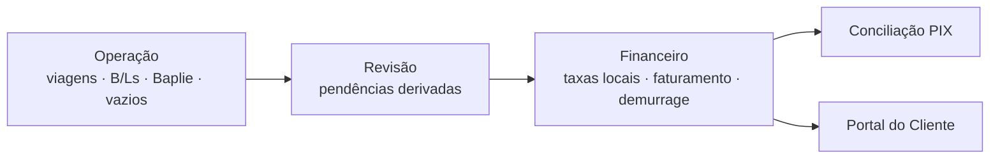

# Documentação do Vela e do Portal Fwlog

Índice documental revisado em 2026-10-14: links e lista de documentos vivos
conferidos contra `docs/`, e rotas da tabela de módulos conferidas contra os
roteadores. Diretrizes canônicas em [AGENTS.md](../AGENTS.md). Cada fato tem um
único documento dono ([tabela de donos](CONVENCOES.md#responsabilidade-de-cada-documento),
[ADR 0082](adr/0082-governanca-documental-dono-unico-e-adr-historica.md)).

## Por onde começar

| Você quer… | Vá para |
|---|---|
| Entender o sistema de cima | [ARCHITECTURE.md](ARCHITECTURE.md) + [CONTEXT.md](../CONTEXT.md) (glossário) |
| Rastrear uma tela, botão, hook, serviço ou RPC | [RASTREABILIDADE.md](RASTREABILIDADE.md) |
| Fazer ou mudar uma tela (aparência, blocos, botões, cores) | [identidade-visual.md](identidade-visual.md) |
| Mexer num módulo específico | [modules/](#módulos) abaixo |
| Rodar localmente | [setup/development.md](setup/development.md) |
| Fazer deploy | [setup/deploy.md](setup/deploy.md) |
| Rodar/entender os testes | [setup/testing.md](setup/testing.md) |
| Saber a regra vigente de uma tela ou domínio | Doc do módulo em [modules/](#módulos); o porquê está na ADR linkada |
| Entender uma regra que atravessa módulos | [operations/regras-de-negocio.md](operations/regras-de-negocio.md) |
| Entender segurança (RLS, auth, CSP) | [operations/seguranca.md](operations/seguranca.md) |
| Saber quais serviços externos o sistema usa, onde estão as contas e os segredos | [operations/servicos-externos.md](operations/servicos-externos.md) |
| Validar um fluxo manualmente | [operations/validacao.md](operations/validacao.md) |
| Resolver faturamento, baixa, restituição, cancelamento ou correção de B/L | [Manual financeiro](operations/manual-financeiro.md) |
| Saber por que algo foi decidido | [adr/](adr/README.md) |
| Saber onde registrar uma informação | [CONVENCOES.md](CONVENCOES.md#responsabilidade-de-cada-documento) |
| Comunicar resultados na linguagem do sistema (agentes) | [agents/linguagem-do-sistema.md](agents/linguagem-do-sistema.md) |

## Visão geral

Ciclo completo: **Operação** (viagens, B/Ls CNTR, carga solta e mistos, manifestos de granito, containers, veículos, Baplie EDI, vazios) → **Revisão** (resolução de pendências derivadas antes da emissão elegível) → **Comercial** (clientes, taxas locais, overrides) → **Financeiro** (faturamento, demurrage, conciliação PIX) → **Portal do Cliente** (consulta de faturas, pagamento, disputas).

O fluxo canônico detalhado está em [ARCHITECTURE.md](ARCHITECTURE.md#fluxo-operacional-e-financeiro).

## Módulos

| Módulo | Doc | Rotas |
|---|---|---|
| Viagens | [modules/viagens.md](modules/viagens.md) | `/viagens`, `/viagens/:voyageId` |
| BLs & EDI (import) | [modules/manifesto-edi.md](modules/manifesto-edi.md) | `/bls`, `/bls/:blId`, `/containers`, `/veiculos`, `/baplie`, `/vazios-importacao`, `/embarquevazios` |
| Granito | [modules/granito.md](modules/granito.md) | `/granito`, `/granito/taxas` |
| Chegadas/Saídas | [modules/chegadas-saidas.md](modules/chegadas-saidas.md) | `/chegadas-saidas` |
| Clientes | [modules/clientes.md](modules/clientes.md) | `/clientes`, `/clientes/:cnpj` |
| Taxas Locais | [modules/taxas-locais.md](modules/taxas-locais.md) | `/taxas-locais`, `/taxas-locais/tabelas` |
| Faturamento | [modules/faturamento.md](modules/faturamento.md) | operação em `/taxas-locais`; `/faturamento` é redirect legado |
| Demurrage | [modules/demurrage.md](modules/demurrage.md) | `/demurrage`, `/demurrage/taxas` |
| Conciliação PIX | [modules/reconciliacao-pix.md](modules/reconciliacao-pix.md) | `/reconciliacao` |
| Desbloqueio de CE | [modules/desbloqueio-ce.md](modules/desbloqueio-ce.md) | `/desbloqueio-ce`, `/portal/desbloqueio-ce` |
| Portal do Cliente | [modules/portal-cliente.md](modules/portal-cliente.md) | `/portal/*` |
| Operação & Suporte | [modules/operacao-suporte.md](modules/operacao-suporte.md) | `/painel`, `/revisao`, `/alertas`, `/alertas/regras`, `/relatorios`, `/line-up-tv/display`, `/admin` |

A coluna Rotas lista as rotas principais de cada módulo. O mapa completo, com
as rotas de cadastro, de Comunicados, do console e da Inspeção do Portal, é o
[mapa de rotas](ARCHITECTURE.md#mapa-de-rotas) da arquitetura.

## Referência transversal

- [ARCHITECTURE.md](ARCHITECTURE.md) — stack, camadas, modelo de dados, mapa de rotas.
- [CONTEXT.md](../CONTEXT.md) — glossário: termos de domínio, estados e a distinção entre conceitos próximos (B/L, Baplie, CE Mercante, demurrage…); a regra vigente fica no módulo.
- [identidade-visual.md](identidade-visual.md) — as nove regras de aparência, cores, letra e peças comuns do Vela e do Portal Fwlog.
- [ROADMAP.md](ROADMAP.md) — estado atual, backlog e riscos.
- [CHANGELOG.md](CHANGELOG.md) — histórico de entregas relevantes.
- [adr/](adr/README.md) — decisões numeradas (o porquê); o índice diz o status e onde está a regra vigente.
- [operations/](operations/regras-de-negocio.md) — [manual dos serviços externos](operations/servicos-externos.md),
  [regras de negócio transversais](operations/regras-de-negocio.md), [segurança](operations/seguranca.md),
  [manual financeiro](operations/manual-financeiro.md), [validação manual](operations/validacao.md),
  [limpeza dos dados de teste](operations/reset-ambiente.md), [backup lógico cifrado em R2](operations/backup-r2.md),
  [rate limit do Portal](operations/portal-rate-limit.md), [segredos dos jobs `pg_cron`](operations/segredos-cron.md),
  [observabilidade (Better Stack e Sentry)](operations/observabilidade.md), [configuração do Sentry](operations/sentry-configuracao.md)
  e [deploy do schema consolidado v1.0](operations/squash-schema-v1-deploy.md).
- [agents/](agents/linguagem-do-sistema.md) — [contrato de comunicação dos agentes](agents/linguagem-do-sistema.md)
  e [issue tracker](agents/issue-tracker.md).
- [setup/](setup/development.md) — desenvolvimento, deploy, testes.
- [plans/](plans/README.md) — planos de implementação vivos (ainda não executados).
- [spec/](spec/README.md) — specs funcionais ainda sem implementação concluída.
- [archive/](archive/README.md) — histórico: planos executados, specs concluídas, auditorias, QA e relatórios.

O ciclo de vida plano/spec → archive está definido em
[CONVENCOES.md](CONVENCOES.md#ciclo-de-vida-de-planos-e-specs).

## Registros históricos

Auditorias, relatórios e planos e specs concluídos ficam no
[arquivo histórico](archive/README.md), com o estado de cada plano e spec nos
índices de [planos arquivados](archive/plans/README.md) e de
[specs arquivadas](archive/specs/README.md); o que cada entrega produziu está no
[CHANGELOG](CHANGELOG.md). São registros da data em que foram feitos, não a
regra vigente. Os mais recentes sobre importações e CE Mercante são a
[revisão de 2026-10-09](archive/audits/2026-10-09-revisao-importacoes-ce-mercante.md),
a [revisão da PR 929](archive/audits/2026-10-11-revisao-pr-929-importacoes.md) e a
[revisão final da PR 929](archive/audits/2026-10-12-revisao-final-pr-929.md).

## Convenções da documentação

Ver [`CONVENCOES.md`](CONVENCOES.md) — formato, estrutura dos módulos,
labels de evidência, catálogo de ações e regras de histórico vs arquivo.
