# Revisão rigorosa das importações e dos dados de carga do Vela — 2026-10-21

Base: `main` = `806d2b5` (merge da PR #1004; a árvore é igual à `staging` `34e2a48`, que já traz as PRs #1005 e #1006 e as migrations até a 345). Banco: Postgres 16 local descartável, replay das 342 migrations vivas, uma cópia isolada por frente de revisão. Nada foi rodado contra produção ou staging; nenhum arquivo do repositório foi alterado.

Rótulos de evidência: **[reproduzido]** = executado no banco local ou rodando o código real do front em Node; **[teste]** = suíte existente que passa; **[lido]** = só leitura do código. Números de migration sem qualificação são da cadeia viva (`supabase/migrations/`); "arquivada NNN" é de `supabase/migrations_archive/`.

Linha de base: as 30 suítes local-pg das importações passaram na `main` (272 testes) **[teste]**.

---

## 1. Resumo executivo

O caminho da tela está, na maior parte, correto e atômico:
- **Atomicidade:** cada importação grava numa transação, e uma linha ruim no fim do arquivo não deixa nada gravado.
- **Reimportação idêntica do CE (o "CL"), das datas e do Granito:** não muda nada.
- **Preservação na reimportação do B/L:** id, datas, Demurrage, desova e perfil manual dos containers continuam iguais.
- **Revisões anteriores:** a maioria dos problemas M01–M25 está corrigida.

Os riscos que sobram estão em três lugares:
- **Portas pela API que não passam pelas regras da tela:** uma RPC antiga ainda aberta, gravação direta nas tabelas de carga e RPCs por lote de bundles antigos.
- **Concorrência sem trava:** o staging do Baplie não tem trava nenhuma, e as importações da mesma viagem entram em deadlock entre si.
- **Leitores que divergem do gravador:** o mesmo porto com duas réguas, números de peso lidos de dois jeitos e o Histórico lendo outra chave.

Os cinco riscos mais graves:

1. **F-01 (crítico):** `import_manifest_transactional`, a RPC do Manifesto CNTR que a ADR 0025 removeu, continua executável por qualquer usuário interno ativo (`002:28192`; a arquivada 290 também concedia, então produção provavelmente está igual). Uma chamada pela API faz tudo isto sem prévia nem rastro útil:
   - muda a viagem do B/L;
   - apaga o Cliente;
   - grava `financial_status = 'paid'`;
   - recria os containers, perdendo descarga, IMO e SOC;
   - cancela fatura.

   Reproduzido por quatro frentes e por mim.
2. **F-02 (crítico):** no B/L avulso PDF/DOCX (carga solta), "25.350 MT" vira 25.350 t (×1.000) e "55,244 M3" vira 55.244 m³. O aviso mostra um valor que não é o gravado, e nada barra o número. Ele vai para a taxa por tonelada (`blDocumentParser.ts:308-321`) **[reproduzido]**.
3. **F-03 (alto):** qualquer usuário ativo grava direto, pela Data API, em `bls`, `bl_containers`, `baplie_containers`, `vehicles`, `vazios_*` e `granite_*`. Isso contorna:
   - o P0008 (FCL de dois Clientes);
   - o vínculo de Cliente só por documento;
   - as regras dos veículos;
   - a trava do ADR fechado.

   O INSERT não deixa rastro. Uma linha forjada no staging do Baplie vira marca IMO no B/L e recalcula a taxa **[reproduzido]**.
4. **F-04 (alto):** o staging do Baplie não tem trava nem unicidade (H1.1). Duas gravações sobrepostas (duas abas, duas pessoas ou um retry com a primeira ainda rodando) deixam as duas listas: 600 linhas para 300 containers. O IMO do arquivo substituído continua cobrado, porque o plano das marcas agrega por `bool_or` **[reproduzido]**. Isso não explica sozinho a GREEN ITAJAI / 11 (ver F-04).
5. **F-05 (alto):** a confirmação de faturamento do arquivo de B/L COSCO é decidida no navegador (`override_billing = !impacto`, `blFreightImport.ts:524`). Com mais de 1.000 linhas de cálculo (teto `max_rows` do PostgREST) ou com uma corrida entre sessões, containers entram em B/L calculado ou faturado sem confirmação e sem rastro do override. A fatura é reemitida **[reproduzido]**.

Também graves:
- **F-06:** a reimportação do Manifesto BB reemite fatura sem confirmação.
- **F-07:** um container FCL termina dividido entre dois Clientes pelo vínculo posterior.
- **F-08:** a régua de portos do leitor do Baplie é diferente da do banco, e containers somem do staging.
- **F-09:** um EDI truncado entra pela metade.
- **F-10:** excluir o irmão de um container compartilhado já faturado deixa a fatura com meio container.
- **F-54:** a Base de Clientes com 3.000 Clientes e 500 B/Ls sem cliente levou 572 s localmente, contra o teto de 60 s. A causa é a reconciliação de alertas de Revisão, rodada uma vez por Cliente novo, não a 342.

Sobre os fatos de 20/10 na GREEN ITAJAI / 11:
- **Tabelas duplicadas:** a sequência 1.5 → 2.2 feita uma depois da outra deixa uma linha por container **[reproduzido]**. A duplicação no banco exige gravações sobrepostas (janela de cerca de 0,2 s com 760 containers). A explicação mais provável continua sendo a tela, já corrigida.
- **Consulta para provar no banco:** em F-04 há duas consultas somente de leitura que o Lucca pode rodar em produção. Eu não rodei.
- **Correções da 341 e da 342 e do commit `f483188`:** resolvem os casos relatados. Os buracos que sobram estão nos achados F-24, F-35 e F-37.

---

## 2. Mapa do sistema

Os diagramas seguem arquivo → leitor → prévia → RPC → tabelas → gatilhos → efeitos → telas. "Corpo vivo" é o que `pg_get_functiondef` devolve no replay. A migration indicada é a que trouxe esse corpo.

### Área 1 — Baplie (EDI, SMDG15 = 1.5 e SMDG22 = 2.2)

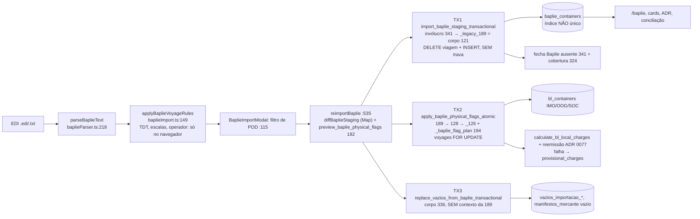

| Função | Corpo vivo | Trava |
|---|---|---|
| `import_baplie_staging_transactional` | invólucro `341:240-262`, que chama o `_legacy_189` (igual a `121:55-147`) | nenhuma |
| `apply_baplie_physical_flags_atomic` | invólucro da 189, que chama a 128, depois `_apply_..._126` e o plano `194:1335/1451` | `voyages FOR UPDATE` |
| `preview_baplie_physical_flags` | `182:234` | — |
| `replace_vazios_from_baplie_transactional` | `336:23` (o `_legacy_189` ficou órfão) | advisory `vazios_importacao:` |
| `resolve_baplie_divergence` | `194:1617` | `bl_containers FOR UPDATE` |
| `reconcile_voyage_baplie_coverage_alerts` / `_missing_alerts` | `324:77` / 341 | — |

Status: o leitor está correto nas duas versões com o código de porto completo. Problemas: falta trava (F-04), a régua de portos diverge (F-08) e o EDI truncado é aceito (F-09).

### Área 2 — Arquivo de B/L de container (COSCO `.xlsx`: B/L × container, Frete & Despesas, aba VIN)

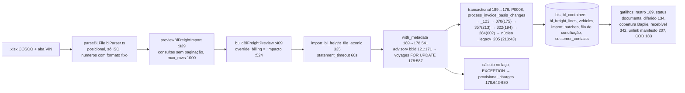

Pontos-chave do núcleo: `billing_locked` em `213:285` (a `175:308` foi substituída); containers em `213:629-760`; registro do override em `213:1074-1081`.

Status:
- **Atomicidade:** correta.
- **Preservação na reimportação:** correta.
- **Problemas:** o override é decidido no cliente (F-05); FCL pode terminar com dois Clientes (F-07); deadlock (F-11); B/L cancelado (F-12); totais incoerentes sem o aceite (F-27).

### Área 3 — Carga solta: Manifesto BB e B/L avulso (PDF/DOCX)

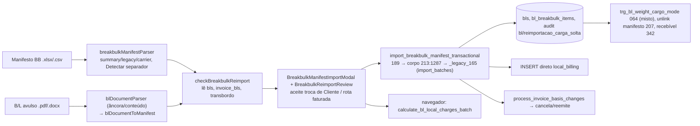

Status:
- **Corretos:** atomicidade, recusa de outra viagem (P0005), CE nunca gravado, "Detectar" no Manifesto BB, misto preservando os containers.
- **Problemas:** peso ×1.000 no PDF/DOCX (F-02), reemissão sem confirmação (F-06), divisões por 1.000 silenciosas (F-30).

### Área 4 — CE Mercante (o "CL") e Manifesto Mercante

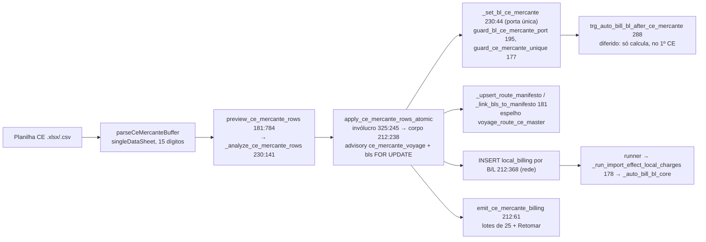

Status:
- **Corretos:** dado e unicidade (somando o Granito), canônico de 13, tudo ou nada, planilha idêntica sem efeito, nenhuma fatura dupla.
- **Problemas:** alerta crítico falso via runner (F-13), erro de câmbio recusa a planilha (F-17), tempo (F-18).

### Área 5 — Datas ("Importar Datas de Descarga e Devolução")

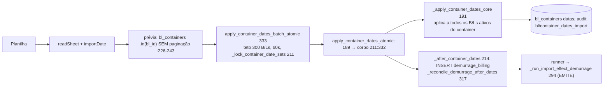

Status:
- **Corretos:** atomicidade, devolução vazia mantém a gravada, ordem das datas recusada no banco, prévia velha (201), arquivo idêntico sem efeito, desempenho (300 B/Ls em 5,2 s).
- **Problemas:** B/L cancelado recebe datas (F-12), RPC por B/L aberta (F-19), prévia sem paginação (F-31).

### Área 6 — Vazios de importação, Vazios pelo Baplie e Embarque de vazios

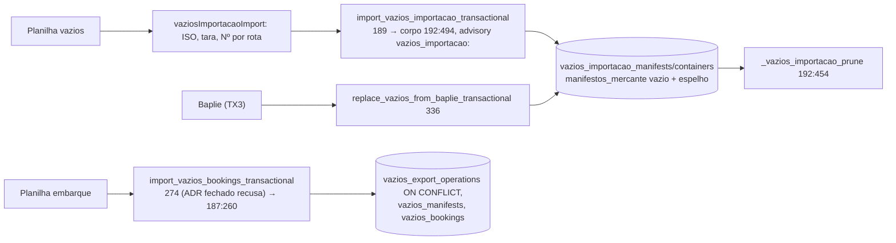

Status:
- **Corretos:** substituição só das rotas do arquivo, natureza preservada, Nº canônico, porto por `normalize_port_code`, Baplie sem vazios (336) só tira os do Baplie.
- **Problemas:** duplicação entre fontes e rotas (F-32), órfãos depois da exclusão (F-33), o servidor não repete as validações (F-29), rastro perdido na 336 (F-26).

### Área 7 — Veículos (planilha) e aba VIN

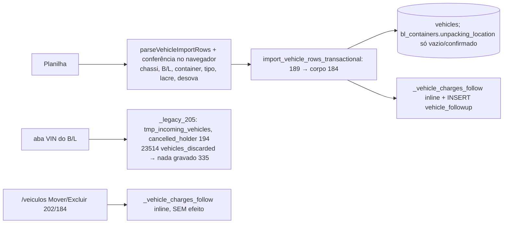

Status:
- **Corretos:** chassi em outra viagem ativa, B/L da viagem e desova conflitante no arquivo, conferidos também no servidor; recálculo e efeito chegam ao mesmo valor.
- **Problemas:** tipo, lacre, peso e confirmação de desova só no navegador (F-29); chassi repetido dá 23505 cru (F-36); Excluir/Mover sem rede (F-34).

### Área 8 — Cliente na importação, Base de Clientes e conciliação

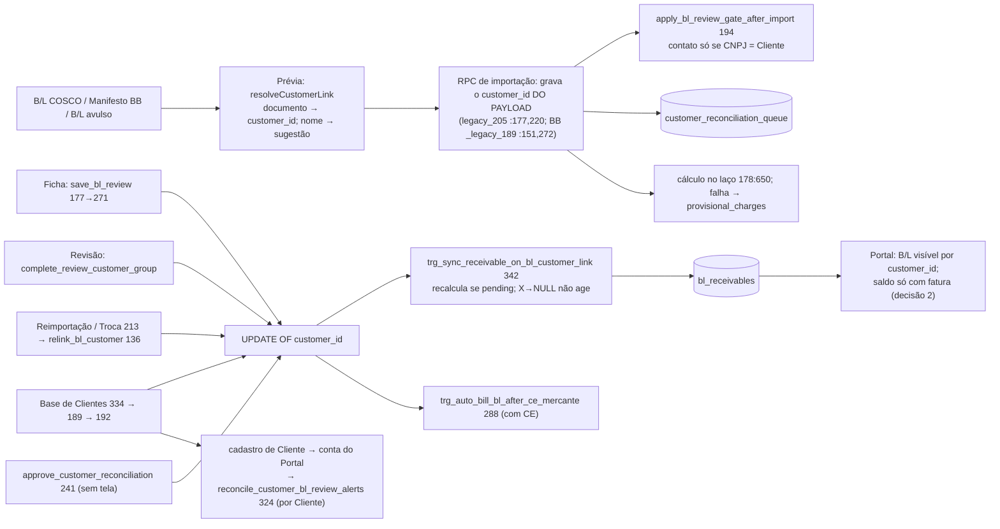

| Função | Corpo vivo | Observação |
|---|---|---|
| `apply_customer_base_batch_atomic` | 334 | arquivo inteiro, `statement_timeout 60s`, teto 3.000 |
| `apply_customer_base_row_atomic` | invólucro 189 → corpo 192 | vínculo por `manifest_customer_cnpj_cpf = cnpj` (192:201) |
| `sync_receivable_on_bl_customer_link` | 342 | `AFTER UPDATE OF customer_id ... WHEN NEW.customer_id IS NOT NULL` (342:85-88) |
| `trg_portal_reopen_on_new_process` | removido pela 343 | — |
| `save_bl_review` | 177 → `_legacy_070` 271 | descarta `p_audit_rows` (177:380-394) |
| `approve_customer_reconciliation` | 241 | sem conferir CNPJ (241:90-110) |
| `apply_bl_review_gate_after_import` | 194 | — |
| `relink_bl_customer` | 136 | só `service_role` |
| `capture_manifest_financial_contact` | 008 | — |

Status:
- **Corretos:** o recebível nasce uma vez em todas as portas de vínculo; a conta ativa do Portal não volta para análise nos quatro caminhos (decisão 1); a Base vincula só por documento exato.
- **Problemas:**
  - tempo da Base com B/Ls pendentes (F-54);
  - o servidor confia no `customer_id` (F-15);
  - `approve_customer_reconciliation` aberta (F-55);
  - H8.1 (F-56) e H8.2 (F-57).

### Área 9 — Viagens, escalas, Programação por planilha, exclusão e cancelamento

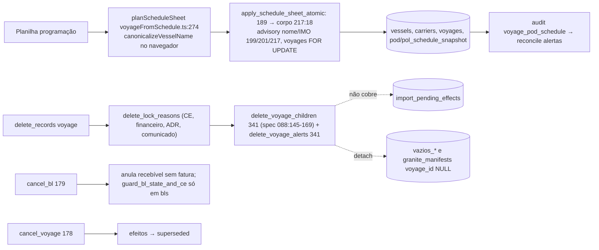

Status:
- **Corretos:** a mesma viagem nova não é criada duas vezes em arquivos simultâneos; o cancelamento do irmão reemite o container inteiro.
- **Problemas:** efeitos órfãos (F-14), M24 na exclusão (F-10), duplicação de navio pela API (F-40).

### Área 10 — Fila de efeitos (ADR 0065)

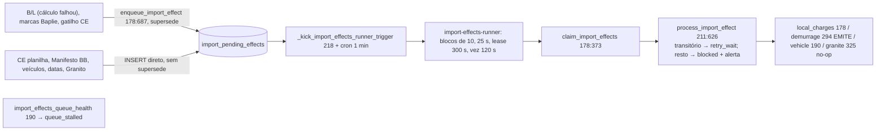

Status:
- **Corretos:** idempotente em todos os tipos; nenhuma fatura dupla em nenhum cenário de concorrência; o lease vencido é recuperado.
- **Problemas:** o alerta de bloqueio nunca fecha (F-13 e F-14), a exclusão deixa efeitos órfãos (F-14), `reactivate_bl` não reabre os efeitos (F-14).

### Área 11 — Frontend comum

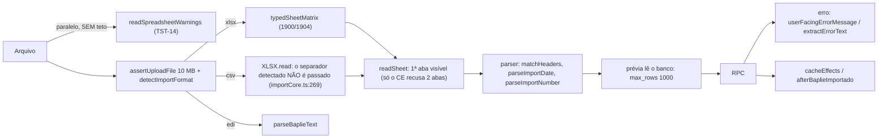

### Área 12 — Rastro e Histórico

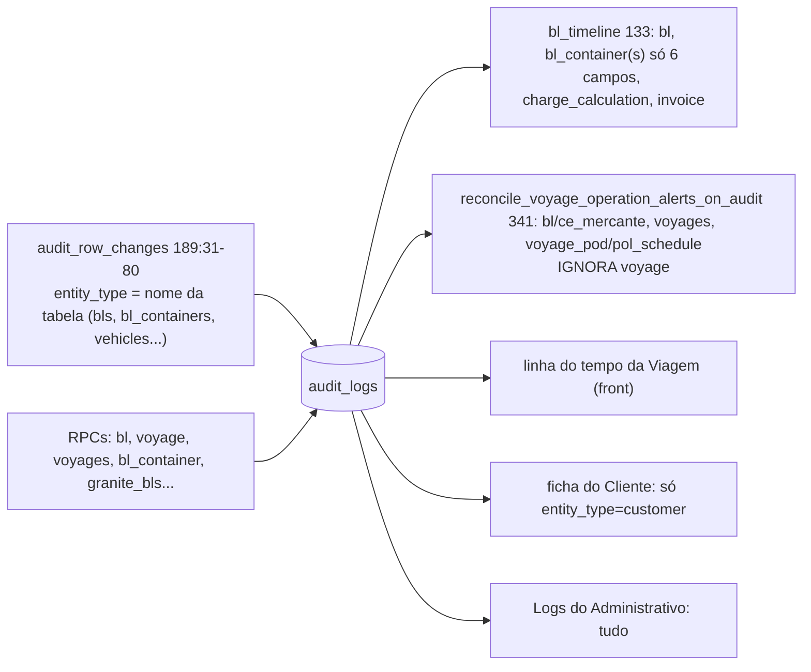

### Área 13 — Contagens e telas derivadas

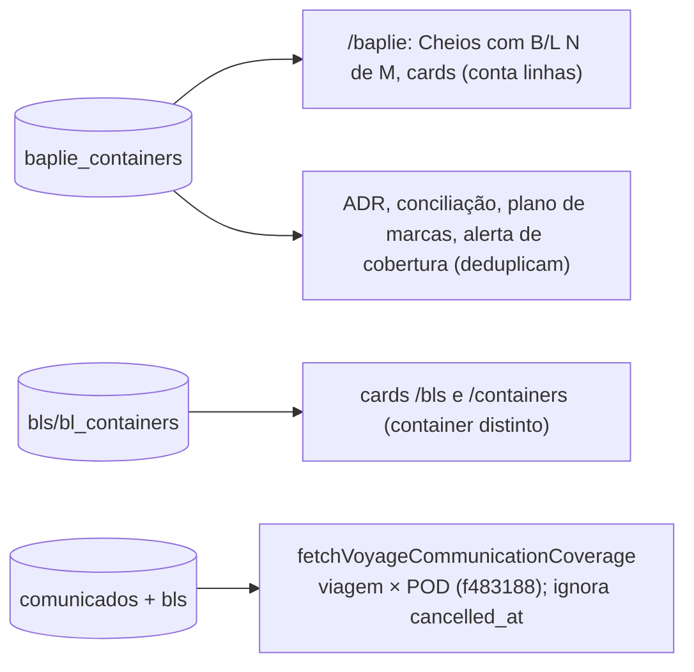

### Área 14 — Granito

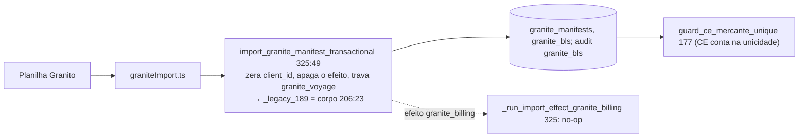

Status:
- **Corretos:** nada fatura por esse caminho; a reimportação idêntica não muda nada; o CE de Granito conta na unicidade do CE **[reproduzido]**.
- **Problema:** célula opcional em branco apaga o valor gravado na reimportação (F-41).

---

## 3. Matrizes

### 3.1 Importador × tabelas × efeitos

Legenda: ✓ efeito disparado; ✗ não dispara; R = recalcula na transação; Q = enfileira efeito.

| Importador | Tabelas escritas | Taxas Locais / recebível | Fatura emitida (ADR 0077) | Demurrage | Alertas | Comunicado / Portal | ADR | Histórico | Fila |
|---|---|---|---|---|---|---|---|---|---|
| Baplie (staging) | `baplie_containers`, `audit_logs` (`voyage/baplie_import`, só contagem) | via marcas (TX2): R; falha → Q `provisional_charges` | marcas → reemissão sem diálogo na 1ª importação (F-25) | ✗ | fecha Baplie ausente (341) e cobertura (324) | ✗ | lê o staging (deduplica) | só contagem; sem rastro por container | Q só se o recálculo falha |
| Baplie (marcas) | `bl_containers` IMO/OOG/SOC/`*_source` | R | ✓ reemite | ✗ | ✗ | Portal vê a nova fatura | ✓ | IMO aparece; SOC não (F-23) | idem |
| Vazios pelo Baplie | `vazios_importacao_*`, `manifestos_mercante` vazio (prune) | ✗ | ✗ | ✗ | CE Mercante pendente (rota sem Nº) | ✗ | seção vazios | rastro sem justificativa (F-26) | ✗ |
| B/L COSCO | `bls`, `bl_containers`, `bl_freight_lines`, `vehicles`, `import_batches`, fila de conciliação, `customer_contacts`, `alert_items` | R no laço; falha → Q | ✓ com override (F-05) | ✗ | `bl_vehicles_changed_on_reimport`; cobertura | recebível (342); contato pelo CNPJ | ✓ | linhas `bl` do núcleo; `bls`/`vehicles` invisíveis (F-23) | Q só em falha |
| Manifesto BB | `bls`, `bl_breakbulk_items`, `import_batches` | navegador recalcula; Q `local_billing` (INSERT direto) | ✓ **sem confirmação** (F-06) | ✗ | ✗ | recebível (342) | ✓ | `bl/reimportacao_carga_solta` em JSON | Q (duplica, F-42) |
| B/L PDF/DOCX | igual ao BB (1 linha por arquivo) | igual | igual | ✗ | ✗ | igual | ✓ | igual | igual |
| CE Mercante (CL) | `bls.ce_mercante`, `manifestos_mercante`, espelho, `audit bl/ce_mercante` | R no 1º CE (diferido: só calcula) | emissão em lotes de 25 + rede | ✗ | CE pendente (na hora); reenvio/Desbloqueio; **`import_effect_blocked` falso** (F-13) | libera Portal e Desbloqueio | ✓ | ✓ CE e Nº | Q `local_billing` por B/L |
| Datas | `bl_containers` datas (todos os B/Ls ativos do container) | ✗ | ✗ | R + Q `demurrage_billing` (emite) | atraso (`overdue`) | Portal Demurrage | ✓ | ✓ + JSON | Q por grupo |
| Vazios (planilha) | `vazios_importacao_*`, `manifestos_mercante` vazio, espelho | ✗ | ✗ | ✗ | CE pendente | ✗ | ✓ | só Logs do Admin | ✗ |
| Embarque de vazios | `vazios_export_operations`, `vazios_manifests`, `vazios_bookings` | serviços lançados | ✗ | ✗ | ✗ (não invalida alertas, F-38) | ✗ | ADR de Saída | só Logs do Admin | ✗ |
| Veículos | `vehicles`, `bl_containers.unpacking_location` | R (sem fatura viva); isento anula o recebível | ✓ via base (ADR 0077) | ✗ | ✗ | ✗ | ✓ | invisível no Histórico do B/L | Q `vehicle_followup` |
| Base de Clientes | `customers`, `customer_contacts`, `customer_portal_accounts`, `portal_provisioning_events`, `bls` (`customer_id`, status, `review_status`, `notes`), fila de conciliação | 342 + cálculo explícito (2 a 3 vezes por B/L; valor final igual) | só com CE: auto-bill, retenção pelo Portal ou Q `local_billing` | ✗ | `review_customer_unlinked` fecha; `review_portal_not_ready` abre (custo: F-54) | visibilidade por `customer_id`; saldo só com fatura; sem disparo direto de comunicado | — | `bl customer_id` ✓; ficha do Cliente ✗ (F-24) | Q só se o auto-bill falha |
| Programação | `vessels`, `carriers`, `voyages` (snapshots) | data de referência da tarifa (F-33b) | ✗ | ✗ | reconcilia (`voyages`) | Portal: programação | ✓ | 2× "Viagem criada" | ✗ |
| Granito | `granite_manifests`, `granite_bls` | ✗ (não fatura) | ✗ | ✗ | ✗ | ✗ | ✓ | `granite_bls` | efeito inserido e apagado |

### 3.2 Cenário de reimportação × esperado × real

| Cenário | Esperado | Real | Fonte |
|---|---|---|---|
| Arquivo idêntico: B/L COSCO | no-op | Cria lote novo e troca o `batch_id`. Apaga e reinsere o frete. B/L sem fatura é recalculado com tabela e ROE do dia. B/L faturado não é recalculado, sem "Carga alterada" nem efeito. | [reproduzido] F03 |
| Arquivo idêntico: CE (CL) | no-op | no-op (sem audit, efeito nem recálculo) | [reproduzido] F05 |
| Arquivo idêntico: Manifesto BB | no-op | Lote novo e `batch_id` reescrito; o navegador recalcula os B/Ls "sem mudança". | [reproduzido] F04 |
| Arquivo idêntico: datas | no-op | no-op (300 B/Ls) | [reproduzido] F06 |
| Arquivo idêntico: vazios | no-op | Os vazios trocam id e "Importado em". | [reproduzido] F07 |
| Arquivo idêntico: Granito | no-op | no-op | [reproduzido] F04 |
| Arquivo idêntico: Baplie | aceita sem perguntar | Aceita sem diálogo e reaplica as marcas; vazios e Nº mantidos. | [reproduzido] F01/F02 |
| Linha a mais, B/L COSCO sem aceite | containers e totais iguais | Containers não mudam, mas peso e CBM do B/L mudam (24.000 → 36.000). | [reproduzido] F03 (F-27) |
| Linha a mais, B/L COSCO com aceite | entra e recalcula ou reemite | igual ao esperado | [reproduzido] |
| Linha a menos, B/L COSCO | sai só o que a prévia mostrou | igual; container com Invoice de Demurrage ou veículos não sai | [reproduzido] + [teste] |
| Linha alterada: tipo ou peso do container | só com aceite | não muda sem aceite; o peso do B/L muda | [reproduzido] |
| Linha alterada: IMO declarado | containers viram IMO | Só os containers novos viram IMO. | [reproduzido] F03 (F-28) |
| Manifesto BB: peso ou itens de B/L faturado | pedir confirmação (ADR 0077 item 2) | Aplica, cancela e reemite sem aviso (R$ 100 → R$ 125). | [reproduzido] F04 (F-06) |
| Baplie 2.2 sobre 1.5 e o contrário | 1 linha por container, marcas iguais | 1 linha por container. Com o tipo ISO antigo (`4510` × `45G1`) o diálogo marca todos como "Alterado". Com porto de 3 letras, containers somem. | [reproduzido] F01 |
| Arquivo de outra viagem: B/L COSCO | recusar | Sem aceite, o envio inteiro cai com "P0002 Vinculo de batch falhou". Com aceite, o B/L muda de viagem. | [reproduzido] F03 |
| Arquivo de outra viagem: Manifesto BB | recusar | P0005 desfaz o lote | [reproduzido] F04 |
| Arquivo de outra viagem: Baplie | bloquear | TDT de outra viagem bloqueia só no navegador. Sem TDT, não confere nada. | [reproduzido] F01 |
| B/L cancelado no arquivo: B/L COSCO | aviso, não tocar | A prévia diz "Sem mudança". A gravação recusa o envio inteiro ("cancelado: somente leitura"). Pela RPC antiga, os containers do cancelado mudam. | [reproduzido] F03/F07 (F-12) |
| B/L cancelado no arquivo: Manifesto BB e CE | aviso | aviso; a linha não é tocada | [reproduzido] F04/F05 |
| B/L cancelado no arquivo: datas | ? | Grava no cancelado e propaga aos irmãos ativos. | [reproduzido] F06 (F-12) |
| B/L faturado, mudança de faturamento | override e ADR 0077 | B/L COSCO: com aceite, reemite. Pela corrida ou pelo teto de 1.000 linhas, reemite sem aceite (F-05). | [reproduzido] |
| Troca de cliente, sem aceite | mantém e avisa | mantém consignatário, CNPJ e e-mail; `customer_changes_ignored` | [reproduzido] F03 |
| Troca de cliente, com aceite | troca e o e-mail vai para o novo | igual (M14 corrigido) | [reproduzido] |
| Mudança de POD, sem aceite | nada muda | O POD fica, mas o Place of Delivery muda. | [reproduzido] F03 |
| Mudança de POD, com aceite | muda e desvincula o Manifesto | igual (207) | [reproduzido] F05 |
| B/L em COD | POD mantido | mantido (183) | [teste] |
| Part Lot, mesmo Cliente | rateio certo nos dois | B/L sem fatura não é recalculado quando o irmão chega ou sai (1,5 container). Corrige na emissão pelo CE. | [reproduzido] F03 (F-28) |
| Part Lot, Clientes diferentes (FCL) | P0008 | Recusa se os dois têm Cliente. Se um entra sem Cliente e é vinculado depois, o container fica dividido. | [reproduzido] F03 (F-07) |
| Baplie com POD filtrado | ? (pergunta) | Substitui a viagem inteira; some o Nº de Manifesto de vazios e a natureza. | [reproduzido] F01/F02 (F-21) |
| Duas importações simultâneas: Baplie com Baplie anterior | uma espera a outra | As duas listas ficam (união; ou 600 linhas para 300). | [reproduzido] F02 (F-04) |
| Duas importações simultâneas: Baplie, 1ª da viagem | idem | 40P01 numa delas | [reproduzido] |
| Duas importações simultâneas: B/L × B/L e B/L × Baplie | idem | 40P01 em 15 de 15 e em 6 de 8 | [reproduzido] F03 (F-11) |
| Duas importações simultâneas: CE × B/L e datas × B/L | idem | 40P01 em 1 de 6 e reproduzido no outro par | [reproduzido] F05/F06 |
| Duas importações simultâneas: CE × CE, datas × datas, vazios × vazios, programação × programação | serializa | serializa | [reproduzido] + [teste] |
| Reimportação depois de excluir a viagem | — | Os vazios ficam órfãos. Os efeitos pendentes viram `blocked` com alerta permanente. | [reproduzido] F07/F09 |
| Reimportação depois de cancelar o B/L (reemissão com o mesmo número) | ? | Recusada pela tela; pela RPC antiga, altera o cancelado. | [reproduzido] |
| Bundle antigo (RPC por lote) | recusar | Grava parcial: lote 1 fica. Na aba VIN descarta o chassi em silêncio. Nas datas, reemite a Demurrage e para no meio. | [reproduzido] F03/F06 (F-19) |
| Retry depois de timeout | idempotente | B/L: serializa pela trava `bl:`. Baplie: duplica se a 1ª ainda roda. | [lido] / [reproduzido] |

---

## 4. Achados

Ordenados por severidade. "Reproduzir" aponta para o roteiro mínimo; os scripts das frentes ficaram no scratchpad e foram apagados na limpeza final (ver §9), então o roteiro está descrito aqui.

### Críticos

**F-01 — Crítico (latente, só pela API) — A RPC do Manifesto CNTR continua aberta e grava sem nenhuma das regras atuais.** Áreas 2, 3, 12 e transversal.
- **Descrição.** `import_manifest_transactional`, da importação que a ADR 0025 removeu, é `SECURITY DEFINER` e tem `EXECUTE` para `authenticated`. O corpo é o `_legacy_165`, e no `ON CONFLICT` grava do payload:
  - `voyage_id`, `customer_id`, `financial_status` e `review_status`;
  - apaga e recria os containers.

  Ela não passa pela P0008, pela Troca de Consignatário (213), pela ADR 0043 (vínculo por documento) nem pela ADR 0092. `guard_bl_financial_status_port` não age, porque dentro de DEFINER o papel corrente é o dono da função.
- **Evidência.**
  - Grant: `002:28192` (`GRANT ALL ... TO authenticated`); arquivada 290:86 (`GRANT EXECUTE ... TO authenticated`), o que indica o mesmo em produção.
  - Chamadores: só `src/integration/supabase.integration.test.ts:56`. A carga solta usa o `_legacy_165` direto, como DEFINER (`213:1414`), então não precisa do grant público.
  - É também o único gravador de `import_batches.file_hash`.
- **Reproduzir** [reproduzido por mim no `vela_r00`]:
  1. Como `authenticated` com JWT de operador ativo:
     ```sql
     SELECT import_manifest_transactional('x.xlsx', <viagem B>, auth.uid(), 'container', 'h', 1, 1,
       '[{"id":"BL1","pol":"CNSHA","pod":"BRSSZ","financial_status":"paid","review_status":"ok"}]',
       '[{"bl_id":"BL1","container_number":"FTEN1000002","type":"20GP"}]', '[]', false)
     ```
     O B/L antes estava na viagem A, faturado, com Cliente e com container com descarga.
  2. Depois da chamada:
     - `voyage_id` passou para B;
     - `customer_id` virou NULL;
     - `financial_status` passou de `invoiced` para `paid`;
     - `review_status` virou `pending_review`;
     - o container antigo foi apagado e o novo entrou sem descarga.
  3. O audit tem só linhas `bls` sem justificativa.

  As outras frentes viram, além disso:
  - a fatura cancelada sem reemissão e o recebível aberto no Cliente antigo (F04);
  - com `customer_id: null` e lista vazia, o B/L sem Cliente, marcado `review_status='ok'` e sem containers (F08).
- **Impacto.** B/L no Portal do Cliente errado; cobrança e Demurrage perdidas; "pago" sem baixa; Mercante desalinhado.
- **Correção sugerida.** `REVOKE EXECUTE ... FROM authenticated` no nome público (ou `DROP` do nome público, mantendo o `_legacy_165` interno da carga solta). Mais um teste em `grantsDoReplay`/`rpcCatalog` afirmando que nenhuma RPC de importação sem chamador no front é executável por `authenticated`.
- Ver revisão financeira (baixa, área 7) quanto ao `paid` sem pagamento.

**F-02 — Crítico — B/L avulso PDF/DOCX: peso em toneladas com três decimais entra 1.000 vezes maior; cubagem com vírgula também.** Área 3.
- **Descrição.** `readWeight` lê "25.350" com `thousandsAware`, então dá 25350, e depois multiplica por 1.000 porque a unidade é MT/TONS (`blDocumentParser.ts:308-319`). Resultado: 25.350.000 kg, ou 25.350 t. O aviso diz "lido como 25350 kg", que não é o valor gravado. `readMeasurement` usa en-US fixo (`:321`), e "55,244 M3" vira 55.244 m³ sem aviso. O caminho do PDF/DOCX não usa o teto `NUMERIC_CEILINGS` do Manifesto BB (`breakbulkManifestParser.ts:944`), e esse teto (200 mil t) também não pegaria 25.350 t.
- **Reproduzir** [reproduzido por mim]: bundle de `blDocumentParser.ts` e `normalizeBlDocumentFields` + `blDocumentToManifest` com `grossWeight: '25.350 TONS'` → `gross_weight_kg: 25350000`, `bb_weight_ton: 25350`; `'11.652 MT'` → 11.652 t; `measurement: '55,244 M3'` → `total_cbm: 55244`.
- **Impacto.** Taxa por tonelada 1.000 vezes maior na fatura do Cliente. O operador só percebe se ler o peso na prévia, e o aviso mostra outro número.
- **Correção sugerida.**
  - Com unidade de tonelada, ler o separador seguido de três dígitos como decimal (ou bloquear como ambíguo, igual ao "Detectar" do Manifesto BB).
  - Aplicar o bloqueio por ambiguidade e o teto por coluna também neste caminho.
  - Cubagem com vírgula decimal.
  - Aviso com o valor efetivamente gravado.

**F-10 — Crítico (cenário estreito) — M24 continua valendo na exclusão: excluir o irmão de um container compartilhado já faturado deixa a fatura do outro com meio container.** Área 9.
- **Descrição.** Cancelar o irmão reemite a fatura do outro com o container inteiro **[teste `auditoriaCeContainerCompartilhado`]**. Excluir o irmão (possível quando ele não tem CE nem documento financeiro) não registra nenhuma mudança: os containers saem por cascata e `capture_invoice_basis` não encontra os irmãos porque o B/L pai já foi apagado na mesma transação **[lido]**.
- **Reproduzir** [reproduzido F07]:
  1. B/Ls `Z1` e `Z2`, mesmo Cliente, mesmo container; CE só no `Z1`, fatura com `quantity 0.5`, total 500.
  2. `delete_records('bl', ['Z2'])` como Administrativo.
  3. Resultado: a linha de `Z1` continua com 0,5 e há 0 `invoice_basis_pending_changes`.
- **Impacto.** Cobrança a menor, sem alerta.
- **Correção sugerida.** Em `delete_records('bl')`, capturar a base dos irmãos antes do DELETE (ou apagar os containers antes do B/L). Testar o caminho "excluir".
- Ver revisão financeira, área de container compartilhado.

### Altos

**F-03 — Alto — Escrita direta pela Data API nas tabelas de carga (H1.6 confirmada).** Transversal.
- **Descrição.** As políticas `*_active_global` (`is_active_user()`) e o privilégio de INSERT/UPDATE de `authenticated` deixam qualquer usuário ativo gravar direto em:
  - `bls`, `bl_containers`, `bl_breakbulk_items`, `bl_freight_lines`;
  - `vehicles`;
  - `baplie_containers`;
  - `vazios_importacao_*`, `vazios_manifests`, `vazios_bookings`;
  - `granite_*`;
  - `import_batches`;
  - `voyages`, `vessels`.

  Os gatilhos de auditoria de `bls`, `bl_containers`, `bl_breakbulk_items`, `bl_freight_lines`, `granite_bls`, `vazios_importacao_containers` e `vazios_bookings` cobrem só UPDATE e DELETE. `baplie_containers` não tem auditoria nenhuma.
- **O que segura** [reproduzido F12]:
  - os gatilhos de porta seguram CE, situação financeira, datas, Manifesto Mercante (REVOKE `212:33`) e cancelamento de viagem;
  - DELETE é recusado;
  - Portal, inativo e `anon` são recusados em tudo.
- **O que passa** [reproduzido F02, F06, F07, F12]:
  - container FCL num B/L de outro Cliente (P0008 contornado);
  - `bls.customer_id` trocado sem documento, embora `relink_bl_customer` esteja fechada;
  - linha duplicada e mudança de IMO no staging do Baplie, sem audit. A aplicação das marcas leva o IMO ao B/L, recalcula e registra "Importação de Baplie (marcas)";
  - chassi já ativo em outra viagem;
  - bookings com o ADR fechado;
  - `bl_breakbulk_items` com 1.000.000 kg.
- **Produção.** Pela 340 (`340:1-50`), o privilégio vem dos *default privileges* da plataforma; a RLS é a única barreira, e as políticas são as mesmas do replay.
- **Uso pela tela.** O front só escreve direto em `bl_containers.unpacking_location`, `vazios_importacao_containers.natureza`, `voyages`/`vessels`/`carriers` e `vazios_export_*`.
- **Correção sugerida.** Revogar INSERT/UPDATE de `authenticated` nas tabelas que só as RPCs gravam. Para as duas colunas que a tela grava, usar grant por coluna (ou RPC com motivo). Acrescentar teste local-pg de "escrita direta recusada".

**F-04 — Alto (crítico latente) — Staging do Baplie sem trava nem unicidade: duas gravações sobrepostas deixam as duas listas (H1.1 confirmada).** Área 1.
- **Descrição.** O corpo da 121 faz `DELETE WHERE voyage_id` e depois `INSERT`, sem advisory, sem `voyages FOR UPDATE` e sem índice único (`001:5766`). Em READ COMMITTED, a segunda chamada espera as linhas antigas, não vê as novas da primeira e insere as suas. A RPC também aceita o mesmo container repetido em `p_rows`, inclusive cheio e vazio ao mesmo tempo **[reproduzido F02, F12]**. Todas as outras importações de viagem têm trava: Granito `206:52`, vazios `187:82`, CE `181:1168`/`212:309`, programação `188:51`, B/L `121:171`.
- **Reproduzir** [reproduzido F02]. Viagem com Baplie anterior de 150 containers; sessão 1 com 300 containers segurando o COMMIT 3–4 s; sessão 2 começando 1 s depois:
  - listas diferentes → `total=500`;
  - mesma lista → `total=600 distinct=300`, e o audit diz duas vezes "150 → 300";
  - arquivo 1 com IMO e arquivo 2 sem IMO → ficam as duas linhas, e `_baplie_flag_plan` agrega por `bool_or`. O B/L continua IMO classe 3.
  - Na primeira importação da viagem não há duplicata: 40P01 no flush diferido do status documental (proteção acidental).
- **GREEN ITAJAI / 11.** Não explica sozinha. A sequência 1.5 → 2.2, uma depois da outra, deixa uma linha por container **[reproduzido; teste `alertasDaViagem`]**. Para duplicar, a segunda gravação precisa começar nos cerca de 140–190 ms da primeira (760 containers). O botão fica desligado durante a gravação (`BaplieImportModal.tsx:267`), e o cliente não refaz a chamada. Com o grupo "No Baplie, sem B/L" repetindo os 482 cheios, a tela explica a observação.
- **Prova objetiva** (somente leitura, para rodar em produção; não rodei):
  ```sql
  SELECT container_number, count(*) FROM baplie_containers WHERE voyage_id = 62 GROUP BY 1 HAVING count(*) > 1;
  SELECT changed_at, old_value, new_value, changed_by FROM audit_logs
   WHERE entity_type = 'voyage' AND entity_id = '62' AND field_name = 'baplie_import' ORDER BY changed_at;
  ```
- **Impacto.**
  - Para o Cliente: taxa IMO/OOG ou SOC/COC de um arquivo substituído.
  - Na tela: o `/baplie` conta em dobro (F-22).
  - No rastro: o audit não bate com o banco.
- **Correção sugerida.**
  - `pg_advisory_xact_lock('baplie_voyage:'||id)` ou `voyages FOR UPDATE` no início (a mesma trava das marcas).
  - Recusar container repetido em `p_rows`.
  - Índice único `(voyage_id, upper(btrim(container_number)))` depois de limpar.
- Ver revisão financeira, área 9, quanto ao valor.

**F-05 — Alto — A confirmação de faturamento do arquivo de B/L COSCO é decidida no navegador (H2.1 confirmada).** Área 2.
- **Descrição.** O servidor calcula `billing_locked` (`213:285`), mas aplica containers, veículos e rota quando o payload traz `override_billing=true` (`213:629-635`). A tela manda `true` sempre que a prévia não viu impacto (`blFreightImport.ts:524`). O rastro `FATURAMENTO_SOBRESCRITO` depende do `billing_impact` mandado pelo cliente (`213:1081`). A prévia lê `charge_calculations`, faturas e irmãos sem paginação.
- **Reproduzir** [reproduzido F03, chamando as funções reais do front contra o banco local e emulando `max_rows=1000`]:
  - **(a) Teto de 1.000 linhas.** 150 B/Ls calculados (1.200 linhas de cálculo). `fetchBillingLockedBlIds` (`:1725`) recebeu 1.000 linhas, e 25 B/Ls pareceram livres. A reimportação com um container a mais, sem aceite, aplicou o container nesses 25, sem rastro de override.
  - **(b) Corrida.** Prévia sem cálculo; outra sessão importa o CE e emite a fatura (1.500); a confirmação inclui o container e reemite (1.950) sem o aviso.
- **Impacto.** Fatura reemitida sem a decisão do operador. O valor segue a ADR 0077, mas sem confirmação e sem rastro.
- **Correção sugerida.** O servidor recusa `override_billing=true` quando ele próprio detecta `billing_locked` sem `billing_impact` confirmado (ou exige um `expected` da prévia). Paginar as consultas da prévia (ou levá-las a uma RPC de prévia no servidor).
- Ver revisão financeira, área 9.

**F-06 — Alto — A reimportação de carga solta muda a base de B/L faturado sem confirmação e cancela e reemite a fatura.** Área 3.
- **Descrição.** No Manifesto BB e no B/L avulso, mudar peso, itens ou modo de carga de um B/L faturado é aplicado sem pedir o override. Isso contraria a ADR 0077, item 2: "reimportação com override". A fatura é cancelada e reemitida na mesma transação. A prévia e o resultado dizem "Tudo o que o arquivo trazia foi aplicado". O aceite existe só para rota e Cliente.
- **Reproduzir** [reproduzido F04]:
  - B/L BB faturado em R$ 100; reimportação com mais peso → R$ 125, sem aviso.
  - B/L de container faturado que recebe carga solta vira misto: a fatura é cancelada, a reemissão falha por `mixed_bl_terminal_conflict` e o B/L fica sem fatura viva.
- **Impacto.** O Cliente recebe uma fatura nova sem que o operador tenha decidido. A fatura pode sumir (caso misto).
- **Correção sugerida.** Incluir peso, itens e `cargo_mode` no bloco de confirmação de faturamento da carga solta, conferido no servidor. Não cancelar a fatura quando a reemissão não é possível.
- Ver revisão financeira, área 9.

**F-07 — Alto — Container FCL termina dividido entre Clientes.** Áreas 2 e 8.
- **Descrição.** `assert_no_fcl_shared_between_customers` (P0008, `176:126-163`) ignora B/L sem Cliente e só roda na importação. O vínculo posterior (`save_bl_review`, Base de Clientes, Revisão) não confere de novo.
- **Reproduzir** [reproduzido F03]:
  1. B/L da Alfa com o container X.
  2. B/L com CNPJ não cadastrado, também com X: aceito.
  3. `save_bl_review` vincula a Beta: aceito.
  4. Resultado: X fica FCL com Alfa e Beta, e a reimportação do irmão passa a ser bloqueada.
- **Impacto.** O rateio cobra os dois Clientes por um FCL (ADR 0078, item 11).
- **Correção sugerida.** Chamar o P0008 também nas portas de vínculo de Cliente (gatilho em `bls.customer_id`).

**F-08 — Alto (condicional) — O leitor do Baplie e o banco usam réguas de porto diferentes.** Áreas 1 e 12.
- **Descrição.**
  - **Pares do mesmo porto:** `portCode.ts` trata BRNVT e BRREC como portos próprios, mas `normalize_port_code` os converte em BRITJ e BRSUA.
  - **Códigos de 3 letras:** os códigos do 1.5 COSCO (`SSZ`, `ITJ`, `PNG`, `RIG`, `SSA`, `PEC`, `SUA`, `NVT`) não são reconhecidos pelo leitor.
- **Reproduzir** [reproduzido F01, F11]:
  - Baplie com POD BRNVT numa viagem com escala BRITJ: todos os containers são descartados como "fora das escalas", só com aviso.
  - POD de 3 letras: o container é descartado com aviso e o resto é importado.
  - POL desconhecido (`KRPUS`): o arquivo inteiro é bloqueado (BAP-03 continua para o POL).
  - `/baplie` mostra a rota "aguardando B/L" enquanto o alerta do banco a considera coberta.
  - O status "BLs e CEs da Escala" é gravado em `::BRITJ` com a escala em `::BRNVT`.
  - Evidência: `portCode.ts:69-78`, `baplieParser.ts:428-434, 486-494`, `baplieImport.ts:172-182`.
- **Impacto.** Marcas IMO/OOG e SOC/COC não aplicadas, com taxa a menor. A conciliação e a cobertura ficam erradas.
- **Correção sugerida.** Uma régua só (a do banco) no front. Tabela de códigos de 3 letras do 1.5 no leitor. POD desconhecido como pendência que exige aceite, não como aviso.

**F-09 — Alto — EDI truncado (sem UNT/UNZ) entra pela metade sem erro.** Área 1.
- **Descrição.** O leitor não confere a presença nem as contagens de UNT e UNZ (`baplieParser.ts:222-228`).
- **Reproduzir** [reproduzido F01]: um arquivo de 15 unidades cortado no meio entrou com 6, sem erro.
- **Impacto.** O staging substitui a viagem inteira com o arquivo parcial. As marcas do Baplie anterior caem dos B/Ls dos containers ausentes (com "Baplie completo"), as taxas são recalculadas e a conciliação mostra divergências falsas.
- **Correção sugerida.** Exigir UNT e UNZ e conferir as contagens. Arquivo truncado vira erro de arquivo (ADR 0092).

**F-54 — Alto — A Base de Clientes passa do teto de 60 s quando há B/Ls sem cliente pendentes (H8.3).** Área 8.
- **Descrição.** O custo não vem do recálculo da 342 (cerca de 7 ms por B/L). Vem da reconciliação de alertas de Revisão, que roda uma vez por Cliente novo:
  - `portal_create_account_on_customer_insert`;
  - `trg_reconcile_bl_review_on_portal_change` (320);
  - `reconcile_customer_bl_review_alerts` (324);
  - `resolve_alert_item`, que varre todos os itens ativos do tipo.

  O cabeçalho da 334 (334:36-40) mediu só a gravação de Clientes ("3.000 ≈ 10 s").
- **Reproduzir** [reproduzido F08, `pg_stat_xact_user_functions`]:

  | Base | B/Ls sem cliente pendentes | Tempo local |
  |---|---|---|
  | 3.000 Clientes novos | 0 | 8,6 s |
  | 3.000 Clientes novos | 100 | 36,5 s (`resolve_alert_item` 28.100 chamadas, 20,4 s) |
  | 3.000 Clientes novos | 500 | **572,8 s** (reconciliação: 546,8 s) |
- **Impacto.** No momento em que a Base mais importa (muitos B/Ls importados sem cliente), a chamada recebe 57014 e nada é gravado. Dividir o arquivo reduz os Clientes, mas cada parte ainda paga o custo multiplicado pelos itens ativos. Que o PostgREST aplica o teto de 60 s da função não foi verificado (§9).
- **Correção sugerida.** Calar o gatilho de alertas do Portal durante a Base (o GUC `vela.bl_review_batch` já existe para o gatilho de `bls`) e reconciliar uma vez por Cliente no fim. `resolve_alert_item` deve buscar por índice (`alerts(entity_type, entity_id)`).
- Ver revisão de alertas.

### Médios

**F-11 — Médio (operacional) — Deadlock entre importações da mesma viagem.** Transversal (H2.3 confirmada em parte).
- **Descrição.** O INSERT em `bls` e em `import_batches` toma `FOR KEY SHARE` na linha da viagem (FK). Depois, `178:587` pede `voyages FOR UPDATE`, e o gatilho diferido do status documental (`134:83`) pede o mesmo no COMMIT.
- **Reproduzir** [reproduzido]:

  | Par | Resultado |
  |---|---|
  | B/L × B/L, mesma viagem, sem container comum | 40P01 em 15 de 15 (`import_bl_freight_with_metadata_legacy_189 line 42`) |
  | B/L × Baplie | 40P01 em 6 de 8 |
  | CE × B/L, 80 B/Ls em ordem inversa | 40P01 em 1 de 6 |
  | datas × B/L | reproduzido pela F06; a F03 não reproduziu em 10 tentativas |
  | Manifesto BB × Manifesto BB, mesmo B/L novo | 40P01 |
  | Baplie × Baplie, 1ª importação | 40P01 |
- **Impacto.** Nada fica pela metade, mas uma importação é recusada com "deadlock detected" em inglês. Só a tela do CE repete uma vez (`ceMercanteImport.ts:261`).
- **Correção sugerida.** A mesma trava por viagem no início de toda importação de viagem (advisory `import_voyage:<id>` ou `voyages FOR NO KEY UPDATE` antes da primeira escrita). Repetir em 40P01 na tela.

**F-12 — Médio — O "somente leitura" do B/L Cancelado só é imposto na linha `bls`, não nos containers.** Áreas 2, 5 e 9.
- **Descrição.** `guard_bl_state_and_ce` (gatilho em `bls`) recusa qualquer mudança de coluna de B/L cancelado, mas `bl_containers` não tem essa guarda. Consequências:
  - **Arquivo de B/L COSCO pela tela:** a prévia não lê `cancelled_at` (`blFreightImport.ts:1525-1545`) e diz "Sem mudança". A gravação recusa o envio inteiro, porque o `UPDATE bls SET batch_id` (`178:607-610`) dispara a guarda. Outro B/L novo do mesmo envio também não entra **[reproduzido F03]**.
  - **Pela RPC antiga** (`import_bl_freight_transactional`, que não grava `batch_id`): os containers do B/L cancelado são trocados e ele continua cancelado **[reproduzido F07]**.
  - **Planilha de datas:** grava no B/L cancelado e propaga para os B/Ls ativos que dividem o container **[reproduzido F06]**. A prévia também não confere.
- **Impacto.** Carga de B/L fora do faturamento é alterada. A tela do B/L recusa o arquivo depois de uma prévia "limpa".
- **Correção sugerida.** Prévia do B/L e das datas lendo `cancelled_at` (aviso que não toca, como no BB e no CE, ou erro, conforme decisão). Guarda de B/L cancelado também em `bl_containers` e `vehicles`.

**F-13 — Médio (ver revisão de alertas) — A rede `local_billing` da planilha de CE abre alerta crítico falso que nunca fecha.** Áreas 4 e 10.
- **Descrição.** A planilha cria `local_billing` para todo B/L com CE novo ou trocado (`212:368`). Para B/L em Revisão ou sem tabela, o efeito vira `blocked` e abre `import_effect_blocked` crítico, sem o número do B/L (`178:243`, `211:746-772`), enquanto a tela diz "Aguardando Revisão".
  - Nada fecha esse alerta: nem a Revisão concluída seguida do `retry_import_effect` que fatura.
  - "Resolver com justificativa" é recusado para esse tipo.
  - `ImportResultPanel`, o único componente com o botão de reprocessar, não é usado em nenhuma tela.
  - Duas emissões simultâneas do mesmo lote (Retomar em duas abas) deixam também `billing_auto_issue_failed` aberto num B/L já faturado.
- **Reproduzir** [reproduzido F05, F09]: CE de um B/L com `review_status` pendente; `claim_import_effects` + `process_import_effect` como `service_role` → `blocked` + alerta; concluir a Revisão, `retry_import_effect` → fatura emitida, alerta ainda ativo.
- **Correção sugerida.** Tratar as esperas de negócio como espera, não como bloqueio. Fechar `import_effect_blocked` quando o efeito conclui. Expor o reprocessamento.

**F-14 — Médio — Efeitos órfãos depois de exclusão ou cancelamento (H9.1 confirmada).** Áreas 9 e 10.
- **Descrição.**
  - `delete_voyage_children` (341, spec `088:145-169`) e `delete_records('bl')` não tratam `import_pending_effects`. O runner leva os efeitos a `blocked/effect_domain_missing`, com alerta crítico permanente.
  - `_import_effect_voyage_id` lê como id de viagem o número só numérico de um B/L excluído.
  - `reactivate_bl` (`089:99`) não reabre os efeitos encerrados no cancelamento, enquanto `reactivate_voyage` (`211:561`) reabre. O B/L fica com CE, sem fatura e sem efeito.
- **Reproduzir** [reproduzido F07, F09]:
  - B/L com efeito pendente → `delete_records('voyage')` → `process_import_effect` → `blocked` + alerta; `retry_import_effect` bloqueia de novo.
  - `cancel_bl` e depois `reactivate_bl` → o efeito continua `superseded`.
- **Correção sugerida.** A exclusão marca os efeitos da entidade como `superseded` com motivo. `reactivate_bl` reabre os efeitos como `reactivate_voyage` já faz.
- Ver revisão de alertas.

**F-15 — Médio — O servidor confia no `customer_id`, no status de conciliação e nos aceites mandados pelo navegador (BL-18 continua).** Áreas 2, 3 e 8.
- **Evidência.** B/L: `213:219`, `213:468`, `213:264`. Manifesto BB: `_legacy_189` `:151,272`.
- **Reproduzir** [reproduzido F03, F04]:
  - CNPJ da Alfa com `customer_id` da Beta → B/L ligado à Beta, `reviewed`, recebível na Beta. A planilha de CE depois emitiu a fatura para a Beta.
  - `matched_name` com `customer_id` → ligado e `reviewed`.
  - No Manifesto BB, igual: o B/L foi calculado com a Condição de A e o recebível nasceu para A **[reproduzido F08]**.
- **Impacto.** Pela tela não ocorre, porque o navegador só manda Cliente casado por documento. Pela API e por bundle alterado, sim. Contraria a ADR 0043.
- **Correção sugerida.** O servidor resolve o Cliente pelo CNPJ normalizado e ignora o `customer_id` do payload (ou recusa quando não bate).

**F-16 — Médio — As regras da viagem e do arquivo do Baplie existem só no navegador; a conferência do TDT é incompleta.** Área 1.
- **Descrição.**
  - **Só no navegador:** TDT, navio, escalas, operador, POL e container repetido. A RPC aceita qualquer lista (F01-05, F02-10).
  - **TDT:** arquivo sem TDT não é conferido; com duas mensagens no arquivo, só o último TDT conta; um TDT só com a viagem gera o aviso falso "nome lido (TDT)".
  - **"Outro operador"** (pendência 7 da PR 929): sem B/L do parceiro na viagem, os containers dele são ignorados. `COSCO` × `COS` no NAD+CA sem B/L bloqueia o arquivo inteiro.
- **Reproduzir** [reproduzido F01, casos 5-6 e 10-12].
- **Correção sugerida.** Conferir no servidor viagem, escalas e duplicatas. Referência do operador pelo SCAC do armador (pergunta).

**F-17 — Médio — Na planilha de CE, um erro de cálculo (câmbio, tabela) recusa a planilha inteira.** Área 4.
- **Descrição.** A tela sempre grava em modo diferido, e nesse modo o cálculo do gatilho roda sem tratamento de erro (`288:42-44`). O modo síncrono antigo gravava o CE e enfileirava a recuperação.
- **Reproduzir** [reproduzido F05]: item em USD sem ROE → "Nada foi gravado", com "Cambio (ROE) nao configurado" em cada B/L.
- **Impacto.** O CE, que libera Portal e Desbloqueio, fica bloqueado por um problema financeiro.
- **Correção sugerida.** Capturar a falha de cálculo no modo diferido e enfileirar `provisional_charges` (ADR 0092, item 5: passo técnico depois da gravação).
- Ver revisão financeira, área 1.

**F-18 — Médio — Tempo perto dos tetos.** Áreas 2 e 4.
- **CE (o CL).** `apply_ce_mercante_rows_atomic` não declara `statement_timeout` (diferente da 333, da 334 e da 335). A reconciliação do "CE Mercante pendente" roda por B/L, e o custo é quadrático dentro de D-5. Medido: 150 B/Ls em 3,0 s; 500 B/Ls em 8,8 s **[reproduzido F05]**. Acima de cerca de 450 B/Ls deve dar 57014 no teto de 8 s de `authenticated`, sem gravar nada, com a mensagem "Reduza o periodo" (errada para esse caso).
- **B/L COSCO.** 1.000 containers em 2,7 s; 7.000 containers em 58,2 s, superlinear e no limite de 60 s **[reproduzido F03]**. Em Postgres puro, o `SET statement_timeout` da função não estende o timeout da sessão; quem aplica é o PostgREST, o que não foi verificado.
- **Marcas do Baplie.** 5,3 s com 500 B/Ls recalculados, sem tarifas reais e sem `statement_timeout` próprio **[reproduzido F02]**.
- **Correção sugerida.** `statement_timeout` explícito na planilha de CE e nas marcas. Reconciliação do alerta uma vez por viagem, no fim. Mensagem de 57014 própria de cada importador.

**F-19 — Médio — RPCs antigas por lote e por linha continuam executáveis, e não há proteção contra bundle antigo (H2.2 e H5.1 confirmadas).** Transversal.
- **Evidência.** Com `EXECUTE` para `authenticated` e sem chamador no front:
  - `import_bl_freight_with_metadata` (`150:171`);
  - `import_bl_freight_transactional` (`128:871`);
  - `apply_container_dates_atomic` (`015:241`);
  - `apply_customer_base_row_atomic` (`185:193`).

  A 189 preserva os grants. `public/chunk-recovery.js` e `src/lib/lazyPage.ts` só recarregam quando um chunk falha; não há versão mínima de build.
- **Reproduzir** [reproduzido F03, F06]:
  - B/L: lote 1 gravado e lote 2 recusado com P0008 → o lote 1 fica. Com chassi de outro B/L ativo na aba VIN, a RPC antiga grava o B/L e descarta o chassi em silêncio (a 335 recusaria tudo).
  - Datas: a primeira chamada por B/L grava e já reemite a Invoice de Demurrage, a segunda falha. Ficam de fora o teto de 300 B/Ls, a ordem das travas e o `expected_*`.
- **Impacto.** Fura a ADR 0092 (arquivo gravado em parte) para quem está com uma aba aberta de antes do deploy.
- **Correção sugerida.** Revogar o `EXECUTE` (seis suítes local-pg chamam essas RPCs como `authenticated` e precisam mudar). Opcional: checar a versão de build antes de gravar.

**F-20 — Médio — Baplie: a prévia velha sobrescreve sem aviso e os três passos não são uma transação (H1.3 e H1.5 confirmadas).** Área 1.
- **H1.3.** `reimportBaplie` lê o staging (`:546`), espera a confirmação (`:564`) e grava (`:566`) sem `expected`, versão nem contagem. Uma importação de outra aba feita nesse intervalo é sobrescrita; os vazios ficam do arquivo errado (staging `E1,E2` × manifesto `E3,E4`), sem alerta **[reproduzido F02]**.
- **H1.5.** Staging, marcas e vazios são três transações. Se a segunda não roda, o staging fica com IMO e o B/L sem, sem alerta e sem efeito. A pendência só aparece ao abrir `/baplie` (`countPendingBapliePhysicalFlags`, `hasPendingBaplieVazios`) **[reproduzido F02]**. A comparação de vazios não distingue "falhou" de "substituído por planilha" (`baplieImport.ts:295-299`). "Atualizar vazios do Baplie" depois de uma planilha da mesma rota desfaz a planilha, e o container fica em dois manifestos **[reproduzido F02]**.
- **Correção sugerida.** Mandar a contagem e o hash do staging lido na prévia como `expected`. Fazer as marcas na mesma transação do staging ou enfileirar o efeito `physical_flags`, que existe mas não tem produtor desde a 178. Marcar a origem dos vazios para distinguir a substituição por planilha.

**F-21 — Médio (pergunta) — O filtro de POD do modal do Baplie substitui a viagem inteira (H1.4 confirmada).** Área 1.
- **Descrição.** `BaplieImportModal.tsx:115` grava só os PODs marcados, mas a RPC apaga a viagem inteira. Os containers dos PODs desmarcados somem do staging e suas marcas caem dos B/Ls. A `_vazios_importacao_prune` (192) apaga o Nº de Manifesto de vazios e a natureza (cama) das rotas desmarcadas, embora o diálogo prometa manter o Nº. Reimportar o arquivo completo não devolve nenhum dos dois.
- **Reproduzir** [reproduzido F01, F02]: arquivo só com BRRIG numa viagem com BRSSZ → containers de BRSSZ apagados, marca IMO derrubada, cobertura aberta com 9 divergências.
- **Correção sugerida.** Depende da decisão (§8): ou substituir só os PODs do arquivo, ou avisar com clareza e não prometer manter o Nº.

**F-22 — Médio — Com staging duplicado, `/baplie` conta em dobro e a diferença esconde a duplicata (H1.2 confirmada).** Áreas 1 e 13.
- **Descrição.** `diffBaplieStaging` indexa por `Map` (`baplieImport.ts:253-254`), então diz "sem diferença". `bapliePresentation.ts:68-94` e `Baplie.tsx:342-350` contam linhas. Resultado:
  - "Cheios com B/L" dá 20 de 20 quando o real é 10 de 10;
  - os cards de containers, IMO e OOG dobram;
  - aparece um "Atualizar vazios do Baplie" falso, e o recadastro falha com 23505 cru.

  O ADR, a conciliação, o plano de marcas e o alerta de cobertura deduplicam.
- **Reproduzir** [reproduzido F01, F10]: duplicar as linhas do staging no banco e rodar as funções puras.
- **Correção sugerida.** Some com a correção de F-04. Até lá, deduplicar na leitura da tela.

**F-23 — Médio — O Histórico do B/L não mostra boa parte do que a importação muda (H12.1 confirmada em parte).** Área 12.
- **Descrição.** `bl_timeline` (133) não lê o gatilho em `bls`, nem `vehicles`, e lê só 6 campos de `bl_containers`.
- **Não aparecem** [reproduzido F11]:
  - o novo consignatário na Troca aceita (aparece só "Cliente: id → id");
  - container que entra ou sai, lacre e peso;
  - o histórico de um container removido, que some com ele;
  - SOC/COC vindo do Baplie;
  - veículos e desova.
- **Com problema de apresentação:**
  - o peso do Manifesto BB vira JSON sem valores;
  - aparecem termos técnicos (`FATURAMENTO_SOBRESCRITO`, "pod: BRITJ → BRVIX", ids de Cliente);
  - a "Origem" da importação aparece como "Motivo", contra `regras-de-negocio.md`.
- **Aparecem certo:** POD, POL, viagem, pesos e CNPJ do B/L, CE, Nº de Manifesto, datas e IMO/ONU/OOG.
- **Correção sugerida.** `bl_timeline` passa a ler `bls`, `vehicles` e as mudanças de `bl_containers` do B/L (pelo `bl_id` gravado no rastro), com rótulos na língua da operação.

**F-24 — Médio — "Grava X, lê Y" em alertas e fichas (H4.2 confirmada; H12.2 confirmada em parte).** Áreas 4 e 12.
- **Descrição.**
  - **Informar Nº.** "Informar Nº" (inclusive de vazios) grava `voyage/ce_master`, e `reconcile_voyage_operation_alerts_on_audit` ignora `voyage` (`341:207`). O "CE Mercante pendente" só fecha no detector seguinte, a cada 15 min **[reproduzido F05, F11]**.
  - **Reconciliações na hora.** O B/L novo não fecha "B/Ls esperados" na hora; vazios, troca de POD e `cancel_bl` também não reconciliam na hora **[lido]**. Baplie e Manifesto pela planilha de CE são compensados por chamadas diretas. Programação e cancelar ou reabrir viagem gravam `voyages`, que é lido.
  - **"B/Ls esperados"** compara o porto sem normalizar: um POD BRVIT numa escala BRVIX mantém o alerta aberto **[reproduzido F11]**.
  - **Ficha do Cliente.** Lê só `entity_type='customer'`, mas o gatilho grava `customers`; nada da Base de Clientes aparece **[reproduzido F11]**.
  - **Linha do tempo da viagem.** Busca `import_batches` pelo número da viagem, mas o gatilho grava o número do lote. O Nº informado no lote 7 apareceu também na viagem 7 **[reproduzido F11]**.
- **Correção sugerida.** Um vocabulário de `entity_type` (ou leitores que aceitem o singular e o plural). Chamar a reconciliação nas portas que gravam `voyage`. Normalizar o porto no "B/Ls esperados".
- Ver revisão de alertas para abertura e fechamento.

**F-25 — Médio (ver revisão financeira, área 9) — A primeira importação do Baplie aplica marcas e reemite fatura sem diálogo; a reimportação não diz quais faturas mudam.** Área 1.
- **Descrição.** M11, parte "reemissão sem aviso". A base capturada em si está correta **[reproduzido F02]**.
- **Correção sugerida.** A prévia lista as marcas novas por B/L e as faturas que serão reemitidas.

**F-26 — Médio — A 336 tirou o rastro de "Vazios pelo Baplie" (regressão da 189).** Áreas 6 e 12.
- **Descrição.** A 336 redefiniu o nome público `replace_vazios_from_baplie_transactional` sem `_set_import_context`. As linhas de audit saem com `justification = NULL`, e o `_legacy_189` ficou órfão. É o único dos 14 invólucros da 189 que perdeu o contexto.
- **Reproduzir** [reproduzido F01, F02, F07].
- **Correção sugerida.** Pôr o `_set_import_context` de volta no corpo novo e apagar o `_legacy_189` órfão.

**F-27 — Médio — No B/L COSCO sem aceite, os totais do B/L mudam e os containers não.** Área 2.
- **Descrição.** Arquivo com 3 containers, sem aceite: ficam 2 containers, mas `total_weight_kg` vai de 24.000 a 36.000 e o CBM muda. Com POD sem aceite, o POD fica e o `place_of_delivery` muda (`213:533, 542-543`) **[reproduzido F03]**.
- **Impacto.** O peso do B/L diverge da soma dos containers nas telas, no ADR e em relatórios. Não muda a taxa.
- **Correção sugerida.** Não aplicar os totais derivados quando os containers não são aplicados; tratar o Place of Delivery junto do POD.

**F-28 — Médio (ver revisão financeira) — Part Lot e IMO na reimportação do B/L COSCO.** Área 2.
- **Irmão sem fatura.** Não é recalculado quando o outro B/L chega ou sai: ficam 1 + 0,5 = 1,5 container cobrado até a emissão pelo CE, que recalcula (BL-09 continua).
- **IMO declarado na reimportação.** Marca só os containers novos, porque a prévia preserva o perfil gravado (`:432`, `:1158`) **[reproduzido F03]**.
- **Correção sugerida.** Recalcular os irmãos sem fatura na mesma transação. Decidir se o IMO declarado vale para os containers já gravados (pergunta).

**F-29 — Médio — Regras que só o navegador confere (furo pela API e pelo bundle antigo).** Transversal.

| Importador | O que só o navegador confere |
|---|---|
| B/L COSCO | outra viagem (o servidor move com o override), porto, teto dos números |
| Manifesto BB | porto, teto e não negativo no peso (`bb_weight_ton` sem CHECK) |
| Baplie | ver F-16 |
| Vazios | ISO, tara, porto: o servidor aceitou `lixo 123`, tara -5 e `XXQQQ`, e criou o Manifesto da rota **[reproduzido F07]** |
| Veículos | container do B/L, tipo ISO, lacre, faixa de peso e a confirmação da troca de desova (`unpacking_confirmed` aceito sem conferência) **[reproduzido F06]** |
| Base de Clientes | dígito verificador do CNPJ |
| Programação | nome canônico do navio e porto (F-40) |

- **O servidor repete:** ISO em `bl_containers` e `baplie_containers` (CHECK), B/L e viagem cancelados (gatilhos), Manifesto de 13 caracteres (CHECK), CE (15 dígitos, unicidade, viagem e rota), ordem das datas e prévia velha das datas.
- A documentação (`manifesto-edi.md:174-175`) diz que as regras de veículos valem no servidor; isso é verdade só em parte.

**F-30 — Médio — Divisões por 1.000 silenciosas e números lidos com formato fixo.** Áreas 2, 3 e 7.
- **Manifesto BB.** No layout legado en-US, `"12,500"` kg vira 12,5 kg. No layout do armador em pt-BR, `"12.500"` vira 12,5 kg. O bloqueio só pega o caso que multiplica. Com o formato declarado errado, o valor entra 1.000 vezes maior com um aviso, sem pedir aceite **[reproduzido F04]**. `manifesto-edi.md:128` afirma que o layout do armador bloqueia `12.500`, o que não acontece.
- **B/L COSCO.** `blParser.ts:288,292,293` usa formatos fixos: "3,800" vira 3,8 kg, "12,345.678" vira nulo sem aviso e CBM "30,000" vira 30.000 **[reproduzido F03]**.
- **Aba VIN.** Peso com exatamente 3 casas decimais é descartado como `null` sem aviso (`blParser.ts:313-358`) **[reproduzido F10]**.
- **Correção sugerida.** A mesma resolução de separador com bloqueio nas duas direções; aviso quando um número é descartado.

**F-31 — Médio — As prévias leem o banco sem paginação (`max_rows=1000`).** Áreas 2, 5 e 11.
- **Datas** (`containerDatesImport.ts:134,243`). Acima de 1.000 containers, os restantes viram "não encontrado" e o arquivo inteiro é recusado (DAT-13 continua).
- **B/L COSCO.** `fetchSharedContainerNumbers` e `fetchContainerSiblings` (`blFreightImport.ts:1106,1745`) buscam todas as viagens, sem paginar. O truncamento esconde o container compartilhado e o conflito FCL, e leva ao `override_billing=true` de F-05.
- **Reproduzir** [reproduzido F03 com `max_rows` emulado]; datas [lido].
- **Correção sugerida.** Paginar, ou fazer a prévia no servidor.

**F-32 — Médio — Vazios de importação duplicados entre fontes e entre rotas.** Área 6.
- **Descrição.** A planilha e o Baplie não conferem se o container já está em outra rota ou em outra fonte da viagem. `/baplie` oferece "Confirmar" mesmo com vazios de planilha, porque só procura `source='baplie'`. O Line Up (`lineup.ts:644-667`) e o ADR (`agencyDepartureReport.ts:1205`) contam linhas, e o ADR acusa uma divergência falsa **[reproduzido F07]**.
- **Correção sugerida.** Unicidade de container por viagem nos vazios de importação, ou regra explícita de qual fonte vale (pergunta).

**F-33 — Médio — Órfãos e datas de referência.** Áreas 6 e 9.
- **(a) H6.1 confirmada.** Excluir a viagem deixa `vazios_importacao_manifests` e seus containers com `voyage_id` NULL e o `vazios_manifests` órfão. Eles aparecem em `/vazios-importacao` sem filtro como "Sem navio e viagem" e "Sem número" (uma pendência falsa), e não há como limpar **[reproduzido F07]**.
- **(b) Data de Referência da Tarifa.** `bl_local_charge_reference_date` (`248:28`) faz `pod_schedule_snapshot -> b.pod` sem `normalize_port_code`: com POD BRVIT ou BRNVT, a data cai para hoje em vez da ETA. Também usa `eta::date` e `CURRENT_DATE` em UTC, então depois das 21h de Brasília vira o dia seguinte **[reproduzido F06, F07]**. Ver revisão financeira.
- **Correção sugerida.** (a) Apagar os vazios junto com a viagem, ou dar uma limpeza (pergunta). (b) Normalizar o porto e usar `America/Sao_Paulo`.

**F-34 — Médio — Excluir e Mover veículo não vão para a fila quando o recálculo falha.** Área 7.
- **Descrição.** `_vehicle_charges_follow` engole o erro e avisa "adiado para o efeito", mas `delete_vehicles_with_reason` e `move_vehicles_to_bl` não enfileiram nada.
- **Reproduzir** [reproduzido F06]: sem ROE, item em USD; Excluir um veículo → fila inalterada, taxa com a contagem antiga, sem alerta.
- **Correção sugerida.** Enfileirar `vehicle_followup` nesses dois caminhos.

**F-35 — Médio (área 13; ver revisão de comunicados e alertas) — A Cobertura de comunicados conta B/L cancelado.** 
- **Descrição.** `fetchVoyageCommunicationCoverage` (`customerCommunications.ts:1394`) não lê `cancelled_at`; o filtro usa `financial_status==='cancelled'`, que nenhuma rotina grava.
  - Um Cliente que só tem B/L cancelado fica pendente para sempre.
  - Um B/L cancelado num POD cria uma linha "devido" num porto onde o Cliente não tem carga **[reproduzido F10 na função pura]**.
- **Correto nessa tela:** o "5 de 4" está resolvido (dá "1 de 2" com 1 reenvio pendente) e a linha é por viagem × POD.
- **Situação:** é a parte do M19 que sobra.
- **Relacionado:** o alerta de cobertura do Baplie (324) também conta B/L cancelado, e a tela de `/baplie` não **[reproduzido F02]**.

**F-36 — Médio — Mensagens do banco cruas, genéricas ou com a orientação errada.** Área 11.
- **Descrição.**
  - **Códigos sem mensagem.** `errors.ts:93-114` não mapeia `P0001`, `P0003`, `P0005`, `P0006` e `P0008`. No Manifesto BB, no B/L PDF/DOCX, no Baplie, em Veículos, na Programação, no CE e no Granito, a mensagem vira "Falha ao importar.".
  - **Código e texto crus no B/L.** O arquivo de B/L usa `extractErrorText` (`blFreightImport.ts:831`) e mostra "Nada foi gravado: P0008 …", "40P01 deadlock detected" e "23505 tmp_bl_freight_import_pkey".
  - **Orientação errada.** O 57014 diz "Reduza o período".
  - **Mensagens que não dizem o quê:**
    - chassi e container repetidos aparecem como "Este registro ja existe." sem dizer qual;
    - textos sem acento ou com id interno ("Viagem 9060003 cancelada");
    - XLSX truncado dá "Unsupported ZIP file", em inglês;
    - arquivo de 0 byte recebe uma mensagem genérica.
- **Reproduzir** [reproduzido F03, F06, F07, F10 com `userFacingErrorMessage`].
- **Correção sugerida.** Mapear os SQLSTATEs de negócio em pt-BR, com o B/L ou a linha; usar a mesma função em todos os modais; avisar, na falha de rede, que a gravação pode ter acontecido.

**F-37 — Médio — Leitura de planilha.** Área 11.
- **CSV.** CSV com `;` e vírgulas no texto é lido com `,`: o detector decide `;`, mas `importCore.ts:269` não passa o separador ao SheetJS. A recusa diz "Colunas obrigatórias…" **[reproduzido F10]**.
- **Duas abas.** Com duas abas visíveis com dados, só a primeira entra, sem aviso (só o CE recusa). Datas, Vazios, Manifesto BB, Base de Clientes, Granito e Programação ignoram as outras (INF-04 parcial) **[reproduzido F10]**. No CE, com a 1ª aba vazia e os dados na 2ª, a tela diz "Planilha vazia." **[reproduzido F05]**.
- **Fórmula.** Fórmula sem valor em cache vira célula vazia, sem aviso **[reproduzido F10]**.
- **TST-14.** O leitor de avisos (`ImportParts.tsx:113`) abre o arquivo inteiro antes do teto de 10 MB: um CSV de 15 MB levou 2,5 s **[reproduzido F10]**.

### Baixos

- **F-38 — Cache.** CE e Vazios não invalidam `voyage-route-ce-masters` (lido em `/viagens`), e o Embarque de vazios não invalida os alertas. O ADR pagina sem `.order()` **[lido F10]**. `afterBaplieImportado` invalida os alertas, então `/alertas` se atualiza depois do Baplie (341) **[lido]**.
- **F-39 — Mesmo B/L duas vezes no envio.**
  - **Manifesto BB:** 23505 cru no B/L novo; no B/L existente, a última linha vence sem aviso.
  - **Vários PDFs do mesmo B/L:** não detectados.
  - **B/L COSCO em dois arquivos:** 23505.
  - **CE:** o servidor aceita o mesmo B/L duas vezes no payload e troca o CE sem confirmação (só pela API, porque o front bloqueia).

  **[reproduzido F03, F04, F05]**.
- **F-40 — Programação.** O servidor confia no nome canônico vindo da tela: pela API, "F07 Novo Navio" e "F07 NOVO  NAVIO" criaram navios e viagens duplicados. Não há índice único em `vessels` nem em `voyages`. A gravação de uma linha e a "Nova viagem" inserem sem as travas da 199/201/217. O servidor também grava o porto como vier (nasceu uma escala `::BRVIT`) **[reproduzido F07, F11]**.
- **F-41 — Granito.** Na reimportação, uma célula opcional em branco apaga o valor gravado **[reproduzido F04]**.
- **F-42 — Fila.**
  - Produtores que inserem direto (CE, BB, veículos, datas, Granito) não substituem o pendente do mesmo tipo (INF-14). O resultado continua idempotente, só o audit cresce.
  - `granite_billing` é enfileirado com consumidor no-op, e `physical_flags` não tem produtor.
  - Erro que escapa do tratamento (57014, rede) volta do runner como HTTP 200 `completed_with_error` (`drain.ts:58-64`). O efeito vira `blocked/lease_expired` depois de 5 leases (cerca de 25 min), sem a causa.
  - Efeito de usuário desativado vira `blocked/authorization_invalid`.
  - INF-07: o efeito fica "Concluído" com espera de negócio.

  **[reproduzido F09]**.
- **F-43 — Saúde da fila (H10.1).** `import_effects_queue_health` (190) ignora `running` com lease vencida e `blocked`. Só pesa com o runner parado, e o `claim` recupera o lease vencido quando o runner está vivo **[reproduzido F09]**.
- **F-44 — Baplie, leitor.**
  - Segundo EQD no mesmo LOC+147 entra sem POL, POD e peso, sem aviso (BAP-13).
  - O caractere de escape é aplicado duas vezes (`AB?+12?:34` vira `AB+12`).
  - Com WT e VGM juntos vale o último segmento, não o VGM.
  - Os 672 `RFF+BM` = "BM" da viagem 62 continuam gravados; só a leitura os ignora (`baplieReadModel.ts:31-32`).

  **[reproduzido F01]**.
- **F-45 — ADR conta `45G1` como 45 pés.** 2,25 TEU em `containerTeu.ts:9`, quando pela ISO 6346 é um 40' HC. O teste fixa o erro **[lido F01]**. Fora do escopo; encaminhar à frente do ADR.
- **F-46 — Histórico forjável.** Qualquer usuário ativo insere linhas em `audit_logs` no próprio nome; apareceu no Histórico um falso "CE Mercante … · Origem: Importação de CE Mercante" **[reproduzido F11, F12]**.
- **F-47 — Políticas de escrita "adormecidas".** `baplie_reconciliation_resolutions` e `alerts` têm políticas de INSERT/UPDATE para `authenticated` sem REVOKE. No replay não gravam (falta privilégio); em produção, com o default da plataforma, gravariam. Uma resolução `vale_o_bl` entrou com `resolved_by` NULL, sem motivo e sem audit quando dei o GRANT que produção provavelmente tem **[reproduzido F12, suspeita para produção]**.
- **F-48 — ATD do POL.** A correção manual é desfeita pela próxima importação de qualquer B/L da viagem e do POL; B/L cancelado entra no menor Laden on Board (`175:1121-1135`) **[reproduzido F03]**.
- **F-49 — Manifesto Mercante.**
  - Remover o CE mantém o vínculo com o Manifesto; B/L cancelado continua vinculado; mudar a rota tira o B/L do Manifesto, mas o CE fica, sem alerta.
  - O espelho `voyage_route_ce_master` aceita UPDATE direto: limpei o número sem a RPC.
  - "Informar" e a planilha ao mesmo tempo dão 23505 (INF-10, janela curta).
  - `set_import_batch_ce_master` grava no lote o Nº que a rota recusou.

  **[reproduzido F05, F11]**.
- **F-50 — Estados e rastro enganosos.**
  - `FATURAMENTO_SOBRESCRITO` é gravado mesmo quando a mudança de veículos ficou pendente.
  - A troca de container em B/L faturado deixa `charge_status='not_calculated'` com a fatura emitida.
  - "LCL pode dividir container" é letra morta: `container_load_type` nunca é gravado (`001:957`), e `manifesto-edi.md:129` promete o contrário.
  - O local de desova fica diferente entre B/Ls que dividem o container.

  **[reproduzido F03, F06]**.
- **F-51 — Comentários e textos desatualizados (H2.5 confirmada).**

  | Onde | O que diz | Situação |
  |---|---|---|
  | `335:2,10,14,26,88` | "ADR 0091" | já registrado na nota editorial da ADR 0092 |
  | `213:781` | chassi em outro B/L "recusa só a linha" | desde a 335, recusa o envio |
  | `178:616-621` | "runner do efeito acima" | o efeito não existe |
  | `blFreightImport.ts:158,883,1356` | cita as arquivadas 358 e 166 | números arquivados sem "arquivada" |
  | `blFreightImport.ts:1224-1226` | a reimportação sem aba VIN "apaga a lista" | falso desde a 175 |
  | `import-effects-runner/index.ts:34-37` | a Demurrage não é emitida | a 294 emite |
  | `manifesto-edi.md:129` | cita `import_bl_freight_transactional`/072 | o caminho vivo é a 335 |
  | `manifesto-edi.md:630,1086` | o Manifesto CNTR não existe | a RPC existe (F-01) |
  | `EmbarqueVazios.tsx:647` | "Lista de unidades substituída." | 187/274 atualizam por container |
  | recusas de vazios (`192:542/563/587`) | "porto de origem" | — |
- **F-52 — Testes de contrato que leem migrations arquivadas.** 165 dos 221 `*Migration.test.ts` leem migrations arquivadas pelo redirecionamento de `src/test/setup.ts:38-49`. Exemplo: `importManifestIdentityGuardMigration` afirma o texto da arquivada 290, enquanto a cadeia viva tem o `GRANT ALL` de `002:28192`.
- **F-53 — `set_voyage_route_ce_master` de 5 argumentos é ambígua.** Dá "is not unique"; o front manda 6 e não quebra **[reproduzido F12]**.

### Área 8 — médios e baixos

**F-55 — Médio — `approve_customer_reconciliation` (sem tela desde a ADR 0061) vincula sem conferir o CNPJ e leva o e-mail de outra empresa para o Cliente.** Área 8.
- **Descrição.** Os botões da Validação saíram (`chargeReconciliationService.ts:35-38`), mas a RPC, assim como `reject_customer_reconciliation`, segue com `EXECUTE` para `authenticated`. Ela troca `customer_id` sem conferir o CNPJ e chama `capture_manifest_financial_contact` sem a regra M14 da 271 (241:90-110).
- **Reproduzir** [reproduzido F08]: a fila de um B/L do Cliente X (`x@...`) aprovada para o Cliente A. Resultado:
  - o B/L foi vinculado a A, recalculado e ganhou recebível;
  - `x@...` virou contato financeiro de A;
  - o audit tem só `customer_reconciliation_status`.
- **Impacto.** Faturas e comunicados de A podem ir para o e-mail de outra empresa. Só pela API.
- **Correção sugerida.** Revogar o `EXECUTE` (não há consumidor) ou aplicar a checagem de CNPJ da 271.

**F-56 — Médio — H8.1: cálculo que falha na importação não se recupera sozinho.** Áreas 8 e 10.
- **Descrição.** B/L inserido já com Cliente depende do cálculo no laço da 178. Com ROE ausente, ele grava `local_charges_auto_calc_error` e o efeito `provisional_charges` (178:650-680). O runner bloqueia na primeira tentativa, porque o 22023 é tratado como permanente (`invalid_effect_payload`, 178:338). Gravar o ROE depois não recalcula nada, porque `exchange_rate_reference` só tem gatilho de audit.
- **Reproduzir** [reproduzido F08]: o recebível só nasceu com `retry_import_effect` seguido do runner (1.040,00), e o alerta `import_effect_blocked` continuou ativo depois do sucesso. Sem tabela de taxas: `review_required` e recebível `void` de 0,00.
- **Impacto.** O B/L fica fora do saldo e da cobrança até alguém agir no alerta, ou até o CE ou um recálculo.
- **Correção sugerida.** ROE ausente como espera (`retry_wait`, ou reprocessar ao gravar o ROE); fechar o alerta quando o efeito conclui (F-13).

**F-57 — Médio — H8.2: desvincular (X → NULL) deixa o recebível com o Cliente antigo e o B/L incoerente.** Área 8.
- **Descrição.** A 342 não age em X → NULL (342:30-32, 342:88). Depois do desvínculo pela ficha:
  - o B/L fica sem Cliente, `missing_customer` e `charge_status='not_calculated'`;
  - as linhas de cálculo com a Condição de A ficam;
  - `bl_receivables` continua `open` com A, e `get_customer_pending_balances(A)` inclui o valor.

  **[reproduzido F08]**
- **Impacto.** O saldo interno de A inclui um B/L que não é mais dele. O Portal não é afetado, porque B/L não faturado fica fora do saldo (decisão 2). O revínculo recalcula e move o recebível.
- Ver revisão financeira (saldo). Pergunta em §8.

**F-58 — Baixo — Efeitos colaterais do vínculo.** Área 8. **[reproduzido F08]**
- A Base calcula duas vezes por B/L, e três quando há CE (o valor final é igual).
- Vincular um B/L com CE pela ficha ou pela Revisão emite pelo runner, não na hora: uma vez, com o valor certo.
- Todo recálculo apaga a marca de retenção "Acesso ao portal nao provisionado" (a contagem do alerta muda; a emissão na ativação não).
- A Base deixa no B/L a nota "Cliente não encontrado" e a sugestão de outro Cliente.
- Deadlock entre a Base e a importação de B/L do mesmo Cliente: a Base é recusada inteira, com mensagem em português.
- Vincular ou desvincular pela ficha não aparece no Histórico: `save_bl_review` descarta `p_audit_rows` (177:380-394), e o gatilho grava `bls`, que `bl_timeline` não lê (ver F-23).

---

## 5. Hipóteses

| Hipótese | Veredito | Evidência |
|---|---|---|
| H1.1 staging sem trava | **Confirmada** | F-04 **[reproduzido]**: união e 600 para 300; marca velha mantida. Não explica a GREEN ITAJAI sozinha. |
| H1.2 diff por `Map` esconde duplicata | **Confirmada** | F-22 **[reproduzido]** |
| H1.3 prévia velha sem `expected` | **Confirmada** | F-20 **[reproduzido]** |
| H1.4 filtro de POD substitui a viagem | **Confirmada** | F-21 **[reproduzido]**; o diálogo promete manter o Nº, que é apagado |
| H1.5 três transações sem alerta | **Confirmada** | F-20 **[reproduzido]** |
| H1.6 gravação direta em `baplie_containers` e outras | **Confirmada** (replay) | F-03 **[reproduzido]**; `manifestos_mercante` fechado (212); produção: a RLS é a única barreira (340) |
| H2.1 override decidido no cliente | **Confirmada** | F-05 **[reproduzido]**: corrida e teto de 1.000 |
| H2.2 RPCs antigas expostas | **Confirmada** | F-19 **[reproduzido]**; não há versão mínima de bundle |
| H2.3 travas e deadlock | **Confirmada em parte** | F-11: B/L×B/L 15/15, B/L×Baplie 6/8, CE×B/L 1/6, datas×B/L reproduzido; CE×CE, datas×datas e vazios×vazios serializam |
| H2.4 `file_hash` nunca gravado e reimportação não é no-op | **Confirmada** | Só a RPC morta (F-01) grava hash; 0 de 136 lotes com hash. B/L idêntico cria lote, troca `batch_id`, reinsere o frete e recalcula o B/L sem fatura **[reproduzido]**. Faturado idêntico: sem "Carga alterada" nem efeito **[reproduzido + teste]**. |
| H2.5 "ADR 0091" na 335 | **Confirmada** | F-51; já reconhecida na nota editorial da ADR 0092 |
| H4.1 rede da emissão do CE | **Confirmada com ressalvas** | Efeito para todo B/L com CE novo ou trocado; sem fatura dupla entre tela, Retomar, runner e 2ª planilha, em sequência ou em paralelo **[reproduzido]**; ressalva: alerta crítico falso (F-13) |
| H4.2 audit `voyage` ignorado | **Confirmada** | F-24: "CE Mercante pendente" fecha só no detector de 15 min **[reproduzido]** |
| H5.1 datas por B/L exposta | **Confirmada** | F-19 **[reproduzido]**: gravação parcial com Demurrage reemitida |
| H6.1 vazios órfãos depois da exclusão | **Confirmada** | F-33a **[reproduzido]** |
| H8.1 B/L inserido com Cliente depende do cálculo no laço | **Confirmada** | F-56 **[reproduzido]**: o recebível só nasce com ação manual |
| H8.2 X → NULL mantém o recebível | **Confirmada** | F-57 **[reproduzido]** |
| H8.3 Base de Clientes e 57014 | **Risco confirmado, causa diferente** | F-54 **[reproduzido]**: a causa é a reconciliação de alertas por Cliente novo, não a 342 (cerca de 7 ms por B/L) |
| H9.1 efeitos órfãos na exclusão | **Confirmada** | F-14 **[reproduzido]** |
| H10.1 saúde ignora `running` vencido e `blocked` | **Confirmada** | F-43 **[reproduzido]**; com o runner vivo, o `claim` recupera o lease |
| H10.2 erro de RPC como 200; 503 com o runner desligado | **Confirmada em parte** | O erro de RPC volta como 200 `completed_with_error` e `rotina_http_falhou` não vê (F-42). O 503 alerta: qualquer resposta não 2xx abre `rotina_http_falhou` (316) **[lido]**, e `import_effects_queue_stalled` abre em 60 min com acúmulo. |
| H10.3 a Demurrage é emitida? | **Vale a 294**: `_run_import_effect_demurrage` emite (`issue_demurrage_invoice_for_bl`) | O comentário de `index.ts` está obsoleto (F-51) |
| Superseded descarta trabalho | **Derrubada** | Só substitui o mesmo tipo e a mesma entidade, e o consumidor lê o estado atual; `provisional_charges` e `local_billing` rodam os dois, por prioridade **[reproduzido F09]** |
| H11.1 nenhuma importação guarda arquivo ou hash | **Confirmada, por decisão** | ADR 0078, item 9: "Não se guarda lote, arquivo nem linha". Pergunta em §8. |
| H12.1 mudanças em `bls` fora do Histórico | **Confirmada em parte** | F-23 **[reproduzido]**: POD, POL, viagem, pesos, CE e datas aparecem; consignatário, containers, veículos e SOC não |
| H12.2 audit `voyage` invisível | **Confirmada em parte** | F-24: vale para "Informar Nº" (inclusive de vazios); Baplie e Manifesto pela planilha são compensados por chamadas diretas; programação e reabrir/cancelar viagem gravam `voyages`, que é lido |

### Revisões de 09/10 (M01–M25, P2) e de 11/10 (PR 929): o que continua valendo

| Item | Situação na `main` | Evidência |
|---|---|---|
| M01 (carga solta apaga CE e move B/L) | Corrigido na tela e na RPC viva; **reaberto pela API** | F-01; F04 [reproduzido] |
| M02 (B/L recria containers) | Corrigido; **reaberto pela API** (F-01); sobra F-27 | F03 [reproduzido + teste] |
| M03 (Part Lot no CE) | Corrigido | F05 [reproduzido + teste] |
| M04 (fila pausada) | Corrigido | F09 [teste] |
| M05 (dia/mês e números) | Corrigido | F10 [reproduzido] |
| M06, M07, M08 (unicidade, antes → depois, portas do CE) | Corrigidos (177, 181, 230; `apply_ce_mercante_update` só `service_role`) | F05 [reproduzido + teste] |
| M09 (o CE não informa o que faturou) | **Vale em parte**: via runner (F-13) | F05 |
| M10, M21 (datas e Demurrage) | Corrigidos no escopo de datas (reemite pela 211/317; ver revisão financeira) | F06 [reproduzido] |
| M11 (Baplie: Part Lot, manual, reemissão) | Part Lot e manual corrigidos; **"reemissão sem aviso" continua** (F-25) | F01, F02 |
| M12 (desempenho do CE) | **Vale em parte** (F-18) | F05 [reproduzido] |
| M13 (Manifesto: quatro cadastros etc.) | Canônico e travas corrigidos; **sobram** F-49 e a colisão da linha do tempo (F-24) | F05, F11 |
| M14 (e-mail ao Cliente antigo) | Corrigido | F03 [reproduzido] |
| M15 (veículo depois do CE) | Corrigido | F06 |
| M16 (Base de Clientes) | Corrigido (vínculo só por documento, Revisão e fila); **sobram** F-54 e a nota velha (F-58) | F08 [reproduzido + teste `baseClientesVinculo`] |
| M17 (Granito e vazios duplicam) | Granito, mesma rota, natureza e manuais do Embarque corrigidos; **sobra a duplicação entre fontes** (F-32) | F04, F07 |
| M18 ("Nova fatura emitida" com R$ 0,00) | Corrigido: o aviso sai com o valor certo ("R$ 650,00") | F08 [reproduzido] |
| M19 (B/L cancelado nos comunicados) | Corrigido nas funções do banco; **sobra na Cobertura** (F-35) | F07, F10 |
| M20 (Viagem Cancelada recebe dados) | Corrigido (datas, CE, vazios, Embarque) | F05, F06, F07 |
| M22 (COD × reimportação) | Corrigido (183) | [teste `codDocumentoFatura`] |
| M23 (fatura lê dados vivos) | **Não verificado** nesta revisão; ver revisão financeira | — |
| M24 (exclusão do irmão) | **Aberto na exclusão** (F-10); corrigido no cancelamento | F07 [reproduzido] |
| M25 (Departamentos) | Resolvido por decisão (ADR 0078, item 10; ADR 0085) | F12 |
| P2 cabeçalhos e abas (CE-06, INF-03, INF-04) | CE-06 e INF-03 corrigidos; **INF-04 parcial** (F-37) | F10 |
| P2 CE numérico | Corrigido (inclusive o modelo com 9 dígitos) | F05 |
| P2 Importar B/L | **Corrigidos:** Laden on Board ilegível, portos por nome, CPF, override por lote. **Continuam:** número do B/L só com trim (BL-15), formato de peso e CBM (F-30), recálculo de irmãos (BL-09, F-28), servidor confia no vínculo (BL-18, F-15). **Não verificados:** extração do consignatário e "V001". | F03 |
| P2 veículos | Desova manual preservada; **continuam** regras só no navegador (F-29), gravação direta (F-03) e 23505 cru (F-39) | F06 |
| P2 Baplie | **Corrigidos:** BAP-07, BAP-09, ISO 6346 (aviso), NAD/8249/UNA, divergência SOC/COC, tabela de resoluções. **Continuam:** BAP-03 para o POL (F-08), 2º EQD sem rota (F-44), TDT em parte (F-16), BAP-14 (F-04) e BAP-20/ORDCT-16 (`WARNING permission denied` engolido) | F01, F02 |
| P2 concorrência (CE-09, INF-10, ORDCE-13, BAP-14) | **Continuam** (F-11, F-49, F-04) | F02, F03, F05 |
| P2 paginação (BAP-07, DAT-13, INF-13) | BAP-07 corrigido; **DAT-13 aberto; INF-13 parcial** (F-31) | F10, F06 |
| P2 proveniência (CE-11, INF-09, CED-15) | Contexto da importação gravado; arquivo, linha e hash não, por decisão (ADR 0078, item 9) | F11 |
| P2 ATA e fuso (DAT-08) | A ATA não preenche mais a descarga (decisão, 190:1027); as funções antigas com `::date` ficaram sem gatilho; **resta o `eta::date` em UTC** na data de referência (F-33b) | F06 |
| P2 programação (OUT-14) | Corrigido no essencial; **sobra F-40** | F07 |
| P2 mensagens (INF-11, INF-12, OUT-11) | **Parcial/aberto** (F-36); INF-12: campo do erro deduzido por palavra-chave (`importValidation.ts:28-55`) | F10 |
| P2 Granito (CE-07, CE-08) | Não se aplicam mais (Granito não calcula; a planilha de CE recusa Granito) | F04 |
| P2 limite de upload (TST-14) | **Aberto** (F-37) | F10 |
| PR 929: pendência 7, "outro operador" | **Vale em parte** (F-16) | F01 |
| PR 929: 23505 de chassi | **Vale** (F-39) | F06 |
| PR 929: prévia de carga solta não avisa porto omitido | **Vale** | F04 |
| PR 929: separador CSV em empate | **Vale e é mais amplo** (F-37) | F10 |
| PR 929: POD fora de `portCode.ts` | **Vale e foi agravado** (F-08) | F01, F11 |
| PR 929: segurança (quatro DEFINER, escalas sem grant, porta paralela do CE) | Corrigido (`190:47-50`, `190:71`) | F12 [teste] |
| PR 929: alerta de fila parada | Corrigido (190) | F09 [reproduzido] |

---

## 6. O que está correto (verificado)

- **Atomicidade (ADR 0092).** Uma linha ruim no fim do arquivo não grava nada, e a recusa do banco desfaz tudo. Verificado em:

  | Importador | Recusas reproduzidas |
  |---|---|
  | B/L COSCO | P0002, 42501, 23505, P0008, 23514 |
  | Manifesto BB | P0005 |
  | CE | — |
  | Datas | — |
  | Veículos | — |
  | Vazios | — |
  | Base de Clientes | — |
  | Granito | — |

  Fontes: **[reproduzido F03–F08]**; [teste `importAtomicity`, `importacaoLoteUnico`].
- **Ator e fronteira de função.**
  - Nenhuma RPC de importação aceita um ator diferente de quem chama: 19 de 21 recusam com 42501 e `cancel_voyage` recusa na guarda de Administrativo.
  - Todas têm `search_path` fixo e `is_active_user()`.
  - Nenhuma função é executável por `anon`, e nenhum corpo `_legacy_*`/`_impl_*` por `authenticated` (`189:126`).
  - Portal, inativo e `anon` não gravam em nenhuma tabela de carga.

  **[reproduzido F12]**
- **Portas do banco.** Os gatilhos seguram contra escrita direta: CE, situação financeira, datas de container, Manifesto Mercante (212) e Viagem Cancelada. DELETE e TRUNCATE estão fechados **[reproduzido F12]**.
- **Baplie.**
  - **Leitor:** com código de porto completo, o 1.5 e o 2.2 dão o mesmo resultado. LOC+6/LOC+12 do 1.5 equivalem a LOC+9/LOC+11 do 2.2, e nenhum é porto opcional ou de transbordo. A preferência 9 > 6 e 11 > 12 do `cd38189` está certa (trechos dos manuais SMDG 1.5 e 2.2.1; o PDF completo não baixou).
  - **Sequencial:** 1.5 → 2.2 e o contrário deixam uma linha por container.
  - **Regras de marcas, válidas nas duas versões:**
    - perfil manual mantido (vira divergência);
    - SOC/COC só quando a origem não é `bl` nem `manual`;
    - Part Lot com a mesma marca;
    - "Baplie completo" apaga só as marcas que vieram do Baplie;
    - OOG só com DIM 5–9 > 0;
    - LQ não é IMO;
    - B/L cancelado fora das marcas.

  **[reproduzido F01, F02; teste `baplieMarcas`, `baplieFlagsOnBlImport`]**
- **Baplie ausente (341).** Fecha na importação e continua fechado na reimportação. A cobertura fecha quando o B/L chega depois e reabre quando o B/L é excluído **[reproduzido F02; teste `alertasDaViagem`]**. Cache: `/alertas` é invalidado por `afterBaplieImportado` **[lido F10]**.
- **PRs 1005/1006.**
  - O grupo "No Baplie, sem B/L" não repete a tabela, e `RFF+BM` = "BM" é lido como B/L não citado (`21e7c58`, `4d5d4e6`).
  - Cobertura sem "5 de 4", por viagem × POD (`f483188`).
  - Conta ativa do Portal não reabre (343) e recebível no vínculo (342) **[teste]**.
  - Grants explícitos e comunicados sem queda (339/340) **[teste]**.
- **B/L COSCO.**
  - **Reimportação:** preserva id, datas, Demurrage, desova, perfil e SOC/COC manuais; remove só o que a prévia mostrou; Invoice de Demurrage e veículos impedem a saída do container.
  - **VIN:** com confirmação, alerta e recusa total (335).
  - **Cliente e e-mail:** Troca de Consignatário com e sem aceite; e-mail vai só para o CNPJ do arquivo (M14).
  - **B/L faturado idêntico:** no-op.
  - **Campos preservados:** Laden on Board vazio não altera a data; NCM ausente não apaga o cadastrado.
  - **Limites:** a tela nunca grava Cliente por nome; o 57014 e o VIN têm mensagem clara.

  **[reproduzido F03; teste]**
- **Carga solta.**
  - **CE e campos:** CE nunca gravado; vazio não apaga; cubagem ausente não zera.
  - **Recusas e aceites:** outra viagem → P0005; rota de B/L faturado sem aceite fica a gravada.
  - **Misto:** preserva os containers e separa o peso de container do de carga solta.
  - **Leitura de números:** "Detectar" bloqueia as formas que inflam; XLSX numérico é lido exato.

  **[reproduzido F04]**
- **CE (o CL).**
  - **Formato:** 15 dígitos e chave normalizada; unicidade somando o Granito; Manifesto canônico de 13 caracteres; mesma viagem, rota e natureza; tudo ou nada.
  - **Planilha idêntica:** no-op.
  - **Faturas:** sem fatura dupla.
  - **Alertas da troca:** a troca abre reenvio de comunicado e Desbloqueio uma vez, e a normalização não abre (K10).

  **[reproduzido F05; teste]**
- **Datas.**
  - **Propagação:** a data vai a todos os B/Ls ativos do container.
  - **Recusas:** devolução vazia mantém a gravada; ordem das datas recusada; prévia velha recusada.
  - **Escopo:** Viagem Cancelada recusada; um efeito `demurrage_billing` por grupo.
  - **Repetição e desempenho:** arquivo idêntico sem efeito; 300 B/Ls em 5,2 s.

  **[reproduzido F06]**
- **Vazios.**
  - **Planilha:** substitui só as rotas do arquivo; preserva a natureza; Nº canônico; recusa número de outra rota.
  - **Baplie:** o Baplie sem vazios tira só os do Baplie.
  - **Embarque:** atualiza por container e preserva a inclusão manual; o ADR fechado trava a reimportação.

  **[reproduzido F07; teste `vaziosReimportacao`]**
- **Programação.** O mesmo navio novo em dois arquivos simultâneos gera uma viagem só **[reproduzido F07; teste]**.
- **Fila de efeitos.** Idempotente por tipo, com o mesmo efeito duas vezes, lease vencido e dois runners: 1 fatura e 1 recebível por B/L **[reproduzido F09]**.
- **Granito.** Nada fatura; a reimportação idêntica é no-op; o CE do Granito conta na unicidade **[reproduzido F04]**.
- **Leitor de planilhas.**
  - **Datas e encoding:** datas 1900 e 1904; CSV Windows-1252 com aviso; UTF-8 com BOM.
  - **Ocultas e duplicadas:** linhas e abas ocultas com aviso; coluna duplicada recusada.
  - **Detecção do tipo:** `.xlsx` que é CSV lido pelo conteúdo.
  - **EDI:** `UNA` e release character no EDI.

  **[reproduzido F10]**
- **Cards.** `/bls` e `/containers` contam o container distinto (Part Lot uma vez); o ADR conta cada container uma vez (`398cae7`) **[lido F10]**.

---

## 7. Lacunas de teste

| Prioridade | Cenário | Fixture sintético | Suíte sugerida |
|---|---|---|---|
| 1 | O par SMDG15 × SMDG22 do mesmo navio pelo banco: staging, marcas, uma linha por container; também com porto de 3 letras e BRNVT × BRITJ | 2 EDI de 10–15 unidades (cheio com e sem RFF+BM, IMO, LQ, OOG, SOC por NAD/EQD, LOC 6/9/11/12/83, WT e VGM) | `baplieMarcas` ou nova `baplieVersoes.local-pg` |
| 1 | Dois Baplies simultâneos na mesma viagem (com Baplie anterior) e `p_rows` com repetidos | duas listas de 300; sessão 1 segurando o COMMIT | nova `baplieConcorrencia.local-pg` (helper `runAsync` de `baplieMarcas:81`) |
| 1 | B/L × CE, B/L × B/L, B/L × Baplie, datas × B/L simultâneos: sem deadlock (depois da correção) e sem dado parcial | 80 B/Ls em ordem inversa | `revisaoFinalImportacaoBl` |
| 1 | Arquivo idêntico como no-op em cada importador: audit, lote, efeitos, recálculo, alertas e comunicados iguais | o mesmo payload duas vezes | uma por importador nas suítes existentes |
| 1 | Bundle antigo: `import_bl_freight_with_metadata`, `import_bl_freight_transactional`, `apply_container_dates_atomic`, `apply_customer_base_row_atomic` e `import_manifest_transactional` recusados para `authenticated` | — | `grantsDoReplay` / `rpcCatalog` |
| 1 | B/L avulso PDF/DOCX: "25.350 MT", "11.652 KGS", "55,244 M3" | campos extraídos | `blDocumentParser.test.ts` |
| 2 | Escrita direta recusada em `bls`, `bl_containers`, `baplie_containers`, `vehicles` e `vazios_*` | usuário ativo, `SET ROLE authenticated` | `auditSecurityBoundaries` |
| 2 | Prévia do B/L com mais de 1.000 linhas de cálculo e corrida prévia → CE → confirmação | 150 B/Ls calculados | `auditoriaImportacaoBlContainer` |
| 2 | FCL entre Clientes por vínculo posterior (P0008 no vínculo) | 2 B/Ls, 1 sem Cliente | `auditoriaImportacaoBlContainer` |
| 2 | Manifesto BB que muda peso de B/L faturado exige confirmação; misto com conflito de terminal | B/L faturado | `auditoriaImportacaoCargaSolta` |
| 2 | EDI sem UNT/UNZ e com contagens erradas | EDI cortado | `baplieParser.test.ts` |
| 2 | Exclusão do irmão de container compartilhado faturado | 2 B/Ls, CE só em um | `auditoriaCeContainerCompartilhado` |
| 2 | Exclusão de B/L e de viagem com efeito pendente; `reactivate_bl` reabre efeitos; `import_effect_blocked` fecha depois do retry | — | `importEffects` |
| 2 | Planilha de CE com B/L em Revisão: sem alerta crítico; CE com ROE ausente grava | — | `ceImportacaoContrato` |
| 3 | B/L cancelado na planilha de datas e no arquivo de B/L (aviso ou recusa conforme decisão) | — | `importacaoLoteUnico`, `auditoriaImportacaoBlContainer` |
| 3 | Filtro de POD do Baplie (conforme decisão) | arquivo só com 1 POD | `alertasDaViagem` |
| 3 | Histórico do B/L mostra consignatário, containers, veículos e SOC da importação | reimportação com mudanças | `rastroImportacoes` |
| 3 | CSV `;` com vírgulas no texto; duas abas visíveis; fórmula sem cache; CSV de 15 MB | arquivos sintéticos | `importCore.test.ts` |
| 3 | Mensagens por SQLSTATE e por modal (P0005, P0008, 40P01, 57014, 23505) | — | `errors.test.ts` |
| 3 | Planilha de CE com 500 B/Ls dentro de D-5 (tempo) e B/L com 7.000 containers | volume sintético | `importacaoLoteUnico` |
| 3 | Cobertura de comunicados com `cancelled_at` | — | `customerCommunications.test.ts` |

O que existe hoje **[lido F12]**:
- **Suítes local-pg que provam comportamento:** `baplieMarcas`, `baplieFlagsOnBlImport`, `alertasDaViagem`, `auditoriaImportacaoBlContainer`, `auditoriaImportacaoCargaSolta`, `auditoriaEfeitosImportacao`, `ceImportacaoContrato`, `revisaoFinalCeMercante`, `revisaoFinalImportacaoBl`, `correcoesRevisaoImportacoes`, `importAtomicity`, `importacaoLoteUnico`, `importEffects`, `runnerEfeitosDisparoImediato`, `veiculosRegras`, `vaziosReimportacao`, `baseClientesVinculo`, `recebivelNoVinculoDoCliente`, `granitoReimportacao`, `programacaoPlanilha`, `rastroImportacoes` e `efeitosViagemCancelada`.
- **Contrato textual:** os `src/services/__tests__/*Migration.test.ts` afirmam texto SQL, não comportamento, e 165 de 221 leem migrations arquivadas (F-52).
- **Confirmações pedidas:**
  - não há teste de concorrência do staging do Baplie (todos os usos são sequenciais);
  - não há par 1.5 × 2.2 pelo banco (só `baplieParser.test.ts:235-276`; `test-fixtures/qa-baplie-3cntr.edi` é SMDG20);
  - nenhuma suíte afirma que as RPCs por lote estão fechadas, e seis as usam como `authenticated`;
  - ~7.000 containers não tem teste;
  - 3.000 Clientes, 57014 e 10 MB só têm teste unitário com mock;
  - 300 B/Ls das datas tem teste no banco.

---

## 8. Perguntas para o Lucca

1. **Baplie com POD filtrado:** deve substituir a viagem inteira ou só os PODs do arquivo? E o Nº de Manifesto de vazios e a natureza das rotas desmarcadas, devem ficar?
2. **Guardar o arquivo ou o hash:** o sistema deve guardar o arquivo importado, ou ao menos o hash, para auditoria e para avisar reenvio? A ADR 0078, item 9, hoje diz que não.
3. **Exclusão da viagem:** o que fazer com os vazios e com os efeitos pendentes? Apagar junto, encerrar em silêncio ou manter um alerta? Quem fecha esse alerta?
4. **Importações simultâneas da mesma viagem:** a segunda espera a primeira ou é recusada com "outra importação desta viagem está em andamento"?
5. **RPC do Manifesto CNTR e RPCs por lote:** podem ser fechadas agora? Isso força quem tiver aba aberta de antes do deploy a recarregar. Algum script externo ainda usa `import_manifest_transactional`?
6. **Escrita direta pela API:** a gravação direta de B/L, container, Baplie, veículos e vazios deve continuar aberta a todo Departamento ativo, ou passa a ser só por RPC, como o Manifesto Mercante?
7. **B/L cancelado dentro de um arquivo:** no arquivo de B/L e na planilha de datas, deve ser aviso (não tocar), erro, ou gravar porque a data é da caixa física e deve chegar ao B/L reemitido?
8. **B/L reemitido com o mesmo número:** a importação recusa, ou o caminho é reativar pela ficha?
9. **B/L de outra viagem no arquivo COSCO:** muda de viagem com a confirmação (como hoje) ou é recusado (como na carga solta)?
10. **Carga solta de B/L faturado:** mudar peso, itens ou passar a misto deve pedir a confirmação de faturamento? A fatura pode ser cancelada quando a reemissão ainda não é possível?
11. **Peso no B/L avulso:** como ler "25.350 MT"? Nas planilhas sem pista de separador, a forma que divide por mil deve bloquear como a que multiplica?
12. **Portos:** BRNVT é a mesma escala que BRITJ, e BRREC que BRSUA? Container com POD fora das escalas ou não reconhecido fica como aviso ou vira pendência que exige aceite?
13. **Baplie:**
    - Baplie sem TDT: aceitar com aviso ou bloquear?
    - "Outro operador" em navio de parceiro: a referência deve ser o SCAC do armador da viagem?
    - Container em transbordo (EQD 8249 = 6) continua ignorado?
    - Peso: VGM ou WT?
14. **CE:**
    - B/L em Revisão ou sem tabela que recebe o CE gera alerta crítico, ou fica só "aguardando"?
    - Falha de câmbio ou tabela pode impedir o registro do CE?
    - Trocar o CE ou subir a mesma planilha deve recalcular as Taxas Locais dos B/Ls não faturados?
    - Rota com mais de cerca de 450 B/Ls cabe numa planilha?
15. **Manifesto Mercante:** o B/L sai do Manifesto quando o CE é removido ou quando o B/L é cancelado? B/L que muda de rota e fica com CE e sem Manifesto deve gerar alerta?
16. **Vazios:** o mesmo vazio pode estar em duas rotas ou em duas fontes (planilha × Baplie)? Qual fonte vale? O ADR fechado deve travar também incluir e editar unidades?
17. **IMO na reimportação:** B/L reimportado que passa a declarar IMO deve marcar os containers já gravados?
18. **ATD do POL:** a próxima importação sobrescreve a correção manual? B/L cancelado conta?
19. **"B/L calculado":** já exige a confirmação de faturamento, ou só a fatura emitida? Sem confirmação, os totais do B/L devem acompanhar o arquivo?
20. **Histórico do B/L:** deve mostrar container que entra ou sai, lacre e peso mudados pela reimportação, e o novo consignatário? A troca de razão social pela Base de Clientes deve aparecer na ficha do Cliente?
21. **Planilha com várias abas visíveis:** recusar ou importar todas?
22. **Efeitos de importação:**
    - Efeito cujo iniciador foi desativado: rodar como sistema ou como quem reprocessa?
    - O `import_effect_blocked` deve fechar sozinho e ter botão de reprocessar?
    - Reativar o B/L reabre os efeitos?
23. **Veículos:**
    - Chassi num B/L cancelado da mesma viagem: a planilha de veículos passa ao B/L novo, como a aba VIN faz?
    - O local de desova vale para todos os B/Ls do container?
24. **LCL:** existe LCL fora de veículos? Se existir, quem marca o B/L como LCL?
25. **Desvínculo de Cliente:** em B/L com taxas e sem fatura, o recebível é anulado, fica com o Cliente antigo ou vai para "aguardando cliente"?
26. **Vínculo de B/L com CE:** vincular Cliente a B/L que já tem CE emite a fatura automaticamente, em nome de quem vinculou, de qualquer Departamento. Deve continuar assim ou esperar o Financeiro?
27. **Volume da Base de Clientes:** quantos Clientes por arquivo e quantos B/Ls sem cliente se esperam na operação real? É isso que fixa o teto da Base.
28. **Validação sem tela:** `approve_customer_reconciliation` e `reject_customer_reconciliation` podem ser removidas?
29. **Troca sem cadastro:** na Troca para consignatário sem cadastro, o B/L é desvinculado ou o cadastro deve vir antes?

---

## 9. O que não foi possível verificar e por quê

- **Produção e staging:** não acessados, por regra desta tarefa.
  - Privilégios reais (a 340 diz que vêm do default da plataforma; só o squash foi provado).
  - Dados da GREEN ITAJAI / 11 (consultas de leitura sugeridas em F-04).
  - Estado de `IMPORT_EFFECTS_RUNNER_ENABLED` e do Vault.
  - Tempos reais.
- **PostgREST:** não há PostgREST local, e por isso não foram provados:
  - se ele aplica o `statement_timeout` da função à transação (base dos tetos de 60 s; em Postgres puro o `SET` da função não estende o timeout da sessão);
  - o teto de 8 s de `authenticated`;
  - o `max_rows` (emulado pela F03);
  - o limite de URL dos `.in` grandes;
  - a escolha de overload (PGRST203).
- **Manuais SMDG:** o proxy recusou o download dos PDFs da SMDG (403). A equivalência dos qualificadores LOC vem de trechos de busca e de dicionários EDIFACT; os manuais não foram lidos inteiros.
- **Arquivos reais:** PDF e DOCX reais não foram extraídos; só a normalização dos campos já extraídos foi testada. O formato numérico real do arquivo COSCO também não foi visto.
- **Edge Function do runner em Deno:** não instalada. `net._http_response` e o 503 abrindo `rotina_http_falhou` foram só lidos.
- **Navegador:** nenhuma tela foi aberta. Cache, mensagens e diálogos foram verificados pelo código e pelas funções puras do front.
- **Demurrage processada duas vezes:** só lida (cobertura por caixa sob trava).
- **Itens da revisão de 09/10 não verificados:** extração do consignatário (`extractConsigneeShortName`) e o caso "V001".
- **NOA e programação:** se NOA e NOR podem ter `anchor_atracacao_id`, o que faria a contagem passar do total, e o NOA a partir da ETA da planilha.
- **Limpeza:** os bancos locais e os fixtures sintéticos foram apagados no fim. Os roteiros de reprodução estão descritos em cada achado.
