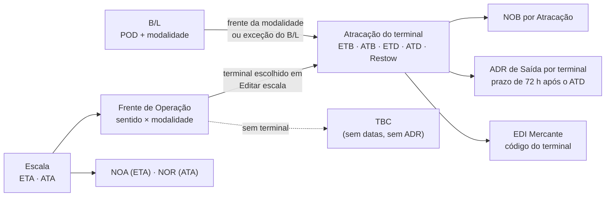

# Revisão do vínculo de terminal na escala — 2026-11-04

Revisão pedida pelo dono no início do uso real do sistema: mapear como a equipe
é lembrada de atribuir o terminal às frentes de operação, como as datas do
terminal são cobradas e o que deixa de acontecer quando a escala não tem
terminal. A pergunta de partida foi esta: "não podemos ter uma Viagem com
escala criada e CEs ligados aos B/Ls sem um terminal atribuído com as datas
corretas".

É um registro datado, feito sobre a `staging` em `3373a00`, com a migration
`582` como a última da cadeia (a mesma da produção nesta data). A regra vigente
continua em [Viagens § Escala, Atracação e datas](../../modules/viagens.md#escala-atracação-e-datas),
[Viagens § Agency Departure Report (ADR)](../../modules/viagens.md#agency-departure-report-adr)
e [Clientes § Régua automática de Comunicados](../../modules/clientes.md#régua-automática-de-comunicados).
O mapeamento anterior, só sobre o que chega ao ADR, é o
[de 2026-10-30](viagem-terminal-adr-2026-10-30.md).

**Decisões do dono (mesmo dia):** as recomendações D1 a D5 foram aceitas e implementadas na migration `584` e nas telas ([ADR 0121](../../adr/0121-terminal-da-escala-cobrado-antes-da-chegada.md)); a D6 (NOB da carga em transbordo) ficou para ouvir a Documentação. As lacunas T1 a T11 abaixo descrevem o sistema antes dessa mudança; T12 continua aberta.

## Resposta curta

**Hoje o Vela só cobra o terminal tarde, e em três pontos:**

1. ao gravar **Editar escala** com o ATA registrado, que recusa frente em TBC;
2. no alerta **Data da escala pendente** ("ATA registrada; falta o ETB."), que
   só abre quando **nenhum** terminal da escala tem ETB;
3. no **Fechar ADR**, que fica desabilitado com frente sem terminal.

Não existe alerta antes da chegada do navio. Uma escala com B/Ls, CEs e
Clientes, e sem terminal, não aparece em nenhuma fila até o ETA passar
(**local-pg**, cenário C1).

**O que depende do terminal:**

- o **NOB** (Aviso de Atracação);
- o **ADR de Saída**, com o prazo de 72 horas e os alertas dele;
- o arquivo do **EDI Mercante**, que recusa a carga sem terminal da frente;
- o **faturamento do B/L misto**, travado pela pendência de terminal;
- a coluna de terminal do **Painel** e do **Line-Up TV**.

O **NOA**, o **NOR** e o **CE e Taxas** não dependem do terminal. A exceção é o
B/L misto: a pendência dele trava o faturamento e, com isso, o CE e Taxas.

**O caso mais grave é silencioso.** As frentes de operação que a janela Editar
escala mostra são calculadas na tela, a partir dos B/Ls, vazios e Granito da
escala. O banco só passa a conhecê-las quando alguém clica em **Salvar escala**.
Se ninguém salva:

- o NOB nunca sai para esses B/Ls;
- nenhum alerta de Comunicado abre;
- o ADR da escala não existe;
- o Painel mostra "TBC" em texto simples, sem cor de aviso.

Quando o ATB é registrado num terminal, o Cliente cuja carga ficou sem terminal
também não aparece no alerta **Comunicado NOB pendente**. Isso contraria a
[ADR 0067](../../adr/0067-nob-automatico-ancorado-na-frente-de-operacao.md),
que manda o alerta ficar aberto nesse caso.

**Produção hoje está correta.** A consulta foi somente leitura e só agregada:

- há 16 Viagens ativas, e só a **Viagem 169** (BRVIX, ETA 12/11/2026 12:00)
  tem carga: 141 B/Ls ativos, 133 com CE;
- as três frentes dela (carga cheia, carga solta e vazios de importação) estão
  no **TVV**;
- a Atracação TVV tem ETB 13/11 12:00 e ETD 17/11 17:00, ainda sem ATB;
- as outras 15 Viagens têm só ETA, sem B/L.

Nada garante, porém, que a próxima Viagem siga o mesmo caminho. As lacunas
abaixo dizem onde o sistema deixaria passar.

## Como o vínculo funciona

- **A frente** é o recorte da escala por sentido e modalidade: carga cheia,
  carga solta e vazios na importação; Granito e vazios na exportação. O veículo
  segue a carga cheia.
- **Frente derivada e frente gravada.** A janela Editar escala e a aba ADR
  derivam as frentes dos dados (`fetchEscalaTerminalState`). O banco só tem as
  linhas gravadas em `voyage_escala_operation_fronts`. O NOB lê só as gravadas
  (`resolve_bl_terminal_id`), e o Painel e o Line-Up TV também
  (`fetchTerminalFrontsByVoyageIds` em `src/services/lineup.ts`). Já o
  fechamento do ADR confere as duas, por `_escala_fronts_without_terminal`
  (**Código**).
- **A Atracação TBC não guarda data.** Desde a migration `490`, ETB, ETD, ATB,
  ATD e Restow só existem na Atracação de um terminal
  ([ADR 0109](../../adr/0109-frente-de-operacao-exige-terminal-ate-o-ata.md)).
  Sem terminal não há ATB; sem ATB não há NOB, nem o alerta dele; sem ATD não
  há prazo do ADR, nem os alertas do ADR.

## O que o Vela cobra em cada marco da escala

| Marco | Comunicado ao Cliente | Alerta que existe hoje | Cobra o terminal? |
|---|---|---|---|
| Escala criada com ETA (Chegadas e Saídas, planilha ou **Adicionar escala**) | — | — | Não |
| D-7 do 1º ETA no Brasil | — | **Baplie ausente**, **B/Ls esperados** | Não |
| D-5 do 1º ETA | **NOA** sai (só o ETA) | **CE Mercante ausente**, **Planilha de veículos pendente** | Não |
| Dia do ETA sem ATA | — | **Data da escala pendente**: "ETA de … passou sem ATA registrada." | Não |
| ATA registrado | **NOR** sai (só o ATA) | **Data da escala pendente**: "ATA registrada; falta o ETB.", só se nenhum terminal tem ETB | Em parte: Editar escala recusa gravar com frente TBC; Chegadas e Saídas, não (lacuna T4) |
| Dia do ETB sem ATB | — | **Data de terminal pendente**, por terminal com ETB | Só para quem já tem terminal |
| ATB registrado | **NOB** sai para os B/Ls daquele terminal | **Data de terminal pendente** ("falta o ETD"); **Comunicado NOB pendente** | Indireto: o B/L sem terminal fica fora sem aviso (T3) |
| Dia do ETD sem ATD | — | **Data de terminal pendente** | Só para quem tem terminal |
| ATD registrado | — | **Pendência de departamento do ADR**; depois de 72 h, **Prazo do ADR vencido** | Só para quem tem terminal |
| Fechar ADR | — | — | Sim: com frente TBC, gravada ou derivada, o fechamento é recusado |

**Código:** `reconcile_voyage_schedule_date_alerts`,
`reconcile_voyage_ce_mercante_missing_alerts`,
`detect_customer_communication_alerts`, `customer_communication_automation_targets`
e `assert_voyage_escala_ready_for_report_close`, nas definições vigentes do
banco local. **local-pg:** cenários C1 a C8b.

## Lacunas encontradas

Gravidade pelo efeito no Cliente e na operação. Os cenários **local-pg** rodaram
em transações desfeitas no fim (`BEGIN … ROLLBACK`).

### T1 — Nenhum alerta antes da chegada (alta)

- **O que acontece:** uma escala com B/Ls com CE e Cliente, sem nenhuma frente
  com terminal, não abre alerta de terminal no D-7, no D-5 nem no dia do ETA.
- **Por quê:** nenhum dos 60 tipos de `alert_type_catalog` trata de frente sem
  terminal. No cenário C1 (ETA daqui a 3 dias, dois B/Ls com CE, nenhuma frente
  gravada), abriram só **Baplie ausente** e **Planilha de veículos pendente**.
- **Também não há onde procurar:** nenhuma lista, filtro ou contador junta
  todas as escalas com carga e sem terminal, de todas as Viagens. O Painel não
  tem filtro por terminal (`lineupFilters.ts`).
- **Evidência:** **Código** e **local-pg**.

### T2 — A frente que nunca foi gravada não existe para o banco (alta)

- **O que acontece:** uma escala que ninguém abriu em **Editar escala** e
  salvou tem frentes só na tela.
  - `resolve_bl_terminal_id` devolve vazio para os B/Ls dela, e o NOB nunca sai.
  - No **Painel** e no **Line-Up TV**, a coluna de terminal mostra "TBC" em
    texto comum.
  - Quando a escala tem uma frente gravada (por exemplo, a de carga cheia no
    TVV) e outra só derivada (a de carga solta que chegou depois), o Painel
    mostra só "TVV", e a TBC fica invisível.
  - Na **Visão geral** da Viagem, a linha da escala não tem coluna de terminal.
    A Atracação TBC é descartada da lista (`VoyageVisaoTab.tsx`), e a escala
    expandida diz só "Sem atracação em …".
- **Evidência:** **Código** e **local-pg** (cenário A da verificação dos
  Comunicados: nenhuma frente gravada, alvos só de NOR).

### T3 — O alerta do NOB não cobre o Cliente sem terminal (alta)

- **O que acontece:** a carga cheia está no terminal T1, com ATB, e a carga
  solta está em TBC.
  - O NOB sai para os Clientes da carga cheia, e **Comunicado NOB pendente**
    lista só eles.
  - O Cliente da carga solta não recebe aviso e não aparece em nenhum alerta.
  - O mesmo vale para a Atracação com terminal e sem nenhuma frente apontando
    para ela: ela aceita ATB, não tem destinatário e não abre alerta (T9).
- **Por quê:** `detect_customer_communication_alerts` monta os itens a partir
  dos alvos da régua, e o B/L sem Atracação não vira alvo.
- **Divergência:** a [ADR 0067](../../adr/0067-nob-automatico-ancorado-na-frente-de-operacao.md)
  e o texto do NOB em
  [Clientes](../../modules/clientes.md#régua-automática-de-comunicados) dizem
  que o alerta fica aberto durante os 30 dias. É o tipo (b) de
  [divergência](../../CONVENCOES.md#divergência-entre-documento-e-código): o
  código diverge da decisão. Ficou registrada em Notas e divergências de
  Clientes, sem reescrever a regra.
- **Evidência:** **Código** e **local-pg** (cenários B e C).

### T4 — O ATA entra sem passar pela trava do terminal (alta)

- **Regra:** a ADR 0109 fez do ATA o prazo: com o ATA, toda frente precisa de
  terminal. A trava existe só em `save_voyage_escala_terminal_state_v2` e na
  v1, isto é, em **Editar escala** e na declaração de exportação.
- **Gravam o ATA sem conferir as frentes:**
  - **Chegadas e Saídas**, ao confirmar a chegada (`confirm_schedule_effective_date`);
  - a janela de escala nova (**Adicionar escala**), que grava pelo caminho
    antigo (`saveVoyageEscalaSchedule` → `record_audit_entries`).
- **No cenário C3**, o ATA confirmado em Chegadas e Saídas, sem frente
  nenhuma, gravou. O único sinal foi "ATA registrada; falta o ETB.", que não
  diz qual frente está sem terminal.
- **No cenário C4**, a carga cheia já tinha terminal e ETB, e a carga solta
  estava em TBC. O ATA confirmado em Chegadas e Saídas gravou e **nenhum
  alerta** abriu.
- **Evidência:** **Código** e **local-pg**.

### T5 — Depois do ATA, só um terminal precisa ter ETB (média)

- **O que acontece:** o alerta da escala pergunta só se **alguma** Atracação
  tem ETB (`bool_or(terminal_etb IS NOT NULL)`).
  - No cenário C6, o T1 tinha ETB e o segundo terminal, U1, não tinha datas:
    o alerta da escala fechou e nenhum alerta cobrou o U1.
  - O alerta por terminal só nasce do ETB. O terminal sem ETB nunca é cobrado,
    nem antes nem depois do ATA.
- **Comentário desatualizado:** a função diz "TBC conta para este conjunto",
  mas a TBC não tem ETB desde a `490`.
- **Evidência:** **Código** e **local-pg**.

### T6 — A frente que nasce depois só é cobrada no Fechar ADR (média)

- **O que acontece:** uma carga importada depois que os terminais foram
  escolhidos cria uma frente derivada em TBC. Pode ser carga solta, vazio de
  importação, Granito ou B/L em transbordo.
- **O banco já sabe calcular isso** (`_escala_fronts_without_terminal`), mas
  só o fechamento do ADR pergunta (`assert_voyage_escala_ready_for_report_close`).
  O fechamento acontece depois da saída do navio, quando o NOB daquela carga já
  deixou de sair.
- O [Manual, 4.3](../../manual/texto/04-viagens-escalas.md#43-atribuir-os-terminais)
  pede que a equipe volte à escala, mas nada a lembra disso.
- **Evidência:** **Código** e **local-pg**.

### T7 — B/L misto com as duas frentes em terminais diferentes (média)

- **O que acontece:** a carga cheia está num terminal, a carga solta em outro,
  e o B/L não tem exceção de terminal.
  - O B/L não entra no NOB de nenhum dos dois.
  - O único sinal é a pendência de Revisão `review:mixed_bl_terminal_conflict`,
    que também nasce quando a carga cheia não tem frente gravada.
  - A pendência segura o faturamento e, com ele, o **CE e Taxas** do Cliente.
    Não é alerta da fila e não fala do NOB.
- **Evidência:** **Código** e **local-pg** (cenário D).

### T8 — O Disparo manual do NOB esconde quem ficou de fora (média)

- **O que acontece:** a conferência do NOB em `/clientes/comunicacao` avisa
  "Atracação TBC" só quando **todos** os B/Ls ficam de fora
  (`ClientesComunicacao.tsx`).
- No caso parcial, os Clientes sem terminal somem da lista sem aviso
  (`expandCandidatesForKind`). O disparo manual, que o Manual indica para os
  buracos da régua, não mostra esse buraco.
- **Evidência:** **Código**.

### T9 — Atracação com terminal e sem nenhuma frente (baixa a média)

- **O que acontece:** quando as frentes saem de um terminal cuja Atracação já
  existia, a Atracação continua e aceita ATB. Já a Atracação nova recusa: "sem
  frente atribuída".
- **Efeito:** o NOB não tem para quem sair e nenhum alerta abre.
- **Evidência:** **Código** e **local-pg** (cenário C).

### T10 — As datas do berço não são conferidas contra as da escala (baixa a média)

- **O que o banco confere** (restrições de `voyage_escala_terminal_state`):
  ATD exige ATB e não pode ser anterior a ele; ETD exige ETB e não pode ser
  anterior a ele.
- **O que nada confere:**
  - o ATB contra o ATA: dá para gravar ATB antes do ATA, ou sem ATA;
  - o ETB contra o ETA. Quando o armador atrasa o navio e a planilha de
    programação muda o ETA, o ETB fica como estava, porque a planilha não grava
    datas de terminal. **Data de terminal pendente** abre no dia do ETB antigo.
    O sinal existe, mas chega como "ETB passou", e não como "ETB anterior ao
    novo ETA".
- **Evidência:** **Código**.

### T11 — O alerta pede o ETB depois da atracação (baixa)

- **O que acontece:** com ATB e ATD registrados e o ETB nunca preenchido,
  "ATA registrada; falta o ETB." continua aberto (cenário C8b). Para fechá-lo,
  a equipe precisa preencher uma previsão que já passou.
- **É coerente com o banco:** o ETD exige ETB, então o terminal precisa do ETB
  de qualquer forma.
- **Evidência:** **local-pg**.

### T12 — B/L em transbordo e o NOB do Porto de Transbordo (a confirmar)

- **O que acontece:** o B/L em transbordo mantém o POD do porto omitido, e
  `bl_belongs_to_atracacao` exige que o POD seja o porto da Atracação. A carga
  conta no ADR do porto de descarga, mas não recebe NOB ali.
- Não há decisão registrada sobre isso.
- **Evidência:** **Código**.

### Outras dependências do terminal

- **EDI Mercante:** o arquivo recusa a carga sem terminal da frente: "Sem
  terminal de descarga no POD …: defina o terminal da frente de operação desta
  carga na escala." (`src/services/mercanteEdi.ts`). É um sinal na hora de
  gerar o arquivo, não um alerta (**Código**).
- **Portal (Programação de Navios):** não mostra terminal; o Cliente não vê a
  falta. O efeito chega a ele pelo NOB que não sai (**Código**).

## Retrato da produção em 2026-11-04

Consulta somente leitura ao projeto Supabase de produção, feita só com
contagens e códigos operacionais (Viagem, porto, terminal), sem dados de
Cliente.

| Item | Valor |
|---|---|
| Última migration aplicada | `582` |
| Viagens ativas | 16 |
| B/Ls ativos | 141, todos da Viagem 169 (BRVIX), 133 com CE, todos com Cliente |
| Frentes gravadas | 3, todas no TVV (carga cheia, carga solta e vazios de importação da Viagem 169) |
| Frentes TBC gravadas | 0 |
| Atracações | 1 (TVV, Viagem 169): ETB 13/11 12:00, ETD 17/11 17:00, sem ATB |
| Exceção de terminal em B/L | 0 |
| Vazios de importação da Viagem 169 | 22, POD BRVIX (cobertos pela frente de vazios no TVV) |
| Alertas ativos da Viagem 169 | nenhum na data (o D-5 do CE Mercante cai em 07/11) |
| Outras 15 Viagens | só ETA em BRVIX, entre 17/11/2026 e 04/02/2027; nenhum B/L |
| Rotinas | `alerts-foundation-detectors` (15 min) e `customer-communication-auto-runner` (2 min) ativas, sem falha registrada em `cron.job_run_details` nas últimas 24 h |

A rodada do `pg_cron` só prova que a chamada saiu; o resultado da Edge Function
não foi lido (`net._http_response`).

## Decisões pendentes

Cada decisão traz o caso prático, as opções e a recomendação. As respostas
viram ADR nova, e a implementação vem depois.

### D1 — Alerta de escala sem terminal

- **Caso:** a Viagem 170 chega em 17/11. Os B/Ls são importados no dia 10, os
  CEs no dia 12, e ninguém abre Editar escala. Hoje a primeira cobrança é o
  "ETA passou sem ATA", no dia 17, que não fala de terminal.
- **Opções:**
  - (a) tipo novo, por escala, que abre no D-5 do ETA (o mesmo prazo do CE
    Mercante) quando `_escala_fronts_without_terminal` devolve alguma frente.
    Essa função já cobre as frentes gravadas e derivadas, de importação e de
    exportação. A mensagem lista as frentes e fecha quando todas têm terminal;
  - (b) abrir já na importação do primeiro B/L da escala;
  - (c) só a partir do ATA.
- **Recomendação:** (a), de Operações, com destino na escala e um segundo marco
  no ATA. O marco abre nova ocorrência e notifica de novo. Isso cobre T1, T2
  (no banco), T4, T5 (para frentes) e T6 de uma vez.

### D2 — ATA registrado fora de Editar escala com frente sem terminal

- **Caso:** a equipe confirma a chegada em **Chegadas e Saídas** e a carga
  solta ainda está em TBC.
- **Opções:**
  - (a) recusar o ATA em Chegadas e Saídas e em Adicionar escala, como faz
    Editar escala;
  - (b) aceitar o ATA, porque o navio chegou e o NOR depende dele, e deixar a
    D1 cobrar o terminal com o marco do ATA.
- **Recomendação:** (b). Recusar o fato atrasaria o NOR ao Cliente. Editar
  escala continua recusando gravar com TBC depois do ATA.

### D3 — Cobertura do NOB

- **Caso:** T3, o Cliente da carga solta em TBC sem NOB e fora do alerta.
- **Opções:**
  - (a) cumprir a ADR 0067: com ATB em algum terminal da escala,
    **Comunicado NOB pendente** lista também os Clientes cujos B/Ls não
    pertencem a nenhuma Atracação, com o motivo "sem terminal";
  - (b) um tipo de alerta separado.
- **Recomendação:** (a). Também mostrar esses Clientes na conferência do
  Disparo manual (T8) e incluir T7 e T9 na mesma conta.

### D4 — Conferência das datas do berço

- **Opções:**
  - (a) recusar ATB anterior ao ATA e avisar, sem recusar, ETB anterior ao ETA
    na janela Editar escala;
  - (b) só avisar nos dois casos;
  - (c) manter como está.
- **Recomendação:** (a). ATB antes da chegada ao porto não descreve um fato
  possível. ETB antes do novo ETA é o caso comum do atraso do armador e pede
  só o aviso.

### D5 — Onde a equipe vê a escala sem terminal

- **Opções:**
  - (a) no Painel, coluna de terminal com "TBC" em âmbar e filtro "Sem
    terminal", calculados pela mesma derivação do banco (D1);
  - (b) na Visão geral da Viagem, coluna de terminal na linha da escala;
  - (c) as duas.
- **Recomendação:** (c). O Line-Up TV continua só exibindo.

### D6 — NOB da carga em transbordo (T12)

- **Pergunta:** o Cliente do B/L em transbordo deve receber o NOB da Atracação
  do Porto de Transbordo, onde a carga foi descarregada?
- **Opções:** (a) sim, pelo terminal da frente da escala de descarga; (b) não,
  e a regra fica escrita em Clientes.
- **Recomendação:** perguntar à Documentação como o aviso é feito hoje fora do
  sistema antes de decidir.

## Correções de documentação nesta mudança

- [Viagens § Escala, Atracação e datas](../../modules/viagens.md#escala-atracação-e-datas)
  dizia que a importação do Baplie cria a escala (migration `411`). Isso foi
  substituído pela `418` ([ADR 0098](../../adr/0098-baplie-nao-cria-nem-exige-escala.md)).
  É o tipo (a), documento defasado: o texto foi corrigido.
- [Clientes § Notas e divergências](../../modules/clientes.md#notas-e-divergências)
  ganhou a divergência do NOB (T3), tipo (b).
- [Viagens § Notas e divergências](../../modules/viagens.md#notas-e-divergências)
  ganhou a do ATA fora da trava (T4) e a da cobrança de ETB por escala (T5).

## Método e evidência

| Etapa | Como |
|---|---|
| Definição vigente | Replay da cadeia ativa (576 migrations) num Postgres 16 local descartável (`scripts/setup-local-pg.sh --reset`) e `pg_get_functiondef` das funções de alerta, da régua de Comunicados, das gravações da escala e do fechamento do ADR |
| Reprodução | Cenários C1 a C8b (alertas de data e terminal) e A a D (NOB), cada um numa transação desfeita, com o detector rodando como na rodada de 15 minutos |
| Telas | Leitura de `VoyageScheduleModals.tsx`, `VoyageAgencyReportTab.tsx`, `VoyageVisaoTab.tsx`, `Painel.tsx`, `lineup.ts`, `ChegadasSaidas.tsx`, `ClientesComunicacao.tsx` e `customerCommunications.ts` |
| Documentação | Módulos Viagens, Clientes e Operação e Suporte; ADRs 0067, 0068 e 0109; Manual do Operador, capítulos 4, 11, 16 e 20 |
| Produção | Supabase MCP, somente `SELECT` agregado |

**Não verificado:**

- as telas no navegador;
- a staging;
- o resultado HTTP das Edge Functions das rotinas;
- o Better Stack e o Sentry.

Os cenários dizem o que o banco faz com a cadeia de migrations do repositório;
que a produção está na mesma `582` foi conferido pela tabela de migrations, não
pela comparação das funções.
