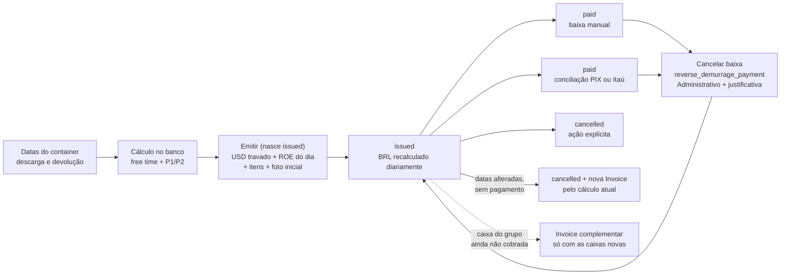

# Demurrage

> **Status:** ativo · **Atualizado:** 2026-10-16 · **Rotas:** `/demurrage`, `/demurrage/taxas`

## Propósito e escopo

Para o procedimento do usuário e as diferenças em relação a taxas locais,
consulte o [manual financeiro](../operations/manual-financeiro.md). A
[revisão financeira](../archive/audits/2026-10-04-revisao-fluxo-financeiro.md)
documenta a bateria local de pagamento, desconto e janela cambial.

Demurrage acompanha descarga e devolução de containers, resolve free time e
tarifas P1/P2, calcula a sobreestadia em USD e mantém invoices próprias cujo
total BRL **acompanha a PTAX até o pagamento** (USD travado na
emissão; ROE/BRL congelam só no pagamento — ver
[ADR 0014](../adr/0014-demurrage-recalculo-diario-substitui-roe-congelado.md) e
[ADR 0015](../adr/0015-demurrage-conciliacao-janela-duas-ptax-data-pagamento.md)).
As rotas internas ficam sob
`ProtectedRoute` em [`src/AppInterno.tsx`](../../src/AppInterno.tsx); a interface de tarifas
expõe mutações apenas para admin, enquanto as policies e RPCs continuam sendo a
fronteira efetiva de autorização.

O domínio não pertence ao ledger de taxas locais. Datas vivem em
`bl_containers`; configuração por B/L, em `bls`; tarifas, em
`demurrage_rates`; documentos e itens, em `demurrage_invoices` e
`demurrage_invoice_items`. A operação vive em `/demurrage`, com consultas em
`/reconciliacao` e `/portal/billing`, mas a persistência continua separada,
conforme a [ADR 0008](../adr/0008-demurrage-integrado-sem-unificar-persistencia.md).

Este módulo é o dono das regras de Demurrage: datas e status do container,
tarifa e acordo, emissão e cobrança por caixa, Recálculo Diário, baixa, Régua
de Cobrança e Disputa
([ADR 0082](../adr/0082-governanca-documental-dono-unico-e-adr-historica.md)).
O [glossário](../../CONTEXT.md) define os termos e aponta para cá; o ROE e o
markup comuns a Taxas Locais e Demurrage ficam em
[Regras de negócio](../operations/regras-de-negocio.md#câmbio-roe--ptax).

Fontes executáveis principais:

- [`src/pages/Demurrage.tsx`](../../src/pages/Demurrage.tsx), composição da
  rota, queries, mutations e estado de tela, e
  [`src/pages/DemurrageRates.tsx`](../../src/pages/DemurrageRates.tsx);
- abas da rota em
  [`DemurrageContainersTab.tsx`](../../src/components/demurrage/DemurrageContainersTab.tsx),
  [`DemurrageInvoicesTab.tsx`](../../src/components/demurrage/DemurrageInvoicesTab.tsx)
  e [`DemurrageCustomersTab.tsx`](../../src/components/demurrage/DemurrageCustomersTab.tsx);
- detalhe da Invoice em
  [`DemurrageInvoiceDetailModal.tsx`](../../src/components/demurrage/DemurrageInvoiceDetailModal.tsx)
  e fluxos modais em
  [`PtaxModal.tsx`](../../src/components/demurrage/PtaxModal.tsx),
  [`PaymentModal.tsx`](../../src/components/demurrage/PaymentModal.tsx),
  [`DiscountModal.tsx`](../../src/components/demurrage/DiscountModal.tsx),
  [`DisputeModal.tsx`](../../src/components/demurrage/DisputeModal.tsx),
  [`DemurrageContainerDatesModal.tsx`](../../src/components/demurrage/DemurrageContainerDatesModal.tsx),
  [`DemurrageRateModal.tsx`](../../src/components/demurrage/DemurrageRateModal.tsx) e
  [`CustomerReportModal.tsx`](../../src/components/demurrage/CustomerReportModal.tsx);
  as validações de formulário ficam em
  [`demurrageFormRules.ts`](../../src/components/demurrage/demurrageFormRules.ts);
- estado da rota na URL em
  [`src/pages/demurrageListState.ts`](../../src/pages/demurrageListState.ts);
- [`src/services/demurrage/demurragePresentation.ts`](../../src/services/demurrage/demurragePresentation.ts)
  concentra formatação e cálculo operacional apresentado na tela principal;
- [`src/components/bl/BlDemurrageSection.tsx`](../../src/components/bl/BlDemurrageSection.tsx)
  na aba `faturamento` do B/L;
- serviços em [`src/services/demurrage/`](../../src/services/demurrage/);
- [`src/services/demurrageDunning.ts`](../../src/services/demurrageDunning.ts),
  [`DemurrageDunningStatus.tsx`](../../src/components/demurrage/DemurrageDunningStatus.tsx)
  e a Edge Function [`demurrage-dunning`](../../supabase/functions/demurrage-dunning/index.ts),
  que exibem e executam a Régua de Cobrança;
- importação de datas em
  [`src/services/containerDatesImport.ts`](../../src/services/containerDatesImport.ts);
- documento imprimível em
  [`src/components/demurrage/InvoiceDocument.tsx`](../../src/components/demurrage/InvoiceDocument.tsx).

## Anatomia das telas

### `/demurrage`

[`src/pages/Demurrage.tsx`](../../src/pages/Demurrage.tsx) compõe a rota,
queries e mutations. Desde a etapa 11 da revisão visual (2026-10-12) o estado
fica na URL ([`demurrageListState.ts`](../../src/pages/demurrageListState.ts)):
`?tab=` (`containers`, `faturas`, `pagas`, `canceladas`, `clientes`,
`disputas`), `?busca=` (vale para Containers e para as abas de Invoice),
`?lente=` (`atraso` ou `devolvidos`, na aba Containers), `?fatura=<id>` (abre o
detalhe da Invoice; vindo de outra tela sem `?tab=`, a página vai para a aba da
situação dela; aberta pela própria página, fica na aba atual e preserva a
lente) e
`?dispute=<id>` (abre a aba Disputas com a conversa em foco; é o destino do
alerta "Disputa aberta no Portal"). As superfícies são `DemurrageContainersTab`,
`DemurrageInvoicesTab`, `DemurrageCustomersTab` e `DemurrageDisputeConversation`
(aba Disputas: leitura para todos; responder, reabrir e anexar, Equipamentos e Administrativo; migration `250`); o detalhe da Invoice é
`DemurrageInvoiceDetailModal`, e cada ação aberta nele (pagamento, desconto,
dados da disputa, documento, cancelar baixa) toma o lugar do diálogo e volta
para ele ao terminar. O cabeçalho tem os botões **Tarifas e acordos** (leva a
`/demurrage/taxas`), **Régua de cobrança**, **Informar PTAX** (só para os
perfis aceitos) e **Importar datas**. Nas abas e no detalhe da Invoice, o
número do B/L e o do container têm o ícone de copiar, e o CNPJ também o tem nas
abas de Invoice e no detalhe. Os cartões do topo filtram:
Containers em atraso aplica a
lente, Aguardando pagamento abre Faturas e Disputas aguardando resposta abre a
aba. Sob recálculo diário (ADR 0014) não há `draft` nem `overdue`: a fatura
nasce `issued` (se `overdue` aparecer, a tela a trata como emitida). A URL é
trocada com `replace`: o Voltar do navegador sai de `/demurrage` em vez de
desfazer aba, busca ou detalhe. A busca guarda o texto como digitado (o espaço
entre palavras fica) e só é aparada ao filtrar; ela segue entre Containers e as
abas de Invoice, com "Limpar busca" quando não acha nada. "Hoje" (data do
pagamento, situação do acordo, previsão do container ainda fora) é o dia de
Brasília (`saoPauloTodayIso`), não o de UTC. Os formulários não fecham durante a
gravação, e a recusa do banco fica no próprio diálogo (cancelar Invoice e
cancelar baixa inclusive); depois de gravar, o detalhe é relido antes de
voltar.

Quem pode cada ação está na [matriz de permissões](../operations/seguranca.md#demurrage-e-granito)
([ADR 0085](../adr/0085-modelo-de-permissoes-por-perfil.md)). Hoje a tela
oferece cada ação só ao perfil que a RPC aceita e diz o motivo aos
demais: gerar Invoice, cancelar Invoice e cancelar baixa são do Administrativo
(`is_admin`); registrar pagamento e desconto, do Financeiro e do Administrativo
(`is_financeiro_user`); Informar PTAX, também de Equipamentos (migration `110`);
a conversa de Disputas, de Equipamentos e do Administrativo; o intervalo da
Régua, só do Administrativo (`set_demurrage_dunning_interval_days`). A guarda
continua no banco. Toda gravação de Invoice passa por
`afterFaturaDemurrageAlterada` ([`cacheEffects.ts`](../../src/services/cacheEffects.ts)):
lista, detalhe, KPIs, caixas cobradas, Por Cliente, Disputas, fichas do B/L e do
Cliente, Portal e alertas.

As regras de datas, emissão, cobrança e Disputa que a tela aplica estão em
[Fluxos e invariantes](#fluxos-e-invariantes).

- A aba `Containers` é **monitoramento operacional** (ADR 0014): mostra
  containers ainda fora (`overdue`, demurrage correndo até hoje), devolvidos com
  demurrage > 0 e as caixas já cobradas numa Invoice viva. Devolvidos dentro do
  free time e sem Invoice são excluídos no frontend. Aceita `?busca=` (container,
  B/L, Cliente ou número da Invoice) e `?lente=`, agrupa por B/L e deriva free
  time (com a origem: do B/L, acordo do Cliente ou tabela), P1/P2 e USD com
  `calculateDemurrage` (devolução ou hoje, quando ainda fora). A previsão usa o
  acordo do Cliente vigente na descarga, que `listDemurrageContainers` anexa a
  cada linha, na mesma ordem do banco. Cada caixa diz em qual Invoice viva foi
  cobrada (`billed_in`): a listagem casa os itens das Invoices `issued`,
  `overdue` e `paid` pela mesma chave de `_demurrage_billed_container_keys`
  (Viagem do B/L da Invoice, Cliente da Invoice e número do container), então a
  caixa do B/L irmão aparece cobrada mesmo com outro `container_id`. A listagem
  também monta o grupo de cobrança de cada B/L (`billing_group`, com a regra de
  `demurrage_group_bl_ids`: B/Ls ativos da mesma Viagem e do mesmo Cliente
  ligados por container compartilhado; âncora é o menor id) lendo todas as
  caixas desses B/Ls, inclusive as ainda fora no free time que a aba não lista.
  Desde o lote 2 da identidade (2026-10-16), a tabela tem **uma linha por
  B/L** (B/L, Cliente, Navio / Viagem, Containers como "x de y devolvidos",
  US$ e Situação, com a ação na ponta) e a seta abre os contêineres embaixo, em
  tabela de cabeçalho claro, com as colunas da fatura do Portal: Dias (âmbar
  quando passa do free time), Free time (a origem ao passar o mouse), 1º e 2º
  período como "dias × diária", US$ e **Editar datas**. A Situação do B/L, em
  texto, segue a ordem de `issue_demurrage_invoice_for_bl` sobre o grupo
  inteiro (nunca só sobre o que a busca ou a lente deixaram visível): as
  Invoices que cobrem o grupo com a situação de cada uma (`existing`),
  "Aguarda devolução de N containers" (alguma caixa não-SOC do grupo sem
  devolução: `waiting_return`), "N caixas sem Invoice" com **Gerar
  complementar** (o grupo já tem Invoice; só as caixas ainda não cobradas,
  migration `214`) ou "A faturar" com **Gerar Invoice**. Em grupo com container compartilhado, a ação aparece uma vez, no
  primeiro B/L do grupo na lista; os outros dizem "cobrança junto com o B/L X",
  e o resumo conta o container compartilhado uma vez. A recusa do banco fica na
  linha do B/L que pediu a emissão e sai quando as datas são editadas. As
  leituras são paginadas (o PostgREST corta em 1000 linhas) e os ids de Invoice
  vão em lotes. O grupo só é lido para B/L com alguma caixa listada ainda sem
  Invoice (todo devolvido fica `returned` para sempre). ponytail: B/L com todas
  as caixas listadas já cobradas fica sem grupo, e o irmão ainda no free time
  fora da lista só aparece quando entrar em atraso ou voltar; o irmão do grupo é
  achado pelo número do container
  gravado igual (o banco compara `upper(btrim())`) e a ordem do âncora é a do
  JavaScript; upgrade: RPC de leitura com o estado do grupo. O free time
  mostrado é o prazo (B/L > acordo > tabela, `demurrageFreeTimeDays`), não o dia
  corrido; o USD da caixa já cobrada é o recalculado hoje, e o cobrado é o da
  Invoice (dito ao passar o mouse no valor).
- Os cartões do topo mostram **Containers em atraso** (contagem lida de
  `demurrage_status = 'overdue'`, gravado pelo banco), **Aguardando
  pagamento (BRL hoje)** e, para Equipamentos e Administrativo, que respondem,
  **Disputas aguardando resposta**; nenhum cartão traz USD. O resumo da aba
  Containers traz, para a lista filtrada, containers, B/Ls e os totais em
  USD "correndo até hoje" e "a faturar (previsto)". **Código:**
  `src/pages/Demurrage.tsx`, `src/components/demurrage/DemurrageContainersTab.tsx`.
- `Importar datas` abre
  [`src/components/shared/ContainerDatesImportModal.tsx`](../../src/components/shared/ContainerDatesImportModal.tsx):
  parseia planilha, mostra preview e erros, exibe progresso/cancelamento da
  leitura e grava a planilha inteira numa chamada
  (`apply_container_dates_batch_atomic`, migration `333`, que passa cada B/L
  por `apply_container_dates_atomic`): qualquer erro na prévia ou B/L recusado
  pelo banco recusa o arquivo inteiro e nada é gravado (regra de 2026-10-19).
  Modelo em `public/templates/datas-container-modelo.xlsx`/`.csv`. Quando todos os containers
  do B/L foram devolvidos, a RPC enfileira o efeito `demurrage_billing`; a
  emissão sai pelo `import-effects-runner` (ligado desde 2026-10-12, segundos
  depois da gravação), e não há emissão
  no navegador (`createInvoiceForReturnedBL`, que não tinha chamador, saiu na
  Etapa 12 do plano de correção das importações).
- O modal `Datas do container` (`DemurrageContainerDatesModal`), aberto pelo
  botão **Editar datas** de cada container (na linha da tabela ou no cartão
  abaixo de 640 px), altera
  descarga e devolução, validando formato e ordem antes da escrita, e grava por
  `set_container_dates` (motivo obrigatório para remover uma data, cobrado junto
  do campo, com o foco nele). Mostra B/L, Cliente, as datas gravadas e, quando a
  caixa já está numa Invoice, o efeito da mudança (reemissão sem pagamento;
  suspensão quando paga, com desconto ou com disputa). Descarga nova posterior à
  devolução gravada é recusada com mensagem de negócio (migration `191`), que
  fica no modal.
- As abas de invoice consultam um status exato por vez (`issued`, `paid` ou
  `cancelled`). Em tabela limpa (2026-10-16): Invoice (abre o detalhe), B/L,
  Emissão, Pagamento (só em Pagas), Cliente, USD a cobrar (total dos itens menos
  o desconto, que a RPC aplica em USD; o desconto aparece ao passar o mouse),
  BRL e Situação em texto ("Em disputa" em âmbar quando há disputa aberta); em
  Faturas, a Régua por último, com o que pausa a cobrança; em Pagas e
  Canceladas, "Fora da Régua" ao lado da situação. Canceladas ficam com a linha
  em cinza. O CNPJ fica no detalhe e na busca, e o ROE comum ao recorte, no
  resumo. O detalhe abre com um bloco de dado principal ("US$ … a cobrar") e os
  fatos (BRL, ROE e origem, Situação, Tipo Normal ou Complementar, Cliente,
  CNPJ, B/L, Navio / Viagem, Emitida em, Itens, Desconto), sem selos; os avisos de
  Invoice suspensa por `dunning_suspended_reason` (paga: restituição ou avulsa;
  com desconto ou disputa: cancelar, gerar de novo e refazer), a marca
  **Complementar** quando há outra Invoice viva anterior no mesmo B/L (ponytail:
  só enxerga o mesmo âncora; a RPC não grava essa marca), as outras Invoices do
  B/L, os containers cobrados e as ações do perfil. **Cancelar Invoice…**
  pede confirmação com motivo, que vai para a auditoria de
  `cancel_demurrage_invoice`. Até a etapa 11, o botão rotulado "Voltar" no
  detalhe da Invoice emitida chamava esse cancelamento (corrigido; teste de
  regressão em `Demurrage.behavior.test.tsx`).
- A Régua mostra "Pausada: datas alteradas, aguarda tratamento" para a Invoice
  com `dunning_suspended_reason`, que o job não cobra (migrations `179`, `203` e
  `214`); antes a coluna prometia a próxima cobrança. O último envio aparece ao
  passar o mouse na Régua.
- **Por Cliente** mostra só o nome (o CNPJ fica no relatório do Cliente, na
  busca e ao passar o mouse). **Disputas**: cada conversa num bloco, com
  Aberta, Resolvida ou Cancelada em texto e "Aguarda a nossa resposta" em
  âmbar, sem selo (2026-10-16).
- O visualizador de fatura/recibo usa
  [`src/components/demurrage/InvoiceDocument.tsx`](../../src/components/demurrage/InvoiceDocument.tsx)
  e o kit compartilhado
  [`src/components/shared/InvoiceDocumentKit.tsx`](../../src/components/shared/InvoiceDocumentKit.tsx);
  `Imprimir` usa `printDocumentElement` (`src/lib/printDocument.ts`) no Vela e
  `window.print()` no Portal. Pix só em Invoice `issued` ou `overdue` sem
  pagamento: a paga ou cancelada aberta como fatura não traz mais o QR. A
  Invoice complementar diz de qual Invoice anterior ela completa e que cobra só
  as caixas ainda não cobradas (`useDemurrageComplementOf`, mesma regra de
  `earlierLiveInvoices` do detalhe; enquanto essa consulta carrega ou se falhar,
  `Imprimir` fica bloqueado com o motivo na tela; no Portal a marca ainda não
  chega ao documento). O documento lê Cliente, B/L, navio e rota do cadastro atual: a
  cópia congelada da migration `183` é só de Taxas Locais.

### `/bls/:blId` → aba `faturamento`

[`src/components/bl/BlFaturamentoTab.tsx`](../../src/components/bl/BlFaturamentoTab.tsx)
inclui [`BlDemurrageSection`](../../src/components/bl/BlDemurrageSection.tsx)
como segunda entrada operacional. A seção permite:

- editar `free_time_override` e overrides P1/P2 do B/L;
- definir ou limpar `return_date` por container;
- visualizar descarga e cálculo derivado antes de salvar;
- voltar à tarifa padrão deixando os campos de override vazios;
- abrir o B/L em `/demurrage` pelo botão **Abrir em Demurrage** (busca pelo
  número do B/L).

### `/demurrage/taxas`

[`src/pages/DemurrageRates.tsx`](../../src/pages/DemurrageRates.tsx) lista
`demurrage_rates` em tabela limpa (lote 2 da identidade, 2026-10-16): Tipo,
Free time, 1º período, Diária 1º, 2º período, Diária 2º, Vigência, Situação em
texto e Observações, cada dado na sua coluna. A aba fica na URL (`?tab=acordos`)
e a ordem de aplicação, no cabeçalho. Tarifa inativa e acordo encerrado ou
inativo ficam escondidos por padrão; **Mostrar inativas** (e, nos Acordos,
**Mostrar encerrados e inativos**) os traz com a linha inteira em cinza, com o
estado em `?inativas=1` (`useShowInactive`). Nos Acordos, a coluna Cliente leva
só o nome (o CNPJ fica na busca e no cartão do celular), as diárias ficam em
duas colunas e o acordo futuro diz "Começa em dd/mm/aaaa". Editar fica na linha; ativar/desativar e excluir, no menu ⋮. Excluir
só é oferecido para tarifa ou acordo que ainda não entrou em vigor: o banco
recusa os demais (`guard_used_tariff_delete`, migration `091`), e a tela manda
desativar. O formulário (`DemurrageRateModal`) segue
`demurrage_rates_intrinsic_sanity_chk` (migration `012`) junto do campo: diária
vazia ou fora do formato pt-BR, P1 começando antes do dia 1, faixa P1 invertida,
P2 começando dentro de P1 e vigência fora de ordem; ao editar, a vigência
inicial é obrigatória (em branco, a data antiga ficaria). O acordo recusa free
time acima de 365 dias. Recusa do banco aparece por `classifyDbError` (a
orientação de negócio fica; texto cru de constraint vira frase legível), e
"nada mudou" fecha o formulário com aviso, sem erro. A aba de acordos
(`CustomerDemurrageAgreementsTab`) aceita `?cliente=` (o "Ver em Tarifas" da
ficha do Cliente), mostra a situação de hoje (Vigente, Começa depois, Encerrado,
Inativo; a escolha no cálculo continua pela data de descarga) e o Cliente como
link para a ficha, com o CNPJ e o ícone de copiar. O acordo também é editado na
aba Financeiro da ficha do Cliente, que oferece Novo acordo e Editar a qualquer
Departamento (policies `customer_demurrage_agreements_insert_active_global` e
`_update_active_global`, migration `254`); os
botões da ficha (**Ver em Tarifas** e **Aguardando pagamento em Demurrage**)
buscam pelo CNPJ, para não trazer Clientes de nome parecido. Usuários ativos podem ler; criar e editar
tarifas e acordos é de qualquer Departamento pelas policies `demurrage_rates_insert_active_global`
e `demurrage_rates_update_active_global` (migration `254`; ADR 0085, D6), ativar/desativar só do Administrativo pelo
gatilho `guard_tariff_active_change` (migration `091`) e excluir pela RPC
`delete_catalog_row` (migration `096`), só antes da vigência.

## Catálogo de ações

| Tela / ação | Pré-condições | Origem | Orquestração | Persistência | Efeitos e cache | Falhas | Evidência |
|---|---|---|---|---|---|---|---|
| `/demurrage` · monitorar containers em demurrage | Sessão interna; aba `Containers` | `Demurrage` (estado/queries); `DemurrageContainersTab`; `groupByBl`; `effectiveDemurrage`; filtro local | `listDemurrageContainers` (`demurrage_status IN ('overdue','returned')`); `ensureDemurrageRatesLoaded`; `calculateDemurrage` | SELECT em `bl_containers`, `bls`, `customers`, `voyages`, `vessels`; SELECT em `demurrage_rates` | Query `['demurrage-containers']`, `staleTime=60s`; devolvidos no free time excluídos no cliente; colunas free time / dias excedidos / P1·P2 / USD; container ainda fora entra pelo `overdue` que o banco grava (migration `197`; B/L ou Viagem Cancelados ficam fora pela `200`) | Erro de query mostra `InlineError`; falha de tarifas sem cache válido do banco rejeita o cálculo com mensagem explícita | **Código:** [`Demurrage.tsx`](../../src/pages/Demurrage.tsx), [`DemurrageContainersTab.tsx`](../../src/components/demurrage/DemurrageContainersTab.tsx), [`demurragePresentation.ts`](../../src/services/demurrage/demurragePresentation.ts), [`demurrageContainers.ts`](../../src/services/demurrage/demurrageContainers.ts), [`demurrageRates.ts`](../../src/services/demurrage/demurrageRates.ts) |
| `/demurrage` · carregar KPIs | Sessão interna | Query montada pela página | `fetchDemurrageKPIs` executa três consultas paralelas | `bl_containers` e `demurrage_invoices` | Query `['demurrage-kpis']`, `staleTime=60s` | Qualquer consulta com erro rejeita o conjunto; a página mantém placeholders | **Código:** [`Demurrage.tsx`](../../src/pages/Demurrage.tsx), [`demurrageKpis.ts`](../../src/services/demurrage/demurrageKpis.ts) |
| `/demurrage` · importar datas | Arquivo com B/L, container e descarga; devolução opcional; várias Viagens por arquivo | `ContainerDatesImportModal.handleFile/handleImport` | `readContainerDatesFile` (prévia "antes → depois"; mesmo container com datas diferentes na Viagem recusa as linhas) → `importContainerDates` → RPC `apply_container_dates_batch_atomic` (migration `333`), uma chamada para o arquivo inteiro (até 300 B/Ls, `statement_timeout` de 60 s; acima do teto a leitura recusa, e o tempo esgotado não grava nada e pede para dividir a planilha), que aplica cada B/L em ordem de `bl_id` por `apply_container_dates_atomic` (migration `179`: devolução vazia mantém a gravada; a data vale para todos os B/Ls ativos que dividem o container na Viagem; SOC não conta como devolução pendente); quando o grupo de Demurrage volta, enfileira `demurrage_billing` no B/L-âncora (emitido pelo `import-effects-runner`, ligado desde 2026-10-12) e reconcilia Invoice emitida com datas alteradas; container que já está na data pedida (o segundo B/L que divide a caixa) não é escrito nem conferido contra a prévia (migration `190`); a prévia que viu a descarga vazia também é conferida, e a descarga gravada depois dela recusa a linha como prévia obsoleta (migration `201`); o estado esperado enviado é o "antes" que a prévia mostrou, não uma releitura na hora de gravar | UPDATE em `bl_containers`, um evento `container_dates_import` em `audit_logs` e o efeito em `import_pending_effects`, na mesma transação do B/L | `afterDatasContainerAlteradas` (carga, financeiro e Demurrage: containers, Invoices, KPIs, Por Cliente e fichas do B/L e do Cliente); reporta atualizados e inalterados | Colunas/datas inválidas ficam no preview; descarga nova posterior à devolução gravada (com a devolução vazia na planilha) é recusada com mensagem de negócio (migration `191`); container fora do B/L é erro na prévia; qualquer erro na prévia bloqueia a importação e um B/L recusado pelo banco desfaz o arquivo inteiro (nada gravado; o Resultado lista o B/L e o motivo) | **Código:** [`ContainerDatesImportModal.tsx`](../../src/components/shared/ContainerDatesImportModal.tsx), [`containerDatesImport.ts`](../../src/services/containerDatesImport.ts) |
| `/demurrage` · editar descarga e devolução | Descarga obrigatória; devolução vazia ou não anterior; motivo para remover uma data gravada | Botão **Editar datas** do container → `openEditContainer`; `containerDatesMutation` | `demurrageDatesSchema` → `updateContainerDates` → RPC `set_container_dates` (migration `179`) | UPDATE em `bl_containers` do container e dos mesmos números nos B/Ls ativos da Viagem; `audit_logs` `container_dates`; reconciliação de Invoice emitida | `afterDatasContainerAlteradas` (carga, financeiro e Demurrage: containers, Invoices, KPIs, Por Cliente e fichas do B/L e do Cliente); fecha o modal e limpa a recusa de emissão da linha | Validação local bloqueia formato/ordem; o banco recusa devolução antes da descarga, remoção sem motivo e descarga posterior à devolução gravada (mensagem de negócio, migration `191`) | **Código/Teste:** [`Demurrage.tsx`](../../src/pages/Demurrage.tsx), [`demurrageContainers.ts`](../../src/services/demurrage/demurrageContainers.ts), [`financialValidation.test.ts`](../../src/services/__tests__/financialValidation.test.ts) |
| B/L · definir ou remover devolução | Container do B/L; data opcional; motivo para remover a devolução gravada | `BlDemurrageSection.handleSaveReturnDate` (Remover pede motivo) | `updateContainerReturnDate` → RPC `set_container_dates` (migration `179`; com `p_keep_discharge`, a descarga é a gravada, lida sob a trava do container, e a tela não a relê, migration `210`) | UPDATE em `bl_containers` do container e dos mesmos números nos B/Ls ativos da Viagem; `audit_logs` `container_dates` com o motivo; efeito `demurrage_billing` quando o grupo volta; reconciliação de Invoice emitida | Relê o detalhe do B/L e chama `afterDatasContainerAlteradas` (carga, financeiro e Demurrage: containers, Invoices, KPIs, Por Cliente e fichas do B/L e do Cliente) | Recusa do banco (sem motivo, devolução antes da descarga) mostra toast e não grava nada | **Código/Teste:** [`BlDemurrageSection.tsx`](../../src/components/bl/BlDemurrageSection.tsx), [`demurrageContainers.ts`](../../src/services/demurrage/demurrageContainers.ts), [`updateContainerReturnDate.rpc.test.ts`](../../src/services/demurrage/__tests__/updateContainerReturnDate.rpc.test.ts) |
| B/L · salvar free time e P1/P2 | Usuário ativo; B/L carregado com `updated_at` esperado; valores vazios ou numéricos | `BlDemurrageSection` → `saveBlDemurrageConfig` | RPC `save_bl_demurrage_config` grava os três campos com optimistic lock e uma linha de auditoria por campo, na mesma transação | UPDATE de `bls.free_time_override`, `bls.demurrage_rate_override_p1_usd`, `bls.demurrage_rate_override_p2_usd`; INSERT em `audit_logs` | Invalida `queryKeys.bls.detail(bl.id)`, `queryKeys.bls.all()` e `['demurrage-containers']` | Conflito concorrente (`B/L foi alterado por outro usuario`) recarrega o detalhe; valor não numérico é bloqueado antes da chamada | **Código:** [`BlDemurrageSection.tsx`](../../src/components/bl/BlDemurrageSection.tsx), [`blDemurrageConfig.ts`](../../src/services/blDemurrageConfig.ts), `save_bl_demurrage_config` em [`002_business_logic_and_security.sql`](../../supabase/migrations/002_business_logic_and_security.sql) |
| Derivar free time, P1/P2 e status | Tipo, descarga e devolução válidos; tarifas do banco carregadas | Previsão na aba `Containers` (`effectiveDemurrage`) e na seção Demurrage do B/L (`BlDemurrageSection`); a emissão calcula no banco (`_calculate_demurrage_invoice_authoritative`) | `ensureDemurrageRatesLoaded` carrega `demurrage_rates`; `calculateDemurrage` resolve tarifa e calcula dias inclusivos de P1/P2 | Sem escrita; lê cache em memória de tarifas vindas do banco | Resultado `within_free_time` ou `overdue`, usado só na tela (o status gravado é calculado pelo banco, migration `197`); falha de refresh preserva o último cache válido do banco | String vazia/data inválida, devolução anterior, tipo sem tarifa cadastrada ou ausência de tarifa vigente do banco lança erro | **Código/Teste:** [`demurrageRates.ts`](../../src/services/demurrage/demurrageRates.ts), [`calculateDemurrage.test.ts`](../../src/services/demurrage/__tests__/calculateDemurrage.test.ts) |
| `/demurrage` · criar invoice para B/L (nasce `issued`) | Qualquer Departamento (migration `246`, P4); Cliente vinculado; todos os containers não-SOC do grupo devolvidos; sobreestadia nas caixas a cobrar; alguma caixa não-SOC do grupo ainda sem Invoice viva da mesma Viagem e do mesmo Cliente | Botão `Gerar Invoice` ou `Gerar complementar` na linha do B/L devolvido com sobreestadia e caixa sem Invoice; B/L cujo grupo tem caixa não-SOC ainda fora (listada ou não) mostra "Aguarda devolução"; grupo com container compartilhado tem uma só ação; `generateMutation` abre o detalhe da Invoice emitida | `createInvoiceForBL` → RPC `issue_demurrage_invoice_for_bl` (migrations `179` e `191`): grupo de B/Ls do mesmo Cliente que dividem container na Viagem, uma caixa por número, emissão pelo B/L-âncora em `create_demurrage_invoice_authoritative`; container no free time entra com valor zero; B/L cancelado é recusado com o motivo; a completude do grupo é conferida só na emissão; desde a migration `214`, cobrança por caixa: só as caixas sem Invoice viva da Viagem e do Cliente entram, e o grupo já com Invoice recebe a complementar no âncora atual | RPC: INSERT em `demurrage_invoices` (`status='issued'`, `current_roe`/`current_total_brl`/`pix_payload`), itens e a foto inicial em `demurrage_invoice_history` | `afterFaturaDemurrageAlterada` | Grupo com todas as caixas já cobradas devolve `existing` e a tela avisa que já existe Invoice (não duplica); caixa já cobrada pedida direto em `create_demurrage_invoice_authoritative` é recusada (23505); PTAX indisponível sem cache rejeita | **Código:** [`Demurrage.tsx`](../../src/pages/Demurrage.tsx), [`demurrageInvoices.ts`](../../src/services/demurrage/demurrageInvoices.ts), definição vigente na migration `214` (nasce `issued` desde a migration arquivada [`156`](../../supabase/migrations_archive/156_demurrage_create_invoice_issued.sql)) · **Teste:** `demurrageCobrancaPorCaixa.local-pg.test.ts` |
| `/demurrage` · listar invoices e acompanhar Régua | Aba `Faturas` (`issued`), `Pagas` ou `Canceladas` | Query da página; `DemurrageInvoicesTab` | `listDemurrageInvoices({status})` + `fetchDemurrageDunningStatuses` → `getDemurrageDunningDisplay` | SELECT em `demurrage_invoices`, `customers`, `bls`, `voyages`, `vessels`, claims da régua, contatos, preferências e supressões | Queries `['demurrage-invoices', status]` e `['demurrage-invoices', 'dunning', invoiceIds]`; mostra tentativa seguinte, data, último envio ou pausa | Erro da invoice mostra `InlineError`; falha da régua mostra `Régua indisponível` | **Código:** [`Demurrage.tsx`](../../src/pages/Demurrage.tsx), [`DemurrageInvoicesTab.tsx`](../../src/components/demurrage/DemurrageInvoicesTab.tsx), [`demurrageInvoices.ts`](../../src/services/demurrage/demurrageInvoices.ts), [`demurrageDunning.ts`](../../src/services/demurrageDunning.ts) · **Teste:** `DemurrageDunningStatus.test.tsx` |
| `/demurrage` · abrir detalhe/breakdown | Invoice selecionada | Número da Invoice nas listas, `?fatura=<id>` (ficha do B/L, ficha do Cliente, alerta de Invoice de Demurrage) | `getInvoiceDetail` carrega cabeçalho e itens em paralelo | SELECT em `demurrage_invoices` e `demurrage_invoice_items` | Query `['demurrage-invoice-detail', id]` | Erro da invoice ou dos itens rejeita a leitura | **Código:** [`Demurrage.tsx`](../../src/pages/Demurrage.tsx), [`demurrageInvoices.ts`](../../src/services/demurrage/demurrageInvoices.ts) |
| `/demurrage` · marcar pago manualmente | Financeiro/Administrativo; invoice `issued`; data entre a emissão e hoje (conferida junto do campo) | `PaymentModal`; `payMutation`; falha fica no modal | `markInvoicePaid` → `register_demurrage_payment`, com request UUID | RPC valida e bloqueia invoice, congela valores e registra histórico | `afterFaturaDemurrageAlterada` | Estado/valor/data incompatíveis rejeitam; não é UPDATE direto do navegador | **Código/Teste:** [`demurrageInvoices.ts`](../../src/services/demurrage/demurrageInvoices.ts), `demurrageMoney.local-pg.test.ts` |
| `/demurrage` · **Cancelar baixa…** | Administrativo ativo; Invoice `paid`; justificativa digitada | Botão `Cancelar baixa…` no detalhe → `DemurragePaymentReversalModal` (avisa quando as datas do container mudaram depois do pagamento e diz o que o cancelamento fará); `unpayMutation` | `reverseDemurragePayment(id, justificativa)` → RPC `reverse_demurrage_payment` | RPC volta a Invoice a `issued`, limpa `paid_at`, `pix_txid` e `conciliated_by_extract` e grava `audit_logs` `payment_reversed` com a justificativa; Pix do Itaú que deu a baixa volta a Pix em análise com Alerta (migration `446`); Invoice suspensa por datas alteradas é cancelada e reemitida, segue suspensa ou perde a suspensão (gatilho `trg_reconcile_demurrage_after_payment_reversal`, migration `191`) | `afterFaturaDemurrageAlterada`; relê o detalhe antes de voltar a ele | Sem permissão (`42501`), Invoice não paga ou justificativa vazia; restituição de Demurrage não cancelada faz o banco recusar (`guard_demurrage_payment_after_refund`, migration `136`); a recusa fica no modal e a baixa continua registrada; cancelar a baixa não devolve dinheiro | **Código/Teste:** [`Demurrage.tsx`](../../src/pages/Demurrage.tsx), [`DemurragePaymentReversalModal.tsx`](../../src/components/demurrage/DemurragePaymentReversalModal.tsx), `DemurragePaymentReversalModal.test.tsx`, `Demurrage.behavior.test.tsx`, `auditoriaFaturasDemurrageComunicado.local-pg.test.ts` (cancelamento da baixa de Invoice suspensa) |
| `/demurrage` · cancelar invoice | Administrativo; documento não pago; confirmação com motivo | `Cancelar Invoice…` no detalhe; `handleCancelInvoice`; `cancelMutation` | `cancelDemurrageInvoice(id, motivo)` → `cancel_demurrage_invoice`, com request UUID e o motivo digitado | RPC cancela e audita; fatura paga é recusada | `afterFaturaDemurrageAlterada` | Estado/permissão incompatíveis rejeitam | **Código:** [`demurrageInvoices.ts`](../../src/services/demurrage/demurrageInvoices.ts), `012_demurrage_mutation_guards.sql` |
| `/demurrage` · aplicar ou remover desconto (USD) | Qualquer Departamento (migration `247`); invoice elegível; percentual 0–100 ou valor fixo permitido; justificativa em toda alteração (a RPC exige) | `DiscountModal` com prévia em USD; `discountMutation`; erros junto do campo | `applyDemurrageDiscount` → `apply_demurrage_discount`, com request UUID, justificativa e aprovador | RPC calcula desconto em USD antes da conversão, atualiza total/QR e histórico (foto com a data de Brasília, migration `357`); desconto que zera o USD líquido quita a Invoice (isenta, migration `306`). A janela de fotos que a baixa aceita começa na última mudança de desconto: revogado o desconto, o valor com desconto deixa de quitar (migration `357`) | `afterFaturaDemurrageAlterada` | Desconto acima da base/estado incompatível é recusado | **Código/Teste:** [`demurrageInvoices.ts`](../../src/services/demurrage/demurrageInvoices.ts), `demurrageMoney.local-pg.test.ts` |
| `/demurrage` · atualizar assunto, motivo e notas da disputa | Invoice visível | `DisputeModal` ("Dados da disputa"); `disputeMutation` | `updateDemurrageInvoice` | UPDATE direto só de assunto, motivo e notas; o estado da Dispute (`dispute_open`/`dispute_status`) muda apenas pela conversa de Disputes (RPCs `add_demurrage_dispute_message`/`reopen_demurrage_dispute`), porque a migration `106` revogou o UPDATE dessas colunas | `afterFaturaDemurrageAlterada` | Não há schema local específico; erro do banco mostra toast | **Código:** [`Demurrage.tsx`](../../src/pages/Demurrage.tsx), [`DisputeModal.tsx`](../../src/components/demurrage/DisputeModal.tsx), [`demurrageInvoices.ts`](../../src/services/demurrage/demurrageInvoices.ts) |
| `/demurrage` · imprimir fatura/recibo | Invoice detail carregado; recibo só depois de consultar as restituições | Visualizador e botão `Imprimir` | Render React → `printDocumentElement` (janela só com o documento, espera a marca) | Sem escrita | Abre diálogo nativo em A4 com "Página N de M"; fatura em aberto traz Pix, paga ou cancelada não; recibo traz recebido, devolvido, a devolver e líquido, sem Pix; complementar diz qual Invoice completa. Desde o lote 6b: TOTAL em caixa âmbar compacta à direita abaixo da tabela (na impressão não começa uma página sozinha), com "VENCIMENTO: DD/MM/AAAA" (fatura) ou "PAGO EM:" (recibo) embaixo sem fundo; ROE em caixa azul-marinho; USD/Dia com vírgula decimal; rótulos "B/L", "Navio / Viagem:", "POL:"/"POD:"; Pix com o aviso de baixa em 1 a 5 minutos, sem "Valor da fatura"; Recebedor em 12px logo após o rótulo; nada abaixo de 12px | Popup bloqueado cai em `window.print()` da página; não há geração de PDF no servidor | **Código:** [`Demurrage.tsx`](../../src/pages/Demurrage.tsx), [`InvoiceDocument.tsx`](../../src/components/demurrage/InvoiceDocument.tsx), [`InvoiceDocumentKit.tsx`](../../src/components/shared/InvoiceDocumentKit.tsx) |
| `/demurrage` · **Informar PTAX** | Financeiro, Administrativo ou Equipamentos (o botão só aparece para eles, migration `110`); PTAX positiva | Botão `Informar PTAX` → `PtaxModal`; `recalcManualMutation` | `recalculateInvoicesManual` → RPC `recalculate_demurrage_invoices_manual` → `recalculate_demurrage_invoices(ptax, hoje, 'manual')`, que grava no servidor a referência cambial com origem `manual` | `exchange_rate_reference`; Invoices emitidas e não pagas cujo ROE muda (`current_roe`, `current_total_brl`, `roe_source`, `pix_payload`) e foto em `demurrage_invoice_history` | `afterFaturaDemurrageAlterada`; toast com o número de Invoices recalculadas | `42501` para outros perfis; PTAX fora da faixa usual pede um segundo clique; a falha fica no modal | **Código/Teste:** [`Demurrage.tsx`](../../src/pages/Demurrage.tsx), [`PtaxModal.tsx`](../../src/components/demurrage/PtaxModal.tsx), [`demurrageKpis.ts`](../../src/services/demurrage/demurrageKpis.ts), `Demurrage.behavior.test.tsx` (perfil, vírgula, faixa e falha) |
| `/demurrage` · intervalo da **Régua de cobrança** | Qualquer perfil lê o intervalo; só o Administrativo salva; inteiro de 1 a 365 dias | Botão `Régua de cobrança` → `DemurrageDunningSettingsModal`; confirmação com antes/depois | `useSetDemurrageDunningIntervalDays` → `setDemurrageDunningIntervalDays` → RPC `set_demurrage_dunning_interval_days` | UPDATE de `app_settings.demurrage_dunning_interval_days`; `audit_logs` quando o valor muda | Invalida `queryKeys.appSettings()`; a próxima rodada da Régua usa o novo intervalo; salvar não envia cobrança | Valor fora de 1–365 recusado junto do campo e pela RPC (`22023`); outro perfil recebe `42501`; o mesmo valor fecha sem gravar | **Código/Teste:** [`DemurrageDunningSettingsModal.tsx`](../../src/components/demurrage/DemurrageDunningSettingsModal.tsx), [`appSettings.ts`](../../src/services/appSettings.ts), `set_demurrage_dunning_interval_days` em [`002_business_logic_and_security.sql`](../../supabase/migrations/002_business_logic_and_security.sql), `DemurrageDunningSettingsModal.confirmation.test.tsx` |
| `/demurrage?tab=disputas` · **Enviar resposta**, **Reabrir Disputa** e anexo | Equipamentos ou Administrativo; resposta só com a Disputa aberta aguardando Equipamentos; reabertura só da resolvida, com justificativa; anexo PDF, JPG, PNG ou TXT de até 10 MB | `DemurrageDisputeConversation`; confirmação mostra o próximo responsável (Cliente ou Ninguém) | `addDemurrageDisputeMessage` → RPC `add_demurrage_dispute_message`; `reopenDemurrageDispute` → `reopen_demurrage_dispute`; `uploadDemurrageDisputeAttachment` → Storage `demurrage-disputes` + RPC `add_demurrage_dispute_attachment` | `demurrage_dispute_messages` (com `author_type` do perfil), `demurrage_disputes` (estado e próximo responsável) e anexos; notificação ao Cliente quando a vez é dele; o Alerta `portal_dispute_opened` de Equipamentos fecha ou reabre | `afterFaturaDemurrageAlterada` (Disputas, Invoices, Portal e alertas) | Disputa aguardando o Cliente ou fechada recusa a resposta; anexo inválido é recusado antes do envio; anexo que falha depois da mensagem gravada pode ser reenviado sozinho | **Código/Teste:** [`DemurrageDisputeConversation.tsx`](../../src/components/demurrage/DemurrageDisputeConversation.tsx), [`demurrageDisputes.ts`](../../src/services/demurrage/demurrageDisputes.ts), migration `081`, `DemurrageDisputeConversation.test.tsx` |
| `/demurrage` · detalhe da Invoice paga · **Restituição excepcional** | Invoice `paid`; autorizar: qualquer Departamento (migration `247`), valor até o recebido menos o já reservado e justificativa de 10 caracteres ou mais; confirmar: Financeiro ou Administrativo, com comprovante, favorecido e data | `FinancialRefundsPanel` (`source="demurrage"`) no detalhe; confirmação em cada passo | `requestFinancialRefund` → RPC `request_financial_refund`; `confirmDemurrageRefund` → `confirm_demurrage_refund`; `useCancelFinancialRefundAuthorization` → `cancel_financial_refund_authorization` | `demurrage_refunds` (migration `136`); enquanto houver restituição não cancelada, a baixa e o valor congelado ficam travados | `afterBlInvoiceBasisAlterada` (restituições, Invoices de Demurrage, ficha do Cliente e alertas) | Sem permissão (`42501`), valor acima do disponível ou justificativa curta ficam no painel; autorização cancelada exige nova solicitação | **Código:** [`FinancialRefundsPanel.tsx`](../../src/components/billing/FinancialRefundsPanel.tsx), [`financialRefunds.ts`](../../src/services/financialRefunds.ts), migration `136`; procedimento no [manual financeiro](../operations/manual-financeiro.md) |
| `/reconciliacao` · confirmar PIX | Match por TXID sem ambiguidade; data válida; valor na janela das duas PTAX | `Reconciliacao.confirmMutation` | `confirmUnifiedPixReconciliation` → RPC `confirm_unified_pix_matches` → lote `confirm_demurrage_pix_matches` | Cada item passa por `register_demurrage_payment` (migrations `012` e `027`): confere status, valor pela janela das duas fotos e TXID já usado em outra Invoice; grava `paid`, o valor casado, `paid_at`, `pix_txid`, `conciliated_by_extract` e a foto `source='payment'` no histórico | Invalida invoices locais/demurrage, KPIs, B/Ls, clientes e histórico | Wrapper rejeita data, origem, valor fora da janela e contagem parcial | **Código/Teste:** [`reconciliacao.ts`](../../src/services/reconciliacao.ts), migration arquivada [`158`](../../supabase/migrations_archive/158_demurrage_pix_window_conciliation.sql), [`reconciliacao.test.ts`](../../src/services/__tests__/reconciliacao.test.ts) |
| `/reconciliacao` · **Cancelar baixa…** de Demurrage | Administrativo ativo; Invoice `paid`; justificativa não vazia | Detalhe da Invoice aberto na Conciliação → `DemurragePaymentReversalModal`; `reversalMutation` | `reverseDemurragePayment` → RPC `reverse_demurrage_payment`, a mesma de `/demurrage` | UPDATE para `issued`, limpa `paid_at`/`pix_txid`/`conciliated_by_extract`; INSERT em `audit_logs`; Invoice suspensa por datas alteradas segue o gatilho da migration `191` | `afterFaturaDemurrageAlterada`; relê o detalhe e volta a ele | `42501`, invoice ausente, status diferente de `paid`, justificativa vazia ou restituição de Demurrage não cancelada (migration `136`) | **Código/Teste:** [`Reconciliacao.tsx`](../../src/pages/Reconciliacao.tsx), [`reconciliacao.ts`](../../src/services/reconciliacao.ts), definição vigente na migration `446` (Pix do Itaú volta a análise; justificativa obrigatória desde a migration arquivada [`113`](../../supabase/migrations_archive/113_require_justification_on_payment_reversal.sql)), [`reversalJustificationMigration.test.ts`](../../src/services/__tests__/reversalJustificationMigration.test.ts) |
| `/demurrage` · visão por consignatário | Aba `Por Cliente` | `DemurrageCustomersTab` + `fetchCustomerDemurrageSummary`/`fetchCustomerDemurrageDetail` | Agrega faturas `issued` não pagas por cliente (USD a cobrar, líquido do desconto como em Faturas, + BRL do último recálculo, já líquido) | SELECT em `demurrage_invoices` + `customers` | Queries `['demurrage-customer-summary']` e `['demurrage-customer-detail', id]` | Erro rejeita a leitura; vazio mostra `EmptyState` | **Código:** [`Demurrage.tsx`](../../src/pages/Demurrage.tsx), [`DemurrageCustomersTab.tsx`](../../src/components/demurrage/DemurrageCustomersTab.tsx), [`demurrageKpis.ts`](../../src/services/demurrage/demurrageKpis.ts), [`CustomerSummaryReport.tsx`](../../src/components/demurrage/CustomerSummaryReport.tsx) |
| `/demurrage` · imprimir relatório por cliente | Aba `Por Cliente` com dados | Botão `Imprimir` → `CustomerReportModal` | Render React → `window.print()` | Sem escrita | Relatório imprimível com totais USD/BRL por consignatário (desde o lote 6b: logo Transhipping escura, CNPJ com máscara, dólar "US$ 2.760,00" e "Emitido em DD/MM/AAAA" no canto do número) | Popup/print dependem do navegador | **Código:** [`CustomerReportModal.tsx`](../../src/components/demurrage/CustomerReportModal.tsx), [`CustomerSummaryReport.tsx`](../../src/components/demurrage/CustomerSummaryReport.tsx) |
| `/demurrage/taxas` · listar | Usuário interno ativo | Query da página | `listDemurrageRates` | SELECT em `demurrage_rates` | Query `['demurrage-rates']` | Erro mostra `InlineError` | **Código:** [`DemurrageRates.tsx`](../../src/pages/DemurrageRates.tsx) |
| `/demurrage/taxas` · criar/editar tarifa | Qualquer Departamento (migration `254`); **Desativar**/**Reativar** e **Excluir** só ao Administrativo; tipo de container, diárias, faixas P1/P2 e vigência válidos (`demurrageFormRules`, a mesma regra de `demurrage_rates_intrinsic_sanity_chk`); ao editar, vigência inicial obrigatória | `handleSave` → `DemurrageRateModal`; confirmação com antes/depois (ou resumo da tarifa nova) | `upsertDemurrageRate` | UPSERT em `demurrage_rates` (policies `demurrage_rates_insert_active_global` e `demurrage_rates_update_active_global`, migration `254`) | Limpa o cache em memória; invalida `['demurrage-rates']` e `afterReferenciaDemurrageAlterada` (previsão da aba `Containers` e Informações do Portal); Invoices emitidas não mudam | Erro de validação junto do campo; recusa do banco no formulário por `classifyDbError`; "nada mudou" fecha com aviso, sem gravar | **Código/Teste:** [`DemurrageRates.tsx`](../../src/pages/DemurrageRates.tsx), [`demurrageRates.ts`](../../src/services/demurrage/demurrageRates.ts), [`demurrageFormRules.ts`](../../src/components/demurrage/demurrageFormRules.ts), `demurrageFormRules.test.ts`, `DemurrageRates.behavior.test.tsx` |
| `/demurrage/taxas` · **Desativar** / **Reativar** tarifa | Administrativo; confirmação com a situação antes/depois | `handleToggleActive` (menu ⋮) | `toggleDemurrageRateActive` | UPDATE de `active` em `demurrage_rates`, conferido pelo gatilho `guard_tariff_active_change` (migration `091`) | Limpa o cache em memória; invalida `['demurrage-rates']` e `afterReferenciaDemurrageAlterada` | Recusa do banco em toast, por `classifyDbError` | **Código:** [`DemurrageRates.tsx`](../../src/pages/DemurrageRates.tsx), [`demurrageRates.ts`](../../src/services/demurrage/demurrageRates.ts) |
| `/demurrage/taxas` · **Excluir tarifa** | Administrativo; tarifa que ainda não entrou em vigor (só então o menu oferece a ação); motivo digitado na confirmação | `handleDelete` (menu ⋮) com `confirmWithReason` | `deleteDemurrageRate` → `deleteOneById` | RPC `delete_catalog_row` com o motivo (migration `096`); o banco recusa tarifa já usada (`guard_used_tariff_delete`, migration `091`) | Limpa o cache em memória; invalida `['demurrage-rates']` e `afterReferenciaDemurrageAlterada` | Recusa do banco em toast, por `classifyDbError`; cancelar a confirmação não escreve | **Código:** [`DemurrageRates.tsx`](../../src/pages/DemurrageRates.tsx), [`demurrageRates.ts`](../../src/services/demurrage/demurrageRates.ts) |
| `/demurrage/taxas?tab=acordos` e aba Financeiro da ficha do Cliente · **Novo acordo**, **Editar**, ativar/desativar e **Excluir acordo** | Criar e editar: qualquer Departamento (migration `254`); ativar, desativar e excluir: Administrativo (gatilho `guard_tariff_active_change`, migration `091`; o formulário só mostra **Acordo ativo** ao Administrativo; a ficha oferece só Novo acordo e Editar); Cliente, free time de 0 a 365 dias e início da vigência; sem outro acordo ativo do Cliente com vigência sobreposta; excluir só antes da vigência e com motivo | `CustomerDemurrageAgreementsTab` e `CustomerDemurrageAgreementModal` (confirmação com antes/depois) | `useSaveCustomerDemurrageAgreement` → `saveCustomerDemurrageAgreement`; `toggleCustomerDemurrageAgreementActive`; `deleteCustomerDemurrageAgreement` → `deleteOneById` | UPSERT e UPDATE em `customer_demurrage_agreements`; exclusão pela RPC `delete_catalog_row` com motivo (migration `096`) | Invalida a lista de acordos, os acordos da ficha do Cliente e `afterReferenciaDemurrageAlterada` (previsão da aba `Containers`); Invoices emitidas não mudam | Vigência sobreposta: "Ja existe um acordo ativo para este cliente com vigencia sobreposta."; demais recusas por `classifyDbError` | **Código/Teste:** [`customerDemurrageAgreements.ts`](../../src/services/demurrage/customerDemurrageAgreements.ts), [`useCustomerDemurrageAgreements.ts`](../../src/hooks/useCustomerDemurrageAgreements.ts), `CustomerDemurrageAgreementConfirmation.test.tsx`, `customerDemurrageAgreements.test.ts`; **Teste local-pg:** `permissoesPorPerfil.local-pg.test.ts` (P9) |

## Estado e dados

- **Queries principais:** `['demurrage-containers']`, `['demurrage-kpis']`,
  `['demurrage-invoices', status]`, `['demurrage-invoice-detail', id]` e
  `['demurrage-rates']`. A aba do B/L também invalida `['bl-detail', blId]` e
  `['bls']`.
- **Estado local da página:** B/L em geração e recusa da emissão, modais e
  formulários (datas, pagamento, desconto, dados da disputa, cancelamento da
  baixa, documento, PTAX e Régua). Aba, busca, lente, Invoice aberta e Disputa
  em foco ficam na URL (`?tab=`, `?busca=`, `?lente=`, `?fatura=`,
  `?dispute=`; ver [Anatomia das telas](#anatomia-das-telas)).
- **Tarifa efetiva:** precedência `override do B/L > acordo do Cliente
  vigente na descarga > demurrage_rates vigente na emissão` (regra em
  [Tarifa, free time, P1 e P2](#tarifa-free-time-p1-e-p2) e
  [Acordo de Demurrage do Cliente](#acordo-de-demurrage-do-cliente)). A tarifa
  do banco é a única fonte de verdade; não existe fallback estático. `ensureDemurrageRatesLoaded`
  mantém cache em memória por cinco minutos e, se um refresh falhar depois de
  um carregamento válido, preserva o último cache vindo do banco. Sem cache
  válido ou sem linha vigente para o tipo de container, o cálculo falha com
  mensagem explícita ao operador.
- **Aliases ISO:** o catálogo pode manter somente as linhas canônicas de
  `main`; `demurrageRates` resolve os aliases históricos (`22G1`, `42G1`,
  `45G1`, `20FT`, `40FT`, `45R1` e equivalentes) para a tarifa canônica, sem
  duplicar essas linhas no banco.
- **Datas:** `bl_containers.discharge_date` e `return_date` são a fonte
  operacional. `demurrage_invoice_items` copia datas, dias, free time, tarifas
  e subtotal no momento de criação da invoice (ver
  [Emissão da Invoice de Demurrage](#emissão-da-invoice-de-demurrage)).
- **ROE e referência cambial:** `fetchROE` (`src/services/demurrage/demurrageRoe.ts`,
  reexportado por `demurrageKpis.ts`) consulta a PTAX dos últimos dez dias,
  aplica o markup `DEMURRAGE_ROE_MARKUP` (`1,065`, cópia de prévia do ponto
  canônico `_demurrage_roe_markup()` do banco, migration `264`; ADR 0014) e usa
  primeiro a referência persistida em `exchange_rate_reference` e depois
  `localStorage['demurrage_roe_cache']` como fallback. A referência do banco
  precisa ter origem `bcb_live`/`cached`, PTAX e ROE positivas e compatíveis
  com o markup; taxa manual não é apresentada como PTAX. O cache preserva
  `updated_at` do banco como data de obtenção. Uma falha do BCB só é reportada
  quando nenhum fallback está disponível. `fetchROE` só lê: não grava a
  referência (migration `236`).
  O Recálculo Diário e o congelamento no pagamento estão em
  [Recálculo diário e congelamento no pagamento](#recálculo-diário-e-congelamento-no-pagamento).
- **Câmbio de display:** o header interno usa
  [`src/hooks/useRoeHeaderRate.ts`](../../src/hooks/useRoeHeaderRate.ts) e o
  `fetchROE` compartilhado para apresentar PTAX Venda, a fórmula
  `PTAX × 1,065 = ROE`, a data efetiva e uma ação de atualização. Não há CNY nem
  contrato cambial paralelo; a entrada manual permanece exclusiva de
  `/demurrage`.
- **PIX:** com `app_settings.pix_provider = 'static'`, a emissão, o desconto e
  o recálculo montam o QR estático no banco
  (`build_transshipping_pix_payload`, migration `034`) com o valor BRL e o
  `doc_number` como TXID. Desde a migration `293` (decisão de 2026-10-16), o banco gera o número da
  emissão pela tela, da reemissão e, desde a `294`, da emissão automática pela
  planilha de datas (antes `DEM-AUTO-<efeito>`) em sequência por ano,
  `DEM-AAAA-NNNN` (`next_demurrage_doc_number`, contador em
  `demurrage_doc_counters`; pula o número cujo TXID já exista, como um número
  informado à mão), como a fatura de Taxas Locais; antes era
  `DEM-<AAAAMMDDHHMMSSmmm>-<B/L>` (migration `278`), de 36 caracteres. O índice único
  `demurrage_invoices_pix_txid_unique` recusa Invoice cujo TXID repita o de
  outra; [`src/lib/pix.ts`](../../src/lib/pix.ts) só
  normaliza o TXID lido no extrato (`normalizePixTxid`). A baixa de demurrage não cria `bl_receivables`,
  `invoice_receivable_links` nem `ledger_settlements`. Com
  `app_settings.pix_provider = 'itau'` (migration 151, ativa em produção desde 2026-10-07),
  o gatilho `zz_itau_pix_demurrage_payload` substitui o QR estático gravado
  pelas RPCs por uma cobrança Itaú. Nova PTAX altera a mesma cobrança, com o
  mesmo TXID e validade até 14h30 do próximo dia útil de Vitória (migration
  153, `itau_pix_cutoff`). Vencida e não paga, a cobrança é substituída por
  outra com novo TXID. Às 14h de dia útil, fatura sem a PTAX do dia abre
  `demurrage_ptax_recalc_failed` (entidade `itau-pix-14h`). O recálculo de PTAX
  (`recalc-demurrage-ptax`) está agendado às 14h de Brasília, de segunda a sexta,
  desde 07/10. Runtime em produção: a Demurrage de teste DEM-TEST-ITAU-20261007
  (R$ 0,16) foi baixada pelo cron em cerca de 40 s, com câmbio congelado no
  pagamento. Baixa pelo extrato continua disponível em `/reconciliacao`.
  Detalhes no [plano Itaú](../archive/plans/2026-10-06-integracao-itau-pix.md).
- **Portal (push/armazenado):** [`src/services/portalBilling.ts`](../../src/services/portalBilling.ts)
  chama `portal_list_demurrage_invoices()` e
  `portal_get_demurrage_invoice_detail(bigint)`. O cliente resolve pela sessão,
  limita a invoices `issued|overdue|paid` e exige liberação do B/L. Sob recálculo
  diário (ADR 0014) o portal **não** recalcula on-demand: exibe o **último
  recálculo armazenado** — USD fixo (`total_usd`) + BRL dinâmico
  (`current_total_brl`) com data/fonte de referência (`updated_at`, `roe_source`,
  via migration arquivada [`159`](../../supabase/migrations_archive/159_portal_demurrage_reference.sql)).
  Assim o valor exibido == valor do QR == histórico. Sem notificação a cada
  recálculo. A aba Demurrage do Portal mostra só o ROE vigente e a data de
  atualização, sem a composição PTAX × 1,065 do cabeçalho interno; o detalhe
  da Invoice mostra o ROE aplicado, que na Invoice paga é o congelado no
  pagamento.

## Fluxos e invariantes

### Datas do container e status de Demurrage

A descarga é a data informada pelo terminal; a ATA da Viagem não a preenche
(ADR 0078, item 19). O gatilho `BEFORE INSERT` que copiava `voyages.ata` para
container sem descarga (`trg_container_discharge_date` com
`set_container_discharge_date`, da migration arquivada
[`028`](../../supabase/migrations_archive/028_demurrage_module.sql)) saiu na
migration `179`, e o que reagia à mudança de `voyages.ata`
(`trg_propagate_voyage_ata_to_containers`, da `002`) saiu na `190`.

- Datas mudam pela planilha (`apply_container_dates_atomic`) ou pela edição do
  container (`set_container_dates`, que exige motivo para remover uma data); as
  duas aplicam a data a todos os B/Ls ativos que dividem o container na Viagem.
  Desde a migration `211`, essas são as únicas portas: o UPDATE direto de
  descarga ou devolução pelo PostgREST é recusado
  (`trg_guard_container_dates_direct_write`) e a RPC legada
  `update_container_demurrage_dates` não é mais executável por usuário. As duas
  RPCs travam antes o conjunto inteiro de containers de mesmo número na Viagem,
  em ordem de id (`_lock_container_date_sets`), para que duas gravações em B/Ls
  que dividem containers não entrem em deadlock.
- **Planilha de datas:** a chave é B/L + container. Cada linha exige descarga
  válida (sem ela, a linha é recusada na prévia), e devolução vazia, na célula
  ou por falta da coluna, mantém a gravada: a planilha nunca apaga uma data.
  Remover uma data é correção isolada, com motivo, na edição do container ou
  na seção Demurrage do B/L.
- `demurrage_status` tem uma semântica: `returned` quando há devolução;
  sem devolução, `overdue` quando os dias desde a descarga passam do free time
  (free time do B/L, acordo de Demurrage do Cliente vigente na descarga,
  tabela vigente — a mesma ordem do cálculo da Invoice) e `within_free_time`
  no prazo ou sem descarga; SOC nunca fica em atraso, nem container de B/L
  Cancelado ou de Viagem Cancelada (migration `200`): cancelar ou reativar o
  B/L e cancelar a Viagem refazem o status na hora. O gatilho
  `trg_container_demurrage_status_semantics` calcula o status a cada gravação
  de datas, tipo, B/L ou SOC/COC (migration `197`; entre a `179` e a `197`
  nada gravava `overdue`), e o job diário `container-demurrage-status`
  (`refresh_containers_demurrage_status()`) atualiza o container que vence sem
  ninguém mexer nele. Os dias contam pela data de São Paulo, a mesma da
  Invoice, e não pela data UTC do banco (migration `211`: das 21h à meia-noite
  o container entrava em atraso um dia antes). Na Viagem Cancelada, a guarda
  aceita só a mudança do status calculado, e o container não sai dela trocando
  de B/L (migration `211`). Leem esse status a aba `Containers`
  (`listDemurrageContainers`), o KPI "Containers em atraso", o sinal do
  cabeçalho (`useOperationalAlerts`), a Demurrage correndo da ficha do Cliente
  (`fetchCustomerRunningDemurrage`) e o **Gerar Fatura** de B/L com container
  ainda fora (`DemurrageContainersTab`).
- `calculateDemurrage` rejeita devolução anterior à descarga; o modal repete a
  validação e
  a migration arquivada
  [`089`](../../supabase/migrations_archive/089_demurrage_date_order_constraints.sql)
  aplica constraints `NOT VALID` a novas escritas/updates. `total_days` não pode
  ser negativo nos itens. Descarga nova posterior à devolução gravada é recusada com
  mensagem de negócio (migration `191`).

### Container SOC

Container SOC (do cliente; ver SOC / COC no [CONTEXT](../../CONTEXT.md)) não
volta ao estoque e fica fora da Demurrage (migration `121`): o banco nunca o
deixa `overdue` (`trg_soc_container_never_overdue`), recusa item de fatura de
Demurrage para ele (`trg_guard_demurrage_item_not_soc`) e o exclui do conjunto
"todos os containers devolvidos" que `assert_demurrage_invoice_complete` exige.
A aba `Containers` e a emissão (`createInvoiceForBL`) também o deixam de fora, salvo container já
congelado numa fatura ativa. Desde a migration `179`, o SOC também não conta
como devolução pendente na planilha de datas nem na emissão automática.

### Tarifa, free time, P1 e P2

- **Precedência:** para free time, diária de P1 e diária de P2 vale o
  override do B/L (`free_time_override`, `demurrage_rate_override_p1_usd`,
  `demurrage_rate_override_p2_usd`), depois o
  [Acordo de Demurrage do Cliente](#acordo-de-demurrage-do-cliente) ativo e
  vigente na data de descarga do container e, por último, a tarifa de
  `demurrage_rates` ativa e vigente na data do cálculo (na emissão, a data da
  emissão), escolhida pelo tipo canônico do container. As faixas P1/P2
  (`p1_day_to`, `p2_day_from`) vêm sempre da tarifa. **Código:**
  `_calculate_demurrage_invoice_authoritative` (migration `191`) e `getRate` em
  [`demurrageRates.ts`](../../src/services/demurrage/demurrageRates.ts).
- **Tarifa:** cadastrada por tipo de container, com free time, faixas P1/P2,
  diárias em USD e vigência. `active` desliga a tarifa na hora; `valid_to`
  agenda o fim. A tarifa do banco é a única fonte de verdade, sem fallback
  estático. O banco exige faixas coerentes
  (`demurrage_rates_intrinsic_sanity_chk`), mas não exige diária de P2 maior
  que a de P1.
- **O free time só move o início da cobrança.** O free time (do B/L, do acordo
  ou da tarifa) move o **início** da cobrança e não desloca as faixas: P1 vai
  de free+1 ao fim da faixa P1 do grupo em `demurrage_rates`, e P2 começa em
  max(início de P2, free+1). Free time além do fim da faixa P1 significa, por
  definição, que não há dias em P1 — a cobrança começa direto em P2, sem que
  dias livres virem P2
  ([`calculateDemurrage.test.ts`](../../src/services/demurrage/__tests__/calculateDemurrage.test.ts)
  cobre os dois casos). Overrides P1/P2 substituem apenas o valor diário.

### Acordo de Demurrage do Cliente

`customer_demurrage_agreements` (criada na migration arquivada
[`366`](../../supabase/migrations_archive/366_customer_demurrage_agreements.sql);
definição vigente nas migrations `001`, `091` e `096`) guarda o free time e,
opcionalmente, diárias P1/P2 negociados com o Cliente, com vigência
(`valid_from`/`valid_to`). O acordo vale para todos os tipos de container, e o
que ele não define (P1 ou P2 em branco) vem da tarifa. O banco recusa dois
acordos ativos do mesmo Cliente com vigências sobrepostas
(`customer_demurrage_agreements_no_overlap`), e acordo em vigor não se exclui,
só se desativa. Duas regras de leitura, ambas com uma armadilha já corrigida:

- **A escolha é por data de descarga, não por cliente.** Um cliente pode ter
  mais de um acordo ativo (o vencido e o vigente). Guardar "o acordo do cliente"
  antes de olhar a data fazia o vencido mascarar o vigente e a cobrança cair na
  tabela padrão. A escolha vive em `selectAgreementForDischargeDate`, usada pela
  seção Demurrage do B/L e pela listagem da aba `Containers`
  (`listDemurrageContainers`), com a lista ordenada por vigência decrescente
  para que o mais recente vença em sobreposição; a emissão escolhe no banco
  pela mesma regra (`_calculate_demurrage_invoice_authoritative`).
- **Sem cliente vinculado não há acordo.** `listCustomerDemurrageAgreements` só
  filtra por cliente quando recebe um id — "sem `customerId`" significa "todos",
  porque a aba de acordos lista tudo de propósito. Por isso quem pergunta pelos
  acordos **de um** cliente passa `enabled` ao hook: sem esse guard, um B/L sem
  cliente recebia todos os acordos ativos e aplicava, pela data, o acordo
  negociado de outro cliente.

### Emissão da Invoice de Demurrage

A Invoice de Demurrage cobra a sobreestadia em USD e nasce `issued`: sob
recálculo diário não há `draft`, `overdue` nem vencimento (ADR 0014). Só é
emitida quando todos os containers não-SOC do grupo de B/Ls foram devolvidos;
com container ainda fora os dias continuam correndo, e a aba `Containers` só
monitora. Sai pelo botão **Gerar Invoice** ou **Gerar complementar**
(qualquer Departamento, migration `246`) ou pela planilha de datas, que enfileira `demurrage_billing`
para o `import-effects-runner`. O cálculo é do banco
(`_calculate_demurrage_invoice_authoritative`, migration `191`): o navegador
não envia itens nem valores, e `calculateDemurrage` só faz a previsão da aba
`Containers` e da seção Demurrage do B/L
([ADR 0065](../adr/0065-inbox-efeitos-e-autoridade-financeira.md) supersede
parcialmente a autoridade de cálculo da
[ADR 0026](../adr/0026-demurrage-validacao-item-rpc-veto.md)).

- **USD travado e itens:** cada item de `demurrage_invoice_items` guarda a
  composição do cálculo: datas de descarga e devolução, dias, free time, dias
  e diária de P1, dias e diária de P2 e subtotal. Mudança posterior de tarifa
  não reescreve os itens; mudança de datas cancela a Invoice e reemite outra
  ([Datas alteradas depois da emissão](#datas-alteradas-depois-da-emissão)),
  e os itens antigos ficam na cancelada.
- **ROE do dia:** o ROE vem da referência cambial vigente
  (`exchange_rate_reference`), e o BRL do dia fica em `current_total_brl`, com
  a foto inicial em `demurrage_invoice_history`; depois o BRL segue o
  [Recálculo Diário](#recálculo-diário-e-congelamento-no-pagamento) até o
  pagamento.
- **Régua:** `first_billed_at` recebe a data da emissão e ancora a
  [Régua de Cobrança](#régua-de-cobrança).
- **Quem vê o quê:** o detalhe interno mostra itens, desconto, USD a cobrar,
  ROE e BRL. O Portal recebe de cada item o free time e os dias e diárias de
  P1/P2 (`portal_get_demurrage_invoice_detail`); o detalhe do Portal mostra
  por container datas, dias, free time, dias cobrados, o valor de cada período
  (1º e 2º, com dias × diária) e o USD; o recibo impresso mostra free time e
  dias e diárias de P1/P2 (B30; ADR 0083, item 26).

### Grupo de Demurrage e cobrança por caixa

B/Ls do mesmo Cliente ligados por container
compartilhado na Viagem (`demurrage_group_bl_ids`) recebem uma única Invoice,
pelo B/L de menor número (`demurrage_group_anchor`), com cada caixa uma vez,
quando todos os containers não-SOC do grupo voltaram
(`issue_demurrage_invoice_for_bl`). Desde a migration `214` (decisão do dono
de 2026-10-12), "cada caixa uma vez" vale pela caixa, não pelo grupo de hoje:
caixa (número normalizado, não-SOC) que já é item de Invoice `issued`,
`overdue` ou `paid` da mesma Viagem e do mesmo Cliente — inclusive Invoice
ancorada em B/L hoje cancelado — não é cobrada de novo
(`_demurrage_billed_container_keys`); rascunho não conta. Grupo com todas as
caixas cobertas devolve `existing` com as Invoices que cobrem
(`invoice_ids`); grupo com caixa descoberta recebe, no âncora atual, uma
Invoice **complementar** só com as caixas descobertas, pelo mesmo cálculo e
com o grupo inteiro devolvido. Assim o grupo que se divide depois da emissão
e o B/L que sobra do âncora cancelado com Invoice paga não são cobrados de
novo, e o irmão que chega depois com caixa nova é cobrado por ela (a planilha
de datas enfileira a emissão quando o grupo devolvido tem caixa descoberta).
A emissão é serializada por Viagem e Cliente (`_lock_demurrage_box_billing`),
e a conferência da emissão recusa Invoice com caixa já cobrada em outra; o
índice "uma Invoice emitida ou paga por B/L" saiu. Container no free time entra com valor
zero; grupo sem sobreestadia não fatura. A Invoice aparece só na linha do
B/L-âncora. Desde a migration `191`: B/L cancelado não é raiz de grupo nem
recebe Invoice (`issue_demurrage_invoice_for_bl` e
`create_demurrage_invoice_authoritative` recusam com o motivo, e as datas na
linha dele não enfileiram emissão); se o B/L-âncora é cancelado com a emissão
`demurrage_billing` dele ainda na fila, o efeito sai `superseded` e enfileira a
emissão do âncora que restou no grupo (migration `211`); B/L de Viagem
Cancelada também não recebe Invoice de Demurrage (gatilho
`trg_guard_voyage_cancelled_demurrage_invoices`, migration `211`); a completude do grupo é conferida só na
emissão (inserção ou rascunho que vira emitida), não na baixa, no cancelamento da baixa nem
na atualização de câmbio, então um irmão que chega depois não trava a baixa;
cancelar um B/L cujo container está numa Invoice de Demurrage viva do grupo é
recusado como "fatura de Demurrage em aberto"; linha antiga com devolução
gravada entra no cálculo pela data, não pelo status.

### Datas alteradas depois da emissão

A reconciliação é de `_reconcile_demurrage_after_dates`. Sem pagamento, a
Invoice é cancelada e reemitida (ou só cancelada, se o valor
novo for zero, o B/L estiver cancelado ou a Viagem cancelada); a decisão vale
para a Invoice travada, então uma baixa que confirma antes não tem a Invoice
paga cancelada (migration `211`). A reemissão cobra as caixas da Invoice
cancelada que nenhuma outra Invoice viva cobre: pelo grupo do B/L dela e, para
a caixa que saiu desse grupo, pelo âncora do B/L ativo que ainda a tem; a
Invoice que cobra caixa do B/L alterado é achada mesmo ancorada fora do grupo
de hoje. Caixa que fica sem cobrança sem ser por falta de sobreestadia ou de
devolução (por exemplo, virou SOC) não passa por sucesso: o retorno traz
`reissue_complete = false` e `unbilled_containers`, e o Alerta
`demurrage_invoice_dates_changed` da Invoice cancelada diz quais caixas
conferir (migration `214`). Ele fecha sozinho quando todas essas caixas entram
numa Invoice emitida da mesma Viagem e do mesmo Cliente (gatilho na emissão,
migration `349`). Se a reemissão cobriu todas as caixas, ou não havia o que
cobrar (B/L ou Viagem cancelados, sem sobreestadia, aguardando devolução), o
alerta não fica aberto (decisão do dono de 2026-10-21; antes ficava aberto na
Invoice cancelada sem nada que o fechasse). Com pagamento, fica
`dunning_suspended_reason` (a Régua não a cobra) e a diferença é tratada à mão pela restituição de Demurrage ou por
avulsa, e o mesmo Alerta abre. A conferência se registra em "Resolver com
justificativa", que o tipo aceita desde a migration `349`. A
Invoice sem pagamento com desconto ou disputa aberta segue o caminho da paga
(migration `203`; ADR 0079, decisão 1): não é reemitida, fica com
`dunning_suspended_reason` e o alerta pede cancelar, gerar de novo e refazer o
desconto ou responder a disputa; a suspensão sai quando os itens voltam a
bater com as datas, e o Alerta da Invoice fecha junto (migration `208`, também
no cancelamento da baixa com as datas de volta). No cancelamento da baixa
(**Cancelar baixa…**) de uma Invoice suspensa (migration `191`), com as datas
ainda diferentes das faturadas ela é cancelada e reemitida (ou só cancelada, se
o valor novo for zero; com desconto ou disputa, fica suspensa); com as datas de
volta às faturadas, a suspensão por datas sai e a fatura segue emitida. Nenhum
dos dois caminhos toca a suspensão pela recusa do provedor
([Régua de Cobrança](#régua-de-cobrança)): a Invoice paga ou negociada que já
estava suspensa por ela continua assim, e a suspensão por datas é aplicada
quando o alerta da recusa é resolvido (migration `317`). A confirmação do
cancelamento da baixa em `/demurrage` e em `/reconciliacao`
(`DemurragePaymentReversalModal`) avisa que as datas mudaram depois do
pagamento e o que o cancelamento fará (ADR 0079, decisão 2).

### Recebível sem fatura

Desde a migration `191`, recebível anulado, ou sem fatura
viva vinculada nem baixa, não trava a exclusão do B/L, da Viagem ou da escala;
a exclusão do B/L apaga junto o recebível que o cancelamento já tinha anulado.
Container compartilhado com irmão de fatura paga não bloqueia a emissão das
Taxas Locais do B/L que chega (ver [Faturamento](faturamento.md)).

### Recálculo diário e congelamento no pagamento

Sob recálculo diário (ADR 0014), a emissão **não** congela o ROE/BRL: ela
trava o USD e fixa o `current_total_brl` do dia. O congelamento real ocorre no
pagamento (`source='payment'` no histórico), quando o recálculo daquela fatura
cessa. O câmbio do header é apenas informativo.

- **Recálculo:** a RPC `recalculate_demurrage_invoices` (`service_role`;
  definição vigente na migration `402`) reprecifica toda fatura `issued` ou
  `overdue` (vencida) e não paga, sem ROE manual (item seguinte), quando o ROE muda, inclusive com Disputa aberta, que não congela o fato
  cambial. Aplica o desconto em USD antes da conversão, grava
  `current_roe`/`current_total_brl`/`roe_source`, regenera o `pix_payload` e
  insere a foto em `demurrage_invoice_history`.
- **ROE manual do B/L** (migration `435`; decisão do dono de 2026-10-22): o
  ROE manual do B/L (`bls.demurrage_roe_manual` e `bls.demurrage_roe`) só se
  grava por `set_bl_manual_roe`, no bloco **Condições de Demurrage deste B/L**
  da ficha do B/L (**Definir ROE manual…**, **Trocar ROE manual…**, **Tirar ROE
  manual…**). Financeiro, Administrativo e Equipamentos põem e tiram, com motivo
  de 10 caracteres ou mais; o histórico do B/L grava a mudança com o motivo. O
  UPDATE direto dessas colunas saiu de `authenticated`. Vale para a próxima
  Invoice emitida; a Invoice já emitida segue o ROE dela. **Teste local-pg:**
  `decisoesDoDonoRun3.local-pg.test.ts`; **Teste:** `BlManualRoe.test.tsx`.
- **ROE manual prevalece** (ADR 0094, B10; migration `382`): a Invoice emitida
  com o ROE manual do B/L (`roe_manual`) fica fora do recálculo pela PTAX, e o
  detalhe mostra "ROE manual, fora do recálculo pela PTAX". O Financeiro, o
  Administrativo ou Equipamentos (desde a migration `435`) usa **Tirar ROE manual…** no detalhe da Invoice emitida ou
  vencida, com motivo de 10 caracteres ou mais
  (`release_demurrage_invoice_manual_roe`): a Invoice passa ao câmbio de
  referência gravado no Vela, com foto no histórico na data dessa cotação e o
  motivo em `audit_logs` (`roe_manual_removed`), e volta ao recálculo diário,
  inclusive a vencida (migration `402`).
  Enquanto o ROE manual vale, a rotina da cobrança Itaú estende o QR dela até o
  corte do dia sem esperar a PTAX, e o alerta das 14h não a conta como "sem a
  PTAX de hoje"; a Invoice com Pix em análise também não entra nesse alerta e
  ganha o QR de volta quando o Pix é tratado (migration `385`). É regra da
  Demurrage: o preço fixo na importação das Taxas Locais não se aplica a ela.
  **Teste local-pg:** `demurrageRoeManual.local-pg.test.ts`.
- **Agenda:** a Edge Function agendada
  [`recalc-demurrage-ptax`](../../supabase/functions/recalc-demurrage-ptax/index.ts)
  busca a PTAX (política do `demurrage-manager`: `CotacaoDolarPeriodo`, ~10
  dias, `top 1` desc) e chama a RPC em dias úteis, às 14h de Brasília (agenda
  em [serviços externos](../operations/servicos-externos.md#jobs-agendados-pg_cron)).
- **BCB fora:** o operador usa o botão **Informar PTAX** em `/demurrage` →
  `recalculate_demurrage_invoices_manual`, restrita a Financeiro,
  Administrativo e Equipamentos (migrations `109` e `110`; o botão só aparece
  para eles). Um banner de staleness aparece quando há faturas aguardando
  pagamento e o último recálculo é anterior ao último dia útil.
- **Cache do cabeçalho:** `localStorage` permite continuidade do câmbio do
  cabeçalho quando o BCB está indisponível, mas não impõe expiração máxima ao
  cache de ROE. A emissão
  não mostra aviso de cache: usa a referência cambial gravada no banco
  (`exchange_rate_reference`), que o navegador também regrava a partir da PTAX
  lida ou do cache (ver [Notas e divergências](#notas-e-divergências)).

### Desconto

Descontos são sempre expressos e aplicados em **USD**, antes da conversão para
BRL: percentual sobre o total USD; valor fixo em USD subtraído do total USD. A
RPC de recálculo grava `discount_usd` no histórico; `recomputeDiscountedBrl`
reflete o desconto no BRL/QR imediatamente após a edição.
O desconto é de qualquer Departamento, com justificativa em toda alteração
(migration `247`). Invoice sem pagamento com desconto não é reemitida quando as datas
mudam ([Datas alteradas depois da emissão](#datas-alteradas-depois-da-emissão)).

**Desconto integral (isenção):** desde a migration `306` (decisão D7 do plano de
correção dos e-mails), o desconto que zera o USD líquido de uma Invoice emitida
a quita na hora: `apply_demurrage_discount` grava `paid` com `paid_at` na data
do desconto (Brasília), BRL zero e sem PIX, a foto `source='payment'` com valor
zero e o registro `discount_exemption` em `audit_logs`, com a justificativa do
desconto. Não há status próprio de isenção: a Invoice aparece em Pagas, sai da
Régua de Cobrança ("Régua encerrada: liquidada") e das pendências do Cliente no
Vela e no Portal, onde aparece como paga. O `DiscountModal` avisa a
consequência antes de salvar. Para desfazer, o Administrativo usa **Cancelar
baixa…** (a Invoice volta a `issued` ainda com o desconto) e altera o desconto.
Cancelar a baixa não manda ao Cliente o aviso de "Nova fatura de demurrage":
desde a migration `313`, `notify_demurrage_issued` só avisa na emissão
(inserção já emitida, ou rascunho/cancelada que passa a emitida). As Invoices
que já tinham desconto integral antes da `306` foram quitadas pela `313` do
mesmo jeito, na data do último desconto. Antes, a Invoice ficava emitida com
valor zero, não podia ser baixada (`register_demurrage_payment` exige valor
positivo) e a Régua a recusava em loop. **Teste local-pg:**
`reguaCobrancaDemurrage.local-pg.test.ts`.

### Baixa, cancelamento da baixa e restituição

- **Ciclo por RPC:** todo o ciclo financeiro passa por RPC:
  emissão (`issue_demurrage_invoice_for_bl`), baixa manual
  (`register_demurrage_payment`), desconto (`apply_demurrage_discount`),
  cancelamento da Invoice (`cancel_demurrage_invoice`), cancelamento da baixa
  (`reverse_demurrage_payment`) e conciliação (`confirm_unified_pix_matches` →
  `confirm_demurrage_pix_matches`, que passa cada item por
  `register_demurrage_payment`; a baixa automática do Itaú também usa
  `register_demurrage_payment`). O navegador só grava por UPDATE direto os
  dados da disputa (`dispute_subject`, `dispute_reason`, `dispute_notes`) e
  `notes` (e `due_date`, sem uso na tela), limitado por grant de coluna
  (migrations `012`, `028` e `106`). A baixa de demurrage não cria
  `bl_receivables`, `invoice_receivable_links` nem `ledger_settlements`.
- **Conciliação:** o wrapper unificado identifica a fatura por `txid = doc_number` e valida o valor
  pago pela **janela das duas PTAX mais recentes** (`get_demurrage_recent_values`,
  ADR 0015) com `event_date <= data do pagamento`, tolerância `0,01` (fallback ao
  `current_total_brl` sem histórico). No pagamento congela o valor casado, grava a
  foto `source='payment'` no histórico e encerra o recálculo (`paid_at`).
- **Cancelar baixa:** o Administrativo ativo, com justificativa, desfaz uma
  baixa lançada por engano (`reverse_demurrage_payment`): a Invoice volta a
  `issued`, perde `paid_at`, `pix_txid` e `conciliated_by_extract`, e
  `audit_logs` registra `payment_reversed`. Se a baixa veio do Pix do Itaú,
  o Pix volta a Pix em análise na Conciliação, com Alerta (migration `446`,
  [Cancelar baixa](reconciliacao-pix.md#cancelar-baixa)). Cancelar a baixa não devolve
  dinheiro. Com restituição de Demurrage não cancelada, o banco recusa
  ("Recebimento financia restituição: preserve a baixa e o valor congelado.",
  `guard_demurrage_payment_after_refund`, migration `136`). Invoice suspensa
  por datas alteradas segue
  [Datas alteradas depois da emissão](#datas-alteradas-depois-da-emissão).
  `/demurrage` e `/reconciliacao` usam a mesma confirmação
  (`DemurragePaymentReversalModal`).
- **Restituição pendente:** restituição de Demurrage pendente abre o alerta
  `restituicao_pendente` (entidade `demurrage_invoice`), como a de Taxas
  Locais, e ele fecha quando nada resta pendente (migration `375`).
- **Restituição excepcional:** devolve dinheiro de Invoice paga. Qualquer
  Departamento autoriza no detalhe (`request_financial_refund`, até o valor
  recebido menos o já reservado), o Financeiro ou o Administrativo confirma a devolução com
  comprovante, favorecido e data (`confirm_demurrage_refund`), e qualquer
  Departamento pode cancelar a autorização ainda não devolvida (migration `247`)
  (`cancel_financial_refund_authorization`). Procedimento no
  [manual financeiro](../operations/manual-financeiro.md).

### Régua de Cobrança

A Régua de Cobrança envia sozinha a cobrança de cada Invoice de Demurrage
emitida e não paga, até a liquidação. Esta seção diz quando ela cobra, pausa e
para; o envio do Comunicado (destinatários por Caixa de Comunicação, chave de
envio e tratamento de bounce) está em [Clientes](clientes.md#clientescomunicacao).
O Administrativo muda o intervalo no botão **Régua de cobrança** de
`/demurrage`, e a coluna Régua da aba Faturas mostra a tentativa seguinte, a
data, o último envio ou a pausa.

- **Quando cobra:** o job `demurrage-dunning` roda a cada 5 minutos (`3-59/5`,
  migration `458`; antes de hora em hora, no minuto 7). A emissão da Invoice
  não chama a rodada: a `458` criou essa chamada e a `459` a tirou, por decisão
  do dono de 2026-10-25 ([ADR 0103](../adr/0103-emails-automaticos-saem-pelo-evento.md)),
  porque as Invoices de uma importação de devoluções são emitidas uma a uma pela
  fila de efeitos e a chamada na primeira dividia o lote em dois e-mails. Como a
  fila leva vários minutos para emitir um lote, a primeira cobrança de uma
  Invoice também espera enquanto o Cliente tiver faturamento de Demurrage na fila
  (`pending`, `running` ou `retry_wait`, criado nas últimas 2 horas; `blocked`
  não segura), para o lote sair num e-mail só (migration `463`, decisão do dono
  de 2026-10-26). Toda cobrança,
  inclusive a primeira, só sai em dia útil a partir das 9h de Brasília
  (migration `305`; decisão D9 do plano de correção dos e-mails):
  o dia útil é o do calendário `business_holidays` usado pelo Itaú PIX
  (`itau_pix_business_day`; sem o ano cadastrado, feriado conta como dia
  útil). A cobrança que vence fora da janela sai na primeira rodada da janela
  seguinte, em geral às 9h03 do próximo dia útil. O vencimento não muda: o
  primeiro envio vence na emissão (`first_billed_at`) e cada tentativa
  seguinte vence o intervalo configurado em
  `app_settings.demurrage_dunning_interval_days` (padrão de 7 dias, de 1 a
  365) depois do dia do último envio, em São Paulo, sem teto. Depois de uma
  pausa (Disputa aberta, por exemplo), sai uma cobrança e as seguintes seguem o
  intervalo normal, sem recuperar as "atrasadas" ([ADR 0083](../adr/0083-decisoes-da-revisao-geral-da-documentacao.md),
  item 15). Cada tentativa é numerada, e o número distingue uma cobrança
  da anterior sobre a mesma Invoice. A seleção vigente é
  `claim_demurrage_dunning_candidates` (migration `317`; antes, migrations
  `313`, `305`, `256`, `179`, `010`, `011` e `041` e migrations arquivadas
  `378` e `379`). A coluna
  Régua calcula a próxima data pela mesma âncora (`getDemurrageDunningDisplay`)
  e mostra o dia em que a cobrança vence, sem descontar fim de semana ou
  feriado.
- **Quem é cobrado:** Invoice emitida, sem `paid_at`, sem Disputa aberta, sem
  `dunning_suspended_reason`, com USD líquido do desconto maior que zero, de
  B/L liberado no Portal (com CE Mercante, a mesma regra de
  `_portal_list_demurrage_invoices_core`), de Cliente ativo e com ao menos um
  contato autorizado para a Cobrança de Demurrage por
  `customer_communication_recipient_allowed`: contato ativo, e-mail válido, sem
  supressão (bounce permanente ou supressão de Comunicados) e numa caixa ativa
  ligada ao tipo (hoje Demurrage e Financeiro), e com ROE vigente, navio e
  viagem, que o e-mail mostra por Invoice. A regra é uma só
  (`_demurrage_dunning_block_reason`, migration `313`, que devolve o motivo de
  a Invoice não ser cobrável; `_demurrage_dunning_invoice_billable` é "sem
  motivo") na seleção, na conferência antes de cada destinatário e na coluna
  Régua. Invoice paga, isenta ou cancelada sai da Régua ("Régua encerrada").
- **Pausas e suspensão:** Disputa aberta, bounce sem alternativa, ausência de
  contato válido, B/L sem liberação do Portal, Cliente desativado, USD líquido
  zero, Invoice sem ROE vigente ou B/L sem navio/viagem pausam a régua; a
  posição volta e a regularização retoma no mesmo discriminador. A coluna
  Régua mostra "Pausada: <motivo>" com o motivo do servidor (desde a
  migration `370`, "Pix em análise" quando um Pix Itaú ligado à Invoice está
  em análise, sem cobrança nova até o Financeiro decidir —
  [ADR 0093](../adr/0093-tabela-vinculada-ao-bl-e-coerencia-financeira.md),
  decisão 17; por exemplo,
  "Pausada: Cliente desativado"), lido por `list_demurrage_dunning_claim_statuses`
  (campo `pause_reason`, migration `313`), em vez de prometer a próxima data.
  `dunning_suspended_reason` tira a Invoice da Régua quando as
  datas mudam depois do pagamento ou numa Invoice sem pagamento com desconto
  ou disputa aberta
  ([Datas alteradas depois da emissão](#datas-alteradas-depois-da-emissão));
  a coluna mostra "Pausada: datas alteradas, aguarda tratamento". Antes de cada
  destinatário, a Edge Function confere a Invoice de novo
  (`demurrage_dunning_candidate_sendable`). Numa mensagem agrupada, a Invoice
  que deixou de ser cobrável sai da mensagem dos destinatários seguintes, sem
  abortar as demais: se ninguém a recebeu ainda, a posição dela volta e ela sai
  também do Comunicado do grupo (`settle_demurrage_dunning_claim` com o
  Comunicado, migration `313`), para voltar noutra composição da mesma etapa
  sem colidir com o grupo já enviado; se já chegou a alguém, a posição fica
  consumida, e quem já recebeu não recebe de novo. Invoice que chega à
  composição sem ROE, navio, viagem ou data da cotação sai da mensagem com
  pausa ("Dados incompletos para a cobrança: falta …"), sem contar como falha
  do provedor, e as demais seguem.
- **Recusa definitiva do provedor (D6):** quando o provedor de e-mail recusa a
  cobrança em definitivo para todos os contatos (por exemplo, HTTP 400, 409 ou
  422, ou bounce), a posição não volta, a Invoice ganha
  `dunning_suspended_reason` "Cobrança recusada pelo provedor: …" e abre o
  alerta `cobranca_demurrage_recusada` para o Administrativo. A coluna mostra
  "Pausada: e-mail recusado pelo provedor, corrija o contato e resolva o
  alerta". Depois de corrigir o contato, **Resolver** com justificativa em
  `/alertas` (`resolve_alert_item_with_justification`; o tipo entrou em
  `_alert_types_resolved_with_justification` na migration `313`) tira a
  suspensão e devolve a posição (retoma no mesmo discriminador). Até lá a
  varredura de posições órfãs (30 minutos) não solta a posição recusada
  (migration `313`), e nem o cancelamento da baixa nem a reconciliação de datas
  alteradas apagam o motivo da recusa (migration `317`). A retomada usa chave
  de idempotência nova (`resume_generation`), então o provedor é chamado de novo
  com o contato corrigido, e a mensagem nasce num Comunicado novo (migration
  `317`: no grupo, a geração entra na chave do grupo; na Invoice única, a Edge
  passa um `dispatch_id` derivado da Invoice, da tentativa e da geração). O
  Comunicado recusado fica no Histórico como falha, e o da retomada mostra só o
  envio ao contato corrigido, em vez de "Parcial". A retomada também zera a
  contagem de falhas da posição (migration `317`). Falha de configuração do
  provedor (401 e 403), tempo esgotado, rede e 5xx não suspendem: a posição
  volta e a Régua tenta de novo na rodada seguinte; na terceira falha seguida
  da mesma tentativa abre o mesmo alerta, que fecha sozinho quando a cobrança
  sai. O alerta (de recusa ou de falhas seguidas) também fecha sozinho quando a
  Invoice passa a paga, inclusive isenta pelo desconto integral, ou cancelada
  (gatilho `resolve_demurrage_dunning_alert_on_closed_invoice`, migration
  `317`); o fechamento tira a suspensão pela recusa, e a Invoice cuja baixa for
  cancelada volta a ser cobrada na geração seguinte. Recusa definitiva de só
  parte dos contatos deixa o Comunicado `parcial` e também abre o alerta. O desfecho de
  cada Invoice é gravado por `settle_demurrage_dunning_claim` (migrations `305` e `313`),
  e cada pausa, falha e recusa fica no log da Edge com Invoice, Cliente,
  tentativa, motivo e e-mail mascarado.
- **Lote e recuperação:** cada execução reivindica um lote limitado (50
  Invoices, por ordem de id; com mais vencidas que o lote, as de um mesmo
  Cliente e etapa podem sair em rodadas diferentes, em dois e-mails). A posição
  de uma Invoice só volta quando a mensagem não chegou a ninguém: falha sem
  nenhuma entrega, ou pausa. Se a mensagem já chegou a algum contato, a posição
  fica consumida (`partial`) mesmo quando o banco não confirma o status, quando
  outro contato falha ou quando a rodada cai numa exceção depois da entrega
  (por exemplo, ao gravar o status do Comunicado), para quem já recebeu não
  receber de novo; um erro ao conferir um contato conta como falha só dele, e
  os demais seguem (Edge, migration `317`). A recusa definitiva também não
  devolve a posição. A varredura de posições órfãs (30 minutos) não solta a
  posição de Comunicado `enviado`, `simulado` ou `parcial`, nem a de Comunicado
  com tentativa aceita pelo provedor, com ou sem id, ou entregue, ainda que o
  Comunicado tenha virado falha (migration `317`). O handler procura tentativas anteriores pela chave nova, pela
  identidade do destinatário e pela chave legada do contato; quando encontra
  uma tentativa histórica, reutiliza a `idempotency_key` persistida em vez de
  reescrevê-la. Um grupo da mesma tentativa cujo Comunicado terminou em falha
  sem tentativa aceita (ou que não tem tentativa aceita) não segura as Invoices:
  a composição seguinte (por exemplo, com uma Invoice nova) cria o grupo novo
  (`create_customer_dunning_group_atomic`, migrations `305` e `317`). O grupo
  com tentativa aceita, com ou sem id do provedor, segura a participação mesmo
  em falha, e a Régua passa à etapa seguinte depois do intervalo.
  `ponytail:` a queda da Edge entre registrar a tentativa e chamar o provedor
  também conta como aceita, então essa etapa pode não ter chegado ao Cliente;
  a melhoria é consultar o provedor pela chave de idempotência antes de
  decidir. A UI lê o contador pela RPC
  `list_demurrage_dunning_claim_statuses`. Com a chave de envio desligada, a
  tentativa é registrada como simulada e conta como cobrança da sequência
  (**Código:** a posição só é liberada em falha sem entrega ou pausa). A rodada fica em
  [`_shared/demurrageDunningRunner.ts`](../../supabase/functions/_shared/demurrageDunningRunner.ts),
  testada com banco e provedor falsos (`demurrageDunningRunner.test.ts`); a
  regra do banco tem a suíte `reguaCobrancaDemurrage.local-pg.test.ts`.
- **Comunicado:** na mesma rodada, as Invoices do mesmo Cliente com o mesmo
  número de tentativa vão numa só mensagem, que lista cada Invoice sem
  consolidar valores: não há soma das Invoices. Com a rodada a cada 5 minutos
  (migration `458`; antes, de hora em hora), as Invoices emitidas no mesmo
  intervalo de 5 minutos vão juntas, e o lote de uma importação de devoluções
  vai junto mesmo emitido ao longo de vários minutos, porque a primeira cobrança
  espera a fila de efeitos do Cliente (migration `463`); as emitidas à mão em
  intervalos diferentes saem em mensagens separadas (antes, as da mesma hora
  iam juntas). As que vencem fora da janela continuam
  juntas na primeira rodada dela. Uma Invoice só usa o modelo unitário
  (`renderDemurrageTemplate`): linha de apoio "DEM · navio / viagem", bloco
  "Invoice DEM" com o USD líquido em destaque ("US$ 1.840,00") e B/L, Navio /
  Viagem, "Em reais (informativo)" e ROE ("5,4600 em 19/10/2026"), a nota do
  recálculo e o botão "Ver a cobrança no Portal". Duas ou mais usam
  `renderDemurrageGroupTemplate` (decisão D8): o mesmo layout dos Comunicados,
  assunto "Cobrança de Demurrage — N Invoices" e o bloco "Invoices" em lista
  (Invoice e B/L à esquerda; US$ e o informativo em reais à direita), com Navio /
  Viagem na faixa do bloco quando é a mesma para todas, senão na linha de cada
  Invoice, e a nota do ROE com a data da cotação (ROEs diferentes são listados) e
  do recálculo no dia do pagamento. Dólar sempre como "US$ 1.840,00" e ROE com
  vírgula, também no texto puro; o rodapé leva `eqp@fwlog.com.br`
  (`DEMURRAGE_CONTACT_EMAIL`, lote 6b). A data do ROE é a da
  cotação vigente em `demurrage_invoice_history` (a primeira foto com o ROE
  atual; migration `305`). Sem PIX nem anexo; o link leva ao Portal.

### Disputa de Demurrage

A Disputa de Demurrage é aberta pelo Cliente no Portal
(`portal_open_demurrage_dispute`; lado do Cliente em
[Portal do Cliente](portal-cliente.md#gate-de-faturamento-e-dispute)) e vira
uma conversa append-only em `demurrage_disputes` e
`demurrage_dispute_messages`, com anexos privados por mensagem no bucket
`demurrage-disputes`.

- **Quem responde:** Equipamentos é o dono da Disputa e do Alerta
  `portal_dispute_opened`; o Administrativo responde e reabre como cobertura
  (migration `081`). A mensagem grava quem respondeu (`author_type`
  `equipamentos` ou `administrativo`), e o Portal mostra isso ao Cliente. Na
  aba **Disputas** de `/demurrage`, só para esses dois perfis, **Enviar
  resposta** pede o próximo responsável (Cliente, ou Ninguém, que resolve a
  Disputa) e **Reabrir Disputa** exige justificativa.
- **Efeitos na cobrança:** Disputa aberta pausa a
  [Régua de Cobrança](#régua-de-cobrança), não impede o Recálculo Diário
  (migration `066`) e, se as datas mudarem depois da emissão, deixa a Invoice
  suspensa em vez de reemitida (migration `203`). O estado da Disputa
  (`dispute_open`/`dispute_status`) só muda pela conversa, porque a migration
  `106` revogou o UPDATE dessas colunas; **Dados da disputa** no detalhe grava
  só assunto, motivo e notas.
- **Próximo responsável da conversa:** a resposta de Equipamentos deve manter
  a próxima ação escolhida na conversa. A migration `159_dispute_preserve_next_responder.sql` impede que o trigger
  legado da Invoice sobrescreva essa decisão quando `dispute_open` e
  `dispute_status` não mudaram. Mudanças reais de lifecycle seguem sincronizadas.
  Reprodução e correção validadas em PostgreSQL local; migration aplicada em
  produção com autorização do dono em 2026-10-06. Repetição pela interface
  com Equipamentos confirmou próxima ação Cliente, tanto na tela quanto no banco.

## Testes e validação

Existência de teste não é execução: esta revisão documental (2026-10-14) não
rodou as suítes. O selo **Runtime local** da etapa 11 está na
[rastreabilidade](../RASTREABILIDADE.md), e o Runtime em produção do Pix Itaú
está em [Estado e dados](#estado-e-dados).

- **Unidade:**
  [`calculateDemurrage.test.ts`](../../src/services/demurrage/__tests__/calculateDemurrage.test.ts)
  cobre free time, P1/P2, tarifas carregadas do banco, falha sem cache válido,
  tipo sem tarifa cadastrada, overrides e ordem de datas;
  [`updateContainerReturnDate.rpc.test.ts`](../../src/services/demurrage/__tests__/updateContainerReturnDate.rpc.test.ts)
  cobre auditoria ao definir e limpar a devolução;
  [`financialValidation.test.ts`](../../src/services/__tests__/financialValidation.test.ts)
  cobre validação de desconto e ordem descarga/devolução;
  [`demurrageDunning.test.ts`](../../src/services/__tests__/demurrageDunning.test.ts)
  cobre o calendário e as pausas exibidas da Régua, inclusive a Invoice
  suspensa.
- [`reconciliacao.test.ts`](../../src/services/__tests__/reconciliacao.test.ts)
  cobre chamada única ao wrapper, data ausente, erro de valor e divergência de
  contagem; o mock grava `pix_txid` numa Invoice emitida, estado que a emissão
  não produz (ver [Notas e divergências](#notas-e-divergências)). Testes de
  migration cobrem a exigência de admin e justificativa na reversão.
- [`demurrageKpis.test.ts`](../../src/services/__tests__/demurrageKpis.test.ts)
  testa parsing de datas do extrato PIX, não `fetchDemurrageKPIs`; portanto os
  KPIs permanecem evidência de **Código**, não de teste específico.
- **Comportamento da tela:**
  [`Demurrage.behavior.test.tsx`](../../src/pages/__tests__/Demurrage.behavior.test.tsx)
  cobre emissão que abre o detalhe, recusa na linha do B/L, lente de atraso,
  relatório por Cliente, Informar PTAX por perfil e faixa, desconto, dados da
  disputa e pagamento voltando ao detalhe, cancelar Invoice com motivo,
  cancelar baixa com justificativa e aviso de datas, `?fatura=` e a aba
  Disputas por perfil. Também há `DemurrageRates.behavior.test.tsx`,
  `demurrageListState.test.ts` e, em
  [`src/components/demurrage/__tests__/`](../../src/components/demurrage/__tests__/),
  `DemurrageContainersTab`, `DemurrageContainerDatesModal`,
  `DemurragePaymentReversalModal`, `DemurrageDunningStatus`,
  `DemurrageDunningSettingsModal.confirmation`, `DemurrageDisputeConversation`,
  `DemurrageInvoicesTab.behavior`, `PaymentModal.behavior`,
  `InvoiceDocument.behavior`, `CustomerDemurrageAgreementConfirmation` e
  `demurrageFormRules`.
- **PostgreSQL local** (`LOCAL_PG_INTEGRATION=1`; job local-pg do CI), em
  [`src/integration/`](../../src/integration/):
  `demurrageCobrancaPorCaixa` (cobrança por caixa, complementar e reemissão da
  caixa que saiu do grupo, migration `214`);
  `auditoriaFaturasDemurrageComunicado` (SOC, devolução vazia, grupo,
  reemissão por datas, B/L cancelado e cancelamento da baixa de Invoice
  suspensa, migrations `179` e `191`); `revisaoFinalDemurrage` (baixa antes da
  reconciliação, data de São Paulo, escrita direta recusada, deadlock, Viagem
  Cancelada e âncora cancelado, migration `211`); `demurrageAuthority` (o banco
  ignora total, datas e tarifa vindos do navegador); `demurrageMoney` (baixa
  idempotente, desconto, janela de duas fotos e DML direto bloqueado);
  `exchangeRateIntegrity` (referência cambial); `correcoesRevisaoImportacoes`
  (status em atraso, migrations `197` e `200`).
- **Testes de contrato SQL** em
  [`src/services/__tests__/`](../../src/services/__tests__/), como
  `demurrageAuthorityMigration`, `demurrageDunningMigration`,
  `demurrageRecalcAndPixWindowMigration` e `reversalJustificationMigration`,
  provam a forma do SQL, não a execução.

## Notas e divergências

- **Demurrage não vence na ficha do Cliente (B29):** a coluna `demurrage_invoices.due_date` segue no banco, mas a ficha do Cliente não conta nem mostra Invoice de Demurrage vencida: sai o aviso "faturas de Demurrage vencidas" da Visão geral, a coluna Vencimento e a situação Vencida da aba Financeiro, e o "vencida" da aba Conteineres; o estado legado `overdue` aparece como em aberto e segue no saldo (ADR 0014; [ADR 0083](../adr/0083-decisoes-da-revisao-geral-da-documentacao.md), item 26). **Teste:** `fichaOverview.test.ts`, `FinanceiroTab.test.tsx` (B29).

- **Valor por período no Portal e free time no recibo (B30):** o detalhe da Invoice de Demurrage no Portal mostra, por container, o free time e o valor de cada período (1º e 2º, com dias × diária), e o recibo impresso ganha a coluna Free time ([ADR 0083](../adr/0083-decisoes-da-revisao-geral-da-documentacao.md), item 26). **Código:** [`PortalDemurrageDetailModal.tsx`](../../src/components/portal/PortalDemurrageDetailModal.tsx) e [`InvoiceDocument.tsx`](../../src/components/demurrage/InvoiceDocument.tsx); **Teste:** `PortalDemurrageDetailModal.test.tsx`, `InvoiceDocument.behavior.test.tsx` (B30).

- **Correções implementadas — Código/Teste local.** O detalhe ganhou autorização de restituição excepcional pelo Administrativo e confirmação pelo Financeiro, com comprovante, favorecido e data. Cancelamento integral preserva recebimento/câmbio e cancela após devolver; o recibo mostra bruto, devolvido, pendente e líquido. A migration 136 foi incluída após autorização explícita; ver [decisões implementadas](../archive/specs/2026-10-04-controles-financeiros-design.md) e [manual](../operations/manual-financeiro.md). A janela cambial e o contrato de quitação de Demurrage continuam específicos desse domínio.

- **Job de PTAX agendado (registro operacional):** o `recalc-demurrage-ptax`
  está agendado às 14h de Brasília, de segunda a sexta, desde 07/10
  (agendamento manual, jobid 26; registro em
  [serviços externos](../operations/servicos-externos.md#jobs-agendados-pg_cron)).
  O agendamento não prova cada execução: um `succeeded` em
  `cron.job_run_details` só mostra que o wrapper terminou; a chamada HTTP se
  confere conforme [segredos e cron](../operations/segredos-cron.md#verificação).

- **Corrigido (2026-06-25) — P2 não conta dias livres do override:** quando o
  `free_time_override` do B/L é maior que o fim da faixa P1 do grupo, a cobrança
  começa em `override+1` (direto em P2), mas
  [`calculateDemurrage`](../../src/services/demurrage/demurrageRates.ts) contava
  P2 a partir do dia fixo da faixa do grupo, incluindo indevidamente os dias
  ainda livres pelo override (sobrecobrança). O início de P2 passou a ser
  `max(p2_day_from, freeUntil+1)`: P1 começa em `override+1`, sem deslocar as
  faixas (regra em [Tarifa, free time, P1 e P2](#tarifa-free-time-p1-e-p2)). Caso normal
  (override ≤ fim de P1) permanece inalterado.
- **Corrigido (migrations `012` e `027`) — RPC base de PIX:** a suspeita
  registrada contra a migration arquivada
  [`095`](../../supabase/migrations_archive/095_confirm_demurrage_pix_matches_batch.sql),
  em que `confirm_demurrage_pix_matches(jsonb)` atualizava os IDs recebidos sem
  validar valor, status ou TXID, não vale mais. A definição vigente (`012`)
  exige Financeiro ativo e passa cada item por `register_demurrage_payment`
  (definição vigente na `027`), que confere status, valor pela janela das duas
  fotos e TXID já usado em outra Invoice.
- **Corrigido (nota editorial de 2026-10-12, conferida no código):** as duas
  telas cancelam a baixa pela mesma RPC: `Cancelar baixa…` em `/demurrage` e a
  reversão em `/reconciliacao` chamam `reverse_demurrage_payment` (Administrativo,
  justificativa e auditoria). `unmarkInvoicePaid`, sem chamador na tela, saiu
  do serviço, e `reopen_demurrage_invoice` deixou de ser executável pelo
  navegador (migration `328`). As datas da edição do container e da aba do B/L passam pela
  mesma `set_container_dates`, que grava `audit_logs` `container_dates`
  (migration `179`).
- **Permissões por perfil (ADR 0085):** pela [matriz de permissões](../operations/seguranca.md#demurrage-e-granito), qualquer Departamento gera Invoice e complementar (migration `246`), aplica desconto e autoriza ou cancela a restituição excepcional (`247`), cria e edita tarifa e acordo de Demurrage (`254`) e lê a fila de Disputas (`250`); registrar pagamento e a devolução segue do Financeiro e do Administrativo; cancelar Invoice e baixa, só do Administrativo; responder, reabrir e anexar na Disputa, Equipamentos e Administrativo. **Teste local-pg:** `permissoesPorPerfil.local-pg.test.ts` (P4, P5, P9 e P12).
- **Excedente de Invoice paga é tratado à mão (A12):** quando a correção de datas reduz uma Invoice de Demurrage já paga, o sistema não abate nem cria a restituição sozinho: a Invoice sai da Régua, o Alerta abre e a Restituição é autorizada (qualquer Departamento pela [ADR 0085](../adr/0085-modelo-de-permissoes-por-perfil.md); migration `247`) e registrada pelo Financeiro ou pelo Administrativo. Vale enquanto Demurrage não tiver saldo nem pagamento parcial ([ADR 0083](../adr/0083-decisoes-da-revisao-geral-da-documentacao.md), item 12, que supersede parcialmente o item 19 da ADR 0078).
- **E-mail da Régua com o USD líquido (A13):** o e-mail da Régua informa como "Valor da cobrança" (e na lista agrupada) o USD líquido do desconto, coerente com o BRL informativo e a tela ([ADR 0083](../adr/0083-decisoes-da-revisao-geral-da-documentacao.md), item 13). A Edge Function `demurrage-dunning` lê `discount_mode` e `discount_value` e usa `invoiceNetUsd` (`src/services/demurrage/demurrageNetUsd.ts`, a regra de `apply_demurrage_discount` compartilhada com a tela). **Teste:** `demurrageNetUsd.test.ts`; **Teste de contrato:** `demurrageDunningFunction.test.ts` (A13). A Edge Function nova só vale em produção depois de publicada.
- **Referência cambial só pelo job e pelo Informar PTAX (A14).** Só o job do BCB (`recalc-demurrage-ptax`, `service_role`) e o Informar PTAX (`recalculate_demurrage_invoices`, como dono) gravam `exchange_rate_reference`, que a emissão usa, como manda a ADR 0065 (decisão 4) e a decisão do dono na migration `110` ([ADR 0083](../adr/0083-decisoes-da-revisao-geral-da-documentacao.md), item 14). Desde a migration `236`, `authenticated` não executa `save_exchange_rate_reference(_v2)` e o cabeçalho deixou de gravar a PTAX lida no navegador ou o cache local (**Teste local-pg:** `exchangeRateIntegrity.local-pg.test.ts`).
- **Régua retoma pelo último envio (A15, migration `256`):** depois de uma pausa (por exemplo, Disputa aberta por 30 dias), sai uma cobrança e as seguintes seguem o intervalo a partir do último envio ([ADR 0083](../adr/0083-decisoes-da-revisao-geral-da-documentacao.md), item 15); antes, o calendário preso a `first_billed_at` mandava as "atrasadas" em rodadas horárias seguidas. **Teste local-pg:** `communicationEligibility.local-pg.test.ts` (A15, falha sem a migration); **Teste:** `demurrageDunning.test.ts` (A15).
- **Plano B pelo extrato acha a Invoice de Demurrage (A16):** o plano B pelo extrato em `/reconciliacao` acha a Invoice de Demurrage aberta pelo TXID da cobrança, e **Escolher fatura…** a lista ([ADR 0083](../adr/0083-decisoes-da-revisao-geral-da-documentacao.md), item 16; migration `242`, `_pix_txid_open_candidates`). **Teste local-pg:** `planoBExtratoPix.local-pg.test.ts`.
- **Pix de Demurrage sem TXID vira exceção (A17):** Pix de Demurrage sem TXID legível vira exceção para decisão humana; a baixa automática por CNPJ e pela janela das duas PTAX, prevista na ADR 0015, foi abandonada ([ADR 0083](../adr/0083-decisoes-da-revisao-geral-da-documentacao.md), item 17).
- **Markup num ponto só (B24, migration `264`):** o markup 1,065 mora em `_demurrage_roe_markup()`; a ida (`_demurrage_roe_from_ptax`) e a volta (`_demurrage_ptax_from_roe`, usada por `apply_demurrage_discount` e `confirm_unified_pix_matches`) derivam dele, e `save_exchange_rate_reference_v2` calcula o ROE da PTAX quando recebe só a PTAX — é o que a Edge `recalc-demurrage-ptax` faz, lendo o ROE gravado. A constante `DEMURRAGE_ROE_MARKUP` do navegador só serve à prévia e é conferida contra o banco (ADR 0014). **Teste local-pg:** `exchangeRateIntegrity.local-pg.test.ts` (B24); **Teste:** `demurrageRoeMarkup.test.ts`.
