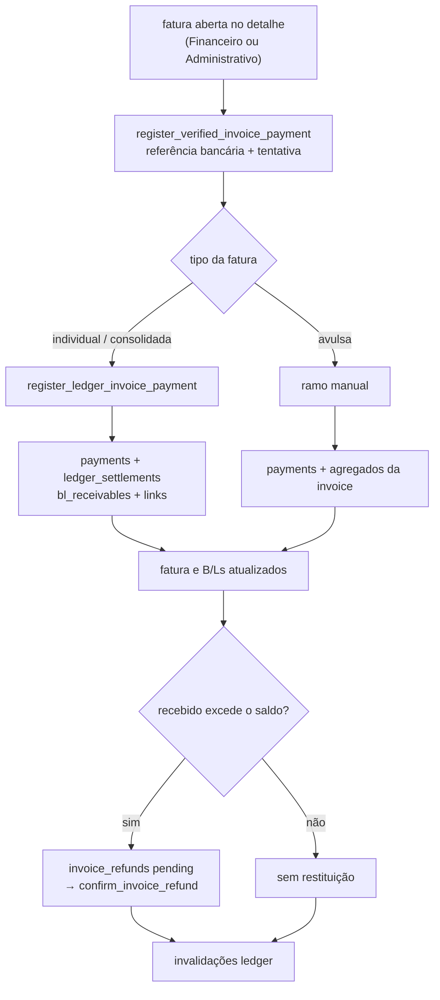

# Faturamento

> **Status:** ativo · **Atualizado:** 2026-10-14 · **Rotas:** operação em `/taxas-locais`; `/faturamento` é redirect legado; detalhe e cancelamento de baixa também são abertos por `/reconciliacao`

## Propósito e escopo

Para a ação do usuário em cada exceção, consulte o
[manual financeiro](../operations/manual-financeiro.md). A
[revisão de 2026-10-04](../archive/audits/2026-10-04-revisao-fluxo-financeiro.md)
registra evidências locais e lacunas de recibo, restituição e mudança de Cliente.

Faturamento é o processo compartilhado de invoices que transforma B/Ls elegíveis em documentos financeiros, mantém a
lista e o detalhe de invoices, cria consolidadas, registra pagamentos,
cancelamentos e restituições. Demurrage tem operação própria em `/demurrage`.
Para taxas locais, o saldo canônico é o ledger por recebível; a tabela
`invoices` continua sendo o documento emitido.

Qualquer usuário interno ativo emite Fatura Avulsa pelo botão **Gerar fatura
avulsa** nesta rota (ADR 0083, item 9; migration `246`). O operador escolhe o Cliente e o Tipo de cobrança (controle segmentado Item da tabela / Outra). Item da tabela exige B/L e traz item, quantidade e valor resolvidos no servidor; Outra permite nome, quantidade e valor livres em R$. A descrição da cobrança aparece na fatura impressa e no Portal. Em Outra, B/L e
Viagem são opcionais; um B/L informado precisa pertencer ao Cliente e ser
compatível com a Viagem. A RPC `create_manual_invoice` grava uma invoice
`manual` e seu item em transação, sem exigir CE Mercante ou gate local
do Portal. Não cria `invoice_bls`, vínculo de recebível, `bl_receivables` nem
settlement de ledger. Use a [ADR 0075](../adr/0075-fatura-avulsa-flexivel.md)
para a decisão completa.

- `/taxas-locais` é a rota interna definida em `src/AppInterno.tsx` e composta por
  `src/pages/TaxasLocais.tsx`; `/faturamento` apenas preserva links legados.
- Quem emite, dá baixa, cancela, autoriza e registra a Restituição está na
  [matriz de permissões](../operations/seguranca.md#taxas-locais-e-faturamento)
  ([ADR 0085](../adr/0085-modelo-de-permissoes-por-perfil.md)). Este módulo
  descreve o que o sistema aceita hoje; as diferenças estão em
  [Notas e divergências](#notas-e-divergências). As capacidades da tela estão
  em `src/hooks/useAuth.tsx`; não há `faturamento_edit` nesse contrato.
- [Taxas Locais](taxas-locais.md) é dona do cálculo e do estado
  `ready_for_billing`.
- Para B/Ls de container, carga solta e misto, emissão automática de taxas
  locais nasce na transição do CE Mercante (ADRs 0020 e 0042): o gatilho
  server-side calcula as taxas, promove o B/L e emite a invoice/recebível na
  mesma transação quando os dados do cliente, a reconciliação e os demais
  critérios financeiros estão prontos. Pela planilha de CE Mercante (migration
  `181`), a gravação guarda o CE e o cálculo e a tela emite logo depois em
  lotes de 25 (`emit_ce_mercante_billing`, que reaproveita o cálculo do dia do
  CE), com progresso e Retomar; o efeito `local_billing` é a rede. A fatura sai
  com a nota "Sistema — CE Mercante". Desde a migration `195`, B/L que só
  espera (Cliente não conciliado, Revisão pendente) volta como aguardando, com
  a frase de negócio, sem Alerta; a falha técnica de um B/L abre
  `billing_auto_issue_failed` (ADR 0041), que fecha quando a fatura do B/L sai —
  no próprio lote ou por qualquer outro caminho (gatilho do CE, fila de efeitos,
  Portal, **Emitir fatura**), pelo gatilho `resolve_auto_issue_alert_on_invoiced`.
  Alertas já abertos para B/L faturado antes da `195` fecham na próxima emissão
  do lote ou à mão. Desde a migration `204` (ADR 0079, decisão 4), B/L sem
  tabela de cobrança ativa para o POD e a modalidade volta como "Aguardando
  tabela de cobrança" e entra num alerta `billing_charge_table_missing` por POD
  e modalidade, com a lista dos B/Ls, que fecha quando as faturas saem; a
  emissão recalcula quando a tabela passa a existir. O B/L cancelado, sem CE,
  com outro POD ou outra modalidade, ou de Viagem cancelada também sai da lista
  (migration `208`). A lista é travada antes de ser lida: duas emissões
  simultâneas no mesmo POD não apagam o B/L uma da outra (migration `209`). B/L calculado com todas as
  taxas zeradas volta como "Nada a faturar", sem alerta. Nenhum dos dois abre
  `billing_auto_issue_failed`. Desde a migration `212`, o B/L que sai do lote
  sem fatura a emitir ("Nada a faturar", isento, sem CE ou cancelado) também
  deixa a lista do alerta de tabela faltando e fecha a falha de emissão
  anterior; e a mesma planilha de CE importada de novo devolve ao lote o B/L
  ativo, com CE e sem fatura que uma emissão interrompida deixou para trás. A
  tela não fecha (X ou Escape) enquanto grava ou emite. Sem CE, qualquer desses
  modos fica em “Aguardando CE Mercante” na Validação; a exceção manual é a emissão
  individual “Emitir”, que mantém os mesmos gates. Granito é apoio operacional
  e não emite invoice (nota de 2026-09-23 na ADR 0042). Embarque de Vazios não emite CE nem possui faturamento de
  cliente.
- Toda emissão, manual ou automática, exige o Gate de faturamento do Portal
  aberto: Portal pronto ou Liberação de faturamento sem Portal vigente. A regra
  do gate e da Liberação está em
  [Regras de negócio § Gate de faturamento](../operations/regras-de-negocio.md#gate-de-faturamento)
  (ADR 0070). Neste módulo, o efeito é este: na emissão pelo CE, o gate fechado
  não é falha — o CE calcula e **retém** a fatura (`billing_hold_reason =
  'Acesso ao portal nao provisionado'`, resultado `held`), sem acionar a fila;
  conceder a Liberação ou ativar o Portal reprocessa o Cliente e emite as
  retidas pelo mesmo caminho, com o cálculo feito no registro do CE, sem
  recalcular pela tabela vigente (o USD converte pelo ROE do dia da emissão;
  ver [Taxa local em dólar](#taxa-local-em-dólar)). Quando o CE
  é gravado fora da planilha, `trg_auto_bill_bl_after_ce_mercante` calcula e
  emite na mesma transação; pela planilha, desde a migration `181`, o gatilho só
  calcula e a emissão vem pelos lotes de `emit_ce_mercante_billing`. Se houver
  falha operacional, um efeito `local_billing` é enfileirado; com ator válido
  ele é recuperável e, sem `auth.uid()`, fica registrado como
  `actor_source=system` e bloqueado de forma auditável, sem fabricar um
  usuário. A repetição é idempotente.
- A comunicação financeira é posterior à emissão/disponibilização no Portal:
  `customer_local_charges_communication_readiness()` exige CE, revisão limpa e
  faturamento concluído em todos os B/Ls ativos do cliente na viagem. Quando
  pronta, a automação dispara `ce_mercante_taxas` em background; o reenvio é
  manual e assistido na coluna da Taxas Locais. Essa trilha não altera o gate de
  faturamento.
- [Reconciliação PIX](reconciliacao-pix.md) é dona do upload, matching,
  confirmação por TXID e cancelamento de baixa a partir do histórico.
- Demurrage permanece em sua própria experiência em `/demurrage` e em
  `demurrage_invoices`, sem entrar no ledger local; a Régua de Cobrança é regra
  de [Demurrage](demurrage.md).

## Anatomia das telas

### Detalhe do B/L: trilhos Operacional e Documental

`src/pages/BlDetalhe.tsx` monta dois trilhos independentes em
`BlRailsPipeline`, desenhados com o `StepRail` comum (a primeira etapa pendente
é a atual; bloqueio continua bloqueio). O trilho **Operacional** permanece com os marcos
`Saída do POL → Chegada ao POD → Descarga → Devolução` para B/Ls de container
(e os marcos de escala para carga solta).

O trilho antes chamado Financeiro agora é **Documental**. Seus quatro cards
centrais, sempre nesta ordem, são:

- **Cliente:** vínculo, reconciliação e pendências do cadastro/Portal;
- **Taxas Locais:** `Não calculado`, `Calculado`, `Isento` ou `Bloqueado · <causa>`;
- **CE Mercante:** `Cadastrado` ou `Pendente · bloqueia emissão e Portal`, para
  container e carga solta;
- **Fatura:** `Não emitida`, `Rascunho`, `Emitida`, `Parcialmente paga`, `Paga`,
  `Coberta`, `Cancelada` ou `Obsoleta`, com `Individual`/`Consolidada` quando
  houver vínculo.

O bloco Documental conta só as pendências dos quatro cards centrais, e a
próxima ação aponta para o primeiro card central pendente ou bloqueado
(**Código:** `summarizeDocumentalRail` e `pickNextAction` em
`src/services/blRails.ts`); a faixa da próxima ação e os blocos dos trilhos
na ficha estão em [Manifestos e EDI](manifesto-edi.md#blsblid). Demurrage é
um indicador auxiliar opcional e não bloqueia a fatura comum. A fatura do
detalhe é lida tanto de
`invoice_bls` quanto de `invoice_receivable_links`, permitindo identificar uma
consolidada mesmo quando o B/L não tem vínculo individual. Não há vencimento ou
estado `Vencida` nesse trilho: essa regra não existe para taxas locais.

No backend, `047_bl_documental_gates.sql` exige CE Mercante antes de marcar o
B/L como pronto e nas fronteiras de emissão individual e consolidada. A
migration `051_ce_mercante_auto_billing.sql` leva a emissão para a transição
do CE; desde a `083` ela obedece ao mesmo gate do Portal que a emissão manual,
e contato com e-mail não é condição de emissão (`085`). Ao abrir o gate, a
fatura retida sai com o cálculo do registro do CE (`085`). A leitura de
Portal do detalhe também devolve `portal_access_ready`, calculado pela função
canônica `customer_portal_access_ready`; a entrega continua usando
`bl_has_portal_release`, que aplica a exigência documental aos dois modos de
carga.

### Lista de invoices

`src/pages/TaxasLocais.tsx` abre por padrão a aba **Faturas**. Desde a etapa 10
da revisão visual (2026-10-09), a URL é a fonte do recorte
(`src/pages/faturasListState.ts`): `tab=validacao` (ou o antigo `pendencias`),
`invoice`, `busca` (fatura ou B/L), `customer`/`customerName`, `bl`, `fatura`, `viagem`, `pod`, `tipo`,
`situacao`, `emissaoDe`/`emissaoAte`, `pagamentoDe`/`pagamentoAte`, `page` e
`pageSize`; links antigos com `tab=invoices` continuam valendo. Data fora do
formato AAAA-MM-DD é ignorada e página além do total recua para a última.

O B/L que filtra a Validação usa um parâmetro próprio, `validacaoBl`, e não o
`bl` de Faturas. Um B/L com fatura ativa sai da fila da Validação; levar o
filtro de Faturas ao trocar de aba abriria a fila vazia. Por isso cada aba
começa sem o B/L da outra, e o recorte de Faturas é preservado na volta. A
Validação abre filtrada só pelo alerta "Ver na Validação" ou por um link. O
endereço antigo `tab=validacao&bl=` (ou `tab=pendencias&bl=`) é convertido na
chegada. A lista usa:

- `src/components/billing/InvoiceFiltersBar.tsx`: busca única por fatura ou
  B/L (`busca`; a fatura entra se o número dela ou de qualquer B/L dela bate),
  Cliente, Situação (Em aberto, Paga ou coberta, Cancelada ou obsoleta) e
  Navio / Viagem abertos; B/L, fatura, POD, tipo, emissão, pagamento e tamanho
  de página em "Mais filtros" (lote 1 da identidade, 2026-10-14);
- `src/components/billing/InvoicesTable.tsx`, em tabela limpa: Fatura (o
  número abre o detalhe; consolidada com o ícone de pilha), B/L (o primeiro e
  "+n"), Emissão, Cliente, Navio / Viagem, Total, Saldo (âmbar quando maior que
  zero) e Situação em texto (`InvoiceSituation`: Emitida, Parcialmente paga,
  ✓ Paga, Coberta, Cancelada em cinza com a linha inteira); sem coluna de
  Comunicado, sem CNPJ nem POD na linha (ficam no detalhe e no filtro); cartões
  abaixo de 1024 px, para Saldo e Situação não ficarem atrás da rolagem;
- bloco Faturas com o total do recorte e o saldo em aberto na faixa do título
  ("nesta página" quando há mais de uma página) e Exportar com os filtros;
- loading, erro com Tentar novamente (sem lista vazia falsa) e vazio derivados
  de `useInvoices`.

Acima das abas ficam os alertas financeiros (cada um com o link de onde se
resolve, `alertEntityLink`), a Reemissão pendente e os Ajustes de COD. Nesta
página, o alerta de fatura abre o detalhe sem perder o recorte da lista, e o
bloqueio de cobrança de um B/L sem rota própria leva à Validação filtrada pelo
B/L (`financialAlertAction.ts`, parâmetro `validacaoBl`). A fatura aberta pela Reemissão pendente aparece
por cima da aba atual; `?invoice=` sem `tab` continua abrindo em Faturas.

A página não marca faturas vencidas ao montar: **taxa local não tem vencimento
praticado** (ADR 0055, migration arquivada `348`), e o detector `detect_overdue_invoices`
foi removido junto com a coluna `invoices.due_date`.

O filtro Tipo inclui **Avulsa**. Linhas sem B/L continuam na lista; se houver
Viagem direta, o navio e a viagem são exibidos a partir de `invoices.voyage_id`.
O detalhe apresenta item, descrição da cobrança e contexto opcional. A impressão
usa o mesmo modelo da invoice local, com título **FATURA AVULSA** e sem criar
um B/L artificial. Quando a quantidade de um item é fracionária por container
compartilhado, o documento identifica a razão (por exemplo, `1/7`) como fração
do container compartilhado.

### Validação

- `src/components/billing/ValidacaoTab.tsx` orquestra consultas, mutações,
  invalidações e estado da fila operacional de taxas locais e Granito, num
  bloco "Validação" com a contagem, **Recalcular selecionados** e **Exportar
  (n)** na faixa do título. `src/components/billing/ValidacaoControls.tsx`
  contém os filtros (Busca, Motivo — ver [Motivo de bloqueio de faturamento](#motivo-de-bloqueio-de-faturamento) — e Navio / Viagem abertos; Modo de carga, POD
  e "Incluir faturados e isentos" em "Mais filtros");
  `src/components/billing/ValidacaoOperationsTable.tsx` renderiza a tabela limpa
  (lote 1 da identidade, 2026-10-14): seleção, seta de abrir e as colunas B/L,
  Cliente, Navio / Viagem, Motivo (em texto, uma vez), Subtotal e **uma ação por
  linha, a que resolve o motivo** (Recalcular, Vincular na Revisão, Cadastrar
  CE, Abrir Cliente ou Emitir). Cálculo, Vínculo do Cliente e Modo de carga
  saíram da linha.
- **Fila (2026-10-14):** B/L faturado, **parcialmente pago ou pago** sai da fila
  (`getBillingBlock` usa `isBlFinanciallyLocked`; antes só `invoiced` contava e o
  B/L pago voltava como "Cálculo incompleto" oferecendo Emitir). B/L **Pronto
  para emitir** (tudo certo e a fatura não saiu sozinha) fica na fila normal com
  o botão Emitir; antes só aparecia com "Incluir resolvidos". Sem linhas de taxa,
  o motivo se chama "Cálculo sem linhas"; com taxa em revisão, "Taxa em revisão";
  a retenção pelo Portal, "Conta do Portal não ativa" (código
  `portal_nao_provisionado`). Quando há Alerta aberto do B/L que explica o
  motivo, a faixa da linha aberta traz a data: "A emissão automática falhou em
  dd/mm/aaaa." (`billing_auto_issue_failed`) ou "Cálculo bloqueado desde
  dd/mm/aaaa." (`billing_calculation_blocked`), lidos da mesma consulta dos
  avisos financeiros (`src/components/billing/validacaoBand.ts`). O título
  resume "N B/Ls aguardando emissão" e só cita a seleção quando há B/L marcado.
- **Exportar:** uma planilha só (`exportValidacaoWorkbook`), uma linha por B/L,
  com B/L, Cliente, CNPJ, Navio / Viagem, Trecho, Modo de carga, Motivo, Detalhe
  do motivo, Último cálculo, Subtotal, Contêiner compartilhado (ADR 0038: B/L com
  taxa rateada por contêiner lista os contêineres que divide, "CSNU1 (2 B/Ls)") e
  uma coluna por taxa com o total dela no B/L (`fetchChargeTotalsByBl`); taxa em
  US$ tem coluna própria "(US$)". Respeita
  a seleção e, sem seleção, o filtro; o botão diz quantos ("Exportar 7 B/Ls") e o
  arquivo se chama `validacao-taxas-locais-AAAA-MM-DD.xlsx`. A "Visão filtrada" e a "Conferência do
  escopo" saíram.
- **Ajustes de COD (ADR 0051):** `src/components/billing/CodAdjustmentsPanel.tsx`
  lê a fila de `cod_adjustments` com status `pending` e só monta o painel quando
  há ao menos uma pendência. Uma resposta bem-sucedida sem pendências omite o
  painel inteiro; carregamento e erro continuam visíveis para não esconder uma
  consulta inconclusiva. A tabela traz B/L (link para a ficha, com o ícone de
  copiar), Ação, Anterior, Destino, Diferença e Operação: nos ramos de
  documento, o botão **Abrir faturas** (aba Faturas filtrada pelo B/L), o
  número interno e **Vincular e concluir**; nos demais, **Aplicar abatimento**
  ou **Registrar restituição**, todos com a confirmação **Liquidar ajuste**.
  A regra está em [Ajuste de COD](#ajuste-de-cod).
- **Bloqueio por Portal não provisionado (ADR 0054, ADR 0070, issue 638):** o
  gate de emissão e de revisão é `customer_billing_access_ready` (definição
  vigente na migration `084`): Portal pronto pelo critério do faturamento
  (`customer_portal_billing_ready` — conta ativa, `account_situation =
  'ativo'`, vinculada ao usuário de autenticação, e-mail de recuperação com
  formato válido, `recovery_email_status = 'ok'` e fora de
  `portal_suppressed_emails`) **ou** Liberação de faturamento sem Portal
  vigente. Sem ele, `_compute_bl_review_pendencies` (definição vigente na `085`)
  devolve a pendência `Acesso ao portal nao provisionado`, a emissão
  manual/consolidada é recusada (`create_invoice_from_bls_core`, `019`) e a
  emissão automática do CE retém a fatura em `billing_hold_reason`.
  `customer_portal_access_ready` continua servindo à leitura de prontidão do
  Portal (detalhe do B/L, visibilidade), não ao gate. A reavaliação da Revisão
  quando o Portal ou a Liberação mudam está em
  [Suporte operacional](operacao-suporte.md) (seção Gate canônico de revisão).
  O histórico do critério está nas migrations arquivadas `337`, `367` e `368`.
  B/L faturado não é recomputado. A Validação lê as duas fontes: `notes`,
  escrito pela `save_bl_review`, e a retenção do CE. O cálculo não é afetado.
  Na Validação o
  motivo deixou de aparecer como “Cálculo incompleto”: `getBillingBlock` ganhou o
  código `portal_nao_provisionado`, atrás de cliente, cálculo e CE Mercante na
  precedência, porque é o único bloqueio que se resolve no cadastro do cliente e
  não no B/L. Ele só responde pelo B/L quando é a **única** pendência aberta.
- **Linha aberta (lote 1 da identidade, 2026-10-14):** dois blocos lado a lado.
  **Situação do B/L** traz o motivo numa faixa âmbar (verde quando pronto;
  neutra para faturado, isento e Granito) com o botão que o resolve — cliente
  em `/revisao?bl=<id>` (a Revisão lê `bl` junto de `cliente`/`busca`/`q`,
  filtrando a fila e abrindo o grupo daquele B/L, ADR 0061), CE Mercante na
  ficha do B/L, portal na ficha do Cliente (visível a todos os perfis; a tela de
  destino aplica a permissão) — e só Trecho, CE Mercante, Cliente e CNPJ (sem
  Cliente, o nome e o CNPJ do manifesto, da fila de conciliação). Subtotal,
  Linhas de taxa, Última revisão e Último evento saíram por repetirem a linha ou
  a conferência. As pendências de revisão das taxas continuam embaixo quando o
  cálculo está em revisão. **Conferência do cálculo** traz a data do cálculo e o
  total no título.
- **Conferência de cálculo na expansão (issue 583):** a expansão do B/L mostra
  como se chegou ao valor, não só qual é. `list_bl_local_charge_lines` passou a
  devolver `charge_table_name`, `charge_table_pod` e `application_basis`
  (migration arquivada `369`, `DROP`+`CREATE` porque o `RETURNS TABLE` muda de forma):
  assim a tela nomeia a tabela usada sem outra leitura de `charge_tables` e
  `charge_table_items` (que têm leitura global por `is_active_read_user()`; a
  nota original dizia "admin-only", o que não vale mais). `ConferenciaCalculo`
  (um `Block` com a tabela Taxa, Base, Qtd., Unitário e Total em cabeçalho
  claro) agrupa as linhas por origem (`src/components/billing/conferenciaCalculo.ts`):
  um grupo por tabela de cobrança, com o porto de descarga no subtítulo — é o
  POD que escolhe a tabela, Vitória cobra pela de Vitória e Salvador pela de
  Salvador —, mais os grupos **Lançamentos manuais** e **Sem tabela vinculada**,
  este último marcado como anomalia por ser linha automática sem tabela. Cada
  grupo soma seu subtotal e o cabeçalho soma o total, BRL e USD separados, sem
  converter moeda. A conferência nasce aberta: quem expande o B/L está ali para
  conferir. Granito não a exibe (não participa da emissão). Portos aparecem pelo
  alias e não pelo LOCODE: `formatPortDisplayName` cobre os códigos canônicos que
  `normalize_port_code` produz (migration arquivada `365`).

  Para **B/L faturado** a conferência continua lendo `charge_calculations`, que é
  o cálculo e está congelado na prática — `calculate_bl_local_charges` recusa
  recálculo (`22023`) em `invoiced`/`partially_paid`/`paid`. Mas o que a fatura
  registrou pode divergir desse total num caso concreto: desde a migration arquivada `261`
  o detalhamento é **congelado** em `invoice_items` na emissão (não mais
  reconstruído em leitura, que virou rede de segurança), e na consolidação, quando
  a soma dos itens não fecha com o saldo do B/L, o que se congela é **uma linha
  agregada** por B/L. Nesse caso a tela mostraria um número diferente do cobrado.
  Por isso, quando o B/L está com situação financeira `invoiced`, a
  conferência compara seu total com o subtotal congelado do B/L
  (`invoice_bls`, ou `invoice_receivable_links` nas consolidadas — esta sem coluna
  em USD, daí o `null` significar "não sei" e não "zero") e **avisa quando
  diverge**, dizendo que o que vale para o cliente é o valor da fatura. A
  tolerância é de um centavo, porque os dois lados são `NUMERIC(14,2)` somados em
  pontos diferentes (`src/components/billing/ConferenciaCalculo.tsx`). A
  conferência é leitura: não recalcula, não aprova e não emite.
- **Etapa 12 do plano de faturamento (ADR 0038):** a aba Pendências foi
  removida por ser subconjunto literal da Validação. O link `?tab=pendencias`
  abre a Validação com o Motivo **Cálculo incompleto** pré-aplicado
  (`initialBlockCode = 'calculo_incompleto'`); o recálculo em massa é feito
  selecionando as linhas e usando **Recalcular selecionados**.

### Modal de invoice consolidada

`src/components/billing/ConsolidatedInvoiceModal.tsx` seleciona cliente,
viagem e B/L, consulta receivables, desabilita linhas não elegíveis e resume
quantidade/valor. A seleção só aceita `eligibility_status = eligible`, regra
isolada em `src/components/billing/consolidatedInvoiceSelection.ts`.

### Detalhe, pagamento, restituição e cancelamento

`src/components/billing/InvoiceDetailModal.tsx` (também aberto pela
Conciliação, com `enablePaymentReversal`) é uma superfície única com seções por
filete:

- cabeçalho com situação exata, tipo, emissão, número interno, Cliente com CNPJ
  (com o ícone de copiar), navio/viagem e, na avulsa, a descrição da cobrança;
- faixa de valores que separa total emitido, recebido, abatido pela correção do
  B/L, devolvido, a devolver e saldo (ou "Coberta pela consolidada X" /
  "Não cobrado"), lida de `financial_summary`
  (`src/components/billing/invoiceDetailPresentation.ts`); sem vencimento;
- vínculo com a fatura substituída ou sucessora, Reemissão pendente e motivo de encerramento sem reemissão;
- Fatura desatualizada e histórico dos ajustes que a correção do B/L fez em fatura com pagamento (abatimento e restituição);
- B/Ls (número com link para a ficha e o ícone de copiar), itens (breakdown
  reconstruído de consolidadas) e pagamentos; cada
  pagamento tem "Cancelar baixa…" para o Administrativo, que abre o formulário
  na própria seção com a baixa escolhida, justificativa e conferência de
  valor/data; na Conciliação o formulário já abre na baixa selecionada;
- uma única lista de restituições (`invoice_refunds`); Confirmar devolução e
  Cancelar autorização abrem dentro da linha, com comprovante, favorecido e data;
  na avulsa, a autorização de restituição excepcional fica logo abaixo
  (`FinancialRefundsPanel variant="authorization"`);
- registro de pagamento (ledger versus legado) e cancelamento da fatura sem
  pagamentos, com confirmação; o registro aparece para o Financeiro e o
  Administrativo, e o cancelamento só para o Administrativo — os demais perfis
  leem o motivo (migration `247`);
- impressão da fatura ou do recibo no próprio modal (Voltar ao detalhe), sem
  abrir um segundo diálogo.

### Demurrage

**Etapa 12 do plano de faturamento (ADR 0038; nota editorial em
[ADR 0008](../adr/0008-demurrage-integrado-sem-unificar-persistencia.md)):** a
aba Demurrage (lista, modal de detalhe e impressão) foi removida por duplicar
`/demurrage` sem os filtros e a impressão de lá. A faixa agregada de Demurrage
também foi removida; `/demurrage` é a única superfície
das métricas e da gestão desse processo. `?tab=demurrage` redireciona para
`/demurrage`, consumindo `tab` e preservando os demais parâmetros (chamado só
depois de todos os hooks do componente para não violar as Regras dos Hooks entre
a renderização normal e a que redireciona). **Gap conhecido:** o plano pedia confirmar com a
operação que ninguém imprime Demurrage a partir de `/faturamento` antes de
remover esse caminho — essa confirmação não foi feita nesta sessão (sem
acesso à operação); se alguém dependia da impressão a partir daqui, o caminho
agora é abrir `/demurrage` diretamente.

### Histórico de reconciliação

`src/components/billing/ReconciliationHistoryTable.tsx` pertence à pasta de
billing, mas não é montado em `TaxasLocais.tsx`; a superfície executável está em
`src/pages/Reconciliacao.tsx`. Ela combina pagamentos locais e Demurrage,
filtra, ordena, pagina, exporta e abre o detalhe para cancelamento de baixa.

### Documento imprimível

`src/components/billing/InvoiceDocumentLocal.tsx` usa
`src/components/shared/InvoiceDocumentKit.tsx` e
`src/components/shared/invoiceFormat.ts`. `InvoiceDetailModal` mostra o
documento no próprio diálogo e imprime por `printDocumentElement`
(`src/lib/printDocument.ts`); o Portal usa `window.print()`. O nome sugerido é
calculado por `buildInvoiceFileBaseName`. Não existe geração de PDF por
biblioteca.

Desde a PR 939 (documentos impressos, tela 20 da identidade), sem mudar o visual: valores
em R$ não quebram linha, a folha tem margem e "Página N de M" em todas as
páginas, e o recibo da individual coberta diz "Recebido pela consolidada
… (atribuído a estes B/Ls)" e "Valor líquido atribuído", em vez de "Valor
recebido". A nota interna da emissão pelo CE ("Sistema — CE Mercante") não é
impressa; Pix só em fatura pagável e nunca no recibo.

A fatura de Taxas Locais é **modular** (Fatura Adaptativa Modular): os itens
são agrupados em até três blocos, cada um com subtotal — **1. Carga
conteinerizada**, **2. Carga solta (breakbulk)** e **3. Taxas administrativas e
documentais** —, e bloco sem item não aparece. B/L misto mostra os dois blocos
de carga sob o cabeçalho "MISTO (CNTR + CARGA SOLTA)"; na consolidada, os
blocos se repetem por B/L. A classificação do item vem do snapshot (categoria
ou base de aplicação) em `classifyInvoiceItem`
(`src/components/shared/invoiceFormat.ts`). A avulsa lista seus itens sem
blocos. **Código:** `src/components/billing/InvoiceDocumentLocal.tsx`.

## Catálogo de ações

| Tela / ação | Pré-condições | Origem | Orquestração | Persistência | Efeitos e cache | Falhas | Evidência |
|---|---|---|---|---|---|---|---|
| `/taxas-locais` · filtrar/listar invoices | Sessão interna; filtros opcionais | `TaxasLocais` → `InvoiceFiltersBar` / `InvoicesTable` | `useInvoices` → `listInvoices` | `SELECT invoices`, `invoice_bls`, `invoice_receivable_links`, `payments`; filtros auxiliares consultam B/Ls/viagens | Query `queryKeys.invoices.list(filters)`; paginação remota da lista principal | Erro principal vira `InlineError`; filtros sem IDs retornam vazio sem consultar invoices | **Código:** `src/pages/TaxasLocais.tsx`, `src/services/billing.ts` · **Teste:** `src/services/__tests__/billing.test.ts` |
| `/taxas-locais` · emitir Fatura Avulsa | Usuário interno ativo/admin autorizado pela RPC; Cliente; Outra com item/quantidade/valor livres e contexto opcional; item da tabela exige B/L e valor resolvido | Botão “Gerar fatura avulsa” → `ManualInvoiceModal` | `useCreateManualInvoice` → `createManualInvoice` → RPC `create_manual_invoice` | Cria `invoices.invoice_type='manual'` e um `invoice_items.source='manual'`; `notes` guarda a descrição; não cria relações de ledger | Invalida lista/detalhe de invoices, histórico de reconciliação e dados relacionados ao B/L/Cliente quando informados | RPC valida valores, Cliente/B/L/Viagem e coerência; falha transacional não deixa documento/item parcial | **Código:** `src/components/billing/ManualInvoiceModal.tsx`, `src/hooks/useBilling.ts`, `src/services/billing.ts`, migrations `097` e `123`; **Teste:** `src/components/billing/__tests__/ManualInvoiceModal.test.tsx`, `src/hooks/__tests__/useBillingManualInvoice.test.ts`; **Teste local-pg:** `src/integration/manualInvoice.local-pg.test.ts` |
| `/taxas-locais` · exportar lista | Mesmos filtros; ao menos uma invoice | `TaxasLocais.handleExport` | `listInvoicesForExport` → `exportInvoicesWorkbook` | Leituras paginadas de 1000; arquivo XLSX local | Não altera cache | Sem linhas gera aviso; leitura/geração propaga erro | **Código:** `src/pages/TaxasLocais.tsx`, `src/services/billing.ts`, `src/services/exports.ts` · **Teste:** `src/services/__tests__/billingHelpers.test.ts` |
| `/taxas-locais` · abrir invoice | ID selecionado pela tabela ou query string | `InvoicesTable.onSelectInvoice` | `useInvoiceDetail` → `listInvoiceDetails` | RPC `list_invoice_details` lê documento, links diretos, itens e pagamentos; `list_payment_registrar_names` (migration `221`) dá o nome de quem registrou cada baixa | Query `queryKeys.invoices.detail(id)` | ID ausente desabilita query; erro mostra falha no modal | **Código:** `src/components/billing/InvoicesTable.tsx`, `src/components/billing/InvoiceDetailModal.tsx`, `src/services/billing.ts` · **Teste:** `src/pages/__tests__/TaxasLocais.behavior.test.tsx` |
| Detalhe · carregar breakdown consolidado | Invoice sem itens diretos e com `invoice_receivable_links` | `listInvoiceDetails` após RPC base | Lê links/snapshots; RPC `get_consolidated_invoice_item_breakdown`; valida com Zod | `invoice_receivable_links`, `voyages`, leitura protegida de `charge_calculations` | Reusa `invoice-detail`; usa linha agregada por B/L se breakdown não reconciliar com subtotal | Erro/shape inválido do breakdown é best-effort e cai no agregado | **Código:** `src/services/billing.ts`, `supabase/migrations_archive/086_consolidated_invoice_item_breakdown.sql`, `supabase/migrations_archive/090_restrict_consolidated_invoice_breakdown.sql` |
| Validação · recalcular selecionados | Seleção não vazia | `ValidacaoTab.runBatchOperation('recalculate')` | Hooks de Taxas Locais; Granito usa `runGraniteBatch` canônico | Uma operação por B/L | Invalida operações, invoices, B/Ls e resumo após o lote | Resultado parcial agrega erros sem interromper os demais B/Ls | **Código:** `src/components/billing/ValidacaoTab.tsx`, `src/hooks/useLocalCharges.ts`, `src/services/graniteBillingWorkflow.ts` · **Teste:** `src/services/__tests__/localCharges.test.ts`, `src/services/__tests__/graniteBillingWorkflow.test.ts` |
| Validação · apoio operacional de Granito | Não aplicável a Granito; a fila oferece apenas recálculo | `runBatchOperation('recalculate')` | `runGraniteBatch` chama exclusivamente `calculateGraniteBlCharges` | Snapshot quantitativo operacional | Invalida operações, B/Ls e resumo | Falhas são isoladas por B/L; nenhum estado financeiro é promovido | **Código:** `src/components/billing/ValidacaoTab.tsx`, `src/services/graniteBillingWorkflow.ts` · **Teste:** `src/services/__tests__/graniteBillingWorkflow.test.ts` |
| Validação · emitir invoice individual | B/L "Pronto para emitir" (calculado, revisado ou pronto), não faturado e com cliente | `handleIssueSingleInvoice` | `markBlReadyAndCreateInvoice` (RPC `mark_bl_ready_and_create_invoice`: marca pronto e emite na mesma transação, como a ficha do B/L); Granito é somente apoio operacional e não oferece emissão | RPC local para B/Ls financeiros; nenhum caminho financeiro novo para Granito | Invalida operações, invoices, B/Ls e resumo após emissão local | RPC revalida estado, cliente e vínculos; Granito não exibe o botão “Emitir” | **Código:** `src/components/billing/ValidacaoTab.tsx`, `src/components/billing/ValidacaoOperationsTable.tsx` · **Teste:** `ValidacaoOperationsTable.test.tsx`, `ValidacaoTab.confirmation.test.tsx` |
| B/L · Emitir fatura (marca pronto e emite atomicamente) | Um B/L com cliente reconciliado, taxas elegíveis e CE Mercante | `BlCobrancasTab` (botão **Emitir fatura**, qualquer Departamento desde a migration `246`; com confirmação), `reviewBillingAutomation` | `markBlReadyAndCreateInvoice` | RPC `mark_bl_ready_and_create_invoice` chama promoção + criação ledger na mesma transação; `047_bl_documental_gates.sql` reforça CE na prontidão e emissão | Chamadores invalidam seus domínios após sucesso | Qualquer falha aborta promoção e emissão juntas | **Código:** `src/components/bl/BlCobrancasTab.tsx`, `src/services/reviewBillingAutomation.ts`, `supabase/migrations_archive/102_mark_ready_and_invoice_atomic.sql`, `supabase/migrations/047_bl_documental_gates.sql` |
| Modal consolidada · listar elegíveis | Cliente selecionado; filtros opcionais | `ConsolidatedInvoiceModal` | `useConsolidatableReceivables` → `listConsolidatableReceivables` | RPC `list_consolidatable_receivables` lê ledger e links | Query `queryKeys.billingLedger.consolidatableReceivables(filters)` | Sem cliente não consulta; rows pagas/sem saldo/em consolidada aberta ficam desabilitadas | **Código:** `src/components/billing/ConsolidatedInvoiceModal.tsx`, `src/services/billingLedger.ts` · **Teste:** `src/components/billing/__tests__/ConsolidatedInvoiceSelection.test.ts` |
| Modal consolidada · emitir | Cliente, ao menos um receivable elegível e CE Mercante em cada B/L selecionado | `ConsolidatedInvoiceModal.submit` | `useCreateConsolidatedInvoice` → `createConsolidatedInvoice` | RPC `create_local_consolidated_invoice` cria invoice, links, evento e auditoria; `047_bl_documental_gates.sql` guarda links e transição para emissão | Invalidação ledger comum: ledger, invoices, B/Ls, clientes, detalhes, refunds, alertas e contagem | RPC trava receivables e rejeita cliente divergente, saldo inválido, consolidada aberta ou B/L sem CE | **Código:** `src/services/billingLedger.ts`, `supabase/migrations_archive/067_local_billing_ledger_phase2.sql`, `supabase/migrations/047_bl_documental_gates.sql` · **Teste:** `src/services/__tests__/billingLedger.test.ts`, `src/services/__tests__/blDocumentalGatesMigration.test.ts` |
| Detalhe · registrar pagamento ledger | `canRegisterInvoicePayment`: fatura não avulsa com status `issued`/`partially_paid`/`overdue` e saldo positivo; fora disso o card mostra que a fatura não aceita pagamento | `InvoiceDetailModal.handleRegisterPayment` | `useRegisterLedgerInvoicePayment` → `registerLedgerInvoicePayment` | RPC `register_verified_invoice_payment` → `register_ledger_invoice_payment` → `payments`, `ledger_settlements`, receivables, invoice, B/Ls, eventos e possível refund | Invalidação ledger comum | Valor/data validados; RPC rejeita estado, ausência de links, TXID duplicado e regras de valor | **Código:** `src/pages/faturamentoLedgerPayment.ts`, `src/components/billing/InvoiceDetailModal.tsx`, `src/services/billingLedger.ts` · **Teste:** `src/services/__tests__/billingLedger.test.ts` |
| Detalhe · registrar pagamento de avulsa | `canRegisterInvoicePayment`: fatura avulsa com status `issued`/`overdue`/`partially_paid`/`paid` (excedente vira restituição); cancelada ou rascunho não mostra o formulário (VELA-15) | Mesmo handler, ramo `else` | `useRegisterInvoicePayment` → `registerInvoicePayment` | RPC `register_verified_invoice_payment` (ramo `manual`) → `payments`, agregados de `invoices`, restituição do excedente | Invalida invoices, detalhe, B/Ls e clientes | Bloqueia valor não positivo, referência bancária ausente e avulsa fora dos status aceitos (22023) | **Código:** `src/pages/faturamentoLedgerPayment.ts`, `src/hooks/useBilling.ts`, `supabase/migrations/136_controles_financeiros.sql` · **Teste:** `src/pages/__tests__/faturamentoLedgerPayment.test.ts`, `src/components/billing/__tests__/InvoiceDetailPrint.test.tsx` |
| Taxas Locais · Reemissão pendente · Tentar reemitir | Consolidada cancelada pela correção do B/L; qualquer Departamento (migration `246`) | `PendingReissuesPanel` | `useRetryPendingConsolidatedReissue` → `retryPendingConsolidatedReissue` | RPC `retry_pending_consolidated_reissue` → `_try_recreate_consolidated` (128): recria com os mesmos B/Ls, encerra se já não são os mesmos ou aguarda a individual | Invalida invoices (inclui Reemissão pendente), detalhe, ledger e clientes | Trava (Portal não pronto) mantém a pendência com o motivo no alerta | **Teste:** `invoiceBasisCorrection.local-pg.test.ts` |
| Detalhe · Resolver alerta com justificativa | Fatura desatualizada tratada; qualquer Departamento (migration `246`); motivo | `StaleInvoiceResolutionPanel` | `resolveStaleInvoice` | `resolve_stale_invoice`; eventos de alerta e auditoria | Fecha alerta, sem emitir documento ou fazer ajuste | Motivo vazio e papel não autorizado recusados | **Teste:** `invoiceCorrection.local-pg.test.ts` |
| Detalhe · cancelar invoice | Admin; invoice sem pagamentos | `handleCancelInvoice` | `useCancelInvoice` → `cancelInvoice` | RPC protegida `cancel_invoice` (executa como `SECURITY DEFINER` após validar sessão ativa e papel admin) → invoice, batch, B/Ls e auditoria; implementação mais recente também preserva regras de Granito | Invalida invoices, detalhe, billing-ready, B/Ls e clientes | Pagamentos bloqueiam cancelamento; tabelas internas não são expostas diretamente; falha cria alerta/evento best-effort | **Código:** `src/components/billing/InvoiceDetailModal.tsx`, `src/services/billing.ts`, `supabase/migrations_archive/064_fix_granite_invoice_cancel_reissue.sql`, `supabase/migrations_archive/142_secure_cancel_invoice_wrapper.sql` |
| Detalhe · confirmar devolução | Refund pendente; Financeiro/Administrativo; comprovante, favorecido e data | `handleSettleRefund` com conferência | `useSettleInvoiceRefund` → `settleInvoiceRefund` | RPC `confirm_invoice_refund` (136), com evidência/auditoria | Invalidação financeira comum, inclusive Portal e Demurrage | Sem permissão, evidência ou lastro é rejeitado; repetição idêntica é idempotente | **Código:** `src/services/billingLedger.ts` · **Teste local:** `invoicePostBillingSafety.local-pg.test.ts` · **Migration 136:** [controles financeiros](../archive/specs/2026-10-04-controles-financeiros-design.md) |
| Detalhe da avulsa ou de Demurrage · **Restituição excepcional** (autorizar) | Qualquer Departamento (migration `247`); avulsa paga ou parcialmente paga, ou Invoice de Demurrage paga; valor positivo até o recebido ainda não reservado (em Cancelamento com devolução integral, exatamente esse valor); finalidade (Devolução por ajuste ou Cancelamento com devolução integral) e justificativa de ao menos 10 caracteres | `FinancialRefundsPanel` (variante de autorização no detalhe da avulsa; completa no detalhe de Demurrage) | `requestFinancialRefund` (`src/services/financialRefunds.ts`), com chave de tentativa | RPC `request_financial_refund` (`136`) → `invoice_refunds` ou `demurrage_refunds` pendente com finalidade e `request_id` | Invalida restituições e dados financeiros relacionados | Papel diferente do Administrativo recebe `42501`; valor acima do disponível ou justificativa curta, `22023`. A autorização não transfere dinheiro: a devolução é registrada pelo Financeiro ou pelo Administrativo | **Código:** `src/components/billing/FinancialRefundsPanel.tsx`, `supabase/migrations/136_controles_financeiros.sql` |
| Detalhe · **Cancelar autorização** de restituição excepcional | Qualquer Departamento (migration `247`); restituição excepcional (`request_id` preenchido) ainda pendente; motivo de ao menos 10 caracteres | `FinancialRefundsPanel` (botão na linha da restituição) | `useCancelFinancialRefundAuthorization` → `cancelFinancialRefundAuthorization` | RPC `cancel_financial_refund_authorization` (`136`) → restituição `cancelled`, motivo registrado | `afterBlInvoiceBasisAlterada` | Restituição gerada pela correção do B/L não é cancelável por esta ação; nova devolução exige nova autorização | **Código:** `src/hooks/useFinancialRefunds.ts`, `supabase/migrations/136_controles_financeiros.sql` |
| Detalhe · Ajustes pela correção do B/L · **Preparar cancelamento financeiro** | Administrativo; B/L de fatura paga ou parcialmente paga, com cobrança vigente e sem troca de Cliente em andamento; motivo de ao menos 10 caracteres | `InvoiceCorrectionPanel` | `usePrepareBlFinancialCancellation` → `prepareBlFinancialCancellation` | RPC `prepare_bl_financial_cancellation` (`136`): abate o saldo da cobrança do B/L e separa o recebido para restituição; demais B/Ls da consolidada preservados | Invalidação ledger comum | Não cancela o B/L: depois de devolver e confirmar, o Administrativo cancela o B/L na ficha. Outros papéis recebem `42501` | **Código:** `src/components/billing/InvoiceCorrectionPanel.tsx`, `src/hooks/useBillingLedger.ts`, `supabase/migrations/136_controles_financeiros.sql` |
| Taxas Locais · Ajustes de COD · **Liquidar ajuste** | Financeiro ou Administrativo (`settle_financial_adjustments`); ajuste `pending`. Em Cancelar e reemitir, Fatura complementar e Revisão manual de cobrança, o número interno de uma fatura ativa do B/L, ainda não vinculada a outro ajuste | `CodAdjustmentsPanel` | `useSettleCodAdjustment` → `settleCodAdjustment` | RPC `settle_cod_adjustment` (`130` sobre o corpo da `002`): aplica abatimento/restituição ou vincula o documento e marca o ajuste liquidado, com auditoria | Invalidação ledger comum | Ajuste já tratado pela correção automática do B/L é recusado (`22023`); documento de outro B/L ou já vinculado é recusado | **Código:** `src/components/billing/CodAdjustmentsPanel.tsx`, `src/services/billingLedger.ts`, `supabase/migrations/130_correcao_faturamento_pix_e_cod.sql` |
| Detalhe · imprimir fatura ou recibo | Detalhe carregado; recibo para paga, coberta ou cancelada com pagamento | **Imprimir fatura** / **Imprimir recibo** no detalhe | Mostra `InvoiceDocumentLocal` no diálogo; **Imprimir** chama `printDocumentElement` (`src/lib/printDocument.ts`) | Sem persistência; documento usa o snapshot da emissão, `financial_summary` e `pix_payload` | Sem invalidação | Popup bloqueado cai em `window.print()` da página; falha de impressão é do navegador | **Código:** `src/components/billing/InvoiceDetailModal.tsx`, `src/components/billing/InvoiceDocumentLocal.tsx`, `src/lib/printDocument.ts`, `src/index.css` · **Teste:** `InvoiceDetailPrint.test.tsx`, `InvoiceDocumentLocal.behavior.test.tsx`, `InvoicePrintCssContract.test.ts`, `src/lib/__tests__/printDocument.test.ts` |
| Histórico de reconciliação · filtrar/exportar/abrir detalhe | Superfície `/reconciliacao` | `ReconciliationHistoryTable` | `listReconciliationHistory`, `exportReconciliationHistoryExcel` | Leituras de invoices/payments/links e Demurrage; export XLSX local | Query `['reconciliation-history', filters]` | Erros de leitura aparecem na tabela; export reaplica filtros | **Código:** `src/components/billing/ReconciliationHistoryTable.tsx`, `src/services/reconciliacao.ts` · **Teste:** `src/components/billing/__tests__/ReconciliationHistoryTable.behavior.test.tsx` |

## Estado e dados

### Queries e invalidações

| Estado remoto | Query key | Dono |
|---|---|---|
| Lista de invoices | `queryKeys.invoices.list(filters)` | `useInvoices` |
| Detalhe | `queryKeys.invoices.detail(id)` | `useInvoiceDetail` |
| Links por B/L | `queryKeys.invoices.links(blIds)` | `useInvoiceLinks` |
| Clientes do seletor | `queryKeys.billingReady.customers(search)` | `useBillingCustomers` |
| Receivables consolidáveis | `queryKeys.billingLedger.consolidatableReceivables(filters)` | `useConsolidatableReceivables` |
| Refunds | `['invoice-refunds', invoiceId]` | `useInvoiceRefunds` |
| Alertas | `['financial-alerts']` | `TaxasLocais` |
| Histórico | `['reconciliation-history', filters]` | `ReconciliationHistoryTable` |

`useLedgerInvalidation` invalida `billingLedger.all()`, `invoices.all()`,
`bls.all()`, clientes, `['invoice-detail']`, `['invoice-refunds']`,
`['financial-alerts']` e `['op-count']`. O caminho legado usa invalidações
menores e específicas descritas no catálogo.

### Ownership financeiro

| Relação | O que possui | O que não possui |
|---|---|---|
| `invoices` | Documento, número, cliente, tipo, datas, total, agregados pagos/saldo, status, PIX e relações `covered`/`obsolete` | Não é a fonte final do saldo por B/L no caminho ledger |
| `invoices` do tipo `manual` | Documento avulso; `notes` guarda descrição e `voyage_id`/`bl_id` guardam contexto opcional | Não cria vínculo financeiro com B/L nem recebível local |
| `invoice_bls` | Vínculo direto e snapshot financeiro de B/Ls para invoices individuais/Granito | Não representa a alocação contábil de consolidadas |
| `invoice_receivable_links` | Vínculo invoice ↔ receivable, subtotal/snapshot e estado `active`/`settled_by_this_invoice`/`settled_elsewhere`/`obsolete` | Não possui o saldo atual; aponta para `bl_receivables` |
| `bl_receivables` | `original_amount_brl`, `settled_amount_brl`, `balance_brl` e estado por B/L de taxas locais | Não é o documento apresentado ao cliente |
| `ledger_settlements` | Alocação de um pagamento a um receivable, método, origem e TXID | Não substitui o evento de pagamento em `payments` |
| `payments` | Evento de pagamento por invoice, valor, método, data, ator e observação | No ledger, não informa sozinho como o valor foi distribuído entre B/Ls |
| `invoice_refunds` | Dinheiro a devolver ao Cliente: excedente de pagamento, crédito de COD, restituição da correção do B/L (`origin = 'correction'`, `correction_receivable_id`) e restituição excepcional (`request_id`, finalidade `correction`/`cancel`); estado `pending`/`settled`/`cancelled`, com comprovante (`bank_reference`), favorecido e quem confirmou | Não reabre saldo nem substitui o cancelamento da baixa |
| `invoice_lifecycle_events` | Eventos `issued`, `paid`, `partially_paid`, `covered`, `obsolete`, `cancelled`, `reconciled_by_txid` e `backfilled` | Não é a fonte de saldo nem o log genérico de todas as alterações |

### Fronteiras atômicas

| RPC | Transição atômica | Chamador atual |
|---|---|---|
| `create_invoice_from_bls_with_ledger` | `create_invoice_from_bls_core` + `link_invoice_to_ledger` | `createInvoiceFromBls` em `src/services/billing.ts` |
| `mark_bl_ready_and_create_invoice` | trava B/L, promove para pronto e cria invoice ledger | `BlCobrancasTab` e `reviewBillingAutomation` |
| `create_local_consolidated_invoice` | trava receivables, cria invoice, links, evento e auditoria | `createConsolidatedInvoice` |
| `create_manual_invoice` | valida Cliente e contexto opcional, calcula total e cria invoice/item em transação | `createManualInvoice` em `src/services/billing.ts` |
| `register_verified_invoice_payment` | baixa no detalhe (Financeiro e Administrativo, migration `247`; referência bancária obrigatória, idempotência por tentativa): avulsa grava `payments` e agregados de `invoices` e cria restituição do excedente; demais documentos delegam a `register_ledger_invoice_payment` (`136`) | `registerLedgerInvoicePayment` / `registerInvoicePayment` no detalhe; baixa automática Itaú da avulsa (`153`) |
| `register_ledger_invoice_payment` | cria payment, distribui settlements, atualiza receivables/invoice/B/Ls, estados cruzados, eventos e refund | `register_verified_invoice_payment`; também chamado por reconciliação TXID |
| `reconcile_invoice_payment_by_txid` | resolve uma invoice local e delega a baixa ao ledger; sem versão de cobrança local, cai no caminho legado da `097`, que baixa avulsa por `register_invoice_payment` | `confirm_unified_pix_matches` em `/reconciliacao`; baixa automática Itaú de fatura local |
| `register_invoice_payment` | pagamento e agregados do modelo legado | caminho legado da conciliação por TXID (avulsa) |
| `cancel_invoice` | cancelamento, estado de B/Ls e auditoria | `cancelInvoice` |
| `confirm_invoice_refund` | `pending → settled` com referência bancária, favorecido e data (Financeiro ou Administrativo) e auditoria | `settleInvoiceRefund` |
| `add_manual_invoice_charge` / `delete_manual_invoice_charge` | Desativadas: sem `EXECUTE` para a API desde a `122` | — |
| `settle_invoice_refund` | Desativada: recusa sempre desde a `136` e manda usar `confirm_invoice_refund` | — |

## Fluxos e invariantes

### Motivo de bloqueio de faturamento

Na Validação, a coluna e o filtro **Motivo** dizem por que um B/L ainda não
virou fatura. São quatro motivos de bloqueio, e nenhum é um status marcado por
alguém: **Sem cliente vinculado**, **Cálculo incompleto** (na linha, "Cálculo
sem linhas" ou "Taxa em revisão" quando é o caso), **Aguardando CE Mercante** e
**Conta do Portal não ativa** (código `portal_nao_provisionado`). **Pronto para
emitir** fica na fila padrão com o botão Emitir; **Faturado** e **Isento** são
situações resolvidas, fora da fila padrão (aparecem com **Incluir faturados e
isentos**); Granito aparece como **Apoio operacional**. A
confirmação do cálculo é o cadastro do CE Mercante: não existe ato separado de
aprovação nem de marcação como pronto (ADR 0041; ADR 0077, decisão 7).

Nenhum motivo impede **calcular**: as taxas são calculadas para conferência
mesmo com bloqueio aberto. Os motivos impedem **emitir**, na emissão manual e na
automática pelo CE (ADR 0070). Quando há mais de um aberto, a tela mostra o
primeiro nesta ordem: cliente, cálculo, CE Mercante, Portal. O Portal vem por
último porque é o único que não se resolve no B/L: é cadastro do Cliente e vale
para todos os B/Ls dele. O motivo é derivado na tela (`getBillingBlock` em
`src/components/billing/validacaoPipeline.ts`) e é informativo; a validação do
banco continua sendo a autoridade da emissão. Não se confunde com
`charge_status`, que é registro interno do motor de cálculo.

### Documento da fatura congelado (ADR 0078, item 13)

Desde a migration `183`, a emissão (status diferente de rascunho) grava em
`invoice_document_snapshots`, no fim da transação, a razão social, o CNPJ e o
endereço do Cliente, a Viagem, o navio e, por B/L, POL, POD, Viagem e navio. O
detalhe (`list_invoice_details`) e o Portal (`_portal_invoice_details_core`)
sobrepõem essa cópia aos dados vivos, e a impressão mostra o endereço
congelado. Corrigir o Cliente ou o B/L depois não reescreve uma fatura já
emitida; mudanças de valor seguem a ADR 0077.

### Taxa local em dólar

Item de Taxa cadastrado em USD (como a Booking Cancelation Fee) é convertido em
BRL **na emissão da fatura** (individual ou consolidada), pelo ROE vigente em
`exchange_rate_reference` naquele momento, e o valor convertido fica congelado
com o resto da fatura: o `snapshot_payload` do item guarda `roe` e
`roe_effective_date`, e o documento impresso e o detalhe mostram a nota da
conversão. Linha em USD não bloqueia a emissão; sem ROE configurado, a emissão
falha com mensagem explícita em vez de congelar valor zerado.

Não há Recálculo Diário, ao contrário do Demurrage: ali a dívida está correndo;
aqui o valor é devido por inteiro desde o CE, e recalcular uma taxa local pela
cotação criaria dois comportamentos para o mesmo documento conforme a moeda do
item. A Condição de Cliente de item em dólar é valor em dólar e entra antes da
conversão ([Taxas Locais](taxas-locais.md#tabela-aplicável-item-de-taxa-e-condição-de-cliente)).
**Código:** `create_invoice_from_bls_core` (definição vigente na `019`) e
`create_local_consolidated_invoice_core`; a regra veio da migration arquivada
`268` (ADR 0038, decisão 6).

### Container compartilhado na emissão

B/Ls do mesmo Cliente que dividem um container são faturados cada um com o
rateio do container, recebam o CE juntos ou em momentos diferentes. A emissão
só é recusada quando um B/L irmão foi faturado com um rateio que não é mais o
atual e essa fatura ainda pode ser reemitida: ela é reemitida antes, o que
impede cobrar o container duas vezes (detalhe da guarda em
[Segurança da correção automática](#segurança-da-correção-automática--migration-130)).
Quando o conjunto de B/Ls de um container muda depois do faturamento (irmão que
chega ou é cancelado), a importação ou o cancelamento é aceito e a fatura
emitida segue a [correção após emissão](#correção-após-emissão-adr-0077): sem
pagamento, é reemitida com o rateio novo. Container FCL não é dividido entre
Clientes diferentes: a importação de B/L recusa esse caso (regra em
[Manifestos & EDI](manifesto-edi.md)).

### Correção após emissão (ADR 0077)

A fatura é disponibilizada ao Cliente na emissão e preserva total e itens. A
correção nasce sempre do B/L: o operador reimporta o B/L, aplica o Baplie ou
altera o B/L, os containers ou os veículos, e o sistema trata a fatura sozinho,
em segundos, sem botão de fatura. Só conta o que muda o valor do B/L (Viagem,
POD, modalidade, pesos, Movement To, containers com IMO/OOG, SOC/COC e
vizinhos de container compartilhado, veículos, cancelamento) ou o Cliente; uma
data de Demurrage não é correção. Ninguém digita valor de correção nem concede
desconto.

Fatura emitida não oferece edição manual de itens; as RPCs antigas foram
revogadas para a API pela migration `122`. Não há Cancelar e reemitir nem
correção digitada: a `128` removeu `cancel_invoice_for_reissue` e
`register_invoice_correction` (decisão de 2026-10-02).

Toda alteração que muda a base faturada de um B/L com fatura de Taxas Locais
viva é tratada no fim da transação. Gatilhos `BEFORE` em `bls`,
`bl_containers` e `vehicles` guardam a base anterior (`bl_invoice_basis_snapshot`,
só campos lidos pelo motor, inclusive SOC/COC) e gatilhos de restrição
adiados chamam `process_invoice_basis_changes` no commit; reimportação e Baplie
chamam a mesma função antes de responder (`invoice_reissues` no retorno).
`apply_invoice_basis_changes` compara o valor do B/L (`_quote_bl_local_charges`,
com o ROE congelado no recebível) e o Cliente:

- sem mudança de valor nem de Cliente: nada acontece;
- sem pagamento: cancela todas as consolidadas e individuais afetadas antes de
  emitir, reemite cada individual pelo núcleo da emissão automática do CE
  (`_auto_bill_bl_core`, ROE do dia) e recria cada consolidada uma única vez,
  só com os mesmos B/Ls (`_try_recreate_consolidated`); B/L cancelado, isento,
  quitado ou de outro Cliente encerra a consolidada sem reemissão
  (`reissue_closed_at`/`reissue_closed_reason`) e os demais B/Ls seguem
  cobrados pelas individuais;
- com pagamento e valor menor: `_register_invoice_correction_core` abate
  primeiro o saldo em aberto e só o que passar dele vira restituição, com o
  alerta **Restituição pendente**, que fecha quando o Financeiro (ou o
  Administrativo) confirma a devolução com referência bancária, favorecido e
  data (`confirm_invoice_refund`) e não resta restituição pendente na fatura;
- com pagamento e valor maior, ou cálculo em revisão: **Fatura desatualizada**;
  a diferença a maior vai em Fatura Avulsa;
- troca de Cliente: ver [Troca de Cliente após emissão](#troca-de-cliente-após-emissão-regra-de-cnpj).

Exemplos. Sem pagamento: BL-A faturado em R$ 500 dentro de uma consolidada de
R$ 1.000; acrescentar um container de R$ 500 gera individual nova de R$ 1.000 e
consolidada nova de R$ 1.500, cada uma ligada à que substitui. Com pagamento:
fatura de R$ 3.000 com R$ 1.000 pagos e valor correto de R$ 2.400 — o saldo cai
de R$ 2.000 para R$ 1.400, sem restituição; paga inteira, os R$ 600 viram
restituição.

Travas de emissão (Portal não pronto, revisão pendente) deixam **Reemissão
pendente** com o motivo no alerta; resolvida a trava, quem emite usa
**Emitir fatura** na ficha do B/L (qualquer Departamento, migration `246`),
que reemite a individual, e o gatilho de
`invoice_receivable_links` recria a consolidada. B/L cancelado ou isento
encerra a pendência. Fatura cancelada resolve Fatura desatualizada. Uma falha
nesse processamento não desfaz a correção do B/L: vira Fatura desatualizada.
Em consolidada, só o recebível do B/L corrigido é ajustado. O Portal recebe o
saldo ajustado e discrimina abatimentos/restituições; total original permanece
visível, e a fatura cancelada só aparece pelo filtro Cancelada
([Portal do Cliente](portal-cliente.md)). Fatura com ajuste registrado não é
cancelada (migration `125`).

Registrar pagamento confirma valor recebido e saldo restante e avisa que, com
pagamento, a correção do B/L passa a abater saldo ou gerar avulsa. O ajuste não
cria pagamento fictício. Restituição é registro de dinheiro a devolver,
liquidado no fluxo existente. Cancelar uma baixa que financia uma restituição
por correção é recusado quando o dinheiro restante não cobrir a devolução
comprometida; sem restituição, a reversão preserva o abatimento e recompõe
somente o saldo real.
Itens da tabela na avulsa são resolvidos na emissão pelo mesmo catálogo manual
do B/L, com Condição do Cliente, base B/L/TEU e USD convertido pelo ROE congelado
no snapshot. Outra mantém o item livre. Nada é cobrado automaticamente.

Depois de um cancelamento, o recálculo desvincula os itens da fatura cancelada
das linhas de cálculo antigas (`126`). Cancelar fatura individual coberta por
consolidada aberta é recusado; o efeito de veículos cancela a consolidada do B/L
isento e a encerra sem reemissão (`128`). Erro de preço (tabela ou Condição do
Cliente) não reemite: vale para faturas futuras. O rateio de container
compartilhado entra na base (`bl_invoice_basis_snapshot` lista os B/Ls que
dividem cada container): irmão que chega ou é cancelado depois do faturamento
reemite a fatura do B/L faturado com o rateio novo (migration `176`; a guarda de
mutação de container compartilhado saiu).

### Troca de Cliente após emissão (regra de CNPJ)

Quando a reimportação troca o consignatário (o Cliente) de um B/L com cobrança
de Taxas Locais, a fatura emitida não muda de Cliente nem é transferida com o
mesmo valor. **Sem pagamento**, ela é cancelada e reemitida para o novo
Cliente, com o ROE do dia (ADR 0077, item 3). **Com pagamento**, o recebimento
do B/L vira restituição ao Cliente original (o saldo é abatido e o recebido é
separado para devolução), o alerta Fatura desatualizada abre e a nova cobrança
só sai depois que a devolução é confirmada; se a emissão para o novo Cliente
for barrada, fica pendente com **Tentar emitir para o novo Cliente** no
detalhe. O recebível original é arquivado (`void`), com pagamentos e
settlements preservados, e o recebimento antigo nunca quita a nova cobrança,
mesmo que o B/L volte ao mesmo CNPJ. Em consolidada, só o B/L alterado é
restituído. O CE Mercante não muda.

Fatura consolidada e fatura paga não impedem a troca. Impedem: Invoice de
Demurrage ou Fatura Avulsa do B/L recebidas sem restituição confirmada ao
Cliente original, e Cliente de destino não cadastrado quando há cobrança.
**Código:** `relink_bl_customer`, `_apply_paid_basis_change`,
`_finish_invoice_customer_change` e `_bl_customer_change_cash_blockers`
(definição vigente na `136`; ADR 0077, "Regra de CNPJ definida em 2026-10-04";
ADR 0078, item 14). **Teste local-pg:**
`src/integration/invoicePostBillingSafety.local-pg.test.ts`. O procedimento do
usuário está no [manual financeiro](../operations/manual-financeiro.md).

### Ajuste de COD

O COD (Change of Destination) muda o destino final do B/L para o Porto de
Transbordo e, por isso, **reprecifica a Taxa Local**, que é devida no destino
final (ADR 0051). O Transbordo não reprecifica: nele o destino final é
preservado. O CE Mercante do B/L não muda, e Demurrage segue manual. A marcação
do COD (justificativa obrigatória, `set_bl_cod`) é regra de
[Viagens](viagens.md); aqui fica o efeito financeiro.

- **B/L não faturado:** é recalculado pelo motor e não há ajuste. Exceção: se o
  B/L tem lançamento manual, abre um ajuste **Revisão manual de cobrança**.
- **B/L faturado:** abre um **Ajuste de COD** append-only com o valor original
  (lido do documento efetivamente emitido, nunca da tabela atual do POD antigo),
  o valor no destino novo (linhas em USD pelo ROE vigente), a diferença, o pago
  e o saldo em aberto. São três ramos:
  1. **sem pagamento:** a [correção após emissão](#correção-após-emissão-adr-0077)
     reemite a fatura sozinha; o ajuste registra o fato e se liquida com a
     fatura sucessora;
  2. **com pagamento e valor maior:** **Fatura complementar** — a diferença é
     cobrada por Fatura Avulsa;
  3. **com pagamento e valor menor:** a diferença **abate primeiro o saldo em
     aberto** (**Abater saldo aberto**); só a parte que excede o saldo volta como
     dinheiro (**Restituição por excedente**). Com a fatura paga inteira, a
     diferença vira restituição direto. Devolver a diferença cheia restituiria o
     que nunca entrou.

A reemissão automática da ADR 0077 vale também para o COD
([ADR 0083](../adr/0083-decisoes-da-revisao-geral-da-documentacao.md), item 11, que supersede parcialmente a ADR 0051):
o Ajuste de COD registra o fato e é liquidado com a fatura sucessora, sem
"Cancelar e reemitir". O ajuste que ainda pede ato fica no painel **Ajustes de
COD** (acima das abas de Taxas Locais) até o Financeiro ou o Administrativo usar
**Liquidar ajuste**: na Fatura complementar, informando o número interno da
avulsa emitida; nos de abatimento e restituição, aplicando-os.

**Código (interação com a correção automática):** desde as migrations `128` e
`130`, a mudança de POD do COD também dispara a
[correção após emissão](#correção-após-emissão-adr-0077). Sem pagamento, a
fatura é reemitida sozinha e o ajuste (ação `cancel_and_reissue`, mostrada
como **Reemissão automática**) se liquida quando o B/L ganha a fatura
sucessora, com ela como documento resultante (migration `249`); se a
reemissão travar, o painel só aponta o B/L, sem pedir número; com pagamento e valor menor, o
abatimento e a restituição são feitos pela correção e o ajuste é marcado
liquidado, vinculado a ela; com pagamento e valor maior, abre Fatura
desatualizada e o ajuste **Fatura complementar** pede a avulsa.
**Código:** `apply_cod_financial_effect` e `settle_cod_adjustment` (`130`, sobre
os corpos da `002`; `249`), gatilho `settle_cod_reissue_on_invoice_bl` (`249`),
`src/components/billing/CodAdjustmentsPanel.tsx`.

### Pagamento, saldo e restituição

- A baixa no detalhe sempre passa por `register_verified_invoice_payment`
  (Financeiro e Administrativo, migration `247`; referência
  bancária obrigatória, idempotência por tentativa).
  `isLedgerInvoicePayable` exige tipo `individual` ou `consolidated`, estado
  pagável e `balance_brl > 0`; individual e consolidada seguem o ledger.
- A Fatura Avulsa (`manual`) tem três caminhos de baixa: no detalhe, o ramo
  manual de `register_verified_invoice_payment` (grava `payments` e agregados de
  `invoices`, sem ledger); na baixa automática Itaú, o mesmo RPC com o
  `endToEndId` como referência (`153`); e, na conciliação PIX por extrato, o
  caminho legado de `reconcile_invoice_payment_by_txid` (`097`), que ainda chama
  `register_invoice_payment`, que acha a avulsa pelo número ou pela cobrança
  Itaú ([Reconciliação PIX](reconciliacao-pix.md), migration `242`). Seu
  B/L/Viagem direto é apenas contexto; pagamento e cancelamento não alteram
  status financeiro ou saldo do B/L nem criam settlement local.
- No ledger, `bl_receivables.balance_brl` é a fonte da verdade. Totais e status
  em `invoices` e `bls.financial_status` são projeções atualizadas na mesma RPC.
- Pagamento ledger parcial produz `bl_receivables.status =
  partially_settled` e `invoices.status = partially_paid`. O valor é alocado em
  ordem de `receivable_id`.
- PIX exige quitação do saldo local, com margem técnica de `0,01`. Pagamento
  manual pode ser parcial; se exceder o saldo, aloca somente o aberto e cria
  `invoice_refunds`.
- A devolução é confirmada por `confirm_invoice_refund` (Financeiro ou
  Administrativo), com referência bancária, favorecido e data; o botão não
  transfere dinheiro. `settle_invoice_refund` recusa desde a `136`.
- `covered` significa que uma invoice individual foi quitada por uma
  consolidada ligada aos mesmos receivables. `covered_by_invoice_id` aponta para
  o documento que liquidou.
- `obsolete` significa que uma consolidada aberta perdeu validade porque uma
  invoice individual liquidou receivables que ela cobria. Seus links passam a
  `obsolete`.
- O cancelamento da baixa local, documentado em
  [Reconciliação PIX](reconciliacao-pix.md), restaura receivables, links e
  estados `covered`/`obsolete` quando aplicável.
- O breakdown de consolidada é derivado em leitura. O subtotal de
  `invoice_receivable_links` prevalece: se a soma atual de
  `charge_calculations` não reconciliar em `0,01`, a UI mostra uma linha
  agregada.
- Os filtros agrupam sete status reais em três grupos:
  `issued|partially_paid|draft → Emitida`,
  `paid|covered → Paga`, `cancelled|obsolete → Cancelada`. No Portal, o rótulo
  da linha distingue `paid` ("Paga", com recibo) de `covered` ("Coberta pela
  <consolidada>", saldo zero, sem recibo próprio); a consolidada paga continua
  visível com o recibo dela (migration `162`, decisão de 2026-10-08).
  `overdue` saiu do domínio na migration arquivada `348` (ADR 0055).

## Testes e validação

A suíte `src/integration/invoiceCorrection.local-pg.test.ts` exercita em
PostgreSQL local: tabela/override, USD/TEU, B/L obrigatório, abatimento com
pagamento parcial, restituição do excedente, consolidação, orientação e resolução
de alerta. `invoiceReissue.local-pg.test.ts` verifica cancelamento e vínculo.
`InvoiceCorrectionPanel.test.tsx` e `ManualInvoiceModal.test.tsx` exercitam o
fluxo guiado. São evidências locais com shims, sem deploy ou Preview remoto.

Os testes não foram executados nesta cartografia, por instrução do coordenador.

### Testes de serviço, página e componente

- `src/pages/__tests__/TaxasLocais.test.ts`
- `src/pages/__tests__/TaxasLocais.behavior.test.tsx`
- `src/pages/__tests__/faturamentoInvoiceStatus.test.ts`
- `src/pages/__tests__/faturasListState.test.ts`
- `src/components/billing/__tests__/invoiceDetailPresentation.test.ts`
- `src/components/billing/__tests__/InvoiceDetailPrint.test.tsx`
- `src/components/billing/__tests__/InvoicesTable.test.tsx`
- `src/services/__tests__/billing.test.ts`
- `src/services/__tests__/billingHelpers.test.ts`
- `src/services/__tests__/billingLedger.test.ts`
- `src/components/billing/__tests__/ConsolidatedInvoiceModal.test.tsx`
- `src/components/billing/__tests__/ConsolidatedInvoiceSelection.test.ts`
- `src/components/billing/__tests__/ManualChargeFormFields.test.tsx`
- `src/components/billing/__tests__/ValidacaoOperationsTable.test.tsx`
- `src/components/billing/__tests__/validacaoFunnel.test.ts`
- `src/services/__tests__/portalGateCriterioMigration.test.ts`

Esses arquivos sustentam filtros, emissão, RPCs de pagamento/cancelamento,
seleção de consolidadas, helpers de status, paginação de exportação e estados
dos formulários.

### Teste de contrato SQL

Os testes abaixo leem texto de migrations; não provam o comportamento de um
banco aplicado:

- `src/services/__tests__/ledgerIndividualRpcMigration.test.ts`
- `src/services/__tests__/ledgerPartialPaymentsMigration.test.ts`
- `src/services/__tests__/ledgerSettlementGuardsMigration.test.ts`
- `src/services/__tests__/pixExactAndRefundsMigration.test.ts`
- `src/services/__tests__/settleInvoiceRefundsMigration.test.ts`
- `src/services/__tests__/guardInvoiceableReadyStateMigration.test.ts`
- `src/services/__tests__/guardManualChargesMigration.test.ts`

Para a Fatura Avulsa, `manualInvoiceMigration.test.ts` verifica o contrato em
texto da migration; `manualInvoice.local-pg.test.ts`, com
`LOCAL_PG_INTEGRATION=1`, executa o fluxo num PostgreSQL local descartável.
Esses resultados são evidência local, não comprovam deploy ou execução remota.

Evidência de **Runtime**:

- produção, 07 e 08/10/2026: baixa automática Itaú de avulsas, individual e
  consolidada (ver [Cobrança dinâmica Itaú](#cobrança-dinâmica-itaú--migration-151));
- Preview autenticado da PR #797 (SHA `70f3933`): a fixture `QA S10 Financial
  Battery` recebeu a avulsa `INV-2026-0001` de R$ 1,00, sem B/L nem Viagem; a
  lista mostrou emitida, pago R$ 0,00 e saldo R$ 1,00, e o detalhe mostrou o
  item, total/saldo e zero pagamentos. O smoke valida a leitura do saldo da
  avulsa no painel interno; não valida Portal, comunicação nem impressão (o
  botão de impressão não foi acionado).

## Notas e divergências

- **Correções e controles financeiros (migrations `122`–`136`) em produção.** A tela aceita excedente, exige referência bancária e congela tentativas após timeout. O recibo distingue bruto, abatimento, devolvido, pendente e líquido; cobertura tem data e valor por B/L. Restituições excepcionais, cancelamento financeiro e a regra de CNPJ usam a migration `136`, incluída após autorização explícita; ver [decisões implementadas](../archive/specs/2026-10-04-controles-financeiros-design.md). Evidência de implantação: a baixa automática Itaú da avulsa chama `register_verified_invoice_payment`, criada pela `136`, e foi observada em produção em 07 e 08/10 (**Runtime**, seção Cobrança dinâmica Itaú). O registro remoto de migrations não foi consultado nesta revisão.

- **Divergência de tipo legado — Código.** `InvoiceDocumentStatus` e `src/services/blRails.ts`
  ainda carregam o literal `overdue` e o traduzem para “Emitida”, embora o
  constraint atual de `invoices.status` não grave mais esse estado. É código
  legado sem caminho de persistência conhecido; a documentação de taxas locais
  continua descrevendo o contrato efetivo do banco, e esta nota evita tratar a
  divergência como conformidade completa.

- **Histórico fora de `/faturamento`.** Apesar do nome e diretório do componente,
  `ReconciliationHistoryTable` é montado somente em `/reconciliacao`.
- **Vencimento saiu do domínio (resolvido).** Os dois detectores que coexistiam
  (`detect_overdue_invoices` e o job diário `mark_overdue_invoices`) foram
  removidos pela migration arquivada `348`, junto com `invoices.due_date`, o status
  `overdue` e o gatilho que bloqueava emissão para cliente com fatura vencida.
  Taxa local não tem vencimento praticado — ver ADR 0055.
- **Código sem chamador.** `runAtomicLocalBatchBilling`
  (`src/services/localBatchBillingWorkflow.ts`) só é importado pelo próprio
  teste: a Validação não promove nem emite em lote desde a ADR 0041.
- **Breakdown congelado na consolidação (migration arquivada `261`).** Desde a etapa 1 do
  plano de faturamento (ADR 0038, achado 3), `create_local_consolidated_invoice_core`
  grava o snapshot em `invoice_items` no momento da consolidação — linha por
  item quando a soma reconcilia com o saldo do B/L, senão uma linha agregada
  (mesma regra que antes só existia ao vivo). Consolidadas emitidas antes da
  migration foram backfilled (`snapshot_payload.backfilled=true`); a
  reconstrução ao vivo em `get_consolidated_invoice_item_breakdown` e no CTE de
  `portal_invoice_details` continua existindo só como rede de segurança.
- **Remoção de `trg_emit_invoice_on_bl_ready` (migration arquivada `268`).**
  A mesma migration que passou a converter USD na emissão (regra em
  [Taxa local em dólar](#taxa-local-em-dólar)) removeu o trigger
  `trg_emit_invoice_on_bl_ready` (bug pré-existente: emitia fatura
  automaticamente em qualquer transição para `ready_for_billing`, inclusive
  pelo botão manual, sem checar CE Mercante) — `mark_bl_ready_for_billing`
  passou a chamar `sync_local_charge_receivable` diretamente para manter o
  ledger atualizado sem esse efeito colateral. A emissão automática voltou a
  existir apenas na transição explícita do CE Mercante, de forma idempotente,
  pela migration `051`.
- **Cálculo de taxas locais antes da conciliação de cliente (migration `072`):** `sync_local_charge_receivable` retorna `NULL` sem abortar quando `v_bl.customer_id` é nulo, permitindo cálculo inicial de taxas no B/L recém-importado; o registro financeiro em `bl_receivables` aguarda a conciliação do cliente na Revisão.
- **PIX tem um autor.** O gatilho `trg_populate_local_invoice_pix_payload`
  (origem na migration arquivada `074_ledger_invoice_pix_payload.sql`) é o único que
  grava `pix_payload` das invoices locais; a escrita best-effort
  `persistPixPayload` do frontend foi removida (commit `94718d24`). Com
  `pix_provider = 'itau'`, o mesmo gatilho abre a cobrança Itaú em vez de
  montar o QR estático.
- **Suspeita — caminho legado amplo.** A decisão de pagamento é feita somente
  por tipo, status e saldo da invoice. Documento local com vínculos ledger
  incompletos pode cair no RPC legado; não houve validação em Runtime desse
  cenário.
- **Conferência de cálculo só compara com a fatura em `invoiced` — Código.**
  `ConferenciaCalculo.tsx` só busca o subtotal faturado e mostra o aviso de
  divergência quando `financial_status = 'invoiced'`; B/L parcialmente pago ou
  pago, cuja fatura também está congelada, não recebe a comparação. Não há
  decisão registrada que justifique a diferença (possível defeito, a confirmar
  com o dono).
- **Baixa do Financeiro e Restituição de todos (ADR 0085, D2 e D4; P5).** Desde a migration `247`, Financeiro e Administrativo registram a baixa manual, e qualquer Departamento autoriza ou cancela a restituição excepcional, com a justificativa que as RPCs exigem; os alertas Fatura desatualizada e Restituição pendente avisam também o Financeiro. Cancelar fatura e cancelar baixa seguem do Administrativo (**Teste**, Postgres local, `permissoesPorPerfil.local-pg.test.ts`).
- **Emissão por qualquer Departamento (A9 e P4).** Desde a migration `246`, todo usuário interno ativo emite a Fatura Avulsa, a fatura fora do automático (ficha do B/L, Validação, consolidada) e a Invoice de Demurrage, e usa Tentar reemitir, Tentar aplicar correção, Tentar emitir para o novo Cliente e Resolver fatura desatualizada; os botões aparecem para todos os setores. A emissão é só em nome próprio (`p_actor` conferido, migration `241`) e grava o rastro de sempre. Preparar cancelamento financeiro, cancelar fatura e cancelar baixa seguem do Administrativo (**Teste**, Postgres local, `permissoesPorPerfil.local-pg.test.ts`).
- **Correção pendente (A10):** o Item da tabela da avulsa e o lançamento manual escolhem a tabela e a Condição de Cliente pela mesma regra do cálculo automático (ADR 0040; [ADR 0083](../adr/0083-decisoes-da-revisao-geral-da-documentacao.md), item 10). Hoje ainda excluem tabela com vigência vencida ou futura e escolhem a Condição de Cliente pela data do upload. Correção pendente no [plano de correções](../plans/2026-10-14-correcoes-decididas-na-revisao-geral.md); regra em [Taxas Locais](taxas-locais.md#notas-e-divergências).
- **COD segue a ADR 0077 (A11).** No COD de B/L faturado sem pagamento, a correção automática reemite a fatura e, desde a migration `249`, o Ajuste de COD se liquida com a sucessora; o painel deixou de pedir "Cancelar e reemitir" e o número da fatura (**Teste**, Postgres local, `invoicePostBillingSafety.local-pg.test.ts`).
- **Restituição (A1):** a devolução ao Cliente se chama Restituição, como nas telas e na ADR 0077; "estorno" é sinônimo a evitar, e Cancelar baixa é outra ação ([ADR 0083](../adr/0083-decisoes-da-revisao-geral-da-documentacao.md), item 1).

### Cobrança dinâmica Itaú — migration 151

**Ativa em produção desde 2026-10-07** (`app_settings.pix_provider = 'itau'`).
Com essa chave, o gatilho do QR local deixa de
montar o QR estático e passa a manter uma cobrança Itaú por fatura pagável:
qualquer mudança de saldo ou status (baixa, correção, reemissão automática,
troca de Cliente, cancelamento) cancela a cobrança anterior e abre outra.
Contrato e fila em [Reconciliação PIX](reconciliacao-pix.md#cobrança-dinâmica-itaú--migration-151).
O padrão da coluna continua `static`, valor de um banco novo; voltar para
`static` em produção não é procedimento operacional.

**Runtime em produção (07 e 08/10):** avulsas INV-2026-0004 e INV-2026-0005, a
individual INV-2026-0006 e a consolidada INV-2026-0009 foram pagas por QR Itaú
e baixadas pelo cron, sem análise. Paga a consolidada, as individuais
INV-2026-0007 e INV-2026-0008 passaram a `covered` e suas cobranças Itaú foram
canceladas no ciclo seguinte, sem deixar QR pagável.

### Segurança da correção automática — migration 130

O saldo pagável determina o QR local, sem alterar total/itens emitidos; versões
anteriores permanecem rastreáveis. Faturas pagas/canceladas não oferecem QR.
Restituição de correção usa os settlements do recebível e pode ser distribuída
entre individual e consolidada. Pagamento de outro B/L não financia essa
restituição. A baixa que sustenta uma restituição não pode ser cancelada.

O Ajuste de COD de abatimento ou restituição criado na mesma operação é
vinculado à correção automática e marcado liquidado, sem repetir abatimento ou
devolução ([Ajuste de COD](#ajuste-de-cod)). O alerta Fatura
desatualizada só fecha quando todos os recebíveis relacionados concordam com
Cliente e cálculo atuais. Alteração de participação em container compartilhado
também verifica os B/Ls vizinhos. Na emissão, cada vínculo de fatura grava o
rateio com que o B/L entrou (`invoice_bls.container_shares`); a guarda
`guard_shared_container_invoice` recusa (SQLSTATE `P0007`, nomeando o B/L irmão)
só quando o irmão faturado tem rateio diferente do atual
(`bl_container_share_signature`), também na consolidada. Desde a migration
`191`, a recusa vale só enquanto a fatura do irmão ainda pode ser reemitida: se
ela tem pagamento, baixa parcial, cobertura por consolidada paga ou correção
registrada, não é reemitida (ADR 0077, item 4), o vínculo guarda o rateio
antigo e o B/L que chega fatura com o rateio atual. O caso de cobrar o
container mais de uma vez (irmão sem pagamento ainda não reemitido) continua
recusado com `P0007`.

Se o efeito financeiro falhar, `invoice_basis_pending_changes` conserva a
pendência; quem corrige usa **Tentar aplicar correção** (qualquer Departamento,
migration `246`) na seção Ajustes
pela correção do B/L do detalhe da fatura. `retry_invoice_basis_changes` reexecuta o cálculo atual e mantém a
pendência se houver erro. Salvar B/L invalida também faturas, vínculos,
restituições, alertas, ledger e consultas do Portal.
