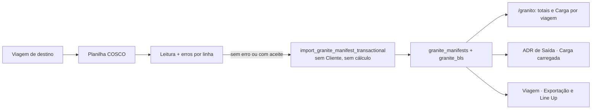

# Granito

> **Status:** ativo · **Atualizado:** 2026-10-20 · **Rotas:** `/granito` (`/granito/taxas` leva a `/granito`)

## Propósito e escopo

Granito é o pipeline das planilhas COSCO de blocos de granito embarcados. Ele
serve **só para totalizar a carga movimentada no navio**: quantos B/Ls, quantos
blocos e quanto peso cada navio e viagem levou (regra decidida pelo
responsável em 2026-10-19, no lote 5b da
[identidade visual](../identidade-visual.md)).

- **Sem Cliente.** O B/L de Granito não tem Cliente vinculado. A importação
  grava o shipper como veio na planilha, sem procurar Cliente pelo CNPJ, sem
  sugestão por nome e sem pendência. O Granito não entra na Revisão nem abre
  alerta de Cliente não vinculado.
- **Sem taxa.** Não há cálculo de taxas, tarifa nem fatura de Granito; ele não
  entra na Validação de Taxas Locais. A tabela de tarifas (`granite_rates`) e
  o cálculo (`calculate_granite_bl_charges`) saíram do banco na migration
  `329` (decisão do responsável de 2026-10-19: "Apagar a tabela").
- **Só peso real.** O peso do Granito é o peso real da planilha (`Real
  Weight`). O peso declarado pelo shipper é ruído e não conta em lugar nenhum,
  nem como reserva (decisão do responsável de 2026-10-19).
- **Sem CE.** A planilha de CE Mercante não grava CE em B/L de Granito.

As colunas e tabelas do modelo anterior (`granite_bls.client_id`,
`suggested_client_id`, `charge_status`, `granite_bl_charges` e
`invoice_granite_bls`) continuam no banco, sem uso, até uma limpeza à parte; o
que já estava gravado nelas não foi apagado. A exceção é `granite_rates`,
apagada na `329` com as tarifas que tinha; os snapshots de `granite_bl_charges`
guardam o id da tarifa (`rate_id`) como histórico, sem FK.

A rota é interna e fica sob `ProtectedRoute` em
[`src/AppInterno.tsx`](../../src/AppInterno.tsx). Qualquer Departamento ativo,
inclusive Equipamentos, importa a planilha COSCO (ADR 0078, item 10). As
tabelas operacionais (`granite_manifests`, `granite_bls`) aceitam leitura,
inserção e edição de usuário ativo; a exclusão é só pelas RPCs com motivo e
Trava (`delete_records` e a reimportação): o DELETE direto saiu na migration
`235`.

Fontes executáveis principais:

- [`src/pages/Granite.tsx`](../../src/pages/Granite.tsx);
- [`src/services/graniteImport.ts`](../../src/services/graniteImport.ts)
  (leitura e importação da planilha) e
  [`src/services/graniteCargo.ts`](../../src/services/graniteCargo.ts)
  (consulta, regra do peso e resumo por viagem);
- o modal de importação
  [`src/components/shared/GraniteImportModal.tsx`](../../src/components/shared/GraniteImportModal.tsx),
  aberto de `/granito` e da aba da Viagem (lote 6a);
- entrada pela Viagem em
  [`src/components/shared/VoyageImportActions.tsx`](../../src/components/shared/VoyageImportActions.tsx);
- banco: `import_granite_manifest_transactional` na definição da migration
  `325` (corpo da `206`).

## Anatomia das telas

### `/granito`

[`src/pages/Granite.tsx`](../../src/pages/Granite.tsx), na ordem das telas de
lista da identidade visual:

- **Título** "Granito" e, no topo, só **Importar planilha COSCO**.
- **Três cartões de total do recorte** (`MetricCard`): B/Ls, Blocos e Peso
  (em t, uma casa), todos "no recorte". Enquanto o recorte carrega, ou se a
  leitura falha, mostram "—" ("Carregando" ou "Sem dado" para leitor de tela).
- **Filtros** sempre abertos: **Busca** por B/L ou shipper (com pausa na
  digitação), **Viagem** (navio ou viagem; `?voyage=` semeia o filtro) e
  **POD**, lista dos portos de descarga do recorte. **Limpar filtros** aparece
  com algum filtro ativo; o vazio com filtro diz os filtros pelo nome do navio
  e da viagem, nunca pelo número interno.
- **Carga por viagem**: uma linha por navio e viagem e trecho, com Navio /
  Viagem (link para a ficha da Viagem), Trecho (POL → POD), B/Ls, Blocos e
  Peso. É o número que a tela existe para dar.
- **B/Ls de Granito**: B/L (com o ícone de copiar; não abre ficha, porque não
  há o que ver além da linha), Shipper (como veio na planilha), Navio /
  Viagem, Trecho, Blocos e Peso. A faixa do bloco repete os totais; a nota
  "Peso: o peso real da planilha COSCO." explica a regra; **Por página** fica
  no rodapé.
- **Peso** em toda a tela: só o peso real (`graniteWeightKg`); sem ele, "—"
  ("Sem peso" para leitor de tela), nunca o declarado pelo shipper.

A janela **Importar manifesto Granito**
([`GraniteImportModal`](../../src/components/shared/GraniteImportModal.tsx), a
mesma da aba da Viagem, lote 6a) pede a Viagem de destino (fixa na aba da
Viagem) e o arquivo `.xls/.xlsx`, que pode ser lido antes da Viagem; diz as
colunas obrigatórias (BL e Real Weight), oferece o modelo
`public/templates/granito-modelo.xlsx` e mostra a prévia: B/Ls, Blocos, Peso e
erros, as primeiras 50 linhas (B/L, Shipper, Trecho, Blocos, Peso, Fase) e o
relatório de erros exportável. Qualquer erro de linha recusa o arquivo inteiro
e nada é gravado; não há aceite que grave só as linhas válidas
([ADR 0092](../adr/0092-importacao-com-erro-e-recusada-inteira.md)). Depois de
gravar, o Resultado fica no modal até **Concluir**.

### `/granito/taxas`

Saiu do sistema em 2026-10-19, junto com o cálculo de taxas: sem Cliente, não
há a quem cobrar. O endereço leva a `/granito` (teste: `rotasDesconhecidas.test.tsx`). A tabela `granite_rates`, com
as tarifas gravadas, saiu do banco na migration `329`.

### Entrada por `/viagens/:voyageId`

Na aba Exportação, [`VoyageImportActions`](../../src/components/shared/VoyageImportActions.tsx)
abre o mesmo [`GraniteImportModal`](../../src/components/shared/GraniteImportModal.tsx)
de `/granito`, com a viagem fixa (lote 6a); a regra de erro é a mesma. A ação
"CE Mercante (Granito)" saiu.

### Superfícies que leem o Granito

- O ADR de Saída (seção **Carga carregada**), a aba Exportação e o card da
  Viagem leem B/Ls, blocos e peso de `granite_manifests` e `granite_bls`; a
  Line Up marca a exportação com Granito pela declaração da escala. O painel
  de Granito da aba Exportação mostra só Manifestos e B/Ls, com o peso em
  destaque (`summarizeExportByEmbarkPort`); "Prontos" e "Faturados", contados
  de `charge_status`, saíram em 2026-10-20.
- A Revisão e a Validação de Taxas Locais não leem mais o Granito.
- Faturas antigas de Granito continuam consultáveis em `/taxas-locais` →
  Faturas, pelas superfícies genéricas de faturamento.

## Catálogo de ações

| Tela / ação | Pré-condições | Origem | Orquestração | Persistência | Efeitos e cache | Falhas | Evidência |
|---|---|---|---|---|---|---|---|
| `/granito` · filtrar e listar | Sessão interna | `Granite` | `listGraniteBls` (página) e `fetchGraniteCargoRows` (recorte inteiro, sem o POD, em páginas de 1.000) → `summarizeGraniteCargo` | SELECT em `granite_bls` com `granite_manifests!inner`, `voyages`, `vessels` | `queryKeys.granite.bls(filtros)` e `queryKeys.granite.cargo(filtros)`; troca de filtro volta à página 1 | Erro de leitura mostra o aviso com **Tentar novamente**; enquanto carrega ou sem dado, os cartões mostram "—" | **Código:** [`Granite.tsx`](../../src/pages/Granite.tsx), [`graniteCargo.ts`](../../src/services/graniteCargo.ts) · **Teste:** `graniteCargo.test.ts`, `Granite.behavior.test.tsx` |
| `/granito` · abrir a importação e escolher a Viagem | Usuário interno ativo, de qualquer Departamento (ADR 0078, item 10) | `Granite` → `GraniteImportModal` (o mesmo da aba da Viagem); `VoyageCombobox` no modal | A seleção só prepara os argumentos do importador; o arquivo pode ser lido antes | Leitura de viagens | Estado local | Sem viagem, arquivo ou usuário o botão fica desabilitado | **Código:** [`Granite.tsx`](../../src/pages/Granite.tsx), [`GraniteImportModal.tsx`](../../src/components/shared/GraniteImportModal.tsx) |
| `/viagens/:voyageId` · importar Granito | Viagem e usuário definidos; arquivo com B/Ls válidos | `VoyageImportActions` → `GraniteImportModal` com a viagem fixa | `parseGraniteManifestFile` → `importGraniteManifest` | `granite_manifests`, `granite_bls` | `afterManifestoImportado`, que inclui a família `granite-bls` (a lista do Granito se atualiza também por aqui) | Erro de leitura ou de linha recusa o arquivo inteiro (ADR 0092); falha de gravação recusa tudo | **Código:** [`VoyageImportActions.tsx`](../../src/components/shared/VoyageImportActions.tsx) · **Teste:** `VoyageImportActions.behavior.test.tsx` |
| Ler a planilha COSCO | Arquivo `.xls`/`.xlsx` dentro do limite; primeira aba visível com o cabeçalho COSCO | `GraniteImportModal` (`useCancellableFileRead`) | `assertUploadFile` → `readSheet` (primeira aba visível; linhas e abas ocultas ignoradas com aviso) → `matchHeaders`/`createHeaderMapper`; exige B/L único e `real_weight_kg > 0` | Nenhuma escrita; não consulta a base de Clientes | Retorna `ParsedGraniteManifest` com `bls` e `rowErrors` | B/L ausente/duplicado, peso ausente/zero, data de prontidão impossível ou POL/POD fora do catálogo viram erro de linha; planilha sem as colunas obrigatórias é recusada ("Planilha inválida. Colunas obrigatórias: …"); qualquer erro de linha recusa o arquivo inteiro, sem aceite (ADR 0092) | **Código:** [`graniteImport.ts`](../../src/services/graniteImport.ts), [`importCore.ts`](../../src/services/importCore.ts) · **Teste:** `graniteParse.test.ts` |
| Importar N B/Ls | Viagem existente; usuário; ao menos um B/L e nenhum erro de linha | `GraniteImportModal.handleImport` (em `/granito` e na aba da Viagem) | `importGraniteManifest` soma o peso, lê os B/Ls já gravados na Viagem (`graniteImportScope`) e, com B/L em comum, pede confirmação para tirar os ausentes dos manifestos tocados | `import_granite_manifest_transactional` (migration `325`, corpo da `206`; uma transação): ignora `client_id` e `suggested_client_id` do arquivo; manifesto novo quando não há B/L em comum; com B/L em comum, atualiza pelo número (preservando o CE já gravado), inclui os novos e tira os ausentes só com confirmação, com Histórico; ausente com Invoice antiga nunca sai | Mostra o Resultado no modal; invalida o Granito, a Viagem, o ADR e a Line Up; o aviso diz manifesto novo, novos, atualizados, retirados e mantidos | Viagem ausente, B/L repetido ou erro de escrita recusa tudo; as recusas conhecidas chegam em português, e erro desconhecido vira "Não foi possível importar a planilha do Granito. Tente novamente." (achado G7) | **Código:** [`graniteImport.ts`](../../src/services/graniteImport.ts) · **Teste:** `graniteImportAtomic.test.ts`; **Teste local-pg:** `granitoReimportacao.local-pg.test.ts`, `granitoSemCliente.local-pg.test.ts` |

## Estado e dados

- **`granite_manifests`:** cabeçalho por importação, associado à viagem, com
  portos, quantidade de B/Ls, peso total (soma do peso real) e autor.
- **`granite_bls`:** entidade própria com UUID e os dados COSCO (shipper, CNPJ
  do shipper como veio, portos, blocos, `real_weight_kg`,
  `shipper_weight_kg`, `final_m3`, fase). Não tem FK nem identidade
  compartilhada com `bls`. `ce_mercante` continua único quando preenchido
  (gatilho `guard_ce_mercante_unique`), mas nenhuma tela grava CE de Granito.
- **Colunas sem uso desde a `325`:** `client_id`, `suggested_client_id` e
  `charge_status` (valores antigos ficam; a importação nova não preenche
  vínculo nem sugestão, e o reimportado mantém o que já tinha).
- **Tabelas sem uso desde a `325`:** `granite_bl_charges` (snapshots de
  cálculo; `rate_id` é o id histórico da tarifa, sem FK desde a `329`) e
  `invoice_granite_bls` (vínculos de faturas antigas, ainda lidos pelo detalhe
  da fatura). `granite_rates` (tarifas) saiu do banco na `329`. Desde a `330`
  os snapshots de `granite_bl_charges` são só leitura pela API (sem policy nem
  grant de escrita para `authenticated`).
- **Peso exibido:** `graniteWeightKg` usa só o peso real, quando ele existe e é
  maior que zero; sem ele, a tela mostra "—" e o total conta zero. O
  `shipper_weight_kg` continua gravado como veio na planilha, mas a tela não o
  lê.
- **Queries/cache:** família `queryKeys.granite` (`['granite-bls', …]`):
  `bls(filtros)` para a página e `cargo(filtros)` para os totais e a Carga por
  viagem. `afterManifestoImportado` e `afterViagemAlterada` (a lista mostra
  Navio / Viagem) invalidam a família inteira.

## Fluxos e invariantes

- O parser lê a primeira aba visível pelo leitor comum (`readSheet`): linhas e
  abas ocultas são ignoradas com aviso, e um B/L que só está nelas conta como
  fora do arquivo na confirmação de saída. Exige B/L e peso real positivo; B/L
  duplicado na mesma planilha é rejeitado, e o banco reforça unicidade por
  `(manifest_id, bl_number)`.
- **Reimportação e manifesto novo** (ADR 0078, item 25; ADR 0079, decisão 7;
  migrations `186`, `192`, `196` e `206`). Planilha sem nenhum B/L em comum
  com os já gravados na Viagem é outro manifesto. Com B/L em comum, a planilha
  reimporta só os manifestos que ela toca: atualiza os B/Ls pelo número,
  inclui os novos no mais recente desses manifestos e só tira os B/Ls
  ausentes do arquivo (em linha nenhuma, nem nas com erro) depois de
  confirmação, com Histórico; o B/L ausente com Invoice antiga nunca sai. Os
  totais de todos os manifestos da Viagem são refeitos a partir dos B/Ls.
- **Sem Cliente, sem cálculo** (migration `325`). A importação descarta o
  vínculo e a sugestão de Cliente que vierem no payload e tira da fila o
  efeito `granite_billing` que o corpo legado ainda enfileira; o efeito que
  já estivesse na fila termina sem agir (`skipped: granito_sem_calculo`).
  `save_granite_bl_review` não é executável pela API e
  `calculate_granite_bl_charges` saiu do banco na `329`; a planilha de CE
  Mercante recusa o alvo `granite`.
- **Sem tarifas** (migration `329`). `granite_rates` saiu do banco; a FK
  `granite_bl_charges_rate_id_fkey` saiu antes, e os snapshots antigos ficaram.
  `delete_catalog_row` e `reactivate_catalog_row` recusam `granite_rates`
  ("Tabela fora da …"), e `guard_used_tariff_delete` perdeu o ramo dela; para
  os demais cadastros, as três funções seguem como antes.
- **Sem alerta de Cliente.** O tipo `review_granite_customer_unlinked`
  ("Revisão de Granito — cliente não vinculado") está inativo no catálogo; o
  gatilho que o reconciliava a cada escrita em `granite_bls` saiu, o detector
  não abre nada e os alertas abertos foram fechados na `325`.

## Testes e validação

- [`graniteCargo.test.ts`](../../src/services/__tests__/graniteCargo.test.ts):
  regra do peso (só o real; sem ele, `null`, mesmo com declarado), resumo por
  viagem e trecho, busca escapada por B/L ou shipper, filtros de Viagem e POD
  e leitura do recorte em páginas de 1.000.
- [`graniteParse.test.ts`](../../src/services/__tests__/graniteParse.test.ts):
  cabeçalhos e regras COSCO, datas e a fixture anonimizada de 19 linhas; o
  parser não consulta a base de Clientes. Não comprova upload do usuário nem
  o runtime do Supabase.
- [`graniteImportAtomic.test.ts`](../../src/services/__tests__/graniteImportAtomic.test.ts):
  uma RPC por importação, payload sem `client_id`/`suggested_client_id`,
  reimportação e mensagens de erro.
- [`Granite.behavior.test.tsx`](../../src/pages/__tests__/Granite.behavior.test.tsx):
  tela aprovada (cartões, Carga por viagem, só peso real, B/L sem link,
  POD em lista, filtro pelo nome da viagem) e janela de importação sem
  conferência de Cliente.
- **Teste local-pg** (PostgreSQL local com shims de Auth):
  [`granitoSemCliente.local-pg.test.ts`](../../src/integration/granitoSemCliente.local-pg.test.ts)
  (importação sem vínculo nem efeito de cálculo, alerta fechado e fora do
  catálogo, alvo `granite` recusado, grants; na `329`, tabela e cálculo fora
  do banco, snapshot antigo preservado e exclusão e reativação de cadastro
  valendo para os outros cadastros) e
  [`granitoReimportacao.local-pg.test.ts`](../../src/integration/granitoReimportacao.local-pg.test.ts).
- Não há selo **Runtime**: a tela não foi conferida num ambiente Supabase
  remoto nesta mudança.

## Notas e divergências

- **Histórico — modelo com Cliente e taxa (até 2026-10-19).** Até a migration
  `325`, a importação reconciliava o shipper com Clientes pelo CNPJ (vínculo
  por documento, sugestão por nome; ADR 0043), o B/L sem Cliente caía na
  Revisão (`save_granite_bl_review`) e abria o alerta
  `review_granite_customer_unlinked`, a tela calculava snapshots
  quantitativos a partir de `granite_rates` (**Calcular taxas**, recálculo na
  Validação como "Apoio operacional", efeito `granite_billing` na
  importação), havia a tela `/granito/taxas` e a planilha de CE Mercante
  aceitava o alvo Granito (migration `212`). O responsável decidiu em
  2026-10-19 que o Granito não tem Cliente e serve só para totalizar a carga;
  tudo isso saiu. Antes ainda, o fluxo financeiro de Granito (emissão de
  invoice, `ready_for_billing`) já tinha sido removido; as invoices antigas e
  `invoice_granite_bls` continuam consultáveis.
- **Código — peso real obrigatório na planilha.** O parser continua exigindo
  `Real Weight` positivo em cada linha (sem ele a linha é erro), e a tela só
  conta o peso real (decisão do responsável de 2026-10-19: o declarado é
  ruído). O ADR também soma o peso real.
- **Código — leitura do recorte no navegador.** Os totais e a Carga por viagem
  somam no navegador o recorte inteiro, lido em páginas de 1.000 (`ponytail:`
  em [`graniteCargo.ts`](../../src/services/graniteCargo.ts)); com o
  histórico crescendo sem filtro de Viagem, o caminho é uma RPC de agregação.
- **Código — corpo legado ainda enfileira o efeito.** O corpo da `206`
  (`import_granite_manifest_transactional_legacy_189`) continua inserindo
  `granite_billing`; o envelope da `325` remove essas linhas na mesma
  transação (`ponytail:` na migration). Reescrever o corpo fica para a
  limpeza das colunas sem uso.
- **Código — erro de linha recusa o arquivo inteiro (ADR 0092, lote 6a).**
  `importGraniteManifest` recusa qualquer `rowErrors` antes da RPC; não existe
  mais `allowRowErrors`.
