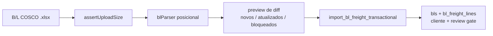

# Manifestos & EDI

> **Status:** ativo · **Atualizado:** 2026-10-14 · **Rotas:** `/bls`, `/bls/:blId`, `/containers`, `/veiculos`, `/baplie`, `/vazios-importacao`, `/embarquevazios`, `/embarquevazios/depots`

## Propósito e escopo

Importações e correções de B/L, container, Baplie e CE atualizam o campo **BLs e
CEs** da Escala ao final da transação, pela migration `134`. As regras por tipo
de carga e a alteração manual com justificativa estão em
[BLs e CEs da Escala](../../CONTEXT.md#operação-marítima) e no
[módulo de Viagens](viagens.md#fluxos-e-invariantes).

A auditoria de escrita direta do status documental usa o instante da inserção imposto pelo servidor,
para que uma alteração manual posterior à automação mantenha a ordem correta.
O primeiro evento de um porto inicializa o objeto da agenda, garantindo que o
snapshot da viagem acompanhe o status registrado na auditoria.

Pipeline de ingestão e revisão operacional do Vela. O módulo recebe planilhas e EDI/EDIFACT, limita o arquivo, faz parse e preview no cliente, persiste em tabelas de domínio e expõe as superfícies de B/L, containers, veículos, Baplie e vazios. A viagem é o eixo operacional; o arquivo de B/L é a fonte documental da carga de container e alimenta Frete & Despesas do BL e o ATD do POL; o Baplie é a fonte física de staging e conciliação. Conforme a ADR 0025, a importação de Manifesto CNTR e a geração local de EDI Mercante foram removidas.

Quando o importador de CE Mercante é iniciado no contexto de uma viagem, seu
escopo fica travado nessa viagem: o preview deve identificar e bloquear linhas
referentes a B/Ls de outra viagem. Os importadores contextuais de CE Mercante,
Manifesto BB e Veículos oferecem planilhas-modelo no próprio modal.

A fronteira de upload separa o tipo pelo conteúdo antes de escolher o parser:
XLSX/XLS são binários, CSV e EDI são texto, e conteúdo desconhecido ou ambíguo
é recusado. BOM é tratado explicitamente; CSV fora de UTF-8 em Windows-1252
(o "CSV" salvo pelo Excel) é aceito com aviso (ADR 0078, item 22), salvo quando
o importador o proíbe (`allowWindows1252Fallback: false`). O preview informa
formato, encoding, BOM, tamanho e uma amostra textual limitada, sem enviar o
conteúdo à telemetria. Texto só é classificado como CSV de uma coluna quando
tem cabeçalho operacional plausível; a assinatura de EDI Mercante exige os
campos posicionais de um registro real, para que marcadores como `M3` em uma
planilha não desviem o parser.

**Leitor comum de planilhas (`readSheet`, ADR 0078, item 22):** as planilhas
deste módulo passam pelo leitor comum — célula tipada, datas pelo parser único
`src/lib/importDate.ts`, números por `parseImportNumber`, linhas e abas ocultas
ignoradas com aviso e duas colunas que casam o mesmo campo bloqueadas. A regra
completa vale para todas as importações e fica em
[Regras de negócio § Leitura de planilhas](../operations/regras-de-negocio.md#leitura-de-planilhas). Aplicações próprias
deste módulo: o Laden on Board do B/L é lido com o dia certo também em pasta
gravada no sistema de datas 1904; o Embarque de Vazios pede confirmação antes
de gravar quando há linhas ou abas ocultas, porque as unidades delas sairiam do
Embarque; os Vazios de Importação fazem a mesma pergunta (a gravação substitui
os containers de cada rota da planilha); a confirmação de saída do Granito
avisa que um B/L "ausente" pode estar numa linha ou aba oculta; e, na busca da
aba de Veículos, uma aba anterior sem os campos, com coluna repetida ou com o
dado só em linhas ocultas não interrompe a procura.

Os modais de importação seguem o percurso comum de
`src/components/shared/ImportParts.tsx` (destino → arquivo → leitura → prévia →
confirmação → resultado), com os erros de linha normalizados em `ImportIssue`
(lista completa, exportável em CSV sem o payload bruto), leitura cancelável e
limite de 10 MB do `assertUploadSize`; o contrato comum das prévias está em
[Regras de negócio § Leitura de planilhas](../operations/regras-de-negocio.md#leitura-de-planilhas). Neste módulo, as
superfícies customizadas de Baplie, Granito, Veículos, Datas, CE Mercante e
B/Ls usam o mesmo hook de leitura cancelável e exibem o arquivo atual, o
progresso e o botão de cancelamento; uma resposta tardia não publica prévia. A
área de arquivo fica desativada, com o motivo, enquanto faltar a viagem de
destino. Erros de linha bloqueiam a confirmação por padrão; as superfícies que
permitem decisão manual passam `allowRowErrors` explicitamente, enquanto erros
documentais ou de viagem continuam bloqueantes. Resultado parcial (troca de
cliente recusada ou cálculo pendente no B/L, linhas recusadas em datas de
containers e veículos, clientes pendentes na base) fica na tela com
**Concluir**, sem oferecer reenviar o mesmo lote.

As rotas são registradas em `src/AppInterno.tsx`. Os donos executáveis são as páginas em `src/pages/`, os parsers/importadores em `src/services/`, as RPCs e policies em `supabase/migrations/` e as chaves em `src/services/queryKeys.ts`. `docs/adr/0005-pipeline-importacao-viagem-staging-reconciliacao.md` define a separação entre fontes; `docs/adr/0009-hard-delete-controlado-bloqueios-fiscais-auditoria.md` define exclusões controladas.

Para o detalhe de B/L, o checkout atual é a fonte executável. A spec e os três planos arquivados em `docs/archive/` preservam intenção e sequência histórica, mas não prevalecem sobre `src/pages/BlDetalhe.tsx`, `src/components/bl/` e a definição atual de `bl_timeline` (migration `133`).

## Anatomia das telas

Nas listas e na ficha do B/L deste módulo (B/Ls, Containers, Veículos, Baplie,
Vazios de Importação e Embarque de Vazios), o número do B/L, o CE Mercante, o
CNPJ e o número do contêiner trazem o ícone de copiar ao lado; no número do
B/L, o ícone substitui o antigo item "Copiar número do B/L" do menu **⋮** da
lista e de **Mais ações** da ficha
([identidade visual, regra 9](../identidade-visual.md#as-nove-regras)). O ícone
só confirma a cópia depois que a área de transferência a aceita e avisa a
falha no próprio lugar. **Código:** `src/components/ui/CopyValue.tsx`;
**Teste:** `src/components/ui/__tests__/CopyValue.test.tsx`,
`src/pages/__tests__/Bls.test.tsx`.

### `/bls`

- O número do B/L é o link para a ficha, com o ícone de copiar ao lado (também
  no CE Mercante). Cada linha tem uma ação secundária visível (expandir a
  carga) e, para o Administrativo, o menu **⋮** com **Excluir B/L**; para os
  demais o menu não aparece. O primeiro item recebe foco, as ações podem ser
  percorridas por teclado e o menu é limitado ao viewport.
- Filtros, lente de modalidade e página ficam na URL (`q`, `voyage`, `pol`,
  `pod`, `review`, `financial`, `charge`, `profile`, `cargoMode`, `page`,
  `pageSize`; `src/pages/blsListState.ts`). O link "BLs" do breadcrumb da ficha
  volta ao último recorte aberto na sessão.
- Três cards filtram a lista ao clique (Pendentes de revisão, Prontos para
  faturar, Sem faturamento); os volumes do recorte (B/Ls, CNTRs, toneladas de
  carga solta, máquinas, packages, m³, taxas pendentes e isentos) ficam numa
  faixa de resumo na barra da tabela, ao lado da lente Todos/Contêiner/Carga
  solta/Misto. Abaixo de 640 px a lista vira cartões.
- O parser de Frete & Despesas e a migration `073_purge_bogus_freight_lines.sql`
  compartilham a regra de rejeitar somente cabeçalhos/cláusulas documentais sem
  valor numérico. Descrições longas e cobranças legítimas que começam por
  palavras ou números continuam preservadas.
- `src/pages/Bls.tsx` lista B/Ls unificados (contêiner, carga solta e misto) com paginação, seleção em massa, **linha expansível** (`BlRowDetail`: contêineres com tara e descarga, resumo e itens de carga solta — sem query nova, a RPC já projeta os filhos), resumo e filtros por texto, viagem, POL, POD, revisão, financeiro, taxas locais, perfil de carga e modo de carga (`container`, `carga_solta`, `misto`). As ações do cabeçalho são **Importar** (menu com B/L de contêiner, B/L de carga solta .pdf/.docx, Manifesto de carga solta BB e CE Mercante) e **Exportar**; não há importação de Manifesto CNTR nem geração local de EDI Mercante. As antigas rotas segregadas `/manifestos` e `/carga-solta` foram unificadas nesta tela única.
- Cada linha mostra CE Mercante, navio/viagem, consignatário/cliente, rota, modo de carga, containers distintos, perfil IMO/OOG, status de taxas, invoice e link para `/bls/:blId`.
- O modal **Importar CE Mercante** aceita só planilha (o CE não entra por EDI; o
  EDI do sistema é o Baplie). Para B/Ls de carga, o operador informa antes o Nº
  de Manifesto Mercante; a prévia, conferida no servidor, mostra CE e Manifesto
  antes → depois, faturas vivas, Portal, Comunicado e Desbloqueio, e pede
  confirmação com motivo para troca de CE ou de Manifesto; depois de gravar, a
  tela emite em lotes de 25, com progresso, **Retomar** e o resultado por B/L, e
  o modal não fecha pelo X nem pelo Escape enquanto grava ou emite. As regras de
  entrada, troca, emissão e Manifesto estão em [CE Mercante](#ce-mercante) e
  [Manifesto Mercante](#manifesto-mercante).
- O modal **Importar Manifesto BB** (carga solta) exige a viagem de destino e o **formato numérico do arquivo**: `Detectar pelo arquivo` (padrão), `Vírgula decimal (pt-BR)` ou `Ponto decimal (en-US)`. Trocar o formato relê os arquivos já escolhidos. Em `Detectar`, o separador decimal é decidido pela evidência do próprio arquivo — célula com os dois separadores, ou com um separador seguido de um número de dígitos diferente de três — e **toda célula que restar na forma `259.312` (separador de milhar seguido de exatamente três dígitos) vira erro bloqueante**, porque ela pode valer 259 mil ou 259,312 e a diferença vira uma taxa por tonelada mil vezes maior. Declarar o formato transforma esse bloqueio em aviso de conferência, com as duas leituras na mensagem. Formato declarado que o arquivo contradiz é recusado em vez de corrigido em silêncio. Acima disso há um teto de absurdo por coluna (peso, cubagem, máquinas e volumes): o número que não descreve um B/L é recusado seja qual for o separador. O layout do armador (carrier) usa a mesma resolução — antes lia peso sem formato e cubagem em `en-US` fixo.
- O modal **Importar B/L** aceita Excel COSCO, exige a viagem declarada pelo operador, bloqueia divergência entre navio/viagem do arquivo e a viagem escolhida, mostra preview de novos/atualizados/bloqueados e confirma via RPC transacional (`import_bl_freight_transactional`). O parser aceita somente numeração ISO de container (`AAAA9999999`), ignorando cláusulas/textos do B/L que apareçam no bloco físico; o payload reaplica a mesma normalização antes da RPC. Também captura descrição, total de volumes, telefone do consignatário, DG Class e número ONU. Quando reimporta um B/L existente, o preview preserva `IMO/OOG`, classe IMO e número ONU dos containers cujo número já existia, para o B/L não apagar atributos físicos vindos de Baplie ou de dados históricos. O preview vincula cliente por documento ou nome do consignatário; a RPC grava o estado de reconciliação, aplica o review gate e mantém match por nome em validação manual. Com a viagem declarada, a confirmação passa por `import_bl_freight_with_metadata` (migration `072`), que calcula as taxas locais provisórias de cada B/L na mesma chamada; falha de cálculo fica em `audit_logs` e na fila de efeitos como recuperação. Emissão exige CE Mercante e os gates server-side. Mudanças com impacto em faturamento (quantidade de containers, container compartilhado, IMO/OOG, lista de veículos por chassi, peso de carga solta, CNPJ faturado, POL/POD, viagem e modo de carga) são informadas e só são aplicadas com override do operador, auditado; sem override, os demais campos são aplicados e o B/L não é descartado. O diff cobre todos os campos que a RPC grava — inclusive os blocos completos de partes, `notify_cnpj_cpf`, e-mail do consignatário, veículos, viagem e modo de carga — e cada linha é rotulada na língua da operação. Quando o arquivo traz **outro consignatário** (Troca de Consignatário), o preview alerta a troca de cliente (de quem para quem, com CNPJ) e lista os documentos preservados; com o aceite do operador, `relink_bl_customer` (definição vigente na migration `136`) troca o Cliente do B/L. A cobrança de Taxas Locais já emitida segue a regra de CNPJ da [ADR 0077](../adr/0077-fatura-emitida-nao-muda-de-valor.md): sem pagamento, é reemitida para o novo Cliente, com o ROE do dia; com pagamento, o recebido é devolvido ao Cliente original antes da nova cobrança (ver [Faturamento](faturamento.md#correção-após-emissão-adr-0077)). Impedem a troca Invoice de Demurrage ou fatura avulsa recebida sem restituição confirmada ao Cliente original e, quando o B/L já tem cobrança de Taxas Locais, Cliente de destino não cadastrado — o motivo aparece no preview e os demais campos seguem sendo aplicados. A linha bloqueada (arquivo de outra viagem ou de outro B/L) não anuncia troca de consignatário, porque não importa nada; e quando o servidor recusa uma troca aceita no preview, a recusa (`customer_relinks`) é mostrada ao operador em vez de "importação concluída" (migration arquivada `360`). O CE Mercante não faz parte do payload do import e permanece como está. **Reimportação (migration `175`, ADR 0078 itens 16 e 17):** os contêineres são reconciliados por número — o que continua no arquivo mantém id, descarga, devolução, status de Demurrage, local de desova, perfil IMO/OOG e SOC/COC manual, e só lacre, tipo, tara, peso e cubagem mudam; o que o arquivo não traz sai apenas se a prévia mostrou a remoção ("Saem do B/L"). Container com item de Invoice de Demurrage, em qualquer situação da invoice, não sai por reimportação: a prévia bloqueia só aquela linha e o servidor recusa dizendo isso (migration `194`; cancelar a invoice não destrava). Container com veículos só sai se a aba VIN os tira dele: sem a aba, ou com a aba mantendo veículos nele, a prévia bloqueia a linha; com a aba tirando os veículos, a confirmação da lista de veículos é obrigatória. Sem a aba VIN os veículos não mudam; com ela, a prévia lista entram, saem e mudam e pede confirmação ("Confirmo a lista de veículos da aba VIN"), um alerta `bl_vehicles_changed_on_reimport` registra o B/L e as mudanças e chassi que já está em outro B/L ativo recusa só a linha; linha da aba VIN que aponta para container que sai pelo arquivo é recusada sozinha. Chassi em B/L ou Viagem cancelados não recusa a linha, e na mesma Viagem (B/L reemitido pelo armador) o veículo passa do B/L cancelado para o novo, com Histórico (migration `194`). A confirmação de faturamento é por B/L, na linha da prévia (o rodapé marca todos). Laden on Board ilegível ou vazio vira aviso e não altera a data gravada; POD que nem a tabela de apelidos nem o cadastro de portos (`ports`, por nome ou LOCODE) reconhece recusa a linha. Container FCL que já está num B/L ativo de outro Cliente na mesma Viagem recusa a linha na prévia e o lote no servidor (`assert_no_fcl_shared_between_customers`, SQLSTATE `P0008`, migration `176`; ADR 0078, item 11); B/L LCL e container com veículos podem ser divididos, e para o mesmo Cliente vale o rateio do container compartilhado. B/L faturado não é recalculado na importação: a fatura segue a ADR 0077 pela base capturada, e a reimportação idêntica não acende "Carga alterada após faturamento" nem enfileira `provisional_charges`. O e-mail do arquivo vira contato só do Cliente cujo CNPJ é o do arquivo, comparado com as letras do CNPJ alfanumérico (`normalize_document_text`, migration `194`); na Troca de Consignatário aceita ele vai para o Cliente novo. Sem o aceite da troca (outro Cliente, ou CNPJ diferente do gravado e do Cliente vinculado), o B/L mantém consignatário, bloco do consignatário, CNPJ, razão social e e-mail gravados, e a troca volta em `customer_changes_ignored` e no resultado (migration `213`; antes, o B/L ficava com o Cliente antigo e o consignatário novo). Correção de POD limpa a exceção de terminal do POD anterior, como na carga solta e no COD (`213`). Depois de gravar, o resultado fica na tela, com ou sem pendências, e mostra por B/L contêineres e veículos que entraram, mudaram ou saíram e os VINs recusados. O **NCM** é campo próprio do B/L (`bls.ncm_codes`, ADR 0057): a importação grava o que o documento declara e preserva o cadastro manual quando o documento não declara nenhum, porque a descrição de container vem de uma célula só e a de carga solta descarta as linhas `NCM NUMBER`. A ação em lote fica na lista; a mesma entrada existe como ação rápida da viagem e como atalho filtrado na ficha do B/L.
- O importador de **Manifesto BB** aceita layout resumido (sem coluna CE desde a migration `174`), legado e formatos de carrier; faz preview, confere os B/Ls já gravados (outra Viagem bloqueia; troca de Cliente e rota de B/L faturado pedem aceite), suporta B/L de carga solta ou transiciona B/L existente com contêineres para `misto`, e registra erros no batch. Na prévia, B/L cancelado é ignorado com aviso (somente leitura; reativar pela ficha para corrigir) e "faturado", para pedir a confirmação de rota, é o status faturado ou pago ou a fatura de taxas locais viva ligada por `invoice_bls`, inclusive rascunho (a gravação também conta a consolidada ligada pelo recebível). No layout resumido, a descrição montada das quantidades (`Maquinas: 1 | Packages: 2`) só vai para B/L novo; o B/L existente mantém a descrição gravada. Peso e cubagem digitados como número numa planilha XLSX entram como estão (antes eram multiplicados por mil). Os modais de planilha mostram o formato/encoding detectados antes da prévia do domínio, exibem o relatório completo de erros aplicáveis e permitem exportá-lo sem `raw`.
- A confirmação do Manifesto BB pode aceitar explicitamente os erros de linha aplicáveis por `allowRowErrors`; isso não libera B/L incompatível com a viagem, documento inválido ou qualquer erro central da transação.
- **Sequência para carga solta:** importe primeiro os B/Ls pelo Manifesto BB
  ou pelo B/L avulso. Depois, use **Importar CE Mercante** para os CEs e informe
  o **Nº de Manifesto Mercante** oficial no mesmo modal. Os B/Ls precisam
  existir antes da importação separada de CE. A planilha BB não grava CE
  (ADR 0078, item 1): uma coluna CE num arquivo antigo é ignorada com aviso na
  prévia. O número do manifesto é distinto do CE de cada B/L e não é extraído
  do nome do arquivo.
  Reimportar um B/L atualiza o cadastro e seu lote; os totais históricos do lote
  anterior não representam B/Ls adicionais na aba **Rotas e Manifestos**.
- O modal **Importar B/Ls (PDF/DOCX)** recebe o conhecimento avulso do armador — um arquivo por B/L, vários de uma vez. Exige a viagem declarada pelo operador e bloqueia o arquivo cujo navio/viagem divirja da viagem escolhida, no mesmo contrato da importação documental de B/L de container. O preview mostra partes, rota, volumes, peso, cubagem, marcas, NCM, frete e ressalvas do navio, além dos avisos de leitura.
- Para listagens e reconciliação por nome, o consignatário curto termina na natureza jurídica (`LTDA`, `S.A.`, `EIRELI`, `EI`, `MEI`, `SLU`, `EPP`, `ME`, incluindo combinações); sem marcador reconhecido, usa a primeira linha não vazia. O bloco completo permanece intacto como dado documental e para auditoria.
- Pela ADR 0025, `Laden on Board` persiste o ATD do POL. Entre B/Ls da mesma Viagem e POL prevalece automaticamente a data mais antiga. ETD e ATD permanecem distintos; telas sem coluna própria mostram ATD em verde na célula de ETD.
- O Administrativo exclui B/Ls, individualmente ou em lote, com motivo e prévia do banco; B/L com CE Mercante não é excluído, e sim cancelado (ver [B/L Cancelado e exclusão](#bl-cancelado-e-exclusão)).
- O Nº de Manifesto Mercante é gerenciado na tabela `manifestos_mercante`, por Viagem e rota, com vários manifestos por rota e a natureza `carga` ou `vazio` (`natureza`). A edição é feita na aba Rotas e Manifestos de `/viagens/:voyageId` (**Editar**, em toda rota, que abre ETD previsto + ATD POL e Nº de Manifesto Mercante; **Informar**, na coluna Nº de manifesto Mercante da rota ainda sem número; e **Ver B/Ls**, na rota de carga com B/L; **Código:** `src/components/voyages/VoyageManifestosTab.tsx`) e, por B/L, na ficha; desde a migration `212` a API só lê o cadastro. Ver B/Ls da rota pagina a lista da Viagem (sem o teto de 1.000 linhas do PostgREST). Regras em [Manifesto Mercante](#manifesto-mercante).

### Atualização após ações próprias

- Os efeitos financeiros reutilizam `INVOICE_BASIS_CACHE_KEYS`: alterações de
  carga, viagem, Baplie e cancelamento de B/L atualizam também restituições,
  ajustes de COD, histórico de conciliação e consultas de faturas do Portal.
  Essa lista preserva os consumidores das correções de faturamento da PR 839.
- Importar B/L container, B/L carga solta, Manifesto BB ou CE Mercante atualiza
  listas e cards de B/Ls, Containers, Veículos e Viagens, além da ficha da Viagem,
  conciliação do Baplie, filtros por porto/tipo, Revisão, Taxas Locais, ADR,
  Relatórios e fichas consumidoras. Importação rápida da Viagem usa o mesmo
  efeito de cache que o modal da lista.
- Exclusões de B/Ls, Containers e Veículos atualizam também os totalizadores e
  vínculos dependentes, incluindo veículos removidos junto com um Container.
  Edição manual e vínculo/desvínculo de Cliente atualizam as projeções do B/L.
- **Rastro das importações (migration `189`, ADR 0078 item 9):** cada
  importação deste módulo (B/L, Manifesto BB, CE Mercante, Baplie, Veículos,
  Vazios, Embarque de Vazios, datas de container) grava no Histórico o
  contexto da importação como justificativa das linhas que cria, altera ou
  exclui. O formato do contexto e as regras do rastro valem para todas as
  importações e ficam em [Regras de negócio § Rastro das importações](../operations/regras-de-negocio.md#rastro-das-importações).
- **Veículos (migration `184`, ADR 0078 itens 8 e 23):** a planilha casa o
  B/L pelo número exato da Viagem (sem buscar B/L "parecido"); chassi já em
  outra Viagem ativa recusa a linha (B/L ou Viagem cancelados não contam); tipos
  ISO equivalentes (40HQ = 40HC), lacre sem zeros à esquerda e opcional para
  flat rack e plataforma; o local de desova só preenche vazio, a troca do gravado
  pede confirmação e valores diferentes para o mesmo container no arquivo
  recusam as linhas (pelo número do container, inclusive quando dois B/Ls o
  dividem); B/L cancelado recusa a linha na prévia. As mesmas regras valem em
  `import_vehicle_rows_transactional`.
  Sem fatura viva, as Taxas Locais são recalculadas na hora e B/L isento anula o
  Recebível. Na página Veículos, **Mover para outro B/L**
  (`move_vehicles_to_bl`) e **Excluir** (`delete_vehicles_with_reason`) valem
  para qualquer usuário, com motivo, mesmo com CE; a fatura viva segue a ADR 0077.
  O Mover grava no Histórico, com o motivo, cada vínculo que muda (B/L, container
  e Viagem) e trava os B/Ls de origem e destino em ordem de id (migration `193`).
- **COD e omissão na importação (migration `183`, ADR 0078 item 15):** a
  reimportação de B/L de container não muda o POD de B/L em COD vivo (a prévia
  avisa e os demais campos atualizam; a carga solta segue a `174`); mudar o POD
  pela ficha é correção, nunca COD. B/L criado depois da omissão com POD no porto
  omitido entra como afetado, disposição Transbordo, herdando o registro global;
  desde a migration `192` o Transbordo aparece no Histórico do B/L. A prévia do
  B/L de container avisa o porto omitido; a prévia da carga solta (Manifesto BB
  e B/L avulso) ainda não avisa.
- **Baplie:** as marcas IMO/OOG e SOC/COC, as origens do perfil, os
  containers ignorados e as divergências estão em
  [Baplie: marcas, SOC/COC e divergências](#baplie-marcas-soccoc-e-divergências).
- Importar/reimportar Baplie atualiza os cards mesmo sem alteração de flags
  físicas. As duas entradas de importação usam `afterBaplieImportado`; o upload
  da página aguarda a aplicação física e a atualização da viagem **escolhida no
  modal**, que pode diferir da viagem aberta. Cadastro/substituição de vazios
  atualiza as famílias reais de Vazios IMP e Rotas e Manifestos.
- Salvar Local de desova atualiza também seus cards em Veículos; o campo deixa
  de guardar uma cópia do valor salvo após a atualização. Datas de descarga e
  devolução (planilha, ficha do B/L ou Demurrage) atualizam os consumidores de
  Demurrage, incluindo cards, faturas e ficha do Cliente. O campo de devolução
  também libera o rascunho salvo para acompanhar importações seguintes. Desova
  e devolução confirmadas são refletidas no cache antes da releitura: se ela
  falhar, o campo mantém o valor salvo. A conclusão de uma gravação não apaga
  um rascunho mais recente editado durante a operação.
- A atualização ocorre após as próprias ações, sem recarregar a página.
  Consultas abertas são refeitas; telas fechadas consultam novamente ao abrir.
  Isso não implementa sincronização entre usuários nem antecipa efeitos ainda
  pendentes no worker de importação.
- **Teste:** `operationalCacheRefresh.test.ts` usa QueryClient/QueryObserver reais
  e fontes locais alteradas para verificar listas/cards abertos e reabertura.
  `Baplie.cacheRefresh.test.tsx` exercita o upload com outra viagem no seletor;
  `EquipmentPermissionGates.test.tsx` verifica desova salva seguida de novo dado.
  `Containers.cacheRefresh.test.tsx` exclui uma linha pela tela real e verifica
  o card de Containers e os resumos consumidores de B/Ls e Viagens sem remontar.
  Esses testes usam serviços simulados, sem provar execução de RPC/RLS no Supabase.

### `/bls/:blId`

- `src/pages/BlDetalhe.tsx` resolve o modo container/BB e monta as abas `visao-geral`, `carga`, `detalhes`, `faturamento` e `historico`.
- A aba padrão `visao-geral` remove `tab` da query; `carga`, `detalhes`, `faturamento` e `historico` sincronizam suas respectivas chaves. Chaves antigas, como `operacional`, não são aceitas.
- **Cabeçalho e situação:** a ficha abre com a faixa de identidade (`IdentityBand`): tipo e modalidade (e Cancelado, quando for o caso) acima do título, que é o número do B/L com o ícone de copiar; abaixo, Navio / Viagem (link para a Viagem), Trecho, CE Mercante (com o ícone de copiar) e Cliente; ao lado, **Reimportar B/L** (B/L com contêiner, não cancelado) e **Mais ações**, que só aparece para o Administrativo quando há o que fazer: **Cancelar B/L** (B/L com CE) ou **Reativar B/L** (B/L cancelado). Copiar o número saiu do menu e ficou no ícone. B/L cancelado mostra data e motivo numa faixa própria. Logo abaixo, a faixa **Próxima ação** aparece só quando há pendência documental, com a etapa, o motivo e um botão que diz o destino (por exemplo "Resolver na Revisão"); sem pendência não há faixa. Em seguida, os blocos **Operacional** (com o andamento da descarga ao lado do título, "N/M descarregados") e **Documental** (com a contagem de pendências ou "Sem pendências") mostram os trilhos no `StepRail` comum. B/L inexistente mostra "não encontrado" (`maybeSingle`), distinto de falha de consulta com Tentar novamente. **Código:** `src/pages/BlDetalhe.tsx`, `src/components/bl/BlRailsPipeline.tsx`; **Teste:** `src/components/bl/__tests__/BlRailsPipeline.test.tsx`.
- **Visão geral:** cinco blocos, cada um com o seu dado principal: **Embarque** (navio/viagem com link para a Viagem, armador e trecho; terminal de descarga com **Definir exceção** ou **Alterar exceção**, para quem pode editar, que abrem o formulário da exceção só quando pedidos), **Documento Mercante** (CE Mercante do B/L, com o ícone de copiar, e número do Manifesto Mercante vinculado), **Cliente**, **Carga** e **Portal**. O bloco Carga leva à aba própria por **Ver na aba Carga**; com contêiner, o dado principal é quantos já voltaram ("x de y devolvidos", sem contar SOC e contando uma vez o contêiner repetido; só com SOC, que não volta, o dado principal é a contagem de contêineres), com a contagem, IMO/OOG e SOC/COC como apoio, a situação do Baplie com **Abrir conciliação** e a tabela de até 10 contêineres (número com o ícone de copiar; Devolução: data e Demurrage; No terminal: descarga, lacre e peso bruto), em que SOC aparece como "Não se aplica (SOC)", a Demurrage só aparece depois da descarga e o excedente vira "Mais N na aba Carga."; com carga solta, o dado principal é peso e cubagem, com máquinas e packages, e o misto mostra os dois. Datas de POL/POD e situação de taxas/fatura ficam só nos trilhos (**Código:** `src/components/bl/BlVisaoGeralTab.tsx`; **Teste:** `src/components/bl/__tests__/BlVisaoGeralTab.test.tsx`). Quando há omissão, um bloco de Transbordo ou COD explica o porto omitido, onde a carga descarregou, os dados do seguimento e o efeito de Marcar COD (Taxa Local no novo destino, Ajuste de COD se já faturado, saída do Manifesto Mercante do porto omitido, CE inalterado).
  - **Cliente:** um único fluxo, no bloco Cliente. Sem cliente, diz "Sem cliente vinculado" e mostra o cliente declarado no manifesto (CNPJ com o ícone de copiar) com **Vincular este cliente** (usa o cadastro existente pelo CNPJ e só cadastra quando não existe, exigindo e-mail no manifesto) e a busca no cadastro, com **Vincular** por resultado. Com cliente, mostra nome (link para a ficha), CNPJ com o ícone de copiar, saldo em aberto e conciliação, com **Trocar** e **Desvincular**; avisa quando o manifesto declara outro CNPJ. Todo vínculo pede confirmação e grava por `save_bl_review`.
- A leitura interna do bloco Portal usa `get_bl_portal_status` (definição atual nas migrations `002` e `047`), RPC `SECURITY DEFINER` que valida `is_active_user()` e faz a leitura mínima necessária por B/L, pois `portal_notifications` e `customer_portal_accounts` permanecem protegidas por RLS.
- **Carga:** `BlCargaTab` em aba própria (`?tab=carga`), governada pelos predicados `isContainerCargoMode`/`isBreakbulkCargoMode` — um B/L misto mostra as duas seções. Contêineres vinculados (com tara e data de descarga), resumo da carga solta, itens da carga solta e veículos vinculados. Era uma seção no fim da aba Detalhes, abaixo do formulário de edição.
- **Detalhes do B/L:** `BlDetalhesTab` compõe `BlOperacionalTab` (seções Partes, Rota, Documento, Carga e Notas, até três colunas; Notify 2 e telefone do consignatário como dado do documento; justificativa e salvar numa barra que fica fixa enquanto há alteração) e a seção de frete.
  - Formulário auditado: Shipper, Consignatário, Notify Party, Place of Receipt, POL, POD, Place of Delivery, Movement From/To, Data e Local de emissão, pagamento, NCM, descrição da carga, notas e justificativa (`editableFields` de `useBlEditForm`). O CE Mercante e o Manifesto Mercante ficam fora do Salvar: **Corrigir**/**Remover** CE (migration `177`) e **Mover**/**Desvincular** Manifesto (`BlManifestoField`, migration `181`), com motivo. Mudar o POL, o POD ou a Viagem desvincula o Manifesto, com registro no Histórico (`unlink_manifesto_on_route_change`; o POL entrou na migration `207`). Mover e Desvincular, na ficha e em Ver B/Ls, mandam o Manifesto que a tela mostrava por B/L (`p_expected`); B/L que outra sessão moveu depois recusa a operação inteira (migration `209`), e a tela recarrega a ficha e a lista para a nova tentativa partir do estado atual (também em Corrigir/Remover CE). O vínculo só muda por essas ações e pela planilha de CE: `UPDATE` direto do Manifesto pela API é recusado (migration `212`); editar o POL/POD pela ficha continua desvinculando. Peso e cubagem aparecem por modalidade e são independentes: `Peso contêiner (kg)`/`CBM contêiner (m³)` só com contêiner, `Peso (t)`/`CBM carga solta (m³)` só com carga solta — num B/L misto os dois conjuntos aparecem e nenhum sobrescreve o outro.
  - NCM é editável em `bls.ncm_codes`; a extração de `cargo_description` é sugestão auxiliar, deduplicada e sem ocorrências `UN NCM`.
- `notify_party` importado do B/L continua editável; B/Ls históricos preservam o valor já gravado.
  - O import também persiste, de forma forward-only, `place_of_receipt`, `movement_from`, `movement_to` e `issue_place`; registros históricos sem reimport permanecem nulos.
  - Atalho "Reimportar B/L" abre o modal compartilhado filtrado para o B/L da ficha, evitando aplicar arquivo de outro conhecimento.
- **Faturamento:** `BlFaturamentoTab` compõe `BlCobrancasSection` (status, fatura ativa com número, situação, tipo, total e **Abrir no Faturamento**, faixa de totais, motivo visível quando a emissão está bloqueada, tabela de taxas com erro distinto de vazio e cobrança manual sob demanda, por **Adicionar cobrança manual**, com **Editar** na linha manual e **Excluir** só para o Administrativo) e `BlDemurrageSection` (só quando o B/L tem container: faturas de Demurrage do B/L, condições próprias e devolução por container com a Demurrage prevista, e **Abrir em Demurrage**). O vínculo de cliente fica no bloco Cliente da Visão geral.
  - Vincular o cliente produz o efeito completo da conciliação (ADR 0061, migration arquivada `370`): além de fechar a fila,
    o e-mail do manifesto é capturado como contato **financeiro** do cliente — normalizado e sem duplicar contato
    já cadastrado — e `approved_by` registra o revisor que resolveu. É a mesma regra usada pelo Aprovar da
    Validação, agora em função única (`capture_manifest_financial_contact`).
  - Taxas locais podem ser calculadas, receber linhas manuais, ser revisadas e avançar para faturamento.
  - Demurrage reúne free time, P1/P2, descarga/devolução e cálculo por container; as regras canônicas continuam em [Demurrage](demurrage.md).
- **Cliente e Portal:** dois blocos da Visão geral. Cliente reúne identidade e conciliação; Portal diz se o Cliente vê o B/L ("Visível no Portal" ou "Não visível no Portal", com o motivo), os avisos ao Cliente (lido ou não) e as disputas abertas ("Nenhum" e "Nenhuma" quando não há), e oferece **Enviar convite do Portal** quando o B/L tem Cliente e a conta do Portal não está ativa. Para B/L pendente de revisão, reutiliza `ReviewCustomerOnboarding` e `complete_review_customer_group`, com razão social, CNPJ e e-mail editáveis e convite opcional para o mesmo e-mail. A operação afeta somente o B/L aberto; tenta faturamento automático apenas quando a correção o libera. Falha no convite preserva o cadastro e permite nova tentativa. B/Ls já revisados mantêm o vínculo/troca/desvínculo auditado, e cliente existente pode receber convite sem refazer o vínculo.
- Os painéis técnicos de efeitos pós-importação não aparecem na ficha: o processamento continua no servidor, e a tela mantém o resultado operacional/documental, taxas e conciliação do Baplie.
- **Histórico:** `BlHistoricoTab` usa paginação incremental de `bl_timeline`, intercala eventos e comunicados por data, mostra a família e "auditado" como texto de apoio (só o estado do comunicado é tag) e distingue carregando e falha de "nenhum evento". O que a importação grava na transação que cria o B/L não aparece como alteração; no lugar entra o evento “B/L criado” (migration `133`).

### `/containers`

- `src/pages/Containers.tsx` lista containers consolidados com filtros, resumo distinto por tipo/IMO/OOG (faixa de resumo na barra da tabela; erro de consulta aparece como "—", não zero), exportação e navegação ao B/L e à Viagem. Filtros e página ficam na URL (`src/pages/containersListState.ts`: `q`, `voyage`, `pol`, `pod`, `review`, `financial`, `charge`, `profile`, `type`, `vehicle_container`, `page`, `pageSize`; `search` continua aceito). Um endereço que a tela não escreveu (menu lateral ou outro link para `/containers` com a página aberta) substitui os filtros. A linha mostra lacre, descarga e devolução (na devolução, SOC aparece como "Não se aplica (SOC)"), e a origem do SOC/COC que vale (pelo B/L, pelo Baplie ou correção manual, de `bl_containers.ownership_source`). Abaixo de 640 px a lista vira cartões.
- A ação aprovada se chama **Importar Datas de Descarga e Devolução**, tanto no botão quanto no título do modal. A descarga é obrigatória e a devolução é opcional; a operação pode emitir invoice de demurrage quando todos os containers do B/L retornaram.
- Não existe importador de planilha de IMO/OOG: o perfil do container vem do B/L (DG Class e número ONU), do Baplie — que prevalece sobre o B/L para container presente no arquivo — e da correção manual na aba Carga; ver [Baplie: marcas, SOC/COC e divergências](#baplie-marcas-soccoc-e-divergências). A resolução das divergências do Baplie continua disponível em `/baplie`.
- O Administrativo exclui containers com motivo; o banco recusa container de B/L com CE Mercante ou com documento financeiro emitido e container com taxa local ou item de Demurrage; veículos dependentes saem junto (ver [B/L Cancelado e exclusão](#bl-cancelado-e-exclusão)).

### `/veiculos`

- `src/pages/Veiculos.tsx` exige viagem para visualizar lista, estatísticas e filtros; a viagem fica em `?voyage=` e a faixa de viagens usa o mesmo resumo de Viagens do Baplie. O modal de importação possui seletor próprio de viagem e, nesta página, linha com erro bloqueia o lote (a ação rápida da Viagem permite aceitar as divergências e gravar só as linhas válidas).
- A lista agrupa os veículos pelo container: o **Local de desova** é atributo do container (CONTEXT.md) e é editado uma vez, no cabeçalho do grupo, gravando ao sair do campo ou com Enter (Escape desfaz o rascunho); "Salvando…", "Salvo" ou a falha aparecem junto do campo. Quem edita veículos também seleciona linhas para definir o local em lote. **Excluir** e **Mover para outro B/L** valem para qualquer usuário ativo, com motivo, mesmo com CE no B/L (ADR 0078, item 23; migration `184`). O filtro "Sem local informado" lista os containers ainda sem local, e o resumo "veículos sem local de desova" conta os veículos desses containers (veículo sem container não entra: não há local a informar).
- O parser suporta modelo do sistema, COSCO Daily Report e cabeçalhos chineses.
- A convenção numérica é escolhida pelos cabeçalhos da origem (pt-BR no modelo
  interno; en-US nos relatórios COSCO/terminais), sem aceitar expoente ou texto
  anexado como peso/cubagem. Container e tipo são canonizados em maiúsculas e
  um ISO inválido mantém-se apenas na prévia de erro, sem confirmação.
- O import valida chassi, B/L da viagem e match não ambíguo de container por número, tipo e lacre. A planilha só preenche o **Local de desova** vazio; trocar o valor gravado pede confirmação na prévia (ADR 0078; migration `184`).
- A prévia exibe o relatório completo de erros de linha e permite exportá-lo sem
  arquivo bruto; no modal compartilhado, leituras múltiplas exibem progresso e
  podem ser canceladas antes da importação.
- O modal customizado também exibe o arquivo atual/progresso e permite cancelar
  a leitura antes de inserir veículos.
- Após inserir veículos, sem fatura viva, a RPC recalcula as Taxas Locais na
  hora e B/L isento anula o Recebível sem fatura (migration `184`); o efeito
  `vehicle_followup` continua enfileirado na mesma transação e refaz o mesmo
  quando processado pelo `import-effects-runner`, ligado desde 2026-10-12 e
  disparado pela própria importação (migration `218`; ver
  [Serviços externos](../operations/servicos-externos.md)).
- Qualquer usuário ativo exclui veículos, individualmente ou em lote, ou os
  move para outro B/L, sempre com motivo (`delete_vehicles_with_reason`,
  `move_vehicles_to_bl`); o Mover registra no Histórico cada vínculo que muda
  (B/L, container e Viagem).

### `/baplie`

- `src/pages/Baplie.tsx` sincroniza a viagem em `?voyage=<id>` e trabalha em três estados: sem staging; staging sem manifesto; staging com manifesto.
- A seção **Conciliação Baplie × B/L** diz a situação em texto e ícone (viagem sem B/L, aguardando B/L das rotas, conferindo, falha com Tentar novamente, divergências ou "Baplie e B/Ls conferem"), a cobertura documental ("Cheios com B/L: N de M", em que M exclui os cheios de rotas ainda sem B/L) e, para cada grupo de divergência, o significado e o que fazer. Cada container da lista recebe a situação na conciliação (Com B/L, Sem B/L, SOC/COC diverge, fora da conciliação), também filtrável. A tradução fica em `src/pages/bapliePresentation.ts`; a regra continua em `baplieReconciliation.ts`.
- Se o Baplie é gravado mas a aplicação de IMO/OOG aos B/Ls falha, o modal fica aberto com o aviso, tanto em `/baplie` quanto na ação rápida "Baplie EDI" da Viagem. A falha não é gravada: `/baplie` recalcula a pendência a cada leitura (`countPendingBapliePhysicalFlags`, mesma regra de `apply_baplie_physical_flags_atomic`: só `full`, número com `trim` + maiúsculas, IMO/OOG por OU, maior classe/ONU, todos os B/Ls ativos que têm o container (Part Lot), perfil manual mantido e SOC/COC só quando a origem não é o B/L nem correção manual) e, enquanto houver pendência, mostra "IMO/OOG do Baplie ainda não aplicados a N containers de B/L" com **Aplicar IMO/OOG agora**. Só sem pendência a nota afirma que os dados estão aplicados. Importar o mesmo arquivo (aceito direto, sem diferença) também refaz a aplicação. Se o que falha é o recadastro dos vazios, o Baplie também fica gravado (`vaziosError`), mas importar o mesmo arquivo não refaz os vazios (sem diferença, eles não são tocados): o aviso oferece **Recadastrar vazios** (`retryBaplieVazios`), que refaz só essa parte.
- Importação/reimportação substitui o staging completo da viagem por `import_baplie_staging_transactional`; o parser valida que o conteúdo é EDI, respeita `UNA`/separadores/release character, isola segmentos por EQD, identifica o encoding escolhido e deduplica containers repetidos por numeração ISO antes de persistir.
- A conciliação considera containers `full` e aponta divergência de
  existência, **SOC/COC divergente** e **IMO/OOG manual diverge**. Ao fim de
  toda importação ou reimportação, `reimportBaplie` aplica as marcas do Baplie
  (IMO, classe, ONU, OOG e, quando o B/L não declara, SOC/COC) aos containers
  dos B/Ls ativos da Viagem, com o mesmo efeito em `/baplie` e na ação rápida da
  Viagem; a falha volta em `flagsError` sem desfazer o staging. A tela mostra a
  coluna SOC/COC do Baplie e a seção "SOC/COC divergente entre B/L e Baplie".
  As regras estão em
  [Baplie: marcas, SOC/COC e divergências](#baplie-marcas-soccoc-e-divergências).
- O upload customizado mostra o progresso do parse e permite cancelar; o
  staging parcial nunca é publicado depois do cancelamento.
- **Vazios do Baplie (migrations `187` e `192`, ADR 0078 item 25):** o recadastro pelo Baplie preserva a natureza digitada (cama/cover plate) e remove manifestos sem container e Nº de Manifesto `vazio` sem rota viva. A reimportação por planilha está em [`/vazios-importacao`](#vazios-importacao) e a do Embarque de Vazios em [`/embarquevazios`](#embarquevazios).
- Containers `empty` podem gerar um manifesto de Vazios de Importação; se já existir um manifesto Baplie, o operador escolhe substituir ou manter. Vazios vindos do Baplie **não pedem** o Nº do manifesto Mercante na importação, mas o número continua obrigatório: a rota aparece como "Informar" na aba Rotas e Manifestos e entra no alerta **CE Mercante pendente** (migration `119`) até ser preenchida (decisão de 2026-10-01).
- **Reimportar um Baplie** (`reimportBaplie` em `src/services/baplieImport.ts`, usado por `/baplie` e pela ação rápida da Viagem) compara o arquivo novo com o Baplie atual por container (status cheio/vazio, POL, POD, tipo, IMO, OOG, SOC/COC; slot, peso e B/L ref. não contam). Sem diferença, aceita sem perguntar e mantém os vazios e o Nº do manifesto Mercante. Com diferença, o diálogo "Substituir o Baplie da viagem" lista cada container incluído, removido ou alterado; ao confirmar, se os vazios mudaram e a viagem já tinha manifesto de vazios do Baplie, os vazios são recadastrados na hora; se esse recadastro falhar, o Baplie continua gravado e a falha volta em `vaziosError`. O Nº do manifesto Mercante de vazios (`manifestos_mercante`) nunca é apagado pela reimportação (decisão de 2026-10-01).

### `/vazios-importacao`

- `src/pages/VaziosImportacao.tsx` lista e exporta containers vazios por texto, viagem e manifesto.
- O modal importa planilha para uma viagem e exige um **Nº do manifesto Mercante
  por rota** (POL → POD) dos vazios. Colunas obrigatórias: **Container**, **POL**
  e **POD**; opcionais: **Tipo** e **Tara (kg)**. O modelo está em
  `public/templates/vazios-importacao-modelo.xlsx` (e `.csv`), com link no modal.
  Depois de ler a planilha, a prévia mostra um campo de número por rota
  encontrada; a importação só libera com todos preenchidos e sem o mesmo número
  em duas rotas. Um mesmo POL com dois POD pede dois números, e vazios de vários
  portos de origem pedem um número por rota. Cada número vira um registro de
  `manifestos_mercante` com `natureza='vazio'` e é o que a aba Rotas e
  Manifestos exibe na linha VAZIOS da rota (a linha de carga da mesma rota
  continua com o manifesto `natureza='carga'`). O número é obrigatório: a
  planilha o exige, e os vazios vindos do Baplie entram sem número, com a
  pendência no alerta **CE Mercante pendente** (ver `/baplie`).
- **Reimportar a planilha** substitui os containers das rotas que ela traz, em
  qualquer manifesto de vazios da Viagem, preservando por container a natureza
  digitada (cama/cover plate), e reaproveita ou corrige o Nº da rota; número
  cadastrado em outra rota ou Viagem é recusado, e manifestos que ficam sem
  container e Nº `vazio` sem rota viva saem (migration `187`; ADR 0078, item
  25). Desde a migration `192`, a rota é comparada por `normalize_port_code`
  dos dois lados (com POD BRNVT ou BRREC, gravados como BRITJ e BRSUA, o
  Manifesto recém-criado era apagado e o espelho ficava órfão), o Nº entra nas
  checagens na forma canônica (`canonical_manifesto_numero`) e corrigir o Nº
  da rota atualiza também o espelho `voyage_route_ce_master` (o Manifesto que
  sai leva o espelho junto). Linhas ou abas ocultas pedem confirmação antes de
  gravar.
- O parser canoniza container/tipo e POL/POD, valida tara não negativa e aceita
  somente portos reconhecidos pelo catálogo operacional; uma linha inválida
  bloqueia a confirmação antes da RPC por padrão. O override explícito de
  `allowRowErrors` importa as linhas válidas, mantém os erros no resultado e
  nunca grava o texto cru de um porto não reconhecido. A prévia exibe e exporta
  a lista completa de erros sem `raw`; a leitura mostra progresso e pode ser
  cancelada antes da persistência.
- O fluxo alternativo vindo de Baplie é iniciado em `/baplie`, não por botão desta página.

### `/embarquevazios`

O Embarque de Vazios é o registro, criado do zero por Equipamentos, do embarque
de containers vazios de exportação de uma Escala: existe **um por escala**
(Viagem e porto de embarque; `vazios_export_operations` único por
`(voyage_id, embark_port)`). Ele reúne duas partes de naturezas distintas, que
só se tocam na armazenagem: a **Lista de Unidades Embarcadas** (o fato, por
planilha ou inclusão manual, sem preço) e as **Linhas de Serviço** (o custo,
lançado à mão; uma linha não aponta para containers). Decisões: ADR 0033, com a
reimportação da ADR 0078 (item 25) e a seção única do ADR da ADR 0036.

- **Tela.** `src/pages/EmbarqueVazios.tsx` tem **Novo Embarque de Vazios**
  (Viagem e **Porto de embarque**, botão **Criar**), **Embarques por escala**
  (busca) e, no Embarque aberto, as abas **Unidades Embarcadas** e
  **Serviços** (com o total do Embarque no rótulo). O link **Cadastro de
  Terminais** leva a `/embarquevazios/depots`. Vindo da Viagem
  (`?voyage=<id>`), a Viagem fica travada; `/vazios` é apenas redirect de
  compatibilidade para esta rota.
- **Porto de embarque** é escolhido entre os portos brasileiros do POL e do POD
  dos B/Ls da Viagem (`fetchVoyageEscalaPorts`, normalizados por
  `normalizePortCode`); sem nenhum, o campo diz "Nenhuma escala encontrada —
  importe os B/Ls da viagem antes de criar o Embarque" (ver a decisão pendente
  D2-30 em [Notas e divergências](#notas-e-divergências)).
- **Unidade Embarcada.** Container vazio efetivamente embarcado na escala, com
  número, tipo, local de origem (sempre presente e ativo: um Depot ou um
  Terminal Portuário do Cadastro de Terminais), condição (**vazio** ou
  **material**, isto é, com material do armador dentro), entrada e saída do
  depot (hand-in e hand-out) e data de embarque. Unidade de Depot exige as duas
  datas, com saída não anterior à entrada; unidade de Terminal Portuário
  (embarque direto: descarregou, ficou no terminal e é reembarcada) vem sem
  datas de depot e não gera armazenagem, mas pode ter serviços lançados como
  qualquer outra. O embarque não pode ser anterior à saída do depot
  (constraint `vazios_bookings_movement_after_hand_out`, migration `065`). O
  banco confere local e datas em toda gravação
  (`validate_vazios_booking_operation`). A lista é completa — inclui as
  unidades que não geram armazenagem — e é a fonte da contagem de vazios
  embarcados e dos dias de armazenagem do ADR.
- **Planilha de Unidades Embarcadas.** Sete colunas: CONTAINER, TIPO, LOCAL
  (código do Cadastro de Terminais), CONDIÇÃO (vazio ou material), ENTRADA,
  SAÍDA e EMBARQUE; modelo em
  `public/templates/unidades-embarcadas-modelo.xlsx`, com o seletor de arquivo
  comum (`ImportFilePicker`). Datas `DD/MM/AAAA` ou data do Excel pelo parser
  único; container e tipo canonizados em maiúsculas. Container repetido,
  número fora do ISO, local inexistente ou inativo, condição inválida e datas
  incompatíveis com o tipo do local são apontados por linha, e qualquer
  divergência recusa a planilha inteira sem gravar; a RPC repete a validação,
  tudo ou nada. Linhas ou abas ocultas pedem confirmação antes de gravar,
  porque as unidades delas sairiam do Embarque.
- **Reimportação** (`import_vazios_bookings_transactional`, migration `187`;
  ADR 0078, item 25): atualiza por container mantendo o id (inclusive a unidade
  incluída à mão que o arquivo traz), insere as novas, tira só a unidade de
  planilha anterior que o arquivo novo não traz, preserva a unidade incluída à
  mão e não deixa manifesto órfão.
- **Incluir, editar e excluir unidade** à mão usa RPCs atômicas
  (`create_manual_vazios_booking`, `update_manual_vazios_booking`,
  `delete_manual_vazios_booking`) com as mesmas regras de local e datas e
  mensagem de validação segura; a exclusão pede confirmação, sem motivo, e não
  deixa manifesto órfão.
- **Linha de Serviço.** Declaração de um serviço efetivamente performado:
  **Local**, **Natureza**, **Serviço** (do catálogo daquele local),
  **Quantidade** e **Valor unitário**; o serviço de transporte leva a rota (o
  local é a origem e o destino é o do serviço). O mesmo serviço com tipo de
  container ou rota diferentes é outra linha, porque o valor difere. O usuário
  lança quantas linhas precisar e o sistema não presume nenhuma. Overtime
  (cobrado pelo depot ou pelo transportador fora do horário normal),
  reorganização, bundle composition, visual check, handling e transporte são
  linhas como as outras, não acréscimos percentuais nem colunas importadas.
- **Natureza do serviço** (atributo do serviço no catálogo) decide o que a
  linha exige, e o banco confere (`validate_vazios_export_service_line`):
  **armazenagem** exige local do tipo Depot e a condição do serviço, sem tipo
  de container, rota ou percentual, com no máximo uma linha por (depot,
  condição) (`uq_vazios_storage_line_operation_local_condition`);
  **transporte** exige o destino vinculado ao serviço; **geral** exige só o
  local. O serviço precisa ser do local da linha.
- **Valor da linha.** Ao escolher local e serviço, o sistema sugere o valor
  unitário do catálogo (`valorSugerido`, do discriminante mais específico ao
  genérico: tipo de container, rota, condição); o usuário pode sobrescrevê-lo,
  e o valor efetivo fica na linha (`valor_sugerido` guarda a sugestão). O valor
  do serviço já é o efetivo, inclusive para overtime ou majoração: a linha não
  aceita percentual (`vetoPercentual`), e o total é `quantidade × valor
  unitário` (`totalLinha`, `src/services/vaziosCusto.ts`; ver a decisão
  pendente D2-31 sobre a coluna Total da tela).
- **Armazenagem.** Dias cobráveis de uma unidade de Depot = `(saída − entrada
  + 1) − free time`, nunca negativo: o +1 conta o dia de entrada e o de saída,
  e o free time é o do depot para a condição da unidade (vazio ou material). A
  quantidade da linha de armazenagem é a soma calculada pela Lista para aquele
  (depot, condição), não digitada; **Sobrescrever cálculo** grava a quantidade
  manual, e a tela mantém a calculada visível ao lado. **Armazenagem pendente
  de lançamento** lista as combinações (depot, condição) com dias calculados e
  sem linha: **Lançar** preenche serviço, quantidade calculada e valor do
  catálogo num clique (o usuário ainda lança); sem serviço de armazenagem
  daquela condição no depot, a tela não oferece o atalho e mostra
  **Cadastrar**, que leva ao Cadastro de Terminais (ver a decisão pendente
  D2-32).
- **Observação** da linha é editável na tela e aparece no ADR. Excluir linha
  pede motivo (`delete_catalog_row`, qualquer usuário ativo; migration `096`).
- **No ADR**, a seção **Embarque de vazios** (Equipamentos) mostra
  **Containers embarcados** (a Lista, por tipo e por local) e **Operação de
  pátio** (storage em containers e dias, embarque direto, locais, Linhas de
  Serviço com observação e total da operação). As duas partes são exibição
  derivada do mesmo Embarque e têm uma resolução única da seção (ADR 0036); a
  conferência das faturas do depot e do transportador é do Financeiro. As
  regras do ADR estão em [Viagens § Agency Departure Report (ADR)](viagens.md#agency-departure-report-adr).

### `/embarquevazios/depots`

`src/pages/DepotCadastro.tsx` (**Cadastro de Terminais**) registra os locais com
que a operação de vazios trabalha e o **Catálogo sugerido** de serviços de cada
um. A entidade é o local, não uma tabela de tarifas: o catálogo só sugere
valores e não tem vigência — o valor sugerido vale até alguém trocá-lo, e
trocá-lo não muda as linhas já lançadas.

- **Tipos de local.** **Depot**: armazena o vazio antes do embarque, tem os
  dois free times de storage (**Free time vazio** e **Free time material**,
  dias de armazenagem gratuita por condição) e é o único tipo que gera
  armazenagem; não tem porto. **Terminal portuário**: o próprio terminal da
  escala (ex.: TVV), sem free time (`depots_free_time_check`), que nunca gera
  armazenagem mas cobra serviços como qualquer local; exige um porto brasileiro
  do cadastro (`depots.port_id`; terminal novo sem porto é recusado por
  `validate_depot_terminal_port`). A tela avisa os terminais legados ainda sem
  porto (`preflight_depots_terminal_port_mapping`).
- **Código e Ativo.** O código é normalizado em maiúsculas e único
  (`depots_code_normalized_key`). Local inativo não entra em planilha nem em
  lançamento novos; na Escala, terminal inativo não pode ser escolhido para
  uma nova operação, mas continua visível como "(inativo · histórico)" onde já
  está referenciado (`VoyageScheduleModals.tsx`), e a escolha usa os terminais
  ligados ao porto da Escala.
- **Catálogo sugerido.** Cada serviço pertence a um local
  (`depot_services.depot_id`) e tem nome, natureza (armazenagem, transporte ou
  geral), valor sugerido e, conforme a natureza, condição (armazenagem:
  EMPTY ou EMPTY W/ MATERIAL) ou destino da rota (transporte). A lista é
  aberta: serviço novo é cadastrado escolhendo a natureza, sem mudança de
  código; não há lista fixa de serviços comum a todos os locais. Serviço pode
  ser desativado e reativado.
- **Quem pode.** Qualquer usuário ativo cadastra e edita locais e serviços;
  excluir é do Administrativo, com motivo (`delete_catalog_row`, migration
  `096`). O banco recusa excluir local ou serviço em uso (B/L, escala, ADR,
  unidade ou linha lançada; FKs `ON DELETE RESTRICT`), e a tela traduz a
  recusa de local ainda definido como terminal de B/L.

### Contato do manifesto na importação

O e-mail do consignatário que vem no documento do B/L é incorporado ao cadastro
do Cliente na própria importação, pela mesma função única que a Revisão e o
Aprovar da Validação usam (`capture_manifest_financial_contact`, migration
arquivada `370`). Em que caixas e como principal ou adicional ele entra é regra
de [E-mail capturado do B/L](clientes.md#e-mail-capturado-do-bl): o nome da
função é histórico, e o contato não vai para a caixa Financeiro. A captura acontece em
`apply_bl_review_gate_after_import` (migration arquivada `371`; definição atual
na migration `194`), que é o pós-processamento comum aos dois caminhos de
importação vivos — o de documento do B/L e o de carga solta.

Ela roda **antes** do laço de pendências, e não dentro dele: o laço faz
`CONTINUE` para B/L sem pendência, que é exatamente o caso do vínculo
automático por CNPJ (`matched_document`). Esse B/L nunca chega à Revisão, então
a importação é a única oportunidade de registrar o contato. Depois que o CE
Mercante é vinculado, o comunicado financeiro consulta a prontidão de todos os
B/Ls ativos do cliente na viagem; quando o conjunto está completo, o resumo de
CE e Taxas Locais é disparado em background pelo canal
`send-customer-communication`, sujeito à chave global e às supressões.

Duas notas de estado:

- **Carga solta não tem e-mail para capturar.** O layout de planilha aceito
  pelo parser de breakbulk não possui coluna de e-mail; `manifest_customer_email`
  vai nulo porque não há valor na origem, não por descarte. Se o layout ganhar a
  coluna, a captura passa a valer sem mudança no banco.
- **`import_manifest_with_postprocess_transactional` não existe mais.** Era
  ela quem capturava o contato (via `p_contact_emails`) antes de a importação
  migrar para o caminho do documento do B/L; a migration arquivada `199` a
  removeu, e a captura passou para `apply_bl_review_gate_after_import`
  (migration arquivada `371`).

## Catálogo de ações

| Tela / ação | Pré-condições | Origem | Orquestração | Persistência | Efeitos e cache | Falhas | Evidência |
|---|---|---|---|---|---|---|---|
| `/bls` — filtrar, paginar, selecionar e abrir B/L | Sessão interna; dados legíveis por RLS | `Bls` | `useBls`, `useBlSummary`, `useInvoiceLinks`; seleção local por `useRowSelection` | Leitura de `bls`, relações e invoices | Queries `['bls', filters]`, `['bl-summary', filters]`, `['invoice-links', ...]`; navega para `/bls/:blId` | Filtros de `chargeStatus`/perfil podem carregar tudo e filtrar no cliente; erro de query mostra `InlineError`; `?page=` além do total troca para a última página existente (`replace`) | `src/pages/Bls.tsx`; `src/hooks/useBls.ts`; `src/hooks/useBilling.ts` |
| `/bls` — importar B/L | Usuário interno ativo; arquivo COSCO `.xlsx/.xls`; viagem declarada pelo operador; B/L existente ou novo na viagem escolhida | `BlImportModal` | `parseBLFile` lê células posicionais, aceita apenas containers ISO, captura campos documentais e DG, `previewBlFreightImport` preserva atributos IMO/OOG existentes por container e calcula diff/gate contra a viagem selecionada, `confirmBlFreightImport` chama `import_bl_freight_with_metadata` (lote com viagem, com cálculo provisório das taxas; migration `072`) ou `import_bl_freight_transactional` (sem viagem), em chamadas de até 20 B/Ls e 300 contêineres para caber no limite de 8 s (`57014`); a busca por contêiner normalizado usa o índice da migration `163` | `bls.bl_emission_date`, `cargo_description`, `total_packages`, `packages_unit`, `consignee_phone`, `bl_freight_lines`, `bl_containers`/`vehicles` quando liberados, `bls.customer_id`/reconciliação, `audit_logs`; a guarda ISO do schema (migration `001`; origem: migration arquivada `164`) bloqueia número inválido | Invalida a lista centralizada de `afterManifestoImportado`: `bls`, `bl-summary`, `bl-detail`, `containers`, `vehicles`, `vehicle-stats`, `voyage-vehicle-stats`, `invoices`, `invoice-links`, `customers`, `voyages`, portos, vazios, Baplie, schedules, timeline e Line Up; review gate/fila são reaplicados no lote | CNPJ divergente, navio/viagem do arquivo diferente da viagem selecionada, match por nome pendente deixam a linha em validação; com cálculo ou fatura, as variáveis de faturamento (containers, peso de carga solta, IMO/OOG, SOC/COC, veículos, CNPJ, rota, viagem) pedem a confirmação por B/L; texto contratual ou outra string fora de `AAAA9999999` não vira container; reimport do mesmo container não zera IMO/OOG nem datas, desova ou status de Demurrage (reconciliação por número, migration `175`); container ausente só sai com a remoção mostrada na prévia, e o que tem Invoice de Demurrage ou veículos que ficam nele bloqueia só a sua linha (migration `194`); veículos só mudam com aba VIN e confirmação; chassi de B/L ou Viagem cancelados não recusa a linha; POD fora do cadastro bloqueia a linha; container FCL em B/L ativo de outro Cliente recusa a linha e o lote (`P0008`, migration `176`); itens bloqueados não são enviados à RPC; se uma chamada falhar no meio, as anteriores ficam gravadas e reimportar conclui o restante | `src/components/shared/BlImportModal.tsx`; `src/services/blParser.ts`; `src/services/blFreightImport.ts`; `src/services/cacheEffects.ts`; `supabase/migrations_archive/162_bl_freight_lines.sql`, `supabase/migrations_archive/163_bl_import_customer_review_gate.sql`, `supabase/migrations_archive/164_guard_iso_container_numbers.sql`, `supabase/migrations_archive/171_bl_import_edi_fields.sql`, `supabase/migrations/163_bl_containers_indice_numero_normalizado.sql`, `supabase/migrations/175_reimportacao_bl_container_preserva.sql`; `src/integration/auditoriaImportacaoBlContainer.local-pg.test.ts`; testes `blParser.test.ts`, `blFreightImport.test.ts`, `containerNumberGuardMigration.test.ts`, `blImportCustomerReviewGateMigration.test.ts`, `BlImportModal.test.tsx`, `cacheEffects.test.ts` |
| Manifesto Mercante — criar/vincular/excluir | Viagem e rota; número; Mover/Desvincular com motivo e o Manifesto que a tela mostrava | `VoyageManifestosTab` e Ver B/Ls (`ManifestoBlsModal`) em `/viagens/:voyageId`; `BlManifestoField` na ficha | `useManifestosMercante` → `manifestosMercanteService.ts` → `move_bls_to_manifesto_mercante`/`unlink_bls_from_manifesto_mercante` (lista de B/Ls paginada) | `manifestos_mercante` (só leitura pela API desde a migration `212`); vínculo em `bls.manifesto_mercante_id`, que sessão de usuário não grava direto (`guard_bl_manifesto_port`); auditoria por trigger | Invalida manifestos, B/Ls, ficha, Histórico do B/L e da Viagem; a recusa por estado antigo (migration `209`) recarrega os mesmos dados | Número inválido, rota diferente, motivo ausente, Manifesto mudado depois da tela e gravação direta pela API recusados; erros propagados | **Código:** serviço/hook; **Teste:** `useManifestosMercante.test.tsx`; **Integração em PostgreSQL local:** `revisaoFinalCeMercante.local-pg.test.ts`, `ceImportacaoContrato.local-pg.test.ts` |
| CE Mercante por planilha | Planilha com uma aba de dados, sem erro de estrutura na prévia; todos os B/Ls existentes; para B/L, Nº de Manifesto Mercante de 13 caracteres e todos os B/Ls da mesma viagem e rota | `CeMercanteImportModal` (prévia, confirmação com motivo, emissão em lotes com **Retomar**) | Parser valida cabeçalhos, BL único e CE de 15 dígitos; `previewCeMercanteRows` → `preview_ce_mercante_rows` (estado por B/L no servidor: CE e Manifesto antes → depois, faturas vivas inclusive consolidada pelo recebível, Portal, Comunicado, Desbloqueio; CE já em B/L de Granito é erro); `importCeMercanteRows` → `apply_ce_mercante_rows_atomic` com `p_defer_billing` para B/Ls de carga e `p_target='granite'` para Granito; `emitCeMercanteBilling` → `emit_ce_mercante_billing` em lotes de 25 | Migrations `181` e `195`: trava da Viagem antes dos B/Ls; CE pela porta única `_set_bl_ce_mercante` (ou `apply_granite_ce_mercante_update`); `manifestos_mercante` e `bls.manifesto_mercante_id`; cálculo na gravação e fatura no lote, com a nota "Sistema — CE Mercante"; Histórico do CE, do Manifesto criado e do vínculo com tipo, Viagem, Manifesto, rota e motivo | Invalida `afterCargaAlterada` e `manifestosMercante`; troca de CE com Comunicado enviado abre `comunicado_ce_reenvio_pendente` e com Desbloqueio conferido abre `ce_trocado_com_desbloqueio`; espera de Cliente ou de Revisão volta como aguardando, sem Alerta; falha técnica abre `billing_auto_issue_failed`, que fecha quando a fatura sai | Tudo ou nada: linha sem CE, CE repetido ou em outro B/L ativo, número de outra viagem/rota/natureza ou B/L inexistente recusam e nada é gravado; troca de CE ou mudança de Manifesto sem confirmação com motivo é recusada, e se outra planilha mudou os B/Ls depois da prévia a tela a refaz; B/L cancelado é ignorado com aviso; deadlock tem uma nova tentativa | `src/components/shared/CeMercanteImportModal.tsx`; `src/services/ceMercanteImport.ts`; `supabase/migrations/181_ce_importacao_contrato.sql`; `supabase/migrations/195_ce_mercante_correcoes.sql`; **Teste:** `CeMercanteImportModal.test.tsx`; **Integração em PostgreSQL local:** `ceImportacaoContrato.local-pg.test.ts` |
| Excluir B/L elegível | Administrativo; motivo obrigatório; o banco recusa B/L com CE Mercante (cancele em vez de excluir) ou com documento financeiro emitido — fatura ou Invoice de Demurrage em qualquer situação, recebível com baixa ou ligado a fatura viva —, além de outros vínculos (ajuste de COD, comunicado etc.); recebível sem fatura nem baixa não trava | `runBlDelete` | `checkBlDependencies` pede a prévia ao banco; confirmação com motivo; `deleteBls` | RPC `delete_records('bl', …)` (migrations `087` e `088`; travas em `bl_delete_lock_reasons`, migration `191`): veículos, recebível sem fatura e B/L saem na mesma sub-transação, ou o B/L volta inteiro com o motivo; cascatas operacionais; linha `deleted` em `audit_logs` com o motivo | Invalida `['bls']`, `['bl-summary']`, `['containers']`, `['vehicles']`, `['invoice-links']`, `['voyages']` | Travas geram exclusão parcial ou nenhuma; quando nenhum B/L pode sair, o aviso na lista nomeia cada B/L e o motivo, sem abrir a confirmação; operação irreversível | `src/pages/Bls.tsx`; `src/services/bls.ts`; `supabase/migrations/088_trava_exclusao_ce_mercante.sql`; `docs/adr/0009-hard-delete-controlado-bloqueios-fiscais-auditoria.md`; ADR 0071 |
| Corrigir CE / Remover CE | Usuário ativo; motivo obrigatório; remover recusado com fatura viva, inclusive consolidada ligada pelo recebível (migration `195`) | Campo CE Mercante da aba Detalhes da ficha do B/L (`BlCeMercanteField`) | `blCeMercante.ts` → RPCs `correct_bl_ce_mercante`/`remove_bl_ce_mercante` → `_set_bl_ce_mercante` (migrations `177`, `195`, `207` e `209`; corrigir e remover travam o B/L e conferem o CE que a ficha exibia, `p_expected_ce`: se outra sessão o trocou com o diálogo aberto, recusam pedindo para recarregar a ficha) | `bls.ce_mercante`; `audit_logs` `ce_mercante` com o motivo; alerta `comunicado_ce_reenvio_pendente` se o Comunicado já foi enviado e `ce_trocado_com_desbloqueio` se havia Desbloqueio conferido (um por troca, qualquer que seja a porta). CE legado com a mesma chave (`ce_mercante_key`) é normalização: grava a forma canônica, sem reenvio nem alerta. `UPDATE` ou `INSERT` de CE fora das portas é recusado (`guard_bl_ce_mercante_port`) e `save_bl_review` não grava o CE | `afterBlEstadoAlterado` + Histórico do B/L | Recusa mostra CE em outro B/L, formato ou fatura viva | `src/components/bl/BlCeMercanteField.tsx`; `src/services/blCeMercante.ts`; `src/integration/auditoriaCeUnicidadeValidacao.local-pg.test.ts`; `src/integration/ceImportacaoContrato.local-pg.test.ts` |
| Cancelar B/L / Reativar B/L | Administrativo; a tela só oferece Cancelar para B/L com CE Mercante; motivo obrigatório; cancelar é recusado com fatura de Taxas Locais em aberto (rascunho, emitida ou parcialmente paga), recebível com baixa ou ligado a fatura viva, ou Invoice de Demurrage em aberto, inclusive a do grupo que cobra caixa deste B/L | Botões em **Mais ações** da ficha do B/L (`BlDetalhe`) | `cancelBl` (prévia e execução) e `reactivateBl` → RPCs `cancel_bl`/`reactivate_bl` (migrations `089`, `179` e `191`) | `bls.cancelled_at`, `cancelled_by`, `cancel_reason`; `audit_logs` `cancelled`; recebível sem fatura e cálculo sem item de fatura anulados com registro no Histórico. B/L cancelado fica somente leitura e não entra em fatura (triggers em `bls`, `invoices`, `invoice_bls`) | `afterBlEstadoAlterado` | Recusa mostra o bloqueio; editar B/L cancelado é recusado | `src/pages/BlDetalhe.tsx`; `src/services/blState.ts`; `src/integration/blCancel.local-pg.test.ts` |
| B/L — sincronizar aba com URL | B/L válido | `BL_TABS` / `setSearchParams` | `visao-geral` remove `tab`; demais definem query | Nenhuma | Preserva componentes montados por prop `active` | Query desconhecida cai em `visao-geral` | `src/pages/BlDetalhe.tsx`; `src/pages/__tests__/blTabs.test.tsx` |
| B/L — editar revisão operacional e carga | Mudança detectada; justificativa; usuário; `updated_at` esperado | `BlOperacionalTab` / `useBlEditForm` | Normaliza campos, cria auditoria por campo e chama `save_bl_review`; mantém pesos e cubagens separados por modalidade | `bls`, `audit_logs`, fila de reconciliação; status recalculado pelo gate | Invalida `['bl-detail', blId]`, `['audit-logs','bl',blId]`, `['bls']`, `['voyages']` | Sem mudança/justificativa; número inválido; `PT409`/`40001` recarrega após conflito | `src/hooks/useBlEditForm.ts`; `supabase/migrations_archive/129_review_gate_hardening.sql` |
| B/L — importar B/L na ficha | B/L aberto; arquivo COSCO do mesmo B/L; viagem declarada | `BlDetalhe` → `BlImportModal` | Modal chama o mesmo parser/preview/importador com `onlyBlId` e viagem selecionada | `bls.bl_emission_date`, `bl_freight_lines`, vínculo/reconciliação de cliente e auditoria; dados físicos só se não houver bloqueio financeiro | Invalida `['bl-detail']`, `['bls']`, `['voyages']`; review gate/fila são reaplicados para o B/L | Arquivo de outro B/L ou de outra viagem é bloqueado no preview; bloqueios financeiros e match por nome aparecem linha a linha | `src/pages/BlDetalhe.tsx`; `src/components/shared/BlImportModal.tsx`; `src/services/blFreightImport.ts` |
| B/L — exibir NCM e Notify Party | Descrição/notify importados ou editados | `BlOperacionalTab` | `useBlEditForm` persiste NCM editado; `listBlNcms` sugere códigos da descrição; import persiste notify | `bls.ncm_codes` e `bls.notify_party` | Sem query própria | NCM ausente mostra vazio; dados históricos não recebem backfill | `src/lib/ncm.ts`; `src/services/blFreightImport.ts`; `src/hooks/useBlEditForm.ts` |
| B/L — vincular, criar ou desvincular cliente | Usuário; B/L carregado; dados de manifesto para criação | `BlClienteSection` | Pendente: `complete_review_customer_group` e convite opcional por `portal-invite-send`, como na Revisão Manual; já revisado: `save_bl_review` e cadastro com recuperação de CNPJ concorrente | `customers`, contatos e `bls.customer_id`/reconciliação | Estado do B/L, Revisão, clientes, taxas, faturas, provisionamento, status do Portal e Histórico do B/L | Confirmação antes de vincular/desvincular; cliente do manifesto sem cadastro e sem e-mail é recusado com orientação; erro do servidor exibido; vínculo exige estado atual do B/L | `src/components/bl/BlClienteSection.tsx`; `src/services/customers.ts` |
| B/L — calcular/revisar taxas e faturar | Usuário; linhas/tabela elegíveis; gate e cliente coerentes | `BlCobrancasSection` | Hooks de taxas; linhas manuais; `markBlReadyAndCreateInvoice` quando há cliente | `charge_calculations`, `bls`, recebíveis/invoices conforme serviços/RPCs | Invalida famílias de linhas, B/Ls, pendências, voyages e invoices; caminho de emissão também usa arrays literais | Pendência de revisão, ausência de cliente, USD ou tabela ausente bloqueiam; B/L faturado trava edição | `src/components/bl/BlCobrancasTab.tsx`; `src/hooks/useLocalCharges.ts`; `src/services/billing.ts` |
| B/L — configurar demurrage e datas de retorno | Usuário ativo; container/B/L carregado | `BlDemurrageSection` | `save_bl_demurrage_config` grava free time, P1/P2 e auditoria com optimistic lock; retorno usa `updateContainerReturnDate` | `bls`, `bl_containers`, `audit_logs` | Invalida `queryKeys.bls.detail(bl.id)`, `queryKeys.bls.all()`, `['demurrage-containers']` | Conflito concorrente recarrega o B/L; regras pertencem a Demurrage | `src/components/bl/BlDemurrageSection.tsx`; `src/services/blDemurrageConfig.ts`; `supabase/migrations_archive/147_save_bl_demurrage_config_atomic.sql` |
| B/L — abrir invoice ativa e carregar Histórico | B/L válido | `BlFaturamentoTab` / `BlHistoricoTab` | **Abrir no Faturamento** leva a `/taxas-locais?invoice=<id>`; `useInfiniteQuery` chama `bl_timeline` em páginas de 50, com **Carregar mais** | Leitura de invoices e `audit_logs` resolvidos pela RPC | `queryKeys.invoices.links([blId])`; `queryKeys.bls.timeline(blId)` | Histórico sem evento diz "Nenhum evento registrado ainda."; falha da RPC mostra aviso com **Tentar novamente** (e diz quando a lista ficou incompleta) | **Código:** `src/components/bl/BlFaturamentoTab.tsx`; `src/components/bl/BlCobrancasTab.tsx`; `src/components/bl/BlHistoricoTab.tsx`; `src/hooks/useBlTimeline.ts`; `src/services/blTimeline.ts`; `supabase/migrations/133_bl_timeline_sem_ruido_de_criacao.sql` |
| `/bls` — parse/preview/import de B/L avulso | Viagem, usuário e arquivo `.pdf`/`.docx` legível; navio/viagem do documento compatível com a viagem escolhida | `BlDocumentImportModal` | PDF com rótulos numerados é lido por âncora de rótulo; `.docx` (formulário escaneado com caixas de texto) e PDF sem rótulo são lidos por conteúdo; o B/L vira um manifesto BB de uma linha e segue por `importBreakbulkManifest` | Mesma RPC do manifesto BB: `import_manifest_transactional`, campos BB, `bl_breakbulk_items` e review gate na mesma transação | Invalida `['bls']`, `['voyages']`, `['port-options']` | Sem número de B/L o arquivo não importa; divergência de navio/viagem e erros documentais bloqueiam; avisos de leitura (CNPJ, peso, cubagem, volumes divergentes do total por extenso) entram como erros do lote e só passam com `allowRowErrors` explícito. A prévia confere cada documento com o B/L já gravado (`checkBreakbulkReimport`): B/L de outra Viagem não entra, troca de Cliente pede aceite e rota de B/L faturado pede a confirmação de faturamento. A reimportação segue o contrato da carga solta da migration `174` (ver a linha do BB): corrige só o que o documento traz e nunca apaga CE, Cliente vinculado nem observações | `src/services/blDocumentParser.ts`; `src/services/blDocumentImport.ts`; `src/components/shared/BlDocumentImportModal.tsx`; `src/services/__tests__/blDocumentParser.test.ts` |
| `/bls` — parse/preview/import BB | Usuário interno ativo; viagem, usuário e arquivo válido | Modal em `Bls` ou `VoyageImportActions` | Parser suporta três layouts; o service envia lote, B/Ls, itens e erros para `import_breakbulk_manifest_transactional` com a conferência da prévia contra os B/Ls gravados, com `allowRowErrors` apenas quando o operador aceita a prévia; efeitos `local_billing` são gravados na mesma transação e processados pelo `import-effects-runner` (ligado desde 2026-10-12, migration `218`) | RPC compõe `import_manifest_transactional`, campos BB, `bl_breakbulk_items`, review gate e outbox em uma transação | Página invalida `['bls']`, `['voyages']`, `['port-options']`; o detalhe do B/L reabre o status do efeito | Erro de documento/viagem ou qualquer falha central reverte batch, B/Ls, itens, erros e efeitos. **Reimportação** (migration `174`, ADR 0078 itens 1 e 14): B/L existente só recebe os campos que o arquivo traz e valor vazio nunca apaga; o CE nunca é gravado (coluna CE ignorada com aviso, devolvida em `ce_ignored`); CNPJ de outro Cliente só troca com aceite (`relink_customer`, mesmo `relink_bl_customer` do B/L de container), senão volta em `customer_changes_ignored`; CNPJ de consignatário não cadastrado, diferente do gravado e do Cliente vinculado, também é Troca de Consignatário (a prévia mostra "não cadastrado"): sem aceite mantém o consignatário, com aceite o B/L volta para a Reconciliação de Cliente, recusado quando há financeiro (migration `213`); POL/POD de B/L faturado só mudam com a confirmação de faturamento (`override_billing`), senão voltam em `billing_locked`; B/L em COD mantém o POD (`cod_pod_kept`); POD alterado desvincula o Manifesto Mercante pelo gatilho `unlink_manifesto_on_route_change`, com a linha legível no Histórico (`213`); cubagem ausente no Manifesto BB do armador vai vazia e não zera a gravada, e na reimportação de um item (B/L avulso PDF/DOCX) o valor que o documento não traz fica o do item gravado (`213`); B/L de outra Viagem recusa o lote (SQLSTATE `P0005`, a prévia já bloqueia); a Revisão é reavaliada só pelas pendências calculadas, preservando a nota humana; fatura com base alterada segue a ADR 0077 (`process_invoice_basis_changes`); cada B/L alterado ganha no Histórico uma linha `reimportacao_carga_solta` com Viagem, rota e campos. O resultado por B/L (novos, corrigidos, sem mudança e pendências) aparece no modal; B/L novo calcula as taxas e B/L corrigido recalcula. Na revisão da PR 929: B/L cancelado é ignorado com aviso na prévia e na gravação (somente leitura); "faturado" na prévia inclui a fatura viva ligada por `invoice_bls`, como na gravação; no layout resumido, a descrição montada das quantidades não sobrescreve a do B/L existente; peso e cubagem numéricos de XLSX não são multiplicados por mil; o aceite da troca de Cliente e a confirmação de faturamento guardam as transições mostradas (B/L, Cliente atual → do arquivo, rota gravada ⇒ rota do arquivo): trocar o arquivo ou a Viagem desmarca o que não foi visto, e a gravação confere de novo e só marca `relink_customer`/`override_billing` na linha que continua igual à prévia (`BreakbulkApproval`) | `src/services/breakbulkImport.ts`; `src/components/shared/BreakbulkReimportReview.tsx`; `supabase/migrations/174_reimportacao_carga_solta_preserva.sql`; `src/integration/auditoriaImportacaoCargaSolta.local-pg.test.ts` |
| `/containers` — importar datas de descarga e devolução | Linhas com B/L, container e descarga; devolução opcional e, quando presente, ≥ descarga; várias Viagens por arquivo | `ContainerDatesImportModal` | Prévia "antes → depois" por B/L + container (mesmo container com datas diferentes na Viagem recusa as linhas) e gravação por B/L em `apply_container_dates_atomic` (migrations `179` e `190`), que aplica a data a todos os B/Ls ativos que dividem o container na Viagem, audita o B/L num evento `container_dates_import` e, quando o grupo de Demurrage volta, enfileira `demurrage_billing` (processado pelo `import-effects-runner`) | `bl_containers`, `audit_logs`, `import_pending_effects` | Invalida `['demurrage-containers']`, `['demurrage-invoices']`, `['bl-detail']` | Container ausente conta `missing`; cada B/L é atômico e a falha de um não desfaz os outros. Devolução vazia mantém a gravada (remover é pela edição do container, com motivo); container que já está na data pedida (o segundo B/L que divide a caixa) não é escrito nem conferido contra a prévia; a prévia que viu a descarga vazia também é conferida (migration `201`); descarga nova posterior à devolução gravada recusa com mensagem de negócio (migration `191`) | `src/components/shared/ContainerDatesImportModal.tsx`; `src/services/containerDatesImport.ts`; `src/integration/correcoesRevisaoImportacoes.local-pg.test.ts` |
| `/containers` — excluir | Administrativo; motivo obrigatório; o banco recusa container de B/L com CE Mercante ou com documento financeiro emitido (`bl_delete_lock_reasons`, migrations `088` e `191`) e container com taxa local, item de Demurrage ou outro vínculo | `runContainerDelete` | Prévia pelo banco; confirmação com motivo | RPC `delete_records('container', …)` (`087`): veículos e container saem juntos ou o container volta inteiro com o motivo; cascatas; linha `deleted` em `audit_logs` | Invalida `['containers']`, `['bls']`, `['vehicles']`, `['bl-detail']` | Bloqueadores fiscais; hard delete irreversível | `src/pages/Containers.tsx`; `src/services/containers.ts` |
| `/veiculos` — parse/preview/import | Viagem; linhas válidas e match não ambíguo | Modal em `Veiculos` ou `VoyageImportActions` | Valida chassi/B/L/container e local de desova na prévia (B/L cancelado recusa a linha; desova divergente do gravado pede confirmação); `import_vehicle_rows_transactional` (migration `184`) repete as regras no servidor, insere o lote, recalcula as Taxas Locais na hora sem fatura viva e enfileira um `vehicle_followup` por B/L | Insert em `vehicles` e efeitos pós-commit na origem; processamento permanece recuperável | Página invalida `['vehicles']`, `['vehicle-stats']`, `['voyage-vehicle-stats']`, `['bl-detail']`; o detalhe do B/L reabre o estado | Duplicidade, B/L fora da viagem ou cancelado, chassi em outra Viagem ativa, container/tipo/lacre divergente, desova diferente para o mesmo container no arquivo; falha do recálculo na hora fica para o efeito, sem desfazer veículos inseridos | `src/services/vehicleImport.ts`; `supabase/migrations/184_veiculos_regras_e_acoes.sql`; **Teste:** `vehicleImport.test.ts`; **Integração em PostgreSQL local:** `veiculosRegras.local-pg.test.ts` |
| `/veiculos` — excluir | Usuário interno ativo; motivo obrigatório | `runDelete` (confirmação com motivo) | `deleteVehicles` por IDs | RPC `delete_vehicles_with_reason` (migration `184`): apaga os veículos com o motivo no Histórico e, sem fatura viva, recalcula as Taxas Locais dos B/Ls; fatura viva segue a ADR 0077 | `afterCargaAlterada`; toast conta só o que saiu | Sem motivo ou sessão inativa é recusado; exclusão irreversível pelo sistema | `src/pages/Veiculos.tsx`; `src/services/vehicles.ts`; `src/integration/veiculosRegras.local-pg.test.ts` |
| `/veiculos` — **Mover para outro B/L** | Usuário interno ativo; motivo obrigatório; B/L de destino existente e não cancelado; container do destino escolhido quando ele tem mais de um | `MoveVehiclesModal` | `move_vehicles_to_bl` (migrations `184`, `193` e `202`) | `vehicles.bl_id`, `container_id`, `voyage_id`; Histórico com o motivo para cada vínculo que muda (B/L, container, Viagem); B/Ls de origem e destino travados juntos em ordem de id; Taxas Locais recalculadas sem fatura viva | `afterCargaAlterada`; limpa a seleção | Chassi já na Viagem do destino, destino cancelado ou inexistente, container de outro B/L e veículo de Viagem Cancelada (somente leitura, migration `202`) são recusados | `src/components/vehicles/MoveVehiclesModal.tsx`; `src/integration/veiculosRegras.local-pg.test.ts` |
| `/baplie` — importar ou substituir staging | Viagem e usuário interno ativo (migration `077`); substituir um Baplie existente pede confirmação | `BaplieUploadModal` / ação rápida | Parser EDIFACT deduplica por container ISO; filtro opcional de POD; RPC apaga staging da viagem e insere o novo lote na mesma transação | `baplie_containers`; a guarda ISO do schema (migration `001`) bloqueia novos inválidos | Invalida `['baplie-staging', voyageId]`, `['baplie-reconciliation', voyageId]` | Sem containers selecionados; parse inválido; `42501` para sessão ausente ou inativa; cancelar a confirmação de substituição não escreve | `src/pages/Baplie.tsx`; `src/services/baplieParser.ts`; `src/services/baplieImport.ts`; `supabase/migrations_archive/109_fix_anon_executable_import_rpcs.sql`; `supabase/migrations_archive/164_guard_iso_container_numbers.sql`; testes `baplieParser.test.ts`, `baplieReconciliation.test.ts` |
| `/baplie` e ação rápida da Viagem — aplicar flags físicas do Baplie (automático) | Import/reimport concluído | `reimportBaplie`, depois do staging | `applyBapliePhysicalFlags` → `apply_baplie_physical_flags_atomic` (migrations `182` e `194`): aplica `is_imo`/`imo_class`/`un_number`/`is_oog` e SOC/COC do Baplie a todos os B/Ls ativos que dividem o container (Part Lot), mantém o perfil manual (vira divergência) e as marcas do B/L, apaga só as marcas vindas do Baplie anterior que caíram (confirmadas na prévia de `preview_baplie_physical_flags`); idempotente | `bl_containers`, `audit_logs`; recálculo das Taxas Locais dos B/Ls cuja marca de cobrança mudou | `afterBaplieImportado` (reconciliação, containers, viagens, ficha e Histórico do B/L, relatório da agência, taxas locais); o resultado diz onde aplicou, o que caiu e o perfil manual divergente | Falha na aplicação volta em `flagsError`: o modal mostra aviso e só Concluir, sem desfazer o staging já importado | `src/services/baplieImport.ts`; `src/services/baplieReconciliation.ts`; `src/pages/Baplie.tsx`; `src/components/shared/VoyageImportActions.tsx`; **Integração em PostgreSQL local:** `baplieMarcas.local-pg.test.ts` |
| `/baplie` — importar/substituir/manter vazios | Staging com `status='empty'`; usuário interno ativo | `VaziosSection` | RPC lê staging, substitui opcionalmente e cria manifesto/containers na mesma transação; manter não escreve | `vazios_importacao_manifests`, `vazios_importacao_containers` | Invalida `['baplie-vazios-manifest', voyageId]`, staging, reconciliação, `['vazios-importacao']`, `['vazios-importacao-stats']` | Nenhum vazio ou manifesto duplicado sem confirmação de substituição | `src/pages/Baplie.tsx`; `src/services/vaziosImportacaoImport.ts`; `supabase/migrations_archive/146_import_vazios_transactional.sql` |
| `/vazios-importacao` — importar planilha | Usuário interno ativo; viagem, usuário e preview | Modal da página ou ação rápida | `importVaziosImportacaoManifest` chama `import_vazios_importacao_transactional`, que grava, na mesma transação, um Manifesto Mercante `vazio` por rota POL → POD (`p_manifestos`), o manifesto de vazios e os containers; rota sem número, mesmo número em duas rotas, número de outra rota ou Viagem ou POL/POD ausente recusam sem gravar nada; `allowRowErrors` é passado somente pelo override explícito | `vazios_importacao_manifests`, `vazios_importacao_containers`, `manifestos_mercante` e o espelho `voyage_route_ce_master` | Página invalida containers/manifests, `['voyages']` e Line-Up; ação rápida invalida só voyages/Line-Up | Reimportar a mesma rota substitui os containers dela em qualquer manifesto da Viagem, preserva a natureza (cama/cover plate) e reaproveita ou corrige o Nº; erro de linha bloqueia por padrão e porto desconhecido vira ausência, nunca texto cru | `src/pages/VaziosImportacao.tsx`; `src/services/vaziosImportacaoImport.ts`; `supabase/migrations/187_vazios_reimportacao_preserva.sql`; `supabase/migrations/192_base_granito_vazios_carga_solta_correcoes.sql`; `vaziosImportacaoImport.test.ts`; `vaziosReimportacao.local-pg.test.ts` |
| `/embarquevazios` — **Criar** Embarque de Vazios | Usuário interno ativo; Viagem e **Porto de embarque** escolhido entre os portos brasileiros dos B/Ls da Viagem | Card **Novo Embarque de Vazios** em `EmbarqueVazios` | `fetchVoyageEscalaPorts` (`listVoyageRoutePorts` + `normalizePortCode`) → `upsertVaziosExportOperation` | `vazios_export_operations` (upsert por `voyage_id, embark_port`: um Embarque por escala) | Refaz a lista de Embarques e abre o criado | Viagem sem B/L não oferece porto ("Nenhuma escala encontrada…"); erro do banco aparece em toast | **Código:** `src/pages/EmbarqueVazios.tsx`, `src/services/vaziosExportOperations.ts`; **Teste:** `EmbarqueVazios.flow.test.tsx` |
| `/embarquevazios` — **Importar planilha** de Unidades Embarcadas | Embarque aberto; usuário interno ativo; planilha `.xlsx`/`.xls`/`.csv` com CONTAINER, LOCAL e CONDIÇÃO (das sete colunas) | Modal **Importar Unidades Embarcadas** (`ImportFilePicker`) | `parseVaziosManifestFile` aponta por linha container repetido ou fora do ISO, local inexistente/inativo, condição e datas incompatíveis com o local; com linhas ou abas ocultas pede confirmação; `importVaziosManifest` recusa o lote com qualquer divergência e chama `import_vazios_bookings_transactional` | `vazios_manifests`, `vazios_bookings`; a RPC (migration `187`, com o rastro da `189`) repete a validação tudo ou nada, atualiza por container mantendo o id, insere as novas, tira só a unidade de planilha anterior ausente do arquivo, preserva a unidade incluída à mão e apaga manifesto sem unidade | Refaz unidades e Embarque e invalida o ADR da Viagem (`invalidateAgencyReportForVoyage`) | Qualquer divergência recusa a planilha inteira e nada é gravado; mensagem por linha (até 20, com o resto resumido) | **Código:** `src/services/vaziosImport.ts`; `supabase/migrations/187_vazios_reimportacao_preserva.sql`; **Teste:** `EmbarqueVazios.flow.test.tsx`, `vaziosImportAdrColumns.test.ts`; **Teste de contrato SQL:** `vaziosImportUpsert.test.ts`; **Integração em PostgreSQL local:** `vaziosReimportacao.local-pg.test.ts` |
| `/embarquevazios` — incluir, editar ou excluir Unidade Embarcada | Embarque aberto; usuário interno ativo; container ISO e local escolhido; exclusão com confirmação | Formulário da aba **Unidades Embarcadas** (**Adicionar**, ou **Salvar** e **Voltar** na edição) e botões **Editar** e **Excluir** da linha | `createManualVaziosBooking`, `updateManualVaziosBooking`, `deleteManualVaziosBooking` | RPCs atômicas `create_manual_vazios_booking`, `update_manual_vazios_booking`, `delete_manual_vazios_booking` (migration `002`); manifesto de inclusão manual criado ou apagado na mesma RPC; `validate_vazios_booking_operation` e a constraint `vazios_bookings_movement_after_hand_out` (migration `065`) conferem local e datas | Refaz unidades e Embarque e invalida o ADR da Viagem | Depot sem as duas datas ou com saída antes da entrada, terminal portuário com datas, embarque antes da saída e container inválido são recusados com mensagem segura; exclusão não deixa manifesto órfão | **Código:** `src/services/vaziosExportOperations.ts`; **Teste:** `vaziosManualBooking.test.ts`, `vaziosManualBookingRpc.test.ts`; **Teste de contrato SQL:** `vaziosManualBookingAtomicMigration.test.ts`, `vaziosManualBookingValidationMigration.test.ts`, `vaziosManualBookingDeleteMigration.test.ts` |
| `/embarquevazios` — **Lançar linha** ou **Lançar** armazenagem pendente | Embarque aberto; usuário interno ativo; local, natureza e serviço do catálogo do local; armazenagem só em Depot, com a condição do serviço | Aba **Serviços**: card **Linhas de Serviço** e card **Armazenagem pendente de lançamento** | `chooseService` sugere o valor (`valorSugerido`); `veto` (`vaziosCusto.ts`) recusa transporte sem rota, armazenagem fora de Depot, percentual e segunda armazenagem do mesmo (depot, condição); `upsertServiceLine` | INSERT em `vazios_export_service_lines` com `valor_sugerido`, `quantidade_manual` e `percentual` nulo; `validate_vazios_export_service_line` e `uq_vazios_storage_line_operation_local_condition` repetem as regras no banco | Atualiza a linha na tela, o total do Embarque e invalida o ADR da Viagem | Serviço de transporte sem destino cadastrado, combinação inválida ou armazenagem repetida são recusados com a mensagem da regra | **Código:** `src/pages/EmbarqueVazios.tsx`, `src/services/vaziosCusto.ts`, `src/services/depots.ts`; **Teste:** `vaziosCusto.test.ts`, `depotsSuggestion.test.ts`, `EmbarqueVazios.flow.test.tsx` |
| `/embarquevazios` — editar observação ou excluir Linha de Serviço | Linha lançada; usuário interno ativo; exclusão com motivo | Coluna **Observação** (botão **Adicionar observação** ou **Editar observação**) e botão **Excluir** da linha | `updateServiceLineObservation`; `deleteServiceLine` → `deleteOneById` | UPDATE de `vazios_export_service_lines.observation`; exclusão por `delete_catalog_row` (migration `096`), com o motivo no Histórico | Refaz o Embarque e invalida o ADR da Viagem; a observação aparece no ADR | Sem motivo a exclusão não acontece; erro aparece em toast | **Código:** `src/pages/EmbarqueVazios.tsx`, `src/services/vaziosExportOperations.ts`; sem teste dedicado |
| `/embarquevazios/depots` — **Novo local** / **Salvar local** | Usuário interno ativo; código; terminal portuário com porto brasileiro e sem free time | `DepotCadastro` (card **Identificação**) | `upsertDepot` | INSERT/UPDATE em `depots`; `normalize_depot_code`, `validate_depot_terminal_port` e `depots_free_time_check` no banco; auditoria por gatilho | Refaz a lista de locais da tela; outras telas releem ao abrir | Código vazio, terminal sem porto ou com free time e código repetido são recusados | **Código:** `src/pages/DepotCadastro.tsx`, `src/services/depots.ts`; **Teste:** `DepotCadastro.behavior.test.tsx`, `depots.test.ts` |
| `/embarquevazios/depots` — catálogo sugerido: adicionar, editar, desativar ou reativar serviço | Local selecionado; usuário interno ativo; nome do serviço | Card **Catálogo sugerido** | `upsertDepotService` | INSERT/UPDATE em `depot_services` (natureza, valor sugerido, condição ou destino da rota, ativo) | Refaz o catálogo do local; linhas já lançadas não mudam | Erro do banco aparece em toast | **Código:** `src/pages/DepotCadastro.tsx`, `src/services/depots.ts`; **Teste:** `DepotCadastro.behavior.test.tsx` |
| `/embarquevazios/depots` — excluir local ou serviço | Administrativo; motivo obrigatório | Botões **Excluir** (só para o Administrativo) | `deleteDepot`/`deleteDepotService` → `deleteOneById` | `delete_catalog_row` (migration `096`): exclui com o motivo no Histórico; excluir o local leva os serviços dele | Refaz a lista ou o catálogo | O banco recusa local ou serviço em uso (FKs `ON DELETE RESTRICT`); local ainda terminal de B/L mostra quantos B/Ls trocar antes | **Código:** `src/services/depots.ts`; **Teste:** `DepotCadastro.behavior.test.tsx` |
| B/L — definir exceção de terminal | Terminal planejado no POD e justificativa | `BlTerminalOverrideCard` / `BlDetalhe` | mutation local → `setBlTerminalOverride` | RPC `set_bl_terminal_override`; `bls.terminal_id`, `pod_port_id`, `audit_logs` | Invalida detalhe do B/L e auditoria de B/L | RPC rejeita terminal/porto incompatível, falta de justificativa e sessão inválida | **Código:** `src/services/blTerminal.ts`; **Teste de contrato SQL:** `terminalBlMigration.test.ts`, `pr698ClaudeReviewFollowupMigration.test.ts` |
| B/L — alterar perfil do container (aba Carga, coluna **Perfil**) | Perfil atual (B/L, Baplie ou correção), novo perfil e justificativa | `BlCargaTab` / `BlDetalhe` (pop-up `confirmWithReason`) | mutation local → `setContainerProfile` | RPC `set_bl_container_profile` (migrations `194` e `205`): `bl_containers.is_imo`, `is_oog`, `imo_class`, `un_number` e `profile_source = 'manual'` no container em todos os B/Ls ativos da Viagem que o dividem (Part Lot), com `audit_logs` e recálculo das taxas locais (`calculate_bl_local_charges`) nos B/Ls sem fatura, na mesma transação; o irmão faturado não é recalculado e segue a ADR 0077 pela base alterada (volta em `invoiced_bls`, e o aviso de sucesso diz isso) | Invalida detalhe/listas do B/L, linhas de taxa local, operações e pendências de taxa, containers e auditoria do B/L | RPC rejeita perfil inválido, falta de justificativa, perfil igual ao atual, B/L cancelado ou faturado como ponto de partida (o faturado aponta o B/L sem fatura do mesmo container) e sessão inválida (ADR 0079, decisão 5); a tela esconde o seletor em B/L cancelado ou faturado. O Baplie não troca o perfil manual: a diferença vira divergência **IMO/OOG manual diverge** | **Código:** `src/services/vaziosNatureza.ts`; **Teste de banco local:** `src/integration/containerProfile.local-pg.test.ts`, `src/integration/baplieMarcas.local-pg.test.ts` |
| B/L — alterar SOC/COC do container (aba Carga, coluna **SOC/COC**) | SOC/COC atual (B/L, Baplie ou correção), novo valor e justificativa | `BlCargaTab` / `BlDetalhe` (pop-up `confirmWithReason`) | mutation local → `setContainerOwnership` | RPC `set_bl_container_ownership` (migrations `194` e `205`): `bl_containers.ownership` e `ownership_source = 'manual'` no container em todos os B/Ls ativos da Viagem que o dividem (Part Lot), com `audit_logs` (`container_ownership`) e recálculo das taxas locais nos B/Ls sem fatura, na mesma transação; o irmão faturado segue a ADR 0077 (`invoiced_bls`) | Invalida detalhe/listas do B/L, conciliação do Baplie, linhas de taxa local, operações e pendências de taxa, containers e auditoria do B/L | RPC rejeita valor inválido, falta de justificativa, valor igual ao atual, B/L cancelado ou faturado como ponto de partida e sessão inválida (ADR 0079, decisão 5); a tela esconde o seletor em B/L cancelado ou faturado. Nem o Baplie nem a reimportação do B/L sobrescrevem a correção manual; a diferença para o Baplie aparece como SOC/COC divergente | **Código:** `src/services/vaziosNatureza.ts`; **Teste de banco local:** `src/integration/containerOwnership.local-pg.test.ts`, `src/integration/baplieMarcas.local-pg.test.ts` |

## Estado e dados

Os previews de importação usam a primitiva compartilhada `src/components/ui/PreviewBox.tsx`. Valores numéricos são apresentados com agrupamento `pt-BR` (por exemplo, `1234` como `1.234`), inclusive nos previews de B/L, CE Mercante, datas de container e Veículos; strings permanecem sem transformação. **Código:** `src/components/ui/PreviewBox.tsx`. **Teste:** `src/components/ui/PreviewBox.test.tsx`.

Principais famílias de cache:

| Superfície | Chaves atuais |
|---|---|
| Manifestos/B/Ls | `['bls', filters]`, `['bl-summary', filters]`, `queryKeys.bls.detail(blId)`, `queryKeys.bls.localChargeLines(blId)`, `queryKeys.bls.manualChargeItems(blId)`, `queryKeys.bls.timeline(blId)`; `useBls`/`useBlDetail` carregam `bl_freight_lines` para a ficha e o preview |
| Invoices do B/L | `queryKeys.invoices.links(blIds)` e famílias `queryKeys.invoices.*` |
| Containers | `['containers', filters]`, `['bl-detail', blId]`, `['demurrage-containers']`, `['demurrage-invoices']` |
| Veículos | `['vehicles', voyageId, filters]`, `['vehicle-stats', voyageId]`, `['voyage-vehicle-stats', voyageIds]` |
| Baplie | `['baplie-staging', voyageId]`, `['baplie-bls-exist', voyageId]`, `['baplie-vazios-manifest', voyageId]`, `['baplie-reconciliation', voyageId]` |
| Vazios de importação | `['vazios-importacao-containers', filters]`, `['vazios-importacao-manifests']`, `['vazios-importacao-stats', voyageIds]` |
| Embarque de Vazios | `['vazios-export-operations', voyageId]`, `['embarque-vazios-operation', operationId]`, `['embarque-vazios-units', operationId]`, `['embarque-vazios-voyage-ports', voyageId]`, `['depots']`, `['depot-services', localId]`, `['armazenagem-services']`; o ADR da Viagem por `invalidateAgencyReportForVoyage` |
| Cadastro de Terminais | `['depots', 'list']` (`useDepots`), `['depot-services', depotId]`, `['ports', 'brazilian']`, `['depots', 'terminal-port-preflight']` |

As páginas e modais ainda usam várias arrays literais. A cartografia preserva essas formas: não as normaliza para `queryKeys` quando o código não o faz.

Dados e fronteiras:

- **Lote:** `import_batches` e `import_errors`.
- **B/L:** `bls`, `bl_containers`, `bl_breakbulk_items`, `bl_freight_lines`, `vehicles`.
- **Staging físico:** `baplie_containers`.
- **Decisões:** `baplie_reconciliation_resolutions`.
- **Vazios:** `vazios_importacao_manifests`/`vazios_importacao_containers` (Vazios de Importação) e `vazios_export_operations` (um Embarque por escala), `vazios_manifests`/`vazios_bookings` (Unidades Embarcadas) e `vazios_export_service_lines` (Linhas de Serviço).
- **Cadastro de Terminais:** `depots` (local, tipo, porto do terminal, free times, ativo) e `depot_services` (catálogo sugerido por local).
- **Financeiro derivado:** `charge_calculations`, `invoices`, `invoice_bls`, recebíveis e tabelas próprias de demurrage.
- **Histórico:** `audit_logs`, consultado por `bl_timeline`.

Campos físicos que o Baplie aplica: `bl_containers.is_imo`, `imo_class`, `un_number` e `is_oog` e, quando o B/L não declara, SOC/COC, com a origem em `profile_source` e `ownership_source` (ver [Baplie: marcas, SOC/COC e divergências](#baplie-marcas-soccoc-e-divergências)). O parser também lê peso, slot, status e portos para staging, mas nenhum caminho do Baplie sobrescreve peso, consignatário, cliente, pricing, rota comercial ou cobrança. Esses dados permanecem sob autoridade da fonte documental — o arquivo de B/L para container (ADR 0025), o Manifesto BB para carga solta — e dos fluxos financeiros.

`bl_containers.container_number` e `baplie_containers.container_number` aceitam apenas numeração ISO (`AAAA9999999`). A migration arquivada `164` normalizou espaços, removeu linhas inválidas sem dependências fiscais/veículos e criou constraints `NOT VALID`, que bloqueiam novas gravações inválidas sem travar histórico dependente; no schema consolidado elas estão na migration `001` (`bl_containers_container_number_iso` e a equivalente de `baplie_containers`).

`bl_freight_lines` guarda Frete & Despesas do B/L por linha (exibidas na ficha) e não participa de Taxas Locais, invoices, recebíveis ou demurrage. A importação via B/L corrige campos comerciais com auditoria; com cálculo de taxa ou vínculo em invoice, as variáveis de faturamento só são aplicadas com a confirmação por B/L (ver o modal **Importar B/L** em [`/bls`](#bls)).

### Modalidade, peso e cubagem do B/L

- `bls.cargo_mode` é `container`, `carga_solta` ou `misto`. O B/L misto tem
  contêineres e carga solta no mesmo conhecimento e participa das duas lentes
  operacionais (`isContainerCargoMode`/`isBreakbulkCargoMode`,
  `src/lib/cargoMode.ts`) sem ser contado duas vezes na contagem de B/Ls.
  Máquinas e cubagem de carga solta também contam como sinal de carga solta na
  derivação da modalidade (migration `064`). O faturamento do misto usa as
  tabelas de container e de carga solta
  ([Taxas Locais](taxas-locais.md#fluxos-e-invariantes)) e a fatura mostra um
  bloco para cada modalidade ([Faturamento](faturamento.md#documento-imprimível)).
- O peso físico vive em duas colunas disjuntas: `bls.total_weight_kg` mede só a
  carga conteinerizada e `bls.bb_weight_ton` só a carga solta (migration
  `061`). O peso total em kg é `total_weight_kg + bb_weight_ton × 1000`; em
  toneladas, esse resultado dividido por 1000. Nunca se somam unidades
  diferentes nem se escolhe uma componente isolada. Até a `061`, os
  importadores de carga solta espelhavam o peso nas duas colunas, e o
  desempate `bb_weight_ton ?? total_weight_kg / 1000` subcontava o misto
  enquanto a soma sobre o espelho contava a carga solta duas vezes.
- A cubagem segue a mesma separação desde a migration `064`: `bls.total_cbm` só
  contêiner e `bls.bb_cbm` só carga solta, ambas em m³.
- Quem precisa do total usa `blTotalWeightKg`/`blTotalWeightTon`/`blTotalCbm`
  no TypeScript e a soma com conversão de unidades no SQL (o resumo
  operacional segue a migration `063`). Importação e revisão atualizam cada
  componente separadamente, inclusive no misto; na ficha, os campos aparecem por
  modalidade e nenhum sobrescreve o outro.

## Fluxos e invariantes

### Correção de B/L após faturamento

Reimportação ou Baplie que altera o valor de B/L faturado (inclusive SOC/COC) reemite sozinha a fatura sem pagamento; com pagamento, abate o saldo e restitui o excedente, ou abre Fatura desatualizada para aumento (migration `128`). O preview identifica as faturas locais associadas. Reimportação idêntica, ou que não muda o valor, não reemite nem alerta. Ver [Faturamento](faturamento.md#correção-após-emissão-adr-0077).

### Importação do B/L e invariantes gerais

1. **O B/L é a fonte documental vigente da carga de container.** A superfície `/bls` oferece importação de B/L e CE Mercante; a migration arquivada `199` removeu as assinaturas da RPC legada, enquanto migrations históricas permanecem preservadas.
2. **A ausência das ações é comportamento testado.** Testes de `/bls`, da aba de manifestos da viagem e das ações rápidas garantem que os atalhos removidos não reapareçam.
3. **Código pós-PR prevalece.** PR `#254` e seus planos descrevem a sequência; os merges `#255`–`#258` definem a tela atual.
4. **Cinco abas.** `visao-geral` (padrão), `carga`, `detalhes`, `faturamento`, `historico`. `BlFinanceiroTab` foi removido; demurrage fica em `BlFaturamentoTab` e o vínculo de cliente na Visão Geral.
5. **Coluna preservada, UI removida.** `incoterm` permanece em `bls`/tipos e ainda é aceita pela RPC histórica, mas não integra `editableFields` nem a UI atual. `place_of_delivery` é editável (Place of Delivery, seção Rota de Detalhes do B/L).
6. **NCM persistido.** O NCM é campo próprio do B/L, exigido pela manifestação no Mercante: só dígitos, de 4 a 8 por código (`bls_ncm_codes_digits`, migration `001`), e um B/L pode ter mais de um. `bls.ncm_codes` é editado por `useBlEditForm` e salvo em `save_bl_review`; `extractNcmCodes` lê a descrição da carga para propor códigos e para a importação, que grava o NCM que o documento declara e preserva o cadastrado quando o documento não declara nenhum (ADR 0057). Vazio significa que ninguém cadastrou e nenhum documento declarou, não que a carga não tem NCM.
7. **Notify segue editável.** O import de B/L persiste `notify_party` e os blocos estruturados; B/Ls históricos preservam o valor existente e não recebem backfill.
8. **Histórico e Auditoria não são sinônimos.** Histórico é o ciclo completo. Auditoria é o subconjunto com justificativa deliberada; eventos sistêmicos podem pertencer ao Histórico sem serem Auditoria.
9. **Escopo da timeline.** `bl_timeline` inclui famílias `bl`, `bl_container` (inclusive a auditoria por coluna `bl_containers` dos campos de negócio, migration `079`), `charge_calculation`, `invoice` e `system_event` cujo `entity_id` é o B/L, mais um evento sintético “B/L criado” no instante da criação. Linhas `bl` gravadas na própria transação de criação (`changed_at = bls.created_at`) ficam fora (migration `133`). Eventos globais, como `entity_id='billing'`, ficam fora. Mudanças de `charge_status`/`financial_status` registradas como `entity_type='bl'` são classificadas pela RPC.
10. **Demurrage pertence ao módulo próprio.** Esta documentação cobre a entrada no B/L e efeitos de datas; cálculo, tarifas, invoice, disputa e ciclo de vida pertencem a [Demurrage](demurrage.md).
11. **Carga solta possui fronteira transacional.** Batch, B/Ls, campos BB,
    itens, erros e review gate são confirmados ou revertidos por
    `import_breakbulk_manifest_transactional`. O efeito de cálculo pós-commit é recuperável pela fila de efeitos.
    A migration `060` permite complementar um B/L com carga solta, preservando
    sua carga container e estado financeiro; os triggers recalculam a modalidade
    por statement. Não existe mais a proibição geral de cruzar modalidades.
    Desde a migration `174` a reimportação segue o contrato do B/L de
    container: B/L existente recebe só o que o arquivo traz, CE nunca é gravado
    por esta porta, troca de Cliente e rota de B/L faturado pedem aceite e B/L
    de outra Viagem recusa o lote (ADR 0078, itens 1 e 14).
12. **Baplie substitui por viagem.** A RPC apaga e reinsere o staging em uma transação. Containers `empty` não entram na conciliação de B/L; alimentam Vazios de Importação. O parser mantém o POD reconhecido de `LOC+11/12`; se estiver ausente ou inválido, usa o porto reconhecido de `LOC+83` da mesma unidade, preserva o destino final e mostra aviso para conferir a descarga real. POD informado mas desconhecido, sem `LOC+83` utilizável, tira o container do staging com aviso (o arquivo só é recusado se não sobrar container); POD ausente sem nenhum porto utilizável continua erro bloqueante.
13. **Baplie é a fonte dos atributos físicos, com exceções.** Ver [Baplie: marcas, SOC/COC e divergências](#baplie-marcas-soccoc-e-divergências).
14. **Veículos têm fronteira dividida.** A inserção do lote é transacional e, sem fatura viva, recalcula as Taxas Locais na mesma transação (migration `184`); o efeito `vehicle_followup` refaz depois, por B/L; com fatura viva ele só age quando o B/L ficou isento e cancela apenas a fatura sem pagamento (a com pagamento segue a ADR 0077, migration `190`). Falha nessa fase não desfaz veículos já inseridos.
15. **Datas de container afetam demurrage.** Devolução anterior à descarga é rejeitada; todos retornados podem criar e emitir invoice de demurrage.
16. **Vazios são atômicos por manifesto.** Planilhas criam cabeçalho e itens na mesma RPC. Vazios vindos do Baplie substituem por viagem dentro da mesma transação; a opção “manter” não escreve.
17. **Importar B/L calcula, mas não emite.** Com a viagem declarada, `import_bl_freight_with_metadata` persiste `bl_freight_lines`, `bl_emission_date`, campos documentais e reconciliação de cliente, aplica o review gate/fila do lote e calcula as taxas locais provisórias de cada B/L (migration `072`); sem cliente vinculado, o cálculo existe mas o recebível só nasce na conciliação. Invoice e ledger não são criados na importação: pelas ADRs 0038/0042, o CE confirma e dispara a emissão elegível — pela planilha de CE, o cálculo sai na gravação e a emissão logo depois, em lotes (migration `181`; ver [CE Mercante](#ce-mercante)); sem Portal pronto nem Liberação de faturamento vigente, a fatura fica retida (migration `083`, ADR 0070). Quando há cálculo/invoice, as variáveis de faturamento — containers, IMO/OOG, SOC/COC, lista de veículos (chassis), peso de carga solta, CNPJ, rota (POL/POD), viagem e modo de carga — ficam bloqueadas por padrão e só são aplicadas com a confirmação auditada por B/L (migration arquivada `357`); peso de contêiner, cubagem e os campos comerciais e de frete seguem sempre corrigíveis. A Troca de Consignatário aceita no preview segue a regra de CNPJ da ADR 0077 (reemitir sem pagamento; com pagamento, devolver ao Cliente original antes da nova cobrança; ADR 0078, item 14).

### B/L Cancelado e exclusão

B/L com CE Mercante que não vai seguir — a carga não embarcou ou o armador
reemitiu o documento com outro número — é **cancelado**, não excluído; B/L sem
CE não é cancelado: é excluído (ADR 0071).

- **Cancelar B/L** e **Reativar B/L** ficam em **Mais ações** da ficha, só para
  o Administrativo, com motivo obrigatório; a tela só oferece Cancelar para B/L
  com CE (`cancel_bl`/`reactivate_bl`, migration `089`).
- Cancelar é recusado enquanto houver fatura de Taxas Locais em aberto
  (rascunho, emitida ou parcialmente paga), recebível com baixa ou ligado a
  fatura viva, ou Invoice de Demurrage em aberto, inclusive a do grupo que
  cobra caixa deste B/L (`bl_open_financial_reasons`, migration `191`): o
  Financeiro cancela a fatura ou registra a restituição antes. Recebível sem
  fatura e o cálculo que o gerou são anulados no cancelamento, com registro no
  Histórico (migration `179`; ADR 0078, item 12).
- Cancelado, o B/L fica somente leitura (editar é recusado) e sai do
  faturamento: não entra em fatura nova (gatilhos em `bls`, `invoices` e
  `invoice_bls`). Aparece no Portal como cancelado se já tiver sido liberado e
  libera o CE para o B/L reemitido. Sai da prontidão e do conteúdo do
  Comunicado de CE e Taxas e do Alerta de CE Mercante pendente, e deixa de
  contar nos Alertas de revisão do Cliente; cancelar ou reativar reconcilia
  esses Alertas na hora (migration `169`). A ficha mostra data e motivo numa
  faixa própria; a planilha de CE e a carga solta o ignoram com aviso.
- **Reativar** desfaz o cancelamento feito por engano; a unicidade do CE é
  conferida de novo na reativação (ver [CE Mercante](#ce-mercante)).
- **Excluir B/L ou container** passa por `delete_records` (migrations `087` e
  `088`), só do Administrativo e com motivo; a prévia do banco lista o que não
  pode sair. B/L com CE Mercante não sai (cancele em vez de excluir), e a mesma
  trava vale para os containers dele; também travam os documentos financeiros
  emitidos — fatura ou Invoice de Demurrage, em qualquer situação, e recebível
  com baixa ou ligado a fatura viva (`bl_delete_lock_reasons`, migration
  `191`). Recebível sem fatura nem baixa não trava: sai junto com o B/L.
  Veículos são excluídos pela página Veículos, com motivo, mesmo com CE (ver
  [`/veiculos`](#veiculos)).

### CE Mercante

O CE Mercante é o Conhecimento Eletrônico de cada B/L no sistema Mercante, nos
sentidos de importação e exportação. Ele entra só pela planilha de CE Mercante
e é corrigido ou removido só pela ficha do B/L; nenhuma outra importação o grava
(ADR 0071 e ADR 0078; migrations `177`, `181`, `195`, `207`, `209` e `212`).

- **Entrada pela planilha.** O modal aceita só planilha, com uma aba de dados
  (mais de uma é recusada). Cada importação de B/Ls de carga é um manifesto: o
  operador informa antes o Nº de Manifesto Mercante, obrigatório, e todos os
  B/Ls da planilha precisam ser da mesma Viagem e rota (POL → POD); as regras do
  número estão em [Manifesto Mercante](#manifesto-mercante). Iniciado numa
  Viagem, o importador fica travado nela e a prévia bloqueia linhas de B/Ls de
  outra Viagem. Os B/Ls precisam existir antes (B/L não nasce com CE pela API).
  O CE tem 15 dígitos; linha sem CE é erro com o número da linha e bloqueia a
  planilha; B/L cancelado é ignorado com aviso. A gravação é tudo ou nada:
  linha sem CE, CE repetido ou em outro B/L ativo, número de outra Viagem, rota
  ou natureza, ou B/L inexistente recusam e nada é gravado.
- **Prévia conferida no servidor** (`preview_ce_mercante_rows`): mostra CE e
  Manifesto antes → depois, faturas vivas (inclusive a consolidada ligada pelo
  recebível), Portal, Comunicado e Desbloqueio, e acusa CE que já está num B/L
  de Granito. Trocar CE já gravado ou mover B/L de outro Manifesto exige
  confirmação com motivo; sem ela, nada é gravado. Se outra planilha mudou os
  mesmos B/Ls depois da prévia, a gravação pede confirmação e a tela refaz a
  prévia em vez de repetir a recusa; se o CE ou o Manifesto de um B/L mudou
  depois da prévia, a tela mostra a troca nova e desmarca a confirmação, em vez
  de gravá-la com o motivo antigo.
- **Gravação** (`apply_ce_mercante_rows_atomic`, migrations `164` e `181`).
  Trava a Viagem antes dos B/Ls (sem deadlock entre duas planilhas; a tela
  tenta de novo uma vez), valida rota, Viagem e Manifesto, grava os CEs pela
  porta única `_set_bl_ce_mercante`, cria o Manifesto de carga se ainda não
  existir, vincula os B/Ls e calcula as Taxas Locais, na mesma transação. O Histórico
  recebe o CE, o Manifesto criado e o vínculo uma vez cada, com o contexto da
  importação (tipo, Viagem, Manifesto e rota) e o motivo.
- **Emissão em lotes.** A fatura não sai na gravação: a tela emite logo depois,
  em lotes de 25 (`emit_ce_mercante_billing`), com progresso, **Retomar** e o
  resultado por B/L (faturado, retido, aguardando ou bloqueado com motivo), e a
  emissão é registrada como **Sistema — CE Mercante**. B/L que espera o Cliente
  ou a Revisão aparece como aguardando ("Aguardando conciliação do Cliente",
  "Aguardando Revisão do B/L"), sem Alerta (migration `195`). B/L sem tabela de
  cobrança ativa aparece como "Aguardando tabela de cobrança", com um alerta
  `billing_charge_table_missing` por POD e modalidade, que fecha quando as
  faturas saem; B/L cancelado, sem CE, com outro POD ou modalidade, ou de
  Viagem cancelada sai da lista (migration `208`), e a emissão recalcula quando
  a tabela existe. B/L com todas as taxas zeradas aparece como "Nada a
  faturar", sem alerta (migration `204`; ADR 0079, decisão 4). Só a falha
  técnica abre `billing_auto_issue_failed`, que fecha quando a fatura do B/L
  sai por qualquer caminho; o B/L que sai do lote sem fatura a emitir ("Nada a
  faturar", isento, sem CE ou cancelado) deixa o alerta de tabela faltando e
  fecha essa falha (migration `212`). A mesma planilha importada de novo
  devolve ao lote o B/L ativo, com CE, financeiro pendente e sem fatura local
  viva — o que a emissão interrompida deixou (`212`). O cadastro do CE não
  comprova emissão: o resultado por B/L e a fila de efeitos dizem o que saiu.
  O efeito do CE na emissão (cálculo, gate, retenção sem Portal e Liberação de
  faturamento) é das [Taxas Locais](taxas-locais.md#fluxos-e-invariantes) e do
  [gate de faturamento](../operations/regras-de-negocio.md#gate-de-faturamento).
- **Unicidade.** Um número de CE só pode estar em um B/L não cancelado, somando
  B/Ls de carga e de Granito (relação CE × B/L 1:1). O banco impõe isso em
  todas as portas e na reativação, comparando pela chave normalizada
  (`ce_mercante_key`: letras e dígitos, maiúsculas, sem zeros à esquerda;
  gatilho `guard_ce_mercante_unique`, migration `177`). O
  [B/L Cancelado](#bl-cancelado-e-exclusão) libera o CE para o B/L reemitido. CE
  legado gravado com máscara ou sem o zero à esquerda e com a mesma chave é
  normalização, não troca: grava a forma canônica, registra no Histórico e não
  abre reenvio nem alerta (`195`).
- **Corrigir e Remover pela ficha.** **Corrigir CE Mercante** e **Remover CE
  Mercante**, no campo CE Mercante da aba Detalhes, valem para qualquer usuário
  ativo, com motivo no Histórico e as regras da planilha. Remover só é possível
  sem fatura viva, inclusive a consolidada ligada pelo recebível (`195`);
  importação nunca remove CE. As duas ações conferem o CE que a ficha exibia
  (`p_expected_ce`): se outra sessão o trocou com o diálogo aberto, recusam
  pedindo para recarregar (migrations `207` e `209`). `UPDATE` ou `INSERT` de
  CE fora das portas é recusado (`guard_bl_ce_mercante_port`), e
  `save_bl_review` não grava o CE.
- **Efeitos da troca.** A fatura já emitida não muda
  ([ADR 0077](../adr/0077-fatura-emitida-nao-muda-de-valor.md)). Troca com
  Comunicado já enviado abre `comunicado_ce_reenvio_pendente` (pendência de
  reenvio ao Cliente); troca com Desbloqueio conferido abre
  `ce_trocado_com_desbloqueio` (ver a decisão pendente D4-01 em
  [Notas e divergências](#notas-e-divergências)). O alerta nasce na porta
  única, uma vez por troca, também em Corrigir ou Remover pela ficha. O
  Desbloqueio de CE é do módulo [Desbloqueio de CE](desbloqueio-ce.md).
- **Outras portas.** A importação de B/L de container não traz CE. O Manifesto
  BB e o B/L avulso não gravam CE: a coluna CE saiu do modelo e, num arquivo
  antigo, é ignorada com aviso na prévia (migration `174`).
- **Granito.** A mesma planilha grava o CE de B/L de Granito
  (`p_target='granite'`), com a regra do B/L (15 dígitos; vazio não apaga),
  tudo ou nada e sem calcular nem emitir; `apply_granite_ce_mercante_update`
  deixou de ser executável pela API (migration `212`). Ver
  [Granito](granito.md#catálogo-de-ações).
- **Embarque de Vazios** não tem CE: é custo pago pela agência ao depot, sem
  invoice nem recebível de cliente.
- **Portal e Comunicado.** O CE integra a liberação documental do B/L no Portal
  ([gate de CE no Portal](../operations/regras-de-negocio.md#gate-de-ce-mercante-no-portal)).
  Depois que o CE é vinculado, o Comunicado de CE e Taxas depende da prontidão
  do conjunto Cliente/Viagem, da chave de envio e do processamento do canal,
  não de um envio imediato ao salvar o CE (ver
  [Contato do manifesto na importação](#contato-do-manifesto-na-importação) e
  [Comunicação com o cliente](clientes.md#clientescomunicacao)).

### Manifesto Mercante

O Nº de Manifesto Mercante é o número oficial do manifesto aduaneiro de uma rota
(POL → POD) da Viagem no Mercante. É distinto do CE de cada B/L e do número de
viagem da agência; o nome "CE Master" foi descontinuado na tela.

- **Formato.** 13 caracteres, letras ou dígitos em qualquer posição (ex.:
  `1226501860578`, `1226B01849909`), guardado em maiúsculas, sem espaços nem
  separadores (`canonical_manifesto_numero`; fora disso o banco recusa com
  `guard_manifesto_mercante_canonical`, P0012; migration `181`; ADR 0078,
  item 7).
- **Cadastro.** `manifestos_mercante` guarda o número (único), a Viagem, o par
  de portos e a natureza (`carga` ou `vazio`); uma rota pode ter vários
  Manifestos, e o B/L aponta para o seu por `bls.manifesto_mercante_id`.
  O botão **Informar** da aba Rotas e Manifestos da Viagem, a planilha de CE e
  as importações de vazios gravam no mesmo cadastro; desde a migration `212` a API
  só lê a tabela, e cadastro, troca e vínculo passam pelas RPCs. A ação
  **Informar** e a recusa de troca com B/L vinculado estão em
  [Viagens](viagens.md#viagensvoyageid); a distinção entre Nº de Manifesto e
  CE está em [Viagens § ETD e ATD do POL; Manifesto Mercante da rota](viagens.md#etd-e-atd-do-pol-manifesto-mercante-da-rota).
- **Carga (planilha de CE).** Cada importação da planilha é um manifesto:
  navio + Viagem + rota + número. Uma rota pode ter vários manifestos,
  importados em vezes separadas, cada um com seu número; repetir um número já
  cadastrado junta os B/Ls a ele, e número já usado em outra Viagem, rota ou
  natureza recusa a planilha inteira (migrations `164` e `181`). Outro número
  move o B/L depois de confirmação com motivo na prévia.
- **Vazios.** Cada rota dos Vazios de Importação tem o seu Nº (natureza
  `vazio`); entrada e reimportação estão em
  [`/vazios-importacao`](#vazios-importacao).
- **Mover e Desvincular.** B/Ls são movidos ou desvinculados em lote, com
  motivo, pela Viagem (Rotas e Manifestos → **Ver B/Ls**) e pela ficha do B/L
  (`move_bls_to_manifesto_mercante`, `unlink_bls_from_manifesto_mercante`,
  migration `181`). As duas ações mandam o Manifesto que a tela mostrava por
  B/L (`p_expected`); B/L que outra sessão moveu depois recusa a operação
  inteira, e a tela recarrega a ficha e a lista (migration `209`). `UPDATE` ou
  `INSERT` direto de `bls.manifesto_mercante_id` por sessão de usuário é
  recusado (`guard_bl_manifesto_port`, 42501, migration `212`).
- **Mudança de rota.** Mudar o POL, o POD ou a Viagem do B/L desvincula o
  Manifesto, com registro no Histórico (`unlink_manifesto_on_route_change`; o
  POL desde a migration `207`), inclusive quando a mudança vem de
  reimportação.
- **COD.** O efeito do COD sobre o CE e o vínculo do Manifesto está em
  [Viagens § Omissão de Escala, Transbordo e COD](viagens.md#omissão-de-escala-transbordo-e-cod).
- **Espelho legado.** `voyage_route_ce_master` (tabela da migration `001`;
  origem: migration arquivada `167`) é espelho por rota de
  `manifestos_mercante`, mantido pelos gatilhos da migration `181` e escrito só
  pelas RPCs (`set_voyage_route_ce_master`, importação de vazios); serve aos
  leitores antigos (cards da Viagem e alertas de CE). `import_batches.ce_master`
  guarda a cópia do número nos lotes importados.

### Baplie: marcas, SOC/COC e divergências

O Baplie é a autoridade da presença física do container, da posição a bordo e
das marcas operacionais (IMO, classe, ONU, OOG, cheio/vazio). Peso,
consignatário, Cliente, cobrança e rota comercial continuam da fonte
documental: o B/L para container e o Manifesto BB para carga solta. A contagem
de cheios do ADR é documental: container cheio do Baplie sem B/L vira
divergência, não carga (ver [Viagens § Conteúdo e listagem do operado](viagens.md#conteúdo-e-listagem-do-operado)). Regras
vigentes: ADR 0078, item 21; ADR 0079, decisões 5 e 6; migrations `182`,
`190`, `194` e `205`.

- **Aplicação automática.** Ao fim de toda importação ou reimportação, IMO,
  classe, ONU e OOG do Baplie são aplicados aos containers `full` de todos os
  B/Ls ativos da Viagem que os têm — Part Lot tem sempre as mesmas
  características; B/L cancelado fica de fora — e o resultado diz onde aplicou
  (`apply_baplie_physical_flags_atomic`: número com `trim` e maiúsculas,
  IMO/OOG por OU, maior classe e ONU). Quem aplica é `reimportBaplie`
  (`src/services/baplieImport.ts`), logo depois de gravar o staging e antes de
  recadastrar vazios, então `/baplie` e a ação rápida da Viagem têm o mesmo
  efeito; a falha volta em `flagsError` e não desfaz o staging (até 2026-10-08
  só a página aplicava, e a ação rápida deixava perfil e taxas dos B/Ls
  desatualizados). A aplicação é idempotente e recalcula as Taxas Locais dos
  B/Ls cujo perfil mudou; B/L faturado recebe a marca mas não é recalculado (a
  fatura segue a ADR 0077), e falha de cálculo vira auditoria
  `local_charges_auto_calc_error` e efeito `provisional_charges`.
- **Em qualquer ordem.** Importar B/L numa Viagem que já tem Baplie aplica as
  marcas na mesma transação, antes do cálculo inicial das Taxas Locais
  (`import_bl_freight_with_metadata`, migration `118`), sem depender do
  `import-effects-runner`; desde a migration `150`, só aos containers do
  próprio lote (varrer a Viagem inteira custava cerca de 3 s por lote numa
  Viagem de ~500 B/Ls). A varredura completa fica na importação do Baplie.
- **Três origens do perfil IMO/OOG** (`bl_containers.profile_source`): o B/L
  (DG Class e número ONU declarados no conhecimento marcam todos os containers
  do B/L, origem `bl`), o Baplie e a correção manual com justificativa na aba
  Carga (origem `manual`). Para container presente no Baplie, o Baplie
  prevalece sobre o B/L e refina quais containers são de fato IMO/OOG; o
  Baplie que confirma a marca do B/L não troca a origem `bl`. O perfil manual
  não é trocado: o Baplie diferente vira a divergência **IMO/OOG manual
  diverge**.
- **Baplie completo.** Marca ou container ausente do arquivo novo apaga só as
  marcas que vieram do Baplie anterior, depois de confirmação na prévia
  ("Marca que cai…"); marcas do B/L ou manuais continuam, e um Baplie seguinte
  sem o container não apaga o IMO/OOG declarado no B/L.
- **OOG e LQ.** OOG exige excesso de dimensão (DIM, qualificadores 5 a 9) maior
  que zero; carga perigosa em quantidade limitada (LQ) descarta só o DGS em
  LQ, e carga só LQ é carga normal, sem THD de IMO.
- **Containers ignorados e arquivos bloqueados.** Containers de outro operador
  (NAD+CA), em transbordo (EQD 8249=6), com POD fora das escalas ou com porto
  de descarga desconhecido são ignorados com aviso (pelo porto desconhecido, o
  parser só recusa o arquivo se não sobrar container). "Outro operador" é
  medido contra os operadores dos containers do arquivo que estão nos B/Ls
  ativos da Viagem (lidos com o contexto da Viagem e invalidados com a carga),
  e esses containers nunca são ignorados por operador; sem nenhum deles no
  arquivo, vale o operador do cabeçalho (TDT ou o NAD+CA mais frequente), com
  aviso para conferir, e se a referência excluir todos a importação fica
  bloqueada com o motivo (`applyBaplieVoyageRules`). O número de viagem do TDT
  é comparado sem zeros à esquerda nem pontuação, e TDT de outra viagem
  bloqueia; navio diferente bloqueia quando o nome vem da identificação do
  transporte e só avisa quando foi deduzido; dígito verificador errado é
  aviso. A tela lê as escalas da Viagem por `list_voyage_eligible_pods` e só
  deixa importar depois de conferir navio, viagem e escalas (se a leitura
  falha, a importação fica bloqueada com o motivo).
- **SOC/COC.** COC (carrier owned) é do armador; SOC (shipper owned) é do
  próprio cliente. O B/L informa na linha do container e o Baplie no EQD,
  elemento 4 (8077: `1` = SOC, `2` = COC), gravado em
  `baplie_containers.ownership` (migration `121`). O B/L é soberano: o import
  de B/L grava `ownership_source = 'bl'`, e a aplicação do Baplie só preenche
  container sem valor ou já vindo do Baplie, nunca `bl` nem `manual`. Sem
  informação em nenhuma fonte, o container é tratado como COC e aparece como
  "Não informado". A correção manual pela aba Carga vale para o container em
  todos os B/Ls ativos da Viagem que o dividem, e nem o Baplie nem a
  reimportação do B/L a sobrescrevem. Troca de SOC/COC pelo Baplie em container
  de perfil manual divergente entra no recálculo das Taxas Locais e no
  resultado; correção manual feita enquanto a aplicação roda não é
  sobrescrita. Os efeitos do SOC — sem devolução nem Demurrage, e fora das
  taxas marcadas como "não cobra de SOC" — são de [Demurrage](demurrage.md) e
  [Taxas Locais](taxas-locais.md#persistência-e-ownership).
- **Divergências da conciliação.** A conciliação considera containers `full`
  e aponta divergência de existência (container no Baplie e em nenhum B/L, ou
  em B/L e ausente do Baplie), **SOC/COC divergente** (`ownership_mismatch`, em
  cada B/L ativo do container, também quando a diferença é da correção manual;
  a aba Carga do B/L mostra "Baplie diz …" ao lado do container) e **IMO/OOG
  manual diverge** (`profile_mismatch`). Status cheio/vazio não é divergência
  da conciliação nem é gravado nos containers do B/L. O valor do B/L continua
  valendo para taxas e Demurrage.
- **Vale o B/L** (`resolve_baplie_divergence`) é a única resolução: encerra a
  divergência com motivo para o container em todos os B/Ls ativos que têm o
  mesmo valor e recusa B/L cancelado e divergência que não existe. No SOC/COC,
  registra só a resolução daquele par de valores (Baplie novo com outro valor
  volta a divergir) e a origem continua do B/L, então a reimportação do B/L
  ainda corrige o SOC/COC; no perfil IMO/OOG, o valor do B/L passa a correção
  manual. As resoluções ficam em `baplie_reconciliation_resolutions`, ao lado
  das de existência.
- **Correção manual partindo do B/L faturado.** A correção de perfil ou de
  SOC/COC feita pelo B/L sem fatura vale também para o irmão faturado do mesmo
  container, que não é recalculado e segue a ADR 0077 pela base alterada;
  partindo do próprio B/L faturado, continua recusada e a mensagem aponta o
  B/L sem fatura do mesmo container (ADR 0079, decisão 5; migration `205`).
- O diff do staging é paginado.

## Testes e validação

O lote de 2026-06-23 executou a suíte completa: 148 arquivos passaram, 1 foi
ignorado, com 634 testes aprovados e 9 ignorados.

- Retirada do CNTR/EDI local: `src/pages/__tests__/Bls.test.tsx`, `src/components/shared/__tests__/VoyageImportActions.behavior.test.tsx` e `src/components/voyages/__tests__/voyageCardHelpers.test.tsx` cobrem a ausência das ações.
- Nº de Manifesto Mercante do lote importado (`import_batches.ce_master`): `src/services/__tests__/manifestCeMasterAtomic.test.ts` cobre a forma canônica, a RPC `set_import_batch_ce_master` e a propagação de erro.
- CE Mercante: `src/services/__tests__/ceMercanteImport.test.ts`, `CeMercanteImportModal.test.tsx` e o bloco `082`/`164` de `src/integration/alinhamentoPermissoes.local-pg.test.ts`.
- Baplie/scanner: `src/services/__tests__/baplieParser.test.ts` e `baplieParserS03.test.ts` cobrem dialetos, `UNA`, release character, EOF, grupos físicos, DGS/DIM, duplicatas e portos/peso.
- Formato/encoding: `src/services/__tests__/importText.test.ts`, `importCore.test.ts` e `src/components/shared/__tests__/FileImportModal.test.tsx` cobrem detecção binária/textual, BOM, UTF-8 estrito, fallback Windows-1252, rejeição de prosa/assinaturas EDI falsas e diagnóstico no preview.
- Importar B/L: `src/services/__tests__/blParser.test.ts`, `src/services/__tests__/blFreightImport.test.ts`, `src/services/__tests__/blFreightLinesMigration.test.ts`, `src/services/__tests__/blImportCustomerReviewGateMigration.test.ts`, `src/services/__tests__/blReimportCustomerRelinkMigration.test.ts` e `src/components/shared/__tests__/BlImportModal.test.tsx`.
- B/L pós-PRs: `src/lib/__tests__/ncm.test.ts`, `src/pages/__tests__/blTabs.test.tsx`, `src/components/bl/__tests__/blTimelinePresentation.test.ts`.
- Carga solta: `src/services/__tests__/breakbulkImport.test.ts` e `breakbulkFixtures.real.test.ts`.
- B/L avulso de carga solta: `src/services/__tests__/blDocumentParser.test.ts` (os dois modelos reais, reduzidos ao texto, em `fixtures/`), `blDocumentImport.test.ts` (bloqueio por navio/viagem) e `src/lib/__tests__/zipEntry.test.ts` (leitura do `.docx`).
- Atomicidade e reimportação BB: `src/integration/auditoriaImportacaoCargaSolta.local-pg.test.ts`
  (no CI; o contrato textual da `144` arquivada foi aposentado na Etapa 12 do
  plano de correção das importações).
- Containers/veículos/Baplie/vazios: `containerDatesImport.test.ts`, `vehicleImport.test.ts`, `baplieReconciliation.test.ts`, `vaziosImportacaoImport.test.ts`, `vaziosImportsAtomic.test.ts`.
- Revisão final da PR 929 (migration `212`): `revisaoFinalCeMercante` (cadastro de Manifestos só leitura pela API; vínculo do B/L recusado por `UPDATE`/`INSERT` direto e mantido o desvínculo por troca de POL; "Nada a faturar" fecha os alertas do B/L; planilha repetida devolve o B/L sem fatura; CE do Granito fora da API e com 15 dígitos), `CeMercanteImportModal` (X e Escape não fecham durante a emissão), `useManifestosMercante` (ficha, Histórico do B/L e da Viagem; recarga na recusa por estado antigo), `BlCeMercanteField` e `manifestosMercanteService` (lista de B/Ls paginada).
- Revisão automática depois da ADR 0079 (migration `209`): `ceImportacaoContrato` (Remover CE e Mover/Desvincular com o valor exibido diferente recusam; duas emissões simultâneas no mesmo POD mantêm os dois B/Ls no Alerta de tabela faltando), `programacaoPlanilha` (data mudada depois da prévia recusa o arquivo), `BlCeMercanteField`, `BlManifestoField`, `ManifestoBlsModal` e `manifestosMercanteService`.
- Revisão automática depois da ADR 0079 (migration `208`): `ceImportacaoContrato` (B/L cancelado, sem CE, com outro POD ou de Viagem cancelada sai do Alerta de tabela faltando), `auditoriaFaturasDemurrageComunicado` (o Alerta de datas fecha quando as datas voltam) e `ceMercanteImport.test.ts` (número de B/L de Granito repetido em outra Viagem).
- Revisão automática depois da ADR 0079 (migration `207`): `ceImportacaoContrato` (troca de POL desvincula o Manifesto; correção do CE com o CE exibido diferente é recusada) e `BlCeMercanteField.test.tsx`.
- Decisões da ADR 0079 (migrations `203`–`206`): `ceImportacaoContrato` (`204`, tabela faltando e nada a faturar; `205`, Part Lot com irmão faturado), `containerProfile` (o B/L faturado como ponto de partida continua recusado), `granitoReimportacao` (`206`) e, sem banco, `baplieImport.test.ts` (outro operador pelos containers dos B/Ls da Viagem), `graniteImportAtomic.test.ts` e `vaziosNaturezaProfile.test.ts`.
- Revisão da PR 929 (migrations `190`–`202`): checagens em `src/integration/correcoesRevisaoImportacoes.local-pg.test.ts` (`190`), `auditoriaImportacaoCargaSolta`, `baseClientesVinculo`, `granitoReimportacao` e `vaziosReimportacao` (`192`; totais e sugestão de Cliente do Granito na `196` e na `198`), o status de atraso da Demurrage em `correcoesRevisaoImportacoes` (`197` e `200`), `programacaoPlanilha` e `veiculosRegras` (`193`; trava da Programação por nome e IMO na `199` e em ordem fixa na `201`; IMO gravado no navio achado pelo nome e veículo de Viagem Cancelada fora do Mover na `202`; a prévia de datas com descarga vazia, `201`, em `correcoesRevisaoImportacoes`), `auditoriaImportacaoBlContainer` e `baplieMarcas` (`194`) e `ceImportacaoContrato` (`195`, casos K1–K12), todas `local-pg` no CI; no frontend, `importCore.test.ts`, `importDate.test.ts`, `EmbarqueVazios.flow.test.tsx`, `BlManifestoField.test.tsx` e `CeMercanteImportModal.test.tsx`. Esta página registra a existência das checagens; o resultado de execução fica no CI da PR.
- `src/services/__tests__/uploadLimits.test.ts` comprova o guard antes da leitura para base de clientes e PIX; para os parsers deste módulo, a cobertura do guard foi confirmada estaticamente pelas chamadas a `assertUploadSize`.

O Supabase compartilhado permaneceu somente leitura. As escritas foram
executadas apenas no PostgreSQL descartável e revertidas ao final.

## Notas e divergências

Desde a migration `066_auditoria_maritima_remediations.sql`, o import transacional
persiste `bls.laden_on_board` e recalcula o menor ATD do POL dentro da mesma
transação. Linhas VIN sem marca, modelo, peso e cubagem positivos ficam
bloqueadas no preview; nenhum veículo é criado com valores zero artificiais.

- A migration arquivada `199` (`199_drop_import_manifest_cntr_rpc.sql`) removeu as assinaturas histórica de 13 argumentos e ativa de 14 argumentos de `import_manifest_with_postprocess_transactional`; `import_manifest_transactional` permanece disponível para os fluxos legítimos que ainda a compõem.
- O Nº de Manifesto Mercante é editado em `/viagens/:voyageId` (aba Rotas e Manifestos) e na ficha do B/L; `/manifestos` é só redirect e não possui editor.
- Free time e P1/P2 do B/L são gravados juntos por `save_bl_demurrage_config`, com optimistic lock e auditoria por campo na mesma transação (`src/services/blDemurrageConfig.ts`).
- `useBlEditForm` ainda inclui `free_time_override`, embora o campo tenha sido removido de `BlOperacionalTab` e movido para `BlDemurrageSection`. O formulário principal não oferece controle para alterá-lo.
- A importação de datas em lote passa por `apply_container_dates_atomic` (migration `015`), que grava um evento `container_dates_import` no B/L e, pelo gatilho `audit_row_changes`, cada coluna alterada em `bl_containers`. Desde a migration `079`, `bl_timeline` também lê essa auditoria por coluna (`entity_type = 'bl_containers'`) para descarga, devolução, IMO, classe IMO, ONU e OOG, e o Histórico mostra "Container <número> · <campo>: antes → depois". Quando a mesma mudança já tem o evento semântico `bl_container` com justificativa (edição manual de datas por `update_container_demurrage_dates`, sincronização com a ATA), a linha por coluna não aparece: o Histórico mostra a mudança uma vez, com o motivo.
- A aplicação automática das flags físicas do Baplie (`applyBapliePhysicalFlags`, chamada por `reimportBaplie`) não invalida cache por conta própria: a tela que importou chama `afterBaplieImportado`, que invalida sempre a reconciliação, `['containers']`, `['voyages']`, `['bl-detail']`, `['bl-timeline']`, `['agency-report']`, `['local-charge-operations']` e `['bl-local-charge-lines']`, entre outras, mesmo quando nenhuma flag mudou. As mudanças de flag chegam ao Histórico do B/L pela auditoria por coluna (migration `079`). A pendência de flags em `/baplie` usa a chave `['baplie-reconciliation', voyageId, 'pending-flags']`, coberta pela invalidação de `['baplie-reconciliation']` em `afterBaplieImportado` e nos efeitos de carga; "Aplicar IMO/OOG agora" também chama `afterBaplieImportado`.
- Desde a migration `077`, `import_baplie_staging_transactional` aceita qualquer Departamento interno ativo (decisão de 2026-09-23). A tela `/baplie` e a ação rápida da Viagem mostram importar/reimportar a todos, e ambas comparam o arquivo com o Baplie atual (`reimportBaplie`): com diferença pedem confirmação mostrando a diferença; sem diferença aceitam direto (decisão de 2026-10-01). O autor vem da sessão (`imported_by = auth.uid()`, não do corpo enviado pela tela), e cada importação grava em `audit_logs` o evento `voyage/baplie_import` com a quantidade de containers antes e depois ("Baplie importado" ou "Baplie substituído").
- `/manifestos` e `/carga-solta` são redirects fixos para `/bls`, sem preservar query string; links novos devem apontar diretamente à rota canônica.
- O redirect `/vazios → /embarquevazios` usa destino fixo em `src/AppInterno.tsx`; não há código explícito preservando `?voyage=`.
- O pós-processamento financeiro que ocorre depois de alguns imports permanece fora da transação central e deve ser validado separadamente.
  financeiro de veículos. Para carga solta, a garantia cobre a persistência
  central; o cálculo posterior de taxas continua fora da transação.
- O [Desbloqueio de CE Mercante](desbloqueio-ce.md) (pedidos no Portal, gestão
  em Importação e condição VIP/documentos anuais na ficha do Cliente) tem regra
  e estado de publicação no módulo próprio.
- **Código — textos do Embarque de Vazios:** a aba Unidades Embarcadas diz
  "Reimportar substitui toda a lista da escala" e o aviso de sucesso diz "Lista
  de unidades substituída.", mas a reimportação atualiza por container e
  preserva as unidades incluídas à mão (migration `187`).
- **Código — mensagens dos Vazios de Importação:** as recusas da RPC ainda
  falam em "porto de origem", mas a regra executada é um Nº por rota POL → POD
  (migration `192`).
- **Decisão pendente (D2-30):** o Porto de embarque do Embarque de Vazios só
  oferece os portos dos B/Ls da Viagem, então Viagem só de embarque de vazios,
  sem B/L, não consegue criar o Embarque, enquanto a ADR 0035 manda escolher
  entre as escalas da Viagem. Registrada no
  [plano da revisão](../plans/2026-10-13-revisao-geral-documentacao.md).
- **Decisão pendente (D2-31):** a coluna Total das Linhas de Serviço multiplica
  pelo percentual legado gravado na linha, enquanto o total do Embarque e o ADR
  usam `quantidade × valor unitário` (ADR 0033). Registrada no
  [plano da revisão](../plans/2026-10-13-revisao-geral-documentacao.md).
- **Decisão pendente (D2-32):** o atalho de armazenagem pendente só reconhece
  serviço de armazenagem cadastrado com a mesma condição; o serviço sem
  condição, que o valor sugerido trata como genérico (ADR 0033), aparece como
  "sem serviço de armazenagem cadastrado" (o banco também exige a condição do
  serviço na linha de armazenagem). Registrada no
  [plano da revisão](../plans/2026-10-13-revisao-geral-documentacao.md).
- **Decisão pendente (D3-22):** num B/L misto faturado, a prévia do B/L de
  container pede a confirmação de faturamento quando muda o peso dos
  contêineres, como se fosse peso de carga solta; o servidor aplica esse peso
  sem trava, como prevê a ADR 0017. Registrada no
  [plano da revisão](../plans/2026-10-13-revisao-geral-documentacao.md).
- **Decisão pendente (D3-23):** a planilha-modelo de CE Mercante
  (`public/templates/ce-mercante-modelo.csv` e `.xlsx`) traz exemplos de CE com
  9 dígitos, que a importação recusa (15 dígitos, ADR 0078). Registrada no
  [plano da revisão](../plans/2026-10-13-revisao-geral-documentacao.md).
- **Decisão pendente (D4-01):** trocar ou remover o CE de B/L conciliado como
  Desbloqueio conferido não abre `ce_trocado_com_desbloqueio` nem avisa na
  prévia, porque o código procura a confirmação manual retirada na migration
  `160`, e não o status conciliado com a ZPT (a ADR 0078 manda abrir o
  alerta). Registrada no
  [plano da revisão](../plans/2026-10-13-revisao-geral-documentacao.md).
- **Decisão pendente (D4-20):** o campo "Nº do manifesto" do modal Editar ETD +
  ATD e Nº de Manifesto Mercante mostra o exemplo "Ex.: 25BR00481" (9
  caracteres, o do Nº Escala), contra a regra de 13 caracteres. Registrada no
  [plano da revisão](../plans/2026-10-13-revisao-geral-documentacao.md).
