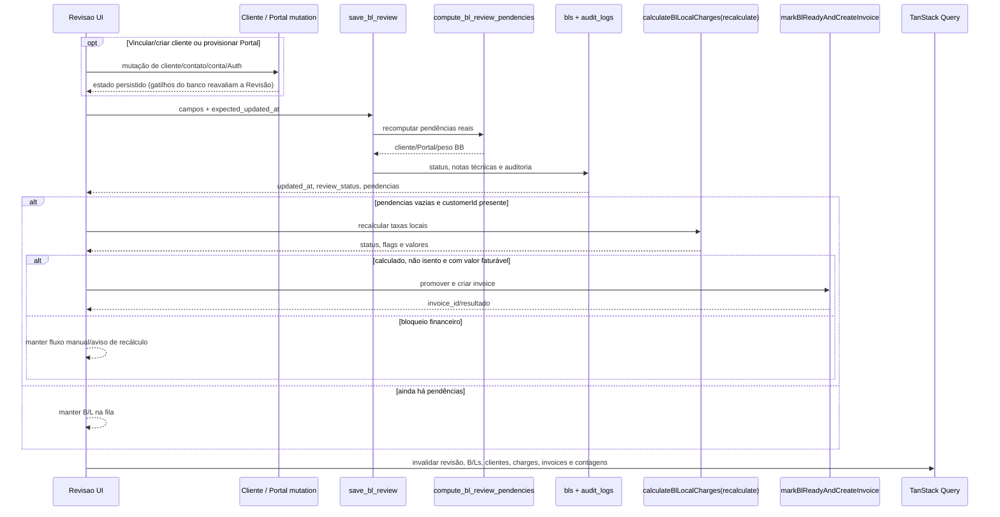

# Operação e Suporte

> **Status:** ativo · **Cartografia verificada:** 2026-10-13 (leitura estática de código e migrations ativas, na revisão geral da documentação) · **Rotas:** `/painel`, `/revisao`, `/alertas`, `/alertas/regras`, `/relatorios`, `/line-up-tv`, `/line-up-tv/display`, `/admin`, `/admin/:tab`

## Propósito e escopo

Este documento cartografa as superfícies operacionais e de suporte que consolidam pendências, revisão, alertas, relatórios, exibição do Line-Up e administração de usuários. É também o dono da regra de Alertas e Notificações Internas ([Fluxos e invariantes](#alertas-e-notificações-internas)). O mapa parte do código executável atual: `src/AppInterno.tsx` é a fonte das rotas internas; páginas compõem a UI; hooks e services concentram queries e mutations; migrations, RLS e RPCs são a fronteira efetiva de autorização e consistência.

Escopo por rota:

- `/painel`: alertas por setor, snapshot do Line-Up, exportação e atalhos;
- `/revisao`: fila agrupada, correção individual ou por cliente, gate canônico e tentativa de faturamento automático;
- `/alertas`: fila paginada, filtros e dispensa temporária de alertas internos;
- `/alertas/regras`: manual somente leitura das regras vivas do catálogo de alertas, com filtros por setor notificado, domínio e gravidade e links para tratamento;
- `/relatorios`: visões operacional, financeira, por cliente e demurrage, com filtros no endereço e exportação de planilha;
- `/line-up-tv`: sem rota nem página dedicada — cai no catch-all interno de `src/AppInterno.tsx`, que responde com a tela "Página não encontrada";
- `/line-up-tv/display`: quadro protegido, sem o shell do `AppLayout`, para monitor/TV;
- `/admin` (e `/admin/:tab`): Usuários (com "O que cada setor pode"), Falhas de entrega de alertas, Histórico de ações, Sistema e Prazo do ADR — uma sub-rota por aba;
- guards e shell compartilhados: `ProtectedRoute`, `AppLayout`, `HeaderInfoBar`, sino de Notificações Internas e navegação.

Rótulos usados na coluna **Evidência**:

- **Código**: comportamento demonstrado por TypeScript/TSX/SQL executável inspecionado;
- **Teste**: teste automatizado existente; não executado nesta cartografia;
- **Teste local-pg**: teste que aplica a cadeia ativa de migrations num PostgreSQL local e executa o SQL (procedimento em [WORKFLOW.md](../../WORKFLOW.md)); não executado nesta cartografia e não substitui ambiente Supabase;
- **Teste de contrato SQL**: teste que inspeciona o texto de uma migration, sem provar aplicação em ambiente. Vários leem migrations da cadeia arquivada pelo redirecionamento de `src/test/setup.ts`; esses aparecem como "contrato de migration arquivada (histórico)";
- **Suspeita**: divergência ou risco que exige confirmação em schema/ambiente controlado;
- **Runtime**: afirmação verificada contra ambiente real. A cartografia original não executou nenhum fluxo; o rótulo aparece apenas nas notas que citam explicitamente a consulta feita ao banco.

Fontes de linguagem e arquitetura: `CONTEXT.md`, `docs/ARCHITECTURE.md`, `docs/adr/0006-revisao-operacional-reconciliacao-cliente-gate-faturamento.md`, `docs/operations/seguranca.md` e `WORKFLOW.md`.

## Anatomia das telas

### Guards, shell e navegação

`src/AppInterno.tsx` coloca todas as rotas deste módulo sob `ProtectedRoute`. `/admin` usa uma segunda árvore com `ProtectedRoute adminOnly`. `/line-up-tv/display` permanece protegido, mas fica deliberadamente fora de `AppLayout`; as demais rotas internas usam o shell com a faixa de avisos, uma barra única (marca, navegação, sino e menu da conta), badges e `ErrorBoundary`.

`src/components/layout/ProtectedRoute.tsx` trata loading, ausência de sessão e falta de perfil ativo (com Sair). Sem a permissão da rota ou sem `isAdmin` em `/admin`, mostra "Acesso restrito" com o departamento e o caminho de volta ao Painel, em vez de redirecionar em silêncio; a autorização real continua nas policies e RPCs. `src/components/layout/AppLayout.tsx` monta badges com `useOperationalCounts`, mostra o menu Admin somente quando `isAdmin` e concentra no menu da conta o departamento, Meu perfil, Sair (navega para `/login`) e a versão da build (`AppVersionBadge`, clique copia o commit). Abaixo de 1100 px a navegação abre pelo botão Menu. `src/components/layout/HeaderInfoBar.tsx` é a faixa de avisos de até 28 px: containers em atraso à esquerda (o [Indicador Operacional](#indicador-operacional) do cabeçalho) e câmbio à direita (oculto abaixo de 768 px). O sino (`src/components/layout/InternalNotificationBell.tsx`) entrega as Notificações Internas; a regra está em [Alertas e Notificações Internas](#alertas-e-notificações-internas).

`HeaderInfoBar` usa `useRoeHeaderRate`, que delega a `fetchROE` (módulo leve
`demurrageRoe.ts`, para o cabeçalho não carregar os indicadores de Demurrage), para exibir PTAX
Venda, a fórmula `PTAX × 1,065 = ROE`, o valor calculado, a data efetiva da
cotação e uma ação de atualização. O header é informativo, não permite entrada
manual e compartilha a referência cambial e o cache canônicos do recálculo de
demurrage. CNY e o antigo contrato `useExchangeRates` não integram mais a
aplicação; a entrada manual permanece no módulo Demurrage.

Esses filtros de UI são ergonomia e navegação. A autoridade continua em policies, triggers, grants, Edge Functions e RPCs; chamadas diretas à API não podem depender de menu oculto ou redirect. Evidências: `supabase/migrations_archive/040_portal_login_rate_limit.sql`, `supabase/migrations_archive/077_fix_user_profile_privilege_escalation.sql`, `supabase/migrations_archive/014_lock_down_financial_reads_and_audit_writes.sql` e as migrations específicas do gate.

### `/painel`

`src/pages/Painel.tsx` tem três áreas (identidade visual, lote 5a):

1. cabeçalho com os acessos **Chegadas e Saídas** e **Tela TV** (botões com ícone e uma linha dizendo o que abrem; a Tela TV abre `/line-up-tv/display` em nova aba) e **Exportar**; não há **Atualizar**, porque o Line-Up se relê sozinho a cada 90 segundos;
2. alertas por setor: um cartão (`MetricCard`) para Documentação, Equipamentos, Operações e Administrativo, com os alertas ativos (âmbar acima de zero) e os dispensados na linha de apoio, mais o cartão **Sem setor** (alertas anteriores à divisão por setor) quando houver; o cartão inteiro leva a `/alertas?departamento=`. Falha do resumo aparece como "Erro ao carregar os alertas por setor.", não como cartões zerados;
3. Line-Up num bloco, com a contagem de escalas e **Carregar mais viagens** (só quando há mais viagens do que a janela carregada) na faixa; filtros abertos (Busca, Escalas, Período, CEs) e **Mais filtros** (Veículos, BB, MTY, RTW, Vinculada); tabela limpa (`LineUpTable`) com a situação em texto (âmbar só em CE **Aguardando** e Vinculada **Não**), o ATB com ✓ na coluna ETB quando registrado, a faixa verde à esquerda do navio atracado, a exportação em cinza nas colunas de carga e a legenda no pé. Abaixo de 640 px, um cartão por escala com todas as informações da linha.

O Painel não tem grade de KPIs nem mostra a última alteração do Line-Up (quem mostra é a TV). As leituras são duas: o snapshot do Line-Up em `['lineup-tv-v3', janela]` e o resumo da fila em `['alert-department-summary']` (RPC `summarize_alert_queue_by_department`), ambos com `staleTime` de 60 segundos e `refetchInterval` de 90 segundos.

`src/services/lineup.ts` lê viagens ativas e concluídas — viagem cancelada fica fora do Line-Up no Painel e na TV (decisão de 2026-10-08), e a mudança de status no audit log da viagem dispara a releitura —, B/Ls, containers, veículos, agendas por POD, agenda de exportação, vazios de importação e `audit_logs`. Containers são deduplicados por número, MTY é creditado apenas à primeira linha ordenada de cada viagem, CE vem do status documental persistido na agenda, com `waiting` quando ainda não há registro, e a última alteração é o timestamp mais recente entre as fontes consultadas. As consultas desse timestamp dividem IDs de viagens e B/Ls em lotes de até 100, evitando URLs que excedam o limite HTTP em viagens com muitos documentos. `src/lib/lineupFilters.ts` aplica localmente busca por navio/viagem, status (**Escalas ativas**, **Escalas concluídas**, **Todas as escalas**), período, CEs e filtros de presença com/sem (veículos, BB, Linked, MTY, RTW); exportações permanecem visíveis. O snapshot cobre as 60 viagens mais recentes; **Carregar mais viagens** amplia a janela do Painel de 60 em 60 até 500 (`ponytail` em `Painel.tsx`: paginar ou ampliar a query se o Painel precisar de histórico maior).

O estado visual aprovado para uma linha de escala é derivado das datas reais (desde o lote 5a, a escala atracada mantém só a faixa verde, sem pintar o texto, e a coluna ETB mostra o ATB quando houver):
ATB sem ATD significa `Atracada` e deixa a fonte verde no Painel e no Line-Up
TV; CEs e Linked preservam seus badges e cores próprios. Com ATD, a escala passa
automaticamente a `Concluída` e perde o destaque de atracação. O snapshot
transporta ATB/ATD por escala e as duas superfícies aplicam essa regra.

Na coluna intitulada `ETA`, a apresentação aprovada usa ATA quando houver e,
na ausência dela, ETA. ATA é exibida em verde sem mudar o título da coluna; se
for removida por correção, a célula volta ao ETA. A mesma precedência `ATA → ETA`
vale para a data do indicador `Início do ciclo` no Line-Up TV. Esse verde da
data indica chegada efetiva e independe do verde da linha inteira, que exige
ATB sem ATD. Painel, exportação XLSX, cards mobile, quadro desktop e o indicador
de início do ciclo usam a mesma precedência.

### `/revisao`

`src/pages/Revisao.tsx` combina:

- quatro cartões de causa que contam os registros e filtram a fila: Sem cliente vinculado, Peso da carga solta ausente, Portal não provisionado e Outras pendências (motivo sem causa canônica); com causa ou busca aplicada, **Limpar filtros** volta à fila inteira;
- busca por B/L, cliente, consignatário, shipper ou CNPJ;
- recorte na URL: `?causa=` (`cliente`, `peso`, `portal`, `outros`; o antigo `granito` cai na fila inteira) e `?busca=`; `?cliente=`, `?q=` e `?bl=` continuam como alvo de chegada (abrem o grupo correspondente) e `?motivo=`/`?reason=` com o motivo bruto antigo viram a causa equivalente;
- grupos por CNPJ válido; quando ele não existe, o nome do consignatário serve apenas para visualização;
- ordem de trabalho: primeiro o que se resolve na própria Revisão e trava a fatura (cliente, peso), com mais B/Ls na frente; depois os grupos que só esperam o Portal;
- a fila é uma tabela com uma linha por Cliente (Cliente, B/Ls, Pendências e Próxima ação); a seta no começo da linha abre o grupo embaixo (identidade visual, lote 2, aprovado em 2026-10-16);
- o grupo aberto se adapta ao caso, com um bloco de foco por pendência, na ordem da próxima ação, e embaixo os B/Ls do grupo só para conferência (B/L com copiar e link para a ficha, Carga, Navio / Viagem, Trecho e Pendências):
  - **nome lido, CNPJ não** ("Identificar o cliente"): a linha do consignatário (`consignee_block`) e a descrição da carga (`cargo_description`) de cada B/L abertas, com os CNPJs marcados, e o cadastro;
  - **CNPJ lido** ("Cadastrar o cliente"): o CNPJ como dado principal, com onde foi lido e em quantos B/Ls, e o cadastro já preenchido; CNPJ de Cliente desativado mostra o motivo e leva à ficha, sem oferecer vínculo;
  - **CNPJs divergentes** ("Confirmar o CNPJ do cliente"): tabela com cada CNPJ, onde foi lido, a quem pertence no cadastro e "Usar este CNPJ", mais o texto bruto; o cadastro aparece depois da escolha;
  - **e-mail do Cliente** (motivo anterior à migration `085`): campo do e-mail principal, preenchido com o e-mail do manifesto quando houver, e **Adicionar e-mail**;
  - **B/L vinculado com outro CNPJ no documento** ("CNPJ do B/L diferente do cliente vinculado"): o cliente vinculado e os CNPJs lidos, com **Abrir ficha do B/L**, onde o cliente é trocado;
  - **peso da carga solta**: tabela com descrição, volumes, CBM e o campo de peso de cada B/L, com validação junto do campo, Enter para gravar e Escape para desfazer;
  - **Portal pendente** (bloco Portal do Cliente): a situação da conta como dado principal, o e-mail do convite e a origem dele; **Autorizar e enviar convite**, **Reenviar convite** ou **Enviar novo convite** conforme a situação, e **Usar outro e-mail**, para quem tem a permissão de provisionar; conta suspensa, ou situação sem convite a enviar, leva ao Provisionamento do Portal; a Liberação de faturamento sem Portal fica só na ficha do Cliente, aberta pelo atalho **Liberação na ficha do Cliente**;
  - **outra pendência** ("Conferir os dados do B/L"): Shipper, Consignatário, POL, POD, peso e CBM da modalidade do B/L, a descrição só para leitura, notas humanas (a linha técnica do gate não é editável) e justificativa opcional, com **Salvar revisão**; o bloco mostra o motivo registrado pelo gate quando ele existe (por exemplo, "CE Mercante não informado"), e número ilegível ou ambíguo ("24.000") trava o salvar com o erro junto do campo, em vez de limpar o valor; o motivo legado de e-mail fica só no bloco de e-mail;
- cadastro (casos de nome, CNPJ e conflito) numa ordem só: o seletor Cadastrar novo cliente / Vincular a um cliente cadastrado (troca o conteúdo do bloco, sem janela), os campos, a escolha **Portal do Cliente** ("Enviar o convite agora" ou "Deixar para depois", sem opção marcada; o botão espera a escolha) e uma faixa que diz o que vai acontecer, com um único botão; vincular a cliente cadastrado só acrescenta contato pela captura protegida: o e-mail do manifesto entra como contato quando o CNPJ do B/L é o do cliente (B28), e a faixa diz isso e compara o CNPJ do cliente com o do B/L na busca e na confirmação; a sugestão por nome (B16) leva ao vínculo com "Usar a sugestão";
- não há janela lateral: a correção dos dados de um B/L fora do caso "Conferir os dados do B/L" é feita na ficha do B/L (Detalhes do B/L e Carga);
- resultados recentes no conteúdo (o que foi gravado, o que falhou e o que continua em revisão), além dos avisos de recálculo das taxas locais.

`src/hooks/useReview.ts` carrega todos os `bls` em `pending_review`, em páginas de 500 até a última. O Granito saiu da Revisão no lote 5b (2026-10-19): não tem Cliente ([Granito](granito.md)). A UI não faz join direto com `customer_portal_accounts`: extrai apenas a linha técnica `Pendencias de importacao:` de `bls.notes`.

`src/pages/revisaoHelpers.ts` trata cliente e consignatário como a mesma entidade de agrupamento, mas só permite onboarding em grupo com CNPJ válido e sem conflito. `getReviewItemDocumentCandidates` também procura CNPJ rotulado nas evidências brutas.

O caso "Conferir os dados do B/L" salva por `saveBlReview`, enviando `expected_updated_at`. A RPC `save_bl_review` aplica o lock otimista, atualiza os campos permitidos, recomputa o gate, decide `review_status`, preserva notas humanas, audita mudanças e retorna `{ updated_at, review_status, pendencias }`. Conflito concorrente usa SQLSTATE `PT409`, convertido em `ConcurrentEditError`; `40001` permanece aceito pelo cliente por retrocompatibilidade.

O onboarding chama `complete_review_customer_group`, que trava os B/Ls, cria/resolve o cliente, insere o contato de forma idempotente, vincula todos os B/Ls e recalcula o gate em uma transação. O convite do Portal é uma chamada posterior, feita só quando o operador escolhe "Enviar o convite agora"; falha do convite não desfaz o cadastro. No grupo com Portal pendente, o convite sai pela mesma Edge `portal-invite-send` do Provisionamento; revogar, suspender, trocar o Email de Recuperação e liberar endereço bloqueado continuam no Console dedicado.

**Histórico (até 2026-10-19):** o B/L de Granito sem Cliente também entrava na fila, como causa "Granito sem cliente", e era vinculado por `save_granite_bl_review`. Com a decisão de que o Granito não tem Cliente, a fila, o bloco, a causa e o aviso de recálculo do Granito saíram; a RPC perdeu o EXECUTE de `authenticated` na migration `325`.

### `/alertas`

`src/pages/Alertas.tsx` (**Alertas**, identidade visual do lote 5a) abre em **Ativos**, com os cartões que filtram **Ativos**, **Críticos** e **Dispensados** (não há "Todos" nem **Atualizar**), a busca, os filtros **Setor**, **Registro** e **Gravidade**, **Limpar filtros** e o atalho **Regras de alertas**. A tabela mostra Gravidade (**Crítico** em vermelho, **Normal** em tinta normal), Alerta, Registro, Mensagem, Setor, Aberto em e as ações. Cada coluna diz uma coisa só: o Registro diz onde (Cliente, B/L, navio e viagem com o porto, container), sem o tipo na frente, e abre a ficha do B/L e da viagem (`alertRecord`); o grupo de B/Ls sem Cliente aparece como "B/Ls sem Cliente"; a Mensagem traz só o detalhe, ou "—". Toda linha tem **Resolver** e **Dispensar**, de largura fixa: **Resolver** leva ao lugar da resolução (o nome do lugar no `title`, de `alertEntityLinkLabel`) e, nos alertas de conferência sem fato de origem, abre a justificativa (ADR 0083). **Dispensados** lista o alerta, o registro, "Dispensado até" em âmbar e quem dispensou, com o motivo na linha aberta. Abaixo de 640 px, um cartão por alerta. A fila vem de `list_alert_queue_page`, de 100 em 100 (**Anterior**/**Próxima**), com crítico antes de normal e o mais recente primeiro; Ativos e Dispensados contam pelo resumo por setor, e Críticos pela página de ativos carregada (`ponytail` em `Alertas.tsx`). O setor é filtrado no servidor e fica na URL (`?departamento=`, usado pelos cartões do Painel, inclusive `sem_departamento`, exibido como **Sem setor**); gravidade, registro e busca filtram só a página carregada. `list_alert_queue` continua como atalho da primeira página de 100 (migration `043`). Linhas legadas de `alerts` sem item continuam na fila, sem o botão **Dispensar**. Nenhum detector deve abrir mais linhas assim: a pendência geral do Portal (`portal_pendencia_geral`) só existe como item agrupado de `reconcile_client_portal_alerts`; o job que a duplicava como linha legada saiu na migration `321` (**Teste**, Postgres local, `pendenciaGeralPortalSemDuplicata.local-pg.test.ts`).

Desde a migration `324` (lote 5a, achado A2), os detectores de viagem, Revisão, ADR e pendência do Portal escrevem na mensagem só o que o Alerta e o Registro não dizem: o prazo ("Prazo D-7 atingido sem Baplie importado."), a contagem ("2 B/Ls aguardam vínculo com Cliente."), o que falta ("Sem conta no Portal e sem e-mail de recuperação.") ou o terminal ("Terminal TVV: ETB de 14/10/2026 passou sem ATB registrada."), sem o nome do Cliente, o número da viagem nem o porto; a migration reescreveu os alertas abertos no formato novo.

Os alertas da Revisão de B/L — `review_customer_unlinked`, `review_portal_not_ready` e `review_breakbulk_weight_missing` — são agregados por Cliente (entidade `customer`: o id do Cliente vinculado ou, sem vínculo, o nome do consignatário) e reconciliados por `reconcile_customer_bl_review_alerts` (última definição na migration `169`, que tira o B/L cancelado da contagem). A audiência é Documentação; todos são críticos. O `review_customer_email_missing` foi aposentado na migration `085`: e-mail de contato não é condição de faturamento. O `review_granite_customer_unlinked` ("Revisão de Granito — cliente não vinculado") foi aposentado na migration `325`: o Granito não tem Cliente; o gatilho em `granite_bls` saiu, o detector não abre nada e os abertos foram fechados. Gatilhos em `bls`, `customer_portal_accounts`, `customer_contacts` e `customer_billing_portal_releases`, as mutações autoritativas (`save_bl_review`, `complete_review_customer_group`) e o detector periódico mantêm a fila e as notificações em dia; a tela relê a fila ao abrir e depois de cada dispensa ou resolução (não há atualização em tempo real).

Os dois tipos do ADR (`agency_report_department_pending` e `agency_report_deadline_missed`) usam um agregado por `(viagem, porto, terminal)` — ou `(viagem, porto)` no legado — com um item independente para cada um dos três departamentos. O ATD do ADR terminalizado vem de `voyage_escala_terminal_state.terminal_atd`; a auditoria da escala, os sign-offs e o detector periódico acionam a mesma reconciliação (`reconcile_agency_report_alerts`, definição vigente na migration `002`; o desenho nasceu na migration arquivada `323`). Quando cada item abre e fecha é regra do ADR: [Viagens § Alertas do ADR](viagens.md#alertas-do-adr). O link para a viagem é produzido por `agencyReportAlertLink`, preservando `terminal` e `report_id` quando existirem.

Detectores server-side de operação e viagem (definição vigente na migration `002`; origem nas migrations arquivadas `326` e `338`) reconciliam B/L esperado, Baplie ausente/cobertura, CE Mercante, datas de escala/terminal e exportação pós-ATD. A audiência usa a união declarada no catálogo; terminais usam `depots.code` na chave/deep-link; e audit logs/estado terminalizado acionam reconciliação imediata, com o detector periódico (Edge Function `alerts-detector`, a cada 15 minutos; agenda em [Serviços externos](../operations/servicos-externos.md)) como rede de segurança. Como os manifests de Granito/Vazios ainda só têm `voyage_id`, a pendência de exportação pós-ATD é agregada por escala, não por terminal.

**Dispensar** abre a janela **Dispensar alerta** (peça comum `Modal`), com o nome do alerta e o registro, **Motivo** e **Volta para a fila em** (a tela sugere daqui a 7 dias e aceita a partir de amanhã); **Dispensar até DD/MM** chama `dismiss_alert_item`. A regra da dispensa e do fechamento está em [Alertas e Notificações Internas](#alertas-e-notificações-internas). Depois da dispensa, `invalidateAllAlertQueries` invalida a fila (`['alerts']`), o resumo do Painel (`['alert-department-summary']`), os alertas financeiros (`['financial-alerts']`), a contagem do menu (`['op-count', 'open-alerts']`) e as notificações do sino. A contagem do menu não tem realtime: atualiza pelo `staleTime` de 60 s (`ponytail` em `useOperationalCounts.ts`: `alerts` não está na publication `supabase_realtime`).

### `/alertas/regras`

`src/pages/AlertasRegras.tsx` apresenta o manual das regras vivas de `alert_type_catalog`, alimentado por `src/services/alertRulesCatalog.ts` (39 regras em 2026-10-13, contagem fixada em `AlertasRegrasCatalog.test.tsx`). Tipo aposentado não é listado: o manual só documenta tipos com produtor, e um tipo sai de `ALERT_RULES` na mesma mudança que o desativa no catálogo SQL. A lista pode ser filtrada por busca, setor avisado (**Qualquer setor**, **Aplicável a todos os setores** e cada setor), assunto (Operação, Revisão, Financeiro, Portal) e gravidade; o detalhe tem três blocos (lote 5a): **Quando abre** (o gatilho como dado principal, o registro, quando aparece e quando fecha), **Quem recebe** (o setor responsável, os avisados e a distribuição) e **Como resolver** (a resolução, a dispensa e o botão com o nome da tela, por exemplo **Abrir Revisão**). O código interno da regra e o endereço da tela não aparecem; o código continua valendo na busca. A seleção (`?regra=`) e os filtros (`?q=`, `?setor=`, `?dominio=`, `?gravidade=`) ficam na URL para permitir retorno e compartilhamento; um `?regra=` de tipo aposentado ou fora do filtro abre a primeira regra listada. A tela é somente leitura: não executa detectores, não resolve itens e não altera configurações.

O verbete distingue **setor responsável** (o `alert_items.department` gravado pelo produtor, que agrupa a fila `/alertas`) de **setores notificados** (a união entre `alert_type_catalog.audience_departments` e o departamento do item, como faz `fanout_alert_item_for_department`; ver [Notificação Interna e Regra de Destinatários](#notificação-interna-e-regra-de-destinatários)). O filtro de setor usa os setores notificados, porque um mesmo alerta pode chegar a mais de um: `pix_unreconciled` é tratado pelo Administrativo e alcança também Documentação e Equipamentos (migration `078`, que também passou a aceitar `administrativo` como setor da fila; pela [ADR 0085](../adr/0085-modelo-de-permissoes-por-perfil.md), item D18, o Financeiro recebe este alerta, a Restituição pendente e a Fatura desatualizada desde a migration `247`, P5); `voyage_schedule_date_pending` e `voyage_terminal_date_pending` alcançam Operações e Documentação; e os dois tipos de ADR abrem um item por departamento — Operações (Escala), Equipamentos (Veículos, Carga carregada e Embarque de vazios) e Documentação (Carga descarregada, Vazios descarregados) — com Documentação também na audiência fixa do catálogo. A opção *"Aplicável a todos os setores"* filtra exclusivamente as regras que notificam Documentação, Equipamentos e Operações ao mesmo tempo.

### `/relatorios`

`src/pages/Relatorios.tsx` possui quatro visões em abas (`TabList`, com setas, Home e End), escolhidas pelo endereço: `?visao=operacional` (padrão, fora da URL), `financeiro`, `por-cliente` ou `demurrage` (lote 5b da [identidade visual](../identidade-visual.md)). A ordem é abas, filtros, cartões de total (`MetricCard` numa linha, do mesmo tamanho) e a tabela num `Block`.

**Filtros.** Em todas as visões ficam sempre abertos o período, **Navio / Viagem** (`VoyageCombobox`) e **Cliente** (o combobox de Cliente do faturamento), com o botão **Exportar planilha**; o resto fica em **Mais filtros**. O rótulo do período diz qual data recorta:

| Visão | Período | Mais filtros |
|---|---|---|
| Operacional | **Criação do B/L de / até** | POL, POD (portos canônicos; a consulta aceita todas as grafias gravadas do mesmo porto), Modalidade, Revisão (Pendente, Em ordem) e Taxas locais (Pendente, Emitida, Paga, Isenta) |
| Financeiro | **Emissão de / até** | Situação, Consolidada (só consolidadas ou sem elas) e Saldo em aberto (com ou sem saldo) |
| Por Cliente | **Período de / até** (B/Ls pela criação; faturas pela emissão) | nenhum |
| Demurrage | **Data do documento de / até**; sem data escolhida, do 1º de janeiro até hoje no calendário de Brasília | Situação, Em disputa e Vencidas (Faturado ou o legado `overdue` com vencimento antes de hoje em Brasília) |

Os filtros ficam no endereço (`de`, `ate`, `viagem`, `cliente` e `clienteNome`, comuns às quatro visões e mantidos na troca de aba; `pol`, `pod`, `modalidade`, `revisao`, `taxas`, `situacao`, `consolidada`, `saldo`, `disputa` e `vencidas`, de cada visão e descartados na troca), aparecem em "Filtros ativos" e vão para a aba **Filtros** da planilha exportada. Valor do endereço fora do formato é descartado antes da consulta e não aparece nos filtros ativos nem na planilha: data que não existe no calendário (`?de=2026-02-30`), id de Navio / Viagem ou Cliente que não é inteiro positivo (e o `clienteNome` sem Cliente válido) e POL/POD fora da forma de código de porto (`src/pages/relatoriosListState.ts`). As planilhas usam os rótulos e as datas da tela, sem código cru: no Operacional, Revisão, **Taxas locais** (mesmo `reportLocalChargesState` da tabela, no lugar do antigo `financial_status`) e Criação do B/L em `dd/mm/aaaa`; no Financeiro, Emissão em `dd/mm/aaaa` e Situação com o rótulo do Faturamento.

**Período em Brasília.** As datas de criação e emissão (`TIMESTAMPTZ`) são cortadas em `-03:00` (`brasiliaStartOfDay`/`brasiliaEndOfDay` em `src/services/reports.ts`); a data do documento do Demurrage é `DATE` e compara a data crua.

**Visões:**

- **Operacional**: cartões B/Ls, Containers, Viagens, Peso (em t) e CBM, sem o B/L cancelado (ele aparece na tabela como "B/L cancelado", mas não entra nos cartões; decisão do responsável de 2026-10-20). Tabela: B/L (abre a ficha, com o ícone de copiar), Navio / Viagem, Trecho (POL → POD), Cliente ("Sem cliente vinculado" em âmbar), Containers, Peso (kg), CBM, Revisão ("Pendente" em âmbar ou "Em ordem"; só `pending_review` é Pendente, e o B/L sem `review_status` gravado é "Em ordem" na tabela, no filtro e na planilha, `reportReviewLabel`) e **Taxas locais**, com os estados da lista de BLs, "Parcialmente paga" separada de "Emitida" (também no filtro) e "Paga" com ✓ (`reportLocalChargesState` em `src/lib/chargeStatus.ts`; `LocalChargesStatus` com `showPaid`).
- **Financeiro**: cartões Saldo em aberto (âmbar acima de zero), Faturas, Emitido, Pago e Canceladas. Tabela: Fatura (abre o detalhe em `/taxas-locais?invoice=`), Cliente, Emissão, Total, Saldo (âmbar só acima de zero) e Situação em texto (Paga e Coberta com ✓, Cancelada e Obsoleta em cinza, com a linha em cinza).
- **Por Cliente**: B/Ls, Peso e CBM sem o B/L cancelado (decisão do responsável de 2026-10-20, como no Operacional). Cartões Emitido, **Clientes com fatura no período**, Top por volume (B/Ls) e Top por faturamento ("—" quando não há). Tabela: Cliente (abre a ficha), CNPJ, B/Ls, Peso, CBM, Faturas, Emitido e Em aberto.
- **Demurrage**: cartões Total US$ (exceto canceladas), Faturas, Faturado (R$) e Recebido (R$). Tabela: Invoice (abre o detalhe em `/demurrage?fatura=`), B/L, Cliente, Emissão, Vencimento, Total US$, Total R$ e Situação, com os totais em tinta normal.

**Regra comum de faturas.** Financeiro e Por Cliente contam a mesma fatura: emitida no período, sem rascunho e sem cancelada, contando como cancelada a consolidada `obsolete`, como nos filtros do Faturamento (`countsAsIssuedInvoice` e `summarizeIssuedInvoices`, decisão de 2026-10-19). O valor emitido de fatura de Taxas Locais vem dos recebíveis do B/L, uma vez por recebível (a individual e a consolidada que a cobre apontam o mesmo); granito e avulsa usam o total da fatura. Em aberto soma o saldo dos recebíveis ativos e abertos, ou o saldo da fatura sem recebível. O Por Cliente inclui o Cliente que teve fatura no período mesmo sem B/L criado nele. Pago soma a fatura `paid` e a individual `covered` (quitada pela consolidada; o Faturamento agrupa `paid|covered` como Paga), uma vez por recebível, então a coberta e a consolidada paga que a cobre não somam duas vezes. No Financeiro, a Situação "Paga" também traz as cobertas e "Cancelada" as obsoletas. A fatura parcialmente paga não entra em Pago (decisão do responsável de 2026-10-20): aparece como "Parcialmente paga" na Situação e o saldo dela conta em Em aberto. Os cartões do Financeiro contam só as faturas da tabela: todo filtro escolhido (período, Navio / Viagem, Cliente, Situação, Consolidada e Saldo em aberto) estreita os cartões junto com as linhas.

**Leitura em páginas e teto.** O servidor entrega no máximo 1.000 linhas por consulta (`max_rows` em `supabase/config.toml`). `fetchAllPages` lê em páginas de 1.000 (ordem estável: data e `id`) até o fim do recorte, com `count: 'exact'` na primeira página. A leitura termina na página vazia ou na curta que já alcançou a contagem, e descarta pelo `id` a linha repetida na fronteira de página quando outra linha é criada no meio da leitura; terminando antes do teto, o total é o que foi lido, sem "faltam N" de contagem velha. A tela para no teto `REPORT_SCREEN_CEILING` (10.000 linhas por fonte); passando dele, um aviso âmbar diz, por fonte (no Por Cliente, B/Ls e faturas separados), quantas linhas foram lidas e quantas faltam, que cartões e tabela usam só o que foi lido e que a planilha traz todas. No Financeiro, a contagem é de faturas lidas antes do filtro de Saldo em aberto, que roda no navegador, e o aviso diz isso. A planilha relê o recorte inteiro, sem teto, nas quatro visões. A tabela mostra 50 linhas por página, recortadas no navegador.

**Acesso e erros.** Falta de permissão de leitura das faturas (`42501`) mostra "Sem permissão para ver as faturas" (Financeiro sem cartões nem linhas; Por Cliente com as colunas financeiras zeradas). Sessão expirada é erro da consulta e mostra a mensagem de entrar de novo. Com erro, a tabela mostra só o erro, nunca "nenhum dado" junto (`QueryStateGate`).

As queries são `['report-operational', filters]`, `['report-financial', filters]`, `['report-customers', filters]` e `['demurrage-report', filters]`.

### `/line-up-tv` e `/line-up-tv/display`

`/line-up-tv` não tem rota nem página própria: o catch-all `<Route path="*">` de `src/AppInterno.tsx` absorve o caminho, como faz com qualquer rota interna desconhecida. Ele renderiza `NaoEncontrado` (antes redirecionava para `/painel` com `replace`, realocando o usuário sem aviso e sem histórico recuperável) e fica dentro do `ProtectedRoute`, para que visitante sem sessão continue indo para `/login`.

`src/pages/LineUpTVDisplay.tsx` usa `['lineup-tv-display-v2']` com as 60 viagens mais recentes, `staleTime` e auto-refresh de 30 segundos; a cada rodada só relê o snapshot inteiro quando `hasLineUpChanged` detecta mudança. Remove as linhas com ATD, exceto as de escala omitida, que continuam visíveis para a operação; tenta fullscreen na carga, mostra flash verde quando recebe novo snapshot e:

- usa o quadro claro anterior à etapa 03, com tamanhos fixos (decisão do responsável de 2026-10-08, item 3 do [plano de revisão visual, arquivado](../archive/plans/2026-10-07-revisao-visual-ux-prompts.md)): cabeçalhos Vessel, Voy, POD, Terminal, ETA, ETB, VIN, VIN CNTR, CG, Total, MTY, RTW, BB, CEs e Linked, e BB em três linhas (MAQ, PACK e TOTAL);
- lê BLs e CEs pela mesma função do Painel (`lineUpCeStatus`, em `src/components/lineup/lineUpStatus.ts`), mantida pela mesma decisão; antes a TV só conhecia Aprovado/Parcial e exibia Recebido, Lançando e Em aprovação como "Aguardando";
- o cabeçalho mostra Início do ciclo, Última alteração (o timestamp mais recente das fontes do snapshot) e Atualizado às; se a atualização falha com dados já exibidos, mantém o quadro e troca "Atualizado às" por "Sem atualização desde"; sem dados, mostra "Falha ao carregar o quadro da TV." e a nova tentativa automática;
- em desktop, dimensiona oito linhas visíveis e, com mais de oito, desliza continuamente uma linha a cada 3 s, sem pausa; `prefers-reduced-motion` anula a transição (regra global de `src/index.css`);
- em touch/mobile (até 1024 px), renderiza cards estáticos;
- mantém placeholders quando há menos de oito linhas.

No carrossel, a fronteira do ciclo deve permanecer visualmente presa à
identidade da primeira escala ordenada: uma borda horizontal destacada aparece
entre a última e a primeira escala, acompanhando ambas durante a animação. Ela
não pertence a uma posição fixa da tela. No mobile, a borda equivalente aparece
antes do card da primeira escala. A referência visual aprovada é a separação
mostrada entre `GREEN SANTOS / 16` e `ZYHY JIN QU / 39`, mantendo também o texto
`Início do ciclo` no cabeçalho.

O display compartilha `fetchLineUpSnapshot` com o Painel, mas não compartilha a mesma cache key. A classe `app-lineup-display-board__row--cycle-start` pertence à ocorrência renderizada da primeira escala, inclusive no track animado e no card mobile, portanto a borda acompanha o ciclo.

### `/admin`

`src/pages/Admin.tsx` (**Administração**) tem cinco abas, uma sub-rota cada (`src/pages/adminTabs.ts`), em `TabList` (setas, Home e End trocam de aba); cada aba é um componente de `src/components/admin/`. Os endereços de antes do lote 5b da identidade visual (`/admin/falhas`, `/admin/logs`, `/admin/metricas`, `/admin/prazo-adr`) redirecionam para a aba nova; sub-rota desconhecida mostra "Página não encontrada". Em toda aba, consulta com erro mostra só o erro e **Tentar novamente**, nunca junto com "nada encontrado" (`QueryStateGate`).

- **Usuários** (`/admin/usuarios`): filtros **Busca** (nome ou e-mail), **Setor** e **Situação** (padrão **Ativos**; **Inativos** e **Todos**), **Novo usuário** e o bloco **Usuários** com Nome, E-mail (coluna própria; o endereço suprimido por devolução ou spam fica em âmbar com ⚠ e o motivo ao passar o mouse; o alerta `usuario_email_devolvido` não vale para a conta técnica "API Itaú" da baixa automática do Pix, desde a migration `319`), Setor em texto (o papel legado `operator` aparece como Documentação), Situação ("Ativo"; "Inativo" com a linha inteira em cinza), Último acesso (data e hora de Brasília, ou "Nunca acessou" em cinza), Criado em e as ações de linha (só ícone, com o nome da pessoa no rótulo acessível, como "Editar acesso de Ana") **Editar acesso** e **Desativar**/**Reativar**. Abaixo, o bloco **O que cada setor pode**: a matriz do catálogo `src/services/permissionMatrix.ts`, em **Só exclusivas** (padrão, sem as linhas em que os cinco setores podem) ou **Todas as ações**;
- **Falhas de entrega de alertas** (`/admin/falhas-de-alertas`): alertas que não acharam ninguém ativo no setor nem no Administrativo (`alert_notification_failures`), com Quando, Alerta, Setor sem destinatário, Motivo (frase de tela, sem o termo técnico gravado no banco) e a ação **Abrir alerta** (a tela de tratamento do alerta); a faixa do bloco diz "Para resolver: ativar alguém do setor na aba Usuários."; páginas de 50;
- **Histórico de ações** (`/admin/historico`): filtros **Assunto** (lista de nomes em português, cada um cobrindo as entidades de `audit_logs` do assunto), **Por** (Qualquer pessoa, Sistema ou uma pessoa da lista de usuários), **De** e **Até** (dias de Brasília); colunas Quando, Por (nome; "Sistema" sem autor; "Pessoa sem cadastro" quando o autor não tem mais perfil, nunca o número interno), Assunto, Registro (qual registro mudou: o Usuário pelo nome, tirado da lista de usuários já carregada; os demais pelo identificador gravado, encurtado, com o inteiro ao passar o mouse) e O que mudou (frase montada de entidade, campo e valor em `src/components/admin/auditLogPresentation.ts`, que reusa os rótulos do Histórico do B/L, da ficha do Cliente e da Viagem; entidade sem rótulo vira "Outro registro" e campo sem rótulo vira "<registro> alterado"; a reabertura do ADR de Saída vira "ADR de Saída reaberto", com De "Fechado" e Para "Aberto"; a senha redefinida vira "Senha redefinida"; o Usuário criado mostra o nome e o setor). A linha aberta mostra **De** e **Para** (o registro gravado em JSON vira só os campos com rótulo) e o motivo; páginas de 50;
- **Sistema** (`/admin/sistema`): Versão (`formatAppVersion`), Ambiente lido da configuração da build (`VITE_SENTRY_ENVIRONMENT`, a mesma do Sentry: Produção, Prévia ou Desenvolvimento; sem a variável, Produção; o servidor local do Vite é sempre Desenvolvimento), **Última viagem criada** e **Última fatura emitida** (data de emissão, `invoices.issued_at`, não a criação);
- **Prazo do ADR** (`/admin/prazo-do-adr`): filtros **Fechado de**/**Fechado até** (dias de Brasília), cartões por departamento "x de y no prazo" com a porcentagem (regra confirmada pelo responsável em 2026-10-19: y conta todo ADR fechado no período, e o departamento que não assinou conta como fora do prazo — 8 assinados no prazo, 1 atrasado e 1 sem assinatura dão "8 de 10") e uma linha por ADR fechado — Navio / Viagem numa linha, porto e terminal —, com ATD, Prazo, a situação de cada departamento em texto ("No prazo"; "Atrasou N h" em âmbar, horas depois do prazo arredondadas para cima; "Não assinou" em cinza; a hora da assinatura ao passar o mouse) e a coluna **Dias corridos do ATD ao Fechamento** (a data e a hora do Fechamento ao passar o mouse). Escalas omitidas e ADRs fechados antes da vigência da medição ficam fora. A regra do prazo está em [Viagens § Prazo de Conclusão do ADR](viagens.md#prazo-de-conclusão-do-adr).

As chaves são `queryKeys.admin` (`['admin-users']`, `['admin-routing-failures', página]`, `['admin-audit-logs', filtros]`, `['admin-metrics']`) e `['agency-report-sla', de, até]`. A lista de usuários vem da RPC `admin_list_users` (perfil com e-mail e último acesso do Supabase Auth, só para o Administrativo). **Novo usuário** (nome, e-mail, setor e senha), as credenciais de **Editar acesso** (novo e-mail e/ou nova senha) e **Desativar** passam pela Edge Function `admin-users`, que confere `is_admin()`, audita e, ao trocar credencial ou desativar, encerra as sessões do usuário (`internal_revoke_sessions`); ninguém desativa o próprio acesso. Salvar o e-mail em **Editar acesso** também libera a supressão (devolução ou spam) do endereço anterior, a não ser que ele seja contato de Cliente ou Email de Recuperação do Portal (RPC `release_internal_user_email_suppression`, migration `309`); enquanto o e-mail de um usuário ativo estiver suprimido, o Alerta `usuario_email_devolvido` fica aberto para o Administrativo. O próprio usuário não troca o e-mail em **Meu perfil** (`/perfil`, só nome e senha): a confirmação do Supabase Auth não chegava (D13 do [plano dos e-mails](../archive/plans/2026-10-17-correcao-dos-emails.md)). **Reativar** pede motivo e passa pela RPC `reactivate_catalog_row` (migration `261`); o botão não repete a chamada enquanto a primeira está em andamento. O setor só se troca em **Editar acesso** (decisão do lote 5b; a linha não tem mais seletor): a janela mostra "Com este setor, <nome> pode" e "Não pode", derivados do mesmo catálogo da matriz e atualizados ao trocar o setor, e a troca pede confirmação com o antes e o depois. A troca de setor é update direto em `user_profiles`, auditado pelo gatilho `trg_audit_user_profile_changes` e protegido por `trg_prevent_user_profile_privilege_escalation` (definições vigentes na migration `002`); quando a mesma janela também troca credencial, o setor muda primeiro e volta ao anterior se a troca de credencial falhar (compensação no navegador, não transação), só se o registro ainda está com o setor que a janela gravou (`restoreUserRole`, update condicionado ao setor); o aviso de erro diz se o setor voltou ou se ficou com o novo. Na própria linha, o Setor de **Editar acesso** fica travado, com a explicação: quem troca o próprio setor perde o `is_admin()` antes da Edge Function, e a volta seria recusada pelo gatilho contra escalada, trancando a pessoa fora; o próprio setor só muda por outra pessoa do Administrativo, e a própria senha também se troca em **Meu perfil**. Toda ação de usuário relê a lista e o Histórico de ações (`['admin-users']` e `['admin-audit-logs']`). A janela de **Novo usuário** mostra a mesma lista ao escolher o setor. A tela gerencia os cinco setores (`administrativo`, `financeiro`, `operacoes`, `documentacao`, `equipamentos`). O que cada setor pode, ação por ação e onde o banco aplica, está na [matriz de permissões](../operations/seguranca.md#modelo-de-permissões-por-perfil); a regra do Administrativo ativo mínimo está em [Administrativo ativo mínimo](#administrativo-ativo-mínimo).

Não há lock otimista na troca de setor nem na reativação. A proteção efetiva para `role` e `active` é administrativa no banco: `trg_prevent_user_profile_privilege_escalation` (origem na migration arquivada `077`) e a RLS de `user_profiles`.

## Catálogo de ações

### `/painel`

| Tela / ação | Pré-condições | Origem | Orquestração | Persistência | Efeitos e cache | Falhas | Evidência |
|---|---|---|---|---|---|---|---|
| Carregar alertas por setor | Sessão interna e perfil ativo | Montagem de `Painel` | `useQuery(['alert-department-summary'])` → `getAlertDepartmentSummary` | RPC `summarize_alert_queue_by_department` (itens ativos e dispensados por setor do item) | Cartões de Documentação, Equipamentos, Operações, Administrativo e Sem setor com link para `/alertas?departamento=`; stale 60 s, refetch 90 s | Erro mostra "Erro ao carregar os alertas por setor." em vez de cartões zerados | **Código:** `src/pages/Painel.tsx`, `src/services/alerts.ts`; **Teste:** `src/pages/__tests__/PainelAlertsSummary.test.tsx` |
| Carregar snapshot Line-Up | Sessão interna ativa | Montagem/intervalo de 90 s | `useQuery(['lineup-tv-v3', janela])` → `fetchLineUpSnapshot(janela)` | Leituras de `voyages` (ativas e concluídas), `bls`, `bl_containers`, `vehicles`, `vazios_importacao_*`, `audit_logs` e agendas | Cache stale 60 s, refetch 90 s; atualiza tabela e MTY | Qualquer leitura obrigatória lança erro e exibe "Erro ao carregar o Line Up." | **Código:** `src/pages/Painel.tsx`, `src/services/lineup.ts`; **Teste:** `src/services/__tests__/lineupSnapshot.test.ts` |
| Carregar mais viagens | Snapshot com mais viagens do que a janela | Botão **Carregar mais viagens** | Amplia a janela de 60 em 60, até 500 | Mesmas leituras, com a janela maior | Nova chave `['lineup-tv-v3', janela]`; filtros e exportação passam a considerar as viagens carregadas | Mesmas do snapshot | **Código:** `src/pages/Painel.tsx`, `src/services/lineup.ts` |
| Filtrar/exportar Line-Up | Snapshot carregado; export exige linhas | `LineUpFilters` e **Exportar** | `filterLineUpRows` combina filtros locais; import dinâmico de `@e965/xlsx` | Nenhuma escrita no banco; arquivo `painel-lineup-AAAA-MM-DD.xlsx` | Exporta somente linhas filtradas; não altera cache | Falha de download mostra "Falha ao exportar o Line Up." | **Código:** `src/pages/Painel.tsx`, `src/lib/lineupFilters.ts`; **Teste:** `src/lib/__tests__/lineupFilters.test.ts`, `src/pages/__tests__/Painel.behavior.test.tsx` (inclui a ausência de filtro de viagem cancelada) |
| Abrir atalhos | Sessão interna ativa | **Chegadas e Saídas**, **Tela TV** e cartões de setor | React Router ou nova aba | Nenhuma | Navega para `/chegadas-saidas`, `/line-up-tv/display` (nova aba) ou `/alertas?departamento=` | Guard pode redirecionar se a sessão deixar de ser válida | **Código:** `src/pages/Painel.tsx`, `src/AppInterno.tsx` |

### `/revisao`

| Tela / ação | Pré-condições | Origem | Orquestração | Persistência | Efeitos e cache | Falhas | Evidência |
|---|---|---|---|---|---|---|---|
| Carregar, filtrar e agrupar fila | Sessão/perfil ativo | Montagem, busca e cartões de causa | `useReviewQueue` carrega os B/Ls em páginas de 500 até a última; `groupReviewItems` agrupa por CNPJ/nome; `sortReviewGroupsByPriority` e `summarizeReviewGroup` dão ordem e próxima ação | Leitura de `bls`, `customers`, `customer_contacts`, `voyages` e `bl_containers` | Cache `['review-queue']`; busca e causa na URL; grupos abertos são locais | Falha de leitura: erro com Tentar novamente, sem fila vazia | **Código:** `src/hooks/useReview.ts`, `src/pages/Revisao.tsx`, `src/pages/revisaoHelpers.ts`; **Teste:** `src/pages/__tests__/revisaoHelpers.test.ts`, `src/pages/__tests__/Revisao.test.tsx`, `src/hooks/__tests__/useReview.pagination.test.ts` |
| Abrir o grupo | Grupo presente no resultado filtrado | Seta no começo da linha da fila | Estado local por grupo; o alvo de chegada (`?cliente=`, `?bl=`…) abre os grupos que casam com ele | Nenhuma | O conteúdo do grupo muda conforme o caso (`ReviewGroupDetail`) | Alteração do filtro pode esconder o grupo aberto | **Código:** `src/pages/Revisao.tsx`, `src/components/review/ReviewGroupDetail.tsx`; **Teste:** `src/pages/__tests__/Revisao.test.tsx` |
| Cadastrar/vincular cliente no grupo | B/Ls pendentes, CNPJ válido, razão social e e-mail válidos; usuário ativo | `ReviewCustomerForm` no grupo; a escolha Portal do Cliente é obrigatória | `useReviewCustomerGroup` → `completeReviewCustomerGroup`; `sendPortalInvite` após commit quando a escolha é "Enviar o convite agora" | `customers`, `customer_contacts`, `bls`, fila de reconciliação e `audit_logs` na mesma transação | Invalida revisão, clientes, lookup, B/Ls, charges, pendências locais e Portal | CNPJ conflitante/missing, grupo alterado (`PT409`/`40001`) ou convite falho; convite falho preserva onboarding | **Código:** `ReviewCustomerForm`, `reviewCustomerGroup.ts`, `complete_review_customer_group` (definição vigente na migration `002`); **Teste:** `Revisao.test.tsx`, `reviewCustomerGroup.test.ts`; **Teste local-pg:** `src/integration/auditoriaImportacaoCargaSolta.local-pg.test.ts` (`complete_review_customer_group` real); `reviewCustomerGroupMigration.test.ts` é contrato da migration arquivada `322` (histórico) |
| Salvar revisão individual | Usuário ativo; item B/L com outra pendência; `expected_updated_at` corrente | “Salvar revisão” no bloco Conferir os dados do B/L (`ReviewBlCheckForm`) | `saveBlReview` → RPC `save_bl_review` → `compute_bl_review_pendencies` → status; se resolvido, `tryAutoIssueInvoice` | Atualiza `bls`; insere `audit_logs`; sincroniza fila de reconciliação; pode gerar cobranças/invoice | Invalida `review-queue`, `bls`, detalhe, audit, customers e `op-count`; faturamento também altera caches por fluxos subsequentes | `PT409`/`40001` vira conflito concorrente; números inválidos falham antes da RPC; pendências mantêm item na fila | **Código:** `src/pages/Revisao.tsx`, `src/services/review.ts`; **Teste:** `src/services/__tests__/review.test.ts`, `src/pages/__tests__/Revisao.test.tsx`; **Teste local-pg:** `src/integration/portalBillingRelease.local-pg.test.ts` (motivo do Portal; e-mail de contato não é pendência); `reviewGateCanonicalMigration.test.ts` é contrato da migration arquivada `128` (histórico) |
| Exibir evidências e segregar conflito | Grupo sem CNPJ ou com candidatos distintos | `ReviewRawLines` e `ReviewCnpjCandidates` | Texto bruto de `consignee_block` e `cargo_description` com os CNPJs marcados; no conflito, cada CNPJ com a origem e o Cliente cadastrado com ele; o cadastro só aparece depois de "Usar este CNPJ" | Nenhuma escrita | Estado local do grupo | Evidência ausente exige confirmação manual; CNPJs conflitantes não são agrupados | **Código:** `src/components/review/ReviewEvidence.tsx`, `revisaoHelpers.ts`; **Teste:** `ReviewEvidence.test.tsx`, `Revisao.test.tsx`, `revisaoHelpers.test.ts` |
| Provisionar o Portal no grupo | Cliente vinculado; pendência "Portal não provisionado"; permissão `portal_provisioning` para agir | Bloco Portal do Cliente: **Autorizar e enviar convite**, **Reenviar convite**, **Enviar novo convite**, **Usar outro e-mail** | `usePortalProvisioningForCustomer` lê a situação; `useSendPortalInvite` → Edge `portal-invite-send` (Documentação e Administrativo) | `portal_invites`, `customer_portal_accounts`, eventos do Portal | Invalida o Provisionamento; ativar o Portal ou conceder a Liberação (na ficha do Cliente, [ADR 0070](../adr/0070-portal-trava-toda-emissao-e-liberacao-por-cliente.md)) reavalia a Revisão no banco; conta suspensa leva ao Provisionamento | Email suprimido, conta ativa, token expirado ou papel sem permissão: a mensagem fica no bloco | **Código:** `src/components/review/ReviewPortalBlock.tsx`, `src/hooks/usePortalProvisioning.ts`; **Teste:** `Revisao.test.tsx`, `ClientesPortal.behavior.test.tsx` |
| Corrigir peso BB inline | Item B/L; peso positivo (vírgula ou ponto decimal); motivo aplicável | Editor inline de texto decimal (erro junto do campo) | `applyInlineBlReviewFix` → `save_bl_review`; só tenta faturar se resultado estiver resolvido | `bls`, `audit_logs` e status canônico | Invalida revisão, B/Ls, detalhe, customers e `op-count` | Peso vazio, ilegível ou não positivo é recusado junto do campo, sem gravar; conflito recarrega fila | **Código:** `src/pages/Revisao.tsx`, `src/services/review.ts`; **Teste:** `src/services/__tests__/review.test.ts`, `src/pages/__tests__/revisaoHelpers.test.ts` |
| Recomputar gate após mutação de cliente/Portal | B/L já vinculado ou grupo em onboarding | Onboarding do grupo; gatilhos do banco em Portal, contatos e Liberação | `complete_review_customer_group` calcula `compute_bl_review_pendencies` por B/L; gatilhos em `customer_portal_accounts`, `customer_contacts` (migration `002`) e `customer_billing_portal_releases` (migration `167`) reavaliam os B/Ls não faturados do Cliente; convite não administra status do Portal | Atualiza `review_status` e fila técnica | B/L resolvido sai da fila; exceção específica permanece | Falha de convite não faz rollback; retry fica no Console do Portal | **Código:** `complete_review_customer_group` (migration `002`), migration `167`, `useReviewCustomerGroup.ts`; **Teste local-pg:** `src/integration/portalBillingRelease.local-pg.test.ts` (ativar o Portal ou conceder a Liberação reprocessa o Cliente) |
| Calcular charges e tentar faturamento | Gate resolvido e `customerId` presente | Pós-save/pós-recompute | `calculateBlLocalCharges(recalculate=true)`; se não `review_required`, não isento e com valor, `markBlReadyAndCreateInvoice` | RPCs `calculate_bl_local_charges` e `mark_bl_ready_and_create_invoice`; ledger/invoice conforme contrato financeiro | Pode levar B/L a `invoiced`; falha/bloqueio abre `billing_calculation_blocked`/`billing_auto_issue_failed` e o aviso de recálculo, preservando o fluxo manual; sucesso fecha esses dois alertas | Revisão de taxa, isenção, valor zero, USD/bloqueios do banco ou erro de invoice impedem emissão | **Código:** `src/services/reviewBillingAutomation.ts`, `src/services/charges/chargeOperationsService.ts`, `src/services/billing.ts`; **Teste:** `src/services/__tests__/reviewBillingAutomation.test.ts`; `src/services/__tests__/reviewGateHardeningMigration.test.ts` é contrato da migration arquivada `129` (histórico) |

### `/alertas`

| Tela / ação | Pré-condições | Origem | Orquestração | Persistência | Efeitos e cache | Falhas | Evidência |
|---|---|---|---|---|---|---|---|
| Filtrar/listar | Sessão interna ativa | Abas Todos/Ativos/Dispensados, filtro **Setor** (URL), **Anterior**/**Próxima** | `useQuery(['alerts', filtro, página, setor])` → `listAlerts` | RPC `list_alert_queue_page` (100 por página; recusa página maior), com linhas legadas de `alerts` sem item | Severidade, entidade e busca filtram a página carregada; rótulos de entidade em consulta separada (`['alerts', 'entity-labels', …]`) | Erro exibe `InlineError` | **Código:** `src/pages/Alertas.tsx`, `src/services/alerts.ts`, `src/services/queryKeys.ts`; **Teste:** `src/pages/__tests__/Alertas.behavior.test.tsx` |
| Dispensar | Item ativo com `item_id`; motivo e data futura | Botão **Dispensar** → **Confirmar dispensa** | `dismissAlertItem(item_id, motivo, revisarAté)` → `dismiss_alert_item` | `alert_item_dismissals` e evento `dismissed` na ocorrência corrente; Eco de Tratamento em `internal_notifications` | `invalidateAllAlertQueries`: fila, resumo do Painel, alertas financeiros, contagem do menu e sino | Motivo ausente ou data não futura são recusados na tela e no banco; item que deixou de estar ativo é recusado | **Código:** `src/pages/Alertas.tsx`, `src/services/alerts.ts`, `dismiss_alert_item` (migration `002`) |
| Fechar pela origem | Condição de origem resolvida | Produtor do alerta (não há ação na tela) | Gatilhos, RPCs e detectores chamam `resolve_alert_item`/`resolve_alert_item_for_department`; o ADR usa reconciliação por departamento | `alert_items.status = resolved`, evento `resolved`; agregado fecha quando não resta item ativo | Item sai da fila; contadores e resumo refletem na próxima leitura | Origem não resolvida mantém o item ativo; `portal_abuso_login` exige análise humana e nenhum produtor o fecha; ver as exceções em [Ciclo de vida do Alerta](#ciclo-de-vida-do-alerta) | **Código:** `resolve_alert_item`, `refresh_alert_aggregate` e produtores (definição vigente na migration `002` e posteriores; desenho nas migrations arquivadas `318`, `321`, `323`, `324` e `326`) |
| Abrir entidade | `entity_type`/`entity_id` suportados | Link na linha | Mapeia invoice, container, B/L, Granito, ADR, viagem, escala ou terminal para a rota interna; ADR inclui terminal/report quando disponíveis | Nenhuma | Navega para faturamento, demurrage, manifesto, granito, Baplie ou viagens com parâmetros de escala/terminal | Tipos sem mapeamento não exibem link | **Código:** `src/pages/Alertas.tsx`, `src/services/alerts.ts` |
| Ler notificação no sino | Destinatário da notificação, perfil ativo | Sino da barra → **Marcar como lida** ou **Marcar todas como lidas**, com confirmação | `useMarkInternalNotificationRead`/`useMarkAllInternalNotificationsRead` → `mark_internal_notification_read`/`mark_all_internal_notifications_read` | `internal_notifications.read_at` do próprio usuário (única coluna que o usuário altera) | Atualiza lista e contador do sino; não altera o Alerta | Falha restaura o estado otimista para nova tentativa | **Código:** `src/components/layout/InternalNotificationBell.tsx`, `src/hooks/useInternalNotifications.ts`; **Teste:** `src/components/layout/__tests__/InternalNotificationBell.test.tsx` |

### `/relatorios`

| Tela / ação | Pré-condições | Origem | Orquestração | Persistência | Efeitos e cache | Falhas | Evidência |
|---|---|---|---|---|---|---|---|
| Consultar operacional | Sessão ativa | Aba/filtros na URL | `fetchOperationalReport` em páginas até o teto da tela | Leitura de `bls` com customers, voyages/vessels/carriers e containers | Cache `['report-operational', filters]`; calcula cartões no cliente | Erro da consulta mostra só o erro; teto atingido gera aviso com as linhas que faltam | **Código:** `src/pages/Relatorios.tsx`, `src/services/reports.ts`; **Teste:** `src/services/__tests__/reports.test.ts`, `src/pages/__tests__/Relatorios.behavior.test.tsx` |
| Consultar financeiro | Permissão de leitura das faturas | Aba/filtros na URL | `fetchFinancialReport`; reconstrói saldo local com recebíveis; regra comum de faturas | `invoices`, `invoice_receivable_links`, `bl_receivables`; Navio / Viagem por `invoices.voyage_id`, `invoices.bl_id`, `invoice_bls` e `invoice_receivable_links` | Cache `['report-financial', filters]` | `42501` retorna `accessDenied`; sessão expirada e demais erros propagam | **Código:** `src/services/reports.ts`; **Teste:** `src/services/__tests__/reports.test.ts` |
| Consultar por cliente | Sessão ativa; faturas podem ser restritas | Aba/filtros na URL | Carrega B/Ls e faturas em páginas, agrega por `customer_id` com a regra comum de faturas | `bls`, `invoices`, `invoice_receivable_links`, `bl_receivables` | Cache `['report-customers', filters]`; teto por fonte | Sem permissão nas faturas, mantém métricas operacionais e zera as financeiras | **Código:** `src/pages/Relatorios.tsx`, `src/services/reports.ts`; **Teste:** `src/services/__tests__/reports.test.ts` |
| Consultar demurrage | Sessão ativa | Aba/filtros na URL | `fetchDemurrageReport` em páginas | `demurrage_invoices` com customers e B/L/viagem/navio | Cache `['demurrage-report', filters]` | Erro da consulta mostra só o erro | **Código:** `src/pages/Relatorios.tsx`, `src/services/reports.ts` |
| Exportar planilha | Visão com dados | Botão **Exportar planilha** | Relê o recorte inteiro sem teto e importa `src/services/exports.ts` sob demanda; acrescenta a aba **Filtros** | Sem escrita; gera arquivo local | Não invalida cache | Falha gera toast com a mensagem do erro | **Código:** `src/pages/Relatorios.tsx`, `src/services/reports.ts`, `src/services/exports.ts` |

### `/line-up-tv` e `/line-up-tv/display`

| Tela / ação | Pré-condições | Origem | Orquestração | Persistência | Efeitos e cache | Falhas | Evidência |
|---|---|---|---|---|---|---|---|
| Abrir `/line-up-tv` | Sessão interna ativa | Navegação/URL | Catch-all `<Route path="*">` com `NaoEncontrado` | Nenhuma | Renderiza a página de rota desconhecida, como qualquer caminho interno não mapeado | Guard pode redirecionar antes para login | **Código:** `src/AppInterno.tsx` |
| Exibir quadro TV | Sessão interna ativa; rota fora do `AppLayout` | URL/**Abrir tela TV** do Painel | `useQuery(['lineup-tv-display-v2'])` → snapshot compartilhado (60 viagens) com `hasLineUpChanged` | Mesmas leituras do Line-Up | Auto-refresh 30 s; tira linhas com ATD, exceto escala omitida; carrossel contínuo desktop/cards mobile; tenta fullscreen | Fullscreen pode ser negado sem bloquear; falha com dados mantém o quadro e mostra "Sem atualização desde"; sem dados, mostra a falha | **Código:** `src/pages/LineUpTVDisplay.tsx`, `src/services/lineup.ts`, `src/AppInterno.tsx`; **Teste:** `src/pages/__tests__/LineUpTVDisplay.behavior.test.tsx`, `src/pages/__tests__/LineUpTVDisplay.cycleStart.test.ts` |

### `/admin` e shell

| Tela / ação | Pré-condições | Origem | Orquestração | Persistência | Efeitos e cache | Falhas | Evidência |
|---|---|---|---|---|---|---|---|
| Listar usuários | Administrativo (`ProtectedRoute adminOnly`; a RPC recusa os demais) | Aba Usuários | `listAllUserProfiles` → RPC `admin_list_users` | Leitura de `user_profiles` com e-mail e último acesso de `auth.users` | Cache `queryKeys.admin.users()`; Busca, Setor e Situação (padrão Ativos) filtram na tela | "Não foi possível carregar os usuários.", com Tentar novamente | **Código:** `src/components/admin/AdminUsersTab.tsx`, `src/services/adminUsers.ts`, `src/components/layout/ProtectedRoute.tsx`; **Teste local-pg:** `src/integration/adminUsuarios.local-pg.test.ts` |
| Criar usuário | Administrativo; nome com 3+ caracteres, e-mail válido, senha pela regra e setor gerido | **Novo usuário** → confirmação **Criar usuário** | `createUser` → Edge Function `admin-users` (`create`) | Supabase Auth e `user_profiles`; `audit_logs` (`created`) | Invalida `queryKeys.admin.users()` e `['admin-audit-logs']` | "Já existe um usuário com este e-mail."; demais erros em toast | **Código:** `src/services/adminUsers.ts`, `supabase/functions/admin-users/index.ts`; a janela mostra o que o setor escolhido poderá fazer (`SectorCapabilities`) |
| Editar acesso | Administrativo; novo setor, novo e-mail e/ou nova senha | **Editar acesso** → **Salvar** → confirmação com o antes e o depois | `updateUserCredentials` → `admin-users` (`update_credentials`) | Supabase Auth; `audit_logs` (e-mail; senha redefinida); encerra as sessões do usuário; com e-mail informado, libera a supressão do e-mail anterior (`release_internal_user_email_suppression`) | Invalida `queryKeys.admin.users()` e `['admin-audit-logs']`; o usuário precisa entrar de novo | E-mail duplicado ou inválido, senha fora da regra | **Código:** `src/services/adminUsers.ts`, `supabase/functions/admin-users/index.ts` |
| Alterar setor | Administrativo; não na própria linha (o Setor fica travado) | **Editar acesso** → Setor (a lista "Com este setor, … pode" muda na hora) → **Salvar** → confirmação **Alterar setor** | `updateUserProfile(id, { role })`, antes das credenciais quando a mesma janela troca as duas | Update direto em `user_profiles.role`; gatilho de auditoria com o autor; gatilho contra escalada de privilégio | Invalida `queryKeys.admin.users()` e `['admin-audit-logs']`, também quando a troca de credencial falha depois | Sem lock otimista (última escrita vence); `42501` bloqueia autor indevido; a recusa do banco (último Administrativo ativo) em toast | **Código:** `src/services/adminUsers.ts`, `src/components/admin/AdminUsersTab.tsx`, `EditarAcessoModal.tsx`; **Teste local-pg:** `src/integration/adminUsuarios.local-pg.test.ts` (troca de setor auditada com o autor), `permissoesPorPerfil.local-pg.test.ts` (só o Administrativo troca) |
| Desativar | Administrativo; usuário ativo e diferente de quem age | **Desativar** → confirmação | `deactivateUser` → `admin-users` (`deactivate`) | `user_profiles.active = false` pelo cliente de quem age (auditoria com autor) e `internal_revoke_sessions` | Invalida `queryKeys.admin.users()` e `['admin-audit-logs']`; a sessão do usuário é encerrada | "Você não pode desativar o próprio acesso."; demais erros em toast | **Código:** `src/services/adminUsers.ts`, `supabase/functions/admin-users/index.ts`; **Teste local-pg:** `src/integration/adminUsuarios.local-pg.test.ts` (desativação auditada) |
| Reativar | Administrativo; usuário inativo; motivo obrigatório | **Reativar** → confirmação com motivo | `reactivateCatalogRow('user_profiles', id, motivo)` | RPC `reactivate_catalog_row` (migration `261`): `user_profiles.active`; motivo em `audit_logs` (`reativado`) | Invalida `queryKeys.admin.users()` e `['admin-audit-logs']`; o usuário volta a entrar; com a reativação em andamento o botão não repete a chamada (A7) | Sem motivo, o diálogo não confirma; fora do Administrativo, `42501` | **Código:** `src/components/admin/AdminUsersTab.tsx`, `src/services/deleteRecords.ts`; **Teste:** `Admin.behavior.test.tsx` (A7); **Teste local-pg:** `permissoesPorPerfil.local-pg.test.ts` (B13) |
| Ver falhas de entrega de alertas | Administrativo; aba Falhas de entrega de alertas | Troca de aba, paginação e **Abrir alerta** | `fetchRoutingFailures(página)`; motivo de tela por `routingFailureReasonLabel` | Leitura de `alert_notification_failures` com o agregado de origem | Cache `queryKeys.admin.routingFailures(página)`, stale 30 s; páginas de 50 | "Não foi possível carregar as falhas de entrega." | **Código:** `src/components/admin/AdminAlertFailuresTab.tsx`, `src/services/adminObservability.ts`; **Teste:** `src/pages/__tests__/AdminRoutingFailures.test.tsx` |
| Filtrar/paginar o Histórico de ações | Administrativo; aba Histórico de ações | Filtros Assunto, Por (pessoa ou Sistema), De e Até (dias de Brasília) e paginação | `fetchAuditLogs` com count e lookup dos autores; frase e assunto por `auditLogPresentation.ts` | Leitura de `audit_logs` e `user_profiles` | Cache `queryKeys.admin.auditLogs(filtros)`, stale 30 s; páginas de 50 | "Não foi possível carregar o histórico de ações." | **Código:** `src/components/admin/AdminHistoryTab.tsx`, `src/services/adminObservability.ts`, `supabase/migrations_archive/014_lock_down_financial_reads_and_audit_writes.sql`; **Teste:** `src/services/__tests__/adminObservability.test.ts` |
| Ver o Sistema | Administrativo; aba Sistema | Troca de aba | `fetchSystemMetrics`: duas leituras paralelas; `appEnvironmentLabel` lê `VITE_SENTRY_ENVIRONMENT` | `voyages.created_at` e `invoices.issued_at` | Cache `queryKeys.admin.metrics()`, stale 60 s | Qualquer leitura com erro: "Não foi possível carregar as datas do sistema." (a versão e o ambiente continuam) | **Código:** `src/components/admin/AdminSystemTab.tsx`, `src/services/adminObservability.ts`, `src/lib/appVersion.ts` |
| Consultar o Prazo do ADR | Administrativo; aba Prazo do ADR | Filtros **Fechado de**/**Fechado até** (dias de Brasília) | `useAgencyReportSla` → `listAgencyReportSlaRows` | Leitura de `agency_departure_reports` fechados e do snapshot congelado | Cache `['agency-report-sla', de, até]`, stale 30 s; cartões "x de y no prazo" por departamento | "Não foi possível carregar o Prazo do ADR." | **Código:** `src/components/admin/AdminAdrDeadlineTab.tsx`, `src/services/agencyReportSla.ts`; **Teste:** `src/services/__tests__/agencyReportSla.test.ts` |
| Navegar e sair | Sessão interna ativa | Barra única, menu da conta e Sair | `AppLayout`/`HeaderInfoBar`; `signOut` → `/login` | Supabase Auth/storage de sessão | Limpa sessão conforme `useAuth`; badges vêm de `['op-count', ...]` | Falha de autorização real deve ser resolvida por RLS/RPC, não pelo menu | **Código:** `src/components/layout/AppLayout.tsx`, `src/components/layout/HeaderInfoBar.tsx`, `src/components/layout/appLayoutNav.ts`, `src/hooks/useOperationalCounts.ts`; **Teste:** `src/components/layout/__tests__/AppLayout.test.ts`, `src/hooks/__tests__/useOperationalCounts.test.ts` |

## Estado e dados

### Mapa de caches

| Superfície | Query keys principais | Dono | Política observável |
|---|---|---|---|
| Painel | `['lineup-tv-v3', janela]`, `['alert-department-summary']` | `src/pages/Painel.tsx` | stale 60 s/refetch 90 s nas duas |
| Badges do shell | `['op-count', 'pending-review' \| 'charge-review-required' \| 'ready-for-billing' \| 'open-alerts' \| 'bls-without-customer']` | `src/hooks/useOperationalCounts.ts` | stale 60 s; sem realtime |
| Header | `['header-alert', 'demurrage-overdue']` | `src/hooks/useOperationalAlerts.ts` | stale 5 min |
| Revisão | `['review-queue']`, além de `['bls']`, `['bl-detail', id]`, `['customers']`, `['op-count']` | `src/hooks/useReview.ts`, `src/pages/Revisao.tsx` | Invalidação explícita após mutations |
| Alertas | `['alerts', filtro, página, setor]`, `['alerts', 'entity-labels', filtro, página, setor]` | `src/pages/Alertas.tsx`, `src/services/queryKeys.ts` | Sem refetch periódico; a dispensa invalida a família (fila, resumo do Painel, alertas financeiros, contagem do menu e sino) |
| Sino | `['internal-notifications', …]`, `['internal-notifications-unread-count']` | `src/hooks/useInternalNotifications.ts` | lista a cada 60 s; contador a cada 30 s |
| Relatórios | famílias `report-*` e `demurrage-report` | `src/pages/Relatorios.tsx` | stale 30 s operacional/financeiro/clientes; 60 s demurrage |
| Display TV | `['lineup-tv-display-v2']` | `src/pages/LineUpTVDisplay.tsx` | stale/refetch 30 s |
| Admin | `['admin-users']`, `['admin-routing-failures', página]`, `['admin-audit-logs', logFilters]`, `['admin-metrics']`, `['agency-report-sla', de, até]` | `src/pages/Admin.tsx`, `src/hooks/useAgencyReport.ts` | falhas, logs e SLA 30 s; métricas 60 s |

### Gate canônico de revisão

O contrato vigente combina `compute_bl_review_pendencies` (`051`), seu
núcleo `_compute_bl_review_pendencies` (última definição na `085`, depois de
`059`, `083` e `084`) e os gates de prontidão/emissão (`047`/`056`). As
pendências de revisão são três: Cliente não vinculado; Portal não pronto sem
Liberação de faturamento sem Portal vigente (ADR 0070, migration `083`); e
peso da carga solta ausente.
Ativar ou suspender o Portal e conceder ou revogar a Liberação reavaliam a
Revisão dos B/Ls não faturados do Cliente no próprio banco (gatilhos em
`customer_portal_accounts`, `customer_contacts` e, desde a migration `167`,
`customer_billing_portal_releases`): o B/L que só esperava o Portal sai da fila
sem ação na tela. O vencimento da Liberação não é evento do banco: a emissão
volta a travar na hora (o gate lê `now()`), e o job diário
`billing-release-expiry-review` (03:13 UTC, migration `168`) roda
`reevaluate_expired_billing_releases()`, que devolve à fila, com o motivo do
Portal, os B/Ls não faturados dos Clientes cuja Liberação venceu nos últimos
7 dias sem outra Liberação vigente nem Portal pronto. Entre o vencimento e a
rodada seguinte, a fila ainda não mostra o motivo.
B/L cancelado não conta nos Alertas de revisão do Cliente, e cancelar ou
reativar reconcilia esses Alertas (migration `169`).
Nesses lotes (gatilhos de Portal, contatos e Liberação e o job do vencimento),
o gatilho de linha em `bls` fica calado durante o recálculo e o Alerta do
Cliente é reconciliado uma vez no fim, então a notificação sai com a contagem
final (migration `170`).
B/L cancelado fica fora da reavaliação: `recompute_bl_review_status` devolve
o status sem escrever (migration `168`), porque o B/L cancelado é somente
leitura (`089`).
Contato com e-mail não é pendência de revisão nem condição de emissão
(migration `085`). Peso BB é validado para carga solta
e misto.

CE Mercante tem guarda documental própria antes de promover/emitir, mesmo
quando não aparece no array de pendências de revisão. `save_bl_review` calcula
o status no servidor e protege identidade do ator e concorrência.

### Persistência relevante

- operação/Line-Up: `voyages`, `bls`, `bl_containers`, `vehicles`, `vazios_importacao_manifests`, `vazios_importacao_containers`, agendas de importação/exportação e `audit_logs`;
- revisão: `bls`, `customer_contacts`, `customer_portal_accounts`, `customer_billing_portal_releases`, `audit_logs`, `charge_calculations`, invoices e ledger;
- alertas: `alerts` (agregado por entidade), `alert_items` (item por tipo e setor), `alert_item_events` (abertura, atualização, dispensa e resolução por ocorrência), `alert_item_dismissals`, `alert_type_catalog` (gravidade, setor responsável, audiência e ativo), `internal_notifications` e `alert_notification_failures`;
- relatórios: `bls`, `customers`, `invoices`, `invoice_receivable_links`, `bl_receivables`, `demurrage_invoices`;
- administração: `user_profiles`, Supabase Auth, `audit_logs`, `alert_notification_failures`, `agency_departure_reports`, `voyages`, `invoices`.

## Fluxos e invariantes

### Revisão até faturamento

Invariantes:

- `save_bl_review` é o autor de `review_status` para o save manual: o status não é aceito do payload;
- `expected_updated_at` protege contra sobrescrita concorrente; conflito é `PT409`;
- faturamento automático só é tentado quando `pendencias` está vazio;
- CE Mercante é guarda documental de emissão, distinta do array de revisão;
- Portal usa `customer_billing_access_ready` (Portal pronto ou Liberação vigente), inclusive na automação CE, que retém a fatura em vez de emitir;
- nenhuma migration atual faz backfill top-level dos B/Ls históricos já faturados;
- importação aplica o gate antes de `run_billing_for_import_batch`;
- O Granito não passa pela Revisão desde o lote 5b (2026-10-19): não tem Cliente.

### Administrativo ativo mínimo

O sistema mantém sempre ao menos um usuário Administrativo ativo: o banco recusa rebaixar de setor ou desativar o último Administrativo ativo, e a tela `/admin/usuarios` explica o motivo da recusa ([ADR 0083](../adr/0083-decisoes-da-revisao-geral-da-documentacao.md), item 2). O papel Administrador não existe mais; a regra vale para o Administrativo. Desde a migration `239`, o gatilho `guard_last_active_administrativo` recusa a troca de setor ou a desativação do último Administrativo ativo, venha da tela, da Edge Function `admin-users` (que devolve a explicação com status 422) ou da API, com um lock de transação contra duas sessões rebaixando os dois últimos ao mesmo tempo; a tela mostra a mensagem do banco. O perfil interno também não se exclui pela API (migration `240`): o usuário só é desativado.

### Alertas e Notificações Internas

Regra vigente de Alerta, Notificação Interna, dispensa, fechamento e audiência. Os motivos estão nas ADRs [0034](../adr/0034-notificacao-interna-separada-do-alerta-sino-entrega-alertas-trata.md) (Notificação Interna separada do Alerta; o sino entrega, `/alertas` trata), [0053](../adr/0053-ciclo-de-vida-alerta-dispensa-temporaria.md) (fechamento pela origem e dispensa temporária) e [0029](../adr/0029-adr-signoff-departamental-fases-ciclo.md) (itens por departamento no ADR). Os termos estão no [glossário](../../CONTEXT.md).

#### Ciclo de vida do Alerta

- **Alerta** é a pendência operacional registrada pelo sistema e compartilhada pela equipe interna; responde "o que ainda precisa ser feito". Existe uma vez por entidade (`alerts`, agregado por `entity_type`/`entity_id`) e se divide em itens, um por tipo e setor responsável (`alert_items`). Cada tipo é declarado em `alert_type_catalog`, com gravidade, setor responsável, audiência e se está ativo; produtor de tipo fora do catálogo ativo é recusado.
- Um item fica **ativo** enquanto a condição de origem existir. Não há reconhecimento; as ações manuais na fila são a dispensa temporária e, só nos tipos de conferência sem fato de origem, "Resolver com justificativa" (abaixo).
- **Fechamento pela origem (automático).** Quando há fato verificável, só a recomputação da condição de origem fecha o item: o produtor chama `resolve_alert_item` ou `resolve_alert_item_for_department` quando a condição deixa de existir, e o item passa a `resolved` com o evento correspondente. O agregado fica aberto enquanto houver item ativo e fecha quando todos estão resolvidos (`refresh_alert_aggregate`). Fechar não é ler, reconhecer nem dispensar, e não apaga as Notificações Internas entregues.
- **Resolver com justificativa.** Os tipos de conferência sem fato de origem verificável, como `portal_abuso_login`, fecham por "Resolver com justificativa", com motivo obrigatório e registro no histórico, exceção à ADR 0053 decidida na [ADR 0083](../adr/0083-decisoes-da-revisao-geral-da-documentacao.md), item 23. São `portal_abuso_login`, `bl_vehicles_changed_on_reimport`, `ce_trocado_com_desbloqueio` e, desde a migration `313`, `cobranca_demurrage_recusada`, cuja resolução retoma a Régua de Cobrança suspensa pela recusa definitiva ([Demurrage](demurrage.md#régua-de-cobrança)). Desde a migration `316` entram `desbloqueio_ce_aviso_nao_enviado` (o aviso não sai de novo depois que a solicitação terminou) e `portal_reprocessamento_falhou` só quando a entidade é o evento de e-mail em investigação (`portal_email_event`, que nenhuma rotina tira de lá); o mesmo tipo por B/L continua fechando pela origem (`_alert_types_resolved_with_justification()` e `_alert_item_resolved_with_justification(tipo, entidade)`, migrations `238`, `313` e `316`, espelhadas em `ALERT_TYPES_RESOLVED_WITH_JUSTIFICATION` e `canResolveWithJustification`): o botão **Resolver** da fila pede a justificativa, e `resolve_alert_item_with_justification` resolve o item, para qualquer usuário interno ativo, gravando autor e motivo no evento `resolved` de `alert_item_events`. Nos outros tipos a RPC recusa.
- **Reabertura e nova ocorrência.** Se a condição volta, o mesmo item volta a ativo com nova ocorrência (`occurrence_id`) e nova entrega de notificações; num item ativo, a mudança de marco (`metadata.milestone`) também abre nova ocorrência. Mudança só de mensagem ou de dados grava o evento `updated`, sem notificar.
- **Alertas da viagem (migration `341`).** Excluir a viagem apaga, na mesma transação, os alertas cuja chave é a viagem (`entity_type` começando com `voyage` e `entity_id` igual a `<viagem>` ou começando com `<viagem>::`) e os itens de outros alertas com `metadata.voyage_id` da viagem; itens, eventos e Notificações Internas saem em cascata, e a prévia da exclusão conta esses alertas. Importar o Baplie fecha o "Baplie ausente" na mesma transação; o audit de escala do POD (ETA, exclusão, omissão) reconcilia os alertas de prazo da viagem, e o audit de CE do B/L reconcilia o "CE Mercante ausente". O estudo tipo a tipo do que abre e do que fecha cada alerta, com as lacunas que ficaram como recomendação, está em [Estudo do fechamento automático dos alertas (2026-10-20)](../archive/audits/2026-10-20-auto-resolucao-de-alertas.md).
- A fila `/alertas` mostra só itens ativos (os dispensados ficam na aba **Dispensados** até a data de revisão); itens resolvidos e agregados fechados ficam no histórico (`alert_item_events`) e não aparecem. Linhas legadas de `alerts` sem item continuam na fila até a pendência ser sanada, sem dispensa.
- **Fechamento dos alertas de faturamento e de troca de CE (migration `238`).** `billing_calculation_blocked` e `billing_auto_issue_failed` são abertos e fechados pelo faturamento automático da Revisão no navegador (`upsert_billing_alert`/`resolve_billing_alert`), mas `resolve_billing_alert` recomputa a origem no servidor (`_billing_alert_origin_resolved`) e só fecha com o B/L faturado, cancelado ou excluído, ou, no bloqueio de cálculo, isento ou com cálculo válido; sem isso devolve `false` e o alerta segue ativo. `comunicado_ce_reenvio_pendente` fecha quando um Comunicado de CE e Taxas criado depois da última troca de CE do B/L passa a enviado ou parcial (gatilho em `customer_communications`); `ce_trocado_com_desbloqueio` fecha quando a conciliação ZPT confere o Desbloqueio do CE atual (gatilho em `ce_unlock_zpt_status`).

#### Leitura, dispensa e Eco de Tratamento

- **Ler** e **dispensar** são ações distintas e sem acoplamento.
- **Ler** é pessoal: marca `read_at` na Notificação Interna de quem leu (o usuário só altera essa coluna, e só nas próprias notificações) e nunca altera o Alerta. O sino não oferece dispensar, fechar nem reconhecer.
- **Dispensar** é ato coletivo de triagem sobre um item ativo: tira o item da fila ativa até a data de revisão, mas não resolve a origem, não libera gate e não o torna encerrado. Exige motivo, autor (o usuário da sessão) e data futura de revisão; não há data padrão no banco, dispensa indefinida nem exceção por tipo (`dismiss_alert_item` recusa motivo vazio e data que não seja futura; a tela sugere 7 dias). Qualquer usuário interno ativo dispensa.
- A dispensa vale para a ocorrência corrente (`alert_item_dismissals.occurrence_id`). Na data de revisão o item volta sozinho à fila ativa se a condição persistir; se a condição tiver sido resolvida antes, o item já fechou pela origem. Uma nova ocorrência antes da data também devolve o item à fila. Não há desfazer antecipado na tela.
- **Eco de Tratamento.** A dispensa entrega a Notificação Interna "Pendência dispensada por <autor> até <data>" a quem já recebeu notificação daquela ocorrência, exceto o autor, para que duas pessoas não trabalhem a mesma pendência sem saber.

#### Notificação Interna e Regra de Destinatários

- **Notificação Interna** é o aviso pessoal entregue no sino a um usuário interno sobre um Evento Notificável, com leitura própria de cada destinatário (`internal_notifications`); responde "o que aconteceu e eu preciso saber". Um Alerta origina notificações para vários destinatários.
- **Eventos Notificáveis** hoje: abertura de item, nova ocorrência (reabertura ou novo marco) e o Eco de Tratamento da dispensa. Toda notificação nasce de um evento de item de Alerta (`alert_id`, `alert_item_id` e `event_id` são obrigatórios na tabela). A ADR 0034 previa também acontecimentos que interessam ao usuário sem constituir pendência, numa lista fechada a definir antes da implementação; essa lista não foi definida e não existe Notificação Interna sem Alerta.
- **Cópia congelada.** A notificação grava título, mensagem, gravidade, entidade e destino no instante do evento, e descreve o evento como ocorreu, não o estado atual da entidade. Dispensar ou fechar o Alerta não apaga nem altera as notificações entregues: o registro de que o usuário foi avisado permanece.
- **Regra de Destinatários (audiência).** A audiência de um item é o catálogo (`alert_type_catalog.audience_departments`) mais o setor responsável do item: a entrega (`fanout_alert_item_for_department`) vai aos usuários ativos cujo setor está numa das duas, como `/alertas/regras` mostra ([ADR 0083](../adr/0083-decisoes-da-revisao-geral-da-documentacao.md), item 24, que supersede parcialmente a ADR 0034). Exemplo: o ADR grava itens para Operações, Equipamentos e Documentação com só Documentação na audiência do catálogo; Operações recebe a notificação do próprio item, e Documentação recebe as dos três.
- **Setor responsável** não é audiência: é o setor do item, que agrupa a fila `/alertas`, os cartões do Painel e o filtro **Setor**.
- **Fallback crítico.** Item crítico sem nenhum destinatário ativo na audiência é entregue ao Administrativo, marcado como rota alternativa no sino (o responsável pelo tratamento não muda). Se nem o Administrativo tiver usuário ativo — ou se um item normal não tiver destinatário —, a falha fica em `alert_notification_failures` e aparece em **Falhas de entrega de alertas** (`/admin/falhas-de-alertas`). O papel legado `operator` recebe como Documentação, e o fallback procura só o Administrativo (migration `328`, que tirou o teste do papel `admin`, extinto na migration `093`).
- **Entrega.** O sino lista as não lidas, 20 por página, e relê a lista a cada 60 s e o contador a cada 30 s; não há realtime. `/alertas` continua sendo a central de trabalho: o sino entrega, a fila trata.

#### Indicador Operacional

- Contagem derivada de uma consulta ao estado atual, sem instante de ocorrência nem estado de leitura: não é Alerta nem Notificação Interna e não entra no sino.
- No cabeçalho, o único hoje é **N containers em atraso** (`useOperationalAlerts`: containers com `demurrage_status = 'overdue'`; o clique abre a aba Containers da Demurrage com a lente Em atraso). Até 2026-10-16 dizia "N demurrages vencidos", contra a regra B29 (Demurrage não vence). Os badges do menu (`useOperationalCounts`) são contagens da mesma natureza e retornam zero em erro.

### Shell e navegação

- contagens do menu são auxiliares e retornam zero em erro para não quebrar o shell;
- menu/role/redirect são UX; RLS, triggers, RPCs e Edge Functions mandam;
- `/line-up-tv/display` não herda cabeçalho/nav, porém continua atrás de `ProtectedRoute`.

### Line-Up

- viagens consideradas: `active` e `completed` — viagem cancelada fica fora (decisão N2 de 2026-10-08, [plano arquivado](../archive/plans/2026-10-08-correcao-pendencias-auditoria-etapas-00-05.md)); as 60 mais recentes, ampliáveis no Painel de 60 em 60 até 500 por **Carregar mais viagens**; a TV lê 60;
- cancelar ou reativar uma viagem dispara a releitura pelo audit log da viagem;
- containers são deduplicados por `container_number`, com fallback por id;
- MTY vem somente de Vazios de Importação e é creditado uma vez por viagem;
- o display exclui linhas com ATD, exceto as de escala omitida;
- Painel e display compartilham o service, mas têm caches e intervalos distintos.

## Testes e validação

Testes existentes relevantes, não executados nesta cartografia por restrição de recursos compartilhados:

| Área | Cobertura existente | Calibração |
|---|---|---|
| Revisão UI | causas e URL, fila em tabela e prioridade, cada caso do grupo aberto, escolha do Portal no cadastro, convite no grupo, erro de consulta, CNPJ das evidências, vínculo em lote, resultado parcial, peso inline, conferência do B/L e justificativa default | **Teste:** `src/pages/__tests__/Revisao.test.tsx` |
| Helpers de revisão | grupos, causas, próxima ação, prioridade, evidência por origem, notas técnicas, e-mail, Portal e peso BB | **Teste:** `src/pages/__tests__/revisaoHelpers.test.ts` |
| Service e fila de revisão | parsing de retorno, `PT409`, payload, correção inline, paginação além de 500 | **Teste:** `src/services/__tests__/review.test.ts`, `src/hooks/__tests__/useReview.pagination.test.ts` |
| Gate SQL | três motivos (Cliente, Portal sem Liberação, peso BB); e-mail de contato não é pendência; Portal e Liberação reprocessam o Cliente | **Teste local-pg:** `src/integration/portalBillingRelease.local-pg.test.ts`; `src/services/__tests__/reviewGateCanonicalMigration.test.ts` e `src/services/__tests__/reviewGateHardeningMigration.test.ts` são contrato das migrations arquivadas `128` e `129` (histórico; o primeiro ainda afirma a trava de e-mail que a `085` removeu) |
| Onboarding do grupo | `complete_review_customer_group` executado na cadeia ativa | **Teste local-pg:** `src/integration/auditoriaImportacaoCargaSolta.local-pg.test.ts` |
| Auto-faturamento | recálculo, invoice, review_required, valor zero e erro | **Teste:** `src/services/__tests__/reviewBillingAutomation.test.ts` |
| Relatórios | saldos por recebíveis, regra comum de faturas (Financeiro = Por Cliente), leitura em páginas até o fim, período em `-03:00`, abas pelo teclado e filtros no endereço | **Teste:** `src/services/__tests__/reports.test.ts`, `src/pages/__tests__/Relatorios.behavior.test.tsx`, `src/lib/__tests__/chargeStatus.test.ts` |
| Navegação financeira | badge/alerta no menu | **Teste:** `src/components/layout/__tests__/AppLayout.test.ts` |
| Alertas e notificações | entrega à audiência e nova ocorrência ao avançar o marco; dois itens por departamento no mesmo agregado do ADR com fan-out; fila e dispensa na tela; sino sem dispensar, fechar ou reconhecer; resumo por setor no Painel | **Teste local-pg:** `src/integration/alertsReviewHardening.local-pg.test.ts`, `src/integration/agencyReportAlertsFoundation.local-pg.test.ts`; **Teste:** `src/pages/__tests__/Alertas.behavior.test.tsx`, `src/components/layout/__tests__/InternalNotificationBell.test.tsx`, `src/pages/__tests__/PainelAlertsSummary.test.tsx` |
| Regras de Alertas | cobertura dos tipos do catálogo, espelho de gravidade/audiência, ADR por departamento, filtro por setor notificado e deep-link de tipo aposentado | **Teste:** `src/pages/__tests__/AlertasRegrasCatalog.test.tsx`; **Teste de contrato SQL:** `src/pages/__tests__/AlertasCatalogContract.test.ts` com `src/services/__tests__/alertCatalogSql.ts` (lê 16 migrations de catálogo, arquivadas e ativas; não inclui a `008`) |
| Administração | `admin_list_users` só para o Administrativo; troca de setor e desativação auditadas; falhas de roteamento; log de ações; SLA do ADR | **Teste local-pg:** `src/integration/adminUsuarios.local-pg.test.ts`; **Teste:** `src/pages/__tests__/Admin.behavior.test.tsx`, `src/pages/__tests__/AdminRoutingFailures.test.tsx`, `src/services/__tests__/adminObservability.test.ts`, `src/services/__tests__/agencyReportSla.test.ts` |

Lacunas observadas:

- há cobertura local em `Painel.behavior.test.tsx`, `lineupSnapshot.test.ts`, `Alertas.behavior.test.tsx`, `LineUpTVDisplay.behavior.test.tsx` e `Admin.behavior.test.tsx`; esses testes não substituem runtime autenticado;
- os testes de contrato SQL provam texto esperado na migration, não schema aplicado, grants efetivos nem execução transacional; boa parte lê migrations arquivadas pelo redirecionamento de `src/test/setup.ts`;
- faltam cenários de integração para conflito real `PT409`, provisionamento Auth, RLS por papel, emissão completa de invoice e invalidação de cache entre telas.

Validação runtime futura deve usar ambiente controlado e registrar: papel, B/L/cliente, estado inicial, mutation, retorno RPC, status final, invoice/cache e evidência. Nenhum desses cenários operacionais recebe rótulo Runtime nesta cartografia.

## Notas e divergências

- **Admin sem lock otimista — Código.** A documentação anterior atribuía lock por `updated_at` à edição de usuários, mas `src/services/adminUsers.ts` faz update por `id` sem versão (troca de setor e reativação). Segurança de papel/ativo existe no banco; concorrência continua last-write-wins.
- **Display não é público — Código.** `/line-up-tv/display` está fora do `AppLayout`, porém dentro de `ProtectedRoute` em `src/AppInterno.tsx`.
- **Relatórios e limite — Código + Teste.** As quatro visões leem em páginas de 1.000 até o fim, com teto de 10.000 linhas por fonte na tela e aviso das linhas que faltam; a planilha lê o recorte inteiro (lote 5b, achado R2). Antes, a tela esperava 2.000 linhas e o servidor entregava 1.000, e o aviso nunca aparecia.
- **Exportações — Código.** As quatro visões exportam planilha relendo o recorte inteiro, com os filtros na aba **Filtros**; Demurrage usa `exportDemurrageReportWorkbook`.
- **CE Mercante — Código + Teste de contrato SQL.** O bloqueio de CE Mercante permanece na validação do faturamento; o predicado morto `needsCeMercante` foi removido da fila de revisão manual, que não trata esse motivo como pendência própria.
- **Tipos de alerta aposentados — Código + Runtime.** Quatro tipos estão inativos no catálogo e não têm produtor: `invoice_overdue`, `invoice_payment_invalid` e `invoice_cancel_blocked` (aposentados nas migrations arquivadas `327`, `347` e `348`; na cadeia ativa já nascem inativos na `002`) e `review_customer_email_missing` (migration `085`). `register_invoice_payment`/`cancel_invoice` apenas gravam a recusa em `audit_logs` e devolvem erro ao operador, e o gatilho `route_catalog_alert_insert` exclui os dois tipos de recusa (`002`). `/alertas/regras` não os lista; só o rótulo (`TYPE_LABELS`) permanece, para itens históricos continuarem legíveis na fila. O rótulo Runtime cobre uma verificação pontual, anterior à consolidação das migrations: em 2026-08-26, `pg_get_triggerdef` do gatilho `route_catalog_alert_insert` no projeto de produção confirmou os dois tipos na cláusula `WHEN` de exclusão.
- **Audiência do ADR inclui Documentação em todos os itens — Código.** `alert_type_catalog.audience_departments` do ADR é `{documentacao}`; como a entrega soma o departamento do item, Documentação recebe também as notificações dos itens de Operações e Equipamentos. O agrupamento da fila continua pelo departamento do item.
- **Corrigido (lote 5a, achado A1):** o Painel tem o cartão do Administrativo, responsável por 10 dos 48 tipos de alerta (Pix, restituição, fatura desatualizada, cobrança de Demurrage recusada, rotinas, e-mails devolvidos); antes eles só apareciam na fila completa (**Teste:** `PainelAlertsSummary.test.tsx`).
- **Alertas de contato do Cliente catalogados (B19).** `caixa_sem_destinatario` e `cliente_sem_contato_principal`, ativos no catálogo desde a migration `008` e produzidos pelo banco (ADR 0064), têm rótulo na fila, destino na aba Cadastro e contatos do Cliente e verbete em `/alertas/regras`; o teste de contrato lê a `008`. Desde a migration `245`, fecham pela origem no salvamento dos contatos: o primeiro quando toda caixa ativa tem destinatário elegível, o segundo sempre, porque o salvamento exige exatamente um principal ativo (**Teste**, Postgres local, `alertasDeContatoFecham.local-pg.test.ts`).
- **Corrigido (B13, migration `261`):** reativar usuário diz "Reativar" e pede motivo, gravado em `audit_logs` pela RPC `reactivate_catalog_row`, do Administrativo (ADR 0072).
- **Evidência Runtime limitada.** Fora da nota dos tipos aposentados, esta cartografia não executou suíte, browser, Supabase, Edge Function, email, fullscreen ou faturamento real.
