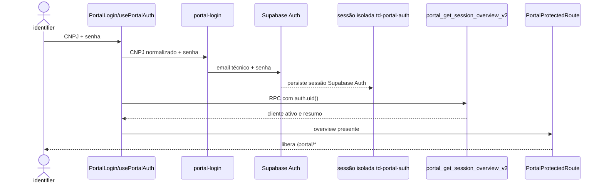

# Portal do Cliente

> **Rotas internas:** `/clientes/portal` (Provisionamento do Portal) e `/clientes/portal/inspecao/:customerId/*` (Modo Inspeção)

> **Status:** ativo · **Atualizado:** 2026-10-18 · **Rotas:** `/portal/login`, `/portal/esqueci-senha`, `/portal/recuperar-senha`, `/portal/ativar`, `/portal/confirmar-email`, `/portal`, `/portal/billing`, `/portal/operacao`, `/portal/desbloqueio-ce`, `/portal/informacoes`, `/portal/informacoes/:section`, `/portal/perfil`

## Propósito e escopo

O Portal é a superfície externa para autenticação, consulta financeira e operacional, consolidação de recebíveis, disputas de demurrage, notificações e atualização limitada de perfil. Não existe cadastro público nem sessão alternativa por token próprio: CNPJ e senha são os **dados visíveis de entrada**; a Edge Function `portal-login` resolve a identidade técnica no servidor e o Supabase Auth continua sendo o único **mecanismo de autenticação e sessão**.

São públicas as cinco rotas de login, recuperação, redefinição, ativação e confirmação de email (`/portal/login`, `/portal/esqueci-senha`, `/portal/recuperar-senha`, `/portal/ativar`, `/portal/confirmar-email`). As sete rotas do Portal autenticado — `/portal`, `/portal/billing`, `/portal/operacao`, `/portal/desbloqueio-ce` (regra em [Desbloqueio de CE](desbloqueio-ce.md)), `/portal/informacoes`, `/portal/informacoes/:section` e `/portal/perfil` — ficam sob `PortalProtectedRoute` › `PortalScopeProvider` › `PortalLayout` em `src/AppPortal.tsx`; qualquer outro caminho volta para `/portal`. O navegador usa `supabasePortal`, com `storageKey: 'td-portal-auth'` e `detectSessionInUrl:false`, separado da sessão interna (`src/services/supabase.ts`).

Este módulo também é dono do lado interno do Portal: o console **Provisionamento do Portal** (`/clientes/portal`), o painel **Revisão do Portal**, a ativação do convite e o Modo Inspeção. A ficha do Cliente ([Clientes](clientes.md)) mantém a seção **Acesso ao Portal** com o resumo e o atalho **Gerenciar aqui**, que abre o mesmo painel.

A interface e seus filtros não autorizam dados. RPCs de Portal resolvem o cliente pela identidade autenticada; RLS, grants e validações server-side continuam sendo a fronteira real, conforme [ADR 0004](../adr/0004-supabase-rls-rpc-fronteira-seguranca.md) e [ADR 0013](../adr/0013-portal-auth-identificador-resolvido-e-excecao-anon.md).

## Anatomia das telas

### `/portal/login`

`src/pages/PortalLogin.tsx` aceita CNPJ e senha. Se a sessão já foi hidratada, redireciona para `/portal`; durante submit chama `usePortalAuth.signIn`, que invoca `portal-login` e converte falhas em mensagem genérica de credenciais. Antes de chamar o servidor, a tela reprova CNPJ com menos de 14 caracteres (`isCompleteCnpjLogin`, `src/lib/portalCnpjLogin.ts`) com mensagem própria de digitação — o formato se confere offline, então avisar não revela nada sobre a base, e a tentativa não consome o rate limit de login.

Quando o ambiente tem a Site Key (`VITE_TURNSTILE_SITE_KEY`), a tela mostra o desafio do Cloudflare Turnstile (ação `portal_login`) e só envia depois dele; sem token, avisa "Complete a verificação de segurança antes de continuar.". O servidor confere o token antes de qualquer outra verificação e recusa com HTTP `403` o token ausente ou inválido; sem `TURNSTILE_SECRET_KEY`, só o stack local passa (**Código:** `supabase/functions/portal-login/index.ts`, `supabase/functions/_shared/turnstile.ts`). Configuração e ordem de publicação em [serviços externos](../operations/servicos-externos.md#cloudflare-turnstile). Toda recusa devolvida pelo `portal-login` — credencial, bloqueio, Turnstile — e a falha de rede nessa chamada chegam à tela como a mesma mensagem genérica, porque `signIn` descarta o status da resposta (ver [Notas e divergências](#notas-e-divergências)).

### `/portal/ativar`

`src/pages/PortalAtivacao.tsx` lê o `token` do link do convite, tira-o da barra de endereços e pede à Edge Function `portal-invite-activate` (`action: 'inspect'`) o nome da empresa e o CNPJ mascarado, que preserva os dois primeiros caracteres, a filial e os dígitos verificadores (ex.: `12.***.***/0001-90`). Abrir o link não consome o convite. **Ativar acesso** envia a senha (`action: 'activate'`); o convite só é consumido quando a ativação conclui. Concluída, a tela mostra **Acesso ativado** e o botão **Ir para o login**: não há entrada automática na sessão do Portal. Convite inválido, usado ou vencido mostra "Link inválido ou expirado. Solicite um novo convite à empresa." e explica que o convite vale 48 horas, é de uso único e que um reenvio invalida os anteriores. Convite pendente de Cliente desativado também recebe essa resposta genérica, na inspeção e na ativação: `portal-invite-activate` recusa a ativação em vez de cancelar os convites na desativação, porque a checagem no momento do uso cobre também o Cliente desativado com o link já aberto e não exige mexer em `portal_invites` (plano dos e-mails, item 4.7). O convite continua `pendente` no banco e vence no prazo normal.

### `/portal/esqueci-senha`

`src/pages/PortalForgotPassword.tsx` envia o CNPJ para a Edge Function
`portal-password-recovery`, com o mesmo desafio Turnstile do login (ação
`portal_recovery`); a recusa do desafio (HTTP `403`) mostra "A verificação de
segurança expirou ou não foi validada. Faça-a novamente.". A resposta é `{ accepted: true }` para todo caso
elegível (com conta ou sem, ativa ou não, email enviado ou não) e
`{ accepted: false, rate_limited: true }` apenas quando o rate limit por CNPJ
bloqueia; a tela mostra a mesma mensagem de sucesso nos dois primeiros casos e
uma mensagem de "tente mais tarde" só para o rate limit — não enumera conta
(achado 3.2 da auditoria `security-audit-portal-2026-08-12`).

A tela de confirmação **afirma** o envio ("Enviamos um link de redefinição para
o email cadastrado na conta"), sem a forma condicional "se houver uma conta para
este CNPJ": o condicional devolvia ao cliente o mesmo sinal de enumeração que o
backend deixou de dar. Dois casos ficam de fora dessa afirmação, e nenhum deles
depende de existir conta: CNPJ com menos de 14 caracteres é reprovado na tela,
sem chamar a Edge Function, e falha de rede/função mostra "não foi possível
concluir a solicitação agora" — prometer email numa requisição que não chegou ao
servidor faria o cliente esperar por uma mensagem que nunca sairia.

### `/portal/confirmar-email`

`src/pages/PortalConfirmarEmail.tsx` lê o token do link enviado ao endereço
novo e chama `portal-recovery-email-change` com `action: 'confirm'`. É rota
**pública**, como `/portal/ativar` e `/portal/recuperar-senha`.

A autorização da troca acontece no pedido, não aqui: `action: 'request'` exige
sessão ativa **e** a senha atual. O que a confirmação prova é posse da caixa
nova, e o token é essa prova — exigir sessão outra vez não acrescentava
barreira. Antes o link apontava para `/portal/perfil?confirm_email=`, rota
protegida: quem abrisse sem sessão era redirecionado ao login por
`PortalProtectedRoute`, que navega sem preservar a query string, e o token se
perdia em silêncio. Isso atingia justamente o leitor do Email de Recuperação,
em geral o contato financeiro, que não tem a senha do Portal.

O token sai da barra de endereços assim que lido (mesmo racional do achado
3.3). A página aceita `token` e também `confirm_email`, e `PortalProfile`
mantém o tratamento do parâmetro antigo: os convites já enviados para o caminho
anterior valem 48 horas, e os dois ramos podem sair depois que essa janela
expirar. Para o link antigo chegar até esse ramo sem sessão, o próprio
`PortalProtectedRoute` redireciona `/portal/perfil?confirm_email=` para a rota
pública preservando a query string — sem isso o guard continuaria descartando o
token. A publicação da Edge Function que passa a montar o link novo só pode
acontecer depois que a rota estiver servida em produção; antes disso a URL cai
no `path="*"` do `App`. Falha de rede na confirmação mostra mensagem própria de
"tente de novo", não "link inválido": `functions.invoke` devolve `{ error }`
tanto no 410 da função quanto no fetch que não saiu, e só o status decide.
Decisão registrada na
[ADR 0048](../adr/0048-confirmacao-de-email-do-portal-em-rota-publica.md).

Se uma confirmação de Email de Recuperação ocorrer durante o reset, recebe
HTTP `423`: o endereço continua inalterado e o link deve ser reaberto após a
conclusão. A página distingue esse estado de HTTP `409` (pedido já resolvido).

### `/portal/recuperar-senha`

`src/pages/PortalResetPassword.tsx` lê o `token` de convite de recuperação da
query string, remove-o da URL logo após ler (`setSearchParams(..., {replace:
true})`, mantido em estado para o submit) e envia `{ token, password }` à
Edge Function `portal-password-reset`, que autoriza e consome o token em
`portal_begin_password_reset` sob lock da conta, validando também o destinatário
contra o Email de Recuperação atual. A troca via Auth Admin e as revogações
encerram com `portal_finish_password_reset`. Durante o reset, a troca do email
é bloqueada; falha exige triagem conforme
[Segurança](../operations/seguranca.md#invariante-de-provisionamento-do-portal).

Concluída a recuperação, `portal-password-reset` envia ao Email de Recuperação
atual o aviso "Sua senha do Portal do Cliente foi alterada", que orienta a falar
com o suporte se a troca não foi da pessoa (`passwordChangedTemplate`; tentativa
`senha_alterada` em `portal_email_attempts`, migration `308`; chave
`senha_alterada:<convite de recuperação>`). A senha já mudou quando o aviso
sai: uma falha nele fica no log e na tentativa e não falha a recuperação. É o
único aviso de segurança por e-mail do Portal: suspensão e reativação da conta
**não** avisam o Cliente (D12 do
[plano dos e-mails](../archive/plans/2026-10-17-correcao-dos-emails.md)). O Portal não
tem outra tela de troca de senha.

### `/portal`

`src/pages/PortalDashboard.tsx` mostra quatro cartões `MetricCard` (lote 4 da identidade, 2026-10-18), em âmbar quando há algo em aberto: **Taxas Locais em aberto** (R$ e número de faturas), **Demurrage em aberto** (US$ das Invoices emitidas, com "R$ … hoje"), **Containers sem devolução** (com "N já em demurrage") e **Desbloqueio de CE em aberto** (solicitações em rascunho, enviadas, em análise ou com correção pedida, com quantas pedem correção; lê todas as páginas de `listPortalCeUnlockRequests`). Cada cartão só navega (sem `aria-pressed`) para Faturas, BLs e Containers ou Minhas solicitações (`/portal/desbloqueio-ce?aba=solicitacoes`) com aba e filtro na query string. Abaixo, o bloco **Programação de navios** (`ShipScheduleWidget`, projeção de `portal_ship_schedule`, com o serviço na faixa e a legenda no pé) e o bloco **Consultas**, com um botão para cada seção da Central de Informações. O Painel não tem bloco de alertas: as pendências do Portal são da equipe interna.

### `/portal/billing`

`src/pages/PortalBilling.tsx` orquestra as abas de Taxas Locais/Avulsas e Demurrage. As listas interativas usam `portal_list_invoices_page` e `portal_list_demurrage_invoices_page`, com filtros server-side de status, navio/viagem, B/L, POD e intervalo de emissão, contagem total, opções e páginas de 25 linhas. Os wrappers `portal_inspect_*_page` preservam o mesmo recorte no Modo Inspeção. As listas ficam em `PortalBillingTabs`; os detalhes ficam em `PortalInvoiceDetailModal` e `PortalDemurrageDetailModal`, com bloco PIX compartilhado. A aba local também exibe invoices `manual`, inclusive sem B/L, com item, descrição, contexto direto de viagem, PIX e impressão pelo navegador. **Só fatura emitida e liberada chega ao Portal** ([ADR 0088](../adr/0088-portal-so-mostra-fatura-emitida.md), migration `298`): rascunho não aparece na lista, no detalhe nem nas somas, e nenhuma tela do Portal mostra valor de Taxa Local ainda não faturada. O KPI de saldo pendente soma o saldo positivo das faturas visíveis em aberto (`issued`, `partially_paid` e o legado `overdue`, locais e `manual`), contando cada B/L uma vez: a consolidada aberta conta no lugar das individuais que ela agrupa, que continuam emitidas até a consolidada ser paga (decisão do dono de 2026-10-20, migration `344`; o Painel do Portal usa a mesma regra em `portalInvoicesInOpenBalance`), e as Invoices de Demurrage em aberto da lista do Portal (`issued` e o legado `overdue`, com a mesma trava de CE da lista); recebível sem fatura visível fica de fora. É diferente do Saldo pendente interno da ficha do Cliente ([Clientes § Saldo pendente](./clientes.md#saldo-pendente)). A descrição (`notes`) é pública somente para invoices `manual`; notas internas de faturas locais continuam fora da allowlist. A criação ou desfazimento de consolidadas permanece restrita às regras locais; desde a migration `298`, a consolidação do Portal só lista e só aceita B/L com fatura visível não cancelada, e a seleção com outro B/L é recusada ("Seleção contém B/L que não pode entrar na consolidada. Atualize a lista."). Paga a consolidada, ela continua na lista e no detalhe com B/Ls, pagamento e recibo; as individuais que ela quitou ficam no filtro "Pagas" como **Coberta**, com saldo zero, sem recibo próprio e com o número e o link da consolidada (decisão do dono de 2026-10-08, migration `162`). A aba demurrage mostra detalhe, PIX e disputas. **Tabela limpa (lote 1 da identidade, 2026-10-14):** Taxas Locais em Fatura, B/L, Emissão, Navio / Viagem, Total, Saldo (âmbar quando maior que zero) e Situação (Paga com ✓, consolidada com o ícone de pilha); Demurrage em Fatura, B/L, Emissão, Navio / Viagem, Total US$, Total R$ (âmbar enquanto há valor a pagar) e Situação (Em disputa em âmbar, Paga com ✓; o estado legado `overdue` aparece como Emitida, porque Demurrage não vence, B29). O número da fatura abre o detalhe; o POD fica no filtro e no detalhe; os filtros ficam abertos. No detalhe de Demurrage, cada período do contêiner é uma linha "dias × diária" e o valor fica na coluna US$.

**Detalhe da fatura de Taxas Locais (lote 4, 2026-10-18).** O bloco Pagamento vem primeiro, com tipo, emissão e situação na faixa e o dado principal pela situação: "R$ X a pagar" em âmbar ("de R$ Y" na parcial), "✓ Paga" com "R$ X recebidos em dd/mm/aaaa", **Coberta** com "Abrir INV-…" da consolidada e **Cancelada** em cinza. O Pix fica numa faixa baixa ao lado do valor (`PortalPixPaymentBlock`: QR pequeno, "Pague com Pix", código numa linha e "Copiar código Pix"; na parcial, o QR cobra o saldo). Fatura de um B/L só mostra B/L, Navio / Viagem, Trecho e Recebido como fatos, sem tabela de B/Ls; a consolidada tem a tabela B/Ls, a coluna B/L em itens e contêineres e "Refazer consolidada" no topo; a avulsa leva a descrição como fato do Pagamento. "Pagamentos recebidos" (quando há pagamento) lista Recebido em (com a hora só quando o registro tem hora: 00:00 e 12:00:00 em Brasília contam como sem hora, porque a baixa manual grava meio-dia), Forma de pagamento e Valor, com o total pago na faixa; os itens têm "Total da fatura" no pé. "Imprimir fatura" e, na paga, "Imprimir recibo".

**Gerar fatura consolidada (lote 4).** Filtros B/L e Navio / Viagem (`Combobox` com as viagens das linhas); bloco "B/Ls que podem entrar" (seleção, marcar todos; B/L, Navio / Viagem, Fatura de hoje, Saldo) e bloco fechado "Com saldo, mas não podem entrar", com o motivo do banco; B/L pago não aparece. A seleção vale mesmo com a linha escondida pelo filtro, e o pé diz "N B/Ls · R$ X". Falha da consulta aparece como erro na janela.

**Demurrage (lote 4).** A faixa do bloco "Faturas de Demurrage" traz o total em aberto, o ROE de hoje e o botão **Disputas · N aberta(s)**, que abre a tela "Disputas de Demurrage" dentro de Faturas (`?tab=demurrage&disputas=1`; a conversa em `&disputa=<id>`): bloco "Em aberto" (Fatura, B/L, Aberta em, Última mensagem, Aguarda) e bloco fechado "Encerradas"; a conversa tem "Abrir DEM-…", "Voltar às disputas" e "Anexar arquivo" por botão. A Invoice complementar ganha a marca ⊕ (`ComplementMark`) na lista e no título do detalhe, pela mesma regra de `earlierLiveInvoices` (Invoice anterior viva do mesmo B/L), calculada no navegador sobre a lista inteira do Cliente em ordem de `doc_date` e id, porque a lista do Portal não traz `created_at`. No detalhe: Pagamento com "R$ X a pagar hoje", Total em dólar, ROE de hoje, B/L e Trecho; bloco "Invoice complementar" com "Abrir DEM-…"; bloco "Disputa" com "Ver conversa"; na paga, "✓ Paga" com "R$ X em dd/mm/aaaa · US$ × ROE" e o bloco "Restituições" (de `refund_summary`, migration `298`); "Abrir disputa" como botão enquanto a fatura não está paga, cancelada ou em disputa. "Imprimir Invoice" nas abertas e "Imprimir recibo" na paga, com o aviso de complementar (`complement_of`) e as restituições no documento. **Código:** `src/pages/PortalBilling.tsx`, `src/components/portal/PortalBillingTabs.tsx`, `src/components/portal/PortalPixPaymentBlock.tsx`, `src/components/portal/PortalInvoiceDetailModal.tsx`, `src/components/portal/PortalConsolidatedModal.tsx`, `src/components/portal/PortalDemurrageDetailModal.tsx`, `src/components/portal/PortalDisputeConversation.tsx`, `src/hooks/usePortalBilling.ts`, `src/services/portalBilling.ts`; **SQL:** migrations `021_portal_billing_pages.sql`, `097_fatura_avulsa.sql`, `105_portal_manual_invoice_pending_balance.sql`, `162_portal_consolidada_paga_e_coberta.sql` e `225_saldo_pendente_portal_unico.sql` (a soma do saldo vira `_portal_customer_pending_balance`, usada pela sessão do Cliente e pelo Modo Inspeção; sem a consolidada em dobro desde a `344`); escopo de `notes` na `098`. **Teste:** `portalConsolidadaPaga.local-pg.test.ts`, `portalInspectionParity.local-pg.test.ts` (fatura emitida e visível, migration `298`), `PortalInvoiceDetailModal.test.tsx`, `PortalConsolidatedModal.confirmation.test.tsx`, `PortalDemurrageDetailModal.test.tsx`, `PortalDisputeConversation.test.tsx`, `portalDemurrageComplement.test.ts`.

### `/portal/operacao`

`src/pages/PortalOperacao.tsx` alterna B/Ls e Containers (`TabList`), com os atalhos "Depósitos de devolução", "Tracking do B/L" e "Solicitar desbloqueio de CE" uma vez só no título. Cada aba abre com cartões que filtram (`MetricCard`) contando o recorte dos demais filtros: B/Ls, Com container sem devolução, Com container em demurrage e Tudo devolvido; Containers, Sem devolução no free time (situação `no_free_time` do filtro de devolução), Em demurrage e Devolvidos. A tabela de B/Ls tem B/L e CE Mercante (copiar), Navio / Viagem, Trecho, Carga, **Taxas locais** e **Pagamento** (de `local_charges`, migration `298`: total e saldo em aberto em âmbar, "✓ Pago", "Aguardando fatura" sem valor quando o B/L ainda não tem fatura visível, "—" sem cobrança), Devolução e Demurrage; a linha aberta mostra os contêineres numa tabela interna e o bloco persistente `Informações de Transbordo`, alimentado pelo registro global vigente da omissão (a disposição COD não publica o motivo interno, navio ou datas do desvio). A aba Containers (derivada por `flattenContainers`) tem Container, Tipo, B/L, POD, Descarga, Devolução, Dias de uso, Free time, Dias em demurrage e Situação ("Em demurrage" em vermelho, "No free time · N dias" em âmbar); CE, Navio, Viagem e POL ficam só na planilha. A planilha de B/Ls ganha Taxas locais e Pagamento com a mesma regra. No celular, cartões sem os botões repetidos. `tab` e o filtro inicial `devolucao` podem vir da URL.

### `/portal/perfil`

`src/pages/PortalProfile.tsx` carrega email de contato, telefone e endereço via RPC, mantém os campos em estado local e salva somente o conjunto permitido. Desde o lote 4 da identidade (2026-10-18), a página tem três blocos com um botão principal cada: **Quem recebe os comunicados** (um sub-bloco por contato, com "contato principal" no título, caixas de recebimento em linha, "Desativar contato"/"Reativar contato"/"Tornar principal" como botões e a faixa "Salvar contatos" no pé, apagada até haver alteração), **Endereço da empresa** ("Salvar endereço" no pé, apagado até haver alteração) e **E-mail de recuperação** (o e-mail atual como dado, Senha atual sem texto de exemplo, Novo e-mail, Confirmar novo e-mail e "Trocar e-mail de recuperação"). O e-mail atual vem de `portal_get_profile` só na sessão do Cliente (migration `300`); a Inspeção não o recebe, porque no Vela esse dado é restrito a alguns perfis, e o bloco começa pela senha. O E-mail de recuperação recebe só convites e links de redefinição. Os erros ficam próximos aos campos; no Modo Inspeção os campos ficam desativados e um aviso explica o motivo. No Portal, o contato principal sem vínculos começa com as três caixas marcadas; vínculos ausentes sem outro destinatário elegível são repostos no rascunho, enquanto delegações já salvas com cobertura são preservadas. Só é possível desmarcar uma caixa do principal quando outro contato ativo, com e-mail e sem bloqueio de entrega, cobre aquela caixa. A gravação continua dependendo de Salvar contatos; o Modo Inspeção exibe os vínculos armazenados sem normalizar o rascunho. `NotificationBell`, em `PortalLayout`, fica disponível em todas as rotas protegidas: painel não modal com Escape devolvendo o foco ao sino, estado de erro com Tentar novamente e não lida indicada também em texto. O `PortalLayout` é uma barra única de 56 px com marca, navegação, sino, Cliente e Sair; o atalho de perfil por ícone saiu porque repetia o item Perfil, e no Modo Inspeção o Sair do shell não aparece porque a faixa do wrapper já oferece a saída.

### Provisionamento operacional

#### Console `/clientes/portal`

A página **Provisionamento do Portal** (Clientes › Provisionamento do Portal),
aberta pelo cabeçalho de Clientes, é a fila de análise, convites e situações do
Portal. Desde o lote 5a da identidade, seis cartões filtram a fila
(Aguardando análise, o inicial; Sem e-mail; Ativação pendente; Convite
expirado; Falha de envio; Contas ativas), cada um com a contagem; clicar no
cartão marcado mostra todos. Há busca por razão social ou CNPJ e o filtro
**Alerta** (`?alerta=critico`; o antigo `?filtro=criticas` cai nele). A tabela
mostra Cliente, CNPJ, Conta, E-mail de recuperação (só o gravado), Alerta
(**Crítico** só com alerta crítico ativo, migration `324`), Ação (o próximo
passo, que abre a linha) e **Espiadinha** (o ícone de olho abre o Modo
Inspeção em nova aba). A ordem segue a prioridade: alerta crítico, fatura
aberta, processo ativo e atividade recente. Clicar na linha expande, na própria
tabela, o painel **Revisão do Portal**; o filtro e o Cliente aberto ficam na URL
(`?filtro=`, `?cliente={id}`), e um Cliente fora do filtro atual aparece com o
botão **Voltar para a fila**. O cabeçalho tem **Informações do Portal** (leva a
`/clientes/informacoes`) e **Exportar** (exporta as linhas do filtro e da
busca atuais). As ações estão no [catálogo](#provisionamento-e-ativação-do-convite).

O painel tem os blocos **Conta do Portal** (situação, decisão, e-mail atual,
origem, entrega e saúde do e-mail), a Liberação de faturamento sem Portal,
**E-mail de recuperação e convite** (os contatos candidatos como escolha, com
finalidade e origem, e **Outro e-mail**; escolher não grava nada) e
**Histórico** em tabela (o que aconteceu e quem fez; a reparação automática da
fila aparece como "Entrou na fila do Portal", por **Sistema**). **Ações
administrativas** abre uma janela com as ações que valem para a conta
(alterar CNPJ, suspender, reativar, liberar endereço, reabrir análise,
revogar convite); o aviso "Este email também
aparece em N outro(s) CNPJ(s). A análise manual continua obrigatória."; os
botões de convite e troca; **Ações administrativas**; o cartão da Liberação de
faturamento sem Portal; o **Histórico** (até 10 eventos); **Ver como o cliente
vê** ou **Ver o que o cliente veria** (Modo Inspeção, em nova aba quando aberto
pelo console) e **Abrir ficha completa →**. A seção **Acesso ao Portal** da
ficha abre o mesmo painel por **Gerenciar aqui**.

A leitura usa `portal_list_provisioning_console` (definição vigente na
migration `103`; o read model nasceu nas migrations arquivadas `196`–`198`).
Antes de projetar a fila, a RPC chama `portal_repair_missing_accounts()`, que
cria de forma idempotente a linha inicial de Clientes sem
`customer_portal_accounts` e grava evento de sistema. Todos os perfis
internos, inclusive Operações, recebem os dados completos (Email de
Recuperação, origem, status de entrega e candidatos; ADR 0045 e
[ADR 0083](../adr/0083-decisoes-da-revisao-geral-da-documentacao.md), item 18;
migration `250`); para Operações o painel mostra esses dados sem ações.
Somente Administrativo e Documentação executam ações; **Alterar CNPJ auditado**
e a Liberação de faturamento sem Portal são só do Administrativo
([matriz de permissões](../operations/seguranca.md#clientes-comunicação-e-portal)).
O Histórico (`portal_list_provisioning_events`, de 1 a 50 eventos) é de todos os
Departamentos ([ADR 0085](../adr/0085-modelo-de-permissoes-por-perfil.md), item
D12; migration `250`).

O registro interno de Portal possui dois eixos independentes: `provisioning_decision`
(`aguardando_analise` ou `aprovado_para_provisionar`) e `account_situation` (`sem_conta`, convite,
falha, `ativo` ou `suspenso`). `recovery_email` é um contato operacional separado
da identidade técnica do Supabase Auth e pode ser compartilhado entre CNPJs após
análise humana. Na tela, a decisão aparece como **Aguardando análise** ou
**Provisionamento autorizado**, e a situação como Sem conta, Ativação pendente,
Convite expirado, Falha no envio, Ativa ou Suspensa. Enviar o convite muda a
decisão para Provisionamento autorizado, mas não conclui o provisionamento: ele só termina quando a conta
fica Ativa, depois de a pessoa autorizada definir a senha. Ativação pendente,
Convite expirado ou Falha no envio coexistem com Provisionamento autorizado, e
**Reabrir análise** devolve a decisão a Aguardando análise sem mudar a situação
da conta. Um Cliente tem no máximo um registro de Portal e, portanto, no máximo
uma conta ativa.

**B/L novo não reabre a análise** (decisões do dono de 2026-10-20 e
2026-10-21, migration `343`). A entrada de um B/L para o Cliente, novo ou por
troca de cliente, não é fato novo para o que trava o provisionamento: a
decisão e a situação da conta ficam como estão, Ativa ou não. O gatilho
`trg_portal_reopen_on_new_process`, que devolvia a decisão a Aguardando
análise a cada B/L, saiu. A análise só volta a Aguardando análise pelo
**Reabrir análise** do Administrativo; com a conta Ativa, a ficha diz
"Análise reaberta; a conta continua ativa até nova decisão" em vez de mostrar
os dois status sem explicação (`provisioningDecisionDetail`). A `343` também
desfez as reaberturas que o gatilho antigo tinha feito.

A decisão tem só esses dois valores. A exceção "Provisionamento não necessário
no momento" foi retirada pelo Bloco #521 (agosto de 2026, migration arquivada
`325`); `portal_set_exception` continua no catálogo apenas como função que
recusa ("A decisão de provisionamento não necessário foi removida; use
Aguardando análise."), sem grant a `authenticated`.

A saúde do Email de Recuperação é um **terceiro eixo**, em coluna própria
(`recovery_email_status`, migration arquivada `299`): `ok`, `bounce_permanente` ou
`complaint`. Ela não rebaixa `account_situation` porque os dois fatos são
independentes — a conta continua `ativo` e o cliente continua entrando com a
senha; o que quebrou é o endereço para onde a recuperação seria enviada. O
webhook marca o sinal em bounce permanente ou complaint, o console mostra o
aviso junto do Cliente e a fila passa a pedir "Validar Email de Recuperação" em
vez de "Conta ativa". `account_situation` só é rebaixado para `falha_no_envio`
quando a conta ainda está em `convite_pendente`, como antes.

`portal_release_suppressed_email(customer_id, email, justificativa)` (migration
arquivada `302`; definição vigente no dump `002`) é a **saída** da lista de bloqueio: restrita a Administrativo e
Documentação, exige justificativa não vazia, remove o endereço de
`portal_suppressed_emails`, zera o sinal das contas que o usavam e grava quem
liberou e por quê em `portal_provisioning_events`. Sem ela, o operador que
quisesse resgatar um endereço bloqueado por engano só podia cadastrar um
endereço **diferente** — gravar um dado errado para contornar um sinalizador
errado. O bloqueio expirar sozinho após N dias foi descartado: o sistema não
tem como saber que a caixa voltou, só chutar um prazo e voltar a enviar para o
vazio; quem sabe é o operador, porque o cliente ligou.

O bloqueio é único **por endereço** e a permissão é **por Cliente**, e a RPC
amarra os dois: o endereço informado tem de ser o `recovery_email` (ou o
`pending_recovery_email`) daquele Cliente, senão a chamada é recusada — sem
isso, poder operar um Cliente qualquer valeria como poder desbloquear qualquer
endereço do sistema, com o rastro gravado no histórico de quem não pediu nada.
Quando a caixa é compartilhada entre CNPJs (o console conta isso em
`shared_email_count`), a liberação alcança todos por construção, e **cada
Cliente afetado recebe a linha no próprio histórico** — para ele o endereço
mudou de estado sem que ninguém o tivesse mencionado. "Afetado" cobre as duas
colunas, como na guarda de propriedade: quem tem o endereço só em
`pending_recovery_email` é justamente quem o bloqueio impedia de concluir a
confirmação.

`credentials_revoked_at` (migration arquivada `301`) guarda o instante da última
revogação de credencial, gravado por `portal_revoke_sessions`.
`current_portal_customer_id()` — o ponto único onde toda leitura do Portal
resolve o cliente — recusa token cujo `iat` seja anterior a esse marco, com
corte estrito e sem tolerância temporal. Sem isso, apagar `auth.sessions`
tirava o direito de **renovar** o token, mas não invalidava o access token já
emitido, e a sessão antiga sobrevivia à troca de senha ou de email pelo TTL do
JWT (1 hora). Se `iat` estiver ausente ou malformado durante uma revogação
ativa, o guard nega fechado com a mesma mensagem genérica. A migration
`069` remove a antiga folga de cinco segundos, que permitia a um JWT
emitido concorrentemente com a senha antiga sobreviver ao reset.

`portal_invites` armazena somente hash de token; `portal_email_attempts`,
`portal_email_events` e `portal_suppressed_emails` registram entrega e supressão;
`portal_provisioning_events` é histórico append-only. As transições passam pelo
envio do convite (`portal-invite-send`), pela ativação (`portal-invite-activate`),
por `portal_cancel_invite`, `portal_return_to_analysis`, pela suspensão e
reativação (`portal-account-suspend`) e pelo job `portal_mark_expired_invites`.
A leitura do serviço também converte convite vencido em `convite_expirado`
quando o job periódico está atrasado.

Na fila de provisionamento, `Aceito pelo provedor` exige `provider_message_id`.
Uma tentativa com status `aceito` mas sem esse identificador aparece como
`Não confirmado`: indica interrupção antes da chamada ou aceite sem identificador
do provedor, e não prova que a mensagem saiu. Sem `RESEND_API_KEY`, a tentativa
fica como falha permanente e o convite não é apresentado como enviado. A
confirmação na interface significa que o provedor aceitou a mensagem; a entrega
à caixa do destinatário depende dos eventos posteriores do provedor de e-mail.

`portal_repair_missing_accounts()` (migration arquivada `198`; definição vigente
no dump `002`) é uma função interna: cria apenas a linha inicial da fila para
Clientes sem registro, sem Auth, convite, Email de Recuperação ou email
transacional. A função não possui execução direta para `PUBLIC`, `anon` ou
`authenticated`; o read model protegido a chama antes de retornar a fila.

Ao inserir qualquer Cliente em `public.customers`, o trigger
`trg_portal_create_account_on_customer_insert` (migration arquivada `193`;
definição vigente no dump `002`) cria automaticamente seu registro em
`customer_portal_accounts` com
`active=false`, `provisioning_decision='aguardando_analise'`,
`account_situation='sem_conta'` e `login_cnpj` normalizado. A operação é
idempotente e registra evento de sistema. Isso coloca o Cliente na fila administrativa imediatamente;
não cria usuário Auth, senha, convite, email de recuperação ou email transacional.
Processo/B/L pode alterar prioridade e pendências operacionais, mas não é
pré-requisito para a existência da linha na fila. Nenhum convite sai
automaticamente nem em lote: Documentação ou Administrativo revisa o Cliente,
escolhe ou informa o Email de Recuperação e envia o convite individualmente.

Autorização das RPCs de provisionamento (migration arquivada `192`): o EXECUTE default do
`PUBLIC` foi revogado e as guardas passaram a ser NULL-safe
(`v_role IS DISTINCT FROM 'administrativo'` / `v_role IS NULL OR v_role NOT IN (...)`).
Antes, `REVOKE ... FROM anon` deixava o EXECUTE do `PUBLIC` e a comparação com
role NULL falhava em aberto, permitindo que `anon` ou um cliente do Portal
(também role `authenticated`) alcançasse `portal_admin_change_cnpj` e afins. O
teste de isolamento por CNPJ contra produção confirmou negação em todas as
camadas após a correção.

**Estado operacional (produção, 2026-07-14):** backfill inicial executado uma
única vez — 309 registros de Portal em `aguardando_analise`/`sem_conta`, sem
escolher email, criar conta ou identidade Auth nem disparar mensagem, com
evento de auditoria por cliente. Desde então o registro
nasce pelo trigger de inserção do Cliente e é reparado na leitura do console; o
backfill e o pré-voo não fazem parte da operação vigente. A Edge Function
legada `provision-portal-user` (senha definida pelo operador) foi aposentada; o
fluxo vigente é convite de uso único.

No recorte RBAC do provisionamento, `administrativo` mantém todas as ações,
`documentacao` pode operar Clientes e Portal, `financeiro` e `equipamentos`
consultam e `operacoes` não recebe ações de Portal. As telas
`ClienteFicha`, `Clientes` e `Revisao` usam `can()` para esse recorte; as demais
ocorrências legadas de `isAdmin` pertencem à auditoria RBAC global futura.

#### Alertas internos do Portal

As pendências do Portal aparecem para a equipe interna no console, na central
`/alertas` e no sino de Notificação Interna, nunca para o Cliente. Pelo catálogo
de alertas, todas têm Documentação como responsável: `portal_pendencia_geral`,
`portal_convite_expirado`, `portal_falha_envio`, `portal_email_suprimido`,
`portal_reprocessamento_falhou` e `portal_abuso_login` avisam só Documentação
(o `portal_reprocessamento_falhou` de um evento do provedor de e-mail em
investigação não tem B/L nem Cliente e abre os Alertas);
`portal_excecao_critica_fatura` e `review_portal_not_ready` avisam também o
Administrativo. Operações não recebe pendências do Portal, e o Financeiro
consulta no sistema sem estar na audiência.

- **Processo ativo:** o Cliente tem processo ativo enquanto tiver B/L não
  cancelado e ainda não pago (a faturar ou faturado) ou Invoice de Demurrage
  emitida ou vencida (`customer_has_active_portal_process`, migration `350`;
  o B/L cancelado, que o cancelamento marca em `cancelled_at` sem mudar
  `financial_status`, deixou de contar na migration `347`).
  Cliente só com B/Ls pagos e sem Demurrage em aberto não gera alerta do
  Portal; um B/L novo dele volta a gerar (decisão do Lucca, 2026-10-21). A
  coluna "Processo ativo" do console usa a mesma regra. Os quatro alertas
  abaixo (pendência geral, convite expirado, falha no envio, e-mail suprimido)
  abrem e fecham na hora em que a conta, o e-mail de recuperação, a lista de
  bloqueio, os B/Ls ou as Invoices de Demurrage do Cliente mudam; a rodada de
  15 minutos do detector confere de novo. Os produtores diretos (a falha do
  convite gravada pela Edge `portal-invite-send` e o bounce processado por
  `process_portal_email_event`) também passam pelo mesmo reconciliador, então
  não abrem alerta para Cliente sem processo ativo.
- **Pendência geral de prontidão:** Cliente com processo ativo cujo Portal não
  está pronto — conta ativa com usuário técnico e
  Email de Recuperação válido, sem bounce/complaint e fora da lista de
  bloqueio. Independe do estado de qualquer fatura. O reconciliador
  (`reconcile_client_portal_alerts_for_customer`, por gatilho, e
  `reconcile_client_portal_alerts`, no detector e após a ativação) abre e
  fecha a pendência; ela se encerra quando o Portal fica pronto ou o Cliente
  deixa de ter processo ativo. O job `portal-refresh-general-pendencies`, que
  abria em paralelo um alerta antigo sem item (Sem setor) para o mesmo Cliente,
  saiu na migration `321`, que também fechou esses alertas antigos.
  Desde a migration `324`, a mensagem diz o que falta: "Sem conta no Portal e
  sem e-mail de recuperação.", "Conta do Portal ainda não ativa.", "Conta do
  Portal suspensa.", "Conta ativa sem usuário de acesso ao Portal." ou "Conta
  ativa sem e-mail de recuperação utilizável.".
- **Convite expirado:** prazo de 48 horas vencido sem ativação; o alerta vai à
  Documentação, com processo ativo, e o novo envio é manual (**Reenviar
  convite**). O job `portal-mark-expired-invites` só muda a situação da conta;
  desde a migration `350` o alerta abre pelo gatilho da conta, sem a linha
  antiga em `alerts`.
- **Falha no envio:** após três tentativas transitórias sem sucesso, ou falha
  permanente, a situação vira Falha no envio, abre `portal_falha_envio` e exige
  **Revisar email e reenviar**.
- **Email suprimido:** bounce permanente ou complaint põe o endereço na lista
  de bloqueio; ele não recebe novos envios até a equipe informar outro
  endereço ou liberar o atual, o histórico é preservado e todos os Clientes que
  usam aquele Email de Recuperação recebem o alerta.
- **Abuso de login:** tentativa bloqueada pelo rate limit abre
  `portal_abuso_login` para o Cliente do CNPJ, quando existe conta.

O resumo diário (`portal-daily-digest`, 08:00 de Brasília) é um e-mail
**interno**, de acompanhamento do provisionamento: não vai a Clientes. Vai aos
usuários ativos de Administrativo e Documentação (papéis `administrativo` e
`documentacao`; o `admin` não existe desde a migration `093`) quando houve, nas últimas 24
horas, falha ou supressão de email, atividade de provisionamento, abertura ou
fechamento de exceção crítica de fatura (`portal_excecao_critica_fatura`), ou
quando há Ativação pendente; sem nada disso, não sai. Não há email imediato de
alerta crítico: a exceção crítica chega pelo resumo, pelo sino e por `/alertas`
([ADR 0083](../adr/0083-decisoes-da-revisao-geral-da-documentacao.md), item 19).

Desde o lote 6b (2026-10-20), o resumo leva a marca Vela, o título "Resumo do
Portal de DD/MM/AAAA" (assunto "Resumo do Portal — DD/MM/AAAA"), um bloco
**Pede ação** (falhas de entrega e supressões, exceções críticas de fatura
abertas, convites aguardando ativação; o número fica em âmbar quando passa de
zero) e um bloco **Para acompanhar** (exceções críticas fechadas, atividade de
provisionamento), sem botão (`_shared/dailyDigestEmail.ts`).

#### Modelos dos e-mails

Todos os e-mails (acesso ao Portal, avisos, Comunicados, Cobrança de Demurrage
e o resumo diário) saem da base única `src/services/emailLayout.ts` (lote 6b):
topo azul da logo (`#0d2b5e`) com a logo branca da Fwlog buscada na origem do
site, título e botão centralizados, blocos com título em faixa, nada abaixo de
12px e códigos (CE, CNPJ, e-mail mascarado) em monoespaçada; a versão em texto
puro acompanha o conteúdo. Os modelos do acesso ficam em
`supabase/functions/_shared/portalEmailTemplates.ts`; os dos Comunicados e da
Cobrança, em `src/services/customerCommunicationTemplates.ts`.

- Convite, novo convite e recuperação começam pelo bloco **Acesso para** (nome
  da empresa e CNPJ mascarado); a recuperação termina com "Se você não fez este
  pedido, ignore esta mensagem: nada muda na sua conta.". Rodapé padrão:
  "Portal do Cliente · Fwlog. Dúvidas ou não reconhece esta mensagem? Fale com
  `PORTAL_SUPPORT_EMAIL`."
- Confirmação do novo Email de Recuperação, aviso do pedido de troca ("Pedido de
  troca do Email de Recuperação"), troca assistida e senha alterada levam o
  rodapé de segurança ("Não foi você? Fale com … imediatamente."), e o corpo não
  repete o pedido de falar com o suporte.
- Falha de entrega ("Um comunicado não foi entregue"): o endereço mascarado, o
  motivo (o servidor do destinatário recusou) e o botão **Abrir Meu perfil**
  (`/portal/perfil`).
- Comunicados e Cobrança de Demurrage: ver [Clientes](clientes.md#régua-automática-de-comunicados)
  e [Demurrage](demurrage.md); o rodapé da Cobrança leva `eqp@fwlog.com.br`.

Se alguma consulta do resumo falha, a rodada responde 500 e não envia um
resumo com contagens zeradas. A resposta traz `{ sent, failed, suppressed }`
reais por destinatário (`_shared/portalDailyDigest.ts`); `failed > 0` deixa o
heartbeat do Better Stack vermelho. A chave idempotente de cada envio é
`resumo:<data>:<hash do destinatário>`, sem o e-mail em claro.

#### Gate de faturamento e Dispute

O Bloco #521 (migration arquivada `325`) consolidou a pendência do Portal por
Cliente e o bloqueio final de emissão por B/L (`portal_billing_gate`): a invoice só pode ficar issued quando a conta está
ativa, o acesso Auth está presente e o e-mail de recuperação é válido,
entregável e não suprimido, ou quando o Administrativo concedeu a Liberação de
faturamento sem Portal para o Cliente (ADR 0070, migration 083). O gate vale
também para a emissão automática pelo CE, que retém a fatura sem Portal. A
ativação e a concessão da Liberação chamam o mesmo reprocessamento idempotente
dos B/Ls com reconciliação matched_document ou reconciled, pelo caminho da
transição do CE, reaproveitando o cálculo feito no registro do CE (migration
085); bloqueios funcionais e falhas técnicas permanecem projetados no B/L. A
Liberação não depende de contato com e-mail: sem Portal, a fatura é entregue
por um usuário interno. A Liberação aparece no painel do Cliente no Console do Portal.
A regra que atravessa módulos está em
[Regras de negócio](../operations/regras-de-negocio.md#gate-de-faturamento).

Disputes de Demurrage são conversas append-only em demurrage_disputes e
demurrage_dispute_messages, com anexos privados por mensagem em Storage, RLS e
próximo responsável (cliente, equipamentos ou ninguem). O Portal pode responder
e solicitar reabertura; do lado interno, Equipamentos é o dono do caso e o
Administrativo responde e reabre como cobertura (migration 081), com a mensagem
gravando quem respondeu (`author_type` `equipamentos` ou `administrativo`). As rotas
/portal/billing e /demurrage projetam a mesma conversa e a pendência interna só
é mantida quando a próxima ação é de Equipamentos. **Código:** migration arquivada
`325` (redefinições vigentes no dump `002` e nas migrations `081` e `109`) e
os componentes PortalDisputeConversation e DemurrageDisputeConversation.
**Teste de contrato SQL histórico:** `src/services/__tests__/block521Migration.test.ts`
lê a migration arquivada `325`.

#### Email transacional

`_shared/portalEmail.ts` registra cada tentativa por chave idempotente, não
envia para endereços suprimidos e repete somente respostas transitórias do
provedor (máximo de três tentativas). A chave enviada ao provedor é a chave
local seguida de um hash do conteúdo: a API (MillionSend, compatível com a
Resend) guarda chaves por 24h e recusa com 409 a mesma chave com outro
conteúdo, o que acontecia quando ids sequenciais se repetiam após um reset do
banco. A falha grava o motivo do provedor em
`last_error` (ex.: `HTTP 409 invalid_idempotent_request`).
`portal-email-webhook` valida assinatura Svix, janela de cinco minutos e
deduplicação por evento: grava o evento numa inbox durável
(`portal_email_events`, chave do evento do provedor) e responde; uma repetição
já processada é no-op e uma ainda pendente continua na fila, sem duplicar
efeitos de entrega, bounce ou complaint. Receber o webhook não significa que o
histórico já foi atualizado: `portal-email-events-runner` (job a cada minuto,
migration `107`) aplica os eventos às tentativas. `portal-daily-digest`
consolida atividade às 08:00 de Brasília. As variáveis
`RESEND_API_KEY`, `PORTAL_FROM_EMAIL`, `PORTAL_REPLY_TO` e
`RESEND_WEBHOOK_SECRET` ficam apenas nas Edge Functions; sem a chave do provedor
a tentativa é gravada como `falha_permanente` e nenhum email é enviado.
Remetente, endereço de resposta e domínio verificado estão em
[serviços externos](../operations/servicos-externos.md#millionsend-envio).

Conteúdo das mensagens (`supabase/functions/_shared/portalEmailTemplates.ts`):
cada uma tem versão HTML e texto puro equivalente, com a marca Fwlog, e
nenhuma leva senha ou dado financeiro. O conteúdo não inclui pixel de abertura
nem link de rastreamento de clique; no provedor atual
(MillionSend), o rastreamento de cliques e de aberturas de `portalfwlog.com.br`
aparecia desligado na configuração do domínio em 2026-10-14 (print do painel). O token opaco fica só no link e não é reproduzido em logs nem em
auditoria.

- **Convite:** identifica a empresa e o CNPJ mascarado, informa a validade de
  48 horas e o uso único, e orienta a criar a própria senha ou, se o
  destinatário não for a pessoa autorizada, ignorar o email e avisar a Fwlog.
- **Reenvio:** traz um novo link, avisa que os anteriores deixaram de
  funcionar e reinicia a validade de 48 horas, sem expor motivo interno,
  operador ou histórico de tentativas.
- **Recuperação de senha:** link de uso único válido por 1 hora, com empresa e
  CNPJ mascarado; concluir a troca encerra as sessões anteriores.
- **Troca do Email de Recuperação:** o endereço novo recebe o link de
  confirmação (uso único, 48 horas) e o anterior recebe um aviso; na troca
  assistida, o aviso ao anterior diz que ele deixou de valer.

A troca assistida do Email de Recuperação (Vela, `/clientes/portal`) passa por
`portal-recovery-email-change` com `action: 'assisted'`: a RPC
`portal_assisted_email_change` aplica a troca com o JWT do operador e, em
seguida, o endereço anterior recebe um aviso de que deixou de valer. Falha nesse
aviso não desfaz a troca; a tela informa o operador.

#### Inspeção do Portal

`/clientes/portal/inspecao/:customerId/*` é uma visão interna somente leitura
do Portal de um Cliente. O acesso usa `is_active_read_user()` e registra a
abertura em `portal_inspection_events`; não usa login como cliente nem altera a
sessão de Portal. O botão é compartilhado por `PortalReviewPanel` no console
de provisionamento e na Ficha do Cliente. A abertura é auditada uma vez pela
ferramenta, não a cada chamada de leitura. O console também é aberto por
Equipamentos, que consulta a fila e o histórico.

O `PortalLayout` é o mesmo no Portal real e na inspeção. Um `PortalScope` injeta
modo, `customerId`, overview e `basePath`; nav, cards, abas e links do sino usam
esse base path. A faixa de Modo Inspeção identifica Cliente, CNPJ e situação de
conta não ativa.

B/L cancelado depois de liberado continua listado em BLs e Containers, com o selo **Cancelado** (`cancelled_at` vindo de `_portal_list_operation_bls_core`, migration `089`; ADR 0071).

##### Ações do Modo Inspeção

| Tela / ação | Pré-condições | Origem | Orquestração | Persistência | Efeitos e cache | Falhas | Evidência |
|---|---|---|---|---|---|---|---|
| `/clientes/portal/inspecao/:customerId/*` — abrir | Usuário interno ativo e Cliente conhecido | `PortalReviewPanel` | `portal_open_inspection` → `PortalScope` → `PortalLayout` | `portal_inspection_events` append-only; overview sem `last_login_at` | Deduplicação de abertura; caches por Cliente no namespace `portal-*` | Gate `42501`, Cliente inválido ou overview indisponível | **Código:** ADR 0045; **Teste de contrato SQL:** guard, grants e abertura; **Integração em PostgreSQL local:** Saldo pendente igual ao do Cliente (`portalInspectionParity.local-pg.test.ts`, migration `225`) |
| Inspeção — consultar Portal | Escopo em modo `inspect` | Páginas e hooks do Portal | `callPortalRpc` escolhe `supabase` + `portal_inspect_*` | Somente leitura pelos núcleos compartilhados | Chaves incluem `customerId`; `basePath` preserva sub-rotas | Falha da superfície correspondente | **Código:** plano da PR 529; **Teste de contrato SQL:** paridade estrutural |
| Inspeção — navegar ou sair pela faixa | Escopo em modo `inspect` | `PortalLayout`, dashboard e `NotificationBell` | Helper de `portalPath`; a faixa (lote 5a, A5) mostra **Voltar ao Provisionamento**, **Voltar à ficha do Cliente** (aberta pela ficha, `?origem=ficha`) ou **Fechar inspeção** (aberta em nova aba pela Espiadinha, `?aba=nova`), por `inspectionExit` em `src/lib/portalInspectionExit.ts` | Nenhuma; sino não marca leitura | Links não escapam para `/portal/*` | Destino inválido permanece no shell protegido | **Código:** ADR 0045; **Teste:** contenção da navegação |
| Inspeção — ação do cliente | Escopo em modo `inspect` | Disputa, perfil, consolidação e sino | UI desabilita; `callPortalRpc` recusa escrita | Nenhuma RPC de escrita de inspeção | Leitura e navegação continuam disponíveis | Tooltip de ação indisponível em Modo Inspeção | **Código:** ADR 0045; **Teste:** bloqueio de escrita |

##### Arquitetura núcleo + invólucro

As leituras escopadas por Cliente usam `_portal_<x>_core(customer_id, ...)`
como fonte única. A RPC do cliente mantém a assinatura e chama o núcleo com
`current_portal_customer_id()`; `portal_inspect_<x>(customer_id, ...)` chama o
mesmo núcleo após `_portal_inspect_guard`. O núcleo não é executável
externamente; os invólucros de inspeção revogam `PUBLIC`/`anon` e concedem
somente a `authenticated`. Isso evita assinaturas opcionais novas e o risco de
`ALTER DEFAULT PRIVILEGES` reabrir `EXECUTE` para `anon`. `portal_list_disputes`
segue o mesmo par desde `013_portal_disputes_inspection.sql`, e o par
cliente/inspeção deriva do mapa literal `src/services/portalRpcContracts.ts`
(usado pelo dispatcher, pelo teste de completude e pelo índice).

`portal_get_session_overview_v2` fica fora desse par porque grava
`last_login_at`; `portal_open_inspection` devolve seu overview sem essa escrita.
Desde a migration `225`, o Saldo pendente dos dois vem da mesma função
(`_portal_customer_pending_balance`); antes a inspeção lia
`customers.pending_balance` e mostrava R$ 0,00 a quem o Cliente via devendo.
`portal_ship_schedule` é a única leitura chamada diretamente, pois não é
escopada por Cliente. Nenhuma escrita recebe invólucro de inspeção.

### Central de Informações

O Vela é a fonte oficial das informações do Portal. O Portal oferece `/portal/informacoes` e seis seções: `taxas`, `devolucao`,
`demurrage`, `agentes`, `atendimento` (aba **Contato**) e `tracking`. Há botões de atalho em Operação,
Faturas e no painel; o Modo Inspeção usa a mesma interface e RPCs de leitura
com guarda do cliente. Componentes, tokens, navegação e tipografia existentes
foram preservados.

A migration `137_portal_information.sql` acrescenta complementos dos depots e
armadores, agentes por porto, contatos e observações. O cadastro inicial usa
as páginas FWLOG de onde devolver, agentes, contato e Demurrage; não importa
planilhas. A página de taxas lê `charge_tables`/`charge_table_items`, pelo
resolver oficial de importação. Demurrage lê `demurrage_rates`; free time em
Operação segue exceção do B/L, acordo do cliente vigente na descarga e tarifa
geral. Sem referência oficial, exibe tarifa indisponível, sem número fixo.
Não inclui tabelas de exportação nem Detention. Devolução e Taxas Locais
exibem apenas BRVIX, BRSSA e BRSUA, incluindo a consulta sem filtro e os
containers selecionáveis. Agentes por porto mantém os demais portos. Taxas
Locais não exibe o badge “Aplicação manual” nem o texto “Inclui SOC”; as
regras de cobrança permanecem nos cadastros oficiais.

Na Operação, os atalhos "Depósitos de devolução", "Tracking do B/L" e
"Solicitar desbloqueio de CE" ficam uma vez só, no título da página (lote 4,
2026-10-18); saíram da linha aberta e dos cartões do celular (**Código:**
`src/components/portal/information/InformationLinks.tsx`,
`src/pages/PortalOperacao.tsx`). A administração de
Depots não exibe o card explicativo com a lista de portos do cadastro.

Dentro de uma seção, as seis seções viram abas (`TabList`) e os filtros ficam em
linha, sem cartão (lote 4). Taxas Locais: um bloco por tabela, com "POD ·
modalidade · vigência" na faixa e Taxa | Incide | Perfil da carga | Valor
("Todos, exceto SOC"). Devolução: um bloco por porto e um sub-bloco por
depósito, com e-mail copiável e "Agendar no site do depósito" quando há link.
Demurrage: dias e valor em colunas separadas, vigência na faixa e "Como a
contagem funciona" num bloco abaixo. Agentes: Agente | Portos | E-mails.
Contato: um bloco por área, Importação primeiro, e-mail como dado principal e
WhatsApp como botão.

O botão **Informações do Portal** fica em `/clientes/portal`, sem item próprio
na barra superior. Em `/clientes/informacoes`, a aba Demurrage mostra as tarifas
oficiais, além da edição das observações. Pela
[matriz de permissões](../operations/seguranca.md#manifesto-importações-e-cadastros)
([ADR 0085](../adr/0085-modelo-de-permissoes-por-perfil.md), item D7), qualquer
Departamento publica na Central: depots, agentes, contatos, tracking e
observações (migration `253`). O acesso usa `is_active_read_user()` e a
gravação exige usuário interno ativo no banco, além da interface. Alterações geram auditoria.
Na aba interna Tracking, o endereço aparece apenas no link “Abrir tracking”;
a URL completa fica no editor do armador, cuja dica diz: "Use {BL} no lugar do
número do B/L para o Portal abrir a consulta já preenchida." Link com a marca
`{BL}` não abre na lista interna (sem B/L não há consulta); a lista diz que o
Portal faz a troca.
Links externos admitem apenas HTTP/HTTPS sem credenciais. Na seção Tracking do
Portal (lote 4, decisão do responsável de 2026-10-18), se o link do armador tem
a marca `{BL}`, o Cliente escolhe um B/L da operação e o botão **Ver tracking
deste B/L na <armador>** abre o link com a marca trocada pelo número
(`encodeURIComponent`; o link final passa de novo pela validação e precisa
ficar na mesma origem). Sem a marca, só o botão **Abrir tracking da
<armador>**, sem a escolha do B/L; armadores dos dois tipos ficam em blocos
separados. O banco (`_portal_information_valid_url`) já aceitava a marca
(**Código:** `src/components/portal/information/TrackingSection.tsx`,
`trackingUrlForBl` em `src/services/portalInformation.ts`; **Teste:**
`src/components/portal/information/__tests__/InformationSections.test.tsx`,
`src/services/__tests__/portalInformation.test.ts`).

**Devolução:** regra fluida por porto de descarga atendido. Não há escolha de
depósito por container ou subplanilha. Os containers de um porto de descarga
podem ser devolvidos em qualquer depósito disponível publicado daquele porto.
A seção de Devolução apresenta os depósitos ativos e publicados agrupados por
porto ou filtrados pelo POD informado. Container SOC não tem devolução (status
`soc` em Operação). Não existe indicação específica de depósito por container:
ela foi descontinuada por decisão de negócio antes da produção (nota de
2026-10-06 no [plano arquivado](../archive/plans/2026-10-04-portal-informacoes.md)). Informações de endereço, horários,
instruções, restrições e link de agendamento são mantidas pelo Vela. As novas
tabelas não concedem escrita direta ao cliente.

A seleção das tarifas gerais usa a mesma normalização dos tipos equivalentes
nos containers e nas linhas de tarifa; escolhe a mais recente da família
vigente. Catálogo, operação e cálculo financeiro para novas emissões usam
esse resolver. Não altera snapshots ou faturas emitidas.

Atendimento mantém a identidade de cada assunto; só admite criar assuntos
suportados ainda ausentes. O editor valida portos de agentes e depots publicados.
O banco também valida host, IPv4/IPv6 e porta dos links de agendamento,
tracking e WhatsApp, além do esquema HTTP(S).
A lista de depósitos de devolução é renovada quando a disponibilidade ou o POD
mudam.

Ao trocar POD, filtros contextuais de B/L e container são limpos; o filtro de
B/L também possui retirada explícita. Tracking selecionado usa o cadastro
atual do armador, inclusive quando o link é retirado. Falha de operação oculta
orientações e ações antigas; novas consultas oferecem retry e estado vazio.

Leituras do Portal e internas atualizam ao retornar à aba e reconectar. Mudanças
em depots, carga/viagem, tabelas, tarifas e acordos invalidam também os caches de
informações e, quando aplicável, operação. Não consulta WordPress em runtime.

Evidência local: testes de serviço/URL, comportamento das seções, permissões
internas e modal; `portalInformation.local-pg.test.ts` executa as RPCs em
PostgreSQL 16 com isolamento, auditoria, unidades compartilhadas, SOC e
precedência de free time. Capturas com dados fictícios ficam em
`artifacts/portal-informacoes/implementation/`. A Central está na `main` desde a
integração da PR 845 (2026-10-05/06), com as migrations `137` e `138`; a
conferência remota de 2026-10-13 registrada no
[plano do Desbloqueio de CE](../archive/plans/2026-10-04-desbloqueio-ce-mercante.md)
encontrou produção com as migrations até `219`, as funções iguais ao replay da
`main` e os sites no commit `c4a984f` (**Runtime** remoto de outra sessão, não
reconferido aqui). O uso real pelo Cliente em produção não foi conferido.

## Catálogo de ações

### Autenticação e sessão

| Tela / ação | Pré-condições | Origem | Orquestração | Persistência | Efeitos e cache | Falhas | Evidência |
|---|---|---|---|---|---|---|---|
| `/portal/login` — autenticar por CNPJ | CNPJ canônico de 14 posições e senha preenchidos; pontuação colada é removida imediatamente e letras são preservadas em maiúsculas; comprimento < 14 para na tela (`isCompleteCnpjLogin`); token Turnstile (ação `portal_login`) quando o ambiente tem a Site Key | `PortalLogin` → `usePortalAuth.signIn` | Edge Function `portal-login`: confere o Turnstile, normaliza o CNPJ, consulta o rate limit, lê `customer_portal_accounts` por `login_cnpj` com `service_role` (sem RPC de resolução) → Auth técnico → `setSession` | `customer_portal_accounts.login_cnpj`; rate limit hash em `portal_login_attempts` | O navegador recebe somente tokens de sessão | CNPJ desconhecido, conta inativa, senha errada e bloqueio recebem o mesmo HTTP `401` genérico; o Turnstile recusado recebe `403`. A tela mostra para todos — inclusive o `403` e a falha de rede na chamada ao `portal-login`, porque `signIn` descarta o status — a mesma mensagem, que avisa da suspensão de 15 minutos após várias tentativas e aponta "Esqueci minha senha" (`PORTAL_LOGIN_REJECTED_MESSAGE`); no caminho bloqueado a consulta à conta e o alerta `portal_abuso_login` rodam em `EdgeRuntime.waitUntil`, então o 401 sai sem trabalho a mais; CNPJ incompleto tem mensagem de digitação, decidida sem consultar o servidor | **Teste:** `src/hooks/__tests__/usePortalAuth.test.tsx`, `src/pages/__tests__/PortalLogin.test.tsx`, `src/lib/__tests__/cnpj.test.ts` |
| Inicialização — hidratar sessão e overview | Aplicação montada; sessão Portal persistida opcional | `PortalAuthProvider` | `getSession()` → `fetchOverview()`; listener `onAuthStateChange` reidrata em `SIGNED_IN`/`TOKEN_REFRESHED` quando necessário | Supabase Auth; RPC `portal_get_session_overview_v2`; UPDATE de `last_login_at` | Define `overview` e `isAuthenticated=Boolean(overview)`; no Sentry, mantém o usuário nulo e marca só a tag `area=portal` | Sessão sem Conta de Portal ativa gera `28000` e limpa overview; outras falhas não são exibidas | **Teste:** `src/hooks/__tests__/usePortalAuth.test.tsx` |
| Layout — sair | Sessão/overview presente | Botão “Sair” em `PortalLayout` ou evento `SIGNED_OUT` do Supabase Auth | Limpa overview e caches `portal-*` antes de `signOutSupabaseClient`; chamadas concorrentes compartilham uma Promise; `isSigningOut` previne duplo clique | Supabase Auth `signOut` (com fallback de remoção local fail-closed se revogação global falhar) | Guard passa a considerar a sessão não autenticada e queries do Portal são removidas; usuário sai localmente mesmo com erro de rede | Se a revogação remota falhar, a sessão local é removida e o erro é exposto como aviso sem bloquear a saída | **Teste:** `src/hooks/__tests__/usePortalAuth.test.tsx`; `src/services/__tests__/supabaseAuth.test.ts` |
| `/portal/esqueci-senha` — solicitar recuperação | CNPJ de 14 posições numéricas ou alfanuméricas; pontuação colada é removida imediatamente; comprimento < 14 para na tela (`isCompleteCnpjLogin`); token Turnstile (ação `portal_recovery`) quando o ambiente tem a Site Key | `PortalForgotPassword.handleSubmit` | Edge Function `portal-password-recovery` confere o Turnstile antes de tudo; rate limit em `portal_recovery_check_rate_limit`/`_register_failure`; trabalho de busca, supressão, convite e envio roda em segundo plano via `EdgeRuntime.waitUntil` | `customer_portal_accounts.login_cnpj`; `portal_invites` (purpose `recuperacao`); email via `sendPortalEmail` | `{ accepted: true }` sai imediatamente após rate limit, eliminando canal lateral temporal (TTFB uniforme); `{ accepted: false, rate_limited: true }` no rate limit | Turnstile recusado devolve `403` e a tela pede para refazer a verificação; resposta não enumera conta (achado 3.2 e PAF-04); confirmação afirma o envio sem condicionar a existência de conta; rate limit mostra "tente mais tarde"; teto de envio de um email por hora por conta (validade do convite) | **Código:** `src/pages/PortalForgotPassword.tsx`, `supabase/functions/portal-password-recovery/index.ts`, [ADR 0049](../adr/0049-rate-limit-do-portal-chaveado-somente-por-cnpj.md); **Teste:** `src/pages/__tests__/PortalRecovery.behavior.test.tsx`, `src/services/__tests__/portalEdgeFunctionsOrder.test.ts` |
| `/portal/confirmar-email` — confirmar novo Email de Recuperação | Token de convite `confirmacao_email` válido na query string (`token` ou `confirm_email`); sem sessão | `PortalConfirmarEmail` | Edge Function `portal-recovery-email-change` (`action: 'confirm'`) valida hash/expiração/status, **lê a conta antes** de consumir o convite e só consome quando há `pending_recovery_email` | `portal_confirm_recovery_email` (lock da conta, consumo condicional, aplicação do email, cancelamento dos links antigos e revogação transacionais) | Rota pública; token removido da URL após leitura; encerra as sessões do Portal | Token ausente/expirado/inválido devolve 410 com mensagem única; pedido já resolvido por outro caminho devolve **409** com mensagem própria ("este pedido de troca já foi resolvido") e **não** queima o convite; autorização da troca ficou no `action: 'request'` | **Teste:** `src/pages/__tests__/PortalConfirmarEmail.test.tsx`, `src/services/__tests__/portalInvites.test.ts` |
| `/portal/perfil` — pedir troca do Email de Recuperação | Sessão do Portal ativa **e** senha atual; email novo válido e fora da lista de bloqueio | `PortalProfile.handleRecoveryEmailChange` | Edge Function `portal-recovery-email-change` (`action: 'request'`) consulta `portal_login_check_rate_limit` **antes** de `signInWithPassword`, registra falha/sucesso no contador do login e encerra a sessão de verificação | `portal_invites` (purpose `confirmacao_email`); `customer_portal_accounts.pending_recovery_email`; `portal_login_attempts` | Email de confirmação para o endereço novo e alerta para o anterior; o endereço atual segue valendo até a confirmação | Bloqueio devolve **429** com mensagem própria; a tela avisa que errar a senha aqui consome as tentativas do login do Portal (mesmo balde, ADR 0049). Falha no envio do link devolve **502**: o convite é cancelado, `pending_recovery_email` é limpo, o endereço antigo não recebe alerta e a tela diz que nenhuma troca foi iniciada | **Código:** `src/pages/PortalProfile.tsx`, `supabase/functions/portal-recovery-email-change/index.ts`; **Teste:** `src/services/__tests__/portalLoginRateLimit.test.ts`, `src/services/__tests__/portalEdgeFunctionsOrder.test.ts`, `src/pages/__tests__/PortalProfile.test.tsx` |
| `/portal/recuperar-senha` — atualizar senha | Token de convite de recuperação válido na query string; senha 8+; confirmação igual | `PortalResetPassword.handleSubmit` | Edge Function `portal-password-reset` chama `portal_begin_password_reset` para validar hash/expiração/status/destinatário sob lock, depois Auth Admin `updateUserById` e `portal_finish_password_reset` | `portal_invites` (consumo condicional); `revokePortalSessions` | Remove `token` da URL após leitura (achado 3.3); encerra sessões do Portal e navega para `/portal/login` | Token ausente/expirado/inválido mostra mensagem única; validação local de senha | **Teste:** `src/pages/__tests__/PortalRecovery.behavior.test.tsx` |
| Rotas protegidas — redirecionar | `PortalAuthProvider` terminou loading | `PortalProtectedRoute` | Loading ocupa shell; ausência de overview retorna `<Navigate replace>` | Nenhuma chamada própria | Redireciona para `/portal/login` | O guard é UX, não autorização de dados | **Código:** `src/components/layout/PortalProtectedRoute.tsx` |

### Dashboard

| Tela / ação | Pré-condições | Origem | Orquestração | Persistência | Efeitos e cache | Falhas | Evidência |
|---|---|---|---|---|---|---|---|
| `/portal` — carregar KPIs e abrir destinos | Sessão autenticada | `PortalDashboard` | `usePortalInvoices`, `usePortalDemurrageInvoices`, `usePortalOperationBls`; cálculos em `useMemo` | RPCs `portal_list_invoices`, `portal_list_demurrage_invoices`, `portal_list_operation_bls` | Usa caches `portal-invoices`, `portal-demurrage-invoices`, `portal-operation-bls`; cards navegam com filtros | Falha financeira ou operacional mostra `InlineError` próprio ("Falha ao carregar indicadores financeiros…" / "…operacionais…") no lugar dos cards | **Teste:** `src/pages/__tests__/PortalDashboard.test.tsx` |
| `/portal` — cronograma projetado de viagens | Sessão do Portal; RPC allowlisted | `ShipScheduleWidget` | `usePortalScheduleVoyages` chama `portal_ship_schedule`, que projeta viagens ativas com `show_on_portal=true`; POD deletado é ocultado e POD omitido volta com `omitted=true`, renderizado como `OMIT` | RPC `portal_ship_schedule`; dados de `voyages` e `audit_logs`; sem acesso direto a `voyage_omissions`/`bl_transshipments` | Query `['portal-schedule-voyages']`, invalidada pelas mutações de omissão/reversão | Falha de RPC aparece como falha do cronograma; `OMIT` é distinto de `X` e não é data | **Código:** `src/components/portal/ShipScheduleWidget.tsx`, `src/services/portalScheduleVoyages.ts`; **Teste de contrato SQL:** `portalShipScheduleOmitted.test.ts` |

### Billing, consolidação e disputa

| Tela / ação | Pré-condições | Origem | Orquestração | Persistência | Efeitos e cache | Falhas | Evidência |
|---|---|---|---|---|---|---|---|
| `/portal/billing` — listar/filtrar invoices locais | Sessão autenticada | `PortalBilling`/`LocalFeesTab` | `usePortalInvoicesPage`; filtros server-side por status agrupado (sem filtro, exclui canceladas e desfeitas — migration `128`), navio/viagem, B/L, POD e data; página de 25 | RPC `portal_list_invoices_page`; núcleo escopado resolve invoices/links/recebíveis/B/Ls do cliente por `auth.uid()` | Query `['portal-invoices-page', mode, customerId, filters, page]`; mudança de filtro volta à primeira página; `tab` fica na URL | Erro da query mostra falha da aba; página vazia é distinta de falha de rede | **Código:** `src/pages/PortalBilling.tsx`, `src/hooks/usePortalBilling.ts`; **Teste:** `src/pages/__tests__/PortalBilling.test.tsx`; **Teste local:** `src/integration/portalInspectionParity.local-pg.test.ts` |
| `/portal/billing` — listar faturas avulsas | Sessão autenticada; invoice pertence ao cliente resolvido no servidor | `PortalBillingTabs` | `usePortalInvoicesPage` → `portal_list_invoices_page`; núcleo Portal atualizado na migration `097` | `invoices` tipo `manual`, item e contexto opcional; cliente vem de `current_portal_customer_id()` | Mesma query paginada `portal-invoices-page`; tipo visual Avulsa | Cliente não amplia escopo por parâmetro; erro da página aparece na aba | **Código:** `src/components/portal/PortalBillingTabs.tsx`, migration `097`; **Teste:** `src/pages/__tests__/PortalBilling.test.tsx`; **Teste local-pg:** `src/integration/manualInvoice.local-pg.test.ts` |
| `/portal/billing` - abrir detalhe local/imprimir | Invoice da lista selecionada e escopada | Número da fatura na lista; `PortalInvoiceDetailModal` e ação de impressão | `usePortalInvoiceDetail` → `portalInvoiceDetails`; `PortalPixPaymentBlock`; `InvoiceDocumentLocal`; `window.print()` | RPC `portal_invoice_details`; lê invoice, B/Ls quando vinculados, itens, viagem/contexto e pagamentos | Query `['portal-invoice-detail', id]`; impressão altera temporariamente `document.title` | Invoice de outro cliente gera `P0002`; fatura avulsa sem B/L não exibe seção vazia de B/L nem ação de reconsolidar | **Código:** migration `097`, `src/components/portal/PortalInvoiceDetailModal.tsx`; **Teste:** `src/components/portal/__tests__/PortalInvoiceDetailModal.test.tsx`; **Runtime remoto não executado** |
| `/portal/billing` — listar/filtrar/detalhar demurrage | Sessão autenticada | `DemurrageTab` e `PortalDemurrageDetailModal` | `usePortalDemurrageInvoicesPage`/`usePortalDemurrageInvoiceDetail`; filtros server-side e página de 25 | RPCs `portal_list_demurrage_invoices_page` e `portal_get_demurrage_invoice_detail`; lê `demurrage_invoices/items` e B/L | Queries `portal-demurrage-invoices-page` e `portal-demurrage-invoice-detail`; wrappers de Inspeção preservam `customerId` | A lista final aceita somente `issued`, `overdue`, `paid`; detalhe negado gera `P0002`; filtros sem resultado são distintos de falha de RPC | **Código:** `src/pages/PortalBilling.tsx`, `src/services/portalBilling.ts`; **Teste:** `src/pages/__tests__/PortalBilling.test.tsx`, `src/integration/portalInspectionParity.local-pg.test.ts` |
| `/portal/billing` — exportar resultado | Aba ativa; filtros atuais | `handleExport` | Busca todas as páginas server-side com `portalList*ForExport`, depois chama `exportPortalLocalInvoicesWorkbook` ou `exportPortalDemurrageWorkbook` | Download XLSX local com `@e965/xlsx` | Exporta todos os resultados que correspondem aos filtros; leitura sob demanda não altera cache das abas | Falha mostra toast e preserva a tela | **Teste:** `src/pages/__tests__/PortalBilling.test.tsx`; **Código:** `src/services/portalBilling.ts`, `src/services/exports.ts` |
| `/portal/billing` — carregar recebíveis consolidáveis | Sessão autenticada | Métrica e `PortalConsolidatedModal` | `usePortalConsolidatableReceivables`; `isReceivableSelectable` | RPC `portal_list_consolidatable_receivables` (core vigente na migration `298`: só B/L com fatura visível não cancelada); `bl_receivables`, links e invoices | Query `['portal-consolidatable-receivables']`; status `eligible`, `paid`, `no_balance`, `open_consolidated` | Só os elegíveis têm seleção; os não elegíveis com saldo ficam no bloco fechado "Com saldo, mas não podem entrar" e o pago não aparece; falha da consulta mostra erro na janela | **Teste de contrato SQL:** `src/services/__tests__/portalCeMercanteGateMigration.test.ts`; **Código:** `src/components/portal/PortalConsolidatedModal.tsx` |
| `/portal/billing` — criar consolidada | Ao menos um recebível selecionado e elegível; posse do cliente; CE em todos os B/Ls; rate limit | `PortalConsolidatedModal.submit` | `usePortalCreateConsolidation` → `portalCreateConsolidation` → core transacional | RPC `portal_create_consolidation` (definição vigente na migration `298`, que recusa B/L fora da lista consolidável); core `create_local_consolidated_invoice_core`; INSERT `portal_notifications` | Invalida recebíveis e invoices; `refreshOverview`; abre detalhe retornado | 3 tentativas/10 min, outro cliente, sem CE, inelegibilidade/core ou transporte | **Teste de contrato SQL:** `src/services/__tests__/portalCreateConsolidationJsonbMigration.test.ts`, `src/services/__tests__/portalCeMercanteGateMigration.test.ts`; **Código:** componente/hook |
| `/portal/billing` — desfazer consolidada | Invoice `consolidated`, status `issued/partially_paid/overdue`, sem pagamentos; confirmação; rate limit | Detalhe local, `handleObsolete` | `usePortalObsoleteConsolidation` → `portalObsoleteConsolidation` | RPC `portal_obsolete_consolidation` (definição vigente na migration `109`); UPDATE invoice e links; INSERT lifecycle e notificação | Invalida recebíveis/invoices; `refreshOverview`; fecha detalhe | 3 tentativas/15 min, invoice alheia/não consolidada/paga/cancelada/obsoleta, com pagamento ou com PIX da fatura em conciliação | **Código:** `src/pages/PortalBilling.tsx`, migration `109`; **Runtime não executado** |
| `/portal/billing` — abrir disputa de demurrage | Invoice não paga/cancelada e sem disputa na UI; motivo não vazio; rate limit | Botão "Abrir disputa" no detalhe (`PortalDemurrageDetailModal`) → `DisputeModal` → `usePortalOpenDispute` | `portalOpenDemurrageDispute` | RPC `portal_open_demurrage_dispute`; UPDATE `demurrage_invoices`; INSERT `portal_notifications` e `alerts` | Invalida `['portal-demurrage-invoices']`; notificação aparece no polling/refetch próprio | 3 tentativas/30 min, motivo vazio, invoice alheia/inexistente ou disputa já aberta | **Código:** `src/components/portal/DisputeModal.tsx`, `src/hooks/usePortalDisputes.ts`; **Teste:** `PortalDemurrageDetailModal.test.tsx` (onde a disputa aparece), `PortalDisputeConversation.test.tsx` (tela Disputas de Demurrage, `?tab=demurrage&disputas=1`); **Runtime não executado** |
| `/portal/billing` — anexar documento em disputa | Sessão Portal autenticada; mensagem de disputa pertencente ao cliente (`author_type='cliente'`); arquivo <= 10 MB (PDF, PNG, JPEG, TXT); cota <= 100 MB; limite diário <= 20 uploads | `portalUploadDisputeAttachment`, `portalCheckDisputeAttachmentEligibility` | Pré-validação via RPC `portal_check_dispute_attachment_eligibility`; Edge Function `portal-dispute-attachment` (valida sessão, arquivo, magic bytes, cota, taxa e mensagem); upload via `service_role` em `demurrage-disputes`; RPC `add_demurrage_dispute_attachment` vincula anexo | Storage bucket `demurrage-disputes`; `demurrage_dispute_attachments`; `demurrage_dispute_messages` | Atualiza lista de anexos da mensagem na disputa | Cota excedida, limite diário atingido, extensão inválida, arquivo corrompido, mensagem inexistente ou de outro cliente | **Código:** `supabase/functions/portal-dispute-attachment/index.ts`, `supabase/migrations/074_portal_dispute_attachments_security.sql`; **Teste:** `src/services/__tests__/portalDisputeAttachmentsService.test.ts`, `src/services/__tests__/portalDisputeAttachmentsSecurityMigration.test.ts`, `src/components/portal/__tests__/PortalDisputeConversation.test.tsx` |

### Operação

| Tela / ação | Pré-condições | Origem | Orquestração | Persistência | Efeitos e cache | Falhas | Evidência |
|---|---|---|---|---|---|---|---|
| `/portal/operacao` — carregar B/Ls e containers | Sessão autenticada | `usePortalOperationBls` | `portalListOperationBls` → `normalizePortalOperationRows` | RPC `portal_list_operation_bls`; B/Ls, viagens, navios, containers e tarifas de demurrage | Query `['portal-operation-bls']` | Erro propaga ao hook e vira `InlineError` | **Teste:** `src/services/__tests__/portalOperation.test.ts`; **Teste de contrato SQL:** `src/services/__tests__/portalCeMercanteGateMigration.test.ts` |
| `/portal/operacao` — consultar Informações de Transbordo | B/L liberado pelo gate de CE e vinculado a uma omissão | Expansão do B/L em `PortalOperacao` | `portal_list_operation_bls` acrescenta o último registro global e `normalizePortalOperationRows` normaliza o objeto; COD aparece como disposição distinta sem o motivo interno | Leitura indireta de `bl_transshipments` e `voyage_omissions` pela RPC; sem acesso direto do Portal | Card reflete complementações na próxima atualização da query; complementações não notificam | COD não publica navio, viagem, ETD/ETA ou justificativa interna; datas publicadas são formatadas em pt-BR | **Teste:** `src/pages/__tests__/PortalOperacao.test.tsx`, `src/services/__tests__/portalOperation.test.ts`; **Teste de contrato SQL:** `portalTransshipmentMigration.test.ts` |
| `/portal/operacao` - alternar, buscar, filtrar e paginar | Dados carregados | `PortalOperacao`, `BlsTab`, `ContainersTab` | Filtros locais; `flattenContainers`; paginas 10/25/50/100; tabelas desktop e cards mobile | Nenhuma nova leitura | `tab` na URL; `devolucao` so inicializa filtro de Containers; filtros resetam pagina | Sem resultado mostra vazio; filtros nao autorizam nem ampliam o escopo RPC | **Teste:** `src/pages/__tests__/PortalOperacao.test.tsx`, `src/lib/__tests__/portalOperationViews.test.ts` |
| `/portal/operacao` — derivar devolução/demurrage | Descarga, devolução, free time e tarifa disponíveis | SQL do RPC; helpers de view para filtros/KPIs | SQL calcula `usage_days`, `free_time_days`, `demurrage_days` e status; cliente deriva contagens/filtros | Somente leitura | Estados: `sem_descarga`, `dentro_free_time`, `em_demurrage`, `devolvido`, `soc` (container do cliente, sem devolução nem dias de demurrage; migration `121`) | Ausência de descarga/free time produz nulos/status conservador; status desconhecido normaliza para `sem_descarga` | **Teste:** `src/services/__tests__/portalOperation.test.ts`, `src/lib/__tests__/portalOperationViews.test.ts` |
| `/portal/operacao` — exportar B/Ls/containers | Resultado filtrado não vazio | Botões “Exportar Excel” | `exportPortalBlsWorkbook`/`exportPortalContainersWorkbook` | Download XLSX local | Exporta todas as linhas filtradas, não só a página; a de B/Ls traz Taxas locais e Pagamento só de fatura visível (migration `298`), a de Containers mantém CE, Navio, Viagem e POL que saíram da tabela | Sem feedback dedicado de falha | **Código:** `src/pages/PortalOperacao.tsx`, `src/services/exports.ts` |

### Notificações e perfil

| Tela / ação | Pré-condições | Origem | Orquestração | Persistência | Efeitos e cache | Falhas | Evidência |
|---|---|---|---|---|---|---|---|
| Layout — contar/listar notificações | Overview autenticado; lista habilitada ao abrir sino | `NotificationBell` | `usePortalUnreadCount` e `usePortalNotifications(open)` | RPCs `portal_notification_unread_count`, `portal_list_notifications(20)`; tabela `portal_notifications` | Queries `portal-unread-count` e `portal-notifications`; polling de 30 s | Loading/vazio no popover; falha da lista mostra estado de erro com **Tentar novamente** | **Código:** `src/components/portal/NotificationBell.tsx`, `src/hooks/usePortalNotifications.ts`; **Teste:** `src/components/portal/__tests__/NotificationBell.test.tsx`, `NotificationBell.behavior.test.tsx` |
| Layout — abrir notificação | Notificação com `link` em `/portal/*` | Clique na linha do sino | Se não lida, pede confirmação e marca como lida; depois navega para o `link`; no Modo Inspeção o caminho é reescrito para o `basePath` e nada é marcado | `portal_notifications.read_at` quando marca | Fecha o painel | Falha ao marcar avisa e ainda abre o conteúdo | **Código:** `src/components/portal/NotificationBell.tsx` |
| Layout — marcar uma/todas como lidas | Notificação do cliente ou contagem > 0 | Clique na linha ou ação “Marcar todas” | `usePortalMarkRead`/`usePortalMarkAllRead` | RPCs atualizam `portal_notifications.read_at` escopado ao cliente | Invalida lista e contador | Falha ao marcar uma notificação avisa e abre o conteúdo; “Marcar todas” mostra “Marcando…” e explica falha ou lista alterada no próprio painel, com “Atualizar lista” | **Código:** hooks e `supabase/migrations_archive/116_portal_fase2_notifications_disputes_profile.sql` |
| `/portal/perfil` — carregar perfil | Sessão autenticada | `PortalProfile` | `usePortalProfile` → `portalGetProfile` | RPC `portal_get_profile`; lê conta, cliente e primeiro contato `faturamento`; só a sessão do Cliente recebe também o e-mail de recuperação (migration `300`), não o Modo Inspeção | Query `['portal-profile', mode, customerId]` | Falha mostra `InlineError` ("Falha ao carregar perfil. Tente novamente em instantes.") e o botão de salvar fica desativado | **Código:** `src/pages/PortalProfile.tsx`, `src/hooks/usePortalProfile.ts`; **Teste:** `src/pages/__tests__/PortalProfile.test.tsx` |
| `/portal/perfil` — **Salvar endereço** (Endereço da empresa) | Sessão autenticada; endereço, cidade, UF ou CEP alterados (o botão fica apagado até haver alteração); confirmação "Confirmar endereço da empresa" | `PortalProfileForm.handleSubmit` | `usePortalProfile.updateProfile` → `portalUpdateProfile` | RPC `portal_update_profile` (definição vigente na migration `008`): a tela envia só endereço, cidade, UF e CEP; a RPC também aceita email de contato e telefone do contato `faturamento` | Invalida `portal-profile` e chama `refreshOverview` | Sem alteração mostra "Nenhuma alteração detectada."; erro da RPC aparece inline; campo vazio de endereço não apaga o valor gravado | **Código:** `src/pages/PortalProfile.tsx`, `supabase/migrations/008_portal_contact_boxes.sql` |
| `/portal/perfil` — **Salvar contatos** (Quem recebe os comunicados) | Sessão autenticada; contatos alterados; confirmação "Confirmar contatos e recebimento" | `PortalContactConfiguration` | `usePortalContactConfiguration` → `portalSaveContactConfiguration` | RPCs `portal_get_contact_configuration`/`portal_save_contact_configuration` (migration `008`), que gravam contatos e vínculos às caixas com auditoria em `customer_contact_change_events` e fecham pela origem os alertas de contato do Cliente, inclusive `nob_sem_destinatario` (migration `267`) | Invalida `portal-contact-configuration` e `portal-profile`; não envia mensagem | Erro mostra "Falha ao salvar contatos."; no Modo Inspeção a gravação fica indisponível | **Código:** `src/components/portal/PortalContactConfiguration.tsx`, `src/services/portalContactConfiguration.ts`; **Teste:** `src/components/portal/__tests__/PortalContactConfiguration.test.tsx` |

### Provisionamento e ativação do convite

Ações internas do console `/clientes/portal` e do painel **Revisão do Portal**
(também aberto pela ficha do Cliente) e a ativação pública pelo Cliente.
Ações de Administrativo e Documentação, salvo indicação; justificativa
obrigatória onde indicado.

| Tela / ação | Pré-condições | Origem | Orquestração | Persistência | Efeitos e cache | Falhas | Evidência |
|---|---|---|---|---|---|---|---|
| `/clientes/portal` — carregar, filtrar e buscar | Usuário interno ativo de Administrativo, Documentação, Financeiro, Operações ou Equipamentos | `ClientesPortal` | `usePortalProvisioning` → `listPortalProvisioningQueue` → RPC `portal_list_provisioning_console`; filtro e busca locais | Leitura; o reparo `portal_repair_missing_accounts` cria linhas ausentes com evento de sistema | Query `['portal-provisioning']`; `?filtro=` e `?cliente=` na URL | Papel fora da lista recebe `42501`; erro mostra "Erro ao carregar a fila do Portal." | **Código:** `src/pages/ClientesPortal.tsx`, migration `103`; **Teste:** `src/pages/__tests__/ClientesPortal.behavior.test.tsx` |
| `/clientes/portal` — **Exportar XLSX** | Fila carregada | Botão do cabeçalho | `exportPortalProvisioningWorkbook(rows)` | Download XLSX local | Exporta as linhas do filtro e da busca atuais | — | **Código:** `src/pages/ClientesPortal.tsx`, `src/services/exports.ts` |
| Revisão do Portal — **Enviar convite**, **Reenviar convite** ou **Revisar email e reenviar** | Situação Sem conta, Ativação pendente, Convite expirado ou Falha no envio; Email de Recuperação válido, fora da lista de bloqueio; Cliente não desativado; confirmação "Autorizar email de recuperação" | `PortalReviewPanel.sendInvite` | `useSendPortalInvite` → Edge Function `portal-invite-send`, que confere o papel (`portal_current_role`) | Convite pendente anterior vira `invalidado_por_reenvio`; novo `portal_invites` (hash, 48 horas); email de convite ou reenvio; `customer_portal_accounts` recebe o Email de Recuperação, a origem (candidato ou informado manualmente), `recovery_email_status='ok'`, decisão Provisionamento autorizado e situação Ativação pendente ou Falha no envio; evento em `portal_provisioning_events` | Invalida `portal-provisioning` e `customer-detail`; toast "Convite aceito pelo provedor de email."; falha de envio abre `portal_falha_envio` | `403` sem papel; `422` email inválido ou suprimido; `409` Cliente desativado ou conta já ativa ("Conta ativa usa recuperação de senha."); falha de envio mostra "O envio do email falhou…"; falha da auditoria devolve `500` | **Código:** `supabase/functions/portal-invite-send/index.ts`, `src/components/portal/PortalReviewPanel.tsx`; **Teste:** `src/components/portal/__tests__/PortalReviewPanel.test.tsx` |
| Revisão do Portal — **Revogar convite** | Ativação pendente; justificativa; confirmação "Revogar convite do Portal" | `PortalReviewPanel.cancelInvite` | `useCancelPortalInvite` → RPC `portal_cancel_invite` | Convite `cancelado` com o motivo; conta volta a Sem conta e Aguardando análise; evento | Invalida `portal-provisioning` e `customer-detail` | `42501`; "Justificativa é obrigatória."; "Não há convite pendente para cancelar." | **Código:** `src/hooks/usePortalProvisioning.ts`, dump `002` |
| Revisão do Portal — **Trocar Email de Recuperação** (troca assistida) | Conta Ativa; email válido fora da lista de bloqueio; justificativa | `PortalReviewPanel.assistedEmailChange` | `useAssistedEmailChange` → Edge Function `portal-recovery-email-change` (`action: 'assisted'`) → RPC `portal_assisted_email_change` com o JWT do operador | Novo endereço (origem informado manualmente, status `ok`), pedido pendente limpo, links de confirmação e recuperação pendentes invalidados, sessões revogadas, evento | Aviso ao endereço anterior; toast diz se o aviso saiu | Email inválido, suprimido ou sem justificativa é recusado; falha do aviso não desfaz a troca | **Código:** `src/services/portalProvisioning.ts`, `supabase/functions/portal-recovery-email-change/index.ts` |
| Revisão do Portal › Ações administrativas — **Suspender conta** | Conta Ativa (a função aceita qualquer situação exceto Sem conta e Suspensa); justificativa | `PortalReviewPanel.changeAccount` | `useSuspendPortalAccount` → Edge Function `portal-account-suspend` (`suspend`) | Revoga sessões; situação Suspensa e `active=false`; mantém a decisão e o usuário técnico; evento; cancela convites e links pendentes | Toast "Situação da conta atualizada." | `403` sem papel; `409` situação incompatível ou alterada no meio; falha da auditoria desfaz a suspensão | **Código:** `supabase/functions/portal-account-suspend/index.ts` |
| Revisão do Portal › Ações administrativas — **Reativar conta** | Conta Suspensa; justificativa | `PortalReviewPanel.changeAccount` | Edge Function `portal-account-suspend` (`reactivate`) | Revoga sessões; volta a Sem conta e Aguardando análise; zera `auth_user_id` e bane o usuário técnico antigo; evento | O Cliente volta à fila para um novo convite | `409` se não estiver Suspensa; falha no banimento devolve `500` com a conta já reaberta | **Código:** `supabase/functions/portal-account-suspend/index.ts` |
| Revisão do Portal › Ações administrativas — **Liberar endereço bloqueado** | Email de Recuperação na lista de bloqueio; justificativa; confirmação "Liberar endereço bloqueado" | `PortalReviewPanel.releaseSuppressedEmail` | `useReleaseSuppressedEmail` → RPC `portal_release_suppressed_email` | Remove o endereço de `portal_suppressed_emails`, volta o status a `ok` nas contas que o usam e grava evento em cada Cliente afetado | Toast "Endereço liberado da lista de bloqueio." | Endereço de outro Cliente ou fora da lista é recusado | **Código:** dump `002`; ver [Console](#console-clientesportal) |
| Revisão do Portal › Ações administrativas — **Reabrir análise** | Decisão diferente de Aguardando análise; justificativa | `PortalReviewPanel.reopenAnalysis` | `useReturnToAnalysis` → RPC `portal_return_to_analysis` | Decisão volta a Aguardando análise sem mudar a situação da conta; evento | Toast "Decisão do Portal atualizada." | `42501` sem papel | **Código:** dump `002` |
| Revisão do Portal — **Alterar CNPJ auditado** | Somente Administrativo; CNPJ válido e diferente do atual; justificativa | `PortalReviewPanel.adminCnpjChange` | `useAdminChangeCnpj` → RPC `portal_admin_change_cnpj` | `customers.cnpj_cpf` e `customer_portal_accounts.login_cnpj`; evento | Toast "CNPJ alterado de forma auditada."; o Cliente passa a entrar com o CNPJ novo | "CNPJ inválido."; "Justificativa é obrigatória."; `42501` para outro papel | **Código:** dump `002` |
| Revisão do Portal — **Conceder liberação** (**Liberar faturamento**) / **Revogar liberação** | Somente Administrativo; Portal não pronto; justificativa (3+ caracteres) e data de revisão futura de até 30 dias; confirmação "Liberar e emitir" | `BillingPortalReleaseCard` | `useGrantBillingPortalRelease`/`useRevokeBillingPortalRelease` → RPCs `grant_customer_billing_portal_release`/`revoke_customer_billing_portal_release` | `customer_billing_portal_releases`; reprocessa as faturas retidas do Cliente | Mostra quantas faturas saíram e o que segue retido; regra em [Regras de negócio](../operations/regras-de-negocio.md#gate-de-faturamento) | Outro papel é recusado pelo banco | **Código:** `src/components/clientes/BillingPortalReleaseCard.tsx`, migrations `083` e `085` |
| `/portal/ativar` — conferir convite | Token na URL | `PortalAtivacao` | Edge Function `portal-invite-activate` (`action: 'inspect'`) | Somente leitura; não consome o convite | Token removido da URL; mostra Empresa e CNPJ mascarado | Convite inexistente, usado ou vencido devolve `410` e "Link inválido ou expirado. Solicite um novo convite à empresa." | **Teste:** `src/pages/__tests__/PortalAtivacao.test.tsx` |
| `/portal/ativar` — **Ativar acesso** | Convite pendente e válido; conta em Ativação pendente, Convite expirado ou Falha no envio e sem usuário técnico; senha da política (8+ com maiúscula, minúscula e dígito) e confirmação igual | `PortalAtivacao.submit` | Edge Function `portal-invite-activate` (`action: 'activate'`): rate limit de ativação, consumo condicional do convite, criação do usuário técnico com senha derivada (pepper), ativação da conta, evento | `portal_invites` consumido; usuário do Supabase Auth; `customer_portal_accounts` com `auth_user_id`, `active=true` e situação Ativa; `portal_provisioning_events` | Reprocessa o faturamento retido do Cliente e reconcilia os alertas do Portal; tela **Acesso ativado** com **Ir para o login**, sem sessão automática | `410` convite inválido; `429` rate limit; `422` senha fora da política; falha ao criar usuário ou gravar a conta desfaz consumo e usuário (`500`); a tela mostra "Não foi possível ativar o acesso. Solicite um novo convite." para qualquer recusa; falha do reprocessamento não desfaz a ativação | **Código:** `supabase/functions/portal-invite-activate/index.ts`; **Teste:** `src/pages/__tests__/PortalAtivacao.test.tsx` |

## Estado e dados

| Query/estado | Fonte | Invalidação ou atualização |
|---|---|---|
| `overview` no `PortalAuthProvider` | `portal_get_session_overview_v2` | Login, hidratação, `refreshOverview`, `SIGNED_IN`/`TOKEN_REFRESHED`; limpo antes do logout, em `SIGNED_OUT` ou por erro de sessão. |
| Sentry no Portal | `setPortalTelemetryUser` em `usePortalAuth` | Usuário sempre nulo (no login, na hidratação e no logout) e só a tag `area=portal`; nenhum identificador do Cliente vai ao Sentry desde a Issue #710 (2026-09-23). |
| `['portal-invoices-page', mode, customerId, filters, page]` | `portal_list_invoices_page` | Criação/desfazimento de consolidada invalidam as raízes `portal-invoices` e `portal-invoices-page`; mudança de filtro/página cria uma leitura limitada. |
| `['portal-invoice-detail', id]` | `portal_invoice_details` | Não é invalidada explicitamente; o modal fecha após desfazer. |
| Faturas avulsas na lista/detalhe | Núcleos paginado e de detalhe do Portal, resolvidos pela sessão autenticada | Reusam queries existentes; o Portal não envia `customer_id` para definir seu escopo |
| `['portal-consolidatable-receivables']` | `portal_list_consolidatable_receivables` | Criação/desfazimento de consolidada. |
| `['portal-demurrage-invoices-page', mode, customerId, filters, page]` | `portal_list_demurrage_invoices_page` | Abertura de disputa invalida as raízes `portal-demurrage-invoices` e `portal-demurrage-invoices-page`; cada leitura traz somente a página solicitada. |
| `['portal-demurrage-invoice-detail', id]` | `portal_get_demurrage_invoice_detail` | Sem invalidação explícita. |
| `['portal-operation-bls']` | `portal_list_operation_bls` | Sem Realtime/refetch específico. |
| `['portal-schedule-voyages']` | RPC `portal_ship_schedule` (projeção de `voyages.show_on_portal` e omissões) | Invalidada por omissão/reversão e pelas mutações de `/chegadas-saidas`; o Portal reflete `OMIT` sem depender de Realtime. |
| `['portal-notifications']`, `['portal-unread-count']` | RPCs de notificação | Polling 30 s e invalidação após marcar lida. |
| Filtros, seleção e modais | Estado local de cada página | Não persistem, salvo `tab` e parte do filtro de operação na query string. |

Persistência principal: `customer_portal_accounts`, `portal_login_attempts` (tentativas de login, recuperação e ativação por hash do CNPJ), `portal_rate_limits` (balde das ações self-service: consolidação, desfazimento e disputa), `portal_notifications`, `customers`, `customer_contacts`, `invoices`, `invoice_bls`, `invoice_receivable_links`, `bl_receivables`, `payments`, `demurrage_invoices`, `demurrage_invoice_items`, `bls`, `bl_containers`, `voyages` (projeção da programação), `alerts` e `invoice_lifecycle_events`.

A falta de Portal ou Email de Recuperação bloqueia a emissão, manual ou
automática, até o Portal ficar pronto ou até a Liberação de faturamento sem
Portal (ADR 0070). Ela gera `portal_pendencia_geral` para Documentação e o
Alerta `review_portal_not_ready` (Documentação trata, Administrativo avisado).
Uma fatura emitida sem Portal e sem Liberação, como as anteriores à migration
083, abre `portal_excecao_critica_fatura` vinculada à fatura. A exceção é fechada
quando a fatura é paga, coberta, cancelada ou obsoleta; a pendência geral fecha
quando o Portal fica pronto ou o Cliente deixa de ter processo ativo (ver
[Alertas internos do Portal](#alertas-internos-do-portal)).

## Fluxos e invariantes

### Correção de B/L após faturamento

A correção do B/L em fatura com pagamento mantém o total original e o dinheiro recebido, mas atualiza o saldo a pagar. O detalhe exibe Ajustes por correção com abatimento e restituição por B/L, por leitura escopada ao Cliente. Avulsas com item de tabela aparecem para o Cliente do B/L. Faturas canceladas permanecem acessíveis ao Cliente, mas a lista sem filtro mostra só as em vigor; as canceladas e desfeitas aparecem pelo filtro **Cancelada** (migration `128`). Ver [ADR 0077](../adr/0077-fatura-emitida-nao-muda-de-valor.md).

### Identidade, convite e recuperação

- **Identificador de login:** somente o CNPJ da empresa, com ou sem máscara,
  numérico ou alfanumérico. CPF e email não são aceitos como login e caem na
  mesma recusa genérica.
- **Email Técnico do Portal:** identidade interna aleatória
  (`p-<uuid>@<PORTAL_TECH_EMAIL_DOMAIN>`), criada na ativação e usada só para
  ligar o CNPJ ao Supabase Auth. Não é informada ao Cliente, não recebe
  mensagens e não é aceita como login.
- **Email de Recuperação:** endereço que recebe convites e links de
  recuperação, separado da identidade de login; pode ser compartilhado por mais
  de um CNPJ. Trocá-lo pelo Perfil exige sessão e senha atual, e o endereço
  atual vale até a confirmação no novo; a troca assistida por Documentação ou
  Administrativo exige justificativa. As duas encerram as sessões existentes,
  como a troca de senha.
- **Email candidato:** endereço de contato ativo do Cliente sugerido no painel,
  com a finalidade cadastrada e a origem. É só sugestão: nunca é escolhido nem
  grava o Email de Recuperação sozinho, e contatos não sincronizam com ele.
- **Convite do Portal:** link de uso único que vale 48 horas e não ativa a
  conta antes da definição da senha. Abrir o link só mostra a tela de
  ativação; o token é consumido quando a ativação conclui. Um reenvio invalida
  os links anteriores.
- **Token de convite e de recuperação:** valor aleatório e opaco de 32 bytes,
  sem CNPJ nem email; só o hash SHA-256 é persistido. A validação confere
  finalidade, vencimento e uso anterior antes do consumo atômico (o `UPDATE`
  só consome convite ainda pendente e não vencido).
- **Recuperação de senha:** link de uso único válido por 1 hora, enviado só a
  conta Ativa com Email de Recuperação fora da lista de bloqueio; um link vivo
  é reaproveitado em vez de reenviado, o que limita a um email por hora por
  conta. Concluir a troca de senha encerra as sessões anteriores.

### Login e escopo da sessão

- **Identificador ≠ mecanismo:** a Edge Function traduz o CNPJ para a identidade técnica sem expor o email. A senha e a sessão são sempre verificadas pelo Supabase Auth.
- **Erros genéricos:** a Edge Function `portal-login` devolve o mesmo HTTP `401` genérico para CNPJ desconhecido ou malformado, conta inativa, senha errada e bloqueio por rate limit; só a recusa do Turnstile tem status próprio (`403`). Nenhum `P0429` chega à tela de login. A recuperação também responde de forma não enumerável. O resolver legado `portal_resolve_login` não tem chamador nem grant.
- **Escopo por identidade:** `current_portal_customer_id()` exige `auth.uid()`, localiza `customer_portal_accounts.auth_user_id`, exige `active=true` e, desde a migration `092`, recusa cliente desativado ("Acesso ao Portal encerrado: cliente desativado"). Cada RPC de dados usa esse customer ID; filtros React nunca autorizam.
- **O role não separa cliente de interno:** ambos autenticam como `authenticated`. Quem separa é o perfil — `user_profiles` (`is_active_read_user()`, `is_admin()`, `_portal_actor_role()`) para o interno, `customer_portal_accounts` para o cliente. Nenhuma policy ou função pode autorizar por "estar autenticado": policy de leitura com `USING (true)` e função `SECURITY DEFINER` sem guarda são vazamentos para o Portal. Função nova nasce fechada ([ADR 0047](../adr/0047-grants-de-funcao-fechados-por-padrao.md)) e o `EXECUTE` é concedido caso a caso; como o cliente do Portal também é `authenticated`, todo grant a `authenticated` exige guarda no corpo. Regra e histórico em [Segurança](../operations/seguranca.md#rls-first); auditoria de origem em `docs/archive/audits/security-audit-portal-2026-08-05.md`.
- **Sessões isoladas:** `supabase` e `supabasePortal` têm storages distintos. Logout do Portal não deve derrubar o usuário interno.
- **Ciclo de sessão do Portal:** `PortalAuthProvider` escuta `onAuthStateChange`; `SIGNED_OUT` limpa overview e remove queries `portal-*`, enquanto `SIGNED_IN`/`TOKEN_REFRESHED` reidratam o overview quando ele não está carregado.
- **Telemetria mínima:** queries e mutations globais reportam erro ao Sentry com `queryKey`/`mutationKey`; o Portal marca só a tag `area=portal` e mantém o usuário do Sentry nulo, sem identificador do Cliente.
- **CE Mercante:** `bl_has_portal_release` exige `trim(coalesce(ce_mercante,'')) <> ''`. O gate vale para visibilidade e ações self-service no Portal; não define elegibilidade de cálculo/emissão no sistema interno.
- **Consolidação:** somente recebíveis do cliente, liberados por CE e com fatura visível não cancelada entram (migration `298`); o core decide elegibilidade financeira. Criação tem limite 3/10 min; desfazimento 3/15 min e exige consolidada aberta sem pagamento.
- **Disputa:** limite 3/30 min; atualiza a invoice de demurrage com prefixo `[Portal]`, cria confirmação em `portal_notifications` e alerta interno. O trigger `notify_dispute_responded` notifica quando o status muda para `resolvido`.
- **Notificações:** triggers criam `invoice_issued`, `demurrage_issued` e `dispute_responded`; ações do Portal também criam `dispute_opened` e `system`. O fluxo interno de omissão de escala/COD também cria `type='transshipment'`.
- **Perfil:** os únicos campos graváveis pelo RPC são email de contato, telefone, endereço, cidade, UF e CEP. Não altera email técnico de Auth, CNPJ/CPF, razão social, status da conta ou permissões.

## Testes e validação

Faturas avulsas têm regressões para linha sem B/L, detalhe com item/descrição,
Viagem direta, PIX e ausência de ação de reconsolidação. O teste PostgreSQL
local cobre emissão e leitura escopada. Isso não comprova implantação ou
execução no Portal remoto.

Os testes foram lidos, mas não executados nesta frente. “Teste de contrato SQL” abaixo significa inspeção textual de migration, não execução contra PostgreSQL.

| Evidência | Tipo | O que sustenta | Limite |
|---|---|---|---|
| `src/hooks/__tests__/usePortalAuth.test.tsx` | **Teste** de hook | Falha de login e bloqueio por rate limit viram a mesma mensagem genérica; limpeza de sessão e cache em `SIGNED_OUT` e no logout; logout fail-closed | Não cobre login bem-sucedido, hidratação, overview ou recovery. |
| `src/services/__tests__/supabaseAuth.test.ts` | **Teste** unitário | Deduplicação de logout e tratamento do lock | Não usa Auth real. |
| `src/components/layout/__tests__/PortalLayout.test.tsx` | **Teste** de componente | Links de navegação do layout | Notificações são mockadas; não cobre guard/logout. |
| `src/pages/__tests__/PortalDashboard.test.tsx` | **Teste** de componente | Quatro KPIs derivados e links com filtros | Cronograma/Realtime são mockados. |
| `src/pages/__tests__/PortalBilling.test.tsx` | **Teste** de componente | Abas e exportação do conjunto filtrado | Modais de consolidação/disputa e detalhes são mockados. |
| `src/pages/__tests__/PortalOperacao.test.tsx` | **Teste** de componente | Abas, filtros, flatten e query param de demurrage | RPC/export são mockados. |
| `src/services/__tests__/portalOperation.test.ts` | **Teste** unitário | Normalização, chamada ao cliente Portal e propagação de erro | Não executa SQL. |
| `src/lib/__tests__/portalOperationViews.test.ts` | **Teste** unitário | Contagens e filtros de devolução/demurrage | Usa fixtures estáticas. |
| `src/services/__tests__/portalResolveLoginHardeningMigration.test.ts` | **Teste de contrato SQL** histórico | Hash, rate limit, erro genérico e grant pré-auth do resolver legado `portal_resolve_login`, na migration arquivada `122` | O login vigente não usa o resolver; não confirma migration aplicada nem resistência real a abuso. |
| `src/services/__tests__/portalCeMercanteGateMigration.test.ts` | **Teste de contrato SQL** | Helper de CE e presença do gate em operação, billing, consolidação e demurrage | Não prova dados, grants efetivos ou execução remota. |
| `src/services/__tests__/portalCreateConsolidationJsonbMigration.test.ts` | **Teste de contrato SQL** | Uso correto do retorno JSONB do core e rate limit | Não cria invoice real. |
| `src/services/__tests__/portalInvoiceConsolidatedBreakdownMigration.test.ts` | **Teste de contrato SQL** | Breakdown por B/L e fallback reconciliado | É contrato de uma migration redefinida depois pelo gate de CE. |
| `src/services/__tests__/portalInvoiceHistoryLinksMigration.test.ts` | **Teste de contrato SQL** histórico | Uso de links de histórico na migration de 2026-06-12 | A migration de CE posterior volta a filtrar links ativos em partes do contrato final. |
| `src/services/__tests__/portalDisputeAttachmentsSecurityMigration.test.ts` | **Teste de contrato SQL** | Guarda de storage restrita a usuário interno, validações de autoria/cota na RPC e grants seguros | Não executa contra PostgreSQL ativo. |
| `src/services/__tests__/portalDisputeAttachmentsService.test.ts` | **Teste** unitário | Validações no cliente (readonly, tamanho, tipos permitidos) e envio multipart | Mock de fetch para a Edge Function. |
| `src/services/__tests__/portalEdgeFunctionsOrder.test.ts` | **Teste** estático | Ordem lexical das verificações em Edge Functions (rate limit antes de busca) | Garante invariante no código-fonte Deno. |

Há testes focados de componente para `PortalLogin` (`src/pages/__tests__/PortalLogin.test.tsx`), `PortalProtectedRoute` (`src/components/layout/__tests__/PortalProtectedRoute.test.tsx`), `PortalConsolidatedModal` (`PortalConsolidatedModal.confirmation.test.tsx`), `DisputeModal`, `NotificationBell` (`NotificationBell.test.tsx` e `NotificationBell.behavior.test.tsx`) e `PortalProfile` (`src/pages/__tests__/PortalProfile.test.tsx`); os de `src/components/portal/__tests__/` mockam as RPCs. `PortalForgotPassword`, `PortalResetPassword` e `PortalAtivacao` têm cobertura de comportamento em `src/pages/__tests__/PortalRecovery.behavior.test.tsx` e `src/pages/__tests__/PortalAtivacao.test.tsx`; o console tem `ClientesPortal.behavior.test.tsx` e `PortalReviewPanel.test.tsx`. Esses testes foram localizados, não executados nesta revisão.

**Runtime não executado.** Cenários necessários: login real por CNPJ, com e sem máscara, e senha; identificador desconhecido com erro genérico e rate limit; coexistência/logout das sessões interna e Portal; reload protegido; recovery completo e tokens expirados; KPIs e Realtime do cronograma; listas/detalhes/export/print local e demurrage; invisibilidade por CE ausente sem afetar o interno; consolidação e desfazimento com/sem pagamento, alertas e lifecycle; estados operacionais em datas controladas; abertura/resolução de disputa; triggers de invoice/demurrage; leitura individual/todas das notificações; perfil com atualização/criação única do contato `faturamento` e tentativa de alterar campos não permitidos.

## Notas e divergências

- **Teste de contrato SQL — ações críticas do Portal.** Na definição vigente da migration `109`, `portal_create_consolidation` e `portal_obsolete_consolidation` gravam `portal_notifications` (o desfazimento também grava `invoice_lifecycle_events`), e a abertura de disputa (`portal_open_demurrage_dispute` → `portal_add_dispute_message`) grava a mensagem, `portal_notifications` e o alerta `portal_dispute_opened`. `portal_update_profile`, na definição vigente da migration `008`, não grava trilha server-side; criar auditoria para essa ação exige decisão e migration próprias.
- **Código — mensagem do Turnstile inalcançável no login.** `usePortalAuth.signIn` troca qualquer erro do `portal-login` por `Error('CNPJ ou senha inválidos.')` sem status; por isso os ramos `TURNSTILE_REJECTED` e `P0429` de `PortalLogin` nunca disparam e a recusa do Turnstile aparece como credencial inválida. A recuperação trata o `403` corretamente. Defeito a tratar em tarefa separada.
- **Console e Histórico completos para Operações (A18; ADR 0085, D12).** Desde a migration `250`, `portal_list_provisioning_console` não mascara mais Email de Recuperação, origem, entrega e candidatos para Operações, e `portal_list_provisioning_events` aceita esse perfil (**Teste**, Postgres local, `permissoesPorPerfil.local-pg.test.ts`; **Teste:** `PortalReviewPanel.test.tsx`).
- **Exceção crítica de fatura no resumo (A19).** O `portal-daily-digest` conta as exceções críticas de fatura abertas e fechadas nas últimas 24 horas; o e-mail imediato não volta ([ADR 0083](../adr/0083-decisoes-da-revisao-geral-da-documentacao.md), item 19). Prova: **Teste de contrato** (`edgeFunctionsRun2.test.ts`, `portalEmailTemplatesBranding.test.ts`); o envio real não foi executado.
- **Caminho legado de contas removido (A21).** As RPCs `upsert_customer_portal_account` e `set_customer_portal_account_active` (senha própria em tabela, que a ADR 0013 recusa), o job `cleanup-portal-sessions` e a tabela `customer_portal_sessions` saíram na migration `234` ([ADR 0083](../adr/0083-decisoes-da-revisao-geral-da-documentacao.md), item 21). A policy `cpa_admin_all` deu lugar a `cpa_admin_select`, só de leitura: nenhum perfil escreve direto em `customer_portal_accounts`, e a conta só muda pelas Edge Functions e pelas RPCs `portal_*` da máquina de estados (**Teste**, Postgres local, `permissoesPorPerfil.local-pg.test.ts`).
- **Corrigido (B25, migration `265`):** `portal_provisioning_backfill`, que tinha voltado ao catálogo (migration arquivada `293`, mantida no dump `002`) depois da remoção decidida na migration arquivada `203`, saiu de vez; o pré-voo já não existia. **Teste local-pg:** `permissoesPorPerfil.local-pg.test.ts` (B25).
- `portal_list_disputes()` é consumida por `portalListDisputes` (`src/services/portalBilling.ts` via `usePortalDisputes`) e tem par de inspeção `portal_inspect_list_disputes` desde `013_portal_disputes_inspection.sql`.
- [ADR 0001](../adr/0001-portal-login-supabase-auth.md) continua válida para Supabase Auth e fim do token legado, mas foi parcialmente superada pela [ADR 0013](../adr/0013-portal-auth-identificador-resolvido-e-excecao-anon.md) quanto aos identificadores aceitos.

O backfill inicial já cumpriu sua finalidade (ver [Console](#console-clientesportal)).
A antiga funcionalidade administrativa foi retirada do menu, das rotas, do
frontend e dos tipos; a migration arquivada `203` revogou e removeu as RPCs
temporárias de pré-voo e backfill (o backfill voltou depois; ver B25 acima).
As migrations históricas permanecem preservadas e o mecanismo interno vigente
de criação/reparo de registros ausentes continua. Não existem ações em lote de
provisionamento.

O Portal não replica o header cambial interno. Somente na aba
`Faturas → Demurrage`, na faixa do bloco Faturas de Demurrage, apresenta o ROE
de hoje, com a data de atualização ao passar o mouse, sem expor PTAX, fórmula
ou botão de atualização (lote 4). Exemplo: `ROE de hoje R$ 5,4288`. O valor vem da mesma
referência autoritativa usada no recálculo global; o detalhe da invoice continua
mostrando o ROE efetivamente aplicado e preserva o valor congelado após pagamento.

### Desbloqueio de CE Mercante — 2026-10-04

O módulo de [Desbloqueio de CE](desbloqueio-ce.md) introduz pedidos no Portal
(`/portal/desbloqueio-ce`), gestão em Importação e condição VIP/documentos
anuais na ficha do Cliente. Regras e estado de publicação ficam no módulo dono.

### Piloto e abertura do Portal

O desenho de piloto e GO LIVE de julho de 2026, nunca executado, foi arquivado
([ADR 0083](../adr/0083-decisoes-da-revisao-geral-da-documentacao.md), item 20) e está preservado no
[relatório histórico](../archive/reports/2026-10-14-desenho-piloto-go-live-portal-julho.md);
a abertura do Portal terá formato novo, a definir.
