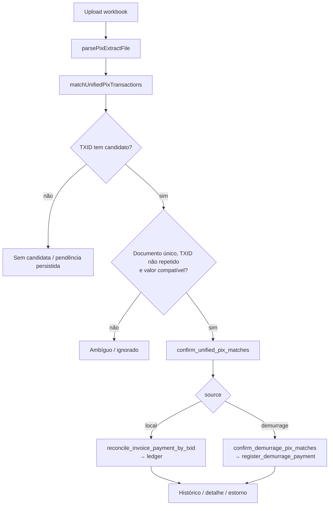

# Reconciliação PIX

> **Status:** ativo · **Atualizado:** 2026-10-13 · **Rotas:** `/reconciliacao` (Administrativo/Admin; abas `?tab=` Pendências, `extrato` e `historico`); `/demurrage/reconciliacao` redireciona para esta rota

## Propósito e escopo

Procedimentos para linhas ambíguas, QR antigo, cancelamento de baixa e
restituição estão no [manual financeiro](../operations/manual-financeiro.md).

Reconciliação PIX recebe a planilha bancária, extrai transações, casa TXIDs com
documentos locais ou de Demurrage, separa resultados seguros de ambiguidades,
confirma o lote, apresenta histórico/exportação e permite cancelar baixas.

- A rota interna está em `src/AppInterno.tsx` e a composição em
  `src/pages/Reconciliacao.tsx` (abas e detalhes); as abas são
  `src/components/billing/PixPendingPanel.tsx`, `PixExtractPanel.tsx` e
  `ReconciliationHistoryTable.tsx`, com leituras puras em
  `pixReconciliationPresentation.ts` e o estado da URL em
  `src/pages/reconciliacaoState.ts`.
- `src/services/demurrage/demurrageKpis.ts` é o dono do parser da planilha.
- `src/services/reconciliacao.ts` é o dono do matching, confirmação, histórico,
  exportação e chamadas de estorno.
- Taxas locais são liquidadas pelo ledger descrito em
  [Faturamento](faturamento.md); Demurrage é atualizado em persistência própria.
- O gate visual usa `isAdmin` em `src/pages/Reconciliacao.tsx`;
  as RPCs críticas também exigem sessão ativa/admin. A tela bloqueia o acesso
  para os demais perfis antes do upload ou matching; nenhuma pendência PIX
  fica apenas em memória do browser.

## Anatomia das telas

A tela separa três coisas que a operação confundia: **Pix recebido** (o dinheiro
entrou no banco), **baixa confirmada** (a RPC gravou o pagamento na fatura) e
**exceção pendente** (um Pix sem baixa segura, salvo até alguém tratar). Cada
uma tem a sua aba; a aba fica na URL (`?tab=`) e as abas já abertas continuam
montadas, então a leitura do extrato e o recorte do histórico não se perdem ao
trocar de aba. Quem não é do Administrativo vê "Acesso restrito" com o motivo e
"Voltar para o Painel"; as RPCs continuam exigindo o Administrativo.

### Monitoramento das cobranças Itaú

A aba **Pendências** (padrão, destino do Alerta `pix_unreconciled`) começa pela
linha de estado da cobrança Pix Itaú (`itau_pix_monitor`, migration 154,
relido a cada minuto): baixa automática ligada ou desligada, até quando os
recebimentos foram consultados (em Brasília) e quantas cobranças estão ativas.
Se o checkpoint de recebimentos (`app_settings.itau_pix_polled_until`) não
avança há 15 min ou mais, um aviso diz que Pix pagos depois daquele horário não
deram baixa automática (limite fixo da tela, `ITAU_POLL_STALE_MINUTES`). Com a
chave desligada, a linha diz que vale o QR estático e leva ao extrato.

Abaixo vêm três listas, cada uma com contagem, uma frase do que significa e o
caminho:

- **Pix recebidos sem baixa** (`itau_pix_receipts` em análise): valor, horário,
  motivo e TXID. Quando a fatura da cobrança fica paga (baixa pelo extrato ou
  pagamento verificado), o Pix sai da lista e o Alerta fecha sozinho. Nos
  outros casos (fatura cancelada a restituir, TXID sem fatura), **Marcar como
  tratado…** abre o motivo na própria linha (mínimo de 5 caracteres, como a
  `itau_pix_mark_receipt_handled`), com a recusa do banco junto do campo;
  Voltar devolve o foco ao botão.
- **Exceções do extrato** (abaixo).
- **Cobranças aguardando o Itaú**: emissão, alteração, conferência de
  vencimento e cancelamento ainda não confirmados, com a resposta incerta e o
  erro primeiro, tentativas e próxima tentativa. O número abre o detalhe da
  fatura. Não há ação: a fila tenta de novo sozinha e consulta antes de repetir
  uma resposta incerta.

A contagem da aba soma o que pede decisão: Pix sem baixa, exceções e cobranças
com resposta incerta ou erro.

### Exceções do extrato

Linhas de extrato sem baixa segura ficam em `pix_reconciliation_exceptions` por
arquivo e linha, inclusive sem TXID. Cada linha mostra valor, dia do extrato,
Ambígua ou Sem documento, o motivo gravado pelo matching, o documento indicado,
TXID, linha, CNPJ e quando foi importada. **Tentar de novo** refaz o matching
só daquela linha; sem fatura segura, explica o motivo na linha e não chama a
baixa. **Escolher fatura…** lista as faturas abertas que aceitam o TXID, com o
valor de cada uma ao lado do Pix; **Baixar nesta fatura** vincula, baixa e
encerra. A falha diz até onde chegou: antes da baixa, nada foi gravado; depois
dela, a baixa existe e só a exceção ficou aberta (não repetir a baixa).

### Upload e matching

A aba **Conciliar extrato** usa as peças comuns de importação
(`ImportGuide`, `ImportFilePicker`, `ImportNotice`): colunas lidas,
arquivo `.xlsx`/`.xls` por clique ou arraste, limite de tamanho e o aviso de
linhas e abas ocultas do próprio seletor. A leitura mostra o andamento e diz
que nada é baixado nesta fase; as linhas sem baixa segura já ficam salvas como
exceção. Falha de leitura fica na tela ("Nada foi baixado"), não em toast.

`parsePixExtractFile` valida tamanho antes de `arrayBuffer()`. O parser procura
a linha que contém a coluna `identificador`, exige `valor pago`, tenta localizar
CPF/CNPJ e `pago em`, preserva TXID vazio para revisão, ignora valor não positivo e normaliza a data
para `YYYY-MM-DD`. Linhas ocultas da aba lida ficam de fora; quando há, a
conferência diz que parte do extrato ficou de fora e que só as linhas visíveis
entram na conciliação (`readSpreadsheetNotices.firstSheetHiddenRows`).

### Revisão do resultado

A conferência mostra uma faixa de resumo (prontas para baixa e o total do lote,
quantas ficam como exceção, linhas lidas) e duas listas (tabela no desktop,
linhas abaixo de 640 px):

- **Prontas para baixa**: linha, pago em, valor do Pix, TXID, fatura e
  origem, Cliente e CNPJ. Uma Invoice de Demurrage paga com a cotação anterior
  diz que a janela das duas PTAX foi aceita.
- **Ficam como exceção pendente**: Ambígua ou Sem documento, com o motivo e o
  documento indicado; já estão salvas em Pendências.

O rodapé diz que nada foi baixado ainda e, com mais de uma linha, que o lote é
gravado junto. **Confirmar N baixas** só aparece ativo com linha pronta;
**Descartar leitura** não apaga as exceções já salvas.

Transações sem documento candidato geram um `UnifiedPixMatch` com
`source = unmatched`. Elas permanecem visíveis para conferência, são contadas
separadamente e nunca entram na confirmação.

### Confirmação e resultado por item

Recusa do lote fica na conferência: "Nenhuma baixa foi gravada", a mensagem do
banco e o lembrete de que uma linha recusada impede as demais. Com sucesso, o
resultado lista só o que a RPC devolveu (fatura, origem, Cliente, valor, dia,
TXID e "Baixa confirmada"); o número abre o detalhe. Se a resposta vier com
menos itens que o enviado, a tela manda conferir o histórico em vez de
prometer a baixa. As linhas que não entraram apontam para Pendências.

### Histórico, filtros e exportação

`src/components/billing/ReconciliationHistoryTable.tsx` (aba **Histórico de
baixas**) combina:

- invoices locais `paid`, `covered` e `partially_paid` com data em `payments`;
- invoices avulsas `manual` pagas/parcialmente pagas, sem exigir vínculo a B/L;
- `demurrage_invoices.status = paid`;
- filtros de período, origem, tipo de fatura (só Taxas Locais), Cliente, B/L,
  navio, viagem e POD, todos na URL com a ordenação, a página e o tamanho;
- situação gravada (Paga, Parcialmente paga com recebido e saldo, Coberta pela
  consolidada) e o valor do B/L com o total da fatura quando difere;
- "Exibindo 1–N de M" no topo e no rodapé; erro de consulta com Tentar
  novamente, sem lista vazia nem "Nenhum registro"; vazio com e sem filtro
  distintos; cartões abaixo de 640 px;
- exportação XLSX do recorte (desativada sem registros);
- abertura do detalhe pelo número da fatura.

### Detalhe e cancelamento de baixa

- Invoice local abre `src/components/billing/InvoiceDetailModal.tsx` (etapa 10)
  com `enablePaymentReversal` e o `paymentId` escolhido no histórico; aberta a
  partir do resultado do lote ou da fila Itaú, vem sem `paymentId`.
- Demurrage abre o mesmo detalhe de `/demurrage`
  (`DemurrageInvoiceDetailModal`, etapa 11). Cancelar baixa abre
  `DemurragePaymentReversalModal` no lugar do detalhe, com o aviso de datas
  alteradas (`reversalDatesNotice`) e a recusa no formulário, e volta ao
  detalhe relido. Fatura e recibo abrem `InvoiceDocument` (etapa 13) no mesmo
  fluxo; o recibo só imprime depois de consultar as restituições. Pagamento,
  desconto, disputa e cancelamento da Invoice abrem `/demurrage?fatura=<id>`.
- Justificativa é obrigatória na UI e nas RPCs.

## Catálogo de ações

| Tela / ação | Pré-condições | Origem | Orquestração | Persistência | Efeitos e cache | Falhas | Evidência |
|---|---|---|---|---|---|---|---|
| `/reconciliacao` · selecionar/upload de planilha | Perfil Administrativo/Admin e arquivo `.xlsx`/`.xls` dentro do limite | Dropzone/input → `processFile` | `matchMutation` chama `parsePixExtractFile` e persiste exceções via `upsert_pix_reconciliation_exceptions`; linhas e abas ocultas ficam fora da leitura e o aviso (`readSpreadsheetWarnings`) aparece no resultado, antes de Confirmar | Linhas sem match seguro ficam persistidas por importação/linha e geram `pix_unreconciled`, tratado pelo Administrativo desde a migration `078` | Nova leitura limpa a anterior e o resultado; com exceção gravada, invalida exceções e alertas | Perfil não autorizado vê “Acesso restrito”; arquivo grande, formato ou cabeçalho inválido aparece na aba com “Nada foi baixado” | **Código:** `src/components/billing/PixExtractPanel.tsx`, `src/services/reconciliacao.ts`, `supabase/migrations_archive/328_pix_unreconciled_persistence.sql` · **Teste:** `src/pages/__tests__/Reconciliacao.behavior.test.tsx` · **Runtime local** (etapa 12) |
| Parser · extrair linhas bancárias | Cabeçalho `identificador` e coluna `valor pago` | `parsePixExtractFile` | `assertUploadSize` → `parsePixExtract` → import dinâmico de `@e965/xlsx` | Nenhuma persistência | Retorna `{txid, cnpj, date, amount}`; ignora TXID vazio/valor não positivo | Cabeçalho/valor ausente lança erro; data inválida vira string vazia e falhará na confirmação | **Código:** `src/services/demurrage/demurrageKpis.ts` |
| Matching · carregar documentos locais e Demurrage | Transações parseadas | `matchUnifiedPixTransactions` | Duas queries paralelas; normalização alfanumérica maiúscula | `SELECT invoices` locais pagáveis e `SELECT demurrage_invoices` emitidas | Sem cache React Query; monta mapa único de TXID para os dois domínios | Erro de qualquer query aborta o matching | **Código:** `src/services/reconciliacao.ts` · **Teste:** `src/services/__tests__/reconciliacao.test.ts` |
| Matching/confirmar · invoice avulsa | Invoice `manual` emitida e PIX compatível com o saldo total; sem requisito de B/L | Matching e confirmação unificada em `/reconciliacao` | `confirm_unified_pix_matches` → `reconcile_invoice_payment_by_txid` → ramo genérico `register_invoice_payment` | `payments` e agregados da invoice; não cria `ledger_settlements` nem liquida B/L | Invalida invoices, detalhe e histórico da reconciliação | TXID ausente, ambíguo, valor divergente ou invoice já paga é rejeitado | **Código:** migration `097`, `src/services/reconciliacao.ts`; **Teste:** `src/services/__tests__/reconciliationInvoiceType.test.ts`; **Teste local-pg:** `src/integration/manualInvoice.local-pg.test.ts` |
| Matching · classificar sem match | TXID sem candidato aberto | Loop de `matchUnifiedPixTransactions` | `txidMap.get(key)` retorna vazio | Sem persistência | Retorna linha `source = unmatched`, painel dedicado e contagem; nunca entra na confirmação | Nenhum documento é alterado | **Código:** `src/services/reconciliacao.ts`, `src/pages/Reconciliacao.tsx` · **Teste:** `src/services/__tests__/reconciliacao.test.ts`, `src/pages/__tests__/Reconciliacao.behavior.test.tsx` |
| Matching · classificar ambiguidade de documento/TXID | Mais de um documento com TXID normalizado ou TXID repetido no extrato | Mesmo loop | `entries.length > 1` ou `seenTxids` | Sem persistência | `ambiguous = true`, motivo e `candidateCount`; UI move para painel ignorado | Não há seleção manual de candidato nesta tela | **Código:** `src/services/reconciliacao.ts`, `src/pages/Reconciliacao.tsx` · **Teste:** `src/services/__tests__/reconciliacao.test.ts` |
| Matching · classificar divergência de valor | Diferença absoluta maior que `0,01` ou valor esperado não numérico | Mesmo loop | Compara transação com saldo local ou `current_total_brl` | Sem persistência | Marca como ambíguo; local e Demurrage recebem motivos distintos | Não existe pagamento parcial por PIX neste fluxo | **Código:** `src/services/reconciliacao.ts` · **Teste:** `src/services/__tests__/reconciliacao.test.ts` |
| `/reconciliacao` · confirmar somente não ambíguos | Ao menos um match seguro; data parseada | `confirmMutation` | Filtra `!ambiguous`; `confirmUnifiedPixReconciliation` refiltra e monta JSON | RPC `confirm_unified_pix_matches` | Em sucesso `afterPixConciliado` (`cacheEffects.ts`): famílias da base de faturamento (ledger, faturas, B/Ls, Cliente, Portal), da Invoice de Demurrage, histórico, exceções, monitor Itaú e alertas | Data vazia falha antes da RPC; erro do lote fica na conferência (“Nenhuma baixa foi gravada”) | **Código:** `src/components/billing/PixExtractPanel.tsx`, `src/services/reconciliacao.ts` · **Teste:** `src/services/__tests__/reconciliacao.test.ts`, `Reconciliacao.behavior.test.tsx`, `cacheEffects.test.ts` · **Runtime local** (etapa 12: recusa `no_match` e baixa de Demurrage) |
| RPC unificada · conciliar item local | `source = local`, data presente, TXID casa uma invoice pagável e valor quita saldo | `confirm_unified_pix_matches` | `reconcile_invoice_payment_by_txid` → `register_ledger_invoice_payment` | `payments`, `ledger_settlements`, `bl_receivables`, links, invoice, B/Ls e eventos | Item `{source: local, status: ok}`; transação inteira aborta se um item falhar | Sem match, ambíguo no domínio local, já conciliado ou valor inexato gera falha do lote | **Código:** `supabase/migrations_archive/103_confirm_unified_pix_matches.sql`, `supabase/migrations_archive/111_pix_exact_and_manual_overpayment_refunds.sql` |
| RPC unificada · conciliar item Demurrage | `source = demurrage`, invoice existente e valor na janela das duas PTAX (`event_date <= pagamento`, tol. `0,01`) | Mesma RPC | Valida pela janela (`get_demurrage_recent_values`, ADR 0015), congela o valor casado e acumula lote para `confirm_demurrage_pix_matches` | `UPDATE demurrage_invoices`: `paid`, `paid_at`, `pix_txid`, `conciliated_by_extract`, `current_total_brl` casado + foto `source='payment'` no histórico | Item `{source: demurrage, status: ok}` | Documento ausente, valor fora da janela ou contagem atualizada diferente aborta o lote | **Código:** `supabase/migrations_archive/158_demurrage_pix_window_conciliation.sql` |
| Resultado · exibir retorno por fonte/item | Confirmação concluída | `confirmMutation.onSuccess` | `describeConfirmation` completa cada item devolvido com o que foi enviado | Sem nova persistência | Lista só os itens devolvidos, conta os enviados que não voltaram e aponta as exceções para Pendências | Shape sem itens vira array vazio e a tela diz que nenhuma baixa voltou | **Código:** `src/components/billing/PixExtractPanel.tsx`, `pixReconciliationPresentation.ts` · **Teste:** `pixReconciliationPresentation.test.ts` |
| Histórico · listar/filtrar/ordenar/paginar | Sessão interna | `ReconciliationHistoryTable`; estado na URL por `reconciliacaoState.ts` | `useQuery` → `listReconciliationHistory` | Pagina completamente os dois domínios em lotes de 1000; filtros/ordenação/paginação no cliente | Query `['reconciliation-history', filters]`, `staleTime` 15 s; data e `paymentId` vêm da mesma baixa mais recente | Erro de qualquer domínio falha a tabela inteira, com Tentar novamente e sem lista vazia | **Código:** `src/components/billing/ReconciliationHistoryTable.tsx`, `src/services/reconciliacao.ts` · **Teste:** `src/services/__tests__/reconciliationHistoryPagination.test.ts`, `src/services/__tests__/reconciliationInvoiceType.test.ts` |
| Histórico · exportar | Filtros atuais e ao menos um registro | Botão “Exportar planilha” | `exportReconciliationHistoryExcel` consulta com página única ampla e carrega `@e965/xlsx` | Arquivo local `conciliacao-<timestamp>.xlsx` | Sem invalidação; neutraliza prefixos de fórmula em strings | Falha exibe toast dedicado e encerra o estado de processamento | **Código:** `src/components/billing/ReconciliationHistoryTable.tsx`, `src/services/reconciliacao.ts` |
| Histórico · abrir detalhe local | Linha local; invoice/payment IDs disponíveis | `onSelectLocalInvoice` | `InvoiceDetailModal` → `useInvoiceDetail`/`useInvoiceRefunds` | Leituras do faturamento | Queries de detalhe/refund | `paymentId = null` permite detalhe, mas não cancelamento da baixa | **Código:** `src/pages/Reconciliacao.tsx`, `src/components/billing/ReconciliationHistoryTable.tsx` |
| Histórico · abrir detalhe Demurrage | Linha Demurrage | `onSelectDemurrageInvoice` | `DemurrageInvoiceDetailModal` (etapa 11) | Leitura de invoice, itens, outras Invoices do B/L e restituições | Query `['demurrage-invoice-detail', id]`, a mesma de `/demurrage` | Erro mostra falha no modal com Tentar novamente | **Código:** `src/pages/Reconciliacao.tsx`, `src/components/demurrage/DemurrageInvoiceDetailModal.tsx` |
| Detalhe local · cancelar baixa | Admin, `paymentId` e justificativa | `InvoiceDetailModal.handleReversePayment` | `reverseLocalPaymentAndInvalidate` → `reverseLocalInvoicePayment` | RPC `reverse_invoice_payment` restaura ledger/links/status, limpa PIX e exclui `payments` | Invalida ledger, invoices, B/Ls, cliente, detalhe, refunds, alertas e histórico antes de fechar | RPC exige admin/justificativa e rejeita payment/invoice ausente | **Código:** `src/components/billing/InvoiceDetailModal.tsx`, `src/hooks/useBillingLedger.ts`, `src/services/reconciliacao.ts` · **Teste:** `src/hooks/__tests__/billingLedgerInvalidation.test.ts` |
| Detalhe Demurrage · cancelar baixa | Admin, invoice paga e justificativa | `reversalMutation` | `DemurragePaymentReversalModal` → `reverseDemurragePayment` | RPC `reverse_demurrage_payment` volta status a `issued`, limpa data/TXID e audita | `afterFaturaDemurrageAlterada`; relê o detalhe e volta a ele | UI e RPC exigem justificativa; recusa fica no formulário (“A baixa continua registrada”) | **Código:** `src/pages/Reconciliacao.tsx`, `src/services/reconciliacao.ts`, `supabase/migrations_archive/113_require_justification_on_payment_reversal.sql` · **Teste:** `Reconciliacao.behavior.test.tsx` |

## Estado e dados

### Estado local da página

- URL: aba (`?tab=`) e filtros, ordem, página e tamanho do histórico
  (`reconciliacaoState.ts`).
- Aba Conciliar extrato: arquivo escolhido, leitura (`matches` e linhas ocultas
  da aba lida) e resultado do lote.
- Aba Pendências: formulário de tratamento do Pix por linha e exceção com as
  faturas abertas.
- Página: detalhe aberto (local com `paymentId` ou Demurrage), cancelamento de
  baixa e documento de Demurrage, com volta ao detalhe.

### Dados remotos

| Domínio | Leitura para matching | Escrita de confirmação | TXID persistido |
|---|---|---|---|
| Local com ledger | `list_local_pix_candidates` resolve `local_pix_charge_versions` e sucessoras compatíveis; valor esperado = valor fixo daquela cobrança | `reconcile_invoice_payment_by_txid` delega a `register_ledger_invoice_payment` | `invoices.pix_txid` e uma linha de `ledger_settlements.pix_txid` |
| Invoice avulsa | `invoices.invoice_type='manual'` em estado pagável; valor esperado = saldo da invoice | `reconcile_invoice_payment_by_txid` chama pagamento genérico `register_invoice_payment` | `invoices.pix_txid` e `payments`; sem settlement por recebível |
| Demurrage | `demurrage_invoices.status = issued`; valor esperado = `current_total_brl` | Update em lote por `confirm_demurrage_pix_matches` | `demurrage_invoices.pix_txid` |

`supabase/migrations_archive/075_ledger_pix_txid_single_settlement_row.sql`
usa trigger para manter o TXID somente na primeira linha de settlement de um
pagamento PIX com vários receivables. O documento local também guarda
`conciliated_by_extract`; Demurrage possui flag equivalente.

### Histórico

`listReconciliationHistory` não consulta uma view única. Ele carrega os dois
domínios, achata B/Ls, usa a data mais recente de `payments` no local,
`demurrage_invoices.paid_at` no outro domínio, remove linhas sem data e aplica
filtros/ordenação/paginação em memória.

## Fluxos e invariantes

- Matching é exclusivamente por TXID normalizado; CNPJ e valor não são fallback
  para localizar documento.
- A interface filtra ambiguidades antes da chamada e o serviço repete o filtro.
- A RPC unificada não recebe um campo `ambiguous`. Para local, ela reexecuta o
  matching no banco e exige uma única invoice; para Demurrage, valida ID e
  valor, mas não reexecuta a política de unicidade cruzada entre domínios.
- Local valida o valor exato da versão do QR. A baixa aloca até o saldo atual;
  excedente de cobrança histórica gera restituição, sem mudar o total emitido.
  Demurrage valida a janela das duas fotos elegíveis à data de pagamento, com
  tolerância de `0,01`; não compara somente o total corrente.
- Um TXID repetido no mesmo extrato é marcado ambíguo a partir da segunda linha.
- Quando o mesmo TXID existe em documento local e Demurrage, o mapa contém dois
  candidatos e a UI marca o match como ambíguo.
- `confirm_unified_pix_matches` é a fronteira transacional do lote: falha em um
  item levanta exceção e impede sucesso parcial do comando.
- Invoice local ledger cria `payments` e settlements por recebível. Fatura
  avulsa cria `payments` pelo ramo genérico e não afeta B/L/ledger. Demurrage não cria
  `payments` nem ledger; marca diretamente o documento como pago.
- Cancelar baixa local remove o payment e restaura saldos/links, mas a migration
  `130` bloqueia a ação quando retirar lastro de restituição. Não equivale a
  devolver dinheiro. Cancelar baixa de Demurrage reabre o documento e audita.

## Testes e validação

O lote comportamental de 2026-06-23 executou os serviços, contratos SQL,
componentes e a página completa. A página foi exercitada com upload, separação
entre seguros/ambíguos/sem candidato, confirmação, resultado, detalhes e
estorno de Demurrage.

### Testes de comportamento estático

- `src/services/__tests__/reconciliacao.test.ts`: TXID-only, colisão entre
  domínios, repetição no extrato, divergência de valor, confirmação unificada,
  data obrigatória e lote Demurrage.
- `src/lib/__tests__/pix.test.ts`: payload BRCode, sanitização/limite de TXID e
  CRC-16.
- `src/pages/__tests__/Reconciliacao.behavior.test.tsx`: monitor Itaú em
  Brasília e consulta parada, Pix tratado com motivo e foco, leitura com
  exceções salvas, linhas ocultas, lote recusado, resultado parcial honesto,
  exceção por Tentar de novo e Escolher fatura (com falha depois da baixa),
  detalhes, cancelamento de baixa de Demurrage, aba na URL e acesso restrito.
- `src/components/billing/__tests__/pixReconciliationPresentation.test.ts` e
  `src/pages/__tests__/reconciliacaoState.test.ts`: leituras puras e estado na URL.
- `src/components/billing/__tests__/ReconciliationHistoryTable.behavior.test.tsx`:
  filtros na URL, ordenação, situação gravada, exportação, erro sem lista
  vazia, vazio com e sem filtro, detalhe pelo número e falha de exportação.
- `src/services/__tests__/reconciliationHistoryPagination.test.ts`: paginação
  integral antes dos filtros.

### Teste de contrato SQL

Estes testes verificam texto de migrations, não um banco aplicado:

- `src/services/__tests__/ledgerPixPayloadMigration.test.ts`
- `src/services/__tests__/ledgerPixSettlementTxidMigration.test.ts`
- `src/services/__tests__/reversalBlsFinancialStatusMigration.test.ts`
- `src/services/__tests__/reversalJustificationMigration.test.ts`

## Notas e divergências

- **Correções implementadas — Código/Teste local.** A baixa escolhida no detalhe pode ser antiga, com confirmação de valor/data/ID. Registro manual exige referência bancária (pode se repetir quando um PIX paga mais de uma cobrança) e tentativa estável; a conciliação PIX mantém TXID próprio. Excedente pendente de uma baixa falsa pode acompanhar sua reversão; devolução confirmada ou ajuste que depende da baixa permanece protegido. Banco implementado na migration 136: [controles financeiros](../archive/specs/2026-10-04-controles-financeiros-design.md).

- **Pendências PIX são persistidas — Código.** `persistUnresolvedPixMatches`
  conserva linhas sem candidata e ambíguas por importação/linha, inclusive sem
  TXID. O Administrativo usa Tentar conciliar ou Escolher candidata; a resolução
  exige prova de baixa autoritativa. Essas linhas não entram automaticamente no
  lote seguro.
- **Suspeita sem prova de falha/exploit — ambiguidade é parcialmente
  client-side.** A RPC unificada não recebe a classificação do frontend. Uma
  chamada direta ainda revalida o match local e os valores, mas não demonstra
  a mesma política de ambiguidade cruzada para um item Demurrage.
- **Suspeita sem prova de falha/exploit — mesmo TXID nos dois domínios.** A UI
  bloqueia a colisão porque `txidMap` agrega local e Demurrage. No banco, a
  unicidade de `ledger_settlements` cobre somente o ledger local e
  `demurrage_invoices` é separado; não foi executado um cenário que tentasse
  aplicar a mesma transação aos dois domínios.
- **TXID é denormalizado.** Local mantém `invoices.pix_txid` e
  `ledger_settlements.pix_txid`; Demurrage mantém seu próprio campo. O trigger
  reduz duplicação entre settlements, mas não elimina a necessidade de
  sincronização entre documento e ledger.
- **Estorno de Demurrage limpa a origem do pagamento.** A migration
  `131_clear_demurrage_extract_flag_on_reversal.sql` redefine
  `conciliated_by_extract = false`.
- **Filtro “Único BL” alinhado.** O valor visual `single` é normalizado para
  `individual` antes da comparação.

### Cobrança dinâmica Itaú — migration 151

**Ativa em produção desde 2026-10-07.** `app_settings.pix_provider` escolhe o
autor do QR: `static` (padrão de um banco novo; QR estático e conciliação só
por extrato) ou `itau` (valor em produção). Com `itau`, os gatilhos que hoje montam o QR estático (faturas locais
e avulsas em `populate_local_invoice_pix_payload`, Demurrage em
`zz_itau_pix_demurrage_payload`) abrem ou cancelam cobranças em
`itau_pix_charges`, com no máximo uma aberta por fatura e TXID `VELA…`. A
função `itau-pix` processa a fila (`itau_pix_claim`/`itau_pix_record`) e grava
o copia e cola em `pix_payload`; até lá Vela e Portal mostram "QR em
preparação". Faturas locais ativas também entram em
`local_pix_charge_versions`, então a conciliação por extrato continua
resolvendo o TXID. A avulsa não entra nessa tabela (migration 152).

**Baixa automática (migration 152):** a função consulta `GET /pix` e chama
`itau_pix_settle` para cada Pix com TXID `VELA…`, que baixa pelos mesmos
donos desta página (`reconcile_invoice_payment_by_txid`, pagamento verificado
da avulsa e `register_demurrage_payment`), com o `endToEndId` como referência
bancária e chave de idempotência (`itau_pix_receipts`). Qualquer recusa (valor
diferente, fatura não pagável, sem usuário de baixa em
`app_settings.itau_pix_settlement_actor`) abre o Alerta `pix_unreconciled`
para o Administrativo, sem baixa. Detalhes no
[plano](../archive/plans/2026-10-06-integracao-itau-pix.md).

**Consulta e horários (Edge `itau-pix` v8).** O job `itau-pix-queue` chama a
função a cada minuto: manutenção de prazos (`itau_pix_maintain`), fila de
cobranças e consulta de recebimentos desde o checkpoint (`itau_pix_checkpoint`),
com 10 min de sobreposição e janelas de até 6 h para recuperar atraso. O Itaú
de produção só encontra a janela pedida em `-03:00` e devolve horários de
Brasília com `Z` indevido; o cliente envia a janela em Brasília e grava tudo em
UTC. Duas travas param a consulta sem baixa nem avanço do checkpoint se o banco
passar a mandar UTC verdadeiro: horário mais de 5 min no futuro e horário do
recebimento a mais de 1 h do minuto UTC do `endToEndId`. O erro aparece no
monitoramento acima; a correção é remover a troca de `Z` em
`supabase/functions/_shared/itauPix.ts`. Operação e segredos no
[manual de serviços externos](../operations/servicos-externos.md#itaú--api-pix-recebimentos).

**Fila completa e disparo imediato (migration 219, 2026-10-13).** Até a
`219`, `itau_pix_claim` só reservava `pending_create` e `pending_cancel`: a
alteração (`pending_update`, PTAX da Demurrage e renovação das Taxas Locais) e
a conferência de vencimento (`pending_expire_check`) nunca chegavam ao Itaú.
A cobrança ficava com o valor antigo e, vencida, a fatura perdia o QR. Agora a
reserva cobre os quatro estados. A transação que deixa cobrança pendente
dispara a função com `{"action":"process_charges"}` (só a fila; prazos e
recebimentos seguem no job de 1 minuto), um runner por vez
(`ops.itau_pix_runner_lease`). Cada execução trabalha em blocos de 5 por até
20 s, no máximo 60 cobranças, e para no primeiro 429 (os limites do Itaú nunca
foram medidos) e na primeira cobrança sem resposta (com o Itaú parado, cada
cobrança espera até 30 s, e um bloco inteiro passaria da vez do runner). A
execução só termina com a fila vazia, então a substituta de uma cobrança
vencida e o cancelamento pedido durante a emissão saem na mesma execução. No
ciclo do job, uma falha da fila não impede a consulta de recebimentos. A
renovação das Taxas Locais usa folga de 7 dias ou metade da validade
configurada, o que for menor: com validade abaixo de 7 dias, a cobrança
renovada pedia nova alteração ao Itaú a cada minuto. Antes, o QR saía em 6 a
56 s (mediana 25 s, 11 cobranças de 07–08/10), só pelo job de 1 minuto, 20
cobranças por chamada.

**Runtime em produção (07 e 08/10):** avulsas, individual, consolidada e
Demurrage de teste pagas por QR Itaú foram baixadas pelo cron entre 23 e 58 s
depois do pagamento; a consolidada (v8) cancelou no ciclo seguinte as
cobranças das individuais que cobriu.

### Cobranças locais após correção — migration 130

A apresentação Pix acompanha o saldo pagável, enquanto total e itens da fatura
permanecem históricos. Cada nova apresentação usa outro TXID; `invoices.pix_txid`
continua registrando o TXID recebido. `local_pix_charge_versions` conserva valor,
payload e fatura de origem. A prévia usa `list_local_pix_candidates`; a baixa
revalida a mesma resolução em `reconcile_invoice_payment_by_txid`, com lock e
controle de repetição. Não há fallback por Cliente, CNPJ ou semelhança de valor.

QR antigo de fatura cancelada só passa para a sucessora com o mesmo Cliente e
os mesmos B/Ls, através da cadeia `replaces_invoice_id`. O valor recebido deve
ser o da cobrança histórica: R$ 600 recebidos em uma sucessora de R$ 500 quitam
R$ 500 e geram restituição de R$ 100. Sem sucessora compatível, composição
alterada ou documento já quitado, o extrato conserva uma exceção para revisão;
não inventa uma baixa em outro documento. Repetição de TXID já liquidado é
recusada. Esse histórico não cancela um QR estático no PSP.

Cobertura executável: `invoicePostBillingSafety.local-pg.test.ts` e os testes
comportamentais de reconciliação, documento e salvar B/L.
