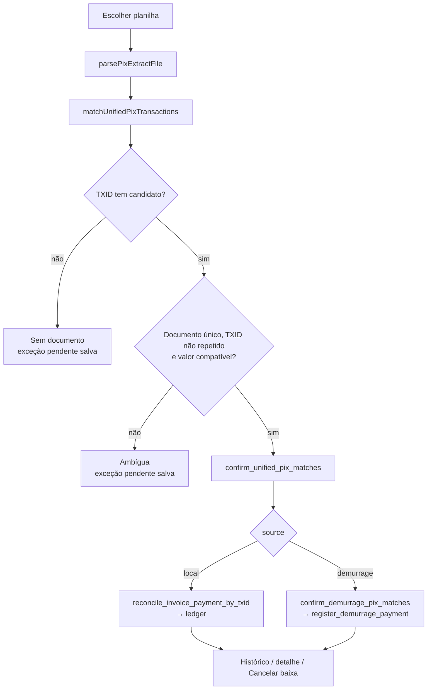

# Reconciliação PIX

> **Status:** ativo · **Atualizado:** 2026-10-16 · **Rotas:** `/reconciliacao` (leitura de todos, conciliar do Financeiro e do Administrativo; [matriz de permissões](../operations/seguranca.md#conciliação-pix); abas Histórico de baixas (padrão, sem `?tab`), `?tab=pendencias` e `?tab=extrato`); `/demurrage/reconciliacao` redireciona para esta rota

## Propósito e escopo

Procedimentos para linhas ambíguas, QR antigo, cancelamento de baixa e
restituição estão no [manual financeiro](../operations/manual-financeiro.md).

A baixa de rotina é automática pela API do Itaú: a cobrança Pix de cada fatura
é emitida no banco e o recebimento é consultado a cada minuto e baixado sem
intervenção (job `itau-pix-queue`, migrations 151–154 e 219). A Conciliação
acompanha essa baixa (aba Pendências), mostra o histórico de baixas e permite
cancelar uma baixa. O Pix recebido que não deu baixa sozinho aparece em
**Pix recebidos sem baixa** e espera uma decisão humana.

A conciliação pelo extrato (aba Conciliar extrato) é **plano B**, decidido pelo
responsável em 2026-10-13: fica para quando a API do Itaú ou a consulta de
recebimentos falhar, ou quando a cobrança Itaú estiver desligada e as faturas
voltarem ao QR estático. Ela recebe a planilha bancária, extrai transações,
casa TXIDs com documentos locais ou de Demurrage, separa resultados seguros de
ambiguidades e confirma o lote. Não é a rotina de baixa; achados que só afetam
esse caminho têm prioridade de contingência. Desde a migration `242`, o TXID
é resolvido no servidor (`_pix_txid_open_candidates`) também para a Invoice de
Demurrage e a fatura avulsa abertas, pelo número do documento (TXID do QR
estático) ou pela cobrança Itaú ([ADR 0083](../adr/0083-decisoes-da-revisao-geral-da-documentacao.md),
item 16). O TXID da Invoice de Demurrage é único desde a migration `278`
([Demurrage](demurrage.md)), e o Pix do QR de uma Invoice cancelada não cai
na irmã aberta do mesmo B/L. Limite conhecido do plano B: uma fatura local sem versão de cobrança
pode aparecer pronta e ter o lote recusado (`no_match`).

- A rota interna está em `src/AppInterno.tsx` e a composição em
  `src/pages/Reconciliacao.tsx` (abas e detalhes); as abas são
  `src/components/billing/PixPendingPanel.tsx`, `PixExtractPanel.tsx` e
  `ReconciliationHistoryTable.tsx`, com leituras puras em
  `pixReconciliationPresentation.ts` e o estado da URL em
  `src/pages/reconciliacaoState.ts`.
- `src/services/demurrage/demurrageKpis.ts` é o dono do parser da planilha.
- `src/services/reconciliacao.ts` é o dono do matching, confirmação, histórico,
  exportação e das chamadas de Cancelar baixa.
- Taxas locais são liquidadas pelo ledger descrito em
  [Faturamento](faturamento.md); Demurrage é atualizado em persistência própria.
- O gate visual usa `isAdmin` em `src/pages/Reconciliacao.tsx`;
  as RPCs críticas também exigem sessão ativa/admin. A tela bloqueia o acesso
  para os demais perfis antes do upload ou matching; nenhuma pendência PIX
  fica apenas em memória do browser.

## Anatomia das telas

A tela separa três coisas que a operação confundia: **Pix recebido** (o dinheiro
entrou no banco), **baixa confirmada** (a RPC gravou o pagamento na fatura) e
**exceção pendente** (um Pix sem baixa segura, salvo até alguém tratar). Cada
uma tem a sua aba; a aba fica na URL (`?tab=`) e as abas já abertas continuam
montadas, então a leitura do extrato e o recorte do histórico não se perdem ao
trocar de aba. Pela [matriz de permissões](../operations/seguranca.md#conciliação-pix)
([ADR 0085](../adr/0085-modelo-de-permissoes-por-perfil.md), item D5), todos
leem a tela e Financeiro e Administrativo conciliam; cancelar baixa segue só
do Administrativo. Desde a migration `247` a tela abre para todos: quem não
concilia não vê **Marcar como tratado…**, **Tentar de novo**, **Baixar nesta
fatura** nem **Encerrar exceção**, e a aba **Conciliar extrato** explica que
ler o extrato e confirmar é do Financeiro e do Administrativo (ler o extrato já
grava as exceções).

### Monitoramento das cobranças Itaú

A tela abre no **Histórico de baixas**; as abas ficam na ordem Histórico de
baixas, Pendências (com contagem) e Conciliar extrato (identidade visual, lote 3,
aprovado em 2026-10-16). Os Alertas de Pix (`pix_unreconciled`, inclusive os
gravados com destino `/reconciliacao` pelas migrations 152, 153 e 247) abrem em
`/reconciliacao?tab=pendencias` (`alertEntityLink`, `PIX_PENDING_HREF`). Na
tela, o código do Pix se chama **Identificador do Pix** (nome da coluna no
extrato do Itaú), encurtado em letra de código na tabela e inteiro ao passar o
mouse e na linha aberta; motivos gravados pelo matching com "TXID" são
reescritos na tela (`pendingExceptionReason`, `extractLineReason`).

A aba **Pendências** começa pelo bloco **Cobrança Pix Itaú**
(`itau_pix_monitor`, migration 154, relido a cada minuto), com Conciliar
extrato na faixa. Se o checkpoint de recebimentos
(`app_settings.itau_pix_polled_until`) não avança há 15 min ou mais, o dado
principal é "Consulta parada há N min" em âmbar, com a frase de que Pix pagos
depois daquele horário não deram baixa automática e de avisar quem cuida da
integração (limite fixo da tela, `ITAU_POLL_STALE_MINUTES`); senão, "Baixa
automática ligada". Os fatos são Baixa automática, Recebimentos consultados até
(em Brasília) e Cobranças ativas. Com a chave desligada, o dado principal é
"Desligada: as faturas usam o QR estático e a baixa vem do extrato".

Abaixo vêm três blocos com tabela limpa, cada um com a contagem e uma frase na
faixa; a situação vai em texto, âmbar só no que pede ação:

- **Pix recebidos sem baixa** (`itau_pix_receipts` em análise): Recebido em,
  Valor, Identificador do Pix e Motivo. Quando a fatura da cobrança fica paga
  (baixa pelo extrato ou pagamento verificado), o Pix sai da lista e o Alerta
  fecha sozinho. Nos outros casos (fatura cancelada a restituir, identificador
  sem fatura), **Marcar como tratado** abre o motivo na linha de baixo (mínimo
  de 5 caracteres, como a `itau_pix_mark_receipt_handled`), com a recusa do
  banco junto do campo; Voltar devolve o foco ao botão.
- **Exceções do extrato** (abaixo).
- **Cobranças aguardando o Itaú**: Fatura (abre o detalhe), Origem, Valor,
  Situação, Tentativas e Próxima tentativa; resposta incerta e erro vêm
  primeiro e em âmbar ("Alteração sem resposta do banco", "Emissão com erro"),
  o que só aguarda o banco fica na tinta normal. A seta abre a resposta do
  banco, o identificador inteiro e a última tentativa. Não há ação: a fila
  tenta de novo sozinha e consulta antes de repetir uma resposta incerta.

A contagem da aba soma o que pede decisão: Pix sem baixa, exceções e cobranças
com resposta incerta ou erro.

### Exceções do extrato

A exceção encerra quando há baixa autoritativa do mesmo TXID e valor: o
`ledger_settlements` da fatura local, a Invoice de Demurrage conciliada ou,
para a avulsa, o TXID gravado na fatura com o evento `reconciled_by_txid`
(migration `269`).

Linhas de extrato sem baixa segura ficam em `pix_reconciliation_exceptions` por
arquivo e linha, inclusive sem identificador. A tabela mostra Pago em (dia do
extrato), Valor, Identificador do Pix, CNPJ e Motivo (com a fatura indicada, quando houver; em âmbar quando a linha é
ambígua; linha sem identificador diz "Linha sem identificador no extrato").
**Tentar de novo** refaz o matching só daquela linha; sem fatura segura,
explica o motivo na linha e não chama a baixa. A seta da linha abre a linha e o
arquivo do extrato e a tabela das faturas abertas que aceitam o identificador
(Fatura, Origem, Valor da fatura e Pix, em âmbar quando difere);
**Baixar nesta fatura** vincula, baixa e encerra. A lista de candidatas
(`list_pix_reconciliation_candidates`) não devolve o Cliente. A falha diz até onde chegou: antes da baixa, nada foi gravado; depois
dela, a baixa existe e só a exceção ficou aberta (não repetir a baixa). Nesse
caso a linha troca Tentar de novo e a seta por **Encerrar exceção**,
que chama só `resolve_pix_reconciliation_exception` com a fatura já baixada (a
fatura não está mais aberta, então o matching e a lista de faturas não a
acham). A tela guarda essa fatura só enquanto está aberta; depois de recarregar,
a linha volta a oferecer só Tentar de novo (ponytail em `PixPendingPanel.tsx`).

Gravar exceções na leitura e marcar um Pix como tratado usam
`afterPendenciaPixAlterada` (`cacheEffects.ts`): exceções, monitor Itaú e o
Alerta `pix_unreconciled` na lista, no Financeiro e no cabeçalho.

### Upload e matching

A aba **Conciliar extrato** usa as peças comuns de importação
(`ImportGuide`, `ImportFilePicker`, `ImportNotice`): colunas lidas,
arquivo `.xlsx`/`.xls` por clique ou arraste, limite de tamanho e o aviso de
linhas e abas ocultas do próprio seletor. A leitura mostra o andamento e diz
que nada é baixado nesta fase; as linhas sem baixa segura já ficam salvas como
exceção. Falha de leitura fica na tela ("Nada foi baixado"), não em toast.

`parsePixExtractFile` valida tamanho e extensão antes de `arrayBuffer()`. O
parser procura a linha que contém a coluna `identificador`, exige `valor pago`,
tenta localizar CPF/CNPJ e `pago em`, recusa o cabeçalho com uma dessas colunas
repetida (ADR 0078, item 22), preserva TXID vazio para revisão, ignora valor não
positivo e normaliza a data para `YYYY-MM-DD`. Extrato sem nenhuma transação
para na leitura ("Nenhuma transação Pix encontrada no extrato"). Linhas ocultas
da aba lida ficam de fora; quando há, a conferência diz que parte do extrato
ficou de fora no fato **Linhas ocultas fora da leitura**, em âmbar, e que só
as linhas visíveis entram na conciliação
(`readSpreadsheetNotices.firstSheetHiddenRows`).

### Revisão do resultado

O bloco **Conferência do extrato** (linhas lidas na faixa) tem como dado
principal "N prontas para baixa" com o total do lote, os fatos Ficam como
exceção (âmbar quando há) e Linhas ocultas fora da leitura, e duas tabelas
limpas:

- **Prontas para baixa**: Linha, Pago em, Valor do Pix, Identificador do Pix,
  Fatura, Origem e Cliente. A coluna **Conferência** só aparece quando alguma
  linha tem nota: uma Invoice de Demurrage paga com a cotação anterior diz que
  a janela das duas PTAX foi aceita.
- **Ficam como exceção**: Linha, Pago em, Valor do Pix, Identificador do Pix e
  Motivo (as mesmas palavras de Pendências, com a fatura indicada e o valor dela); já estão salvas em Pendências.

O rodapé diz que nada foi baixado ainda e, com mais de uma linha, que o lote é
gravado junto. **Ver Pendências** aparece quando há exceção; **Confirmar N
baixas** só aparece ativo com linha pronta; **Descartar leitura** não apaga as
exceções já salvas.

Transações sem documento candidato geram um `UnifiedPixMatch` com
`source = unmatched`. Elas permanecem visíveis para conferência, são contadas
separadamente e nunca entram na confirmação.

### Confirmação e resultado por item

Recusa do lote fica na conferência: "Nenhuma baixa foi gravada", a mensagem do
banco e o lembrete de que uma linha recusada impede as demais. Com sucesso, o
resultado é uma tabela só com o que a RPC devolveu (Fatura, Origem, Cliente,
Pago em, Valor do Pix, Identificador do Pix e a situação "Baixa confirmada" em
texto); o número abre o detalhe. Se a resposta vier com
menos itens que o enviado, a tela manda conferir o histórico em vez de
prometer a baixa. As linhas que não entraram apontam para Pendências (botão **Ver Pendências**).

### Histórico, filtros e exportação

`src/components/billing/ReconciliationHistoryTable.tsx` (aba **Histórico de
baixas**) combina:

- invoices locais `paid`, `covered` e `partially_paid` com data em `payments`;
- invoices avulsas `manual` pagas/parcialmente pagas, sem exigir vínculo a B/L;
- `demurrage_invoices.status = paid`;
- filtros abertos Pago de, Pago até, Origem, Cliente e B/L; em **Mais
  filtros**, Tipo de fatura (só Taxas Locais), Navio, Viagem e POD; todos na URL com a ordenação, a página e o tamanho;
  escolher a origem Demurrage tira o tipo de fatura, e um `tipo` vindo de link
  com `origem=demurrage` é ignorado; página além do fim (link antigo ou baixa
  cancelada na última página) vai para a última existente;
- bloco **Baixas** com o resumo do recorte na faixa ("N faturas · R$ X
  pagos", cada fatura contada uma vez e a coberta pela consolidada sem
  somar, `summarizeReconciliationHistory`) e Exportar planilha; o valor é o
  total pago das faturas do recorte, não o que entrou no período (a fatura
  entra pela data da baixa mais recente);
- tabela limpa: Fatura (com o ícone de pilha na consolidada), Origem, B/L (com
  ícone de copiar), Cliente, Navio / Viagem, Pago em, Valor do B/L (ordenável),
  Valor pago, Saldo (âmbar
  maior que zero) e Situação ("✓ Paga", "Parcialmente paga", "Coberta pela
  consolidada"), sem texto embaixo da célula; a consolidada tem uma linha por
  B/L com o Valor do B/L próprio e o valor pago e o saldo da fatura;
- "Exibindo 1–N de M" no rodapé; erro de consulta com Tentar
  novamente, sem lista vazia nem "Nenhum registro"; vazio com e sem filtro
  distintos; cartões abaixo de 640 px;
- exportação XLSX do recorte (desativada sem registros), com os cabeçalhos da
  tela (Fatura, Origem, Tipo de fatura, B/L, Cliente, CNPJ, Navio, Viagem, POD,
  Pago em, Valor do B/L, Valor da fatura, Valor pago, Saldo, Situação; o
  valor pago e o saldo são da fatura e se repetem em cada B/L da consolidada);
- abertura do detalhe pelo número da fatura.

### Detalhe e cancelamento de baixa

- Invoice local abre `src/components/billing/InvoiceDetailModal.tsx` (etapa 10)
  com `enablePaymentReversal` e o `paymentId` escolhido no histórico; aberta a
  partir do resultado do lote ou da fila Itaú, vem sem `paymentId`.
- Demurrage abre o mesmo detalhe de `/demurrage`
  (`DemurrageInvoiceDetailModal`, etapa 11). Cancelar baixa abre
  `DemurragePaymentReversalModal` no lugar do detalhe, com o aviso de datas
  alteradas (`reversalDatesNotice`) e a recusa no formulário, e volta ao
  detalhe relido. Fatura e recibo abrem `InvoiceDocument` (etapa 13) no mesmo
  fluxo; o recibo só imprime depois de consultar as restituições. Pagamento,
  desconto, disputa e cancelamento da Invoice abrem `/demurrage?fatura=<id>`.
- Justificativa é obrigatória na UI e nas RPCs.

## Catálogo de ações

| Tela / ação | Pré-condições | Origem | Orquestração | Persistência | Efeitos e cache | Falhas | Evidência |
|---|---|---|---|---|---|---|---|
| `/reconciliacao?tab=extrato` · escolher a planilha | Financeiro ou Administrativo (migration `247`) e arquivo `.xlsx`/`.xls` dentro do limite | `ImportFilePicker` (clique ou arraste) → `chooseFile` em `PixExtractPanel` | `readMutation`: `parsePixExtractFile` e `readSpreadsheetNotices` em paralelo, depois `matchUnifiedPixTransactions` e `persistUnresolvedPixMatches`; linhas e abas ocultas ficam fora da leitura e o aviso aparece na conferência, antes de Confirmar | RPC `upsert_pix_reconciliation_exceptions` (definição vigente na migration `002`; origem na migration arquivada `328`): linhas sem baixa segura ficam salvas por importação/linha e abrem `pix_unreconciled`, tratado pelo Administrativo desde a migration `078` | Nova leitura limpa a anterior e o resultado; com exceção gravada, `afterPendenciaPixAlterada` (exceções, monitor Itaú e Alerta) | Perfil não autorizado vê “Acesso restrito”; arquivo grande, formato, cabeçalho inválido ou extrato sem transação aparece na aba com “Nada foi baixado” | **Código:** `src/components/billing/PixExtractPanel.tsx`, `src/services/reconciliacao.ts` · **Teste:** `src/pages/__tests__/Reconciliacao.behavior.test.tsx` · **Runtime local** (etapa 12) |
| Parser · extrair linhas bancárias | Cabeçalho `identificador` e coluna `valor pago` | `parsePixExtractFile` | `assertUploadFile` (tamanho e extensão) → `parsePixExtract` → `readSheet` de `importCore` (carrega `@e965/xlsx` sob demanda) | Nenhuma persistência | Retorna `{txid, cnpj, date, amount, lineNumber}`; preserva TXID vazio, ignora lançamento zerado ou negativo (tarifas e saídas) e conta quantos (`readPixExtract`, mostrado na conferência), aceita o símbolo "R$" e recusa coluna repetida no cabeçalho | Cabeçalho ausente ou coluna repetida lança erro; valor pago ilegível é erro que recusa o extrato inteiro antes de procurar faturas ou salvar exceções (regra de 2026-10-19); data inválida vira string vazia e falhará na confirmação | **Código:** `src/services/demurrage/demurrageKpis.ts` |
| Matching · carregar documentos locais e Demurrage | Transações parseadas | `matchUnifiedPixTransactions` | `list_pix_txid_candidates` resolve no servidor cada TXID do extrato nas faturas abertas (`_pix_txid_open_candidates`: versão de cobrança local, TXID gravado, avulsa e Invoice de Demurrage pelo número do documento, que é o TXID do QR estático, ou pela cobrança Itaú), depois o histórico de recálculo das Invoices de Demurrage candidatas; normalização alfanumérica maiúscula | RPC `list_pix_txid_candidates` (migration `242`) e `SELECT demurrage_invoice_history` | Sem cache React Query; monta mapa único de TXID para os dois domínios | Erro de qualquer leitura aborta o matching | **Código:** `src/services/reconciliacao.ts` · **Teste:** `src/services/__tests__/reconciliacao.test.ts` |
| Matching/confirmar · invoice avulsa | Invoice `manual` emitida e PIX compatível com o saldo total; sem requisito de B/L. O matching acha a avulsa aberta pelo número (QR estático) ou pela cobrança Itaú (migration `242`) | Matching e confirmação unificada em `/reconciliacao` | `confirm_unified_pix_matches` → `reconcile_invoice_payment_by_txid` (migration `130`), que sem versão de cobrança cai no caminho da migration `097` → ramo genérico `register_invoice_payment` | `payments` e agregados da invoice; não cria `ledger_settlements` nem liquida B/L | Invalida invoices, detalhe e histórico da reconciliação | Avulsa aberta vira “Sem documento” no extrato; TXID ausente, ambíguo, valor divergente ou invoice já paga é rejeitado | **Código:** migrations `097` e `130`, `src/services/reconciliacao.ts`; **Teste:** `src/services/__tests__/reconciliationInvoiceType.test.ts`; **Teste local-pg:** `src/integration/manualInvoice.local-pg.test.ts` |
| Matching · classificar sem match | TXID sem candidato aberto | Loop de `matchUnifiedPixTransactions` | `txidMap.get(key)` retorna vazio | Exceção salva na leitura (linha acima) | Linha `source = unmatched` (motivo “Nenhuma fatura aberta com este identificador”, ou “Linha sem identificador no extrato” sem identificador) na tabela **Ficam como exceção** e na contagem; nunca entra na confirmação | Nenhum documento é alterado; a linha é tratada em Pendências | **Código:** `src/services/reconciliacao.ts`, `src/components/billing/PixExtractPanel.tsx` · **Teste:** `src/services/__tests__/reconciliacao.test.ts`, `src/pages/__tests__/Reconciliacao.behavior.test.tsx` |
| Matching · classificar ambiguidade de documento/TXID | Mais de um documento com TXID normalizado ou TXID repetido no extrato | Mesmo loop | `entries.length > 1` ou `seenTxids` | Exceção salva na leitura | `ambiguous = true`, motivo e `candidateCount`; a linha vai para **Ficam como exceção** com o motivo em âmbar | A escolha da fatura não é feita na conferência: é feita em Pendências (seta da linha → **Baixar nesta fatura**) | **Código:** `src/services/reconciliacao.ts`, `src/components/billing/PixExtractPanel.tsx` · **Teste:** `src/services/__tests__/reconciliacao.test.ts` |
| Matching · classificar divergência de valor | Diferença absoluta maior que `0,01` ou valor esperado não numérico | Mesmo loop | Compara transação com saldo local ou `current_total_brl` | Sem persistência | Marca como ambíguo; local e Demurrage recebem motivos distintos | Não existe pagamento parcial por PIX neste fluxo | **Código:** `src/services/reconciliacao.ts` · **Teste:** `src/services/__tests__/reconciliacao.test.ts` |
| `/reconciliacao` · confirmar somente não ambíguos | Ao menos um match seguro; data parseada | `confirmMutation` | Filtra `!ambiguous`; `confirmUnifiedPixReconciliation` refiltra e monta JSON | RPC `confirm_unified_pix_matches` | Em sucesso `afterPixConciliado` (`cacheEffects.ts`): famílias da base de faturamento (ledger, faturas, B/Ls, Cliente, Portal), da Invoice de Demurrage, histórico, exceções, monitor Itaú e alertas | Data vazia falha antes da RPC; erro do lote fica na conferência (“Nenhuma baixa foi gravada”) | **Código:** `src/components/billing/PixExtractPanel.tsx`, `src/services/reconciliacao.ts` · **Teste:** `src/services/__tests__/reconciliacao.test.ts`, `Reconciliacao.behavior.test.tsx`, `cacheEffects.test.ts` · **Runtime local** (etapa 12: recusa `no_match`; a baixa de Demurrage só passou depois de gravar o TXID na Invoice emitida à mão; desde a migration `242` (A16) o TXID é resolvido nas faturas abertas, ver [Notas e divergências](#notas-e-divergências)) |
| RPC unificada · conciliar item local | `source = local`, data presente, TXID resolve uma única cobrança local pagável e o valor é exatamente o dessa cobrança | `confirm_unified_pix_matches` | `reconcile_invoice_payment_by_txid` → `register_ledger_invoice_payment` | `payments`, `ledger_settlements`, `bl_receivables`, links, invoice, B/Ls e eventos | Item `{source: local, status: ok}`; transação inteira aborta se um item falhar | Sem match, ambíguo no domínio local, já conciliado ou valor inexato gera falha do lote | **Código:** `confirm_unified_pix_matches` na migration `002` e `reconcile_invoice_payment_by_txid` na migration `130` (definições vigentes; origem nas migrations arquivadas `103` e `111`) |
| RPC unificada · conciliar item Demurrage | `source = demurrage`, invoice existente e valor na janela das duas PTAX (`event_date <= pagamento`, tol. `0,01`) | Mesma RPC | Valida pela janela (`get_demurrage_recent_values`, ADR 0015), congela o valor casado e acumula lote para `confirm_demurrage_pix_matches` → `register_demurrage_payment` | `UPDATE demurrage_invoices`: `paid`, `paid_at`, `pix_txid`, `conciliated_by_extract`, `current_total_brl` casado + foto `source='payment'` no histórico | Item `{source: demurrage, status: ok}` | Documento ausente, valor fora da janela ou contagem atualizada diferente aborta o lote | **Código:** migrations `002` (`confirm_unified_pix_matches`), `012` (`confirm_demurrage_pix_matches`) e `027` (`register_demurrage_payment`); origem da janela na migration arquivada `158` |
| Resultado · exibir retorno por fonte/item | Confirmação concluída | `confirmMutation.onSuccess` | `describeConfirmation` completa cada item devolvido com o que foi enviado | Sem nova persistência | Lista só os itens devolvidos, conta os enviados que não voltaram e aponta as exceções para Pendências | Shape sem itens vira array vazio e a tela diz que nenhuma baixa voltou | **Código:** `src/components/billing/PixExtractPanel.tsx`, `pixReconciliationPresentation.ts` · **Teste:** `pixReconciliationPresentation.test.ts` |
| Histórico · listar/filtrar/ordenar/paginar | Sessão interna | `ReconciliationHistoryTable`; estado na URL por `reconciliacaoState.ts` | `useQuery` → `listReconciliationHistory` | Pagina completamente os dois domínios em lotes de 1000; filtros/ordenação/paginação no cliente | Query `['reconciliation-history', filters]`, `staleTime` 15 s; data e `paymentId` vêm da mesma baixa mais recente | Erro de qualquer domínio falha a tabela inteira, com Tentar novamente e sem lista vazia | **Código:** `src/components/billing/ReconciliationHistoryTable.tsx`, `src/services/reconciliacao.ts` · **Teste:** `src/services/__tests__/reconciliationHistoryPagination.test.ts`, `src/services/__tests__/reconciliationInvoiceType.test.ts` |
| Histórico · exportar | Filtros atuais e ao menos um registro | Botão “Exportar planilha” | `exportReconciliationHistoryExcel` consulta com página única ampla e carrega `@e965/xlsx` | Arquivo local `conciliacao-<timestamp>.xlsx` | Sem invalidação; neutraliza prefixos de fórmula em strings | Falha exibe toast dedicado e encerra o estado de processamento | **Código:** `src/components/billing/ReconciliationHistoryTable.tsx`, `src/services/reconciliacao.ts` |
| Histórico · abrir detalhe local | Linha local; invoice/payment IDs disponíveis | `onSelectLocalInvoice` | `InvoiceDetailModal` → `useInvoiceDetail`/`useInvoiceRefunds` | Leituras do faturamento | Queries de detalhe/refund | `paymentId = null` permite detalhe, mas não cancelamento da baixa | **Código:** `src/pages/Reconciliacao.tsx`, `src/components/billing/ReconciliationHistoryTable.tsx` |
| Histórico · abrir detalhe Demurrage | Linha Demurrage | `onSelectDemurrageInvoice` | `DemurrageInvoiceDetailModal` (etapa 11) | Leitura de invoice, itens, outras Invoices do B/L e restituições | Query `['demurrage-invoice-detail', id]`, a mesma de `/demurrage` | Erro mostra falha no modal com Tentar novamente | **Código:** `src/pages/Reconciliacao.tsx`, `src/components/demurrage/DemurrageInvoiceDetailModal.tsx` |
| Detalhe local · cancelar baixa | Admin, `paymentId` e justificativa | `InvoiceDetailModal.handleReversePayment` | `reverseLocalPaymentAndInvalidate` → `reverseLocalInvoicePayment` | RPC `reverse_invoice_payment` restaura ledger/links/status, limpa PIX e exclui `payments`; cancela junto o excedente automático ainda pendente dessa baixa ([Cancelar baixa](#cancelar-baixa)) | Invalida ledger, invoices, B/Ls, cliente, detalhe, refunds, alertas e histórico antes de fechar | RPC exige admin/justificativa e rejeita payment/invoice ausente; recusa a baixa que financia restituição (“Esta baixa financia restituição…”) | **Código:** `src/components/billing/InvoiceDetailModal.tsx`, `src/hooks/useBillingLedger.ts`, `src/services/reconciliacao.ts`, migrations `136` (`reverse_invoice_payment`) e `130` (`guard_payment_reversal_after_correction`) · **Teste:** `src/hooks/__tests__/billingLedgerInvalidation.test.ts` |
| Detalhe Demurrage · cancelar baixa | Admin, invoice paga e justificativa | `reversalMutation` | `DemurragePaymentReversalModal` → `reverseDemurragePayment` | RPC `reverse_demurrage_payment` volta status a `issued`, limpa data, TXID e `conciliated_by_extract` e audita; Invoice suspensa por datas alteradas é cancelada e reemitida pelo cálculo atual, ou segue suspensa ([Cancelar baixa](#cancelar-baixa)) | `afterFaturaDemurrageAlterada`; relê o detalhe e volta a ele | UI e RPC exigem justificativa; com restituição de Demurrage não cancelada o banco recusa; recusa fica no formulário (“A baixa continua registrada”) | **Código:** `src/pages/Reconciliacao.tsx`, `src/services/reconciliacao.ts`, migrations `002` (`reverse_demurrage_payment`), `191` (`trg_reconcile_demurrage_after_payment_reversal`) e `136` (`guard_demurrage_payment_after_refund`) · **Teste:** `Reconciliacao.behavior.test.tsx` |

## Estado e dados

### Estado local da página

- URL: aba (`?tab=`) e filtros, ordem, página e tamanho do histórico
  (`reconciliacaoState.ts`).
- Aba Conciliar extrato: arquivo escolhido, leitura (`matches` e linhas ocultas
  da aba lida) e resultado do lote.
- Aba Pendências: formulário de tratamento do Pix por linha e exceção com as
  faturas abertas.
- Página: detalhe aberto (local com `paymentId` ou Demurrage), cancelamento de
  baixa e documento de Demurrage, com volta ao detalhe.

### Dados remotos

| Domínio | Leitura para matching | Escrita de confirmação | TXID persistido |
|---|---|---|---|
| Local com ledger | `_pix_txid_open_candidates` resolve `local_pix_charge_versions` e sucessoras compatíveis; valor esperado = valor fixo daquela cobrança | `reconcile_invoice_payment_by_txid` delega a `register_ledger_invoice_payment` | `invoices.pix_txid` e uma linha de `ledger_settlements.pix_txid` |
| Invoice avulsa | `invoices.invoice_type='manual'` em estado pagável, lida junto com as locais; valor esperado = saldo da invoice. Casa pelo número da avulsa (TXID do QR estático), pela cobrança Itaú (`itau_pix_charges.txid`) ou pelo `invoices.pix_txid` gravado (migration `242`) | `reconcile_invoice_payment_by_txid` chama pagamento genérico `register_invoice_payment` | `invoices.pix_txid` e `payments`; sem settlement por recebível |
| Demurrage | `demurrage_invoices.status` emitida; casa pelo número do documento (TXID do QR estático), pela cobrança Itaú ou pelo `pix_txid` gravado (migration `242`); valor esperado = `current_total_brl`, com a janela das duas PTAX | Update em lote por `confirm_demurrage_pix_matches` | `demurrage_invoices.pix_txid` |

O gatilho `trg_keep_single_pix_txid_settlement_row` (definição vigente na
migration `002`; origem na migration arquivada `075`) mantém o TXID somente na
primeira linha de settlement de um pagamento PIX com vários receivables. O
documento local também guarda `conciliated_by_extract`; Demurrage possui flag
equivalente.

### Histórico

`listReconciliationHistory` não consulta uma view única. Ele carrega os dois
domínios, achata B/Ls, usa a data mais recente de `payments` no local,
`demurrage_invoices.paid_at` no outro domínio, remove linhas sem data e aplica
filtros/ordenação/paginação em memória.

## Fluxos e invariantes

### Matching e confirmação pelo extrato

- Matching é exclusivamente por TXID normalizado; CNPJ e valor não são fallback
  para localizar documento.
- A interface filtra ambiguidades antes da chamada e o serviço repete o filtro.
- A RPC unificada não recebe um campo `ambiguous`. Para local, ela reexecuta o
  matching no banco e exige uma única invoice; para Demurrage, valida ID e
  valor, mas não reexecuta a política de unicidade cruzada entre domínios.
- Local valida o valor exato da versão do QR. A baixa aloca até o saldo atual;
  excedente de cobrança histórica gera restituição, sem mudar o total emitido.
  Demurrage valida a janela das duas fotos elegíveis à data de pagamento, com
  tolerância de `0,01`; não compara somente o total corrente.
- Um TXID repetido no mesmo extrato é marcado ambíguo a partir da segunda linha.
- Quando o mesmo TXID existe em documento local e Demurrage, o mapa contém dois
  candidatos e a UI marca o match como ambíguo.
- `confirm_unified_pix_matches` é a fronteira transacional do lote: falha em um
  item levanta exceção e impede sucesso parcial do comando.
- Invoice local ledger cria `payments` e settlements por recebível. Fatura
  avulsa cria `payments` pelo ramo genérico e não afeta B/L/ledger. Demurrage não cria
  `payments` nem ledger; marca diretamente o documento como pago.

### Cancelar baixa

Cancelar baixa desfaz uma baixa lançada por engano; não devolve dinheiro ao
Cliente. A devolução é a restituição, tratada em
[Faturamento](faturamento.md#pagamento-saldo-e-restituição) e em
[Demurrage](demurrage.md). Só o Administrativo cancela, sempre com
justificativa, na tela e no banco.

- **Fatura local** (`reverse_invoice_payment`, definição vigente na migration
  `136`): remove o pagamento e restaura saldos, links e estados
  `covered`/`obsolete`. O excedente automático ainda pendente que nasceu dessa
  baixa é cancelado junto; restituição confirmada, de correção ou de COD fica
  protegida. O banco recusa quando, sem essa baixa, as restituições não
  canceladas passariam do valor recebido ("Esta baixa financia restituição…",
  `guard_payment_reversal_after_correction`, migration `130`). Na avulsa, saldo
  e status são recalculados pelo total emitido menos as baixas restantes.
- **Invoice de Demurrage** (`reverse_demurrage_payment`, definição vigente na
  migration `002`): volta a Invoice a `issued`, limpa `paid_at`, `pix_txid` e
  `conciliated_by_extract` (a limpeza da origem do pagamento veio da migration
  arquivada `131`) e grava a justificativa em `audit_logs`.
- **Invoice de Demurrage suspensa por datas alteradas depois do pagamento:** com
  as datas ainda diferentes das faturadas, ela é cancelada e reemitida pelo
  cálculo atual (ou só cancelada, se o valor novo for zero; com desconto ou
  disputa aberta, segue suspensa); com as datas de volta às faturadas, a
  suspensão sai (`trg_reconcile_demurrage_after_payment_reversal`, migration
  `191`; ADR 0079, decisão 2). `DemurragePaymentReversalModal` avisa antes
  (`reversalDatesNotice`). A regra das datas alteradas está em
  [Demurrage](demurrage.md).
- **Invoice de Demurrage com restituição não cancelada:** o banco recusa o
  cancelamento ("Recebimento financia restituição: preserve a baixa e o valor
  congelado.", `guard_demurrage_payment_after_refund`, migration `136`).

### Cobrança dinâmica Itaú — migration 151

**Ativa em produção desde 2026-10-07.** `app_settings.pix_provider` escolhe o
autor do QR: `static` (padrão de um banco novo; QR estático e conciliação só
por extrato) ou `itau` (valor em produção). Com `itau`, os gatilhos que hoje montam o QR estático (faturas locais
e avulsas em `populate_local_invoice_pix_payload`, Demurrage em
`zz_itau_pix_demurrage_payload`) abrem ou cancelam cobranças em
`itau_pix_charges`, com no máximo uma aberta por fatura e TXID `VELA…`. A
função `itau-pix` processa a fila (`itau_pix_claim`/`itau_pix_record`) e grava
o copia e cola em `pix_payload`; até lá Vela e Portal mostram "QR em
preparação". Faturas individual e consolidada com cobrança ativa também entram
em `local_pix_charge_versions`, então a conciliação por extrato continua
resolvendo o TXID delas. A avulsa não entra nessa tabela (`itau_pix_record`,
migrations `152` e `153`).

**Baixa automática (migration 152):** a função consulta `GET /pix` e chama
`itau_pix_settle` para cada Pix com TXID `VELA…`, que baixa pelos mesmos
donos desta página (`reconcile_invoice_payment_by_txid`, pagamento verificado
da avulsa e `register_demurrage_payment`), com o `endToEndId` como referência
bancária e chave de idempotência (`itau_pix_receipts`). Fatura de Taxas Locais
ou avulsa exige o valor exato da cobrança; a Invoice de Demurrage aceita o Pix
de uma revisão anterior pela janela das duas PTAX (migration `153`). As baixas
de faturas de Taxas Locais e avulsas são gravadas em nome da conta designada em
`app_settings.itau_pix_settlement_actor`, que aparece em **Registrado por** nos
Pagamentos do detalhe da fatura (migration `221`). Qualquer recusa
(valor diferente, fatura não pagável, TXID do Vela sem cobrança, fatura de
Taxas Locais ou avulsa sem usuário de baixa configurado) grava o Pix em análise e abre o Alerta
`pix_unreconciled` para o Administrativo e o Financeiro, sem baixa; o Pix aparece em **Pix
recebidos sem baixa**. Erro passageiro do banco não manda o Pix para análise: a
consulta seguinte tenta de novo. Detalhes no
[plano](../archive/plans/2026-10-06-integracao-itau-pix.md).

**Consulta e horários (Edge `itau-pix`).** O job `itau-pix-queue` chama a
função a cada minuto: manutenção de prazos (`itau_pix_maintain`), fila de
cobranças e consulta de recebimentos desde o checkpoint (`itau_pix_checkpoint`),
com 10 min de sobreposição e janelas de até 6 h para recuperar atraso. O Itaú
de produção só encontra a janela pedida em `-03:00` e devolve horários de
Brasília com `Z` indevido; o cliente envia a janela em Brasília e grava tudo em
UTC. Se o banco passar a mandar UTC verdadeiro, travas de horário param a
consulta sem baixa nem avanço do checkpoint; na aba Pendências isso aparece,
depois de 15 min, como o aviso **A consulta de recebimentos do Itaú não está
avançando**. Sintomas, travas, correção, segredos e a versão publicada da
função estão no
[manual de serviços externos](../operations/servicos-externos.md#itaú--api-pix-recebimentos).
Um merge não publica a função: o disparo `process_charges` da migration `219`
(abaixo) só tem efeito numa versão publicada que trate essa ação, ramo que
entrou no código em 2026-10-13.

**Fila completa e disparo imediato (migration 219, 2026-10-13).** Até a
`219`, `itau_pix_claim` só reservava `pending_create` e `pending_cancel`: a
alteração (`pending_update`, PTAX da Demurrage e renovação das Taxas Locais) e
a conferência de vencimento (`pending_expire_check`) nunca chegavam ao Itaú.
A cobrança ficava com o valor antigo e, vencida, a fatura perdia o QR. Agora a
reserva cobre os quatro estados. A transação que deixa cobrança pendente
dispara a função com `{"action":"process_charges"}` (só a fila; prazos e
recebimentos seguem no job de 1 minuto), um runner por vez
(`ops.itau_pix_runner_lease`). Cada execução trabalha em blocos de 5 por até
20 s, no máximo 60 cobranças, e para no primeiro 429 (os limites do Itaú nunca
foram medidos) e na primeira cobrança sem resposta (com o Itaú parado, cada
cobrança espera até 30 s, e um bloco inteiro passaria da vez do runner). A
execução só termina com a fila vazia, então a substituta de uma cobrança
vencida e o cancelamento pedido durante a emissão saem na mesma execução. No
ciclo do job, uma falha da fila não impede a consulta de recebimentos. A
renovação das Taxas Locais usa folga de 7 dias ou metade da validade
configurada, o que for menor: com validade abaixo de 7 dias, a cobrança
renovada pedia nova alteração ao Itaú a cada minuto. Antes, o QR saía em 6 a
56 s (mediana 25 s, 11 cobranças de 07–08/10), só pelo job de 1 minuto, 20
cobranças por chamada.

### Cobranças locais após correção — migration 130

A apresentação Pix acompanha o saldo pagável, enquanto total e itens da fatura
permanecem históricos. Cada nova apresentação usa outro TXID; `invoices.pix_txid`
continua registrando o TXID recebido. `local_pix_charge_versions` conserva valor,
payload e fatura de origem. A prévia usa `list_pix_txid_candidates`; a baixa
revalida a mesma resolução em `reconcile_invoice_payment_by_txid`, com lock e
controle de repetição. Não há fallback por Cliente, CNPJ ou semelhança de valor.

QR antigo de fatura cancelada só passa para a sucessora com o mesmo Cliente e
os mesmos B/Ls, através da cadeia `replaces_invoice_id`. O valor recebido deve
ser o da cobrança histórica: R$ 600 recebidos em uma sucessora de R$ 500 quitam
R$ 500 e geram restituição de R$ 100. Sem sucessora compatível, composição
alterada ou documento já quitado, o extrato conserva uma exceção para revisão;
não inventa uma baixa em outro documento. Repetição de TXID já liquidado é
recusada. Esse histórico não cancela um QR estático no PSP.

## Testes e validação

O lote comportamental de 2026-06-23 executou os serviços, contratos SQL,
componentes e a página completa. A página foi exercitada com upload, separação
entre seguros/ambíguos/sem candidato, confirmação, resultado, detalhes e
cancelamento de baixa de Demurrage.

### Testes de comportamento estático

- `src/services/__tests__/reconciliacao.test.ts`: TXID-only, colisão entre
  domínios, repetição no extrato, divergência de valor, confirmação unificada,
  data obrigatória e lote Demurrage. A resolução do TXID (Invoice de Demurrage e
  avulsa pelo QR estático ou Itaú) é do servidor e tem teste local-pg
  (`planoBExtratoPix.local-pg.test.ts`).
- `src/services/__tests__/itauPix.test.ts`: cliente Itaú (token, criação da
  COB, resposta perdida vira incerteza sem repetir a escrita), fila (blocos de
  5, orçamento de 20 s, teto de 60, parada no 429 e no Itaú sem resposta, vez
  do runner) e consulta de recebimentos (janela em Brasília, travas de fuso,
  janelas de 6 h, checkpoint que não avança com falha).
- `src/lib/__tests__/pix.test.ts`: `normalizePixTxid`, usado pelo matching, e o
  builder TypeScript do BR Code (`src/lib/pix.ts`: sanitização/limite de TXID e
  CRC-16). Esse builder não é usado na emissão; o QR estático real é montado no
  banco por `build_transshipping_pix_payload` (ver a integração local abaixo).
- `src/lib/__tests__/pixDecoder.test.ts`: decoder independente do BR Code
  estático, com o vetor oficial do Manual Pix e CRC adulterado. A conferência
  normativa dos campos (Manual de Padrões para Iniciação do Pix 2.10.0 e Manual
  BR Code 2.0.1) está no
  [relatório histórico de 2026-09-10](../archive/reports/2026-09-10-br-code-pix-estatico.md).
- `src/pages/__tests__/Reconciliacao.behavior.test.tsx`: monitor Itaú em
  Brasília e consulta parada, Pix tratado com motivo e foco, leitura com
  exceções salvas, linhas ocultas, lote recusado, resultado parcial honesto,
  exceção por Tentar de novo e pela lista de faturas da linha aberta (com falha depois da baixa),
  detalhes, cancelamento de baixa de Demurrage, aba na URL e acesso restrito.
- `src/components/billing/__tests__/pixReconciliationPresentation.test.ts` e
  `src/pages/__tests__/reconciliacaoState.test.ts`: leituras puras e estado na URL.
- `src/components/billing/__tests__/ReconciliationHistoryTable.behavior.test.tsx`:
  filtros na URL, ordenação, situação gravada, exportação, erro sem lista
  vazia, vazio com e sem filtro, detalhe pelo número e falha de exportação.
- `src/services/__tests__/reconciliationHistoryPagination.test.ts`: paginação
  integral antes dos filtros.

### Teste local-pg

Executam SQL num PostgreSQL local descartável e só rodam com
`LOCAL_PG_INTEGRATION=1` ([WORKFLOW.md §11](../../WORKFLOW.md#11-testes-e-validação));
sem isso ficam em `skip`.

- `src/integration/itauPixCharges.local-pg.test.ts`: provedor estático ×
  Itaú e virada, fila e publicação do copia e cola, saldo novo que troca a
  cobrança, Demurrage e PTAX, baixa automática de avulsa e Demurrage
  (idempotente pelo `endToEndId`), Pix em análise sem usuário de baixa ou com
  TXID desconhecido, prazos (14h30 do próximo dia útil, calendário de feriados, renovação),
  monitoramento e **Marcar como tratado…**, e o disparo da fila na emissão.
- `src/integration/pixBrCode.local-pg.test.ts`: o builder SQL do QR estático
  passa pelo decoder independente (`src/lib/pixDecoder.ts`) e respeita os
  limites do BR Code.
- `src/integration/manualInvoice.local-pg.test.ts`: confirmação da avulsa
  (catálogo de ações).
- `src/integration/invoicePostBillingSafety.local-pg.test.ts`, com os testes
  comportamentais de reconciliação, documento e salvar B/L: baixa automática
  Itaú da individual uma única vez pelo `endToEndId`, confirmações concorrentes
  do mesmo Pix, lote com uma linha inválida desfeito inteiro, cobrança histórica
  com restituição, QR antigo na sucessora, recusa do cancelamento da baixa que
  sustenta restituição e restituição de Demurrage que preserva a baixa.

### Teste de contrato SQL

Estes testes verificam texto de migrations, não um banco aplicado:

- `src/services/__tests__/pixBrCodeMigration.test.ts`: builder SQL do QR
  estático (migration `034`).
- `src/services/__tests__/ledgerPixPayloadMigration.test.ts`,
  `ledgerPixSettlementTxidMigration.test.ts`,
  `reversalBlsFinancialStatusMigration.test.ts` e
  `reversalJustificationMigration.test.ts`: leem as migrations arquivadas
  `074`, `075`, `118` e `113` (pelo fallback de `src/test/setup.ts`), então
  provam o texto da origem, não a definição vigente.

### Runtime

- **Runtime em produção (07 e 08/10):** avulsas, individual, consolidada e
  Demurrage de teste pagas por QR Itaú foram baixadas pelo cron entre 23 e 58 s
  depois do pagamento; a consolidada (v8) cancelou no ciclo seguinte as
  cobranças das individuais que cobriu.
- **Runtime local (etapa 12 da revisão visual):** leitura, recusa `no_match` e
  baixa de Demurrage pelo extrato, esta só depois de gravar o TXID na Invoice
  emitida à mão (antes da migration `242`, que passou a achar a Invoice pelo
  número do documento e pela cobrança Itaú).

## Notas e divergências

- **Leitura para todos, conciliação do Financeiro e do Administrativo (ADR 0085, D5; P5).** Desde a migration `247`, as RPCs de leitura (`list_*`, `itau_pix_monitor`) aceitam qualquer usuário interno ativo, e as de conciliação (vincular, confirmar, tratar exceção, marcar recebimento Itaú, baixa por TXID) aceitam Financeiro e Administrativo; `confirm_unified_pix_matches`, que roda com o usuário, ganhou guarda própria (**Teste**, Postgres local, `permissoesPorPerfil.local-pg.test.ts`).

- **Correções implementadas — Código/Teste local.** A baixa escolhida no detalhe pode ser antiga, com confirmação de valor/data/ID. Registro manual exige referência bancária (pode se repetir quando um PIX paga mais de uma cobrança) e tentativa estável; a conciliação PIX mantém TXID próprio. Excedente pendente de uma baixa falsa pode acompanhar sua reversão; devolução confirmada ou ajuste que depende da baixa permanece protegido. Banco implementado na migration 136: [controles financeiros](../archive/specs/2026-10-04-controles-financeiros-design.md).

- **Pendências PIX são persistidas — Código.** `persistUnresolvedPixMatches`
  conserva linhas sem candidata e ambíguas por importação/linha, inclusive sem
  TXID. Financeiro e Administrativo as tratam em Pendências com **Tentar de novo**,
  a seta da linha e **Baixar nesta fatura** (ou **Encerrar exceção**, quando
  a baixa já existe); a resolução exige prova de baixa autoritativa. Essas
  linhas não entram automaticamente no lote seguro.
- **Suspeita sem prova de falha/exploit — ambiguidade é parcialmente
  client-side.** A RPC unificada não recebe a classificação do frontend. Uma
  chamada direta ainda revalida o match local e os valores, mas não demonstra
  a mesma política de ambiguidade cruzada para um item Demurrage.
- **Suspeita sem prova de falha/exploit — mesmo TXID nos dois domínios.** A UI
  bloqueia a colisão porque `txidMap` agrega local e Demurrage. No banco, a
  unicidade de `ledger_settlements` cobre somente o ledger local e
  `demurrage_invoices` é separado; não foi executado um cenário que tentasse
  aplicar a mesma transação aos dois domínios.
- **TXID é denormalizado.** Local mantém `invoices.pix_txid` e
  `ledger_settlements.pix_txid`; Demurrage mantém seu próprio campo. O trigger
  reduz duplicação entre settlements, mas não elimina a necessidade de
  sincronização entre documento e ledger.
- **Filtro “Único BL” alinhado.** O valor visual `single` é normalizado para
  `individual` antes da comparação.
- **Pix de Demurrage sem TXID vira exceção (A17):** Pix de Demurrage sem TXID legível no extrato cria exceção pendente para decisão humana, como dizem este módulo e o manual; a baixa por CNPJ e pela janela das duas PTAX, prevista na ADR 0015, foi abandonada ([ADR 0083](../adr/0083-decisoes-da-revisao-geral-da-documentacao.md), item 17, que supersede parcialmente a ADR 0015).
