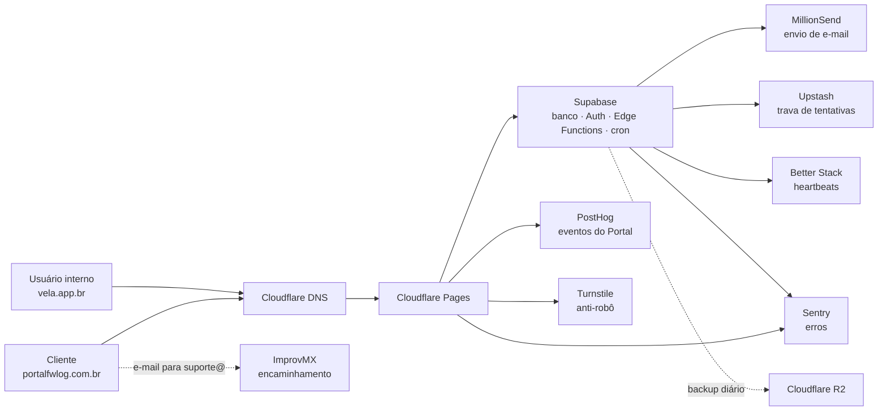

# Manual dos serviços externos

Inventário de **todas** as contas e plataformas de que o Vela e o Portal Fwlog
dependem: para que servem, como se entra, o que está configurado, onde moram os
segredos e o que quebra se cada uma parar. Escrito para quem assumir a operação
sem ter participado da configuração.

- **Estado em:** 2026-09-28, após a migração da Vercel para o Cloudflare
  Pages ([roteiro executado](../archive/plans/2026-09-24-configuracao-servicos-e-migracao-cloudflare.md)).
- **Nunca** escreva valores de segredo aqui. Este documento lista **nomes** e
  **onde** o valor está guardado.
- Ao mudar qualquer configuração de serviço, atualize esta página na mesma PR.

## Mapa geral



## Quem é dono de quê

| Serviço | Conta / login | Plano |
|---|---|---|
| GitHub | repositório `luccafwlog/vela` | — |
| Supabase | login com GitHub; projeto de produção `fgmkhbzhaeebrsizwccx` | — |
| Cloudflare | `luccafwlog@gmail.com`; conta `b9f47a26b8f708444419dac863a54cd4`; time Zero Trust `icy-term-9505` | Free / Zero Trust Free |
| Vercel (rollback manual) | time `luccafwlogs-projects`; projetos `vela` e `fwlog-portal`, Git desconectado | Hobby |
| Registro.br | titular dos domínios `vela.app.br`, `portalfwlog.com.br`, `transhippingdesk.com.br` | — |
| MillionSend | conta `FWLOG` que envia por `portalfwlog.com.br` (Resend: conta anterior, sem uso desde 2026-10-14) | — |
| ImprovMX | domínios `transhippingdesk.com.br` e `portalfwlog.com.br` | — |
| Upstash | database `vela-rate-limit` (`sa-east-1`) | — |
| Sentry | organização com projetos `vela` e `portal` | — |
| PostHog | região **EU** (`eu.posthog.com`) | — |
| Better Stack | Uptime: 2 monitores e 7 heartbeats (um deles do backup); os de `ce-unlock-notify-email` (5 min, tolerância 5 min) e `portal-email-events-runner` (1 min, tolerância 5 min) foram cadastrados em 2026-10-19 e estão Up | Free (avisa a equipe inteira) |
| Computador do backup | usuário Windows `Lucca`, pasta `C:\Users\Lucca\Downloads\Vela` | — |

Ao transferir a responsabilidade, siga o [checklist de passagem](#passagem-de-responsabilidade).

## Onde os segredos estão guardados

| Lugar | O que guarda | Quem lê |
|---|---|---|
| Supabase → **Edge Functions → Secrets** | segredos das Edge Functions (lista na seção [Supabase](#supabase)) | Edge Functions; o painel mostra só um *digest*, nunca o valor |
| Supabase → **Vault** (`vault.secrets`) | segredos que os jobs `pg_cron` enviam às Functions | só o banco; ver [segredos-cron.md](segredos-cron.md) |
| GitHub → **Settings → Secrets and variables → Actions** | tokens de deploy e valores públicos de build | workflows |
| GitHub → environment **`cloudflare-production`** | 7 variáveis `VITE_*` e secret `CLOUDFLARE_PAGES_API_TOKEN` (2026-10-07); deployment restrito à branch `main` | só o workflow de produção |
| GitHub → environment **`cloudflare-pages`** | secret `CLOUDFLARE_PAGES_API_TOKEN` (2026-10-07); sem restrição de branch | jobs `publish` da Preview, limpeza e provisionamento do Pages |
| GitHub → environment **`staging`** | variáveis `VITE_SUPABASE_URL` e `VITE_SUPABASE_ANON_KEY` da branch Supabase `staging`, `VITE_TURNSTILE_SITE_KEY` (Site Key pública do widget `Vela staging`) e `SUPABASE_STAGING_PROJECT_REF` (ref da branch staging); secrets `CLOUDFLARE_PAGES_API_TOKEN` e `SUPABASE_STAGING_ACCESS_TOKEN` (token Supabase só de leitura das migrations, a criar pelo dono) | só o workflow de staging |
| GitHub → environment **`supabase-branches`** | secrets `SUPABASE_ACCESS_TOKEN` (PAT de 2026-10-08) e `PREVIEW_ADMIN_PASSWORD` (2026-10-07); sem restrição de branch | job `prepare` da Preview e `provision-preview-admin` |
| Windows do computador do backup → **variáveis do usuário** | `SUPABASE_DB_URL`, `BACKUP_ENCRYPTION_KEY_HEX`, `R2_*`, `BACKUP_ALLOW_PRODUCTION` | tarefa agendada do backup |
| Windows → **Gerenciador de Credenciais** | `VelaBackup/R2AccessKeyId`, `VelaBackup/R2SecretAccessKey`, `VelaBackup/EncryptionKey` | o dono, para reconfigurar o backup |
| iCloud Senhas do dono | `vela-backup` (chave de cifragem), `supabase-db-vela` (senha do banco) | cópia fora do computador |

A chave de cifragem do backup existe **só** no Gerenciador de Credenciais e no
iCloud Senhas. Sem ela, nenhum backup do R2 pode ser aberto.

---

## Domínios e DNS

### Registro.br

Registro dos três domínios. A partir de 2026-09-24, `vela.app.br` e
`portalfwlog.com.br` delegam para a Cloudflare (`ariadne.ns.cloudflare.com`,
`pablo.ns.cloudflare.com`). `transhippingdesk.com.br` continua com o DNS do
próprio Registro.br.

- **DNSSEC:** ativo nos dois domínios desde 2026-09-24. A chave fica na
  Cloudflare (**DNS → Settings → DNSSEC**). O DS correspondente está no
  Registro.br (**Alterar servidores DNS → + DNSSEC**): keytag `2371` nos dois,
  com digests diferentes. Antes de trocar de novo os servidores DNS, **remova o
  DS** no Registro.br e espere cerca de 2 horas. Com um DS antigo publicado, o
  domínio deixa de resolver.
- **Renovação:** confira a data de expiração de cada domínio no painel do
  Registro.br; domínio expirado derruba site e e-mail.

### Cloudflare DNS

| Domínio | Registro | Valor | Para quê |
|---|---|---|---|
| `vela.app.br` | `CNAME @` | `vela-internal.pages.dev` (nuvem laranja) | site no Cloudflare Pages |
| | `TXT @` | `v=spf1 -all` | o domínio não envia e-mail |
| | `TXT _dmarc` | `v=DMARC1; p=reject;` | rejeitar e-mail falso em nome do Vela |
| | `A www` | `192.0.2.1` (nuvem laranja) | endereço fictício; só existe para a Redirect Rule do `www` |
| `portalfwlog.com.br` | `CNAME @` | `vela-portal.pages.dev` (nuvem laranja) | site no Cloudflare Pages |
| | `MX @` | `mx1.improvmx.com` (10), `mx2.improvmx.com` (20) | receber e-mail (ImprovMX) |
| | `TXT @` | `v=spf1 include:spf.improvmx.com ~all` | SPF do domínio raiz |
| | `TXT millionsend._domainkey` | chave pública DKIM mostrada pela MillionSend | assinatura do envio |
| | `MX send` (10), `TXT send` | `feedback-smtp.sa-east-1.amazonses.com` e `v=spf1 include:amazonses.com ~all` | SPF/retorno do envio (MillionSend) |
| | `TXT resend._domainkey`, `CNAME rsend` | sobras da Resend, sem uso | apagar quando a Resend for encerrada |
| | `TXT _dmarc` | `v=DMARC1; p=none; rua=mailto:suporte@portalfwlog.com.br; fo=1` | política e relatórios DMARC |
| | `A www` | `192.0.2.1` (nuvem laranja) | endereço fictício; só existe para a Redirect Rule do `www` |

**Redirect Rules** (em cada zona: **Rules → Redirect Rules**). A regra
**"www para raiz"** vai de `https://www.<domínio>/*` para
`https://<domínio>/${1}`, com 301 e preservando a query string. Conferido em
2026-09-24: `https://www.<domínio>/teste?x=1` → 301 para
`https://<domínio>/teste?x=1` nos dois domínios. O `A www` precisa ficar com
proxy (laranja): sem proxy a regra não roda e o `www` não abre. Não aponte o
`www` para a Vercel nem para o Pages; o redirecionamento é da Cloudflare.

Regras:

- O `CNAME @` de cada domínio é criado e mantido pelo **Custom domain** do
  projeto Pages. Não o edite à mão; para trocar, remova o domínio no projeto.
- Registros de e-mail (MillionSend e sobras da Resend) ficam **DNS only** (nuvem cinza). O `CNAME @` do Pages e o
  `A www` ficam com proxy.
- **Volta para a Vercel:** apague o `CNAME @` e crie
  `A @ 216.198.79.1` com nuvem **cinza** (proxy na frente da Vercel quebra o
  certificado); depois remova o custom domain do projeto Pages.
- `transhippingdesk.com.br` guarda o e-mail legado (ImprovMX e Resend); não é
  servido pela Cloudflare.

---

## Hospedagem do front-end

O repositório gera dois sites a partir do mesmo código: **Vela** (interno,
`index.html`) e **Portal** (cliente, `portal.html`).

### Cloudflare Pages (produção)

Serve os dois domínios desde 2026-09-24 (Etapa 10).

| Projeto | Endereço `pages.dev` | Domínio (Custom domain, Active) |
|---|---|---|
| `vela-internal` | `vela-internal.pages.dev` | `vela.app.br` |
| `vela-portal` | `vela-portal.pages.dev` | `portalfwlog.com.br` |

- **Upload direto**, sem integração Git. Não configure build pelo painel: o
  `npm run build` com `dist` publicaria o app interno no lugar do Portal.
- **Produção:** `.github/workflows/cloudflare-pages-production.yml`, a cada
  merge no `main`, ligado pela variável `CLOUDFLARE_PAGES_PRODUCTION_ENABLED=true`.
- **Previews:** `.github/workflows/cloudflare-pages-preview.yml` publica
  `pr-<n>.vela-internal.pages.dev` e `pr-<n>.vela-portal.pages.dev` contra o banco
  da branch de preview do Supabase; `cloudflare-pages-preview-cleanup.yml` apaga,
  ao fechar a PR, os deployments antigos de `pr-<n>`, e o mais recente continua
  no alias da PR, atrás do Access ([deploy.md](../setup/deploy.md#workflows)).
  Só publica com `CLOUDFLARE_PAGES_ACCESS_CONFIGURED=true`.
- **Staging persistente:** `.github/workflows/cloudflare-pages-staging.yml`
  publica a git branch `staging` em `staging.vela-internal.pages.dev` e
  `staging.vela-portal.pages.dev` (deploy de Preview, atrás do mesmo Access),
  contra a branch Supabase `staging`. Ligado por
  `CLOUDFLARE_PAGES_STAGING_ENABLED=true` junto com
  `CLOUDFLARE_PAGES_ACCESS_CONFIGURED=true`
  ([deploy.md](../setup/deploy.md#staging-persistente)).
- **Cabeçalhos de segurança (CSP):** gerados por
  `scripts/cloudflare-pages-stage.mjs`; mudam junto com os workflows e o staging do Pages
  ([deploy.md](../setup/deploy.md#headers-rotas-e-cors)).
- **Pages Function `functions/assets/[[path]].ts`:** os dois projetos a recebem
  em `/assets/*`; cada requisição de `/assets/*` conta na cota de invocações de
  Functions do plano. O que ela responde e como é conferida estão em
  [deploy.md](../setup/deploy.md#headers-rotas-e-cors).
- **Token:** secret `CLOUDFLARE_PAGES_API_TOKEN` nos environments GitHub
  `cloudflare-pages`, `cloudflare-production` e `staging`. O valor é o User API Token
  `GitHub Actions — Vela e Portal Fwlog Pages` (Cloudflare Pages: Edit, uma
  conta), criado em 2026-10-07. Em 2026-10-08 a cópia Repository-level foi
  apagada e o Account API Token anterior, `Vela Pages CI/CD` (Pages Write), foi
  revogado. Na conta ficam só `vela-backup-diario` (R2, backup) como Account API
  Token. Histórico: os runs `37608023373`, `37619183889`, `37626476950`, `37629073181`
  e `37630494893` receberam o secret e o ID de conta, mas `GET /pages/projects`
  falhou com HTTP 400 / código `80000024`; os dois últimos informaram
  `Invalid list options provided`, mesmo após `per_page` mudar de 25 para 20.
  A operação foi redesenhada para consultar cada projeto conhecido pela rota
  individual `GET /pages/projects/{project_name}` documentada pela
  [Cloudflare Pages API](https://developers.cloudflare.com/api/resources/pages/subresources/projects/methods/get/),
  e só criar quando a resposta for HTTP 404. O run `37631613061` em `main`
  concluiu com sucesso: os projetos `vela-internal` e `vela-portal` já existiam
  e foram deixados inalterados. Isso valida a credencial e a consulta individual
  no provisionador. Em 2026-10-08, Preview (run `37819195317`), limpeza (run
  `37820173005`, que removeu deployments antigos) e produção também passaram
  com o token dos environments.

### Cloudflare Access (proteção das previews)

Cloudflare One → **Access controls → Applications**:
`vela-internal - Cloudflare Pages` (`*.vela-internal.pages.dev`) e
`vela-portal - Cloudflare Pages` (`*.vela-portal.pages.dev`). Política
**Allow Members - Cloudflare Pages**: Include → Emails → `luccafwlog@gmail.com`;
o login é pela conta Cloudflare. O `*.` protege só as previews; os endereços de
produção `*.pages.dev` ficam abertos.

Ao passar a responsabilidade, troque o e-mail da política pelo do novo
responsável.

### Vercel (rollback manual, sem publicação automática)

Em 2026-09-28, os projetos `vela` e `fwlog-portal` ficaram sem conexão Git. Os domínios de produção e os domínios legados não estão associados a eles. Os projetos e deployments existentes permanecem na conta como opção de rollback manual; nenhum tráfego de produção depende deles. O build ativo e os headers são os do Cloudflare Pages.

Para retomar a Vercel, restaure a configuração de build do Vite, reconecte o Git, associe o domínio e faça o cutover DNS descrito em [Cloudflare DNS](#cloudflare-dns). Valide o site antes de remover o domínio do Pages.

---
## Supabase

Banco PostgreSQL, Auth, Storage, Edge Functions e jobs agendados. Projeto de
produção `fgmkhbzhaeebrsizwccx`. O projeto GitHub é `luccafwlog/vela`.
A produção do Cloudflare Pages espera o check que a integração publica no
commit da `main` antes de publicar
([ADR 0086](../adr/0086-ci-confere-na-medida-da-mudanca.md)); a `main` precisa
continuar vinculada à produção em Branching → Configuration (vínculo
conferido no painel pelo dono em 2026-10-15; o check veio verde nos merges
`b42427c7`, `2763f99b` e `cb7ef2de`, e pulado no `1aa7aaf7` com "not
associated with any Supabase Branch"). Automatic branching está **desligado** (conferido em 2026-10-07); portanto,
abrir uma PR não cria por si só uma branch Supabase nem garante o check
"Supabase Preview". A integração permite criar uma branch pontual e vinculá-la
a uma branch GitHub. O painel informa custo de US$ 0,01344 por hora enquanto a
branch existir, sem impostos; removê-la encerra essa cobrança. Branches novas
não copiam dados de produção por padrão.

Para uma Preview pontual sem ligar Automatic branching: em Supabase → projeto
Vela → Branching → Create branch, informe o nome da branch de Preview e a mesma
branch GitHub da PR em "Sync with Git branch". A integração publica commits
nessa branch. Depois, ponha a etiqueta `preview` na PR para disparar os
workflows de preview. Manter a PR aberta até o check Supabase Preview e o workflow
Cloudflare Pages Preview concluírem; remover a branch após os testes para
encerrar o custo. Conferir a criação e a exclusão no painel. A página Branching
estava sem branches persistentes ou de Preview na conferência de 2026-10-08;
`codex/run2-manual-preview-probe` já tinha sido removida.

**Branch persistente `staging`** (ref `uvgqfpleiyfythkhutlj`, criada em
2026-10-19, "Sync with Git branch" `staging`): banco do staging persistente
([deploy.md](../setup/deploy.md#staging-persistente)). Por ser persistente, a
cobrança por hora vale enquanto ela existir. Em 2026-10-20 tinha as 322
migrations, Vault vazio (os jobs `pg_cron` avisam e não disparam) e nenhum dado
de produção. No mesmo dia, as linhas `007` e `135` do histórico de produção
foram reparadas com `supabase/scripts/reparo_schema_migrations_007_135.sql`
(backup em `supabase_migrations.schema_migrations_bkp_007_135`), para branches
novas não falharem na `165`.

- **Acesso administrativo:** painel pelo login com GitHub; CLI com
  `supabase login`. O CI usa `SUPABASE_ACCESS_TOKEN` e `SUPABASE_PROJECT_REF`.
  O environment GitHub `supabase-branches` guarda, além de
  `PREVIEW_ADMIN_PASSWORD`, o PAT escopado ao projeto `fgmkhbzhaeebrsizwccx`,
  criado em 2026-10-08 e com três permissões, todas `Read`:
  - `API Keys`: o CLI obtém as chaves públicas da branch;
  - `Development Branches`: `branches list` e `branches get`;
  - `Connection Pooling` (`database_pooling_config_read`): sem ela, o
    `branches get` do CLI 2.113 responde 403 e as Previews falham.
  `API Key Secrets` e qualquer permissão de escrita ficam em `None`. O painel
  mostra o PAT (`GitHub Actions — Vela Preview branches v2`) sem expiração;
  revogue-o e gere outro se houver suspeita de exposição.
- **Token da conferência do staging:** secret `SUPABASE_STAGING_ACCESS_TOKEN`
  no environment GitHub `staging`, com a variável
  `SUPABASE_STAGING_PROJECT_REF` (`uvgqfpleiyfythkhutlj`). O workflow de
  staging o usa só para ler `GET /v1/projects/{ref}/database/migrations` e
  conferir as migrations do push antes de publicar
  ([deploy.md](../setup/deploy.md#staging-persistente)). Deve ser um token só
  de leitura das migrations do banco, sem permissão de escrita; o script recusa
  o ref de produção. Situação em 2026-10-20: proposto, ainda não criado; sem
  ele o staging recusa como antes os pushes com migration cujo check vem
  pulado.
  Validação: em 2026-10-08, com esse PAT, os workflows Provision Preview Admin e
  Cloudflare Pages Preview da PR 903 concluíram com sucesso.
  Histórico: o PAT de 2026-10-07 (sem `Connection Pooling`) e o PAT exposto
  numa saída de acessibilidade já não existiam na conferência de 2026-10-08, e a
  cópia Repository-level de `SUPABASE_ACCESS_TOKEN` foi apagada nesse dia.
  Os outros tokens da conta são os `cli_*` do `supabase login` nos computadores
  do dono e `Muse all org` (bot do dono, acesso à organização inteira, vence em
  2026-10-10).
- **Team da organização:** só `luccafwlog@gmail.com` (Owner). O SMTP padrão do
  Auth só entrega a membros do Team; testes de e-mail do Auth precisam de
  endereço membro (em 2026-10-08 um alias entrou temporariamente e foi
  removido).
- **Senha do banco:** só alfanumérica; guardada em `supabase-db-vela` (iCloud
  Senhas) e usada apenas pelo backup. Nada no repositório usa essa senha.
- **Cadastro público do Auth desligado:** o app não usa `signUp`; contas
  nascem só pelas Edge Functions `admin-users` e `portal-invite-activate`
  (`auth.admin.createUser` com `service_role`, que não depende do cadastro
  público). Em Authentication → Sign In / Providers → User Signups, "Allow new
  users to sign up" fica desligado (`disable_signup = true`). A auditoria
  defensiva de 2026-10-19 achou o cadastro aberto em produção
  (`GET /auth/v1/settings`: `disable_signup: false`); **desligar é passo
  pendente do dono** e esta linha deve ganhar a data da conferência quando
  `GET /auth/v1/settings` voltar `disable_signup: true`. A branch Supabase
  `staging` (`uvgqfpleiyfythkhutlj`) ainda não foi conferida: o mesmo
  `GET /auth/v1/settings` no host dela, com a chave anon do staging, deve
  voltar `disable_signup: true`; se não voltar, desligar no painel da branch.
  Desde a migration `337`, uma conta criada assim também
  não lê a programação de navios.
- **Usuário técnico do Auth:**
  `portal-login-dummy@portal-interno.transhippingdesk.invalid`
  (`91abc3b0-96ab-49b0-9a7d-750d5e7d9e84`). **Não apague**: sem ele o login do
  Portal devolve 500 para todos.

### Edge Functions

As 24 funções do repositório estão publicadas e `ACTIVE` em produção:
`admin-users`, `alerts-detector`, `ce-unlock-cleanup`,
`ce-unlock-document-download`, `ce-unlock-export`, `ce-unlock-notify-email`,
`customer-communication-auto-runner`, `demurrage-dunning`,
`import-effects-runner`, `itau-pix`, `portal-account-suspend`,
`portal-ce-unlock-document`, `portal-daily-digest`, `portal-dispute-attachment`,
`portal-email-events-runner`, `portal-email-webhook`, `portal-invite-activate`,
`portal-invite-send`, `portal-login`, `portal-password-recovery`,
`portal-password-reset`, `portal-recovery-email-change`,
`recalc-demurrage-ptax` e `send-customer-communication`. A Edge Function
antiga de aviso de fatura emitida, que a
[ADR 0058](../adr/0058-canal-de-comunicado-ao-cliente.md) mandou apagar (o nome
está na ADR), foi apagada pelo dono no painel em 2026-10-14
([ADR 0083](../adr/0083-decisoes-da-revisao-geral-da-documentacao.md), item 26).
Antes da remoção, nenhum job do `pg_cron` nem função do banco a chamava.
**Runtime:** listagem somente de leitura das Edge Functions do projeto em
2026-10-14, antes e depois da remoção (24 funções depois, sem a antiga); `itau-pix` estava na v20, publicada em
2026-10-13 às 17:47 UTC, e o código baixado trata `{"action":"process_charges"}`,
o disparo da migration `219` (seção [Itaú](#itaú--api-pix-recebimentos)).

Publicação: a Supabase GitHub Integration publica as Functions alteradas no
merge em `main`, desde que a função esteja declarada em
[`supabase/config.toml`](../../supabase/config.toml) (`[functions.<nome>]`, com
o `verify_jwt` dela). `admin-users` não estava declarada e ficou na versão de
2026-09-30, publicada à mão, apesar de mudar nas PRs 901 e 954; foi publicada
pelo conector do Supabase em 2026-10-15 (versão 44, código do `main`) e
declarada no `config.toml` na mesma data. O teste
`edgeTelemetryConfiguration.test.ts` recusa função do repositório sem
declaração. Observado em 2026-10-10 (funções do Desbloqueio de CE) e em
2026-10-14 (`portal-password-recovery` atualizada minutos após o merge da PR
951); a configuração da integração que faz isso não foi conferida. Depois de
cada merge, confira em Supabase → Edge Functions a data de atualização das
funções alteradas, ou baixe o código publicado com `supabase functions download`
e compare com o `main`. Se alguma não foi publicada:
`supabase functions deploy <nome> --project-ref fgmkhbzhaeebrsizwccx`.

Para publicar a proteção de recuperação da PR 841, aplique as migrations `131`
e `132` antes de publicar `portal-password-reset` e
`portal-recovery-email-change`. O procedimento de triagem de reset interrompido
está em [Segurança](seguranca.md#invariante-de-provisionamento-do-portal).

As correções da PR 954 (plano de correções da revisão geral) foram a produção
pelo caminho automático no merge de 2026-10-15 (13:42 UTC): a integração do
Supabase aplicou as migrations `230` a `278` e publicou as Edge Functions
alteradas, e o frontend só é publicado depois do check do Supabase no commit
([Deploy](../setup/deploy.md)). **Runtime** (leitura do projeto pelo conector
do Supabase em 2026-10-15, 13:43 UTC): as migrations `230` a `278` constam
aplicadas; `bl_belongs_to_atracacao`, `_demurrage_roe_markup`,
`_demurrage_ptax_from_roe` e `reactivate_catalog_row` existem; o índice
`demurrage_invoices_pix_txid_unique` existe; `create_manual_invoice` tem
`p_reason`; `recalc-demurrage-ptax`, `send-customer-communication`,
`portal-daily-digest` e `demurrage-dunning` foram republicadas às 13:43 UTC.
`admin-users` não foi (ver o parágrafo de Publicação acima) e foi publicada
à mão às 13:49 UTC; respondeu 204 ao preflight e 403 sem sessão. O job
`recalc-demurrage-ptax` das 17:00 UTC do mesmo dia (item 3 abaixo) terminou com
sucesso e gravou a referência de 2026-10-15 às 17:00:02 UTC (PTAX 5,0521, ROE
5,3805 = PTAX × 1,065, fonte `bcb_live`), sem alerta
`demurrage_ptax_recalc_failed` novo. Duas funções
dependem de migration nova:

| Função | Depende de | Se ficasse no ar sem a migration |
|---|---|---|
| `recalc-demurrage-ptax` | migration `264` (`save_exchange_rate_reference_v2` aceita ROE nulo) | O job da PTAX das 14h falha com `reference_failed` e as Invoices de Demurrage ficam sem o BRL do dia |
| `send-customer-communication` | migration `243` (`bl_belongs_to_atracacao`) | Todo NOB manual devolve 422 ("Um B/L não pertence à Frente de Operação") |

`admin-users`, `portal-daily-digest` e `demurrage-dunning` também mudaram, sem
depender de migration nova. A ordem entre migrations e Functions dentro da
integração não foi conferida (ver acima); se a aplicação das migrations falhar
no merge, as duas funções da tabela ficam no ar sem o que precisam. Depois do
merge, confira:

1. `SELECT proname FROM pg_proc WHERE proname IN ('bl_belongs_to_atracacao', '_demurrage_roe_markup', 'reactivate_catalog_row');` devolve as três.
2. Em Supabase → Edge Functions, `recalc-demurrage-ptax` e `send-customer-communication` com a data do merge.
3. A execução seguinte do job da PTAX grava a referência do dia (sem alerta de falha da PTAX). Conferido em 2026-10-15 (ver acima).

### Secrets das Edge Functions

| Grupo | Nomes | Serviço de origem |
|---|---|---|
| Plataforma (automáticos) | `SUPABASE_URL`, `SUPABASE_ANON_KEY`, `SUPABASE_SERVICE_ROLE_KEY`, `SUPABASE_DB_URL`, `SUPABASE_JWKS`, `SUPABASE_PUBLISHABLE_KEYS`, `SUPABASE_SECRET_KEYS` | Supabase |
| Portal | `PORTAL_URL`, `PORTAL_TECH_EMAIL_DOMAIN`, `PORTAL_LOGIN_DUMMY_AUTH_USER_ID`, `PORTAL_PASSWORD_PEPPER` | — |
| E-mail | `RESEND_API_KEY`, `RESEND_WEBHOOK_SECRET`, `RESEND_BASE_URL` (obrigatório com a MillionSend), `PORTAL_FROM_EMAIL`, `PORTAL_REPLY_TO`, `PORTAL_SUPPORT_EMAIL`, `COMMUNICATIONS_REPLY_TO`, `DEMURRAGE_REPLY_TO` | MillionSend (API compatível com a Resend) |
| Anti-robô | `TURNSTILE_SECRET_KEY` (e opcional `TURNSTILE_ALLOWED_HOSTNAMES`) | Cloudflare Turnstile |
| Trava de tentativas | `UPSTASH_REDIS_REST_URL`, `UPSTASH_REDIS_REST_TOKEN`, `PORTAL_RATE_LIMIT_HMAC_SECRET` (e opcionais `PORTAL_RATE_LIMIT_*`) | Upstash |
| Jobs | `ALERTS_DETECTOR_SECRET`, `CUSTOMER_COMMUNICATION_AUTOMATION_SECRET`, `DEMURRAGE_DUNNING_SECRET`, `PORTAL_DIGEST_SECRET`, `PORTAL_EMAIL_EVENTS_CRON_SECRET`, `IMPORT_EFFECTS_CRON_SECRET`, `RECALC_CRON_SECRET`, `CE_UNLOCK_CLEANUP_SECRET`, `ITAU_PIX_ADMIN_SECRET` (par com o Vault quando o job está habilitado; lista do cofre em [segredos-cron.md](segredos-cron.md)) | — |
| Itaú | `ITAU_CLIENT_ID`, `ITAU_CLIENT_SECRET`, `ITAU_CERT_B64`, `ITAU_KEY_B64`, `ITAU_PIX_KEY` (e opcionais `ITAU_PIX_BASE_URL`, `ITAU_TOKEN_URL`, `ITAU_AUTH_HEADER`) | Itaú (seção [Itaú](#itaú--api-pix-recebimentos)) |
| Monitoramento | `BETTERSTACK_HEARTBEAT_*_URL` (6, todos gravados; os dois últimos, `BETTERSTACK_HEARTBEAT_CE_UNLOCK_NOTIFY_URL` e `BETTERSTACK_HEARTBEAT_PORTAL_EMAIL_EVENTS_URL`, em 2026-10-19), `SENTRY_DSN`, `SENTRY_ENVIRONMENT` | Better Stack, Sentry |
| CORS de previews | `CLOUDFLARE_PAGES_PREVIEW_ORIGINS` (opcional) | Cloudflare Pages |

`PORTAL_PASSWORD_PEPPER` (≥ 32 caracteres aleatórios) é a chave do
`HMAC(pepper, senha)` que o GoTrue guarda para as contas do Portal (auditoria
run-2, #7). Precisa existir **antes** do deploy de `portal-login`,
`portal-invite-activate`, `portal-password-reset` e
`portal-recovery-email-change`; sem ele essas funções respondem erro. Trocar o
valor invalida a senha de todas as contas migradas (o cliente precisa usar a
recuperação), então não é um segredo de rotação rotineira.

`PORTAL_EMAIL_EVENTS_CRON_SECRET`, `IMPORT_EFFECTS_CRON_SECRET` e
`RECALC_CRON_SECRET` existem no código. **Conferência somente de leitura em
2026-10-07:** `PORTAL_EMAIL_EVENTS_CRON_SECRET` existe no Vault; o segredo
correspondente na Edge Function não foi conferido. `IMPORT_EFFECTS_CRON_SECRET`
e `RECALC_CRON_SECRET` não existiam no Vault nessa conferência. Nota de execução
posterior em 07/10: `RECALC_CRON_SECRET` provisionado em par, validado via
HTTP 200 e job agendado às 17h UTC de segunda a sexta. `IMPORT_EFFECTS_CRON_SECRET`
ficou sem provisionar de propósito até a ligação do `import-effects-runner`
(decisão do dono, 2026-10-08); foi criado em par em 2026-10-12, quando o runner
foi ligado (ver o roteiro abaixo). **Condição para
ligar (ADR 0078, item 18):** o runner fica desligado até a Etapa 13 do
[plano de correção das importações](../archive/plans/2026-10-09-correcao-importacoes-ce-mercante.md),
depois da correção das tarefas da fila (Etapas 4 e 7 em produção), do ensaio
em Preview e da aprovação do acumulado pela simulação; a ligação em produção é
ato do dono. O diagnóstico da fila em leitura está em
`supabase/scripts/diagnostico_importacoes_ce_somente_leitura.sql`. A migration `107` deixa
`portal-email-events-runner` e `import-effects-runner` agendados; para o
segundo, o dispatcher emite `WARNING` e não chama a Edge Function enquanto o
segredo do Vault estiver ausente. O job `recalc-demurrage-ptax` foi agendado manualmente em 07/10 (jobid 26). Um `succeeded` em `cron.job_run_details` só comprova que o
wrapper do `pg_cron` terminou; confirme também a chamada HTTP conforme
[segredos e cron](segredos-cron.md#verificação). **Rotação de 2026-10-08:**
`ALERTS_DETECTOR_SECRET`, `CUSTOMER_COMMUNICATION_AUTOMATION_SECRET`,
`DEMURRAGE_DUNNING_SECRET`, `PORTAL_DIGEST_SECRET` e
`PORTAL_EMAIL_EVENTS_CRON_SECRET` trocados em par por volta de 23:35 UTC, com
`200` confirmado nas cinco funções depois da janela da troca.

### Jobs agendados (`pg_cron`)

Horários em UTC; Brasília é UTC−3. "Chave global" é
`app_settings.communications_enabled`: desligada, o envio ao Cliente vira
`simulado`.

| Job | Frequência (UTC) | O que faz | Heartbeat no Better Stack |
|---|---|---|---|
| `portal-email-events-runner` | a cada minuto | processa eventos do provedor de e-mail (entrega, bounce, reclamação), suprime endereços e abre Alertas; evento que esgota as 6 tentativas ou é ambíguo vai para investigação e abre `portal_reprocessamento_falhou` (migration `309`) | `portal-email-events-runner` (secret `BETTERSTACK_HEARTBEAT_PORTAL_EMAIL_EVENTS_URL`; cadastrado em 2026-10-19) |
| `itau-pix-queue` | a cada minuto (agendado manualmente em 07/10, jobid 25); desde a migration `219` a fila de COB também é disparada pela transação que deixa cobrança pendente (`{"action":"process_charges"}`) | prazos das cobranças PIX, fila de COB na API Itaú e baixa automática; o comportamento da fila está em [Reconciliação PIX](../modules/reconciliacao-pix.md#cobrança-dinâmica-itaú--migration-151) | — |
| `ce-unlock-notify-email` | a cada 5 min (manual, 07/10, jobid 23) | avisos do Desbloqueio de CE ao Cliente; com a chave global desligada, registra o aviso como `simulated` e não o envia depois (migration `307`); abre o Alerta `desbloqueio_ce_aviso_nao_enviado` quando o aviso fica sem destinatário ou falha ([Desbloqueio de CE](../modules/desbloqueio-ce.md#avisos-ao-cliente)) | `ce-unlock-notify-email` (secret `BETTERSTACK_HEARTBEAT_CE_UNLOCK_NOTIFY_URL`; cadastrado em 2026-10-19) |
| `import-effects-runner` | a cada minuto (`* * * * *`, migration `218`; antes `3-59/5`, migration `165`) e também disparado pela própria importação, uma vez por transação que grava efeito | fila de efeitos de importação; ligado desde 2026-10-12. Um runner por vez (`ops.import_effects_runner_lease`, renovada a cada bloco; a chamada sem a vez responde `skipped: busy`); cada chamada trabalha em blocos de 10 por até ~25 s. A parada é avisada pelo Alerta `import_effects_queue_stalled` | — |
| `alerts-foundation-detectors` | a cada 15 min, em :02/:17/:32/:47 (`2-59/15 * * * *`, migration `165`) | abre/fecha Alertas do sino; remove até 100 anexos órfãos de Disputa | `alerts-detector` |
| `customer-communication-auto-runner` | a cada 15 min, em :04/:19/:34/:49 (`4-59/15 * * * *`, migration `165`) | Comunicados automáticos NOA/NOR/NOB e CE Mercante/Taxas (respeita a chave global) | `customer-communication-auto-runner` |
| `portal-mark-expired-invites` | a cada 15 min | expira convites do Portal vencidos e abre Alerta de reenvio | — |
| `demurrage-dunning` | de hora em hora, no minuto 7 (`7 * * * *`, migration `165`) | Régua de Cobrança de Demurrage (respeita a chave global) | `demurrage-dunning` |
| `cleanup-provision-rate-limit` | 03:30 | apaga registros de limite de provisionamento com mais de 2 dias | — |
| `ce-unlock-cleanup` | 06:00 (manual, 07/10, jobid 24) | expurga documentos vencidos do Desbloqueio de CE e expira rascunhos | — |
| `billing-release-expiry-review` | 03:13 (00:13 de Brasília; `13 3 * * *`, migration `168`) | `reevaluate_expired_billing_releases()`: devolve à Revisão os B/Ls não faturados de Cliente cuja Liberação de faturamento sem Portal venceu nos últimos 7 dias | — |
| `data-retention` | 06:30 (03:30 de Brasília) | `run_retention()` | — |
| `container-demurrage-status` | 03:17 (00:17 de Brasília; `17 3 * * *`, migration `197`) | `refresh_containers_demurrage_status()`: grava `overdue` no container sem devolução cujo free time venceu desde a última gravação e tira do atraso o de B/L ou Viagem Cancelados (SQL puro; migration `200`) | — |
| `http-job-failures` | a cada 15 min, em :09/:24/:39/:54 (`9-59/15 * * * *`, migration `310`) | `reconcile_http_job_failures_alert()`: abre o Alerta crítico `rotina_http_falhou` (Administrativo) quando `net._http_response` tem, na última hora, resposta fora de 2xx ou falha sem resposta que não seja tempo esgotado, 10 ou mais tempos esgotados, ou quando há 30 ou mais chamadas paradas na fila do `pg_net` (migration `316`), e o fecha quando a hora fica limpa; SQL puro, sem Vault nem Edge Function | — |
| `import-effects-queue-health` | de hora em hora, em :07 (`7 * * * *`, migration `178`) | `reconcile_import_effects_queue_alert()` (migration `190`): abre o Alerta `import_effects_queue_stalled` quando um efeito pendente ou em nova tentativa está vencido (`next_attempt_at`) há mais de 60 minutos e o fecha quando a fila anda; não processa efeitos | — |
| `portal-daily-digest` | 11:00 (08:00 de Brasília) | resumo interno a Administrativo e Documentação (inclui a exceção crítica de fatura) | `portal-daily-digest` |
| `recalc-demurrage-ptax` | 17:00 de segunda a sexta (14:00 de Brasília; manual, 07/10, jobid 26) | PTAX do BCB, referência cambial e recálculo em BRL das faturas emitidas | — |

O job `cleanup-portal-sessions` (03:00, sessões do token antigo do Portal) foi
desagendado pela migration `234`, junto com a tabela que limpava (ADR 0083,
item 21).

Até a migration `165`, nos minutos :00/:15/:30/:45 `net._http_response`
registrava chamadas sem resposta (`Timeout of 5000 ms`, em geral gastos em DNS)
e a rodada afetada só voltava no ciclo seguinte. Correção e verificação descritas
abaixo e em [segredos e cron](segredos-cron.md#horários-e-tempo-limite-dos-disparos).

`billing-release-expiry-review` é SQL puro, sem Vault nem Edge Function; o retorno (`customers`, `bls` reavaliados) fica em `cron.job_run_details`. Parado por mais de 7 dias, rode a função à mão com janela maior, por exemplo `SELECT public.reevaluate_expired_billing_releases(interval '30 days');`.

`import-effects-queue-health` é SQL puro (migration `178`) e não processa efeitos. Até a migration `190` ele não reconciliava de fato: o `pg_cron` roda sem JWT e a reconciliação de Alertas recusava ("Sem permissão."), então o Alerta nunca abria nem fechava. Desde a `190`, a função assume o papel de serviço só durante a própria execução, abre e fecha o Alerta crítico `import_effects_queue_stalled` e mede a idade pelo vencimento da tentativa (`next_attempt_at`), não pela criação: efeito em backoff legítimo não conta. Com o `import-effects-runner` ligado (desde 2026-10-12), o Alerta só abre se a fila parar: efeito vencido há mais de 60 minutos. Antes de ligar o runner, rode a simulação do acumulado (`simulate_import_effects`, server-only) e aprove ou descarte com `apply_import_effects_review` (Etapa 13 do plano de correção das importações).

#### Roteiro para ligar o `import-effects-runner` (ADR 0078, item 18)

Ato do dono, depois que as migrations `174` a `217` estiverem em produção, e
antes de o sistema receber dados reais (ADR 0079, decisão 3). Nada
aqui é feito pelo agente; registre data, quem executou e o resultado de cada
passo nesta seção.

**Pré-requisito do deploy das migrations:** rodar antes, em leitura, o
diagnóstico da Etapa 0
(`supabase/scripts/diagnostico_importacoes_ce_somente_leitura.sql`, numa
transação `READ ONLY`). A `177` aborta o deploy se houver CE repetido entre
B/Ls não cancelados, somando Granito, pela chave normalizada (`ce_mercante_key`:
letras e dígitos, maiúsculas, sem zeros à esquerda), e a `181` reescreve o Nº de
Manifesto Mercante na forma canônica de 13 caracteres e aborta listando os
números que colidem depois da normalização. Se as consultas 2a–2c ou 4 do
diagnóstico devolverem linhas, resolva antes do deploy.

As funções da simulação e da revisão exigem o papel de serviço
(`auth.role() = 'service_role'`). No SQL Editor do Supabase, defina o papel só
dentro da transação:

```sql
-- Simulação: só relato; termina em ROLLBACK.
BEGIN;
SET LOCAL request.jwt.claim.role = 'service_role';
SELECT public.simulate_import_effects(NULL, 200);
ROLLBACK;

-- Revisão: grava o descarte e processa o aprovado; termina em COMMIT.
BEGIN;
SET LOCAL request.jwt.claim.role = 'service_role';
SELECT public.apply_import_effects_review(ARRAY[<aprovar>]::bigint[],
  ARRAY[<descartar>]::bigint[], '<motivo>', '<uuid de quem revisou>');
COMMIT;
```

1. **Ensaio em Preview (antes de produção).** Na branch de Preview do Supabase,
   com as migrations aplicadas: crie `IMPORT_EFFECTS_CRON_SECRET` em par
   (Edge Function Secret e Vault, [segredos-cron](segredos-cron.md)), ligue
   `IMPORT_EFFECTS_RUNNER_ENABLED=true` e confira três ciclos seguidos
   (`3-59/5 * * * *`) em `cron.job_run_details` e no retorno HTTP da função:
   `import_effects_queue_health()` com `running` voltando a zero entre os
   ciclos (efeito tomado fica `running` até o fim do `lease_until`; não existe
   status `leased`) e o Alerta
   `import_effects_queue_stalled` fechado. Depois desligue
   (`IMPORT_EFFECTS_RUNNER_ENABLED` ausente ou diferente de `true`) e confira que
   a função responde `503 paused` e a fila para de andar sem perder efeitos.
2. **Simulação do acumulado em produção (sem gravar).** Com o runner ainda
   desligado, rode a simulação como mostrado acima (`BEGIN`, `SET LOCAL`,
   `SELECT public.simulate_import_effects(NULL, 200);`, `ROLLBACK`). Para cada
   efeito, a resposta diz o que ele faria (`would_succeed` ou `would_fail`, com
   faturas emitidas e canceladas e recálculos) e desfaz o que ele fez. A
   simulação executa cada efeito de verdade numa subtransação desfeita no fim:
   enquanto um efeito roda, ele trava os B/Ls e as faturas que tocaria, como o
   processamento real, e 200 efeitos podem levar minutos. Rode fora do
   expediente. Repita com `p_entity_prefix` por B/L quando quiser olhar um caso.
3. **Aprovar ou descartar o acumulado.** Decida, por efeito, o que vale
   processar e o que é obsoleto e rode `apply_import_effects_review` com o
   papel de serviço, como mostrado acima, terminando em `COMMIT`.
   O descarte vira `superseded` com o motivo no Histórico; o aprovado é
   processado na hora.
4. **Ligar em produção.** Crie `IMPORT_EFFECTS_CRON_SECRET` em par (Vault e
   Edge Function Secret) e defina `IMPORT_EFFECTS_RUNNER_ENABLED=true` na Edge
   Function. A partir daí o processamento fica sempre ligado.
5. **Conferir.** Na primeira hora: `cron.job_run_details` com chamadas HTTP 200,
   `import_effects_queue_health()` sem pendente antigo e o Alerta
   `import_effects_queue_stalled` fechado. Para desligar numa emergência, retire
   `IMPORT_EFFECTS_RUNNER_ENABLED`; a fila acumula e o Alerta volta a abrir
   depois de 60 minutos.

**Execução (2026-10-12, produção):** migrations `174` a `217` aplicadas no
merge da PR 929, depois do diagnóstico da Etapa 0 (uma duplicata de CE entre
B/Ls de teste, resolvida cancelando `CFRV22ZJGVIT016` pelo `cancel_bl`, com
autorização do dono). Simulação dos 1.000 efeitos mais antigos (o máximo por
chamada): todos `would_succeed`, sem fatura emitida nem cancelada. Por decisão
do dono, sem ensaio em Preview (dados de produção são de teste) e sem revisão
efeito a efeito: o acumulado é processado pelo próprio runner. O agente criou
`IMPORT_EFFECTS_CRON_SECRET` no Vault com valor gerado pelo banco; o dono
criou o par e `IMPORT_EFFECTS_RUNNER_ENABLED=true` na Edge Function. Primeiro
ciclo às 22:03 UTC; até 22:36, 140 efeitos `succeeded`, nenhum em
`retry_wait` ou `blocked`. O teste de desligamento (`503 paused`) não foi
feito. A migration `218` passa o job para cada minuto, faz a importação
disparar o runner, um runner por vez, e a função trabalhar por orçamento de
tempo. Em produção desde 2026-10-13: a `218` aplicada e a função nova
publicada (as respostas trazem `elapsed_ms`); o acumulado de ~2.800 efeitos
esvaziou em ~7 minutos, a 490–610 efeitos por minuto em `local_billing`.

`data-retention` roda `public.run_retention()` (migration `094`, ADR 0074; vigente na `311`): apaga auditoria com mais de 5 anos, exceto as marcas de escala, e eventos e tentativas do Portal com mais de 1 ano, inclusive os eventos do provedor de e-mail, e mascara o e-mail em claro das tentativas de envio com mais de 1 ano ([regras de negócio](regras-de-negocio.md)). É SQL puro; não usa Vault nem Edge Function. O resultado da execução fica em `cron.job_run_details`.

Os jobs HTTP chamam a Edge Function por `ops.dispatch_edge_job`, que dá 30 s
ao `pg_net` (antes, o padrão de 5 s incluía DNS e perdia a rodada nos minutos
cheios). Os horários deslocados evitam que os jobs de 15 min/hora disparem no
mesmo minuto; ver [segredos e cron](segredos-cron.md#horários-e-tempo-limite-dos-disparos).

Rotação de segredo de job: sempre o **par** Edge Function Secret + Vault
([segredos-cron.md](segredos-cron.md)).

---

## E-mail

### MillionSend (envio)

Envia convites, recuperação de senha, digest diário, Comunicados e cobrança de
Demurrage, sempre pelas Edge Functions (o navegador nunca chama o provedor).
Substituiu a Resend em 2026-10-14; a MillionSend aceita as mesmas chamadas da
API da Resend, por isso o código e os nomes dos secrets (`RESEND_*`) seguiram os
mesmos.

| Uso | Remetente | Resposta vai para |
|---|---|---|
| Acesso ao Portal (convite, recuperação de senha, aviso de senha alterada, troca do Email de Recuperação) e aviso de bounce ao Cliente | `PORTAL_FROM_EMAIL` | `PORTAL_REPLY_TO` = `suporte@portalfwlog.com.br` |
| Resumo diário do Portal (interno, aos usuários de Administrativo e Documentação) | `PORTAL_FROM_EMAIL` | `PORTAL_REPLY_TO` = `suporte@portalfwlog.com.br` |
| Avisos do Desbloqueio de CE ao Cliente | `PORTAL_FROM_EMAIL` | `PORTAL_REPLY_TO` = `suporte@portalfwlog.com.br` |
| Comunicados | `PORTAL_FROM_EMAIL` | `COMMUNICATIONS_REPLY_TO` = `importacao@fwlog.com.br` |
| Cobrança de Demurrage (régua automática) | `PORTAL_FROM_EMAIL` | `DEMURRAGE_REPLY_TO` = `eqp@fwlog.com.br` (obrigatório: sem ele o envio real é recusado, desde 2026-10-20) |

- **Conta:** organização `FWLOG` em `app.millionsend.com` (nuvem).
- **Domínio:** `portalfwlog.com.br` (**Verificado**, região São Paulo,
  `sa-east-1`). `transhippingdesk.com.br` não foi cadastrado: não há domínio de
  reserva no provedor atual. Não troque o remetente para um domínio que não
  esteja verificado na MillionSend: os e-mails param de sair.
- **Secrets atuais:** `PORTAL_FROM_EMAIL` = `Portal Fwlog <no-reply@portalfwlog.com.br>`;
  `PORTAL_REPLY_TO` e `PORTAL_SUPPORT_EMAIL` = `suporte@portalfwlog.com.br`;
  `RESEND_BASE_URL` = `https://api.millionsend.com`. Sem `RESEND_BASE_URL`, o
  código (`supabase/functions/_shared/email.ts`) volta a chamar
  `https://api.resend.com`.
- **Chave de API:** uma só, `vela-supabase` (**Apenas envio**), guardada apenas
  no secret `RESEND_API_KEY` do Supabase. Nada mais usa a chave: o GitHub não tem
  secret dela e o **Custom SMTP** do Auth do Supabase está desligado (os e-mails
  de login do Auth saem pelo serviço do próprio Supabase, que só entrega a
  membros do Team; ver [Supabase](#supabase)). Por isso nenhum fluxo do Vela
  depende de e-mail do Auth: o usuário interno não troca o próprio e-mail em
  **Meu perfil**; quem troca é o Administrativo, em Admin › Usuários ›
  **Editar acesso** (Edge `admin-users`, confirma o e-mail na hora, sem
  mensagem; D13 do [plano dos e-mails](../archive/plans/2026-10-17-correcao-dos-emails.md)). Para trocar a chave:
  crie a nova, troque o secret, teste com "Esqueci minha senha" no Portal e só
  então apague a antiga.
- **Webhook:** a MillionSend avisa entregas, bounces e reclamações em
  `portal-email-webhook` (eventos **E-mail entregue**, **E-mail devolvido** e
  **Marcado como spam**), assinado com o segredo guardado em
  `RESEND_WEBHOOK_SECRET`. Bounces e reclamações alimentam as listas de
  supressão. Outros eventos não devem ser marcados: o webhook grava qualquer
  evento recebido na fila de processamento. A assinatura segue o padrão Svix
  e é recusada com mais de 5 minutos de diferença; o handler é testado com
  assinatura gerada no CI (`supabase/functions/portal-email-webhook/index.test.ts`).
- **Trocar o segredo do webhook** (vazamento ou webhook recriado), nesta ordem:
  1. Na MillionSend, no webhook de `portal-email-webhook`, gere o segredo novo
     (ou recrie o webhook com os mesmos três eventos) e copie o valor
     `whsec_...` sem colar em arquivo ou terminal compartilhado.
  2. No Supabase → Edge Functions → Secrets, troque `RESEND_WEBHOOK_SECRET` por
     esse valor (o nome segue o da Resend). Não é preciso republicar a função.
  3. Entre os dois passos, os eventos chegam com assinatura que não confere e
     recebem 401; a MillionSend reenvia os que falharam. Confira na MillionSend
     que as entregas seguintes voltam a 2xx e, no banco, que
     `portal_email_events` recebeu linhas novas.
  4. Se o webhook parar de vez, o Alerta `email_retorno_provedor_silencioso`
     (Administrativo, migrations `309` e `314`) abre quando ao menos 3 e-mails
     foram aceitos pelo provedor há mais de 2 horas sem nenhum evento recebido
     depois deles, e fecha na rodada seguinte ao primeiro evento novo.
- **Recebimento** e **Caixas de entrada** da MillionSend não são usados: o
  recebimento é do ImprovMX.
- **Virada conferida em 2026-10-14:** "Esqueci minha senha" no Portal chegou,
  apareceu como entregue na MillionSend e o webhook marcou 100% de sucesso.
- **Volta para a Resend (enquanto a conta existir), nesta ordem:**
  1. Na Cloudflare, apagar o `MX send` e o `TXT send` da MillionSend e recriar o
     `CNAME send` da Resend (valor em resend.com → Domains, DNS only). O CNAME não
     convive com outros registros do mesmo nome.
  2. Esperar o domínio voltar a **Verified** na Resend.
  3. No Supabase, restaurar os valores anteriores de `RESEND_API_KEY` e
     `RESEND_WEBHOOK_SECRET` e apagar `RESEND_BASE_URL`.
  4. Testar com "Esqueci minha senha" no Portal.
- **Resend (anterior):** conta mantida sem uso até a troca estar firme; então
  apagar a chave `vela-supabase` e o webhook na Resend e os registros `rsend` e
  `resend._domainkey` na Cloudflare, e atualizar esta seção.
- **Microsoft 365 da Fwlog (`fwlog.com.br`):** em 2026-09-28, o responsável
  confirmou que o problema de entrega de e-mails do Portal foi solucionado. O
  histórico anterior de mensagens marcadas **Delivered** no Resend sem entrega
  nas caixas foi encerrado; não há ação de TI pendente registrada.

### Antes de ligar a chave de envio real

A chave `app_settings.communications_enabled` ([Clientes](../modules/clientes.md#chave-de-envio-de-comunicados))
está desligada. Ligar é decisão do responsável; antes, conferir:

1. Um envio de teste real de cada tipo chegou a um endereço controlado: NOA,
   NOR, NOB, CE e Taxas, institucional, livre com anexo, Cobrança de Demurrage
   unitária e agrupada, e aviso do Desbloqueio de CE. Para cada um, o evento
   "entregue" voltou pelo webhook, e um bounce provocado suprimiu o endereço e
   abriu o Alerta.
2. O que ficou `simulado` não sai de novo (D1): os dados de teste foram limpos
   com `supabase/scripts/limpar_dados_teste.sql`, seguindo
   [reset do ambiente](reset-ambiente.md).
3. Os heartbeats dos jobs de e-mail (tabela de [jobs agendados](#jobs-agendados-pg_cron))
   estão verdes, e um `/fail` provocado chegou ao Better Stack.

Pendentes em 2026-10-19 os três itens. Origem e detalhes na Fase 6 do
[plano dos e-mails](../archive/plans/2026-10-17-correcao-dos-emails.md).

### ImprovMX (recebimento)

Não há caixa de e-mail nos domínios do sistema; o ImprovMX só encaminha.

| Endereço | Encaminha para |
|---|---|
| `suporte@portalfwlog.com.br` | `importacao@fwlog.com.br`, `lucca.juliatti@fwlog.com.br` |
| endereços de `transhippingdesk.com.br` | legado; conferir no painel |

Encaminhamento conferido em 2026-09-24: um e-mail enviado de um endereço
externo chegou às duas caixas.

`suporte@portalfwlog.com.br` é o endereço impresso nos e-mails de acesso ao
Portal e o destino dos relatórios DMARC. O rodapé dos Comunicados
(`src/services/customerCommunicationTemplates.ts`, `COMMUNICATIONS_CONTACT_EMAIL`)
imprime `importacao@fwlog.com.br`, o mesmo endereço de `COMMUNICATIONS_REPLY_TO`
(D20 do plano dos e-mails, 2026-10-18). O "Fale com o suporte" das telas públicas do Portal
(`src/components/auth/PortalAccessHelp.tsx`) também leva a `suporte@portalfwlog.com.br`;
até 2026-10-20 apontava para `suporte@fwlog.com.br`, que não existe. Ao trocar de responsável, troque também o destino pessoal do alias.

---

## Segurança do Portal

### Cloudflare Turnstile

Widget `Portal Fwlog` (modo Managed, sem pre-clearance), hostnames
`portalfwlog.com.br`, `vela-portal.pages.dev`, `localhost`. Protege
`/portal/login` e `/portal/esqueci-senha` em produção.

- **Site Key** (pública): `VITE_TURNSTILE_SITE_KEY` no environment GitHub
  `cloudflare-production`.
- **Secret Key:** `TURNSTILE_SECRET_KEY` no Supabase de produção.
- **Ordem obrigatória:** Site Key no ar antes do secret; ao desligar, apague o
  secret primeiro. Na ordem errada, todo login e recuperação recebem 403.
- As previews `pr-N` não recebem Site Key e mostram o login sem widget.

O staging usa outro widget, `Vela staging`, com hostname
`staging.vela-portal.pages.dev`. A Site Key pública fica em
`VITE_TURNSTILE_SITE_KEY` no environment GitHub `staging`; o workflow de
staging a passa ao build no mesmo padrão da produção. Na branch Supabase
`staging` (ref `uvgqfpleiyfythkhutlj`), `TURNSTILE_SECRET_KEY` e
`TURNSTILE_ALLOWED_HOSTNAMES=staging.vela-portal.pages.dev` fazem o
`portal-login` exigir o token. Sem a Site Key no bundle, a tela de login mostra
a verificação de segurança vazia e o servidor responde 403.

### Upstash (segunda trava de tentativas)

Database Redis `vela-rate-limit` (`sa-east-1`), acessado só pelas Edge Functions
do Portal. Conta erros por IP+CNPJ (10 em 5 min) e só **acrescenta** bloqueio; a
trava que decide é a do Supabase (5 erros em 15 min por CNPJ, ADR 0049). Se o
Upstash cair, o login continua funcionando com a trava do Supabase.
Detalhes: [portal-rate-limit.md](portal-rate-limit.md).

---

## Observabilidade

### Sentry (erros)

| Projeto | Recebe | Onde está o DSN |
|---|---|---|
| `vela` | app interno e **todas** as Edge Functions | `VITE_SENTRY_DSN_INTERNAL` (build), `SENTRY_DSN` (Supabase) |
| `portal` | Portal do cliente | `VITE_SENTRY_DSN_PORTAL` (build) |

O ambiente vem de `VITE_SENTRY_ENVIRONMENT` (`production` no workflow de
produção do Pages, `preview` nas previews) e de `SENTRY_ENVIRONMENT` no Supabase.
Alertas: "Novo erro em produção — Vela e Portal" (novo issue ou regressão, e-mail
ao responsável) e os alertas automáticos de alta prioridade. O build do Cloudflare
Pages usa os DSNs separados `VITE_SENTRY_DSN_INTERNAL` e
`VITE_SENTRY_DSN_PORTAL`; o projeto interno também recebe os erros de Edge
Functions via `SENTRY_DSN`.
No navegador, erros conhecidos de refresh token inválido são descartados.
Erros PostgREST recebem título legível; a normalização preserva as causas
encadeadas e a sanitização de PII. Falha de PTAX com fallback disponível não
gera evento de erro; falhas de persistência continuam observáveis.
Mais: [sentry-configuracao.md](sentry-configuracao.md), [observabilidade.md](observabilidade.md).

### PostHog (eventos de produto)

Região **EU**. Só o Portal envia eventos: `invoice_viewed`, na tela de faturas
(fatura local e Demurrage); `invoice_paid` e `dispute_opened` estão declarados
em `src/lib/featureFlags.ts`, mas não são enviados. Sem URL, CNPJ ou e-mail; captura
automática, gravação de sessão e cookies desligados (`src/lib/featureFlags.ts`).
No Pages, o Vela também carrega a chave, mas não envia eventos.
Variáveis: `VITE_POSTHOG_KEY`, `VITE_POSTHOG_HOST` = `https://eu.i.posthog.com`.

### Better Stack (site no ar e rotinas)

- **Monitores** a cada 3 min: `https://vela.app.br/` e
  `https://portalfwlog.com.br/portal/login`.
- **Heartbeats** (tabela dos [jobs](#jobs-agendados-pg_cron)): a rotina chama a
  URL a cada execução e acrescenta `/fail` quando falha. Heartbeat **Down** logo
  após cadastrar quase sempre é nome de secret errado.
- **Heartbeat do backup** `backup-r2-diario` (criado pelo dono em 2026-10-14;
  **Up** desde a execução manual da tarefa no mesmo dia): período de 1 dia,
  tolerância de 6 horas, aviso por e-mail; a URL fica na variável do usuário
  `BETTERSTACK_HEARTBEAT_BACKUP_URL` do computador do [backup](#backup)
  ([roteiro](backup-r2.md#heartbeat-do-backup)).
- Sem escalation policy: no plano grátis o aviso vai à equipe inteira (e-mail do
  responsável).

---

## Backup

Backup lógico diário do schema `public`, cifrado (AES-256-GCM) antes de sair do
computador, no bucket R2 `vela-database-backups`, prefixo
`vela/database/production/fgmkhbzhaeebrsizwccx/`. Auth e Storage **não** entram;
para eles vale o backup do próprio Supabase.

- **Onde roda:** Agendador de Tarefas do Windows, tarefa
  `Backup Diario Vela R2`, diariamente às 09:00, programa
  `C:\Windows\System32\cmd.exe`, argumentos
  `/c node scripts\backup-r2.mjs --execute --allow-production --environment production --project-ref fgmkhbzhaeebrsizwccx`,
  iniciar em `C:\Users\Lucca\Downloads\Vela` (sempre na `main`). Resultado de
  cada execução em `%TEMP%\vela-r2-backups\backup-r2.log`. Se o computador estiver desligado,
  roda quando ligar. **Computador parado = sem backup.** O heartbeat do
  backup no Better Stack avisa quando o dia passa sem backup
  ([roteiro](backup-r2.md#heartbeat-do-backup); ligado em 2026-10-14).
- **Programas:** Node 24, PostgreSQL 17 (só as ferramentas de linha de comando)
  e AWS CLI v2.
- **Retenção:** regra "Expire backups after 90 days" no bucket.
- **Token R2:** Account API Token `vela-backup-diario` (Access Key ID começa com `5b22`), Object Read & Write só nesse bucket, sem validade. Criado em 2026-09-24; os tokens antigos foram apagados.
- **Validar um backup:** `node scripts/backup-r2.mjs --verify <arquivo>.dump.enc`
  (trimestral). Procedimento completo: [backup-r2.md](backup-r2.md).
- **Conferência local — 2026-10-05:** tarefa encontrada e habilitada. A
  execução das 09:00:01 falhou (`LastTaskResult = 2`) pelo `EPIPE` de
  `pg_restore --list`, corrigido no script; a execução manual seguinte enviou
  o backup ao R2 e a restauração local foi testada
  ([backup-r2.md](backup-r2.md#estado-operacional-conferido-em-2026-10-05)).
  A tarefa usa a cópia local do repositório, que precisa conter a correção.
- **Conferência no R2 — 2026-10-08:** par `.dump.enc` + `.manifest.json` às
  12:00:01 UTC em 2026-10-06, 2026-10-07 e 2026-10-08 (12,9 MB), horário da
  tarefa agendada; sem arquivos de 2026-10-01 a 2026-10-04 (computador
  provavelmente desligado). `LastTaskResult` não consultado nesse dia.
- **Conferência local — 2026-10-14:** a cópia local estava na branch antiga
  `codex/itau-pix-fuso-producao`, já apagada no GitHub, e o `git pull` não a
  atualizava; o dono passou a pasta para a `main` atualizada, criou a variável
  `BETTERSTACK_HEARTBEAT_BACKUP_URL` e executou a tarefa à mão; o heartbeat
  ficou **Up**. A pasta da tarefa deve ficar na `main`: `git pull` numa branch
  apagada não traz correções novas do script.
- **Falha — 2026-10-19:** o heartbeat `backup-r2-diario` acusou falha
  (`Reported failure`) na execução das 09:00 (`LastTaskResult = 2`). Pelo
  Supabase (log do pooler), o `pg_dump` conectou às 08:58:28 de Brasília e saiu
  normalmente 68 s depois, como no backup de 16/10, sem erro no banco. Na
  pasta dos dumps havia os pares de 17 e 18/10 (34,8 e 37,1 MB) e nada de
  19/10: o script falhou depois do dump e antes de concluir a verificação, e
  o upload nem começou. O motivo não ficou registrado, porque a tarefa
  descarta a saída e o script só imprimia o código de saída do `pg_restore` e
  da AWS CLI. Desde então o motivo entra na mensagem e fica no
  `backup-r2.log` da pasta dos dumps ([roteiro](backup-r2.md#heartbeat-do-backup)).
  **Causa**, achada com o registro na execução manual das 11:40: `validacao
  pg_restore --list falhou (write EOF)`. É o mesmo fechamento antecipado do
  `pg_restore --list` corrigido em 2026-10-05, mas no Windows ele às vezes
  chega como `EOF` em vez de `EPIPE`, e o script só tolerava `EPIPE`; por
  depender do estado do pipe, falha em alguns dias e passa em outros.
  Corrigido em `consumeArchive`, que passou a tolerar os dois.
  Na mesma conferência a pasta da tarefa estava de novo fora da `main`, na
  branch `perf/startup-screens-scroll` (integrada em 15/10 e apagada no
  GitHub), com o script igual ao da `main`; o relógio do computador estava
  cerca de 1,5 min adiantado.
- **Mudar de computador:** instalar os programas, recriar as 7 variáveis do
  usuário (roteiro, Etapa 6), mais `BETTERSTACK_HEARTBEAT_BACKUP_URL`, e a tarefa agendada.

---

## GitHub

- **Workflows:** `ci.yml` (testes, build, migrations; só em PR),
  `local-pg-order.yml` (agendado: segunda, 09:17 UTC; suítes SQL nas duas
  ordens), `cloudflare-pages-*.yml` (Pages; produção no push em `main`,
  esperando o check do Supabase; previews pela etiqueta `preview`),
  `provision-preview-admin.yml` (usuário admin na branch de preview, pela mesma
  etiqueta), `main-only-from-staging.yml` (check da PR contra a `main`) e
  `staging-to-main-pr.yml` (abre ou atualiza a PR `staging` → `main`). Regras
  em [ADR 0086](../adr/0086-ci-confere-na-medida-da-mudanca.md) e
  [ADR 0091](../adr/0091-promocao-feature-staging-main.md).
- **Etiqueta `preview`:** dispara a preview e o usuário admin de uma PR; a
  limpeza ao fechar só roda em PR com essa etiqueta (existe no repositório).
- **Ruleset da `main` ("auto-merge claude"):** impede apagar a branch e
  force-push, exige PR (sem aprovação obrigatória, decisão do dono em
  2026-10-15) e o check `checks` do GitHub Actions verde, sem exigir branch atualizada (conferido pela API em 2026-10-15).
  O check `main-only-from-staging` existe para entrar nessa proteção; esta
  mudança não altera o ruleset.
- **Repository secrets:** em 2026-10-08 havia `SUPABASE_PROJECT_REF` (Preview),
  `VITE_SUPABASE_URL` e `VITE_SUPABASE_ANON_KEY` (build de CI). Na mesma data
  foram apagadas as cópias de `CLOUDFLARE_PAGES_API_TOKEN`,
  `SUPABASE_ACCESS_TOKEN` e `PREVIEW_ADMIN_PASSWORD`, que agora existem só nos
  environments, e o legado `FIREBASE_SERVICE_ACCOUNT_TRANSHIPPING_DESK`.
  `staging-to-main-pr.yml` lê o secret de repositório `STAGING_TO_MAIN_TOKEN`
  (PAT fine-grained só deste repositório: Contents em leitura, Pull requests
  em leitura e escrita). O workflow não cria o secret. Sem ele, usa o
  `GITHUB_TOKEN` e o CI da PR `staging` → `main` fica esperando aprovação.
- **Environment secrets e variables:** os jobs referenciam explicitamente os
  três environments acima, e o workflow de staging o environment `staging`. Se um secret existir no escopo do environment e do
  repositório com o mesmo nome, o GitHub Actions usa o do environment. As 7
  variáveis `VITE_*` de produção vivem em `cloudflare-production`. O environment
  `staging` tem as suas: `VITE_SUPABASE_URL`, `VITE_SUPABASE_ANON_KEY`,
  `VITE_TURNSTILE_SITE_KEY` e `SUPABASE_STAGING_PROJECT_REF`, e o secret
  `SUPABASE_STAGING_ACCESS_TOKEN`. Os environments antigos
  `Preview`, `Preview – fwlog-portal`, `Preview – vela`, `Production` e variantes
  estão vazios e não são referenciados pelos workflows atuais.
- **Variables:** `CLOUDFLARE_ACCOUNT_ID`, `CLOUDFLARE_PAGES_ACCESS_CONFIGURED`,
  `CLOUDFLARE_PAGES_PRODUCTION_ENABLED` e, para o staging,
  `CLOUDFLARE_PAGES_STAGING_ENABLED`.
- **Environments (auditoria run-2, #14):**
  **Conferência de 2026-10-07:** os três environments têm secrets nos locais
  esperados. `cloudflare-pages` e `supabase-branches` não têm restrição de
  branch; `cloudflare-production` mantém política para `main`. Os environments
  antigos `Preview`/`Production` e variantes estão vazios e sem uso nos
  workflows atuais. O dono recusou restringir os environments de Preview à
  branch `main` em 2026-10-06; manter essa decisão registrada.

  A migração dos secrets para os environments foi concluída em 2026-10-08.
  Em 2026-10-08 a API de rulesets respondia que o repositório privado exigia
  GitHub Pro; em 2026-10-15 o ruleset "auto-merge claude" já estava ativo e
  passou a exigir o `checks` (estado vigente no item "Ruleset da `main`"
  acima).

  O provisionamento passou a consultar cada projeto Pages pelo nome e foi
  validado no run `37631613061`; Preview, limpeza, admin da Preview e produção
  passaram com as credenciais dos environments em 2026-10-08. Com isso, as
  cópias antigas podem ser apagadas e as credenciais anteriores revogadas. As
  actions dos workflows com token estão fixadas por SHA.
- **Deploy keys:** nenhuma. `Codex workspace - Transhipping Desk`
  (`read/write`) foi removida em 2026-10-08.
- **Regras:** em 2026-10-06 a API informou `main.protected=false`. A exigência
  de revisão dos workflows da run-2 ainda não está aplicada; depende do plano
  GitHub e de revisor elegível. Não presumir proteção nem usar bypass como
  substituto de configuração.

## Serviços públicos sem conta

- **Banco Central (PTAX):** `olinda.bcb.gov.br`, cotação usada no faturamento.
- **Google Fonts:** `fonts.googleapis.com`, `fonts.gstatic.com`.

---

## Passagem de responsabilidade

Ao entregar a operação para outra pessoa:

1. Convidar a pessoa como membro/administrador em cada serviço da tabela
   [Quem é dono de quê](#quem-é-dono-de-quê) e no GitHub.
2. Transferir ou compartilhar a titularidade dos domínios no Registro.br.
3. Trocar o e-mail da política do Cloudflare Access.
4. Trocar os destinos pessoais do ImprovMX (`lucca.juliatti@fwlog.com.br`).
5. Entregar a chave de cifragem do backup por canal seguro e, se o backup mudar
   de computador, reconfigurar a tarefa agendada.
6. Rotacionar os segredos que o responsável anterior conhecia: senha do banco,
   tokens do R2, do Pages e do Supabase, `RESEND_API_KEY`.
7. Confirmar que os alertas do Sentry e do Better Stack chegam ao novo
   responsável.
8. Remover o acesso do responsável anterior.

## Desbloqueio de CE Mercante

**Publicado em produção** (conferido em 2026-10-10): migrations `139`–`149`, `160`, `161`
e `173` e as cinco funções. As migrations `137` e `138`, publicadas no mesmo bloco,
são da Central de Informações do Portal, não do Desbloqueio. Frontend Vela/Portal: o workflow *Cloudflare Pages Production*
(run 176, commit `eb0eadb`) terminou com sucesso; isso prova a publicação, não a
compatibilidade com o backend, que segue pendente no plano. Em mudanças futuras, publicar na ordem
migrations → Edge Functions → frontend e validar em Preview antes de produção. A publicação
das funções segue [Edge Functions](#edge-functions): a integração do GitHub publica no merge
(em 2026-10-10, `portal-ce-unlock-document` e `ce-unlock-document-download` já estavam
ativas minutos após o merge); confira o código publicado após cada merge. As funções são `portal-ce-unlock-document`,
`ce-unlock-document-download`, `ce-unlock-export`, `ce-unlock-cleanup` e
`ce-unlock-notify-email`. As três primeiras autenticam a sessão com `auth.getUser()`; `verify_jwt=false`
permite CORS e não dispensa autenticação na função. O bucket privado
`ce-unlock-documents` recebe arquivos somente pelo servidor: PDFs dos clientes e o
modelo do termo em DOCX. A `173` e as funções `portal-ce-unlock-document` e
`ce-unlock-document-download` precisam ser publicadas juntas: sem a migration, o
upload do modelo DOCX é recusado ao confirmar no Storage.

O DOCX oficial é cadastrado em Importação → Desbloqueio de CE → Modelo do termo de devolução
(cadastrado em 2026-10-10; trocar o termo é enviar outro arquivo na mesma tela).
Não há modelo jurídico inventado/embutido no código. Homologar a planilha
`zpt-5-v2` com a ZPT: cabeçalhos `BL`, `Financeiro`, `Term. Devolucao`, `Procuracao`,
`BL Entrega`, nessa ordem, valores Sim/Não (o modelo de importação da aba "Planilha
desbloqueio" ainda não foi fornecido; o primeiro upload real é o teste). Não há API
externa automática. Exportar registra o envio no Vela; a conciliação importa o
"Exportar Tela" da ZPT.

A função `ce-unlock-notify-email` envia a fila de avisos ao cliente (recusa de documento e
documentação validada) pela MillionSend, para a caixa Documentação e Operação. Usa o mesmo
segredo `CE_UNLOCK_CLEANUP_SECRET` e `RESEND_API_KEY`, `PORTAL_FROM_EMAIL`, `PORTAL_REPLY_TO`;
Antes de enviar, reavalia a conclusão das solicitações abertas (`ce_unlock_refresh_open`);
com a chave global de Comunicados ligada e sem a chave do provedor ou o remetente, responde 503
e deixa a fila intacta. Cada envio registra tentativa em `portal_email_attempts` (kind
`ce_unlock_notificacao`), associada pelo webhook de e-mail. Com a chave global desligada,
registra o aviso como `simulated` e não o envia depois (D11, migration `307`); contato suprimido
(bounce ou reclamação) não recebe e o aviso fecha `partial`. Job `ce-unlock-notify-email`
agendado em produção em 2026-10-07 (`*/5 * * * *`, jobid 23); `CE_UNLOCK_CLEANUP_SECRET` está no
cofre (`vault.secrets`) e nas secrets das Edge Functions. Ver [segredos e cron](segredos-cron.md).

O job `ce-unlock-cleanup` foi **agendado em produção em 2026-10-07** (`0 6 * * *`, UTC, jobid 24;
ver [segredos e cron](segredos-cron.md)). Antes de agendar,
configurar `CE_UNLOCK_CLEANUP_SECRET` nas variáveis da Edge Function e no Vault
Supabase com exatamente esse nome/valor, por canal seguro. O cron chama
`ops.dispatch_edge_job` com esse segredo dedicado; a função compara o bearer
com o valor configurado e não aceita token de sessão/serviço em seu lugar.
Confirmar também a configuração existente de URL do dispatcher. Nunca colocar
valores de segredos em git, documentação ou comandos compartilhados.

Validar expurgo em Preview e somente então ativar pelo painel de Cron. Uploads
órfãos são elegíveis após um dia; documentos de rascunhos abandonados após
sete dias; arquivos encerrados/inativos após cinco anos, desde que sem vínculo
a pedido aberto. Remoção física usa Storage API, seguida de marcação auditável
e liberação de rascunhos expirados. Histórico de pedidos/lotes não é apagado.
Para interromper expurgo, desativar o job. Para reverter publicação funcional,
retirar as novas rotas do frontend e preservar tabelas/histórico, sem reset.

A correção da PR 847 exige a migration `143` antes de republicar
`portal-ce-unlock-document` e os frontends. Valide em Preview a compensação
de falhas de upload e a preservação de PDFs registrados após resposta perdida;
os testes locais do handler usam backend HTTP simulado e não comprovam Storage
gerenciado. Não há alteração de nomes de segredos ou do agendamento de expurgo.

## Itaú — API Pix Recebimentos

**Provedor Itaú ativo; baixa automática comprovada em produção em 07 e 08/10 para
avulsa, individual, consolidada e Demurrage**, com recibos conferidos pelo dono
no Portal ([relatório de execução](../archive/reports/2026-10-07-integracao-itau-pix-execucao.md)).
Conta 0870/37293-5
(TRANSHIPPING AGENCIAMENTO MARITIMO LTDA, CNPJ 06.352.972/0001-21),
protocolo IT-000245617 com a Implantação Técnica do Itaú
(`implantacao_cash_varejo@itau-unibanco.com.br`; responder sempre no mesmo
assunto). Em 2026-10-06 o banco enviou CLIENT ID e token de ativação, mas o
CLIENT ID é o da credencial de julho, usada pelo sistema de terceiro: a troca
do CSR foi recusada (HTTP 409, `C700a`, certificado ainda válido). O dono
pediu no mesmo thread uma credencial nova, dedicada ao Vela, sem revogar a
atual. O token de 2026-10-06 não tem mais uso. Em 07/10 chegou CLIENT ID
diferente, confirmado por hash; certificado emitido, válido até 07/10/2027
16:11:50 UTC, e OAuth mTLS validado localmente e pela Edge. Prova de centavos,
alteração com validade de 30 dias e cancelamento confirmados em produção;
evidências e limites no "Contrato observado" do plano.

O token troca um CSR por certificado (365 dias) e client_secret em
`sts.itau.com.br`; o procedimento está na Fase 0 do
[plano da integração](../archive/plans/2026-10-06-integracao-itau-pix.md). Destino
dos segredos, em Supabase → Edge Functions → Secrets (**cadastrados pelo dono
em 07/10**): `ITAU_CLIENT_ID`, `ITAU_CLIENT_SECRET`, `ITAU_CERT_B64`,
`ITAU_KEY_B64`, `ITAU_PIX_KEY` e `ITAU_PIX_ADMIN_SECRET`. Backup PFX cifrado
validado; senha no iCloud Senhas; cópia do arquivo fora do computador feita
pelo dono (declarada em 08/10, destino escolhido iCloud Drive).
O item `ITAU_ONBOARDING_PRIVATE_KEY` do Vault não tem uso
(o Itaú não pediu chave pública); removido pelo dono e ausência conferida em 07/10.

A função `itau-pix` é a rotina das cobranças das faturas: chamada pelo job
`itau-pix-queue` (corpo vazio), cuida dos prazos, da fila de cobranças (cria,
altera e cancela a COB de cada fatura) e da consulta de recebimentos para a
baixa automática; chamada com `{"action":"process_charges"}` pelo disparo da
migration `219`, processa só a fila. Está publicada (v20 em 2026-10-13, ver
[Edge Functions](#edge-functions); a v8 de 08/10 trouxe a correção de fuso e as
travas de horário). Ela exige `ITAU_PIX_ADMIN_SECRET`
(bearer próprio, ≥ 32 caracteres aleatórios, nunca `service_role`). Os
overrides opcionais `ITAU_PIX_BASE_URL`, `ITAU_TOKEN_URL` e
`ITAU_AUTH_HEADER` só existem para ajustar host e header se o Itaú divergir
do guia. As ações de diagnóstico da Fase 1 continuam restritas: criam
cobranças de teste de até R$ 1,00 com TXID `VELAT…` e só alteram ou cancelam
essas; consultam qualquer TXID `VELA`, então nunca tocam cobranças do sistema
de terceiro nem mudam a cobrança de uma fatura.

**Sandbox (só testes, desde 2026-10-06).** Aplicação de sandbox criada pelo
dono no [Itaú for Developers](https://devportal.itau.com.br), na conta dele.
A credencial (client_id e client_secret de sandbox) fica nessa aplicação do
portal, onde o secret pode ser regenerado; **não** está em nenhum segredo do
Supabase, no Vault nem no repositório. Endereços:
`https://sandbox.devportal.itau.com.br/api/oauth/jwt` (token, sem mTLS) e
`https://sandbox.devportal.itau.com.br/itau-ep9-api-regulatorio-pix-v2-externo/v2`.
As respostas são exemplos fixos; o que foi observado está na seção "Sandbox do
devportal" do [plano](../archive/plans/2026-10-06-integracao-itau-pix.md).

A fila de cobranças das faturas (migration `151`) só tem trabalho quando
`app_settings.pix_provider = 'itau'`; o padrão é `static`. A ordem completa
para ligar a integração, com quem faz cada passo e como conferir, está no
[Roteiro de ativação](../archive/plans/2026-10-06-integracao-itau-pix.md#roteiro-de-ativação-depois-do-merge-do-código)
do plano. Em resumo, nessa ordem: certificado e segredos (inclusive
`ITAU_PIX_ADMIN_SECRET`, bearer próprio, também no Vault com o mesmo nome);
publicar `itau-pix`; criar a conta Admin dedicada **"API Itaú"** e gravá-la em
`app_settings.itau_pix_settlement_actor` (migration `152`; decisão de
2026-10-06: não usar a conta de uma pessoa); fazer o teste de centavos;
agendar o job `itau-pix-queue` a cada minuto
(`select ops.dispatch_edge_job('itau-pix', 'ITAU_PIX_ADMIN_SECRET')`, ver
[segredos e cron](segredos-cron.md)); só então virar a chave. Certificado,
secrets Edge, publicação e diagnóstico validados; conta `API ITAÚ`
(Administrativo, ativa) vinculada em `itau_pix_settlement_actor` em 07/10,
com autorização do dono. `ITAU_PIX_ADMIN_SECRET` cadastrado também no Vault;
chamada de diagnóstico pelo banco confirmou HTTP 200, Bearer, 300 s em 07/10.
Job `itau-pix-queue` ativo a cada minuto (jobid 25), autorizado em 07/10;
primeiro ciclo confirmou cron `succeeded`, Edge HTTP 200 e avanço do checkpoint,
mantendo `static`, sem processar cobranças ou baixar faturas. Job de
PTAX agendado e validado em 07/10 (jobid 26, 14h Brasília de segunda a sexta,
HTTP 200, referência de hoje gravada). Consulta Itaú corrigida e publicada
na v6: janela vazia encerra pela lista vazia e total zero apesar de 100 páginas
informadas. Cron confirmado com HTTP 200 e checkpoint até o horário atual,
sem baixas durante a conferência em `static`. Virada autorizada em 07/10:
`pix_provider='itau'`, única fatura individual aberta com COB ATIVA e QR
confirmado no banco e gravado na fatura. Diagnóstico de 07/10 confirmou desvio de fuso no Itaú: a janela
20:00–20:10 UTC não encontrou o Pix pago; a equivalente 17:00–17:10 com
`-03:00` encontrou. O banco também devolve criação/recebimento em Brasília
com sufixo `Z` indevido. Correção local envia consultas com `-03:00` e
normaliza as datas recebidas para UTC, preservando offsets explícitos;
publicada na v7 com autorização. Se o Itaú passar a mandar UTC verdadeiro, a
leitura soma 3 h: o cliente recusa horário mais de 5 min à frente do relógio
(erro "Horário do Itaú no futuro") e, na baixa, horário a mais de 1 h do minuto
UTC gravado no `endToEndId` (erro "Horário do Itaú diverge do endToEndId"),
sem baixa nem avanço do checkpoint, inclusive na recuperação de atraso; nesse
caso, remover a troca de `Z` em `_shared/itauPix.ts`.
GET autenticado confirmou o horário UTC
correto; recuperação por `itau_pix_settle` deixou INV-2026-0004 paga, saldo
zero, com um único pagamento da conta API ITAÚ. Cron seguinte respondeu
HTTP 200 e avançou o checkpoint, sem erros. Novo pagamento da avulsa INV-2026-0005, R$ 0,20, foi baixado pelo cron
em cerca de 58 s, sem reprocessamento manual: saldo zero, pagamento único
pela conta API ITAÚ, sem análise. Dono confirmou recibo da avulsa no Portal. Demurrage de teste
DEM-TEST-ITAU-20261007 (R$ 0,16) também baixada pelo cron em cerca de 40 s,
sem intervenção manual, com histórico de pagamento, PTAX 4,9935 e ROE
5,3181 congelados; dono confirmou recibo Demurrage no Portal. Criação e
expiração das duas COBs anteriores à v7 corrigidas com autorização em 07/10,
sem mudar valores, status ou pagamentos. Individual de teste INV-2026-0006
(R$ 0,20) paga às 20:38:28 UTC de 07/10 e baixada pelo cron em cerca de 33 s,
com recibo conferido pelo dono no Portal; em 08/10 a consolidada INV-2026-0009
foi baixada pela v8 em 23 s, e as individuais que ela quitou ficaram como
"Coberta". Evidências no relatório de execução. Chave de onboarding sem uso
removida e ausência conferida.

Na virada, todas as faturas já abertas passam para a cobrança Itaú (decisão
do dono em 2026-10-06; o sistema ainda não tem faturas reais). Os gatilhos só
agem quando a fatura muda, então, logo depois de virar a chave, limpe o QR das
abertas para que cada uma ganhe a sua cobrança:

```sql
UPDATE public.invoices SET pix_payload = NULL
WHERE invoice_type IN ('individual', 'consolidated', 'manual')
  AND status IN ('issued', 'partially_paid', 'overdue');
UPDATE public.demurrage_invoices SET pix_payload = NULL
WHERE status IN ('issued', 'overdue');
```

Voltar a chave para `static` não é procedimento operacional: o QR estático não
é contingência (ver o plano). Se o Itaú ficar fora do ar, as faturas mostram
"QR em preparação". Desligar a integração seria uma decisão do dono e exige
cancelar antes, no Itaú, as cobranças abertas, porque o modo `static` não
acompanha mais as cobranças que estiverem ativas no banco.

Manutenção anual: os prazos da Demurrage usam o calendário
`business_holidays` (migration `153`, anos 2026 e 2027). Cadastre os feriados
de Vitória/ES do ano seguinte antes de 1º/11; a partir dessa data o Alerta
`calendario_feriados_pendente` (Documentação) lembra e fecha sozinho quando o ano
é cadastrado. Ano sem cadastro não para a integração: só sábados e domingos
suspendem o prazo, então a cobrança pode vencer às 14h30 de um feriado. A Demurrage também depende do job
`recalc-demurrage-ptax` estar agendado ([segredos e cron](segredos-cron.md)).

Renovar o certificado 30 dias antes do vencimento. Documentação:
[Itaú for Developers](https://devportal.itau.com.br/nossas-apis/itau-ep9-api-regulatorio-pix-v2-externo).
Função e job Itaú publicados; webhook não cadastrado na conferência de 07/10.

### Correção de simulação de Comunicados — 2026-10-06

Publicadas com autorização do dono, a partir de `0889e478`, no Supabase
`fgmkhbzhaeebrsizwccx`: `send-customer-communication` v169 e
`demurrage-dunning` v166, via `supabase functions deploy` com `--use-api`.
Ambas ACTIVE, mantendo `verify_jwt=false` e autorização interna da Function.
A chave `app_settings.communications_enabled` permaneceu desligada.
Simulação institucional confirmada na tela e no banco (`id=2`, duas tentativas
aceitas sem ID do provedor); o runner Demurrage não foi executado. Detalhes no
[relatório da retomada](../archive/reports/2026-10-06-remediacao-run-2-retomada.md).

### Conferência Supabase Auth — 2026-10-06

No projeto `fgmkhbzhaeebrsizwccx`, captcha do Auth desligado. Organização Pro
não disponibiliza Password Verification Attempt Hook (Team/Enterprise);
Portal segue fallback aprovado de senha derivada com `PORTAL_PASSWORD_PEPPER`.
Site URL ainda apontava para `https://transhippingdesk.com.br` e Redirect URLs
continha oito entradas legadas da Vercel.

**URL Configuration — 2026-10-08:** Site URL `https://vela.app.br`; Redirect
URLs só `https://vela.app.br/**`. A troca de e-mail em Meu perfil não informa
`emailRedirectTo` e volta ao Site URL. (Nota de 2026-10-18: a troca de e-mail
saiu de Meu perfil, D13 do [plano dos e-mails](../archive/plans/2026-10-17-correcao-dos-emails.md);
a confirmação do Auth não chegava pelo SMTP padrão.) Email provider com "Secure email change"
ligado (confirmação no e-mail antigo e no novo). O Portal não depende dessas
URLs: convite e senha usam links próprios das Edge Functions.
